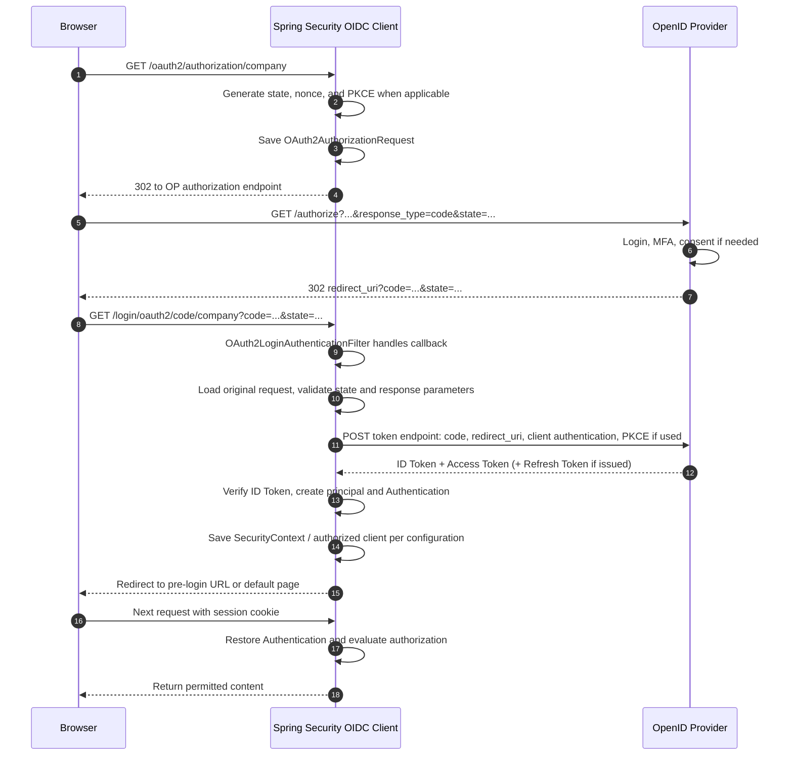

# 7.4. Callback Endpoint `/login/oauth2/code/{registrationId}`

In a Spring Boot application using **Spring Security OAuth 2.0 / OpenID Connect (OIDC) Client** on the Servlet stack, one of the most important URLs in the login flow is:

```text
/login/oauth2/code/{registrationId}
```

This is the **authorization response receiving point (redirection/callback endpoint)**. After the user is sent to the Authorization Server or OpenID Provider (OP) to log in, the browser returns to this endpoint along with an **authorization code** and a **state** value. Spring Security uses that result to complete the Authorization Code Flow, authenticate the user, and establish a login session for the application.

The callback endpoint is **not** the URL where users start logging in, not the OP's token endpoint, and not a business controller you need to write yourself. With the default `oauth2Login()` configuration, the request is received by **`OAuth2LoginAuthenticationFilter`** inside the Servlet Security Filter Chain.

This lesson covers the URL structure, step-by-step callback processing, the relationship between `registrationId` and the initial authorization request, how to customize the callback, a Spring Boot example, and common operational errors.

## 1. Locating the Callback in the OAuth2/OIDC Login Flow

Suppose a web application has the domain `https://orders.example.org` and logs in via a corporate OP. The client registration in Spring Security is named `company`.

| URL | Owning system | Role |
|---|---|---|
| `https://orders.example.org/orders` | Application | Business page requiring login. |
| `https://orders.example.org/oauth2/authorization/company` | Spring Security in the application | Entry point that **initiates** the OAuth2 Authorization Code Flow. |
| `https://login.example.org/.../authorize` | OpenID Provider | Authorization endpoint where the browser is sent to authenticate. |
| `https://orders.example.org/login/oauth2/code/company` | Spring Security in the application | **Callback endpoint** after the OP returns a code or error. |
| `https://login.example.org/.../token` | OpenID Provider | Token endpoint called directly by the backend to exchange the authorization code for tokens. |

When reading configuration or logs, distinguish three kinds of endpoints:

- **Authorization request entry point** (`/oauth2/authorization/company`): the client creates the request and starts the redirect.
- **Redirection endpoint / callback** (`/login/oauth2/code/company`): the client receives the response returned by the OP via the browser.
- **Token endpoint** at the OP: the client's backend exchanges the authorization code for tokens; not a URL for users to open directly.

In the OIDC Authorization Code Flow, **the ID Token and Access Token are received at the token endpoint**, rather than appearing as tokens in the callback URL. The callback primarily receives `code` and `state` or authorization response error parameters.

## 2. Meaning of `{registrationId}`

`{registrationId}` is a placeholder in Spring Security's URI template. It corresponds to the **client registration key in the application configuration**.

Example:

```yaml
spring:
  security:
    oauth2:
      client:
        registration:
          company:
            provider: company-oidc
            client-id: orders-web
            client-secret: ${OIDC_CLIENT_SECRET}
            authorization-grant-type: authorization_code
            redirect-uri: "{baseUrl}/login/oauth2/code/{registrationId}"
            scope:
              - openid
              - profile
              - email
        provider:
          company-oidc:
            issuer-uri: https://login.example.org/realms/company
```

In this example:

| Value | Meaning |
|---|---|
| `company` | Registration ID used by Spring Security to look up `ClientRegistration`. |
| `orders-web` | `client_id` issued by the OP to the application. |
| `company-oidc` | Alias name of the provider configuration in Spring Boot. |
| `https://login.example.org/realms/company` | OIDC issuer trusted by the client. |
| `/login/oauth2/code/company` | Callback path after substituting `{registrationId}`. |

**Registration ID does not have to match the client ID or provider name.** An application can have registrations `employee`, `partner`, or `github`, each with its own client and provider settings.

How the `{registrationId}` placeholder is substituted affects the URL sent in the `redirect_uri` parameter of the authorization request. However, callback validity **does not rely solely on the name appearing in the path**: Spring Security also uses the authorization request saved before redirecting, especially the `state` value and links to the registration/provider.

### 2.1. Template URL vs. actual URL

In configuration:

```yaml
redirect-uri: "{baseUrl}/login/oauth2/code/{registrationId}"
```

Assuming the application's public base URL is `https://orders.example.org`, the resulting URL is:

```text
https://orders.example.org/login/oauth2/code/company
```

This URI must be allowed by the OP in the client registration configuration. If the OP only allows `https://orders.example.org/login/oauth2/code/company` while Spring generates `http://localhost:8080/login/oauth2/code/company`, the OP may reject the request with `redirect_uri_mismatch` or an equivalent error.

`{baseUrl}` is computed from the request context and infrastructure configuration. When behind a reverse proxy, ingress, or load balancer, ensure Spring receives the correct public scheme/host/path through trusted proxy configuration.

## 3. Sequence Diagram of the Callback in Authorization Code Flow

To see exactly where the callback occurs, consider an OIDC flow for a login without an existing application session:



`code` and `state` pass through the browser because they form the authorization response. However, **token exchange** occurs directly between the backend and the OP. Users never need to see or manually enter an authorization code in a separate form.

A debugging note: the browser may already hold an application session cookie from the start of the flow. That session may contain an unfinished authorization request; it **does not mean** the user has successfully logged in.

## 4. What Does the Callback Request Look Like?

After authenticating the user and approving the request, the OP redirects the browser to the registered callback:

```http
HTTP/1.1 302 Found
Location: https://orders.example.org/login/oauth2/code/company?code=c_6s9...&state=s_2k4...
```

The browser follows the redirect and sends the request:

```http
GET /login/oauth2/code/company?code=c_6s9...&state=s_2k4... HTTP/1.1
Host: orders.example.org
Cookie: JSESSIONID=<session-id-if-present>
```

Meaning of each part:

| Part | Source | Purpose |
|---|---|---|
| `/login/oauth2/code/company` | Registered client callback URI | Path that the OAuth2 Login filter matches. |
| `code` | Issued by OP after successful authorization | Short-lived code for the backend to exchange for tokens. |
| `state` | Generated earlier by client; echoed unchanged by OP | Binds the callback to the saved authorization request. |
| Application session cookie | Sent by browser per cookie policy | Lets the client retrieve authorization request state when stored in HTTP session. |

In the **Authorization Code Flow**, a successful callback typically carries `code` and `state`. Each authorization code can only be used according to OP rules, typically once with a very short lifetime.

When the OP denies authorization or an error occurs, the callback may look like:

```http
GET /login/oauth2/code/company?error=access_denied&state=s_2k4... HTTP/1.1
Host: orders.example.org
```

Some OPs also include `error_description` or `error_uri`. Applications should treat these values as **untrusted external input**, never rendering them directly as unescaped HTML and never logging sensitive data.

Depending on profile/protocol and provider configuration, the authorization response may carry additional parameters, such as `iss` in issuer identification mechanisms. That does not alter the core principle: the callback must be bound to **the authorization request and issuer previously chosen by the client**; never trust an arbitrary provider just because a URL parameter names it.

## 5. Which Spring Security Component Receives the Callback URL?

In a **Servlet** application, the main filter for OAuth2 login callbacks is:

```text
org.springframework.security.oauth2.client.web.OAuth2LoginAuthenticationFilter
```

This filter sits in the **Spring Security Filter Chain** and is configured by `oauth2Login()`. Its corresponding default matching URL pattern is:

```text
/login/oauth2/code/*
```

With `registrationId=company`, the callback is `/login/oauth2/code/company`. In documentation and redirect URI configuration, it is usually written in template form as `/login/oauth2/code/{registrationId}`. In the filter's request matcher, the default expression is a wildcard path pattern matching callbacks.

Related components:

| Component | Job |
|---|---|
| `OAuth2AuthorizationRequestRedirectFilter` | When the browser hits `/oauth2/authorization/company`, creates the authorization request and redirects to the OP. |
| `OAuth2AuthorizationRequestResolver` | Builds the authorization request based on the registration and current request; customizable. |
| `AuthorizationRequestRepository<OAuth2AuthorizationRequest>` | Stores the authorization request so the callback can retrieve and match it. |
| `HttpSessionOAuth2AuthorizationRequestRepository` | Common default Servlet implementation storing the authorization request in the session. |
| **`OAuth2LoginAuthenticationFilter`** | Receives the callback, creates an internal authentication request, and triggers token exchange/OIDC authentication. |
| `OAuth2LoginAuthenticationProvider` | Handles OAuth2 login per protocol, including non-OIDC cases. |
| `OidcAuthorizationCodeAuthenticationProvider` | Handles OIDC Authorization Code authentication, verifies ID Token, and builds the OIDC result. |
| `OAuth2AuthorizedClientRepository` / `OAuth2AuthorizedClientService` | Saves authorized client info and tokens per configuration. |
| `SecurityContextRepository` | Saves/restores `SecurityContext` across HTTP requests, typically using the session for web apps. |
| Authentication success/failure handler | Decides navigation after login succeeds or fails. |

Internal classes and invocation order may vary across Spring Security versions and configured extension points, but the responsibilities of the **callback filter** and **saved authorization request** remain the backbone of the flow.

### 5.1. Why not create a `@GetMapping` controller for the callback?

With `oauth2Login()`, Spring Security actively intercepts the callback at the **filter** layer before the request reaches `DispatcherServlet` and controllers.

A controller like the following is not the default login implementation:

```java
// No need to create this endpoint yourself when using default oauth2Login()
@GetMapping("/login/oauth2/code/{registrationId}")
public String callback(@PathVariable String registrationId,
                       @RequestParam String code) {
    // Manually exchanging code and trusting token payload: easy to miss verification steps
    return "redirect:/";
}
```

If the filter is configured properly, the request is handled before that controller ever runs. If the filter fails to match the path, the controller **does not automatically provide protections** like `state` validation, client authentication at the token endpoint, issuer/ID Token verification, and session persistence.

The proper approach in Spring Security is to let the filter handle the callback and customize via supported APIs, such as `oauth2Login().redirectionEndpoint(...)`, `successHandler(...)`, `failureHandler(...)`, or an appropriate authorization request resolver/repository.

## 6. How Does Spring Security Process the Callback Step by Step?

### 6.1. First step: recognize an authorization response

When the callback matches the URL handled by `OAuth2LoginAuthenticationFilter`, the filter reads response parameters such as `code`, `state`, or `error`.

Inside Spring Security, objects such as `OAuth2AuthorizationResponse`, `OAuth2AuthorizationExchange`, and `OAuth2LoginAuthenticationToken` represent the protocol data and the authentication request to be verified. Application teams generally do not need to instantiate these objects for the default login flow.

If the callback receives `error` from the OP, login is not considered successful. The authentication mechanism produces a corresponding error path and delegates handling to the failure handler.

### 6.2. Restore the saved authorization request

Before redirecting the browser to the OP, the client created an `OAuth2AuthorizationRequest` with values such as:

- `client_id`, `redirect_uri`, scopes, and authorization endpoint.
- Random `state` used to bind the request to the response.
- `nonce` if the OIDC flow uses a nonce.
- PKCE data, especially `code_verifier` when PKCE is used.
- Information about the selected registration/provider.

In default Servlet login, `HttpSessionOAuth2AuthorizationRequestRepository` uses the HTTP session to store this request. When the callback returns, Spring Security must retrieve that exact authorization request; depending on processing, the request may be **loaded and removed from the store** to prevent reuse.

If the session cookie is lost between the two redirects, the authorization request may no longer be accessible. Login then fails even though the user just authenticated successfully at the OP.

### 6.3. Verify `state` and match the authorization response

`state` is generated when initiating the authorization request, sent to the OP, and returned by the OP in the callback. The client compares the returned value against the stored request.

The goal is to reject callbacks that do not belong to a request initiated by this browser/client, reducing the risk of **login CSRF, authorization response substitution, or session mix-up**.

A callback carrying a well-formed `code` whose `state` is wrong, missing, or unmatched against a saved request **must not be treated as valid**. Do not troubleshoot failures by removing `state` validation or accepting codes manually in a controller.

**`state` vs. `nonce` and PKCE:**

| Mechanism | Where is it checked? | What does it protect? |
|---|---|---|
| `state` | When processing the callback and matching the initial request. | Correspondence between authorization request and response. |
| `nonce` | When the client verifies the OIDC ID Token, if a nonce was requested. | Binds the ID Token to the specific OIDC request. |
| PKCE | OP verifies `code_verifier` when the backend exchanges the authorization code. | Prevents an attacker who intercepts a code from exchanging it without the verifier. |

The three mechanisms complement each other; none completely replaces the other two.

### 6.4. Call the token endpoint using the matching registration/provider

When the authorization response is valid, the backend sends the authorization code to the token endpoint of the provider selected in the initial request.

Example token request structure (path and client authentication method depend on the OP):

```http
POST /protocol/openid-connect/token HTTP/1.1
Host: login.example.org
Content-Type: application/x-www-form-urlencoded
Authorization: Basic <encoded-client-credentials>

grant_type=authorization_code&
code=<authorization-code-from-callback>&
redirect_uri=https%3A%2F%2Forders.example.org%2Flogin%2Foauth2%2Fcode%2Fcompany&
code_verifier=<original-verifier-if-using-PKCE>
```

Key fields:

- **`code`:** the code just received by the callback, usable only under OP conditions.
- **`redirect_uri`:** must match the redirect URI bound to the authorization request/code.
- **Client authentication:** `client_secret_basic`, `client_secret_post`, or another method allowed by the registration/provider. Public clients cannot protect a secret embedded in the frontend.
- **`code_verifier`:** if the authorization request used PKCE, the backend sends the verifier generated before the redirect.

The OP verifies that the code is valid, unused, and matches the client, redirect URI, and PKCE if applicable. If verification fails, the OP may return `invalid_grant`, `invalid_client`, or another OAuth2 error. In that case **login has not succeeded**, even though the callback reached the right path.

### 6.5. Process the token response and OIDC principal

For an authorization request with scope `openid` and an OP supporting OIDC, the token response typically contains:

```json
{
  "access_token": "<opaque-or-jwt-access-token>",
  "token_type": "Bearer",
  "expires_in": 300,
  "id_token": "<signed-oidc-id-token>",
  "scope": "openid profile email"
}
```

A `refresh_token` may or may not be issued, depending on OP policy, client type, and grant. Never assume a refresh token is always present.

Spring Security verifies the ID Token against trusted client/provider metadata, including constraints such as:

| Claim / check | Meaning |
|---|---|
| Signature and key | ID Token must validate against an accepted OP key/algorithm. |
| `iss` | Issuer must match the configured OP. |
| `aud` | Token must be issued for the matching `client_id`; `azp` is checked when required by OIDC. |
| `exp`, `iat` | Token timing constraints must be valid. |
| `nonce` | Matches the authorization request nonce when the client sent one. |

When all required checks pass, Spring Security builds a principal, typically `OidcUser` for OIDC login, and an authenticated `Authentication`. If the UserInfo endpoint is called, its result must share the same `sub` as the ID Token per the OIDC spec.

Note that **Access Tokens must not be used instead of ID Tokens to establish OIDC identity**. The client may hold the Access Token to call other APIs; each API is responsible for validating tokens and permissions intended for it.

### 6.6. Save authorized client, establish session, and redirect after login

After successful authentication, Spring Security can store `OAuth2AuthorizedClient` — details linking the client registration and issued tokens — via the appropriate repository/service. This is separate from storing the logged-in user in `SecurityContext`.

A successful login flow also performs:

1. `Authentication` is placed into `SecurityContext`.
2. The security context is saved by the configured `SecurityContextRepository`, typically tied to the HTTP session in traditional web apps.
3. Session management may rotate the session ID to defend against session fixation.
4. The authentication success handler chooses the post-login URL, typically the previously requested page via request cache, or a default page.
5. The browser sends the session cookie on subsequent requests; the application restores `Authentication` and evaluates access rules.

Thus, **receiving the callback is distinct from establishing a session**. The callback is only the start of backend verification. A session is considered logged in only after Spring Security finishes authentication and persists the resulting state.

## 7. Complete Spring Boot Configuration Example

### 7.1. Required dependencies

Example using Gradle in a Spring Boot Servlet project:

```gradle
dependencies {
    implementation("org.springframework.boot:spring-boot-starter-web")
    implementation("org.springframework.boot:spring-boot-starter-security")
    implementation("org.springframework.boot:spring-boot-starter-oauth2-client")
}
```

The OAuth2 Client starter provides the integration required for an OAuth2/OIDC Client. You do not need `spring-boot-starter-oauth2-resource-server` if the application currently only handles web login and does not accept bearer tokens on its own APIs.

### 7.2. Declaring client registration and callback

```yaml
spring:
  security:
    oauth2:
      client:
        registration:
          company:
            provider: company-oidc
            client-id: ${OIDC_CLIENT_ID}
            client-secret: ${OIDC_CLIENT_SECRET}
            authorization-grant-type: authorization_code
            client-authentication-method: client_secret_basic
            redirect-uri: "{baseUrl}/login/oauth2/code/{registrationId}"
            scope:
              - openid
              - profile
              - email
        provider:
          company-oidc:
            issuer-uri: https://login.example.org/realms/company
```

Assuming the application's public URL is `https://orders.example.org`, register the following callback with the OP:

```text
https://orders.example.org/login/oauth2/code/company
```

The `OIDC_CLIENT_ID` and `OIDC_CLIENT_SECRET` variables are loaded from environment config or a secret manager; never hardcode secrets in source code. The issuer must be the actual value published by the OP, which varies by provider.

### 7.3. Enabling `oauth2Login()` in the Servlet Security Filter Chain

```java
import org.springframework.context.annotation.Bean;
import org.springframework.context.annotation.Configuration;
import org.springframework.security.config.Customizer;
import org.springframework.security.config.annotation.web.builders.HttpSecurity;
import org.springframework.security.web.SecurityFilterChain;

@Configuration
public class SecurityConfiguration {

    @Bean
    SecurityFilterChain webFilterChain(HttpSecurity http) throws Exception {
        http
            .authorizeHttpRequests(auth -> auth
                .requestMatchers("/", "/public/**", "/assets/**").permitAll()
                .anyRequest().authenticated()
            )
            .oauth2Login(Customizer.withDefaults());

        return http.build();
    }
}
```

With default configuration, Spring Security registers the callback-handling filter. You can place a login link in your UI page like this:

```html
<a href="/oauth2/authorization/company">
  Sign in with company account
</a>
```

When the user clicks this link, the flow begins at `/oauth2/authorization/company`. After logging in at the OP, the browser returns to `/login/oauth2/code/company` and the filter handles the callback.

There is no need to create a `@Controller` or `@RestController` on the callback path.

### 7.4. Controller reading identity after login

Once the callback succeeds and the session is created, business endpoints can read the principal:

```java
import java.util.Map;

import org.springframework.security.core.annotation.AuthenticationPrincipal;
import org.springframework.security.oauth2.core.oidc.user.OidcUser;
import org.springframework.web.bind.annotation.GetMapping;
import org.springframework.web.bind.annotation.RestController;

@RestController
public class CurrentUserController {

    @GetMapping("/me")
    public Map<String, String> currentUser(
            @AuthenticationPrincipal OidcUser user) {
        return Map.of(
            "issuer", user.getIdToken().getIssuer().toString(),
            "subject", user.getSubject()
        );
    }
}
```

`/me` is a **post-login** business endpoint, not the OP callback. On this request Spring Security has already restored `SecurityContext` from the application session. The `(issuer, subject)` pair is generally appropriate for looking up an internal profile; avoid using email as a sole immutable identifier.

## 8. Properly Customizing the Callback URL

You do not have to keep `/login/oauth2/code/{registrationId}` if the application has a valid reason to use another path, for example:

```text
/auth/callback/company
```

However, you must update these **in sync**:

1. The client registration's URI template, so Spring sends the right `redirect_uri` to the OP.
2. **`OAuth2LoginAuthenticationFilter`**'s request matcher via `redirectionEndpoint().baseUri(...)`.
3. The allowed redirect URI list at the OP.
4. Proxy, gateway, and Security Filter Chain rules so callback requests reach the right application/filter.

### 8.1. Example configuration

In `application.yml`:

```yaml
spring:
  security:
    oauth2:
      client:
        registration:
          company:
            provider: company-oidc
            client-id: ${OIDC_CLIENT_ID}
            client-secret: ${OIDC_CLIENT_SECRET}
            authorization-grant-type: authorization_code
            redirect-uri: "{baseUrl}/auth/callback/{registrationId}"
            scope: [openid, profile, email]
        provider:
          company-oidc:
            issuer-uri: https://login.example.org/realms/company
```

In Spring Security configuration:

```java
import org.springframework.context.annotation.Bean;
import org.springframework.context.annotation.Configuration;
import org.springframework.security.config.annotation.web.builders.HttpSecurity;
import org.springframework.security.web.SecurityFilterChain;

@Configuration
public class SecurityConfiguration {

    @Bean
    SecurityFilterChain webFilterChain(HttpSecurity http) throws Exception {
        http
            .authorizeHttpRequests(auth -> auth
                .requestMatchers("/", "/public/**").permitAll()
                .anyRequest().authenticated()
            )
            .oauth2Login(oauth2 -> oauth2
                .redirectionEndpoint(redirection ->
                    redirection.baseUri("/auth/callback/*")
                )
            );

        return http.build();
    }
}
```

Finally, for registration `company`, register the following URL at the OP:

```text
https://orders.example.org/auth/callback/company
```

Note the syntax difference:

- `"{baseUrl}/auth/callback/{registrationId}"` is a **URI template** used to construct the `redirect_uri` value.
- `"/auth/callback/*"` is a **path pattern** used by the OAuth2 Login filter to match callbacks.

If you only change `redirect-uri` without changing `redirectionEndpoint().baseUri(...)`, the OP will redirect to the new path while the filter still listens on the old path. If you only change the filter while the OP still expects the old callback, the OP may reject the authorization request upfront.

### 8.2. Can a fixed URL without a registration ID be used?

Callback matching and how authorization requests are saved/looked up can be customized, but when multiple registrations exist, take extra care so callbacks are accurately bound to the initial authorization request and provider. The default `/login/oauth2/code/{registrationId}` keeps registration identification clear in the URL and straightforward to configure.

Whether the URL is fixed or includes a registration ID, **the path itself is not authentication proof**; `state` and the saved authorization request are what bind the response. Never guess a registration from a browser-supplied parameter and send an authorization code to an arbitrary token endpoint.

### 8.3. Using multiple Security Filter Chains

An application may have a separate chain for APIs (`/api/**`) and a chain for web login. In that setup, the callback must be handled by the chain configured with `oauth2Login()`.

If `/login/oauth2/code/company` is skipped by a chain with an overly narrow `securityMatcher` or intercepted earlier by another chain, the OAuth2 login filter may never run. Symptoms include 404, 401, infinite redirects, or requests falling through to a controller instead of logging in.

Because Spring Security chooses a Security Filter Chain by matcher and order, always verify the matcher scope of the chain containing `oauth2Login()` when customizing callback paths. Never work around this by blindly permitting all callbacks from any source; requests must be processed and state-verified by the OAuth2 filter.

## 9. Callbacks Behind a Reverse Proxy, Gateway, and Multiple Instances

The callback path is a URL that **browsers on the Internet/intranet** must be able to reach. Real deployments typically sit behind a gateway:

```text
Browser:
https://orders.example.org/login/oauth2/code/company

Reverse proxy:
https://orders.example.org -> http://orders-app:8080

Spring Boot:
http://orders-app:8080/login/oauth2/code/company
```

Configuration points to align:

- **Public scheme, host, port, and path:** Spring must generate the right `{baseUrl}`, including any context path or path prefix in use.
- **Forwarded headers:** accept `Forwarded`/`X-Forwarded-*` only from a trusted proxy; never trust spoofed headers from external users.
- **Cookies:** the session cookie must have domain, path, `Secure`, `HttpOnly`, and `SameSite` attributes compatible with the actual redirect flow.
- **Session storage:** if multiple instances serve initiation and callback requests, the session holding the authorization request must be accessible on the instance receiving the callback, via shared session storage or designed routing.
- **TLS:** public callbacks must use HTTPS in real environments, aside from explicit development exceptions permitted by the provider.

Common failure example: the first request hits instance A, where the authorization request is stored in A's in-memory session; the callback hits instance B, which lacks that session. `state` is not found or does not match. This does not mean the OP issued a bad code; the issue lies in client session storage or routing.

Another variant is the browser withholding the cookie because `SameSite` or cookie path does not match. Standard OIDC GET redirects generally work with `SameSite=Lax`, though specialized response modes or cookie policies must be evaluated against actual browsers and infrastructure.

## 10. Callbacks, CSRF, and Security Boundaries

### 10.1. `state` protects against forged authorization responses

Authorization callbacks typically use GET, so CSRF middleware for business forms does not necessarily require a CSRF token on the callback itself. Instead, OIDC/OAuth2 flows use `state` and corresponding binding checks to protect the callback.

Do not confuse this with **disabling CSRF protection entirely** for the web app. For business endpoints relying on session cookies, CSRF protection still needs separate consideration. `state` only protects the authorization request/response; it does not replace CSRF tokens for payments, profile updates, or data deletions.

### 10.2. An authorization code is sensitive even when short-lived

In standard flows, the authorization code appears as a query parameter on the callback URL. Therefore:

- Use HTTPS both between browser and application and between backend and OP.
- Avoid logging full callback URLs (containing `code` and `state`) into application logs, publicly shared access logs, analytics, or unprotected traces.
- Prevent code leakage via `Referer` or open redirects; configure an appropriate referrer policy and navigation flow.
- Never display codes, ID Tokens, or Access Tokens in error messages.
- Protect tokens, `client_secret`, and PKCE `code_verifier` on the backend.

Even if an intercepted code cannot be exchanged thanks to client authentication and PKCE when properly deployed, that is no reason to treat the code as non-sensitive.

### 10.3. The callback does not grant business authorization

Even when OIDC authentication succeeds, the application must still enforce `authenticated()`, roles, scopes, and specific permissions at the right layer. A user can log in successfully yet receive 403 when accessing `/admin` or an order they do not own.

If the application calls separate APIs with an Access Token, each Resource Server must validate tokens intended for it. A successful OIDC Client login does not let another API skip bearer token verification.

### 10.4. Do not trust query parameters to determine the issuer

An application supporting multiple providers must bind the callback to the registration/issuer chosen when starting the flow. Never take an `issuer`, `token_uri`, or registration name from browser query parameters and treat it as a trusted provider. Defending against **mix-up attacks** and cross-provider response confusion requires using the saved registration, verifying issuer/ID Token, and applying additional profile-specific mechanisms as appropriate.

## 11. Handling Success and Failure After the Callback

### 11.1. Success: returning to the page requested before login

In typical web applications, Spring Security can store the original request using `RequestCache`. For example, a user opens `/orders/123`, gets redirected to login, completes the callback, and returns to `/orders/123`.

If you want to specify a default destination page, you can configure `defaultSuccessUrl`:

```java
import org.springframework.context.annotation.Bean;
import org.springframework.context.annotation.Configuration;
import org.springframework.security.config.annotation.web.builders.HttpSecurity;
import org.springframework.security.web.SecurityFilterChain;

@Configuration
public class LoginSuccessConfiguration {

    @Bean
    SecurityFilterChain securityFilterChain(HttpSecurity http) throws Exception {
        http
            .authorizeHttpRequests(auth -> auth
                .requestMatchers("/", "/public/**").permitAll()
                .anyRequest().authenticated()
            )
            .oauth2Login(oauth2 -> oauth2
                .defaultSuccessUrl("/dashboard", false)
            );

        return http.build();
    }
}
```

With `false`, a saved request can take precedence; `/dashboard` serves as the fallback destination if no suitable saved request exists. When changed to `true`, the default destination always takes precedence after login per the corresponding handler config.

**A success URL is not a callback URI.** The callback processes code/state first; the success handler only navigates **after authentication succeeds**. Never configure a success URL as `redirect_uri` at the OP.

### 11.2. Failure: redirecting to a login error page

When the callback contains `error` or token exchange/validation fails, Spring Security invokes the configured failure handler. You can specify an error page:

```java
.oauth2Login(oauth2 -> oauth2
    .failureUrl("/login?oauth2Error")
)
```

Place this inside your existing `HttpSecurity` configuration. If using a custom login page, ensure the error URL is accessible without authentication; otherwise you risk creating a redirect loop.

Never put raw authorization codes, tokens, sensitive exceptions, or secrets in redirect URLs. Fields like `error_description` sent by the provider must be sanitized before display.

### 11.3. Failed login must not create an authenticated session

A browser having a cookie/session used during the flow **does not mean** it is authenticated. When the callback fails, the application must never produce a successful `Authentication` merely because it received a code or because the OP displayed a "login succeeded" screen.

Spring Security considers login complete only after valid protocol results and successful authentication provider verification.

## 12. Typical Errors of the Callback Endpoint

| Symptom | Where to look | Explanation |
|---|---|---|
| OP reports `redirect_uri_mismatch` before returning to the app. | `registration.<id>.redirect-uri`, public base URL, and allowed redirect URIs at the OP. | The URI sent by the client is not on the allowlist. |
| Callback returns **404**. | `oauth2Login()`, callback matcher path, context path, filter chain, and proxy rewrites. | The request may not be reaching the right `OAuth2LoginAuthenticationFilter`. |
| Callback returns **401** or is blocked by another chain. | Order and `securityMatcher` of `SecurityFilterChain` beans. | The callback is being handled by a chain without OAuth2 Login configured. |
| `authorization_request_not_found` or invalid `state` error. | `AuthorizationRequestRepository`, session cookie, shared session, domain/path changes. | Could not restore the authorization request saved before the redirect. |
| `invalid_grant` at the token endpoint. | Expired/reused code, redirect URI, PKCE verifier, and client config. | OP rejected code exchange; not an `/orders` controller bug. |
| `invalid_client` error. | `client-id`, secret, client authentication method at the token endpoint. | OP rejected client authentication. |
| ID Token verification error. | Issuer, audience, signing keys, timestamps, nonce, and OP metadata. | Token failed OIDC validation checks. |
| Redirected to login repeatedly after successful callback. | Session cookie, `SecurityContextRepository`, session storage, and redirect URLs. | Authentication state was not saved or not restored on subsequent requests. |
| Login succeeds, but accessing pages returns **403**. | Authorities, role mapping, and business authorization policy. | Callback completed; user lacks permission for the resource. |
| Custom callback path does not work. | Both `redirect-uri` and `redirectionEndpoint().baseUri(...)`, plus OP configuration. | One or more places still use the old path. |
| Works on one instance, fails intermittently when scaled. | HTTP session/authorization request storage and load balancing. | Initiation and callback may hit different instances that do not share state. |

### 12.1. Common case: provider returns to the right callback, yet the code is still rejected

Some developers see the browser call:

```text
/login/oauth2/code/company?code=...&state=...
```

and assume the OIDC flow must succeed. In reality, the backend still needs to:

1. Locate the saved authorization request and verify `state`.
2. Exchange the authorization code at the token endpoint.
3. Pass client authentication and PKCE checks (if used) at the OP.
4. Verify the ID Token and satisfy OIDC conditions.
5. Save authentication and session state.

Failure at any of these steps causes login to fail, even though the callback URL returned an HTTP call properly.

### 12.2. Common case: renaming a registration and forgetting the callback

If you rename `registration.company` to `registration.staff` while still using the template:

```yaml
redirect-uri: "{baseUrl}/login/oauth2/code/{registrationId}"
```

then the actual callback changes from `/login/oauth2/code/company` to `/login/oauth2/code/staff`. The OP must allow the new callback for that client registration. Login links and registration ID references in code must also be updated consistently.

### 12.3. Common case: adding a callback controller while the filter does not run

When adding a `@GetMapping("/login/oauth2/code/company")` controller to print the `code` parameter, a developer may mistakenly believe the controller is responsible for OIDC login. If the filter matches the callback, the controller never plays a role; if the controller receives the request, investigate why the filter did not match or why the wrong chain ran.

The goal is to **restore Spring Security's callback handling**, not copy token exchange logic into a business controller.

### 12.4. Common case: cookies lost on the return redirect

If `state` is stored in `HttpSessionOAuth2AuthorizationRequestRepository`, the browser must send back the matching session cookie to the callback. The session can be lost because:

- Cookie domain/path does not match the callback URL.
- `Secure`/`SameSite` policy and callback method are incompatible.
- A reverse proxy rewrites host, path, or scheme incorrectly.
- The session times out while the user completes authentication/MFA.
- Instances cannot access the same HTTP session.
- The user starts concurrent login flows and the storage mechanism does not handle that pattern appropriately.

The fix is to address session storage and cookies properly, never to disable `state`.

## 13. Observing the Flow in Development

When diagnosing callbacks, observe the **sequence of events** using non-sensitive values:

1. Browser starts at `/oauth2/authorization/company` and the app builds the authorization request.
2. Redirects to the right provider's authorization endpoint with a valid public URI.
3. OP authenticates the user and redirects to `/login/oauth2/code/company`.
4. The OAuth2 Login filter in the right Security Filter Chain receives the callback and retrieves the authorization request from the repository.
5. Backend calls the token endpoint; observe status codes and error codes on failure, **never logging codes/credentials/tokens**.
6. Spring Security verifies the OIDC result, creates the principal, and builds `Authentication`.
7. Security context and session are saved; the success handler redirects to the next URL.
8. Browser sends the session cookie on the next request; Spring Security restores authentication and applies authorization.

For configuration checks:

- Verify the registration ID used by `/oauth2/authorization/...` links.
- Verify `redirect-uri` after placeholder substitution, including scheme/host/port/path.
- Verify the OP allows that exact callback URI.
- Verify the callback matcher and Security Filter Chain receive the request.
- Verify the session repository/cookie remains valid across the redirect.

You can raise Spring Security's log level in development as needed, bearing in mind HTTP-level logs risk capturing full callback URLs and tokens. Never let public access logs or traces retain raw authorization codes, `state`, tokens, or session cookies.

## 14. Key Points to Remember When Designing Callbacks

The `/login/oauth2/code/{registrationId}` endpoint acts as a **bridge between the OP's authorization response and user authentication inside Spring Security**.

- **The OP returns the browser to the callback with code/state**, rather than directly granting business permissions in the app.
- **`OAuth2LoginAuthenticationFilter`** is the default Servlet component receiving callbacks when using `oauth2Login()`.
- **Saved authorization requests and `state`** are essential constraints for accepting a callback; never trust a code just because the URL matches.
- **The backend exchanges the code for tokens** at the token endpoint under the client registration's rules and PKCE if used.
- **The ID Token is verified** before constructing the OIDC principal and `Authentication`; the Access Token is for calling authorized resources.
- **Security context and application session** are established after authentication succeeds; the success URL is a post-callback navigation step.
- **Changing the callback path must stay synchronized** across `redirect-uri`, the OAuth2 Login filter matcher, and allowed URIs at the OP.

### References

- [Spring Security Reference — OAuth 2.0 Login (Servlet)](https://docs.spring.io/spring-security/reference/servlet/oauth2/login/index.html)
- [Spring Security Reference — OAuth 2.0 Client](https://docs.spring.io/spring-security/reference/servlet/oauth2/client/index.html)
- [Spring Security API — OAuth2LoginAuthenticationFilter](https://docs.spring.io/spring-security/site/docs/current/api/org/springframework/security/oauth2/client/web/OAuth2LoginAuthenticationFilter.html)
- [OpenID Connect Core 1.0 — Authorization Code Flow](https://openid.net/specs/openid-connect-core-1_0.html#CodeFlowAuth)
- [OAuth 2.0, RFC 6749 — Authorization Code Grant](https://www.rfc-editor.org/rfc/rfc6749#section-4.1)
- [PKCE, RFC 7636](https://www.rfc-editor.org/rfc/rfc7636)

Once you understand the callback endpoint, you can let Spring Security handle the protocol mechanics and focus on client/provider configuration and your application's authorization rules. Callback failures also become much easier to isolate: **URL not reaching the filter**, **authorization request/`state` mismatch**, **token exchange rejected**, **invalid OIDC token**, or **session not saved and restored after login**.
