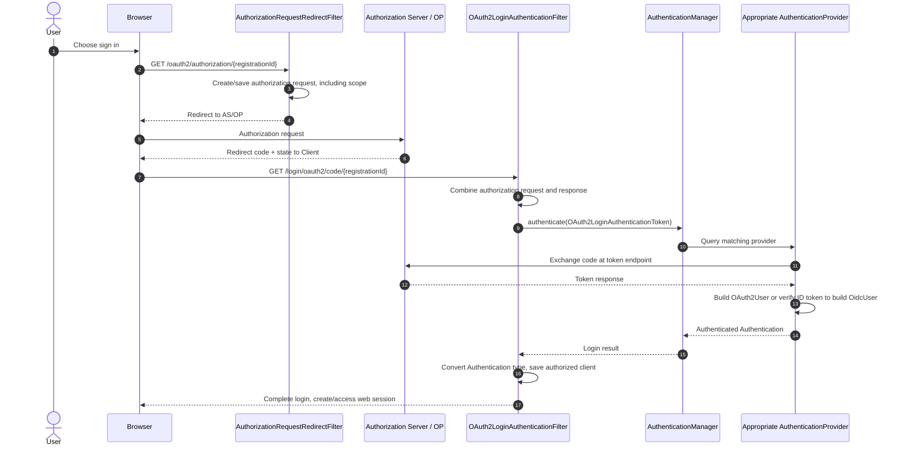

# 7.6. Choosing Between OAuth2LoginAuthenticationProvider and OidcAuthorizationCodeAuthenticationProvider

> **Module:** Spring Security OAuth 2.0 OIDC Client  
> **Chapter:** 7. Servlet Login  
> **Focus:** How Spring Security decides between OAuth 2.0 and OpenID Connect (OIDC) login processing branches, what each AuthenticationProvider does, and why the `openid` scope is the key signal.

In a Spring MVC/Servlet application, a user may log in through an OAuth 2.0 provider that only offers a profile API, or through an OpenID Provider supporting OIDC. Both typically start by redirecting to the Authorization Server and returning to the application with an **Authorization Code**, yet how user identity is established differs.

Spring Security includes two notable components:

- `OAuth2LoginAuthenticationProvider`: handles standard OAuth 2.0 login, receives an access token, and uses `OAuth2UserService` to fetch user information per the provider's contract.
- `OidcAuthorizationCodeAuthenticationProvider`: handles **OIDC Authorization Code login**, requires and validates an ID token, and uses `OidcUserService` to build an OIDC-semantic principal.

Developers generally **do not pick one of the two providers with manual if/else statements**. When `oauth2Login()` is configured, Spring Security prepares the necessary authentication providers. At callback time, whether a provider handles the request depends on the authorization request context, especially the **`openid` scope**. That is the focus of this lesson.

## 1. Learning Objectives

After this lesson, you will be able to:

1. Place both AuthenticationProviders accurately within Spring Security's Servlet login flow.
2. Distinguish `OAuth2LoginAuthenticationToken`, `OAuth2AuthenticationToken`, `OAuth2User`, and `OidcUser`.
3. Explain how `AuthenticationManager`/`ProviderManager` queries each provider, and the meaning of `supports()` and `authenticate()` returning `null`.
4. Identify why the **`openid` scope in the authorization request** routes to the OIDC provider, whereas an OAuth 2.0 request without that scope goes through the standard provider.
5. Describe how each branch exchanges tokens, loads user data, verifies authentication details, and builds a principal.
6. Configure an application with both an OIDC registration and a provider-based OAuth 2.0 registration.
7. Observe which branch ran via the principal and registration ID without logging raw tokens or cookies.
8. Isolate errors such as missing `id_token`, wrong issuer, missing UserInfo endpoint, wrong scope, or confusing a web application with a Resource Server.

## 2. Scope: OAuth2 Login in Servlet

The classes in the title belong to **Spring Security OAuth 2.0 Client** for Servlet applications. They serve users logging into a **web application**. Do not confuse them with:

| Component | Responsibility |
|---|---|
| `OAuth2LoginAuthenticationProvider` | Processes an Authorization Code to log a user in via OAuth 2.0 Login, typically via the provider's UserInfo API |
| `OidcAuthorizationCodeAuthenticationProvider` | Processes OIDC Authorization Code login and verifies the ID token |
| `OAuth2AuthorizationCodeAuthenticationProvider` | Lower-level component performing authorization code authentication/exchange in the standard OAuth2 branch; not the same as the OIDC provider in the title |
| `OAuth2LoginAuthenticationFilter` | Receives the Servlet login callback and calls `AuthenticationManager` |
| `OAuth2AuthorizationRequestRedirectFilter` | Initiates the authorization request and redirects the browser to the Authorization Server |
| `OAuth2AuthorizedClientManager` | Helps manage an authorized client when calling protected resources; does not by itself turn a request into a web login |
| `BearerTokenAuthenticationFilter` and Resource Server providers | Handle bearer tokens on incoming **API** requests; not browser OIDC login callbacks |

Both OAuth2 and OIDC use components in the Client model, yet **OIDC adds an identity authentication and ID token layer** atop OAuth 2.0. Therefore, Spring Security needs two different ways to construct the principal.

Code examples follow the configuration style familiar from **Spring Boot 3.x / Spring Security 6.x with Spring MVC**. APIs and some defaults may evolve in other Spring Security branches; always cross-check the reference documentation and Javadoc matching your project version.

## 3. From Browser to AuthenticationProvider

When a user visits a protected page and chooses to sign in with a registration, the flow typically consists of three phases.

### 3.1. Phase A — Building the authorization request

1. The browser requests `/oauth2/authorization/{registrationId}`, e.g., `/oauth2/authorization/corp`.
2. `OAuth2AuthorizationRequestRedirectFilter` uses the `ClientRegistration` config to create an authorization request.
3. The authorization request contains parameters such as `client_id`, `redirect_uri`, `scope`, `state`, and additional protective parameters when applicable, such as PKCE or an OIDC nonce.
4. The browser is redirected to the Authorization Server / OpenID Provider.
5. Spring Security saves the authorization request context for correlation at callback, per the configured repository.

Key point to remember: **the requested scopes** are already determined in this phase, before the Client receives any tokens.

### 3.2. Phase B — Receiving the callback

After the user authenticates/consents at the provider, the browser returns to the default callback:

```text
/login/oauth2/code/{registrationId}?code=...&state=...
```

`OAuth2LoginAuthenticationFilter` intercepts the matching callback, retrieves the original authorization request, and combines it with the authorization response and `ClientRegistration` to create an unauthenticated `OAuth2LoginAuthenticationToken`.

The filter invokes `AuthenticationManager.authenticate(...)`. Here, the AuthenticationProviders configured for OAuth2 Login begin their work.

### 3.3. Phase C — Authenticating and finalizing the session

The matching provider exchanges the authorization code at the token endpoint, processes the result, builds an `OAuth2User` or `OidcUser`, and returns an authenticated result. The filter can convert the internal result into an `OAuth2AuthenticationToken` for login state and save `OAuth2AuthorizedClient` per configuration.

Thus **the token carried in the callback is not a JWT access token or ID token**: the callback carries an authorization code; token exchange and validation happen next inside Client processing.

### 3.4. Overview diagram



The diagram groups some internal steps for ease of learning. `state` verification, code exchange, security context persistence, and error handling still depend on specific versions and configurations; do not reimplement these steps manually when using Spring Security.

## 4. Selection Mechanism: Two Providers, One Request Type

A common source of confusion is the class names leading readers to expect OIDC uses a completely different input `Authentication` type. In Servlet OAuth2 Login, **both providers can accept `OAuth2LoginAuthenticationToken`**.

`AuthenticationProvider` has two key methods:

- `supports(Class<?> authentication)` indicates whether the provider **is capable of** handling this Authentication class.
- `authenticate(Authentication authentication)` decides whether to actually process the request's contents. It may return an authenticated Authentication, return `null` to let another provider try, or throw `AuthenticationException` if authentication fails.

`ProviderManager` queries configured providers in order. `supports()` returning `true` does not guarantee a provider will handle every request of that class.

### 4.1. Branching rule based on the openid scope

Core logic, simplified from the two provider classes:

```java
// Conceptual illustration only, not application API to copy.
boolean isOidcRequest = authorizationRequest.getScopes().contains("openid");

if (isOidcRequest) {
    // OAuth2LoginAuthenticationProvider declines this branch (returns null);
    // OidcAuthorizationCodeAuthenticationProvider handles OIDC login.
} else {
    // OidcAuthorizationCodeAuthenticationProvider returns null;
    // OAuth2LoginAuthenticationProvider handles OAuth2 login.
}
```

This is a **mental model**, not an if/else config you add to `SecurityFilterChain`.

| Scope on saved authorization request | Handling provider | Resulting principal |
|---|---|---|
| Contains `openid` | `OidcAuthorizationCodeAuthenticationProvider` | `OidcUser` |
| Does not contain `openid` | `OAuth2LoginAuthenticationProvider` | `OAuth2User` |
| Contains `openid`, but token response lacks ID token | OIDC provider attempts handling and throws an error | No valid login principal |
| Contains `openid`, but required JOSE/JWT components are missing | OIDC mechanism may be misconfigured | Must not silently fall back to standard OAuth2 login |

In Spring Security versions implementing this logic, the OAuth2 provider typically inspects the **original authorization request's scopes**, sees `openid`, and returns `null` to defer to the OIDC provider. The OIDC provider does the opposite: if `openid` is absent, it returns `null` to defer to the OAuth2 provider.

**Consequence:** selection is not based simply on provider name (e.g., `google` vs. `corp`), login UI, `registrationId`, or whether the access token is a JWT. The key branching signal is **whether the OIDC authentication request was initiated with `openid`**.

### 4.2. When a provider returns null, does login fail?

Not yet. `null` can simply mean **"this provider does not handle this request; try the next provider"**. For instance, an OIDC request containing `openid` intentionally causes `OAuth2LoginAuthenticationProvider` to return `null`.

Conversely, when the OIDC provider accepts a request and the token response lacks an ID token, has an invalid signature, or has a mismatched nonce, it throws an authentication exception. That is a **genuine failure**, not a signal to safely downgrade to standard OAuth2 login. An application must never write logic saying "if OIDC fails, skip ID token verification and log in using the access token".

### 4.3. Can a provider be chosen based on the returned access token?

No. An OAuth 2.0 access token may be a JWT, but **a JWT access token does not turn OAuth2 Login into OIDC Login**. OIDC requires a dedicated ID token issued in an OIDC authentication flow and verified under OIDC rules.

Reasoning "the returned token contains dots so pick the OIDC provider" is both semantically wrong and risks confusing token audiences.

## 5. OAuth2LoginAuthenticationProvider: The OAuth 2.0 Login Branch

### 5.1. Responsibilities

`OAuth2LoginAuthenticationProvider` is an `AuthenticationProvider` implementation used in OAuth 2.0 Login with the Authorization Code Grant. In the standard branch it:

1. Confirms the request does not contain the `openid` scope; if it does, returns `null` for the OIDC branch.
2. Uses the authorization code exchange mechanism with the token endpoint; related components include `OAuth2AuthorizationCodeAuthenticationProvider` and `OAuth2AccessTokenResponseClient`.
3. Receives the access token from the token response.
4. Builds an `OAuth2UserRequest` containing the `ClientRegistration`, access token, and related parameters.
5. Calls `OAuth2UserService<OAuth2UserRequest, OAuth2User>` to retrieve user attributes from the UserInfo/profile endpoint or provider-supported mechanism.
6. Builds an authenticated `OAuth2LoginAuthenticationToken` with the `OAuth2User` and appropriate authorities.

In common configurations, the user service is `DefaultOAuth2UserService`. It uses the access token to call the UserInfo endpoint and read user attributes per the provider's contract.

### 5.2. Where does identity come from in the standard OAuth2 branch?

OAuth 2.0 itself focuses on **delegated resource access**. To turn it into a "login" experience, the application and provider need an agreement on the user's profile data. A provider may expose an API returning `id`, `login`, `name`, or other fields.

Example illustrative response from a profile endpoint:

```json
{
  "id": 24017,
  "login": "demo-user",
  "display_name": "Demo User"
}
```

Setting `user-name-attribute` instructs Spring Security to use the `id` field as the principal name. However, **this is a provider-specific convention**, not an OIDC ID token with issuer/audience verified under the same mechanism.

When a lesson involves only an OAuth 2.0 provider, clearly explain that the login flow relies on the provider's profile contract; do not equate `oauth2Login()` support with all providers supporting OIDC.

### 5.3. Objects typically produced after processing

| Object | In the standard OAuth2 branch |
|---|---|
| `OAuth2LoginAuthenticationToken` | Internal authentication result of the login flow |
| `OAuth2User` | Principal holding attributes, authorities, and name per user service config |
| `OAuth2AuthenticationToken` | Authentication typically seen in controllers/security context after login |
| `OAuth2AuthorizedClient` | Binds registration and issued tokens, used for API calls |

An `OAuth2User` exposes `getAttributes()`, `getAuthorities()`, and `getName()`. Never assume `getAttributes().get("email")` exists or is verified; that depends on the provider.

### 5.4. Prerequisites for the standard OAuth2 branch to work

A Client registration needs valid information to exchange the code for tokens. Typically OAuth2 Login also needs a UserInfo endpoint/strategy and a way to identify the user. Example self-declared non-OIDC provider:

```yaml
spring:
  security:
    oauth2:
      client:
        registration:
          legacy-profile:
            provider: legacy-provider
            client-id: legacy-web
            client-secret: ${LEGACY_CLIENT_SECRET}
            authorization-grant-type: authorization_code
            redirect-uri: "{baseUrl}/login/oauth2/code/{registrationId}"
            scope: [profile.read]

        provider:
          legacy-provider:
            authorization-uri: https://auth.example.test/oauth/authorize
            token-uri: https://auth.example.test/oauth/token
            user-info-uri: https://api.example.test/profile
            user-name-attribute: id
```

The domains and properties above are illustrative only. To run for real, the provider must actually support the corresponding endpoints, scopes, client authentication method, and UserInfo format.

If the `user-info-uri` is invalid or the service cannot resolve the user-identifying attribute, standard OAuth2 login can fail after exchanging the code for an access token. Never mistakenly conclude "if the token endpoint returned 200, the entire login must have succeeded".

## 6. OidcAuthorizationCodeAuthenticationProvider: The OIDC Login Branch

### 6.1. Responsibilities

`OidcAuthorizationCodeAuthenticationProvider` also handles Authorization Codes. It accepts the request when the authorization request includes the `openid` scope, then executes OIDC-specific steps:

1. Validates the authorization response and request/response correlation, including `state`.
2. Exchanges the authorization code at the token endpoint via `OAuth2AccessTokenResponseClient`.
3. Requires **`id_token`** in the token response for the OIDC Code flow.
4. Uses the JWT/ID token processor configured for `ClientRegistration` to decode and **verify the ID token**.
5. Verifies relevant OIDC constraints, including `nonce` when a nonce was used in the request.
6. Invokes `OAuth2UserService<OidcUserRequest, OidcUser>`, typically `OidcUserService`, to construct the OIDC principal, optionally merging claims from UserInfo when appropriate.
7. Returns an authenticated `OAuth2LoginAuthenticationToken` containing `OidcUser` and token details per configuration.

This **ID token validation** step is a non-negotiable difference. It does not merely call a profile API and trust an `email` or `username` field.

### 6.2. What is inside an ID token?

Example **illustrative payload**, not a real signed JWT:

```json
{
  "iss": "https://login.example.test/realms/company",
  "sub": "person-734",
  "aud": "corp-web",
  "iat": 1893450000,
  "exp": 1893453600,
  "nonce": "example-only-nonce"
}
```

Important claims:

| Claim | Meaning to the Client |
|---|---|
| `iss` | Issuer that issued the ID token; must match the expected issuer |
| `sub` | Subject identifier assigned by the OP; combine `iss` and `sub` as the internal identity key |
| `aud` | Audience must include the receiving Client's client ID; prevents tokens issued for another Client |
| `exp`, `iat` | Validity window and issuance timestamp; checked per policy |
| `nonce` | When used in the authorization request, must be verified to defend against replay/correlation attacks |
| `azp`, `auth_time` | Evaluated when applicable OIDC rules/conditions apply |

**Never take `sub` from an access token as a substitute for an ID token.** Access tokens are intended for Resource Servers and may have different audiences. Conversely, ID tokens are intended for the Client/Relying Party to verify identity, not as bearer tokens for calling APIs.

### 6.3. JwtDecoderFactory and JOSE libraries

The OIDC provider verifies `OidcIdToken` using a `JwtDecoderFactory<ClientRegistration>`, with a default implementation in Spring Security such as `OidcIdTokenDecoderFactory`. It uses provider/Client metadata to verify the token per OIDC requirements, including signature and relevant claims.

In `oauth2Login()` configuration across relevant Spring Security branches, registering the OIDC authentication provider depends on JWT/JOSE decoding capabilities being present, such as the `JwtDecoder` class. If required dependencies are missing, a request with `openid` can fail with an error like **`oidc_provider_not_configured`** instead of switching to standard OAuth2.

In Spring Boot applications, using the standard OAuth2 Client starter typically brings in the needed components; if managing dependencies manually or excluding transitive dependencies, check `spring-security-oauth2-jose` and the libraries required for your version.

### 6.4. OidcUserService and UserInfo

`OidcUserService` can load additional claims from the UserInfo endpoint when permitted by the provider and configuration. This is a **protected resource called with the access token** within the OIDC flow.

Key points:

- A valid ID token is the core of OIDC authentication in the Code flow.
- UserInfo can provide extra claims like `name`, `email`, `picture`, or custom claims.
- Do not assume every OIDC login must call UserInfo; this depends on provider and user service configuration.
- When UserInfo is called, `sub` in the UserInfo response must match `sub` from the verified ID token.
- Profile claims do not automatically become internal `ROLE_ADMIN` roles; the application needs explicit authority mapping rules.

### 6.5. Why must OIDC login never downgrade when the ID token is invalid?

Suppose an authorization request includes `scope=openid profile`, yet the OP returns an access token **without `id_token`**. You cannot say "just call the UserInfo API like standard OAuth2" and treat it as a successful OIDC login.

The OIDC Code flow requires an ID token in the token response. If the ID token is missing, malformed, has the wrong issuer/audience, fails signature verification, or mismatches `nonce`, the OIDC branch must fail. **Falling back from failed OIDC authentication to weaker authentication can introduce authentication vulnerabilities.**

## 7. Comparing the Two AuthenticationProviders

| Dimension | OAuth2LoginAuthenticationProvider | OidcAuthorizationCodeAuthenticationProvider |
|---|---|---|
| Login protocol | OAuth 2.0 Login per provider user-info contract | OIDC Authentication on top of OAuth 2.0 |
| Branching signal | Authorization request **does not** contain `openid` | Authorization request **contains** `openid` |
| Internal input | `OAuth2LoginAuthenticationToken` | `OAuth2LoginAuthenticationToken` |
| Exchanges authorization code | Yes | Yes |
| Token response | Access token required; other tokens depend on provider | Access token and **mandatory ID token** in OIDC Code flow |
| Principal source | `OAuth2UserService` and user attributes from provider | Verified ID token, plus UserInfo via `OidcUserService` when used |
| Principal | `OAuth2User` | `OidcUser` |
| Common user service | `DefaultOAuth2UserService` | `OidcUserService` |
| OIDC ID token verification | Not this branch's responsibility | Yes, via JWT/ID token validation |
| Practical use case | Login via non-OIDC OAuth2 providers per provider contract | Federated login with standardized OIDC identity assertions |
| When declining request | Returns `null` if request has `openid` | Returns `null` if request lacks `openid` |
| When accepting but data is invalid | Throws appropriate authentication error | Throws appropriate authentication error, e.g., missing/invalid ID token |

Common ground: both implement `AuthenticationProvider`, participate in Servlet login, and can complete user login per configured policy. Neither replaces application authorization checks, turns access tokens into session cookies, nor replaces a Resource Server's bearer token validator.

## 8. Pseudocode Illustrating Provider Selection

Below is pseudocode modeling the branching behavior. It is **not** code to copy into Spring Boot and intentionally omits exception/token details to highlight provider selection.

```java
// Pseudocode for understanding Spring Security internals only.
Authentication incoming = new OAuth2LoginAuthenticationToken(
    clientRegistration,
    authorizationExchange
);

// ProviderManager tries registered AuthenticationProviders:
for (AuthenticationProvider provider : providers) {
    if (!provider.supports(incoming.getClass())) {
        continue;
    }

    Authentication result = provider.authenticate(incoming);

    if (result != null) {
        return result; // provider completed authentication
    }

    // null means this provider defers to the next provider
}

// If no provider handles it: authentication fails.
```

Example request with `scope=openid profile`:

```text
OAuth2LoginAuthenticationFilter
  -> AuthenticationManager / ProviderManager
      -> OAuth2LoginAuthenticationProvider
           authorizationRequest.scopes contains "openid"
           => return null
      -> OidcAuthorizationCodeAuthenticationProvider
           authorizationRequest.scopes contains "openid"
           => exchange code, validate id_token, load OidcUser
           => return authenticated OAuth2LoginAuthenticationToken
  -> OAuth2AuthenticationToken in web security context
```

Example request with `scope=read:user` and a provider using an OAuth 2.0 profile API:

```text
OAuth2LoginAuthenticationFilter
  -> AuthenticationManager / ProviderManager
      -> OAuth2LoginAuthenticationProvider
           authorizationRequest.scopes DOES NOT contain "openid"
           => exchange code, load OAuth2User
           => return authenticated OAuth2LoginAuthenticationToken
      -> OidcAuthorizationCodeAuthenticationProvider
           does not handle this request
  -> OAuth2AuthenticationToken in web security context
```

**Note on order:** `ProviderManager` may have a specific registration order, and exact logic depends on version. The stable takeaway is that **each provider has its own acceptance check; OIDC and standard OAuth2 requests are typically separated by `openid`**. Do not infer from this pseudocode that providers are always invoked in the exact order shown in these two illustrations.

## 9. Configuring Spring Boot to Observe Both Branches in One App

An application can configure two registrations:

- `corp`: an OP supporting OpenID Connect.
- `code-host`: a provider supporting OAuth 2.0 Login via a profile API without OIDC in this example.

### 9.1. Dependencies

With Maven and Spring Boot 3.x:

```xml
<dependencies>
    <dependency>
        <groupId>org.springframework.boot</groupId>
        <artifactId>spring-boot-starter-web</artifactId>
    </dependency>
    <dependency>
        <groupId>org.springframework.boot</groupId>
        <artifactId>spring-boot-starter-security</artifactId>
    </dependency>
    <dependency>
        <groupId>org.springframework.boot</groupId>
        <artifactId>spring-boot-starter-oauth2-client</artifactId>
    </dependency>
</dependencies>
```

Servlet/MVC applications use `HttpSecurity`. Do not copy this configuration directly to WebFlux (reactive), which uses different filter chain and authentication provider types.

### 9.2. application.yml

The example uses an internal OIDC Provider running on localhost for learning. In a real application, use the OP's published HTTPS issuer and register redirect URIs. The second OAuth2 provider is illustrated using the built-in `github` provider with its own Client ID/secret:

```yaml
server:
  port: 8080

spring:
  security:
    oauth2:
      client:
        registration:
          corp:
            provider: corp-idp
            client-id: corp-web
            client-secret: ${CORP_OIDC_CLIENT_SECRET}
            authorization-grant-type: authorization_code
            redirect-uri: "{baseUrl}/login/oauth2/code/{registrationId}"
            scope:
              - openid
              - profile
              - email

          code-host:
            provider: github
            client-id: ${CODE_HOST_CLIENT_ID}
            client-secret: ${CODE_HOST_CLIENT_SECRET}
            authorization-grant-type: authorization_code
            redirect-uri: "{baseUrl}/login/oauth2/code/{registrationId}"
            scope:
              - read:user

        provider:
          corp-idp:
            issuer-uri: http://localhost:9000/realms/training
```

Branching explanation:

| Registration | Provider | Requested scopes | Expected branch |
|---|---|---|---|
| `corp` | `corp-idp` via issuer URI | `openid profile email` | OIDC provider |
| `code-host` | `github` via common provider config | `read:user` | OAuth2 Login provider |

In this example, `code-host` is the **internal registration ID**, `github` is the provider ID, and `client-id` is the client identifier issued by the service. When logging in with registration `code-host`, Spring Security does not switch to OIDC just because the app also defines registration `corp`.

**Prerequisites:** configure real Clients at each provider; for `corp` register callback `http://localhost:8080/login/oauth2/code/corp`, and for `code-host` register callback `http://localhost:8080/login/oauth2/code/code-host`. Supply `CORP_OIDC_CLIENT_SECRET`, `CODE_HOST_CLIENT_ID`, and `CODE_HOST_CLIENT_SECRET` via environment/secret store; never commit secrets to Git.

### 9.3. SecurityFilterChain

An explicit chain for both registrations:

```java
import org.springframework.context.annotation.Bean;
import org.springframework.context.annotation.Configuration;
import org.springframework.security.config.Customizer;
import org.springframework.security.config.annotation.web.builders.HttpSecurity;
import org.springframework.security.web.SecurityFilterChain;

@Configuration
public class SecurityConfig {

    @Bean
    SecurityFilterChain webSecurityFilterChain(HttpSecurity http) throws Exception {
        return http
            .authorizeHttpRequests(auth -> auth
                .requestMatchers("/", "/error").permitAll()
                .anyRequest().authenticated()
            )
            .oauth2Login(Customizer.withDefaults())
            .build();
    }
}
```

A custom home page can offer two links:

```html
<a href="/oauth2/authorization/corp">Sign in with organization account</a>
<a href="/oauth2/authorization/code-host">Sign in with Code Host account</a>
```

**Do not manually declare** `new OAuth2LoginAuthenticationProvider(...)` or `new OidcAuthorizationCodeAuthenticationProvider(...)` in typical apps. `oauth2Login()` wires the default components; customize through the appropriate DSL/repository/service hooks.

### 9.4. Difference between login URLs and provider classes

Both login paths share the same structure:

```text
/oauth2/authorization/corp
/oauth2/authorization/code-host
```

Both callbacks share the same structure:

```text
/login/oauth2/code/corp
/login/oauth2/code/code-host
```

The URL identifies the **registration**, not an AuthenticationProvider class name. Spring Security uses the matching `ClientRegistration` to construct the authorization request; the scopes on that request determine which provider executes callback authentication.

## 10. Inspecting the Principal to Identify Which Branch Ran

A demo endpoint can display principal type, registration ID, and low-sensitivity identity fields while avoiding returning tokens:

```java
import java.util.LinkedHashMap;
import java.util.Map;
import org.springframework.security.core.annotation.AuthenticationPrincipal;
import org.springframework.security.oauth2.client.authentication.OAuth2AuthenticationToken;
import org.springframework.security.oauth2.core.oidc.user.OidcUser;
import org.springframework.security.oauth2.core.user.OAuth2User;
import org.springframework.web.bind.annotation.GetMapping;
import org.springframework.web.bind.annotation.RestController;

@RestController
class LoginInfoController {

    @GetMapping("/login-info")
    Map<String, Object> loginInfo(OAuth2AuthenticationToken authentication) {
        OAuth2User user = authentication.getPrincipal();

        Map<String, Object> result = new LinkedHashMap<>();
        result.put("registrationId",
            authentication.getAuthorizedClientRegistrationId());
        result.put("principalType", user.getClass().getSimpleName());
        result.put("name", user.getName());
        result.put("isOidc", user instanceof OidcUser);

        if (user instanceof OidcUser oidc) {
            result.put("subject", oidc.getSubject());
            result.put("issuer", oidc.getIdToken().getIssuer().toString());
        }
        return result;
    }
}
```

This example assumes the endpoint is only called after a user logs in via `oauth2Login()`; if the application allows multiple `Authentication` types, handle principal types explicitly instead of always assuming `OAuth2AuthenticationToken`.

Illustrative output for `corp`:

```json
{
  "registrationId": "corp",
  "principalType": "DefaultOidcUser",
  "name": "person-734",
  "isOidc": true,
  "subject": "person-734",
  "issuer": "http://localhost:9000/realms/training"
}
```

Illustrative output for `code-host`:

```json
{
  "registrationId": "code-host",
  "principalType": "DefaultOAuth2User",
  "name": "demo-code-host-user",
  "isOidc": false
}
```

Exact implementation class names and `name` depend on the user service, provider, and principal mapping. The example's goal is observing **`OidcUser` vs. `OAuth2User`**, not requiring every provider to return identical JSON.

Never expose these fields in a demo endpoint: raw `access_token`, `refresh_token`, `id_token`, client secret, authorization code, session cookie, or raw authentication details.

### 10.1. Do not confuse the final Authentication with the provider that processed it

Common point of confusion:

- **Before ProviderManager runs**, the filter creates `OAuth2LoginAuthenticationToken` to request authentication.
- **Inside the provider**, it is authenticated alongside `OAuth2User` or `OidcUser`.
- **In the app after login**, you normally see `OAuth2AuthenticationToken`, while the inner principal may be `DefaultOAuth2User` or `DefaultOidcUser`.

Thus if you only print `authentication.getClass().getSimpleName()` in a controller, both branches display `OAuth2AuthenticationToken`. To distinguish them, check the **principal type**, `registrationId`, and configured mechanism.

### 10.2. OidcUser is also an OAuth2User

In Spring Security's type hierarchy, `OidcUser` extends the OAuth2 user interface to add ID token and UserInfo access. Consequently:

- A controller accepting `OAuth2User` can work with an OIDC principal.
- Checking `user instanceof OAuth2User` is **not sufficient** to distinguish the two branches.
- When OIDC-specific APIs (like `getIdToken()`) are needed, check `user instanceof OidcUser` or use `@AuthenticationPrincipal OidcUser` on endpoints restricted to OIDC login.

If an application supports both registrations, avoid writing controllers that demand an OIDC-only type for all requests without handling the standard OAuth2 branch.

## 11. Customizing the User Service for the Right Branch

Developers often need to normalize attributes or map roles from providers. Spring Security allows customization at `oauth2Login().userInfoEndpoint()`:

```java
@Bean
SecurityFilterChain securityFilterChain(
        HttpSecurity http,
        OAuth2UserService<OAuth2UserRequest, OAuth2User> oauth2UserService,
        OAuth2UserService<OidcUserRequest, OidcUser> oidcUserService)
        throws Exception {

    return http
        .authorizeHttpRequests(auth -> auth.anyRequest().authenticated())
        .oauth2Login(oauth2 -> oauth2
            .userInfoEndpoint(info -> info
                .userService(oauth2UserService)
                .oidcUserService(oidcUserService)
            )
        )
        .build();
}
```

This snippet assumes the application already defines both user service beans appropriately. It illustrates **wiring hooks** for each service, not a standalone configuration without those beans. Required imports include:

```java
import org.springframework.security.oauth2.client.userinfo.OAuth2UserRequest;
import org.springframework.security.oauth2.client.userinfo.OAuth2UserService;
import org.springframework.security.oauth2.client.oidc.userinfo.OidcUserRequest;
import org.springframework.security.oauth2.core.oidc.user.OidcUser;
import org.springframework.security.oauth2.core.user.OAuth2User;
```

If starting with defaults, you do not need those two beans:

```java
.oauth2Login(Customizer.withDefaults())
```

Providing two separate user services makes sense when each provider has different profile retrieval or mapping logic.

### 11.1. Configuring userService does not select the AuthenticationProvider

A common misconception is thinking:

```java
.userInfoEndpoint(info -> info.oidcUserService(customOidcUserService))
```

forces every registration to use the OIDC provider. It does not. `oidcUserService` only customizes **how `OidcUser` is created once the OIDC branch has already been selected and executed**.

If the authorization request lacks `openid`, the standard OAuth2 branch still runs under its own rules; customizing the OIDC user service does not synthesize an ID token for OAuth2 login.

### 11.2. Authorization after loading the user

A valid OIDC login authenticates identity; a valid profile API supplies user details under the OAuth2 Login contract. Permissions such as `ROLE_ADMIN` still depend on application policy.

You can use `GrantedAuthoritiesMapper` or a custom user service to map claims/attributes from trusted sources. Never grab a `roles` field from every provider and grant admin access without verifying format, source, and mapping rules.

### 11.3. Do not change principal types arbitrarily

In the OIDC branch, a custom OIDC user service should preserve full `OidcUser` semantics, including the verified ID token. Returning only a `DefaultOAuth2User` from a few claims and dropping the ID token loses information and can break OIDC-dependent features.

Conversely, you cannot turn an `OAuth2User` from a non-OIDC provider into a trustworthy `OidcUser` by constructing a fake object with application-assigned `issuer` and `sub`.

## 12. Role of SecurityFilterChain and Dependencies

The two AuthenticationProviders do not appear automatically just because an application declares a `registration`.

For Servlet apps configuring HTTP Security explicitly, the login enabling point is:

```java
.oauth2Login(Customizer.withDefaults())
```

Here, Spring Security registers the components supporting authorization redirects, the callback filter, and the appropriate authentication providers. The OIDC provider also depends on JOSE/JWT capabilities on the classpath.

**When moving from auto-configuration to a custom chain:** if an app previously relied on Spring Boot defaults and later adds a `SecurityFilterChain` bean without calling `oauth2Login()`, expected login behavior disappears. That is an issue of enabling the mechanism in the HTTP chain, **not proof that the OIDC provider chose wrongly**.

### 12.1. Do not register providers manually just to work around scope

Prefer options in the proper order:

1. If you want OIDC login: the provider must support OIDC; registration uses the `openid` scope and valid issuer/metadata.
2. If you want standard OAuth2 login: the provider supports OAuth2 Authorization Code with a UserInfo/profile contract; registration omits `openid`.
3. If you want custom attributes/authorities: configure `userService` or `oidcUserService` accordingly.
4. If you need to customize code exchange: use `oauth2Login()`'s token endpoint customization and an appropriate `OAuth2AccessTokenResponseClient`.
5. If you need post-login business processing: use success handlers, user services, principal mapping, or authorization rules rather than replacing core providers.

Manually instantiating `new OAuth2LoginAuthenticationProvider` in application config without a special requirement can bypass wiring of other components and hurt maintainability across versions.

### 12.2. Do not confuse with Resource Server

An API receiving:

```http
GET /api/orders
Authorization: Bearer <access-token>
```

follows the Resource Server pipeline if you configure `oauth2ResourceServer()`, rather than passing through `OAuth2LoginAuthenticationProvider` or `OidcAuthorizationCodeAuthenticationProvider` to validate that bearer token.

One application can act as both Client and Resource Server, but must design its `SecurityFilterChain`s and entry points for each request type. A successful browser login does not allow skipping permission checks on APIs.

## 13. Scenarios That Can Cause Confusion About Provider Selection

### 13.1. Logging into an OP without openid

You use an OP with OIDC discovery, yet the registration specifies:

```yaml
scope: [profile, email]
```

Without `openid`, the request is not a standard OIDC authentication request. Spring Security may pick the OAuth2 Login branch, which still requires a UserInfo endpoint, `user-name-attribute`, and matching contract. Some OPs may reject the request, omit the ID token, or return insufficient info to build `OAuth2User`.

**Do not conclude:** "If I remove `openid`, Spring Security will still perform OIDC login using the access token."

### 13.2. openid is present, yet the OP returns no ID token

Registration has:

```yaml
scope: [openid, profile]
```

The authorization request is an OIDC request. If the token response lacks `id_token`, `OidcAuthorizationCodeAuthenticationProvider` must reject login under OIDC semantics. The token endpoint returning an access token does not substitute for an ID token.

### 13.3. openid is present, ID token has mismatched issuer or audience

The OIDC provider must validate issuer, audience, signature, expiration, and relevant OIDC conditions. A token with a readable payload is not proof of validity.

For example, an ID token with `aud=other-client` is not meant for Client `corp-web`. Bypassing audience checks to allow login creates a severe trust vulnerability.

### 13.4. OIDC login succeeds, yet SCOPE_admin is missing

A valid `OidcUser` does not automatically carry `ROLE_ADMIN` or business authorities. Selecting the right provider only establishes the principal; authorization depends on `authorizeHttpRequests()` rules and authority mapping.

### 13.5. Access token is a JWT while using standard OAuth2 Login

An Authorization Server can issue JWT access tokens for APIs even when a Client uses OAuth2 Login without `openid`. That does not involve the OIDC provider. Access token purpose and format must be separated from the identity authentication protocol.

### 13.6. An application has multiple registrations

For instance, an app configures `corp` with `openid` and `code-host` without `openid`. Both share `oauth2Login()`, while each request picks the right logic based on registration/scopes.

You do not need two `SecurityFilterChain`s just to distinguish OAuth2 from OIDC. Two chains can be useful when URL policies, sessions, or entry points differ, but they are **not required to select between the two providers**.

### 13.7. WebFlux application instead of Servlet

WebFlux uses the reactive Security stack, such as `SecurityWebFilterChain` and corresponding reactive components. The provider names in the title belong to the Servlet context. If using `spring-boot-starter-webflux`, do not try to plug Servlet's `OAuth2LoginAuthenticationFilter` or Servlet providers into the reactive pipeline.

## 14. Lab A — Observing Both Principal Types

**Goal:** confirm the same application can log in with two registrations and produce two different principal types.

**Setup:** complete the `corp` and `code-host` config from section 9, register matching callback URIs, create test users, enable the `oauth2Login()` HTTP chain and `/login-info` endpoint. Use a development environment free of sensitive accounts or data.

**Steps:**

1. Open a private browser window and visit `/oauth2/authorization/corp`.
2. Log in at the test OP, then open `/login-info`.
3. Record the returned `registrationId`, `principalType`, `isOidc`, issuer, and subject; do not collect raw tokens.
4. Log out of the app or open a fresh private browser session. If the OP still holds an SSO session, that does not alter the protocol—it only affects whether the login screen reappears.
5. Visit `/oauth2/authorization/code-host`, log in, then open `/login-info`.
6. Compare the fields against the `corp` login.

**Expected result:**

- `corp` uses the `openid` scope and produces an `OidcUser`-compatible principal on successful login.
- `code-host` uses standard OAuth2 Login and produces an `OAuth2User` principal per the provider's profile contract.
- Both logins can yield `OAuth2AuthenticationToken` in the web app's security context.
- Protocol switching is not driven by login button text or provider ID; branching relies on the authorization request.

**Discussion question:** If a controller only sees `OAuth2AuthenticationToken`, how do you know the user is actually OIDC? Why must you check `principal instanceof OidcUser`?

## 15. Lab B — Intentionally Changing Scopes

**Goal:** observe how `openid` determines the processing branch.

Perform this on a test configuration, never on a production Client.

**Steps:**

1. Verify `corp` works properly with `scope: [openid, profile]`.
2. Record request scopes at configuration or masked debug level.
3. Temporarily remove `openid` from registration `corp`, leaving only `scope: [profile]`.
4. Restart the application if needed to apply configuration.
5. Start a new login session and observe whether the Authorization Server allows the request, whether the token response includes an ID token, and whether the app can construct a principal under the OAuth2 profile contract.
6. Restore `openid` and re-run the valid flow.

**Takeaway:** a request without `openid` is no longer an OIDC login. The system may succeed via OAuth2 Login if the provider and user service satisfy the contract, or fail if the contract does not match. **Do not treat a failure in the standard OAuth2 branch as proof that provider selection logic is broken.**

## 16. Lab C — Confirming ID Token Errors Are Not Downgraded

**Goal:** distinguish an intentional `return null` by a provider from an **authentication exception thrown** by the OIDC provider.

**Environment:** a controlled lab OP or mock OIDC provider capable of producing malformed token responses for learning. Never tamper with production responses or collect real credentials.

**Variants:**

| Variant | Condition | What to observe |
|---|---|---|
| OIDC response missing `id_token` | Authorization request has `openid`, but token response lacks ID token | OIDC login is rejected; no valid OIDC principal |
| ID token wrong issuer | OP/mock returns ID token with mismatched issuer | JWT/OIDC validation fails |
| ID token wrong audience | ID token `aud` does not contain matching client ID | OIDC verification is rejected |
| Nonce mismatch | Request has nonce and ID token violates constraint | OIDC login is rejected |
| Missing JWT/JOSE dependency | OIDC configured, but environment lacks decoding components | OIDC mechanism unavailable; inspect dependencies |
| OAuth2 UserInfo endpoint returns error | Request lacks `openid` and user service calls UserInfo | OAuth2 Login fails at principal-loading step |

Exact HTTP status or error messages depend on Spring Security version, provider, and success/failure handlers. Observe the **failure stage in the pipeline**: token exchange, ID token validation, UserInfo, or principal mapping.

Question: why must you never "catch all Exceptions and retry `OAuth2UserService`" to keep login working when the ID token is invalid? Because when OIDC was requested, the Client must uphold the expected OIDC trust guarantees.

## 17. Lab D — Diagnosing Login Results vs. API Permissions

**Goal:** avoid confusing login AuthenticationProviders with Resource Server access token validation.

**Setup:** web Client with OIDC login and a separate Resource Server protecting `GET /api/reports` using an access token with scope `reports.read`.

**Steps:**

1. Log in via `corp`, confirm `/login-info` returns `isOidc: true`.
2. From the Client, call the Resource Server using the **access token** issued for the API; never send the ID token as a bearer token.
3. Test a valid access token missing the required scope if configurable in the lab.
4. Observe when the API returns 401 or 403.
5. Verify the web Client session remains authenticated even when the API rejects the request.

**Expected result:** even though the OIDC provider authenticated the web session successfully, the Resource Server independently validates and authorizes the bearer token. The API returning 403 due to a missing scope does not mean Spring Security picked the wrong OAuth2/OIDC AuthenticationProvider during login.

## 18. Deployment Error Diagnostics Table

| Symptom | Typically involved layer | What to check |
|---|---|---|
| Configured OIDC, yet principal is only `OAuth2User` | Authorization request / registration scopes | Did the original request include `openid`? Is a custom user service altering it? |
| Adding `openid` to scopes makes login fail | OIDC validation / provider capability | Does the OP truly support OIDC? Does token response include ID token? Are issuer and keys valid? |
| Standard OAuth2 login gets access token, yet still fails | UserInfo / `OAuth2UserService` | `user-info-uri`, `user-name-attribute`, profile contract, and API call permissions |
| Token endpoint returns 200, yet OIDC login fails | ID token validation | Is `id_token` present? Signature, issuer, audience, expiration, nonce? |
| `oidc_provider_not_configured` received | Dependencies / OAuth2 Login configurer | Is JOSE/JWT decoder on the classpath? Is OIDC configured properly? |
| No redirect when visiting a protected page | `SecurityFilterChain` / login entry point | Is `oauth2Login()` enabled? Does the chain match this URL? |
| Callback is not handled | Redirect URI / filter matcher | Does callback path match `/login/oauth2/code/{registrationId}`? Are custom endpoint and OP synced? |
| Login succeeds, yet `/admin` returns 403 | Authorization rules / authorities mapping | Is `ROLE_ADMIN` actually granted? Do not equate login success with permissions |
| API returns 401/403 after login | Resource Server / access token | Is an API-appropriate bearer token used with right scope/audience and token validation? |
| Class `OAuth2AuthenticationToken` seen for both registrations | Filter final Authentication conversion | Inspect principal type and registration ID to distinguish |

### 18.1. Observing logs safely

In development, you can enable Security logging at a practical level:

```yaml
logging:
  level:
    org.springframework.security: DEBUG
```

Even in a lab, logs or Network captures **should not contain** raw ID tokens, access tokens, refresh tokens, authorization codes, client secrets, session cookies, or real `state` values. For documentation, record endpoints, request types, registration IDs, login outcomes, and summarized error codes.

Debug events and logger names may change between versions; never build application logic around specific internal log strings.

### 18.2. How to inspect provider classes?

For this lesson, there is usually no need to expose both providers manually as beans. You can:

- Inspect request scopes on the registration/authorization request.
- Inspect the principal type after login.
- Review documentation or source for `OAuth2LoginAuthenticationProvider` and `OidcAuthorizationCodeAuthenticationProvider` in your running version.
- Raise log levels in a lab to trace the execution path if needed, avoiding logging secrets.

Separate **provider selection** from **errors inside a provider**: if the request is already OIDC and the ID token fails validation, changing a Java authority mapper cannot fix an issuer validation error.

## 19. Misconceptions to Avoid

| Misleading claim | Accurate understanding |
|---|---|
| "Having `issuer-uri` always selects the OIDC provider." | `issuer-uri` provides metadata/issuer; deciding whether a request is OIDC depends on the `openid` scope and matching protocol configuration. |
| "Both providers `supports(OAuth2LoginAuthenticationToken)`, so they race to handle the token." | `supports()` checks input type; `authenticate()` can return `null` to defer to another provider. |
| "If OIDC login fails, it automatically falls back to OAuth2 user." | OIDC authentication must never be downgraded when the ID token is invalid or missing. |
| "`OAuth2LoginAuthenticationProvider` does not need to know who the user is." | To complete OAuth2 Login, it still needs `OAuth2UserService` to fetch principal data per the provider contract. |
| "OIDC always has to call the UserInfo endpoint." | The core requirement is a valid ID token; UserInfo may be called to supplement claims per service/provider settings. |
| "A JWT access token is an ID token." | The two tokens have different purposes and intended recipients. |
| "If the Authentication is `OAuth2AuthenticationToken`, it definitely isn't OIDC." | `OAuth2AuthenticationToken` can wrap an `OidcUser`. |
| "Using both OAuth2 and OIDC requires writing two `SecurityFilterChain`s." | Both can share `oauth2Login()` across multiple registrations; split chains only when URL policies differ. |
| "After OIDC login, the user automatically gets `ROLE_ADMIN`." | Business permissions require explicit policy and mapping. |
| "`OAuth2LoginAuthenticationProvider` is the provider for API Resource Servers." | It is a provider for **Servlet login callbacks**; Resource Servers use a separate bearer token pipeline. |

## 20. Guidance for Real-World Projects

In a new system authenticating users through an organization, prefer an OP supporting **OIDC**, declare a registration with `openid`, configure valid issuer/client ID/secret/redirect URI, and use `oauth2Login()`. Spring Security automatically wires the OIDC branch with ID token verification; you can focus on user mapping, session policy, and business authorization.

If a provider only supports OAuth 2.0 with a custom profile API, you can use **standard OAuth2 Login** per the provider's contract and map `OAuth2User` accordingly. Be mindful that this is a login experience grounded in a provider-specific contract rather than standardized OIDC identity assertions.

If a single application supports multiple providers, keep registrations independent with their own scopes and provider configs. **Do not select branches by inspecting raw access tokens or modifying `OAuth2LoginAuthenticationFilter` directly.** Spring Security routes requests based on the initiated authorization request.

## 21. References

- [Spring Security Reference — OAuth2 Login](https://docs.spring.io/spring-security/reference/servlet/oauth2/login/index.html): OAuth2/OIDC login mechanics on the Servlet stack.
- [Spring Security Reference — OAuth2 Login Advanced Configuration](https://docs.spring.io/spring-security/reference/servlet/oauth2/login/advanced.html): token endpoint, UserInfo endpoint, `userService`, and `oidcUserService`.
- [Spring Security API — OAuth2LoginAuthenticationProvider](https://docs.spring.io/spring-security/reference/api/java/org/springframework/security/oauth2/client/authentication/OAuth2LoginAuthenticationProvider.html): provider responsibilities, input/output, and contract.
- [Spring Security API — OidcAuthorizationCodeAuthenticationProvider](https://docs.spring.io/spring-security/reference/api/java/org/springframework/security/oauth2/client/oidc/authentication/OidcAuthorizationCodeAuthenticationProvider.html): OIDC Authorization Code login and ID token validation.
- [Spring Security source — OAuth2LoginAuthenticationProvider](https://github.com/spring-projects/spring-security/blob/main/oauth2/oauth2-client/src/main/java/org/springframework/security/oauth2/client/authentication/OAuth2LoginAuthenticationProvider.java): branch checking `openid` to defer to the OIDC provider.
- [Spring Security source — OidcAuthorizationCodeAuthenticationProvider](https://github.com/spring-projects/spring-security/blob/main/oauth2/oauth2-client/src/main/java/org/springframework/security/oauth2/client/oidc/authentication/OidcAuthorizationCodeAuthenticationProvider.java): checking `openid`, ID token, and nonce.
- [Spring Security source — OAuth2LoginConfigurer](https://github.com/spring-projects/spring-security/blob/main/config/src/main/java/org/springframework/security/config/annotation/web/configurers/oauth2/client/OAuth2LoginConfigurer.java): how the DSL registers authentication providers when OAuth2 login is enabled.
- [OpenID Connect Core 1.0](https://openid.net/specs/openid-connect-core-1_0.html): ID token, nonce, issuer, audience, and OIDC verification.
- [RFC 6749 — The OAuth 2.0 Authorization Framework](https://www.rfc-editor.org/rfc/rfc6749): Authorization Code grant and OAuth 2.0 roles.

**Key takeaway:** both classes participate in the Servlet OAuth2 Login flow, yet **requests with `openid` are handled by the OIDC provider and require a valid ID token**, whereas **requests without `openid` use the OAuth2 Login provider with an appropriate UserInfo/profile contract**. When a provider intentionally returns `null`, it is deferring the request to the other provider; when a provider accepts the request and authentication fails, it must raise an error rather than silently downgrading trust.
