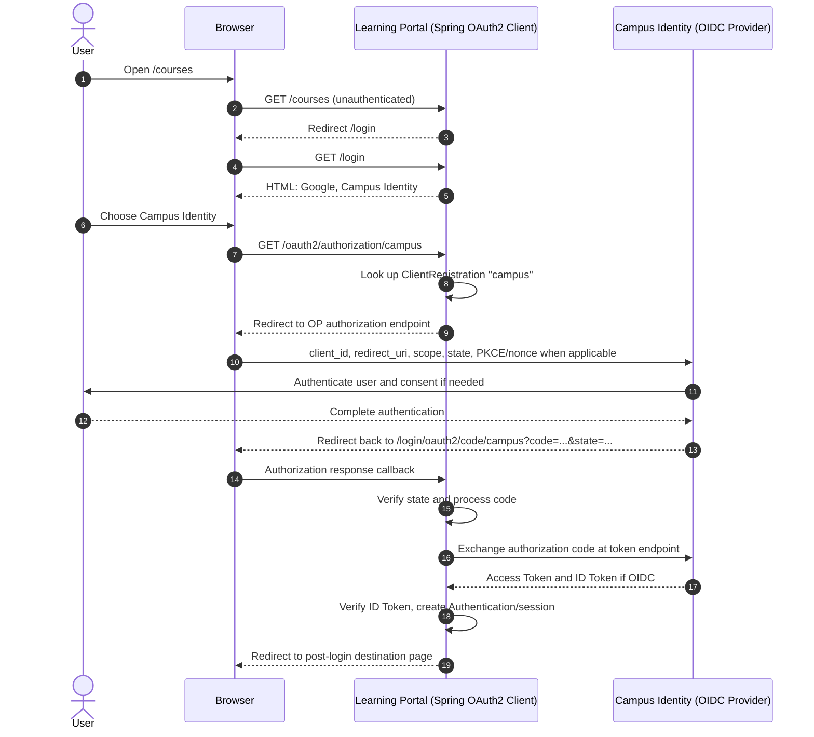

# 7.8. Default Login Page and Provider List

## Lesson Objectives

After this lesson, you will be able to:

- Explain when Spring Security in a **Servlet** application generates the default login page and why it appears when `oauth2Login()` is enabled.
- Identify the list of OAuth 2.0/OpenID Connect (OIDC) login options on the default page, the data source behind the list, and the meaning of display labels.
- Distinguish the **login page** URL, **authorization initiation** URL, **callback** URL, and the Identity Provider's authorization endpoint.
- Configure multiple `ClientRegistration` entries, control `clientName` and `registrationId`, and understand the prerequisites for Spring to display the links.
- Customize the login page while keeping Spring Security's OAuth2 Login filters, including building the list of options from the repository.
- Diagnose missing login pages, missing providers, broken links, redirect loops, or callback errors.

## 1. Context: When Do Users Encounter the Login Page?

Suppose **Learning Portal** is a Spring Boot web application using Spring Security. The `/courses` page is only for logged-in users. A user without a valid login session opens:

```http
GET /courses HTTP/1.1
Host: portal.example.org
```

With OAuth 2.0/OIDC login configured for a Servlet app, Spring Security may redirect the user to `/login`. If the application **has not defined a custom login page**, Spring can generate a default HTML page. This page provides links such as:

```text
                  Sign in

       [Login with Campus Identity]
       [Login with Google]
```

This is an illustrative UI. Actual presentation, labels, and page elements can vary by Spring Security version and config. The list is built from **the application's own OAuth2 Client Registrations**, not a global list of every provider on the Internet.

When the user clicks "Campus Identity", the browser navigates to an endpoint **inside Learning Portal**, for example:

```text
/oauth2/authorization/campus
```

Only then does Spring build an OAuth2/OIDC request and redirect the browser to the **OpenID Provider** to log in. The default page acts as a **login method selector**, rather than verifying Campus Identity passwords itself.

### 1.1. Distinguishing four key addresses

| Address | Owned by | Purpose |
| --- | --- | --- |
| `/login` | Spring web application | Login method selection page, optionally generated by default by Spring |
| `/oauth2/authorization/{registrationId}` | Spring OAuth2 Client | Initiates an authorization request for a specific registration |
| `/login/oauth2/code/{registrationId}` | Spring OAuth2 Client | Receives the authorization response/callback from the provider |
| `https://id.example.org/oauth2/authorize` | Authorization Server/OpenID Provider | Handles user authentication, consent, and issues the authorization code |

The first two addresses can live on **the same application domain** yet serve different functions. `/login` displays choices; `/oauth2/authorization/campus` starts the actual OAuth2 transaction.

### 1.2. Relationship between OAuth2 Login and OIDC Login

`oauth2Login()` is Spring Security's **user login** feature built on the OAuth 2.0 Authorization Code Flow. When a registration requests the `openid` scope and the provider supports OpenID Connect, Spring Security performs additional OIDC steps: validating the ID Token, creating an `OidcUser`, and optionally fetching profile info from UserInfo.

Thus a default login page can simultaneously display:

- A link to an **OIDC Provider**, such as a centralized identity system.
- A link to an **OAuth2 Provider** supplying user info via a provider-specific API, if Spring Security is configured accordingly.

Users only see login options; they do not need to know whether a provider uses a custom OAuth2 UserInfo API or standard OIDC. However, the backend must still process the corresponding flows and identity data properly.

## 2. Which Component Generates the Default Login Page in Spring Security?

In the servlet security filter chain, **`DefaultLoginPageGeneratingFilter`** can provide an auto-generated HTML login page when Spring Security is configured with an interactive login mechanism and no custom login page is specified.

When using OAuth2 Login:

```java
@Configuration
class SecurityConfiguration {

    @Bean
    SecurityFilterChain securityFilterChain(HttpSecurity http) throws Exception {
        http
            .authorizeHttpRequests(auth -> auth
                .requestMatchers("/", "/assets/**").permitAll()
                .anyRequest().authenticated()
            )
            .oauth2Login(Customizer.withDefaults());

        return http.build();
    }
}
```

The snippet assumes the project uses compatible Spring Boot, Spring Security, and OAuth2 Client dependencies; Java imports are omitted to focus on configuration.

Purpose of the key lines:

1. `requestMatchers("/", "/assets/**").permitAll()` lets users view the home page and public static resources.
2. `anyRequest().authenticated()` requires login for all other URLs.
3. `oauth2Login(Customizer.withDefaults())` enables OAuth2 Login with default endpoints and handlers.
4. Without a custom login page config, Spring Security can generate a default login page listing available OAuth clients.

**Not every application using OAuth2 Client automatically creates a `/login` page.** `oauth2Login()` enables interactive login; if an application only configures `oauth2Client()` for outbound API calls or `oauth2ResourceServer()` to accept Bearer tokens, those are different responsibilities and will not produce a login provider list.

### 2.1. The default page is not a `login.html` file in the project

Under default configuration, the HTML is generated by Spring Security during request handling; you can see `/login` even when the project does not contain:

```text
src/main/resources/templates/login.html
src/main/resources/static/login.html
```

This is convenient for demos or verifying OAuth2 Login integration before writing controllers and templates. However, because the page is auto-generated, simply adding an HTML file named `login.html` does not automatically replace the default page. To use a custom UI, configure `loginPage(...)` and build an appropriate handler/view.

### 2.2. The default page can include multiple kinds of options

If the same `SecurityFilterChain` configures both username/password login and OAuth2 Login, the generated page can render both the login form and OAuth2 links. Exact elements depend on enabled authentication mechanisms and the Spring Security version.

For example:

```java
http
    .authorizeHttpRequests(auth -> auth
        .anyRequest().authenticated()
    )
    .formLogin(Customizer.withDefaults())
    .oauth2Login(Customizer.withDefaults());
```

Conversely, an app using only OIDC SSO may show only OAuth2/OIDC options. Do not assume the presence of a password form means Spring Security handles the provider's passwords directly: form login and OAuth2 Login are separate mechanisms.

## 3. Where Does the Provider List Come From?

The list on the default page is built from **`ClientRegistrationRepository`**, where Spring Security stores `ClientRegistration` configurations.

A `ClientRegistration` represents an OAuth2 client registered with an Authorization Server, containing:

| Property | Example | Role on the page and in the flow |
| --- | --- | --- |
| `registrationId` | `campus` | Internal key used to build the `/oauth2/authorization/campus` link |
| `clientName` | `Campus Identity` | Human-readable label shown on the login page link |
| `clientId` | `learning-portal-web` | Value sent to the Authorization Server as the `client_id` parameter |
| `clientSecret` | Loaded from secret store | Confidential client credential; never placed in HTML |
| `authorizationGrantType` | `authorization_code` | Distinguishes interactive login registrations from other grant types |
| `redirectUri` | `{baseUrl}/login/oauth2/code/{registrationId}` | URI receiving the callback after Authorization Server processing |
| `scopes` | `openid`, `profile`, `email` | Requested permission scopes |
| Provider details | `issuer-uri`, authorization endpoint, token endpoint | Identifies the server the client communicates with |

**Each link represents one `ClientRegistration`, not necessarily one unique brand or provider.**

A single OIDC provider may be used by two registrations with separate Client IDs or settings, such as `campus-student` and `campus-staff`. When the repository exposes both and configuration permits login, the page can show two choices even though both lead to the same issuer.

### 3.1. Role of `Iterable<ClientRegistration>`

For `DefaultLoginPageGeneratingFilter` to automatically list configured OAuth clients, `ClientRegistrationRepository` must allow iterating over registrations—typically by implementing **`Iterable<ClientRegistration>`**.

Spring Security's `InMemoryClientRegistrationRepository` satisfies this and is commonly used in straightforward Spring Boot setups.

```java
ClientRegistrationRepository repository = ...;

ClientRegistration campus =
    repository.findByRegistrationId("campus");
```

`findByRegistrationId` supports **looking up a single registration**, yet if an implementation only supports lookup and does **not** implement `Iterable`, Spring has no standard way to collect the list from the repository for the default page.

As a result, OAuth2 Login still resolves registrations when visiting the initiation URL directly, **but the list of links will not appear properly on the auto-generated page**.

Example custom repository:

```java
final class DatabaseClientRegistrationRepository
        implements ClientRegistrationRepository {

    @Override
    public ClientRegistration findByRegistrationId(String id) {
        return loadRegistrationFromDatabase(id);
    }
}
```

This implementation illustrates lookup by key, yet **lacks iteration support**. If you want the auto-generated login page to display all registrations, provide a repository capable of enumerating them. Alternatively, build a custom login page and fetch the list from an application configuration service.

Note: not every registration is suitable as a login button; only display clients configured for **Authorization Code login**.

### 3.2. `clientName` determines the label, `registrationId` determines the URL

Suppose the configuration is:

```yaml
registration:
  campus:
    client-id: learning-portal-web
    client-name: "Campus Account"
```

When rendered:

```text
Link text:       Campus Account
Link href:       /oauth2/authorization/campus
OAuth client_id: learning-portal-web
```

If you change:

```yaml
client-name: "Sign in with School SSO"
```

the link text changes, while `/oauth2/authorization/campus` and `client_id=learning-portal-web` remain unchanged.

If you change **`registrationId`** from `campus` to `university`, the login initiation path changes to `/oauth2/authorization/university` and template-based callback URIs may also change. You must update links, registered URIs at the OP, and any code looking up the registration.

### 3.3. Provider alias is not the registration ID

In YAML:

```yaml
registration:
  campus-student:
    provider: campus-oidc
    client-id: student-client

provider:
  campus-oidc:
    issuer-uri: https://id.campus.example.org
```

- `campus-student`: registration ID, used in the login link.
- `campus-oidc`: provider configuration key name sharing OP details.
- `student-client`: client ID registered at the OP.

The URL `/oauth2/authorization/campus-oidc` **does not automatically exist** just because a provider alias has that name. The default URL requires an actual registration ID.

## 4. Working Example with Two Login Options

Suppose Learning Portal wants to display "Google" and "Campus Identity". An illustrative configuration:

```yaml
spring:
  security:
    oauth2:
      client:
        registration:
          google:
            client-id: ${GOOGLE_CLIENT_ID}
            client-secret: ${GOOGLE_CLIENT_SECRET}
            scope:
              - openid
              - profile
              - email
            client-name: "Google"

          campus:
            provider: campus
            client-id: ${CAMPUS_CLIENT_ID}
            client-secret: ${CAMPUS_CLIENT_SECRET}
            client-authentication-method: client_secret_basic
            authorization-grant-type: authorization_code
            redirect-uri: "{baseUrl}/login/oauth2/code/{registrationId}"
            scope:
              - openid
              - profile
              - email
            client-name: "Campus Identity"

        provider:
          campus:
            issuer-uri: https://id.campus.example.org
```

This configuration uses:

- **Google**, a provider for which Spring Boot includes built-in common provider defaults under registration ID `google`; the app must still register a real OAuth client with Google and obtain valid credentials.
- **Campus Identity**, a hypothetical OP described via `issuer-uri`; the OP must support OIDC Discovery and required endpoints.
- **Environment variables** for client ID/secret; never put real secrets in documentation or source code.
- Scopes `openid`, `profile`, and `email` to request OIDC login and profile details per provider policy.

Typical Maven dependencies in a Spring Boot project:

```xml
<dependency>
    <groupId>org.springframework.boot</groupId>
    <artifactId>spring-boot-starter-security</artifactId>
</dependency>
<dependency>
    <groupId>org.springframework.boot</groupId>
    <artifactId>spring-boot-starter-oauth2-client</artifactId>
</dependency>
```

Dependency versions are managed by the project's BOM and Spring Boot version. For real providers, create the client registration on the provider side and declare a **valid redirect URI**; copying YAML alone will not enable login.

### 4.1. Expected links on the default page

When Spring uses the default login configuration and an iterable repository, users see corresponding options like:

```html
<a href="/oauth2/authorization/google">Google</a>
<a href="/oauth2/authorization/campus">Campus Identity</a>
```

The snippet above illustrates the link structure only; the actual HTML/CSS generated by Spring need not match verbatim.

In production at `https://portal.example.org`, the callbacks are typically:

```text
https://portal.example.org/login/oauth2/code/google
https://portal.example.org/login/oauth2/code/campus
```

Register the corresponding callback for each client at Google and Campus Identity. Changing the context path, reverse proxy, or URI template can cause actual URLs to differ from the example.

### 4.2. Sequence when the user chooses Campus Identity



The `/login` page only serves to **pick a registration**. Actual authentication happens across the OAuth2 Login filters, the Authorization Server, and Spring's token processing.

### 4.3. Where does the user go after login?

In typical configurations, Spring Security saves the initial request requiring authentication and can return the user to the requested page, e.g., `/courses`. When no saved request exists or the app configures a custom success handler, the destination path may differ.

You can configure:

```java
http.oauth2Login(oauth2 -> oauth2
    .defaultSuccessUrl("/dashboard", true)
);
```

Passing `true` forces always redirecting to `/dashboard` upon successful login instead of prioritizing a saved request. This is application-level behavior, independent of the OAuth2 Provider or provider list.

## 5. Filters Involved in the Login Page and OAuth2 Flow

A helpful view of the Servlet architecture:

| Component | Role |
| --- | --- |
| `DefaultLoginPageGeneratingFilter` | Generates default login page content when enabled and matching configuration |
| `OAuth2AuthorizationRequestRedirectFilter` | Intercepts OAuth2 initiation requests, builds authorization requests, and redirects to the Authorization Server |
| `DefaultOAuth2AuthorizationRequestResolver` | Resolves registration from the initiation URL and creates the default authorization request |
| `OAuth2AuthorizationRequestRepository` | Saves and loads the authorization request across the browser round trip; default typically uses HTTP session |
| `OAuth2LoginAuthenticationFilter` | Receives the authorization response callback and runs login token exchange |
| `ClientRegistrationRepository` | Looks up / iterates OAuth2 Client configurations |
| `OAuth2UserService` or `OidcUserService` | Fetches principal details per the corresponding flow |
| `SecurityContextRepository` | Persists the authentication context per configuration after login |

These components have distinct responsibilities. Building an HTML page with a list of links does not replace the authorization request resolver, `state` validation, PKCE, OIDC ID Token validation, session persistence, or success/failure handling.

### 5.1. Requests pass through two different filters

When clicking:

```text
/oauth2/authorization/campus
```

the authorization request handler initiates the redirect to the provider. When returning:

```text
/login/oauth2/code/campus?code=...&state=...
```

the OAuth2 Login handler processes the callback.

If you customize either path, keep the corresponding filter configuration synchronized with links on the login page and the redirect URI registered at the provider.

## 6. Limitations of the Default Page

The default page is great for development and simple systems, yet it is not a full-featured identity UI:

- Styling and labels depend on Spring's page generator; customization of branding, permission explanations, localization, or login assistance is limited.
- The visible list reflects registrations provided to Spring that can be enumerated; it is not auto-synced from an external provider directory.
- There is no built-in "smart provider picker" by email/domain/tenant unless the application builds one.
- Naming a registration `admin` or `staff` is not an authorization policy. Any user can follow the link directly; roles must be checked inside the application.
- With a non-iterable repository or specialized security chains, the default list may not appear as expected.
- Some `ClientRegistration` entries may not be meant for public display; if you need to filter which registrations users see, a custom page makes more sense.

You do not need to replace the default page on day one; it helps verify the OAuth2 Login flow quickly. Once UX and policy requirements become specific, build a custom login page with controlled links.

## 7. Customizing the Login Page While Keeping OAuth2 Login Mechanics

A common requirement: Learning Portal wants its own logo, localized headings, descriptions, and two styled login buttons matching product design.

### 7.1. Configuring an application-supplied `/signin` page

```java
@Configuration
class WebSecurityConfig {

    @Bean
    SecurityFilterChain securityFilterChain(HttpSecurity http) throws Exception {
        http
            .authorizeHttpRequests(auth -> auth
                .requestMatchers("/", "/signin", "/css/**", "/images/**").permitAll()
                .anyRequest().authenticated()
            )
            .oauth2Login(oauth2 -> oauth2
                .loginPage("/signin")
            );

        return http.build();
    }
}
```

When calling `.loginPage("/signin")`:

1. Spring uses `/signin` as the application's login path.
2. **The application must provide a controller/view** for `GET /signin`, or an equivalent handler.
3. That page needs links to the authorization-start URL for each registration.
4. OAuth2 Login filters for redirecting to providers and processing callbacks continue working as configured.
5. Permit unauthenticated access to `/signin` and needed static assets to avoid redirect loops.

Example Spring MVC controller:

```java
@Controller
class SignInController {

    @GetMapping("/signin")
    String signIn() {
        return "signin";
    }
}
```

With Thymeleaf, the template can live at `src/main/resources/templates/signin.html` and include links:

```html
<!doctype html>
<html lang="en" xmlns:th="http://www.thymeleaf.org">
<head>
  <meta charset="UTF-8">
  <title>Sign in to Learning Portal</title>
</head>
<body>
  <h1>Sign in to Learning Portal</h1>
  <p>Choose an account to sign in.</p>

  <a th:href="@{/oauth2/authorization/google}">
    Continue with Google
  </a>
  <a th:href="@{/oauth2/authorization/campus}">
    Continue with Campus Identity
  </a>
</body>
</html>
```

Thymeleaf's `@{...}` expression builds URLs aware of the deployment context; the example assumes Thymeleaf view resolution is enabled. If you change the authorization base URI, update those links accordingly.

**Point to remember:** `.loginPage("/signin")` does not mean the provider must also use `/signin`. This is **Learning Portal's** UI page.

### 7.2. When the custom page has no password form

If the application only uses OAuth2/OIDC login, `/signin` can consist solely of `<a href>` links. This is a completely valid way to start the OAuth2 Authorization Code Flow; you do not need a form asking for the Identity Provider's password, nor should users ever enter a client secret.

OAuth2 initiation links use GET; never collect a user's email/password on Learning Portal's backend to exchange for tokens. User authentication happens at the OP.

### 7.3. Can only a single option be shown?

Yes. If the app uses a single OIDC Provider, `/signin` can have one "Sign in with organization account" button. An application can even configure an authentication entry point or custom routing to redirect immediately to `/oauth2/authorization/campus` without showing a chooser.

However, automatic redirects must avoid infinite loops when the provider returns an error or the user returns with invalid state. Provide a clear error path and a recovery option when a session/token is rejected.

## 8. Dynamically Generating the Provider List

If the number of registrations varies by environment, a custom page can read names and IDs from `ClientRegistrationRepository` instead of hardcoding every link.

### 8.1. Display model containing only safe data

Assuming the repository implements `Iterable<ClientRegistration>`, a controller can select registrations meant for OAuth2 Login:

```java
@Controller
class ProviderSelectionController {

    private final ClientRegistrationRepository registrations;

    ProviderSelectionController(ClientRegistrationRepository registrations) {
        this.registrations = registrations;
    }

    @GetMapping("/signin")
    String signIn(Model model) {
        List<LoginOption> options = new ArrayList<>();

        if (registrations instanceof Iterable<?> iterable) {
            for (Object candidate : iterable) {
                ClientRegistration registration = (ClientRegistration) candidate;

                if (AuthorizationGrantType.AUTHORIZATION_CODE.equals(
                        registration.getAuthorizationGrantType())) {
                    options.add(new LoginOption(
                        registration.getRegistrationId(),
                        registration.getClientName()
                    ));
                }
            }
        }

        model.addAttribute("loginOptions", options);
        return "signin";
    }

    record LoginOption(String registrationId, String clientName) {}
}
```

The Java code above illustrates the idea in modern Java; add the necessary imports and control which registrations are allowed to be displayed. Checking `AuthorizationGrantType.AUTHORIZATION_CODE` prevents turning `client_credentials`-only clients into user login buttons.

Thymeleaf template:

```html
<h1>Choose a sign-in method</h1>

<ul>
  <li th:each="option : ${loginOptions}">
    <a th:href="@{/oauth2/authorization/{registrationId}
                  (registrationId=${option.registrationId})}"
       th:text="${option.clientName}">
      Login provider
    </a>
  </li>
</ul>
```

Depending on the template engine, the link expression can sit on a single line. What matters is:

- **The URL uses `registrationId`.**
- **The label uses `clientName`.**
- Never send `clientSecret`, access tokens, token endpoint secrets, or the full `ClientRegistration` to the browser.
- Do not automatically display registrations not intended for end users if the application enforces selective visibility rules.

### 8.2. When the repository does not implement `Iterable`

With a repository that only exposes `findByRegistrationId(id)`, the application can:

- Maintain a separate list of valid login options in UI configuration.
- Add a dedicated service returning the registrations permitted for display.
- Implement enumeration on the repository if compatible with storage and security design.
- For a small fixed set of choices, hardcode explicit link URLs in the template alongside configuration.

There is no need to force every client-credential store into a public listing API. Expose only the metadata needed for the login selector page.

### 8.3. A provider list is not an allowlist of authorized users

The login options list answers "Which sign-in methods does the app support?", not "What permissions does this user have?". For instance:

```text
/oauth2/authorization/campus-staff
```

merely selects a registration configured for a given flow or policy. If a user lacks the instructor role, they are still not authorized to access `/staff/reports` just because they clicked the Staff button. After the callback, the application must verify identity and authorization from trusted sources.

## 9. How Customizing the Authorization Base URI Affects Login Buttons

Spring Security OAuth2 Login normally starts at:

```text
/oauth2/authorization/{registrationId}
```

To use `/sso/start/{registrationId}` instead:

```java
http.oauth2Login(oauth2 -> oauth2
    .loginPage("/signin")
    .authorizationEndpoint(authorization -> authorization
        .baseUri("/sso/start")
    )
);
```

Then login initiation links must be updated to:

```text
/sso/start/google
/sso/start/campus
```

There is no need to change `clientId` or provider name just because the internal URL changed. This is a Spring Client URL; the Authorization Server still has its own authorization endpoint.

Also, if using the default callback URI template:

```text
/login/oauth2/code/{registrationId}
```

changing the **authorization start base URI** does not automatically change the **callback URI**. Both settings are independent.

### 9.1. Customizing the callback also requires syncing the provider

If the application changes the callback to `/auth/callback/{registrationId}`, configure both:

```java
http.oauth2Login(oauth2 -> oauth2
    .redirectionEndpoint(redirection -> redirection
        .baseUri("/auth/callback/*")
    )
);
```

and:

```yaml
redirect-uri: "{baseUrl}/auth/callback/{registrationId}"
```

Then register the **expanded** redirect URI at the provider, for example:

```text
https://portal.example.org/auth/callback/campus
```

The `*` pattern on the filter matches requests in Spring; it does not mean providers accept wildcards in registered redirect URIs.

For callback URIs, host, scheme, port, context path, and path must match provider policy. A `redirect_uri_mismatch` error is typically a URI or reverse proxy issue, unrelated to the `clientName` label.

## 10. How Changing the Login Page Interacts with Errors and Sessions

### 10.1. The login page can be triggered by a protected request

A typical journey:

```text
1. GET /courses
2. Spring detects no valid Authentication
3. Redirect to /login or /signin
4. User selects a provider
5. OAuth2/OIDC login completes
6. Spring creates Authentication and appropriate session
7. User is redirected to /courses or configured success URL
```

Redirecting to the login page is normally handled by the entry point or unauthenticated-request handler. If an API should return `401` rather than an HTML redirect, configure an appropriate security chain or authentication entry point; login pages are for interactive web flows.

### 10.2. What happens when login fails?

If the provider rejects the request, the user cancels consent, `state` is invalid, or token exchange fails, Spring handles the error per `oauth2Login()` config.

You can configure a dedicated failure path:

```java
http.oauth2Login(oauth2 -> oauth2
    .loginPage("/signin")
    .failureUrl("/signin?error")
);
```

The application must serve `/signin` even with `?error` and display a safe message without leaking tokens, secrets, or raw exceptions. If the error page automatically redirects straight back to the provider, persistent errors will cause a redirect loop.

### 10.3. Do logout and provider selection differ?

The login page only initiates a fresh login. When a user logs out of Learning Portal, the local session may end; this does not mean the SSO session at the OP has been cleared. Next time the user clicks login, the OP may recognize the active session and return very quickly.

For OIDC with centralized logout requirements, you may need to integrate **RP-Initiated Logout** and OP-supported mechanisms. That is a separate problem from displaying the provider list on `/login`.

## 11. Cases Where the Provider List Does Not Appear as Expected

### 11.1. OAuth2 Client is configured, yet the login page has no links

Several possibilities:

- The app only uses `.oauth2Client()` without enabling `.oauth2Login()`.
- A custom login page is configured via `.loginPage(...)`, yet the template omits the links.
- `ClientRegistrationRepository` supports lookup but cannot be iterated, so the page-generating filter cannot list clients.
- Registration failed to initialize due to missing client ID, issuer, or required properties.
- The `SecurityFilterChain` matched for `/login` does not contain the expected OAuth2 Login config.
- Another filter, controller, or forward is handling `/login` instead of the default page.

### 11.2. The login initiation path returns an error or 404

Example:

```text
GET /oauth2/authorization/campus
```

Things to check:

1. Does `registration.campus` actually exist, or only `provider.campus`?
2. Is `oauth2Login()` enabled on the chain handling that URL?
3. Was the authorization base URI changed to `/sso/start` or another path?
4. Does the application have a context path such as `/learning`?
5. Is a reverse proxy stripping or adding prefixes causing a URL mismatch?

If the actual registration ID is `campus-student`, the link `/oauth2/authorization/campus` will not resolve it.

### 11.3. Provider reports `redirect_uri_mismatch`

Possible cause:

```text
Spring sends:
http://portal-service:8080/login/oauth2/code/campus

Provider registered:
https://portal.example.org/login/oauth2/code/campus
```

Behind a reverse proxy, Spring must infer the right external base URL. Spring Boot can use appropriate forwarded header settings, for example:

```yaml
server:
  forward-headers-strategy: framework
```

Only use forwarded headers set/controlled by a trusted reverse proxy; never trust unverified `Host` or `X-Forwarded-*` headers from the Internet. Beyond scheme/host, verify port, path, and callback URI for each registration.

### 11.4. User logs in successfully, yet cannot access resources

OAuth2/OIDC login proves an authenticated session per configuration; it does not grant admin privileges or access to all courses. Signing in via a "Campus Staff" button does not prove the user is staff; Resource Servers and the application must still verify roles, scopes, and resource ownership.

### 11.5. `/signin` keeps redirecting to itself

Common causes: `/signin` is not marked `permitAll()`, the view handler does not exist, wrong security chain, or the entry point keeps redirecting back to a blocked URL. For custom pages, immediately test **opening `/signin` while unauthenticated** before investigating the provider.

## 12. Quick Diagnostic Table

| Symptom | Primary suspect | What to check |
| --- | --- | --- |
| Default Spring page appears despite creating `signin.html` | `.loginPage("/signin")` not configured or actual login path differs | Check OAuth2 Login config and controller |
| No providers shown on default page | Repository not iterable, no registrations, or `oauth2Login()` not enabled | Check `ClientRegistrationRepository`, chain, and startup config |
| Link label shows technical name | `clientName` not set or template renders `registrationId` | Set `client-name` or update UI template |
| Name shown at OP does not change when editing `client-name` | Client name displayed at OP is managed independently | Edit the app name in the provider's registration |
| Login link returns 404 | Wrong registration ID, different base URI, or wrong context path | Compare link and config |
| Provider returns `invalid_client` | Wrong `client_id`, secret, or client authentication method | Compare with registration at provider |
| Provider returns `redirect_uri_mismatch` | Callback does not match registered URI | Compare exact redirect URI and proxy headers |
| Callback returns 404 | Redirection endpoint pattern does not match actual URI | Compare `.redirectionEndpoint().baseUri(...)` and `redirect-uri` |
| `/signin` redirect loop | Custom page requires authentication or handler missing | Permit `/signin` and static assets |
| Lands on unexpected page after login | Saved request or custom success handler | Check `defaultSuccessUrl` and `successHandler` |
| Staff button exists, yet regular users can log in through it | Button only selects registration, does not enforce roles | Add application-level authorization |
| User logs out, yet logs right back in without password | SSO session still active at OP | Check OP logout/re-authentication policy |

## 13. Security Principles to Keep When Designing the Login Page

- **Never collect OP passwords on the Portal page:** OAuth2/OIDC uses redirects to the OP to authenticate users. The provider chooser only needs flow initiation links.
- **Never put client secrets or tokens in HTML:** `clientName` and `registrationId` can be public; `clientSecret`, access tokens, refresh tokens, and secret state must be protected properly.
- **Use `state`/PKCE/nonce per flow:** Spring Security needs complete transaction state and validation to defend against CSRF/login CSRF, response substitution, and code theft risks.
- **Register exact redirect URIs:** never build callbacks from untrusted hosts or allow arbitrary redirect URLs.
- **Separate providers from permissions:** a login link labeled "Admin" is not an authorization mechanism.
- **Limit displayed registrations:** display only necessary user-facing login clients; do not expose backend workload clients in a public menu.
- **Keep error messages free of sensitive details:** never log or display raw tokens, client secrets, authorization codes, or full personal claims.
- **Do not write overly broad `permitAll()` rules:** the login page and static assets need public access, while business endpoints must remain properly protected.
- **Protect forms against forgery:** if a custom UI adds a local login form or state-changing actions, preserve CSRF protection; OAuth2 GET links do not replace protections on other requests.
- **Maintain recoverable UX:** when a provider is unavailable, the error page should let users retry safely or pick another method without endless redirect loops.

## 14. Practice Exercises

### Exercise 1: Predict the link list

Given the abbreviated configuration:

```yaml
spring:
  security:
    oauth2:
      client:
        registration:
          school:
            provider: campus
            client-id: portal-web
            client-name: "School SSO"
            authorization-grant-type: authorization_code
            scope: [openid, profile]
        provider:
          campus:
            issuer-uri: https://id.school.example
```

Assuming the registration has all required settings to initialize and an iterable repository, when using the default login page, predict:

**Link label:** `School SSO`.

**Link target:** `/oauth2/authorization/school`.

**OAuth `client_id` sent to OP:** `portal-web`.

**Provider alias:** `campus`.

The key point is that these four values have distinct roles. Changing the provider alias without changing the registration ID leaves the page link based on `school`.

### Exercise 2: Adding a second provider

The application wants to add "Google" alongside "School SSO".

Configuration steps:

1. Register an OAuth client at Google, obtain Client ID/secret, and declare the redirect URI.
2. Add a `ClientRegistration` with ID `google` and an appropriate display name.
3. Keep `oauth2Login()` enabled, with an iterable repository or manually placed links on a custom page.
4. Test both paths `/oauth2/authorization/school` and `/oauth2/authorization/google`.
5. Ensure callbacks for both registrations are accepted by their respective OPs.

There is no need to merge both providers into a single registration when they have different issuers, client IDs, or policies.

### Exercise 3: Moving from the default page to a custom page

Learning Portal wants to use `/signin` with a logo and two buttons.

**Solution:** Configure `.oauth2Login(o -> o.loginPage("/signin"))`, provide a view/controller for `GET /signin`, permit unauthenticated access, and include two authorization-start links matching the registration IDs. Never write custom code to exchange authorization codes when Spring handles the standard flow.

### Exercise 4: List disappears after swapping the repository

Previously the app used `InMemoryClientRegistrationRepository` and the auto-generated login page showed two options. After switching to a custom `ClientRegistrationRepository` implementing only `findByRegistrationId`, the links disappeared.

**Explanation:** the default page needs to enumerate registrations. A lookup-only implementation can still handle direct login URLs, yet prevents Spring from building the list. Add proper iteration support or build a custom page reading options from a controlled source.

### Exercise 5: A user clicks the "Instructor" button

The login page has the link:

```text
/oauth2/authorization/campus-staff
```

Can the user be treated as an instructor simply because they clicked that link?

**No.** That only selects a registration. After login, the system must verify identity and enforce business permissions from trusted data.

## 15. Review Questions

**1. Why does `/login` appear even when the project has no HTML file of that name?**

> When login is configured without a custom login page, Spring Security's `DefaultLoginPageGeneratingFilter` can generate HTML for the login URL.

**2. Where does the provider list on the default page come from?**

> From the `ClientRegistration` entries exposed by the app through `ClientRegistrationRepository`, requiring the repository to be iterable when Spring auto-generates links.

**3. If `clientName = "SSO Login"` and `registrationId = "campus"`, what are the label and URL?**

> The label is typically `SSO Login`, and the login initiation link is `/oauth2/authorization/campus` under default configuration.

**4. Is `clientName` the name displayed by the Authorization Server on its consent screen?**

> Not necessarily. The name shown at the OP is managed in the OP's own client registration; Spring's `clientName` is application-side display metadata.

**5. Does configuring `.loginPage("/signin")` automatically create a `/signin` template?**

> No. The application must provide a handler/view for this URL and ensure the page links to the authorization-start URLs.

**6. Does changing the authorization start base URI change the callback URI?**

> Not automatically. The authorization start URI and the redirection callback URI are two separate configurations.

**7. The default Spring login page shows no providers, yet `/oauth2/authorization/campus` still works—why might this happen?**

> The repository may not be iterable: Spring can still look up registrations by ID, yet cannot enumerate them to render the list.

**8. Why must the login page not be used to assign roles based on button names?**

> Because buttons only select a client registration. Access permissions must be decided after authentication completes, based on trusted authorization sources and business policies.

---

## Key Takeaways

In a **Spring Security Servlet** application with `oauth2Login()`, the default **`/login`** page can be generated by `DefaultLoginPageGeneratingFilter`. The list of login options reflects enumerable **`ClientRegistration`** entries from the repository; **`clientName`** sets the display label, while **`registrationId`** forms the default **`/oauth2/authorization/{registrationId}`** path. Clicking a link initiates the Authorization Code/OIDC flow; the provider returns the result to the **`/login/oauth2/code/{registrationId}`** callback. When branding, localization, or tighter control over displayed choices is needed, use a **custom login page** while still letting Spring Security handle redirects, token exchange, OIDC verification, and login session creation.
