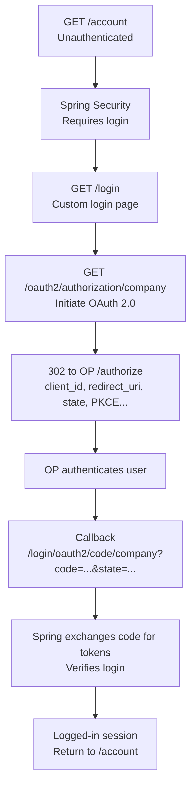

# 7.9. Custom Login Page and Authentication Initiation Path

In a **Spring Security OAuth 2.0/OIDC Client application running on the Servlet stack**, users typically visit a protected page, get redirected to a login page, and choose an Identity Provider. Spring Security can generate a default login page with OAuth 2.0 links, yet many systems need a custom page to show branding, login instructions, or multiple choices such as "Sign in with company account".

Two things are easily confused:

1. **Custom login page**: the HTML page users see in the application, e.g., `GET /login`; the application designs and serves that page itself.
2. **OAuth 2.0/OIDC authentication initiation path**: the endpoint handled by Spring Security to **initiate an authorization request** and redirect the browser to the Authorization Server/OpenID Provider (OP), defaulting to `GET /oauth2/authorization/{registrationId}`.

Changing the login page does not automatically change the authentication initiation endpoint. Changing the initiation endpoint also does not automatically change the callback path. Understanding the three locations **login page → authorization initiation → redirect callback** is fundamental to configuring this properly.

## 1. Context: OAuth 2.0 Login on the Servlet Stack

A Spring MVC or Spring Boot Servlet application typically acts as an **OAuth 2.0 Client**; when using the `openid` scope and an OP supporting OIDC, the application simultaneously acts as an **OpenID Connect Relying Party**.

Roles in the flow:

| Component | Responsibility | Example |
|---|---|---|
| Browser | Renders pages and follows HTTP redirects | Chrome, Firefox |
| Spring Security OAuth 2.0 Client | Protects pages, builds authorization requests, handles callbacks, creates sessions | `portal.example.org` app |
| Authorization Server / OpenID Provider | Authenticates users, issues authorization codes/tokens | `login.example.org` |
| `ClientRegistrationRepository` | Stores OAuth client registration configurations | `company`, `partner` |
| Application HTTP session | Binds pending login requests to callbacks and persists login state | RP's session cookie |

For example, an unauthenticated user visits `GET /account`. If the endpoint requires authentication, Spring Security initiates the login workflow. When the application has a custom `/login` page, the user can click a button to start login via the provider.



By default, Spring Security can serve an auto-generated login page. Once `loginPage("/login")` is specified, the application **takes responsibility for providing its own route, template, and page content**.

## 2. Precisely Distinguishing the Three Paths

| Illustrative path | Typical method | Who handles it? | Purpose |
|---|---|---|---|
| `/login` | `GET` | Application controller/view | Displays the login selection UI |
| `/oauth2/authorization/company` | `GET` | `OAuth2AuthorizationRequestRedirectFilter` | Creates the authorization request and redirects to the OP |
| `/login/oauth2/code/company` | `GET` with `code`/`state` | `OAuth2LoginAuthenticationFilter` | Receives the authorization result and completes login |

Here `company` is the **`registrationId`**, meaning the local key set in Spring's `ClientRegistrationRepository`. It **does not have to equal** the OAuth `client_id` issued by the OP.

For example:

```yaml
spring:
  security:
    oauth2:
      client:
        registration:
          company:
            client-id: portal-web-production
```

- Default login initiation URL: `/oauth2/authorization/company`.
- Query parameter at the OP: `client_id=portal-web-production`.
- Default callback URL: `/login/oauth2/code/company`.

This distinction matters when reading logs. Changing `company` to `company-oidc` in Spring normally changes the URLs containing `{registrationId}`, while `client_id` at the provider can stay the same.

### 2.1. The authentication initiation path is not the OP page

The link:

```text
https://portal.example.org/oauth2/authorization/company
```

points to the **Spring application**, not directly to the OP's login page. Spring Security looks up the `ClientRegistration` named `company`, builds an authorization request with `client_id`, `redirect_uri`, `scope`, `state`, and other protocol details, then sends an HTTP `302` to the OP's authorization endpoint.

Instead of hardcoding `https://login.example.org/authorize?...` in HTML, linking to Spring's URL lets Spring Security securely manage per-request parameters.

### 2.2. The callback path is not the login initiation path

The default callback:

```text
https://portal.example.org/login/oauth2/code/company
```

is used by the OP to return `code` and `state` after the user authenticates. It is **not** a URL for users to click to start logging in, and should never be put on a "Sign in" button.

Visiting the callback directly without a valid pending authorization request prevents the application from completing a protocol-compliant login session.

## 3. How Does Spring Security Generate the Default Login Page?

When OAuth2 Login is enabled:

```java
http.oauth2Login(Customizer.withDefaults());
```

and no custom login page is configured, Spring Security can use `DefaultLoginPageGeneratingFilter` to generate a login page. With standard configuration and an iterable `ClientRegistrationRepository`, that page renders links for OAuth clients.

For example, if the repository has `company` and `partner`, the default page can display the corresponding OAuth options. This is useful for learning, testing, or simple apps.

However, the default page rarely meets requirements for styling, localization, guidance copy, branding, accessibility, or provider display policies. When using:

```java
.oauth2Login(oauth2 -> oauth2.loginPage("/login"))
```

Spring does not build custom HTML for `/login`. You must supply a matching controller or view and allow unauthenticated users to access it.

**Common mistake:** `loginPage("/login")` only specifies where users view the login UI; it changes neither `/oauth2/authorization/{registrationId}` nor `/login/oauth2/code/{registrationId}`.

## 4. Complete Example: Custom Login Page with Spring MVC and Thymeleaf

Suppose a Spring Boot app integrates with an internal OpenID Provider. Requirements:

- Home page `/` and `/login` are public.
- `/account` requires login.
- The user clicks "Sign in with company account".
- Spring initiates OIDC login via registration `company`.
- After successful authentication, Spring creates a session and sends the user to the requested resource.

### 4.1. Dependencies

Example with Gradle (Groovy DSL):

```groovy
dependencies {
    implementation 'org.springframework.boot:spring-boot-starter-web'
    implementation 'org.springframework.boot:spring-boot-starter-security'
    implementation 'org.springframework.boot:spring-boot-starter-oauth2-client'
    implementation 'org.springframework.boot:spring-boot-starter-thymeleaf'
}
```

This is a **Servlet/MVC** application; the example uses modern `SecurityFilterChain`, not the legacy `WebSecurityConfigurerAdapter` from older versions.

### 4.2. Client registration in `application.yml`

```yaml
spring:
  security:
    oauth2:
      client:
        registration:
          company:
            provider: company
            client-id: ${COMPANY_OIDC_CLIENT_ID}
            client-secret: ${COMPANY_OIDC_CLIENT_SECRET}
            client-authentication-method: client_secret_basic
            authorization-grant-type: authorization_code
            redirect-uri: "{baseUrl}/login/oauth2/code/{registrationId}"
            scope:
              - openid
              - profile
              - email
        provider:
          company:
            issuer-uri: ${COMPANY_OIDC_ISSUER_URI}
```

Explanation:

- `registration.company`: creates a registration with ID `company`; this is the name appearing in the login initiation link.
- `client-id`: client identifier issued by the OP; may differ from `company`.
- `client-secret`: credential of the confidential backend client; never place in templates or JavaScript.
- `client-authentication-method`: method the backend uses to authenticate at the token endpoint.
- `redirect-uri`: URI where the OP sends callbacks, containing `{registrationId}`.
- `scope: openid`: requests OIDC, enabling ID token issuance and identity login.
- `issuer-uri`: trusted OP issuer, supporting endpoint/JWKS discovery if the provider is compatible.

Registration at the OP must include the **exact redirect URI**, e.g., `https://portal.example.org/login/oauth2/code/company`. `{baseUrl}` expands from the public base URL recognized by Spring; behind a reverse proxy, configure trusted forwarded headers.

### 4.3. SecurityFilterChain

```java
import org.springframework.context.annotation.Bean;
import org.springframework.context.annotation.Configuration;
import org.springframework.security.config.Customizer;
import org.springframework.security.config.annotation.web.builders.HttpSecurity;
import org.springframework.security.web.SecurityFilterChain;

@Configuration
public class SecurityConfig {

    @Bean
    SecurityFilterChain securityFilterChain(HttpSecurity http) throws Exception {
        http
            .authorizeHttpRequests(auth -> auth
                .requestMatchers(
                    "/", "/login", "/error",
                    "/css/**", "/js/**", "/images/**"
                ).permitAll()
                .anyRequest().authenticated())
            .oauth2Login(oauth2 -> oauth2
                .loginPage("/login"));

        return http.build();
    }
}
```

Effects:

1. Unauthenticated users can access `/login` and UI static assets.
2. Other paths, such as `/account`, require authentication.
3. When login is needed, Spring uses `/login` as the login page.
4. Because authorization endpoint base URI has not been customized, the OAuth2 initiation link remains `/oauth2/authorization/company`.
5. OIDC callbacks are still handled by Spring's filter at `/login/oauth2/code/company` under default config.

You can omit the unused `Customizer` import in this configuration class; it is typically used in examples calling `oauth2Login(Customizer.withDefaults())`. The app does not need a custom controller for the callback; Spring Security owns the callback path once the filter chain is configured properly.

### 4.4. Controller serving the login page

```java
import org.springframework.stereotype.Controller;
import org.springframework.web.bind.annotation.GetMapping;

@Controller
public class LoginPageController {

    @GetMapping("/login")
    public String login() {
        return "login";
    }

    @GetMapping("/")
    public String home() {
        return "home";
    }
}
```

`return "login"` means Thymeleaf renders `src/main/resources/templates/login.html`. If using static HTML, another MVC view, or an SPA frontend, how the page is served can differ, but the display endpoint must still exist and be reachable unauthenticated.

Do not write:

```java
@GetMapping("/login")
public String login() {
    return "redirect:/login";
}
```

because it creates a redirect loop. Also do not leave `/login` under a rule requiring authentication without an exemption, or unauthenticated requests may redirect endlessly to themselves.

### 4.5. Template `login.html`

```html
<!DOCTYPE html>
<html lang="en" xmlns:th="http://www.thymeleaf.org">
<head>
    <meta charset="UTF-8">
    <meta name="viewport" content="width=device-width, initial-scale=1">
    <title>Sign in</title>
    <link rel="stylesheet" th:href="@{/css/login.css}">
</head>
<body>
<main>
    <h1>Sign in to the Portal</h1>
    <p>Use your company account to continue.</p>

    <a th:href="@{/oauth2/authorization/company}">
        Sign in with company account
    </a>
</main>
</body>
</html>
```

The button/link in the example:

- Performs a **GET** to Spring's authentication initiation filter.
- Contains no client secret, access token, or authorization code.
- Does not generate `state` or `nonce` inside the template.
- Never calls the token endpoint directly.
- Uses Thymeleaf's `@{...}` syntax so the application handles context paths properly.

If the app is served under context path `/portal`, Thymeleaf-generated links automatically include the context path. Hardcoding `href="/oauth2/authorization/company"` can break when deployed under a path prefix.

**CSRF:** A GET link to the OAuth2 authorization initiation endpoint is a standard navigation action. There is no need to attach a CSRF token to this link in place of `state`. Conversely, state-changing POST forms in the app (such as session-cookie logout) still require proper CSRF protection.

### 4.6. Protected page and principal inspection

Example controller returning account details after OIDC Login:

```java
import org.springframework.security.core.annotation.AuthenticationPrincipal;
import org.springframework.security.oauth2.core.oidc.user.OidcUser;
import org.springframework.web.bind.annotation.GetMapping;
import org.springframework.web.bind.annotation.RestController;

@RestController
public class AccountController {

    public record AccountInfo(
        String issuer,
        String subject,
        String displayName
    ) {}

    @GetMapping("/account")
    public AccountInfo account(@AuthenticationPrincipal OidcUser user) {
        return new AccountInfo(
            user.getIdToken().getIssuer().toString(),
            user.getSubject(),
            user.getFullName()
        );
    }
}
```

With an `openid` registration and successful OIDC login, the principal is typically `OidcUser`. The `name` claim may not be issued by the OP, so `getFullName()` can return `null`.

`sub` combined with `iss` is a suitable key for mapping internal accounts. Display names or emails should not automatically serve as immutable identifiers or business permissions.

## 5. HTTP Flow When the User Clicks the Login Button

Assume the RP is `https://portal.example.org` and the OP is `https://login.example.org`.

```text
[1] GET https://portal.example.org/account
    -> 302 Location: /login

[2] GET https://portal.example.org/login
    -> 200 OK, HTML contains link /oauth2/authorization/company

[3] GET https://portal.example.org/oauth2/authorization/company
    -> Spring builds authorization request
    -> 302 Location: https://login.example.org/authorize?
          response_type=code
          &client_id=<registered-client-id>
          &redirect_uri=https%3A%2F%2Fportal.example.org%2Flogin%2Foauth2%2Fcode%2Fcompany
          &scope=openid%20profile%20email
          &state=<random-state>
          &code_challenge=<pkce-challenge-if-enabled>
          &code_challenge_method=S256

[4] Browser follows redirect; OP handles authentication/consent

[5] OP -> 302 Location:
    https://portal.example.org/login/oauth2/code/company?
          code=<authorization-code>&state=<original-state>

[6] Spring receives callback and validates authorization response;
    backend exchanges code for tokens at OP token endpoint

[7] Spring Security verifies OIDC ID token, creates Authentication/session

[8] Browser is redirected back to original resource or success page
```

Parameters shown in step [3] are illustrative; an actual authorization request may include an OIDC `nonce`, PKCE `code_challenge`, and extra parameters depending on config/provider. Preserve the library's and OP's semantics.

Spring Security normally saves the authorization request tied to `state` to validate the callback on return. When using HTTP sessions, losing the session between [3] and [5] prevents Spring from locating the initial request.

## 6. How to Change the Authentication Initiation Path

By default, `OAuth2AuthorizationRequestRedirectFilter` handles:

```text
/oauth2/authorization/{registrationId}
```

However, an organization might prefer a friendlier URL like:

```text
/sso/start/company
```

Spring Security Servlet OAuth2 Login allows configuring the **authorization endpoint base URI**:

```java
import org.springframework.context.annotation.Bean;
import org.springframework.context.annotation.Configuration;
import org.springframework.security.config.annotation.web.builders.HttpSecurity;
import org.springframework.security.web.SecurityFilterChain;

@Configuration
public class SecurityConfig {

    @Bean
    SecurityFilterChain securityFilterChain(HttpSecurity http) throws Exception {
        http
            .authorizeHttpRequests(auth -> auth
                .requestMatchers("/", "/login", "/error", "/css/**").permitAll()
                .anyRequest().authenticated())
            .oauth2Login(oauth2 -> oauth2
                .loginPage("/login")
                .authorizationEndpoint(authorization -> authorization
                    .baseUri("/sso/start")));

        return http.build();
    }
}
```

After the change:

| Component | Before | After |
|---|---|---|
| Login page | `/login` | `/login` |
| Login initiation path | `/oauth2/authorization/company` | **`/sso/start/company`** |
| Default callback | `/login/oauth2/code/company` | `/login/oauth2/code/company` |

The template must update its link accordingly:

```html
<a th:href="@{/sso/start/company}">
    Sign in with company account
</a>
```

Crucially, **`baseUri("/sso/start")` only changes where Spring receives the authentication initiation request**. It does not change the OP's authorization endpoint, auto-update the login page, alter the callback, or change `client_id` or `registrationId`.

If `/oauth2/authorization/company` remains in HTML after changing the base URI, Spring's filter will no longer intercept that link under the new configuration. Depending on routes and security rules, users may see `404`, be asked to log in again, or hit a redirect loop.

### 6.1. Where do the links come from?

Spring Security uses `ClientRegistrationRepository` to find the registration matching the `registrationId` in the URL. You cannot invent an arbitrary ID and expect the framework to locate a provider.

For example, if the repository defines:

```yaml
registration:
  company:
    client-id: portal-oidc-prod
  partner:
    client-id: partner-login-prod
```

and the base URI is `/sso/start`, the two links take the form:

```text
/sso/start/company
/sso/start/partner
```

Do not use `/sso/start/portal-oidc-prod` unless that is literally the registration ID. The trailing path segment is the local registration name, not the `client_id` issued by the provider.

### 6.2. Base URI is not an absolute URI to the OP

Configuring:

```java
.authorizationEndpoint(authorization ->
    authorization.baseUri("/sso/start"))
```

does not set the provider's authorization endpoint to `/sso/start`. The OP's actual authorization endpoint is declared via `provider.authorization-uri` or discovered from `issuer-uri`.

Two configuration layers:

| Property | Where it applies |
|---|---|
| `authorizationEndpoint().baseUri(...)` | Path **on the Spring application** to initiate login |
| `provider.<id>.authorization-uri` | URL **at the Authorization Server** receiving the OAuth authorization request |

Never assign `https://login.example.org/authorize` to `baseUri` intending to redirect to the OP; Spring's filter expects a local path matcher.

## 7. Changing the Callback Is Separate from Changing the Initiation URL

Spring Security Servlet OAuth2 Login's default callback pattern is:

```text
/login/oauth2/code/*
```

And the per-client redirect URI configuration is typically:

```yaml
redirect-uri: "{baseUrl}/login/oauth2/code/{registrationId}"
```

If your architecture requires a custom callback `/signin/oauth2/code/{registrationId}`, both places must be coordinated.

### 7.1. Configuring the callback-handling filter

```java
http.oauth2Login(oauth2 -> oauth2
    .loginPage("/login")
    .authorizationEndpoint(authorization -> authorization
        .baseUri("/sso/start"))
    .redirectionEndpoint(redirection -> redirection
        .baseUri("/signin/oauth2/code/*")));
```

### 7.2. Configuring the URI the client sends to the OP

```yaml
spring:
  security:
    oauth2:
      client:
        registration:
          company:
            redirect-uri: "{baseUrl}/signin/oauth2/code/{registrationId}"
```

At the same time, the OP must register the matching absolute callback, such as:

```text
https://portal.example.org/signin/oauth2/code/company
```

If you change `redirectionEndpoint().baseUri(...)` while keeping the old `redirect-uri`, the OP returns the code to a URL Spring's filter no longer handles. If you change `redirect-uri` without updating the filter matcher, the callback returns `404` or fails to complete login.

**There is no need to change the callback just to make a nicer login page.** For most apps, keeping the default callback and only customizing the UI page or initiation URL when needed simplifies integration.

## 8. Multiple Providers on the Same Login Page

A login page can offer multiple OAuth/OIDC options:

```yaml
spring:
  security:
    oauth2:
      client:
        registration:
          company:
            provider: company
            client-id: ${COMPANY_CLIENT_ID}
            client-secret: ${COMPANY_CLIENT_SECRET}
            authorization-grant-type: authorization_code
            redirect-uri: "{baseUrl}/login/oauth2/code/{registrationId}"
            scope: openid,profile
          partner:
            provider: partner
            client-id: ${PARTNER_CLIENT_ID}
            client-secret: ${PARTNER_CLIENT_SECRET}
            authorization-grant-type: authorization_code
            redirect-uri: "{baseUrl}/login/oauth2/code/{registrationId}"
            scope: openid,profile
        provider:
          company:
            issuer-uri: ${COMPANY_ISSUER_URI}
          partner:
            issuer-uri: ${PARTNER_ISSUER_URI}
```

Template:

```html
<section aria-labelledby="login-options">
    <h1 id="login-options">Choose a sign-in method</h1>

    <a th:href="@{/oauth2/authorization/company}">
        Sign in with company account
    </a>

    <a th:href="@{/oauth2/authorization/partner}">
        Sign in with partner account
    </a>
</section>
```

Each link routes to its corresponding `ClientRegistration`, with its own issuer, client ID, credentials, scopes, and redirect URI.

### 8.1. Do not build URLs for nonexistent registrations

Suppose a login page accepts a `provider` query parameter from the user. Do not concatenate directly:

```java
return "redirect:/oauth2/authorization/" + providerFromRequest;
```

without validating `providerFromRequest`. Maintain an allowlist of registration IDs permitted for display and use per application/tenant policy.

Illustrative option:

```java
import java.util.Map;

import org.springframework.stereotype.Controller;
import org.springframework.web.bind.annotation.GetMapping;
import org.springframework.web.bind.annotation.RequestParam;

@Controller
public class LoginChoiceController {

    private static final Map<String, String> ALLOWED = Map.of(
        "employee", "company",
        "vendor", "partner"
    );

    @GetMapping("/choose-login")
    public String choose(@RequestParam String method) {
        String registrationId = ALLOWED.get(method);
        if (registrationId == null) {
            return "redirect:/login";
        }
        return "redirect:/oauth2/authorization/" + registrationId;
    }
}
```

The values in the map are controlled in code, never passed arbitrarily from the browser. In multi-tenant systems, which OP a tenant is allowed to use must come from trusted configuration.

### 8.2. Flexible provider rendering

With a custom login page, the application can:

- Pass the list of login options via `Model` from trusted configuration.
- Show logos, friendly names, or instructions tailored to each provider.
- Hide options inapplicable to the current tenant or audience.
- Use localized translation messages for provider names.

Still, links must point to **real configured registration IDs**. If auto-generating the list from `ClientRegistrationRepository`, check whether the repository implements `Iterable<ClientRegistration>`; a custom repository might only support ID lookup. Do not assume every implementation is iterable.

## 9. How the Login Page and Authorization Path Relate to Security Filter Chains

### 9.1. Granting public access to the login page

If `/login` requires authentication, unauthenticated users get sent back to `/login`, creating a redirect loop:

```text
GET /account
  -> unauthenticated
  -> redirect /login
GET /login
  -> still requires authentication
  -> redirect /login
  -> ...
```

Ensure the login route and CSS/JS/image assets required by the UI are publicly accessible. Only grant `permitAll()` to genuinely public paths; protect everything else with `authenticated()` or explicit authorization rules.

### 9.2. Order of multiple SecurityFilterChains

Complex applications may have one filter chain for a REST API and another for web UI. For example:

- `/api/**`: Resource Server, bearer tokens, stateless.
- `/**`: Servlet web login, session, and `oauth2Login()`.

If the API chain accidentally matches `/login` or `/oauth2/authorization/**` before the web chain, the login filters will not run. Configure explicit `securityMatcher` rules and chain ordering so login paths, authorization initiation, and callbacks reach the right chain.

Example separate API chain:

```java
import org.springframework.core.annotation.Order;
import org.springframework.context.annotation.Bean;
import org.springframework.context.annotation.Configuration;
import org.springframework.security.config.annotation.web.builders.HttpSecurity;
import org.springframework.security.config.http.SessionCreationPolicy;
import org.springframework.security.web.SecurityFilterChain;

@Configuration
public class ApiChainConfig {

    @Bean
    @Order(1)
    SecurityFilterChain apiChain(HttpSecurity http) throws Exception {
        http
            .securityMatcher("/api/**")
            .sessionManagement(session -> session
                .sessionCreationPolicy(SessionCreationPolicy.STATELESS))
            .authorizeHttpRequests(auth -> auth
                .anyRequest().authenticated());

        // Add oauth2ResourceServer().jwt() per API configuration.
        return http.build();
    }
}
```

This example only illustrates **matcher scope**; a real API requires bearer token verification and an appropriate CSRF policy when cookies are not used. The web OAuth2 Login configuration must live in a separate chain with matching scope so it is not shadowed by the API chain.

### 9.3. Login page vs. login processing URL

When an app offers both a traditional username/password form login and OAuth2 Login, distinguish:

- Display page `GET /login`.
- Form login processing endpoint `POST /login` or the path set by `formLogin().loginProcessingUrl(...)`.
- OAuth initiation endpoint `GET /oauth2/authorization/{registrationId}`.
- OAuth callback `GET /login/oauth2/code/{registrationId}`.

Multiple choices can share one UI page, yet form login and OAuth2 Login are **two distinct authentication pipelines**. Do not configure overlapping paths/methods that cause filters to misroute requests.

Example page combining both a form and an OAuth link:

```html
<form th:action="@{/login}" method="post">
    <label for="username">Username</label>
    <input id="username" name="username" type="text" autocomplete="username">

    <label for="password">Password</label>
    <input id="password" name="password" type="password"
           autocomplete="current-password">

    <input type="hidden" th:name="${_csrf.parameterName}"
           th:value="${_csrf.token}">
    <button type="submit">Local Sign In</button>
</form>

<a th:href="@{/oauth2/authorization/company}">
    SSO Sign In
</a>
```

The POST form only works if the application configures `formLogin()` and a matching username/password authentication provider. `oauth2Login()` alone does not make Spring verify usernames/passwords submitted via a form.

## 10. Saving Authorization State and Returning to the Original Page

### 10.1. Role of `state`

When the browser visits `/oauth2/authorization/company`, Spring Security creates an authorization request with a random `state` and stores the data needed to verify the callback. When the OP returns:

```text
/login/oauth2/code/company?code=...&state=...
```

Spring looks up the matching request, checks `state`, and uses the original request's metadata to exchange the code.

If the session cookie or authorization request is lost before the callback, errors like `authorization_request_not_found` or `invalid_state_parameter` may occur, depending on version and failure point.

Common causes:

- Session was not preserved between initiation and callback requests.
- Cookie `Secure`/`SameSite` settings are incompatible with how the OP returns the callback, scheme, or hostname.
- A load balancer routed the callback to a node lacking access to the session store holding the authorization request.
- The user started multiple login flows, navigated back/forward across tabs, and overwrote state in a custom setup.
- The app modified the authorization request or `state` without updating the corresponding repository.

Never use a static `state` across requests. Never accept callbacks with missing or mismatched `state` just to silence errors.

### 10.2. Saved request after login

When an unauthenticated user visits `/account`, Spring Security can save the desired request and send them to `/login`. After OIDC Login succeeds, the success handler and request cache can return the user to the original page.

If customizing `defaultSuccessUrl` or `successHandler`, distinguish:

- **Prioritizing the initial request** when a saved request exists.
- **Always redirecting to a fixed page**.
- **Routing per business policy** after authentication.

Never read a query parameter like `next=https://somewhere.example` and redirect straight to it without validation; that creates an **open redirect** vulnerability. Use controlled internal paths or a strict destination allowlist.

Example fixed success URL setting:

```java
.oauth2Login(oauth2 -> oauth2
    .loginPage("/login")
    .defaultSuccessUrl("/dashboard", true))
```

Passing `true` always prefers `/dashboard` after successful login, even if the user previously visited another page. To return to the saved request when present, choose the matching success URL/handler setting.

### 10.3. Sessions and scaling across multiple instances

In a multi-instance production environment:

```text
Browser
  |
  v
Load Balancer
  |                 |
Spring App A     Spring App B
  |                 |
  +---- Shared Session Store ----+
```

If the authorization request is saved in App A's session while the callback hits App B without a compatible shared store or sticky session, `state` matching can fail.

Design session storage and lifecycle (e.g., Spring Session), cookie domain/path, HTTPS, and reverse proxy headers properly. Moving authorization data into cookies requires careful integrity/confidentiality design; do not swap repositories without understanding the risks.

## 11. Adding Authorization Parameters While Keeping the Standard Flow

Sometimes an OP requires or allows extra parameters:

- `login_hint`: hints at the account for the OP to prefill.
- `prompt`: controls OP interaction, such as `login` or `select_account` per OIDC.
- `max_age`: requires user authentication within a maximum age window.
- `acr_values`: requests specific authentication context classes agreed with the OP.
- `code_challenge`/`code_challenge_method`: PKCE, typically generated by the OAuth client.
- `nonce`: binds the OIDC ID token to the authorization request.

Do not hardcode these values into a static template URL. When customization is needed, Spring Security supports **`OAuth2AuthorizationRequestResolver`** or customizers to adjust the request before redirecting to the OP.

Example explicitly enabling PKCE in the authorization request with Spring Security Servlet:

```java
import org.springframework.context.annotation.Bean;
import org.springframework.context.annotation.Configuration;
import org.springframework.security.config.annotation.web.builders.HttpSecurity;
import org.springframework.security.oauth2.client.registration.ClientRegistrationRepository;
import org.springframework.security.oauth2.client.web.DefaultOAuth2AuthorizationRequestResolver;
import org.springframework.security.oauth2.client.web.OAuth2AuthorizationRequestCustomizers;
import org.springframework.security.web.SecurityFilterChain;

@Configuration
public class LoginSecurityConfig {

    @Bean
    SecurityFilterChain securityFilterChain(
            HttpSecurity http,
            ClientRegistrationRepository registrations) throws Exception {

        var resolver = new DefaultOAuth2AuthorizationRequestResolver(
            registrations, "/sso/start");

        resolver.setAuthorizationRequestCustomizer(
            OAuth2AuthorizationRequestCustomizers.withPkce());

        http
            .authorizeHttpRequests(auth -> auth
                .requestMatchers("/", "/login", "/error", "/css/**").permitAll()
                .anyRequest().authenticated())
            .oauth2Login(oauth2 -> oauth2
                .loginPage("/login")
                .authorizationEndpoint(authorization -> authorization
                    .authorizationRequestResolver(resolver)));

        return http.build();
    }
}
```

Here the base URI is passed directly to `DefaultOAuth2AuthorizationRequestResolver`; links in templates must use `/sso/start/company`. Do not register a conflicting resolver for the same initiation path.

PKCE suits the Authorization Code Flow and requires AS support for checking `code_verifier` at the token endpoint. For public clients, PKCE is critical; for confidential clients, it still strengthens binding between the authorization code and the initial request.

If adding `login_hint` or `prompt`, constrain values coming from user requests and never trust arbitrary browser parameters to alter `redirect_uri`, `client_id`, or select disallowed issuers. Keep all framework checks for `state`, `nonce`, PKCE, and client authentication intact.

## 12. When Should You Redirect Directly to the Provider Instead of Showing a Selection Page?

Not every app needs a login page with chooser buttons. If an organization uses a single OP, you may want users entering a protected area to jump straight to SSO.

Two UX approaches:

| Model | Experience | When appropriate |
|---|---|---|
| **Selection page** `/login` | User sees intro, chooses OP | Multiple providers, custom guidance, login policies |
| **Direct redirect into OAuth** | User is sent straight to `/oauth2/authorization/company` | Single OP and no chooser UI needed |

A controller can redirect from `/login` to the initiation endpoint:

```java
import org.springframework.stereotype.Controller;
import org.springframework.web.bind.annotation.GetMapping;

@Controller
public class DirectSsoController {

    @GetMapping("/login")
    public String login() {
        return "redirect:/oauth2/authorization/company";
    }
}
```

This is an optional pattern for a **single-provider** setup. With a custom base URI `/sso/start`, change the redirect to `redirect:/sso/start/company`.

If the OP still holds an SSO session, the browser can complete login with almost no interaction. However, if the OP denies the request, returns an error, or a user fails a condition, the application needs failure handling and a helpful error page.

Do not configure a failure handler to always redirect to `/login` if `/login` immediately redirects back to the OP and the OP keeps returning the same error; that traps the user in an infinite loop.

## 13. Handling Login Errors and Friendly Error Pages

With a custom login page, provide a way to display failure messages without leaking tokens or secrets.

Example configuration:

```java
.oauth2Login(oauth2 -> oauth2
    .loginPage("/login")
    .failureUrl("/login?error"))
```

The controller can render the same `login` view, and the template shows a generic message when the `error` query parameter is present:

```html
<p th:if="${param.error}" role="alert">
    Unable to complete sign in. Please try again or contact support.
</p>
```

Never show raw technical exceptions, authorization codes, token responses, or sensitive OP details to end users. Server logs should retain safe request correlation to aid investigation.

Common errors to distinguish:

| Symptom | Possible cause | Related config area |
|---|---|---|
| `GET /login` returns 404 | Missing controller/template or wrong view name | MVC controller, templates |
| `/login` redirects to itself | Login page is protected or controller redirects in a loop | `authorizeHttpRequests`, `loginPage` |
| Login link returns 404 | Link does not match initiation base URI | `authorizationEndpoint().baseUri`, template |
| `ClientRegistration` not found | Trailing URL segment differs from `registrationId` | `registration.<id>`, link |
| OP returns `invalid_redirect_uri` | Callback URI sent by Spring is not registered at OP | `redirect-uri`, proxy/base URL, OP settings |
| Callback returns 404 | Redirect endpoint matcher does not match actual URI | `redirectionEndpoint().baseUri` and `redirect-uri` |
| Callback reports state/authorization request error | Lost session, cookie, or request repository | `state`, session store, SameSite, load balancer |
| Token endpoint returns `invalid_client` | Wrong client ID/secret/auth method | Client registration, OP |
| Invalid ID token | Issuer, audience, signature, nonce, or expiration | OIDC provider, JWKS, token validation |
| Login succeeds, yet lands on wrong page | `SavedRequest`, success handler | `defaultSuccessUrl`, request cache |
| Accessing static CSS prompts for login | Static path not permitted or filter matcher skewed | `requestMatchers`, resource paths |
| Error appears only behind reverse proxy | Incorrect public URL/scheme/host or forwarded headers | `{baseUrl}`, proxy headers, TLS |
| Login fails only across multiple nodes | Unsynchronized authorization request/session state | Shared session store / sticky sessions |

**Isolating where the failure occurs** identifies the right layer: the login page is served by MVC; the initiation path is handled by the redirect filter; the redirect URI belongs to the callback filter and registration; token exchange and JWT validation happen next.

## 14. Securing the Login Page and Authentication Initiation Path

### 14.1. Keep secrets on the server

For confidential Spring Boot clients:

- Never embed `client-secret` in `login.html` HTML or JavaScript.
- Never include secrets in OAuth initiation links.
- Never put authorization codes, access tokens, ID tokens, or refresh tokens in arbitrary query parameters on the login page.
- Use controlled secret managers / environment injection on the backend; never commit production secrets.

The login page only needs **local paths** such as `/oauth2/authorization/company`.

### 14.2. Control redirects and dynamic parameters

A login page may need to remember where the user wanted to go after login. Never accept an arbitrary user-supplied URL and redirect to it unchecked, e.g.:

```text
/login?returnTo=https://attacker.example/phishing
```

If supporting a return URL yourself, allow only relative paths or URLs matching a strict allowlist to prevent open redirects to untrusted sites.

Never pass query-string values directly into `redirect_uri` or the authorization request's issuer. Those belong to the trusted configuration of the OAuth flow.

### 14.3. Avoid breaking protocol safeguards

Spring Security manages `state` and OIDC nonces; Authorization Code + PKCE generates a per-flow `code_verifier`. Custom resolvers must preserve these constraints.

Never build OAuth links manually by copying an `/authorize` URL with a fixed `state=123` or `code_challenge`. Those values must be generated per **individual request**.

### 14.4. HTTPS, cookies, and reverse proxies

In production, both RP and OP should be accessed over HTTPS. The RP's session cookie needs appropriate flags such as `Secure`, `HttpOnly`, and `SameSite` matching real browser flows.

When the OP redirects back to the RP callback, the browser must send the cookies needed for Spring to retrieve the authorization request. If using `response_mode=form_post` or a special POST callback flow, `SameSite`/CSRF/filter policies must be evaluated differently from standard GET callbacks.

Behind a proxy, never trust arbitrary client-sent `X-Forwarded-Host` or `Forwarded` headers; accept them only from trusted proxies. A wrong public base URL can cause the OP to reject callbacks or trigger broken redirects.

### 14.5. Do not treat the login page as the authenticator

A custom login page only presents choices and routes the browser into the flow. Actual End-User authentication happens at the OP, and Spring Security verifies the protocol outcome afterward.

A polished HTML page does not prove a user is logged in; never put resource-protection logic inside the controller rendering `/login`. Business endpoints must still be guarded by authorization rules, roles/authorities, and data checks.

## 15. Distinguishing OIDC Login from Resource Server and SPA Apps

Configuring `oauth2Login()` is the solution for an **OAuth client on the Servlet stack**. It does not mean every kind of application must expose `/oauth2/authorization/{registrationId}`.

| Model | Component handling OAuth flow | Typical way authentication starts |
|---|---|---|
| Spring MVC + Thymeleaf | Spring backend is the RP/client | Browser navigates to `/oauth2/authorization/{registrationId}` |
| Spring MVC + custom login page | Spring backend is the RP/client | Browser goes from `/login` to Spring's initiation path |
| Pure SPA (React/Vue) | JavaScript client via OIDC library | Frontend SDK starts Authorization Code + PKCE |
| SPA + Spring BFF | Spring BFF is the OAuth client | Frontend navigates to BFF initiation endpoint |
| Spring REST Resource Server | Not necessarily an OAuth client | API accepts bearer access tokens; does not serve an OIDC login page |
| Backend-to-backend `client_credentials` | Confidential service client | Server-to-server token request; no user login page |

In particular, a **REST API using `oauth2ResourceServer().jwt()`** does not create a browser login UX. It validates bearer access tokens sent by clients; if users need to log in, a client at the frontend or BFF layer must perform the flow.

Conversely, if one Spring application serves both MVC login and APIs, design filter chains, sessions, CSRF, and auth methods cleanly so API bearer traffic is not confused with web sessions.

## 16. Example Customizing Multiple Parts Together

A fuller configuration with:

- Login page at `/sign-in`.
- OAuth initiation URL at `/auth/start/{registrationId}`.
- Callback at `/auth/callback/{registrationId}`.
- Returning to the original page after login (per the success handler's default behavior when a saved request exists).

SecurityFilterChain:

```java
import org.springframework.context.annotation.Bean;
import org.springframework.context.annotation.Configuration;
import org.springframework.security.config.annotation.web.builders.HttpSecurity;
import org.springframework.security.web.SecurityFilterChain;

@Configuration
public class CustomOAuthPathsSecurityConfig {

    @Bean
    SecurityFilterChain webSecurity(HttpSecurity http) throws Exception {
        http
            .authorizeHttpRequests(auth -> auth
                .requestMatchers("/sign-in", "/", "/error", "/assets/**")
                .permitAll()
                .anyRequest().authenticated())
            .oauth2Login(oauth2 -> oauth2
                .loginPage("/sign-in")
                .authorizationEndpoint(authorization -> authorization
                    .baseUri("/auth/start"))
                .redirectionEndpoint(redirection -> redirection
                    .baseUri("/auth/callback/*")));

        return http.build();
    }
}
```

Provider registration:

```yaml
spring:
  security:
    oauth2:
      client:
        registration:
          company:
            provider: company
            client-id: ${COMPANY_CLIENT_ID}
            client-secret: ${COMPANY_CLIENT_SECRET}
            client-authentication-method: client_secret_basic
            authorization-grant-type: authorization_code
            redirect-uri: "{baseUrl}/auth/callback/{registrationId}"
            scope:
              - openid
              - profile
        provider:
          company:
            issuer-uri: ${COMPANY_ISSUER_URI}
```

MVC controller:

```java
import org.springframework.stereotype.Controller;
import org.springframework.web.bind.annotation.GetMapping;

@Controller
public class SignInController {

    @GetMapping("/sign-in")
    String signIn() {
        return "sign-in";
    }
}
```

Template `sign-in.html`:

```html
<a th:href="@{/auth/start/company}">SSO Sign In</a>
```

And at the OP, register the redirect URI:

```text
https://portal.example.org/auth/callback/company
```

**All three changes must stay synchronized**: the UI page path, the authentication initiation base URI, and the callback path/configuration. Unless product requirements dictate otherwise, keeping the default initiation/callback paths usually simplifies integration.

## 17. Practical Implementation Mindset

When creating or updating an OAuth2/OIDC login page in a Spring Servlet app, verify in order:

1. **Which app acts as the OAuth client?** Spring MVC/BFF or a direct SPA? Only apply `oauth2Login()` and its filters to a Spring Servlet RP.
2. **Which screen should users see?** If a custom UI is needed, configure `loginPage(...)` and expose a public controller/template.
3. **Which Registration IDs are declared?** Login buttons must point to paths with real `registrationId`s, such as `company`.
4. **Do you want to change the OAuth initiation URL?** Defaults to `/oauth2/authorization/{registrationId}`; if changing it, set `authorizationEndpoint().baseUri(...)` and update links.
5. **Do you need to change the callback?** If so, update `redirectionEndpoint().baseUri(...)`, `redirect-uri`, and the OP's redirect URI allowlist together.
6. **Are there multiple providers or multi-tenancy?** Display and accept only registrations from trusted configuration; avoid uncontrolled dynamic endpoints/redirects.
7. **Should users return to the pre-login URL?** Pick saved request/success handler behavior accordingly and guard against open redirects.
8. **Can the system preserve authorization state?** Check cookies, sessions, proxies, load balancers, and session lifetimes across multiple instances.
9. **Are protocol safeguards intact?** Keep `state`, PKCE, OIDC nonce/ID token verification, and issuer/audience/redirect validation.
10. **Is the login page confused with callback handling or API login?** Ensure each request goes to the intended MVC controller or Security filter.

**Key takeaway:** `loginPage("/login")` sets **the UI display endpoint**; `/oauth2/authorization/{registrationId}` is **where the authorization flow begins**; `/login/oauth2/code/{registrationId}` is **where callbacks arrive**. Customizing one does not automatically alter the other two. In Spring Security, respecting the boundary between these three paths keeps custom login pages reliable while preserving all of the framework's OAuth 2.0/OIDC security checks.

## 18. References

- [Spring Security — OAuth 2.0 Login](https://docs.spring.io/spring-security/reference/servlet/oauth2/login/index.html): configuring `oauth2Login()` in Servlet.
- [Spring Security — OAuth 2.0 Login Advanced Configuration](https://docs.spring.io/spring-security/reference/servlet/oauth2/login/advanced.html): custom login pages, authorization endpoints, redirection endpoints, and extension points.
- [Spring Security — OAuth 2.0 Client](https://docs.spring.io/spring-security/reference/servlet/oauth2/client/index.html): `ClientRegistration`, provider metadata, authorized clients.
- [Spring Security — Form Login](https://docs.spring.io/spring-security/reference/servlet/authentication/passwords/form.html): distinguishing the form page from the login processing URL.
- [Spring Security — Servlet Architecture](https://docs.spring.io/spring-security/reference/servlet/architecture.html): filter chains and `SecurityFilterChain` selection.
- [RFC 6749 — The OAuth 2.0 Authorization Framework](https://www.rfc-editor.org/rfc/rfc6749): Authorization Code Grant, authorization/token endpoints, and redirect URIs.
- [RFC 7636 — Proof Key for Code Exchange](https://www.rfc-editor.org/rfc/rfc7636): PKCE in the Authorization Code Flow.
- [RFC 9700 — Best Current Practice for OAuth 2.0 Security](https://www.rfc-editor.org/rfc/rfc9700): modern OAuth security recommendations.
- [OpenID Connect Core 1.0](https://openid.net/specs/openid-connect-core-1_0.html): OIDC Authorization Code Flow, ID tokens, nonce, and login requirements.
