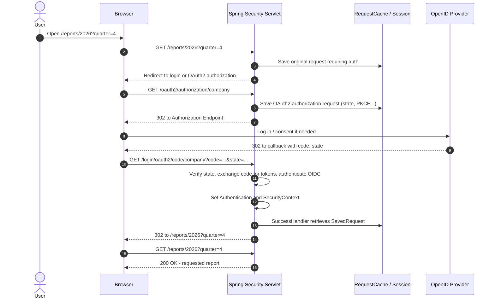

# 7.10. AuthenticationSuccessHandler, Saved Requests, and Post-Login Navigation

In a **Spring Security OAuth 2.0/OIDC Client** application running on the **Servlet stack**, users often open a page requiring authentication before logging in. For example, they click a report link `/reports/2026?quarter=4`, get redirected to an OpenID Provider (Google, Keycloak, Microsoft Entra ID, etc.), finish logging in, and expect to **return to that exact original report**. In other cases, users explicitly click a "Sign in" button from the home page and simply need to land on `/dashboard` after authenticating.

Spring Security addresses both needs via **`AuthenticationSuccessHandler`** and the **saved request** mechanism. To customize navigation properly, you need to know when a request is saved, what decides the destination URL by default, how saved requests take precedence over a default page, and how to guard against open redirects.

This article uses **Spring Security OAuth2 Login on Spring MVC/Servlet**. Java examples follow modern Spring Security 6/7 APIs configured with `SecurityFilterChain`; when using Spring WebFlux, the corresponding interfaces and filters differ.

## 1. Three Core Components

| Component | Role | Example |
|---|---|---|
| `AuthenticationSuccessHandler` | Invoked after Spring Security authenticates successfully; determines the next HTTP response, typically a redirect | Redirecting to a saved request or `/dashboard` |
| `RequestCache` | Saves the request the user tried to access before authentication was required, and allows retrieving it | `HttpSessionRequestCache` |
| `SavedRequest` | Representation of the original saved request used to restore navigation | URL `/reports/2026?quarter=4` and needed request details |

The most important class in default configuration:

**`SavedRequestAwareAuthenticationSuccessHandler`** is an `AuthenticationSuccessHandler` implementation that can **prioritize a saved request**. If no saved request exists, the handler uses the default target URL. Because it extends `SimpleUrlAuthenticationSuccessHandler`, it also provides options such as `defaultTargetUrl`, `alwaysUseDefaultTargetUrl`, and `targetUrlParameter`.

Keep these distinctions clear:

- **Successful login**: Spring Security has validated the OIDC ID Token/identity and created a valid `Authentication`.
- **Success handler**: the HTTP handling step **after** authentication succeeds; it is not responsible for exchanging authorization codes or validating tokens.
- **Saved request**: the application request the user wanted to access **before login**, not the callback from the IdP.
- **OAuth2 Login Redirect URI**: a relatively fixed endpoint such as `/login/oauth2/code/company` where Spring receives `code` and `state`.
- **Success target URL**: where the browser goes **after** the callback has been processed successfully, e.g., `/reports/2026`.

## 2. Complete Timeline: From Deep Link to Destination Page

Suppose an unauthenticated user visits:

```text
GET https://portal.example.test/reports/2026?quarter=4
```

`/reports/**` is protected. Spring Security requires OIDC login via the `ClientRegistration` named `company`:



**Key point:** success at the OIDC callback does not mean the browser will always go to `/dashboard`. By default, if a **valid saved request** exists, Spring prioritizes sending the user back to the exact resource that was blocked earlier.

If the user did not visit a protected resource before starting login (for instance, they clicked a login button on a public page), there will **not necessarily be a saved request**. Spring then uses the default target URL, typically `/` unless configured otherwise.

### 2.1. Classes participating in the flow

Key components on the Servlet stack:

1. **`ExceptionTranslationFilter`** detects when authentication must begin and uses `RequestCache` to save the request before calling `AuthenticationEntryPoint`.
2. **`HttpSessionRequestCache`** typically stores the info as a `DefaultSavedRequest` in the HTTP session.
3. **`OAuth2AuthorizationRequestRedirectFilter`** initiates OAuth2 login and redirects the browser to the Authorization Endpoint.
4. **`OAuth2LoginAuthenticationFilter`** processes the provider callback, exchanges the code, and produces the authentication result.
5. **`AuthenticationSuccessHandler`** is invoked when authentication succeeds to navigate after login.
6. **`RequestCacheAwareFilter`** can restore/wrap the request to match the saved one when the browser returns to the target URL, depending on request cache configuration.

Not every request passing through the system is saved. The request cache only participates in configured scenarios, primarily when accessing a resource requiring authentication and triggering the login flow.

## 3. Saved Request vs. OAuth2 Authorization Request

These are two states easily confused when debugging OIDC.

| Aspect | **Saved request** | **OAuth2 authorization request** |
|---|---|---|
| Purpose | Remembers **the page the user wanted to visit before login** | Remembers **the authorization request** Spring sent to the IdP for callback validation |
| Data example | URL `/reports/2026?quarter=4`, method, relevant headers/parameters | `client_id`, `redirect_uri`, `state`, scopes, PKCE, and related metadata |
| Spring Security interface | `RequestCache` / `SavedRequest` | `AuthorizationRequestRepository<OAuth2AuthorizationRequest>` |
| Common implementation | `HttpSessionRequestCache` | `HttpSessionOAuth2AuthorizationRequestRepository` |
| When used? | After authentication succeeds, to return to the resource | At callback, to verify `state` and complete the OAuth2 flow |
| If lost | User may be sent to the default URL | Callback can fail because authorization request is missing or `state` mismatches |

Example:

```text
Saved request:
GET /reports/2026?quarter=4

OAuth2 authorization request:
response_type=code
client_id=portal-client
redirect_uri=https://portal.example.test/login/oauth2/code/company
state=RANDOM_STATE
scope=openid profile email

OAuth2 callback:
GET /login/oauth2/code/company?code=...&state=...

Success target:
GET /reports/2026?quarter=4
```

The fact that Spring uses the session to store both types of data **does not mean they are the same object**. Manually deleting session attributes or swapping the request cache can break one of the two features. When diagnosing "login succeeded, yet didn't return to the original page", check the **saved request**; when the callback reports a `state` error, check the **authorization request repository** and session.

## 4. Default Behavior of OAuth2 Login

In Servlet apps, Spring Security is commonly enabled like this:

```java
import org.springframework.context.annotation.Bean;
import org.springframework.context.annotation.Configuration;
import org.springframework.security.config.Customizer;
import org.springframework.security.config.annotation.web.builders.HttpSecurity;
import org.springframework.security.web.SecurityFilterChain;

@Configuration
public class SecurityConfig {

    @Bean
    SecurityFilterChain securityFilterChain(HttpSecurity http) throws Exception {
        http
            .authorizeHttpRequests(authorize -> authorize
                .requestMatchers("/", "/error").permitAll()
                .requestMatchers("/reports/**", "/account/**").authenticated()
                .anyRequest().authenticated()
            )
            .oauth2Login(Customizer.withDefaults());

        return http.build();
    }
}
```

In this basic config, `oauth2Login` uses success handling aligned with Spring Security's saved request mechanism. `SavedRequestAwareAuthenticationSuccessHandler` is the standard default handler for this kind of login flow.

Suppose a controller exposes an endpoint:

```java
import org.springframework.web.bind.annotation.GetMapping;
import org.springframework.web.bind.annotation.RequestParam;
import org.springframework.web.bind.annotation.RestController;

@RestController
public class ReportController {

    @GetMapping("/reports/2026")
    public String report(@RequestParam String quarter) {
        return "Quarter " + quarter + " report";
    }
}
```

If the user is unauthenticated, a request to `/reports/2026?quarter=4` can be saved and routed through login. After login succeeds, Spring can redirect back to that exact request so the controller returns data in the authenticated session.

There is no need to write a custom `AuthenticationSuccessHandler` to get "visit a page, log in, return to that page" behavior **if the default request cache already satisfies your design**.

### 4.1. When the user starts login directly

Suppose a public page contains the link:

```html
<a href="/oauth2/authorization/company">Sign in with company account</a>
```

The user clicks this link without first accessing a protected resource. In that case, there is normally no saved request to return to. The handler falls back to the configured **default target URL**.

Note that `/oauth2/authorization/company` is the **Spring application's** login initiation URL, not a saved destination and not the Redirect URI callback `/login/oauth2/code/company`.

## 5. How Does `SavedRequestAwareAuthenticationSuccessHandler` Work?

The default handler's behavior can be expressed as an algorithm:

```text
Authentication succeeds
        |
        v
Is forced default target configured?
        | Yes
        v
Clear relevant saved request, redirect to default target
        |
        +---- No -----> Is a valid targetUrlParameter configured?
                               | Yes
                               v
                         Process that target per configuration
                               |
                               +-- No ---> Does SavedRequest exist?
                                                | Yes
                                                v
                                         Redirect to saved URL
                                                |
                                                +-- No ---> Default target URL
```

Key points:

- `defaultTargetUrl` is the fallback destination when no higher-priority target exists; defaults to `/`.
- `alwaysUseDefaultTargetUrl=true` means **ignore any saved request**, redirect to the default URL, and clear the saved request.
- `targetUrlParameter` allows a request parameter to specify the target in certain handler setups; enforce strict validation if enabled.
- When the handler redirects to a saved request, the saved entry may remain until the next request so `RequestCacheAwareFilter` can match and restore needed details; do not manually clear the session between the two steps.
- The handler navigates using the request cache; it **does not grant access permissions** at the target URL. The new request still passes through the security filter chain and authorization rules.

Configuring a custom handler alters this path if your code does not invoke a handler capable of reading the saved request.

## 6. `defaultSuccessUrl`: The Simplest Customization

For many projects, you do not need a custom handler class. The Spring Security DSL lets you set the default URL:

```java
http.oauth2Login(oauth2 -> oauth2
    .defaultSuccessUrl("/dashboard")
);
```

This sets the **fallback destination page**. If a saved request existed prior to login, prioritizing the saved request remains active under default behavior.

### 6.1. Two overloads and their difference

```java
// A: saved request takes priority; /dashboard is fallback.
http.oauth2Login(oauth2 -> oauth2
    .defaultSuccessUrl("/dashboard", false)
);

// B: after every successful OAuth2 Login, always prefer /dashboard.
http.oauth2Login(oauth2 -> oauth2
    .defaultSuccessUrl("/dashboard", true)
);
```

The single-argument form matches "default URL when no priority target exists":

```java
http.oauth2Login(oauth2 -> oauth2
    .defaultSuccessUrl("/dashboard")
);
```

Comparison table:

| Scenario | `defaultSuccessUrl("/dashboard", false)` | `defaultSuccessUrl("/dashboard", true)` |
|---|---|---|
| User opens `/reports/2026` before login | Returns to `/reports/2026` if saved request exists | Goes to `/dashboard` |
| User clicks login on a public page | Goes to `/dashboard` when no saved request exists | Goes to `/dashboard` |
| Old saved request in session | May take priority when applicable | Ignored/cleared as handler uses default target |
| Intended use | Deep links, bookmarks, email links, return-to-page UX | Product requires one fixed landing page after every login |

**Choose `true` deliberately.** If your app relies on deep links such as reports, orders, or documents, sending every login to the dashboard makes users lose context.

### 6.2. Complete SecurityFilterChain example

```java
import org.springframework.context.annotation.Bean;
import org.springframework.context.annotation.Configuration;
import org.springframework.security.config.annotation.web.builders.HttpSecurity;
import org.springframework.security.web.SecurityFilterChain;

@Configuration
public class SecurityConfig {

    @Bean
    SecurityFilterChain securityFilterChain(HttpSecurity http) throws Exception {
        http
            .authorizeHttpRequests(authorize -> authorize
                .requestMatchers("/", "/error", "/public/**").permitAll()
                .anyRequest().authenticated()
            )
            .oauth2Login(oauth2 -> oauth2
                .defaultSuccessUrl("/dashboard", false)
            );

        return http.build();
    }
}
```

Here `/dashboard` and post-login routes must exist in the application; `.defaultSuccessUrl` does not create controllers or HTML pages automatically.

### 6.3. Why avoid writing a success handler just for a fixed redirect?

If the sole goal is "every successful login goes to `/dashboard`", using:

```java
.oauth2Login(oauth2 -> oauth2
    .defaultSuccessUrl("/dashboard", true)
)
```

is already enough. Writing a custom handler just to call `response.sendRedirect("/dashboard")` makes it easy to forget context paths, saved requests, cleanup logic, and Spring's standard redirect strategy.

## 7. When Do You Need a Custom `AuthenticationSuccessHandler`?

A custom handler is appropriate when you need **extra actions at the moment login succeeds**, such as:

- Recording a successful login audit event without logging secrets or tokens.
- Choosing a landing page based on mapped internal roles.
- Syncing minimal profile info or running controlled business logic.
- Applying different navigation rules across `ClientRegistration`s or tenants.
- Handling custom UI flows needing consistent redirect behavior.

Crucially, a custom handler **must perform the redirect itself**, and if you want to keep saved request behavior, it must use `RequestCache` or delegate to `SavedRequestAwareAuthenticationSuccessHandler`.

### 7.1. Safe pattern: delegate to the default handler

Example creating a handler that logs an event (without printing tokens or sensitive details), then **delegates navigation** to `SavedRequestAwareAuthenticationSuccessHandler`.

```java
import jakarta.servlet.ServletException;
import jakarta.servlet.http.HttpServletRequest;
import jakarta.servlet.http.HttpServletResponse;

import java.io.IOException;

import org.slf4j.Logger;
import org.slf4j.LoggerFactory;
import org.springframework.security.core.Authentication;
import org.springframework.security.web.authentication.AuthenticationSuccessHandler;
import org.springframework.security.web.authentication.SavedRequestAwareAuthenticationSuccessHandler;
import org.springframework.security.web.savedrequest.RequestCache;

public final class AuditingLoginSuccessHandler
        implements AuthenticationSuccessHandler {

    private static final Logger log =
        LoggerFactory.getLogger(AuditingLoginSuccessHandler.class);

    private final SavedRequestAwareAuthenticationSuccessHandler delegate;

    public AuditingLoginSuccessHandler(RequestCache requestCache) {
        this.delegate = new SavedRequestAwareAuthenticationSuccessHandler();
        this.delegate.setRequestCache(requestCache);
        this.delegate.setDefaultTargetUrl("/dashboard");
        this.delegate.setAlwaysUseDefaultTargetUrl(false);
    }

    @Override
    public void onAuthenticationSuccess(
            HttpServletRequest request,
            HttpServletResponse response,
            Authentication authentication)
            throws IOException, ServletException {

        // Illustrates an event only; never log principal claims or tokens.
        log.info("OAuth2/OIDC login completed successfully");

        // Preserves saved request priority and default cleanup.
        delegate.onAuthenticationSuccess(request, response, authentication);
    }
}
```

Register the same `RequestCache` for both the filter chain and the handler:

```java
import org.springframework.context.annotation.Bean;
import org.springframework.context.annotation.Configuration;
import org.springframework.security.config.annotation.web.builders.HttpSecurity;
import org.springframework.security.web.SecurityFilterChain;
import org.springframework.security.web.savedrequest.HttpSessionRequestCache;
import org.springframework.security.web.savedrequest.RequestCache;

@Configuration
public class SecurityConfig {

    @Bean
    RequestCache requestCache() {
        return new HttpSessionRequestCache();
    }

    @Bean
    AuditingLoginSuccessHandler loginSuccessHandler(RequestCache requestCache) {
        return new AuditingLoginSuccessHandler(requestCache);
    }

    @Bean
    SecurityFilterChain securityFilterChain(
            HttpSecurity http,
            RequestCache requestCache,
            AuditingLoginSuccessHandler loginSuccessHandler)
            throws Exception {

        http
            .authorizeHttpRequests(authorize -> authorize
                .requestMatchers("/", "/error").permitAll()
                .anyRequest().authenticated()
            )
            .requestCache(cache -> cache.requestCache(requestCache))
            .oauth2Login(oauth2 -> oauth2.successHandler(loginSuccessHandler));

        return http.build();
    }
}
```

Benefits of delegating:

- Avoids reimplementing saved request retrieval logic.
- Reuses Spring Security's redirect strategy and cleanup handling.
- Lets you configure a fallback default target when no saved request exists.
- Lets you add telemetry or brief business hooks before redirecting.

If auditing or syncing operations can be slow or fail, design appropriate retries, transactions, error policies, and observability. Never let the OIDC callback hang because of a non-critical analytics service.

### 7.2. `successHandler(...)` vs. `defaultSuccessUrl(...)`

Both APIs affect how the **post-login** response is sent:

```java
.oauth2Login(oauth2 -> oauth2
    .defaultSuccessUrl("/dashboard")
)
```

and:

```java
.oauth2Login(oauth2 -> oauth2
    .successHandler(customSuccessHandler)
)
```

When using a custom handler, **that handler is responsible for choosing the URL and completing the response**. Do not assume `defaultSuccessUrl` automatically chains in the order you expect with an arbitrary custom handler. Within one filter chain, choose **one clear success-handling strategy**, configuring any default target inside the handler if needed.

## 8. Role-Based Navigation While Still Prioritizing Saved Requests

A common requirement:

- If the user opened a protected page before logging in, **return to that page**.
- If they explicitly logged in from a public page, users with `ROLE_ADMIN` go to `/admin`, while regular users go to `/home`.

One implementation combines `RequestCache`, `SavedRequestAwareAuthenticationSuccessHandler`, and two immutable `SimpleUrlAuthenticationSuccessHandler` instances without mutating target URLs across requests.

### 8.1. Custom handler

```java
import jakarta.servlet.ServletException;
import jakarta.servlet.http.HttpServletRequest;
import jakarta.servlet.http.HttpServletResponse;

import java.io.IOException;

import org.springframework.security.core.Authentication;
import org.springframework.security.web.authentication.AuthenticationSuccessHandler;
import org.springframework.security.web.authentication.SavedRequestAwareAuthenticationSuccessHandler;
import org.springframework.security.web.authentication.SimpleUrlAuthenticationSuccessHandler;
import org.springframework.security.web.savedrequest.RequestCache;

public final class RoleAwareLoginSuccessHandler
        implements AuthenticationSuccessHandler {

    private final RequestCache requestCache;

    private final SavedRequestAwareAuthenticationSuccessHandler savedHandler;

    private final SimpleUrlAuthenticationSuccessHandler adminHandler =
        new SimpleUrlAuthenticationSuccessHandler("/admin");

    private final SimpleUrlAuthenticationSuccessHandler userHandler =
        new SimpleUrlAuthenticationSuccessHandler("/home");

    public RoleAwareLoginSuccessHandler(RequestCache requestCache) {
        this.requestCache = requestCache;
        this.savedHandler = new SavedRequestAwareAuthenticationSuccessHandler();
        this.savedHandler.setRequestCache(requestCache);
    }

    @Override
    public void onAuthenticationSuccess(
            HttpServletRequest request,
            HttpServletResponse response,
            Authentication authentication)
            throws IOException, ServletException {

        if (requestCache.getRequest(request, response) != null) {
            // User opened a protected URL prior to login.
            savedHandler.onAuthenticationSuccess(request, response, authentication);
            return;
        }

        boolean admin = authentication.getAuthorities().stream()
            .anyMatch(a -> "ROLE_ADMIN".equals(a.getAuthority()));

        if (admin) {
            adminHandler.onAuthenticationSuccess(request, response, authentication);
        } else {
            userHandler.onAuthenticationSuccess(request, response, authentication);
        }
    }
}
```

The handlers are created with **fixed, application-controlled URLs**. Never call `setDefaultTargetUrl(...)` on a singleton handler per request to switch between admin and user: that introduces a **race condition** under concurrent logins.

### 8.2. Wiring into `HttpSecurity`

```java
@Bean
RoleAwareLoginSuccessHandler roleAwareLoginSuccessHandler(RequestCache cache) {
    return new RoleAwareLoginSuccessHandler(cache);
}

@Bean
SecurityFilterChain securityFilterChain(
        HttpSecurity http,
        RequestCache cache,
        RoleAwareLoginSuccessHandler successHandler) throws Exception {

    http
        .authorizeHttpRequests(authorize -> authorize
            .requestMatchers("/", "/error").permitAll()
            .requestMatchers("/admin/**").hasRole("ADMIN")
            .anyRequest().authenticated()
        )
        .requestCache(requestCache -> requestCache.requestCache(cache))
        .oauth2Login(oauth2 -> oauth2.successHandler(successHandler));

    return http.build();
}
```

This assumes a `RequestCache` bean backed by `HttpSessionRequestCache` is declared as in the previous example, and `RoleAwareLoginSuccessHandler` is present in the project.

**Note on roles:** `ROLE_ADMIN` in this example must be **reliably mapped** from an internal authorization system or verified identity data. OIDC scopes `profile`, `email`, or the presence of an `email` claim **do not automatically grant** the `ROLE_ADMIN` authority.

### 8.3. Why not apply role redirects before the saved request?

If role landing took priority first, a user clicking `/orders/123` and logging in would be sent to `/home` or `/admin` instead of reaching the order as intended. For applications where deep links are primary behavior, the right order is:

```text
Does a valid saved request exist?
  Yes -> return to pre-login resource
  No  -> apply role-based landing page
```

If the product explicitly requires "always land on the dashboard after login", you can deliberately flip that priority. Document this clearly in the design, as it differs from default saved request behavior.

## 9. Using the ClientRegistration Name to Choose a Destination Page

An application might support two IdPs: customers sign in via `customer`, and staff via `staff`. Successful OAuth2 Login typically creates an `OAuth2AuthenticationToken` exposing the registration ID.

```java
import org.springframework.security.authentication.AbstractAuthenticationToken;
import org.springframework.security.core.Authentication;
import org.springframework.security.oauth2.client.authentication.OAuth2AuthenticationToken;

public final class RegistrationTargets {

    public static String fallbackTarget(Authentication authentication) {
        if (authentication instanceof OAuth2AuthenticationToken oauth2) {
            return switch (oauth2.getAuthorizedClientRegistrationId()) {
                case "staff" -> "/staff/home";
                case "customer" -> "/customer/home";
                default -> "/home";
            };
        }

        return "/home";
    }
}
```

Here the paths form a **static application allowlist**. Signing in through registration `staff` does not by itself prove the user is an employee allowed into all internal pages; membership/roles must still be verified during authorization checks.

To combine this with saved requests, follow the handler pattern in section 8: delegate if a saved request exists; otherwise pick a fixed handler URL by registration ID. Never construct redirect URLs from user-supplied query strings.

## 10. `RequestCache` and `HttpSessionRequestCache`

### 10.1. How is a request stored?

`RequestCache` is the abstraction for saving, retrieving, and removing requests intercepted prior to authentication.

Common methods:

```java
void saveRequest(
    HttpServletRequest request,
    HttpServletResponse response
);

SavedRequest getRequest(
    HttpServletRequest request,
    HttpServletResponse response
);

HttpServletRequest getMatchingRequest(
    HttpServletRequest request,
    HttpServletResponse response
);

void removeRequest(
    HttpServletRequest request,
    HttpServletResponse response
);
```

`HttpSessionRequestCache` typically stores `SavedRequest` in the HTTP session as `DefaultSavedRequest`. Redirect responses do not automatically replay a previously submitted POST body; request caches mainly help browsers navigate back to the target URL.

### 10.2. Declaring RequestCache explicitly

```java
import org.springframework.context.annotation.Bean;
import org.springframework.security.web.savedrequest.HttpSessionRequestCache;
import org.springframework.security.web.savedrequest.RequestCache;

@Bean
RequestCache requestCache() {
    return new HttpSessionRequestCache();
}
```

Attach it to the security chain:

```java
http.requestCache(cache -> cache.requestCache(requestCache));
```

If a custom success handler also accesses the request cache, **use the exact same bean/instance** across both the chain and the handler. This keeps lookup, removal, and restoration behavior consistent.

In modern Spring Security versions, the request cache may optimize matching via query parameters such as `continue`. When customizing `HttpSessionRequestCache` or implementing `RequestCache`, consult the API documentation for your exact version so `getMatchingRequest` and `getRequest` behave as expected.

### 10.3. When to use `NullRequestCache`?

An application may serve pure JSON REST APIs and not want to cache requests or redirect browsers to login. For an API branch using bearer tokens or returning 401, you can use:

```java
import org.springframework.security.web.savedrequest.NullRequestCache;

http.requestCache(cache -> cache.requestCache(new NullRequestCache()));
```

`NullRequestCache` does not store requests. When OAuth2 Login uses this request cache, there is no saved request for the handler to restore, so it uses the fallback or custom logic.

**Do not accidentally apply `NullRequestCache` to the entire web filter chain** if the product requires "viewing page X, logging in, returning to page X". Mixed web-and-API apps should consider separate `SecurityFilterChain` beans by matcher, each with appropriate authentication and request cache behavior.

### 10.4. Should every HTTP method be cached?

Saved requests make sense primarily for **page-navigation GETs**. Suppose an unauthenticated user sends:

```http
POST /orders HTTP/1.1
Content-Type: application/json

{"productId": 123, "quantity": 1}
```

After login, a browser receiving a redirect is not guaranteed to resend the original POST body, and replaying state-changing operations carries risk. Resource creation/update APIs should return an appropriate authentication error (e.g., 401) so the Client/SPA can re-issue the request after authenticating or prompt the user to confirm. Never rely on saved requests to safely replay POST/PUT/DELETE operations.

If business workflows require returning after login, save the user's **intent** via a dedicated controlled mechanism and restore the UI screen, while re-executing state changes under an explicit design with proper CSRF and idempotency.

## 11. Saved Requests and Sessions: What Happens When the Session Is Lost?

In the OAuth2 Authorization Code Flow, the browser leaves the application for the IdP. Upon returning to the callback, Spring needs to look up data related to the login flow. Losing the HTTP session causes two distinct failure modes:

1. **Authorization request lost:** Spring cannot verify `state` or recover PKCE data; login fails right at the callback.
2. **Saved request lost while authorization request survives:** login may succeed, yet Spring does not know the original page to return to; the success handler falls back.

Common causes:

- The browser did not send the session cookie back after redirects.
- Callback hostname differed from the cookie's host, or `SameSite`/`Secure`/`Domain`/`Path` settings were incompatible.
- A reverse proxy altered the public scheme or host and produced an incorrect callback.
- The app runs multiple instances without consistent session management.
- The session timed out while the user was at the IdP's login page.
- Application/custom code cleared the session or saved request attribute at the wrong moment.
- Stateless session configuration was placed on a filter chain running HTTP-session-based OAuth2 Login.

Spring Security's **session fixation protection** may rotate the session ID after successful authentication; in standard setups, this is a normal protective measure. Never resolve redirect issues by disabling session fixation protection.

### 11.1. Reverse proxies and public URLs

Suppose the browser visits `https://portal.example.test`, while Spring receives connections on `http://internal-service:8080`. If forwarded headers are misconfigured, `{baseUrl}` in the OAuth2 Redirect URI may produce an internal URL.

Behind a trusted proxy, Spring Boot may need:

```yaml
server:
  forward-headers-strategy: framework
```

Exact settings depend on infrastructure. Trust `Forwarded` or `X-Forwarded-*` headers only from proxies you control. Fixing a broken callback URL involves the **OAuth2 Redirect URI**; fixing the post-login destination URL involves the **saved request** or success handler. Verify both redirect steps separately.

### 11.2. `SameSite` cookies and callbacks

The default Authorization Code Flow normally returns to the callback via a GET browser redirect; with properly configured session cookies, `SameSite=Lax` generally handles this flow well. If a provider uses `response_mode=form_post` or another cross-site POST callback flow, cookie policies may need separate handling. Never loosen cookie settings indiscriminately; evaluate HTTPS, `Secure`, CSRF, browser policies, and actual requirements.

## 12. Avoiding Open Redirects in Post-Login Navigation

Some applications add a parameter like:

```text
/login?returnTo=https://evil.example.test
```

and after login execute:

```java
response.sendRedirect(request.getParameter("returnTo"));
```

This is an **open redirect vulnerability pattern**: an attacker can abuse a URL on the app's legitimate domain as a springboard to send users to a phishing site.

### 12.1. Do not trust `targetUrlParameter` by default

`SimpleUrlAuthenticationSuccessHandler` supports a `targetUrlParameter` option. When enabled, request input can directly influence the redirect URL, requiring strict validation. Never enable it just for `?next=...` convenience while letting users supply arbitrary URLs.

For typical web applications, prefer:

- Using `SavedRequestAwareAuthenticationSuccessHandler` for URLs saved by Spring itself during the auth flow.
- Using fixed internal paths such as `/dashboard`, `/admin`, `/home`.
- If custom `returnTo` is needed, accepting only internal paths on a business-route allowlist.
- Never redirecting to `javascript:`, `data:`, protocol-relative `//evil.example.test`, unvalidated path traversals, or directly specified external hosts.
- Never relying on an unvalidated HTTP `Referer` header to pick a redirect URL.

### 12.2. Example allowlist validation for redirect targets

A simple approach is **mapping user choices to fixed routes**:

```java
public final class SafeLandingPage {

    private SafeLandingPage() {}

    public static String fromChoice(String choice) {
        if ("reports".equals(choice)) {
            return "/reports";
        }
        if ("account".equals(choice)) {
            return "/account";
        }
        return "/dashboard";
    }
}
```

This is safer than passing arbitrary URLs straight into `sendRedirect`. Still, **saving and restoring that choice across the OAuth2 flow** must be designed safely; never append arbitrary parameters to the callback or bypass `state`.

### 12.3. Saved requests also require trusted host infrastructure

Saved requests are built from incoming HTTP requests to the application. Behind a reverse proxy, trusting `Host`/`Forwarded` headers from uncontrolled sources can inject unintended absolute URLs into redirects. Therefore, besides using `RequestCache` properly, configure canonical hosts, reverse proxies, and trusted forwarded headers.

## 13. Post-Login Navigation in SPAs and APIs

Not every client expects a browser redirect after login.

### 13.1. Server-rendered MVC web apps

Users open HTML pages, Spring establishes the login session, and returns HTTP 302 to the resource. This is the natural fit for `SavedRequestAwareAuthenticationSuccessHandler`.

```text
GET /invoices/42
  -> 302 /login
  -> OIDC login
  -> 302 /invoices/42
  -> 200 HTML
```

### 13.2. SPAs with a backend session

If React/Vue/Angular starts login via **top-level browser navigation**, the Spring backend still receives the OIDC callback. After creating the session, the handler typically redirects to a valid SPA route:

```text
https://frontend.example.test/app
```

When the SPA and backend live on different origins, cookies, CORS, CSRF, `SameSite`, and callbacks require clear design. Never pass access tokens or ID Tokens in SPA URL query strings just to signal "login complete".

A simpler option on the same origin is using an internal path `/app`. If the frontend is on another origin, use only URLs from **trusted server configuration and an allowlist**, never accepting hosts from unvalidated request parameters.

### 13.3. REST APIs returning JSON

An API endpoint called by JavaScript or a mobile app usually does not want an HTTP 302 to a login page when unauthenticated. For APIs, a sound strategy is returning 401/403 and letting the Client drive the login flow. Web default request caching is not necessarily appropriate here.

If a Spring app serves both web sessions and APIs, consider splitting `SecurityFilterChain` beans by `securityMatcher` and explicitly defining the authentication entry point, `RequestCache`, and success behavior for each resource type.

## 14. Common Mistakes When Writing a Custom Success Handler

### Mistake 1: Overriding the handler and losing saved requests

```java
.oauth2Login(oauth2 -> oauth2
    .successHandler((request, response, authentication) ->
        response.sendRedirect("/dashboard")
    )
)
```

This code always redirects to `/dashboard`. When preserving deep links is required, it breaks default behavior. Use `defaultSuccessUrl("/dashboard", false)` or delegate to `SavedRequestAwareAuthenticationSuccessHandler`.

Additionally, `sendRedirect("/dashboard")` interprets URLs depending on servlet/container/context path; Spring's handlers and `RedirectStrategy` handle web apps with context paths more reliably.

### Mistake 2: Mutating target URLs on a singleton handler per user

```java
// Avoid mutating shared singleton configuration per request.
sharedHandler.setDefaultTargetUrl(isAdmin ? "/admin" : "/home");
sharedHandler.onAuthenticationSuccess(request, response, authentication);
```

Concurrent login requests can overlap. User A and User B can overwrite each other's target before the redirect happens. Use fixed handlers, choose targets per request using local variables and a redirect strategy, or keep selection logic free of shared mutable state.

### Mistake 3: Using `Referer` unchecked as the success target

```java
String previous = request.getHeader("Referer");
response.sendRedirect(previous);
```

`Referer` may be missing, spoofed, contain an external URL, or point to a page users should not be sent back to. It is not a trustworthy source for authentication redirects.

### Mistake 4: Treating the callback as the saved destination

```text
/login/oauth2/code/company
```

is the OAuth2 callback, not the user's original page. If a success handler redirects back to the callback with `code`/`state`, you risk already-used-code errors, redirect loops, or data exposure. A normal success target must be an application resource.

### Mistake 5: Equating OIDC claims with internal roles

`OidcUser` may contain `email`, `name`, `groups`, or provider-specific claims. Never inspect an arbitrary claim to decide whether to redirect to an admin page without verifying and mapping it through a trusted authorization model. Redirecting to `/admin` also **does not replace** the `hasRole("ADMIN")` rule protecting admin routes.

### Mistake 6: Using the request cache to replay POSTs

Saved requests restore URL navigation; they are not an HTTP task queue and do not replace safeguards against duplicate orders or payments. Data-modifying actions should prompt re-confirmation or be designed for idempotency.

### Mistake 7: Writing both JSON and a redirect in the same response

A success handler can only complete one HTTP response for the callback. After calling `sendRedirect`, do not write JSON to the response or invoke another handler. Decide the response format cleanly based on frontend architecture.

## 15. Real-World Issues and How to Isolate Them

| Symptom | Common cause | What to check |
|---|---|---|
| Always returns to `/` after login | No saved request and no default target configured | Check `defaultSuccessUrl` and where users initiated login |
| Always lands on dashboard, ignoring deep links | `alwaysUseDefaultTargetUrl=true` or custom handler forces fixed redirect | Check `defaultSuccessUrl(..., true)` and `successHandler(...)` |
| Original destination is not remembered | Request bypassed caching entry point, `NullRequestCache`, or lost session | Check filter chain, `RequestCache`, cookies, and session |
| OIDC callback fails due to lost `state` | OAuth2 authorization request repository/session lost | Check callback, cookies, proxy, session affinity/shared session |
| Login succeeds, yet redirects to internal host | Incorrect proxy headers or callback/base URL | Check `{baseUrl}`, forwarded headers, and public host |
| Infinite 302 loop between login and target page | Auth session not persisted, cookies blocked, or route/matcher mismatch | Check `SecurityContext`, session, cookies, and authorization rules |
| User logs in, yet gets 403 on returned page | User authenticated, but **lacks permission** for the resource | Check roles/authorities and target page's authorization rules |
| Redirects to `/login/oauth2/code/company` and errors | Success handler mistakenly picked OAuth2 callback as success target | Change target to a real business route |
| Deep link query string disappears | URL saved/rewritten incorrectly or custom redirect dropped query | Inspect saved request and returned `Location` header |
| Logging in across two tabs lands on unexpected page | Concurrent flows in same session compete for saved request or state | Check initiation timing, session, and multi-tab handling |
| API receives HTML login page after login | Web login entry point applied to JSON API | Separate API config or return 401 appropriately |
| Role-based redirect goes to wrong page | Authorities not mapped from trusted authorization source | Check `Authentication.getAuthorities()`, mapping, and claims |
| `returnTo` redirects to unfamiliar domain | Trusted unvalidated target parameter | Allow only allowlisted routes and trusted URLs |

### 15.1. Inspecting the flow with Developer Tools

In development:

1. Open the browser Network tab and enable Preserve log if needed.
2. Visit a URL requiring login, e.g., `/reports/2026?quarter=4`.
3. Watch the redirect to the login page or `/oauth2/authorization/company`.
4. Complete login at the IdP; confirm the `/login/oauth2/code/company` callback.
5. Check the `Location` header right after the callback: does it point to the saved URL or default URL?
6. If the redirect is right yet the final page errors, check **authorization rules and session** on the new request.

Never share logs or network exports containing authorization codes, session cookies, access tokens, refresh tokens, or ID Tokens. Diagnosis usually only requires status codes, paths, and masked values.

### 15.2. Logging for diagnostics without leaking data

You can temporarily raise logging in development:

```yaml
logging:
  level:
    org.springframework.security: DEBUG
```

Lower the log level once no longer needed; filter sensitive headers/cookies/tokens. In custom handlers, log redirect decisions abstractly as "saved target" or "default target" rather than logging full URLs if query strings carry personal data.

## 16. End-to-End Practice Scenario

Suppose an application has:

- Public page `/`.
- Protected report at `/reports/2026?quarter=4`.
- Default page `/dashboard`.
- OIDC login via registration `company`.

Configuration:

```java
@Bean
SecurityFilterChain securityFilterChain(HttpSecurity http) throws Exception {
    http
        .authorizeHttpRequests(authorize -> authorize
            .requestMatchers("/", "/error").permitAll()
            .anyRequest().authenticated()
        )
        .oauth2Login(oauth2 -> oauth2
            .defaultSuccessUrl("/dashboard", false)
        );

    return http.build();
}
```

Consider each case:

| Scenario | Saved request? | Expected outcome |
|---|---|---|
| Unauthenticated user opens `/reports/2026?quarter=4` | Yes, if request hits properly configured request cache | Returns to `/reports/2026?quarter=4` after login |
| User on `/` clicks login link directly | Typically no | Goes to `/dashboard` after login |
| Already logged-in user opens `/reports/2026?quarter=4` | No new login flow needed | Views report immediately, per permissions |
| Changed to `defaultSuccessUrl("/dashboard", true)` | Saved request may exist yet is ignored | Every successful login goes to `/dashboard` |
| Replaced request cache with `NullRequestCache` | Not saved | Uses `/dashboard` instead of restoring deep link |
| Role handler from section 8, no saved request | No | Goes to `/admin` or `/home` per valid authority |

### 16.1. Self-practice questions

**Question 1.** A user visits `/orders/123`, gets sent to OIDC login, and always lands on `/dashboard` after the callback. Code uses `defaultSuccessUrl("/dashboard", true)`. What must change to prioritize the order page?

**Answer hint:** switch to `defaultSuccessUrl("/dashboard", false)` or the single-argument form, keeping an appropriate request cache. If it still fails to return to the order, verify the initial request was saved and the session survived.

**Question 2.** Login succeeds at the OP, yet the callback reports the original authorization request cannot be found. Should you replace `SavedRequestAwareAuthenticationSuccessHandler`?

**Answer hint:** that is not the first place to look. That failure occurs **before the success handler**, when Spring cannot recover the OAuth2 authorization request/`state`. Check sessions, the authorization request repository, callbacks, and cookies.

**Question 3.** An application needs role-based landing pages while preserving deep links. Should you call `setDefaultTargetUrl` on a singleton success handler per request?

**Answer hint:** no. That risks race conditions. Use a stateless strategy with fixed routes; let the delegate handle saved requests first, then pick a role-based landing page when no saved request exists.

**Question 4.** A user clicks "Pay", sending a POST, and is prompted to log in. After login, should you automatically replay the POST from the saved request?

**Answer hint:** no. Do not treat saved requests as a safe request body or transaction queue. After authentication, send the user to a confirmation screen or design an idempotent transaction workflow.

## 17. APIs to Remember

| API/Interface | Package or usage | Role |
|---|---|---|
| `AuthenticationSuccessHandler` | `org.springframework.security.web.authentication` | Extension point for handling responses after login succeeds |
| `SavedRequestAwareAuthenticationSuccessHandler` | `org.springframework.security.web.authentication` | Prioritizes saved request, then falls back to default target |
| `SimpleUrlAuthenticationSuccessHandler` | `org.springframework.security.web.authentication` | Handler redirecting to a simple URL |
| `RequestCache` | `org.springframework.security.web.savedrequest` | Saves/reads/removes requests awaiting login |
| `HttpSessionRequestCache` | `org.springframework.security.web.savedrequest` | Request cache backed by HTTP session |
| `NullRequestCache` | `org.springframework.security.web.savedrequest` | Does not save requests |
| `SavedRequest` / `DefaultSavedRequest` | `org.springframework.security.web.savedrequest` | Original request data |
| `ExceptionTranslationFilter` | `org.springframework.security.web.access` | Triggers authentication and caches requests when needed |
| `RequestCacheAwareFilter` | `org.springframework.security.web.savedrequest` | Helps restore saved requests |
| `OAuth2LoginAuthenticationFilter` | `org.springframework.security.oauth2.client.web` | Handles OAuth2 Login callbacks |
| `OAuth2AuthorizationRequestRedirectFilter` | `org.springframework.security.oauth2.client.web` | Builds/redirects authorization requests to the provider |
| `HttpSessionOAuth2AuthorizationRequestRepository` | `org.springframework.security.oauth2.client.web` | Stores authorization requests with `state` in the session |

Documentation for `SavedRequestAwareAuthenticationSuccessHandler`, `RequestCache`, and `SimpleUrlAuthenticationSuccessHandler` covers options like `setDefaultTargetUrl`, `setAlwaysUseDefaultTargetUrl`, `setTargetUrlParameter`, and `setRequestCache`.

## 18. References

- [Spring Security Reference — Servlet Authentication Architecture](https://docs.spring.io/spring-security/reference/servlet/authentication/architecture.html): authentication flow and `SecurityContext`.
- [Spring Security Reference — Servlet OAuth2 Login](https://docs.spring.io/spring-security/reference/servlet/oauth2/login/core.html): `ClientRegistration`, callbacks, and OAuth2 Login filters.
- [Spring Security Reference — ExceptionTranslationFilter](https://docs.spring.io/spring-security/reference/servlet/architecture.html): relationship between authentication, authorization, and intercepted request handling.
- [Spring Security API — SavedRequestAwareAuthenticationSuccessHandler](https://docs.spring.io/spring-security/reference/api/java/org/springframework/security/web/authentication/SavedRequestAwareAuthenticationSuccessHandler.html): saved request behavior and default targets.
- [Spring Security API — SimpleUrlAuthenticationSuccessHandler](https://docs.spring.io/spring-security/reference/api/java/org/springframework/security/web/authentication/SimpleUrlAuthenticationSuccessHandler.html): redirect strategy, default targets, and target parameter.
- [Spring Security API — HttpSessionRequestCache](https://docs.spring.io/spring-security/reference/api/java/org/springframework/security/web/savedrequest/HttpSessionRequestCache.html): saving and retrieving saved requests.
- [Spring Security API — RequestCache](https://docs.spring.io/spring-security/reference/api/java/org/springframework/security/web/savedrequest/RequestCache.html): request cache abstraction.
- [Spring Security API — AuthenticationSuccessHandler](https://docs.spring.io/spring-security/reference/api/java/org/springframework/security/web/authentication/AuthenticationSuccessHandler.html): post-authentication callback contract.

When designing navigation after OIDC Login, distinguish **the page the user wanted to visit before login**, **the provider's authentication callback**, and **the page shown after authentication**. For most MVC apps, `defaultSuccessUrl("/dashboard", false)` alongside the default request cache preserves deep links while providing a fallback. When complex logic is required, a custom `AuthenticationSuccessHandler` should reuse `SavedRequestAwareAuthenticationSuccessHandler`, strictly validate target URLs, and maintain a clean boundary between **navigation** and **authorization**.
