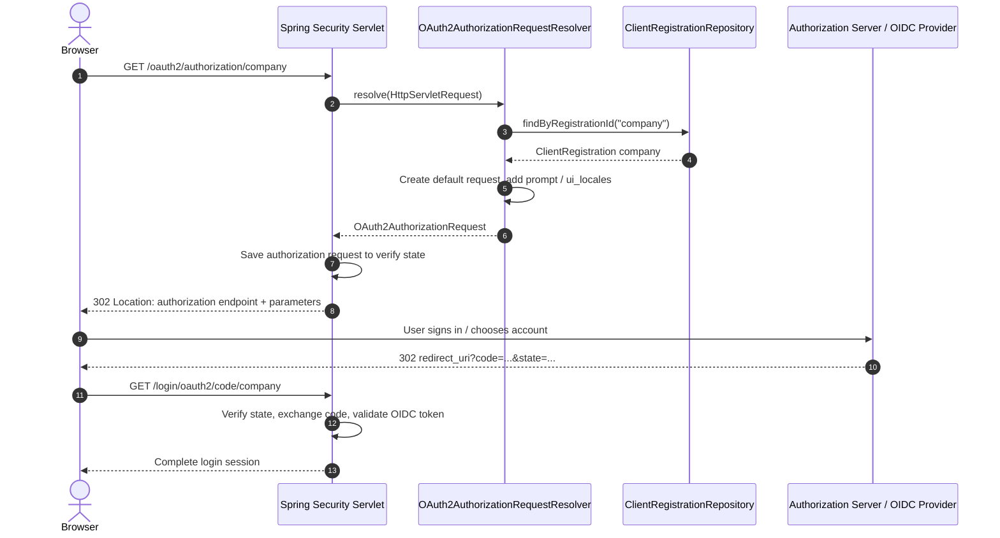

# 8.3. Customizing Authorization Requests per Registration

## 1. Problem: Same Application, Multiple Providers with Different Login Requirements

A **Spring Security OAuth 2.0/OIDC Client** application can connect to multiple Identity Providers (IdPs) through separate `ClientRegistration` entries. For example:

- `company`: employees sign in via the company's OIDC Provider. The UI should prefer Vietnamese and allow selecting an account.
- `partner`: partners sign in via another OIDC Provider. The application wants to require re-authentication when the authentication session is too old, and request an appropriate authentication assurance level.
- `google`: an integration using provider-specific parameters supported by Google for a specific business use case.

In all cases, Spring Security knows the **client ID, redirect URI, authorization endpoint, and scopes** from `ClientRegistration`. However, certain parameters for **each login initiation** can vary by registration: `prompt`, `login_hint`, `max_age`, `ui_locales`, `acr_values`, or provider-specific parameters.

Therefore, we need to know how to **customize the OAuth2 Authorization Request per `registrationId`** while preserving the protections built by Spring Security: `state`, `nonce`, PKCE, and the callback.

> **Goal:** After this lesson, you will be able to identify the registration from the request, add provider-appropriate parameters using `OAuth2AuthorizationRequestResolver`, configure it in `oauth2Login`, and understand why you should not build the entire authorization URL manually or arbitrarily override security parameters.

## 2. Where Does the Authorization Request Fit in the OAuth 2.0/OIDC Flow?

In the **Authorization Code flow**, the authorization request is the request that sends the user's browser to the **provider's Authorization Endpoint**. This request is typically represented as a URL with query parameters, for example:

```http
GET /authorize?response_type=code
    &client_id=employee-portal
    &redirect_uri=https%3A%2F%2Fportal.example.com%2Flogin%2Foauth2%2Fcode%2Fcompany
    &scope=openid%20profile
    &state=<random-state>
    &prompt=select_account
    &ui_locales=vi
HTTP/1.1
Host: id.company.example
```

The example is wrapped across lines for readability; an actual HTTP request sends the URL on a single properly encoded line.

### 2.1. Related Roles

| Component | Role |
| --- | --- |
| **`ClientRegistration`** | Relatively static configuration of an OAuth/OIDC client: `registrationId`, `clientId`, grant, scopes, endpoints, redirect URI |
| **`ClientRegistrationRepository`** | Stores and looks up `ClientRegistration` by registration ID in Servlet |
| **`OAuth2AuthorizationRequest`** | Represents **one authorization initiation request**: authorization URI, client ID, redirect URI, scopes, state, additional parameters, and attributes |
| **`OAuth2AuthorizationRequestResolver`** | From an HTTP request, selects the registration and creates `OAuth2AuthorizationRequest` |
| **`DefaultOAuth2AuthorizationRequestResolver`** | Default implementation handling `/oauth2/authorization/{registrationId}` |
| **`OAuth2AuthorizationRequestRedirectFilter`** | Uses the resolver to initiate the request and then returns a redirect to the Authorization Server |
| **`AuthorizationRequestRepository`** | Saves the authorization request between initiation and callback to verify state/context |
| **`OAuth2LoginAuthenticationFilter`** | Handles the authorization response containing `code` and `state` at the callback |
| **`OAuth2AuthorizedClient`** | Authorized state after tokens are obtained; distinct from the initial authorization request |

### 2.2. Processing Flow Diagram



Customizing the **authorization request** only affects the *login initiation* stage. It **does not mean** customizing the token request, client authentication, ID Token validation, or callback redirect handling.

## 3. Distinguishing Two Parameter Groups in the Authorization Request

### 3.1. Foundational OAuth 2.0 Parameters

| Parameter | Meaning | Who Should Manage It? |
| --- | --- | --- |
| `response_type=code` | Selects the Authorization Code flow | Spring Security based on registration/flow |
| `client_id` | Application identifier at the Authorization Server | `ClientRegistration` |
| `redirect_uri` | Callback receiving the authorization code | Registration + URI template resolution |
| `scope` | Permission scopes requested by the application | Registration, or tightly controlled logic |
| `state` | Binds the callback to the authorization request, mitigating CSRF/session mix-ups | **Generated and checked by Spring Security** |
| `code_challenge` | PKCE challenge sent in the authorization request | PKCE handler |
| `code_challenge_method` | Usually `S256` | PKCE handler |

These parameters directly affect flow validity. If you manually alter `state`, `redirect_uri`, `client_id`, or `code_challenge` without synchronizing related state, login can fail or lose essential protections.

### 3.2. OIDC and Provider Additional Parameters

| Parameter | Examples | Effect |
| --- | --- | --- |
| `prompt` | `login`, `consent`, `select_account`, `none` | Guides how the OP interacts with the user |
| `login_hint` | `employee@example.com` | Hints an account, username, or email to the OP |
| `max_age` | `300` | Requests a maximum age for the authentication session, in seconds |
| `ui_locales` | `vi`, `en` | Suggests preferred authentication UI languages |
| `acr_values` | ACR values published/supported by the OP | Requests an authentication assurance level/context |
| `domain_hint` | Value per provider documentation | Hints tenant/domain or identity routing; not a core OIDC parameter |
| `kc_idp_hint` | IdP alias in Keycloak if configured | Directs login to a linked IdP per Keycloak convention |
| `access_type` | `offline` per Google OAuth convention | Requests access type per Google policy; not a universal OIDC parameter |

Parameters outside core OAuth 2.0 may be **supported, ignored, or rejected** by the OP. Do not treat `domain_hint`, `kc_idp_hint`, or `access_type` as mandatory OIDC features.

**Note on `prompt`:** common OIDC values are `none`, `login`, `consent`, and `select_account`. `prompt=none` requests no interactive UI; if the OP cannot authenticate silently, it usually returns an error such as `login_required` or `interaction_required`. Do not combine `none` with prompt values requiring interaction. `prompt=login` asks the OP to re-authenticate according to policy; it does not by itself replace checking authentication age via `max_age` or verifying the `auth_time` claim.

### 3.3. Authorization Request Parameters vs. Internal Attributes

`OAuth2AuthorizationRequest` has two important data maps:

- **`additionalParameters`:** extra parameters that will appear in the authorization request URI when the builder constructs the URL, such as `prompt`, `ui_locales`, `max_age`, or `code_challenge` under PKCE.
- **`attributes`:** internal data used by Spring Security while processing the flow; not automatically sent to the Authorization Server simply because it was added to the attributes map. For example, the registration ID and PKCE `code_verifier` may live in attributes.

Example:

```java
OAuth2AuthorizationRequest modified = OAuth2AuthorizationRequest
        .from(original)
        .additionalParameters(params ->
                params.put("prompt", "select_account"))
        .build();
```

This is how to add the `prompt` parameter. If you replace `additionalParameters` with `attributes`, the OP will **not receive** that query parameter as intended.

**Do not put `code_verifier` into `additionalParameters` to send it immediately at the authorization endpoint.** With PKCE, the client sends **`code_challenge`** at the start of the flow, while **`code_verifier`** is only sent in the token request when exchanging the authorization code.

## 4. Creating Two ClientRegistrations to Illustrate Registration-Based Customization

The example uses **Spring Boot 3.x / Spring Security 6.x, Spring MVC/Servlet**. The URIs and login policies are illustrative data only.

### 4.1. Dependencies

Maven:

```xml
<dependencies>
    <dependency>
        <groupId>org.springframework.boot</groupId>
        <artifactId>spring-boot-starter-web</artifactId>
    </dependency>
    <dependency>
        <groupId>org.springframework.boot</groupId>
        <artifactId>spring-boot-starter-security</artifactId>
    </dependency>
    <dependency>
        <groupId>org.springframework.boot</groupId>
        <artifactId>spring-boot-starter-oauth2-client</artifactId>
    </dependency>
</dependencies>
```

`spring-boot-starter-oauth2-client` provides OAuth2 Login and the classes used in this lesson. This example uses **Servlet** APIs: `HttpSecurity`, `SecurityFilterChain`, `ClientRegistrationRepository`, and `OAuth2AuthorizationRequestResolver`, rather than WebFlux reactive interfaces.

### 4.2. `application.yml` Configuration

```yaml
server:
  port: 8080

spring:
  security:
    oauth2:
      client:
        registration:
          company:
            provider: company-idp
            client-id: ${COMPANY_CLIENT_ID}
            client-secret: ${COMPANY_CLIENT_SECRET}
            client-authentication-method: client_secret_basic
            authorization-grant-type: authorization_code
            redirect-uri: "{baseUrl}/login/oauth2/code/{registrationId}"
            scope:
              - openid
              - profile
              - email

          partner:
            provider: partner-idp
            client-id: ${PARTNER_CLIENT_ID}
            client-secret: ${PARTNER_CLIENT_SECRET}
            client-authentication-method: client_secret_basic
            authorization-grant-type: authorization_code
            redirect-uri: "{baseUrl}/login/oauth2/code/{registrationId}"
            scope:
              - openid
              - profile

        provider:
          company-idp:
            issuer-uri: https://id.company.example/realms/employees
          partner-idp:
            issuer-uri: https://login.partner.example/realms/partners
```

At each respective OP, you must register:

| Registration ID | Login Initiation URL in Spring | Allowed Redirect URI at OP |
| --- | --- | --- |
| `company` | `http://localhost:8080/oauth2/authorization/company` | `http://localhost:8080/login/oauth2/code/company` |
| `partner` | `http://localhost:8080/oauth2/authorization/partner` | `http://localhost:8080/login/oauth2/code/partner` |

The issuers are illustrative and not reachable endpoints. In a real deployment, each provider must support OIDC Discovery, Authorization Code, client authentication, and the declared scopes.

**`registrationId` is the key used within the Spring application.** It does not have to match the client ID on the OP; custom code selects policies using `registrationId`.

## 5. Simple Approach: Same Parameter for Every Registration

If all logins need `prompt=consent`, you can create a `DefaultOAuth2AuthorizationRequestResolver` and use its built-in customizer.

```java
import org.springframework.context.annotation.Bean;
import org.springframework.context.annotation.Configuration;
import org.springframework.security.oauth2.client.registration.ClientRegistrationRepository;
import org.springframework.security.oauth2.client.web.DefaultOAuth2AuthorizationRequestResolver;
import org.springframework.security.oauth2.client.web.OAuth2AuthorizationRequestResolver;

@Configuration
public class AuthorizationRequestConfig {

    @Bean
    OAuth2AuthorizationRequestResolver authorizationRequestResolver(
            ClientRegistrationRepository registrations) {

        var resolver = new DefaultOAuth2AuthorizationRequestResolver(
                registrations,
                "/oauth2/authorization"
        );

        resolver.setAuthorizationRequestCustomizer(builder ->
                builder.additionalParameters(parameters ->
                        parameters.put("prompt", "consent")));

        return resolver;
    }
}
```

The `setAuthorizationRequestCustomizer` method accepts a `Consumer<OAuth2AuthorizationRequest.Builder>` to modify the builder before the request is finalized. Calling `additionalParameters(...)` preserves parameters already added by the default flow.

However, the simple customizer above **applies the same policy to every registration** handled by the resolver. If `company` needs `select_account` while `partner` needs `login`, we should select the policy based on the registration ID instead of using a single global value.

### 5.1. When Is Configuring the URL at the Provider Enough?

Some providers accept fixed parameters in `authorization-uri`. For a simple integration with a single parameter that never varies per request, you can configure the permitted endpoint along with the provider-supported query parameter.

This approach requires less Java code but has limitations:

- Not convenient when the same registration needs **dynamic** parameters per session/user.
- Requires care with URI encoding, duplicate parameters, and OIDC Discovery/endpoint override behavior.
- Not suitable when parameters depend on separate logic branches per registration.
- Never put secrets or sensitive data in the authorization URI.

In cases with conditional policies, `OAuth2AuthorizationRequestResolver` expresses the logic more clearly and gives per-request control.

## 6. Primary Approach: Custom Resolver Applying Policy by `registrationId`

### 6.1. Implementation Idea

We **wrap** `DefaultOAuth2AuthorizationRequestResolver` instead of building the request from scratch:

1. The default resolver selects `ClientRegistration` from the `/oauth2/authorization/{registrationId}` path.
2. The default resolver generates required OAuth parameters, state, and corresponding OIDC/PKCE data.
3. The application's resolver receives the created request and reads `registrationId` from the **internal attribute** Spring places on the authorization request.
4. The application adds the parameters needed for that registration.
5. The result is returned to Spring Security's redirect filter.

Example policy:

| Registration | Sample Policy |
| --- | --- |
| `company` | `prompt=select_account`, `ui_locales=vi` or `en` from an allowlist |
| `partner` | `prompt=login`, `max_age=300`, `acr_values` per a level recognized by the OP |
| Other registrations | Leave default request unchanged |

**`acr_values` in the example must be replaced with an ACR actually supported by the provider.** It only expresses a request; if the business requirement mandates a specific authentication assurance level, the application must also verify the claims/response from the OP after receiving the ID Token.

### 6.2. Defining `RegistrationAwareAuthorizationRequestResolver`

```java
package com.example.portal.security;

import jakarta.servlet.http.HttpServletRequest;

import org.springframework.security.oauth2.client.registration.ClientRegistrationRepository;
import org.springframework.security.oauth2.client.web.DefaultOAuth2AuthorizationRequestResolver;
import org.springframework.security.oauth2.client.web.OAuth2AuthorizationRequestResolver;
import org.springframework.security.oauth2.core.endpoint.OAuth2AuthorizationRequest;
import org.springframework.security.oauth2.core.endpoint.OAuth2ParameterNames;

public final class RegistrationAwareAuthorizationRequestResolver
        implements OAuth2AuthorizationRequestResolver {

    private final OAuth2AuthorizationRequestResolver delegate;

    public RegistrationAwareAuthorizationRequestResolver(
            ClientRegistrationRepository clientRegistrations) {

        this.delegate = new DefaultOAuth2AuthorizationRequestResolver(
                clientRegistrations,
                "/oauth2/authorization");
    }

    @Override
    public OAuth2AuthorizationRequest resolve(HttpServletRequest request) {
        return customize(request, delegate.resolve(request));
    }

    @Override
    public OAuth2AuthorizationRequest resolve(
            HttpServletRequest request, String registrationId) {

        return customize(request, delegate.resolve(request, registrationId));
    }

    private OAuth2AuthorizationRequest customize(
            HttpServletRequest request,
            OAuth2AuthorizationRequest original) {

        if (original == null) {
            return null;
        }

        String registrationId = original.getAttribute(
                OAuth2ParameterNames.REGISTRATION_ID);

        if ("company".equals(registrationId)) {
            // Only accept allowlisted languages, otherwise default to Vietnamese.
            String language = "en".equals(request.getParameter("lang"))
                    ? "en" : "vi";

            return OAuth2AuthorizationRequest.from(original)
                    .additionalParameters(parameters -> {
                        parameters.put("prompt", "select_account");
                        parameters.put("ui_locales", language);
                    })
                    .build();
        }

        if ("partner".equals(registrationId)) {
            return OAuth2AuthorizationRequest.from(original)
                    .additionalParameters(parameters -> {
                        parameters.put("prompt", "login");
                        parameters.put("max_age", "300");
                        // Only use an ACR that is meaningful per the OP contract.
                        parameters.put(
                                "acr_values",
                                "urn:partner:example:loa:2");
                    })
                    .build();
        }

        return original;
    }
}
```

Points to read carefully:

**(1) The delegate handles the standard parts.** `DefaultOAuth2AuthorizationRequestResolver` knows how to use `ClientRegistrationRepository`, login paths, URI templates, scopes, state, PKCE, and nonce per Spring Security configuration. We do not have to duplicate those mechanisms.

**(2) Implement both `resolve` overloads.** The interface has `resolve(HttpServletRequest)` and `resolve(HttpServletRequest, String)`. Using the same `customize` helper ensures consistent behavior across different call sites.

**(3) Use `OAuth2ParameterNames.REGISTRATION_ID` from attributes.** The default resolver stores the registration ID in `OAuth2AuthorizationRequest`. Reading this attribute avoids manually parsing the path or trusting a browser-supplied `registrationId` query parameter.

**(4) `from(original)` preserves state.** By copying the request created by the default resolver, existing parameters/attributes such as `state`, `nonce`, and PKCE data are not lost when we only add `prompt`/`ui_locales`/`max_age`.

**(5) Modify only `additionalParameters`.** That is the right place for extra parameters in the authorization URL. Do not use `attributes` to pass `prompt` to the OP.

**(6) Dynamic values must be controlled.** In the example, `lang` only selects `en` or `vi`. Never use arbitrary browser input to alter `authorizationUri`, `redirectUri`, `state`, `acr_values`, or issuer.

**(7) Other registrations remain untouched.** This limits behavioral changes to clients without special requirements.

### 6.3. Registering the Resolver with `SecurityFilterChain`

Create a resolver bean and pass it to the `authorizationEndpoint` section of `oauth2Login`:

```java
package com.example.portal.security;

import org.springframework.context.annotation.Bean;
import org.springframework.context.annotation.Configuration;
import org.springframework.security.config.Customizer;
import org.springframework.security.config.annotation.web.builders.HttpSecurity;
import org.springframework.security.oauth2.client.registration.ClientRegistrationRepository;
import org.springframework.security.oauth2.client.web.OAuth2AuthorizationRequestResolver;
import org.springframework.security.web.SecurityFilterChain;

@Configuration
public class WebSecurityConfig {

    @Bean
    OAuth2AuthorizationRequestResolver authorizationRequestResolver(
            ClientRegistrationRepository registrations) {

        return new RegistrationAwareAuthorizationRequestResolver(
                registrations);
    }

    @Bean
    SecurityFilterChain securityFilterChain(
            HttpSecurity http,
            OAuth2AuthorizationRequestResolver authorizationRequestResolver)
            throws Exception {

        http
            .authorizeHttpRequests(authorize -> authorize
                .requestMatchers("/", "/login", "/css/**", "/error")
                    .permitAll()
                .anyRequest().authenticated()
            )
            .oauth2Login(oauth2 -> oauth2
                .authorizationEndpoint(authorization -> authorization
                    .authorizationRequestResolver(
                            authorizationRequestResolver)
                )
            );

        return http.build();
    }
}
```

With the two registrations declared in `application.yml`, Spring Security can initiate login via:

```text
GET http://localhost:8080/oauth2/authorization/company?lang=vi
GET http://localhost:8080/oauth2/authorization/company?lang=en
GET http://localhost:8080/oauth2/authorization/partner
```

These requests are handled by Spring and produce different redirects. You do not need to create a `@GetMapping` for `/oauth2/authorization/...` because the OAuth2 filter already handles login initiation.

**Do not disable CSRF protection** to make `oauth2Login` work. In the session-based Servlet flow, Spring Security relies on request state to bind the callback; keep default protections and configure cookies/sessions properly.

## 7. Actual Flow After Customization

### 7.1. Company Login

The browser calls:

```http
GET /oauth2/authorization/company?lang=vi HTTP/1.1
Host: localhost:8080
```

The custom resolver reads registration `company` and creates an authorization request to the corresponding OP. The generated URL has the abbreviated form:

```text
https://id.company.example/realms/employees/protocol/openid-connect/auth
    ?response_type=code
    &client_id=<company-client-id>
    &redirect_uri=http%3A%2F%2Flocalhost%3A8080%2Flogin%2Foauth2%2Fcode%2Fcompany
    &scope=openid%20profile%20email
    &state=<random-state>
    &prompt=select_account
    &ui_locales=vi
```

If the OP supports account selection and a Vietnamese UI, it can apply these hints. `prompt` and `ui_locales` must never be allowed to bypass mandatory authentication.

### 7.2. Partner Login

The browser calls:

```http
GET /oauth2/authorization/partner HTTP/1.1
Host: localhost:8080
```

The authorization request for partner may carry:

```text
https://login.partner.example/realms/partners/protocol/openid-connect/auth
    ?response_type=code
    &client_id=<partner-client-id>
    &redirect_uri=http%3A%2F%2Flocalhost%3A8080%2Flogin%2Foauth2%2Fcode%2Fpartner
    &scope=openid%20profile
    &state=<random-state>
    &prompt=login
    &max_age=300
    &acr_values=urn%3Apartner%3Aexample%3Aloa%3A2
```

Here `prompt=login` expresses a re-authentication request, `max_age=300` asks for a maximum elapsed time of 300 seconds since the last authentication, and `acr_values` requests a specific assurance level per the OP contract. The OP decides the exact behavior according to the spec and its capabilities; the application must verify required claims and conditions after login succeeds.

### 7.3. The Callback Still Uses the Normal Path

After the user completes the step at the OP, the browser is redirected to the registered callback:

```text
http://localhost:8080/login/oauth2/code/company?code=...&state=...
http://localhost:8080/login/oauth2/code/partner?code=...&state=...
```

Spring Security handles the callback with `OAuth2LoginAuthenticationFilter`, validates `state`, uses the matching `ClientRegistration` to exchange the code for tokens, and proceeds to verify the ID Token per OIDC. **Adding `prompt` or `max_age` does not create a new callback endpoint.**

## 8. Common Customization Variants

### 8.1. Showing Account Selection for One Provider

```java
return OAuth2AuthorizationRequest.from(original)
        .additionalParameters(params ->
                params.put("prompt", "select_account"))
        .build();
```

Useful when the OP supports account selection, such as when users hold multiple identities. Do not apply it globally to all OPs if some OPs do not support this value.

### 8.2. Requiring Re-Authentication for Sensitive Operations

```java
return OAuth2AuthorizationRequest.from(original)
        .additionalParameters(params -> {
            params.put("max_age", "0");
            params.put("prompt", "login");
        })
        .build();
```

`max_age=0` requests fresh authentication per OIDC policy. However, to **protect sensitive actions**, the application still needs to verify the actual authentication time/level from tokens/sessions and business rules; merely sending the parameter without verifying the result is insufficient.

Do not let the browser specify an overly large `max_age` or strip `prompt=login` on a login route that mandates re-authentication.

### 8.3. Using `login_hint` to Improve User Experience

`login_hint` can help the OP prefill an account or choose a sign-in method. However, email addresses/usernames are **personal data** that can appear in URLs, history, proxy logs, or analytics systems. Use it only when needed, in line with privacy policy, and from trusted sources.

A controlled usage when the application already has an internal account hint:

```java
String knownAccount = trustedAccountLookup(); // Application method.
if (knownAccount != null && !knownAccount.isBlank()) {
    builder.additionalParameters(params ->
            params.put("login_hint", knownAccount));
}
```

This is an **illustrative snippet inside resolver logic**, assuming `trustedAccountLookup()` is provided by the application with validated data. There is no reason to take an unvalidated `request.getParameter("login_hint")` and attach it directly to the provider URL.

### 8.4. Choosing UI Language

If users can select `vi` or `en` on the login page, pass the value to `ui_locales` only when it is in an allowlist:

```java
String requested = request.getParameter("lang");
String locale = "en".equals(requested) ? "en" : "vi";

return OAuth2AuthorizationRequest.from(original)
        .additionalParameters(params ->
                params.put("ui_locales", locale))
        .build();
```

`ui_locales` is a **hint**; the OP may choose another language based on its configuration and the user's account.

### 8.5. Provider-Specific Parameters

For providers with proprietary options, add parameters inside that registration's branch. For example, a managed Keycloak environment might support:

```java
if ("company".equals(registrationId)) {
    return OAuth2AuthorizationRequest.from(original)
            .additionalParameters(params ->
                    params.put("kc_idp_hint", "corporate-saml"))
            .build();
}
```

The value `corporate-saml` must be an IdP alias configured and allowed in Keycloak. This is not a general OIDC standard; do not apply it to other providers.

Similarly, a Google integration might support `access_type=offline` if the business case requires long-lived access and the provider permits it. Sending the parameter does not guarantee a refresh token will always be issued: provider policies, consent, grant, and prior authorization state still govern the outcome.

## 9. Per-Registration Parameters vs. Scopes, Tenants, and Endpoints

Several requirements are often mistakenly lumped into authorization request customization logic:

| Need | Where to Configure First |
| --- | --- |
| Each provider has its own client ID and client secret | `ClientRegistration` |
| Each provider has its own issuer, authorization/token/JWKS endpoints | `ClientRegistration.ProviderDetails` and OIDC Discovery |
| Each provider has its own default scopes | `ClientRegistration.scope` |
| Each provider has its own redirect URI | `ClientRegistration.redirectUri` and callback allowlist at OP |
| Add `prompt`, `ui_locales`, `max_age` per request | `OAuth2AuthorizationRequestResolver` |
| Customize how code is exchanged for tokens | OAuth2 token endpoint/token response client |
| Customize how UserInfo is fetched or authorities are mapped | `oauth2Login().userInfoEndpoint(...)` / user service |
| Customize how tokens are saved/restored across requests | `OAuth2AuthorizedClientRepository` / service |
| Change the security chain for login paths | `SecurityFilterChain` and matchers |
| Select internal users by tenant | Separate tenant/authorization logic, mapping only to an allowlist of trusted issuers/registrations |

Do not use `prompt` to swap client IDs, or use `login_hint` to decide the issuer from an untrusted value. In a multi-tenant system, maintain an **explicit tenant → configured and approved registration mapping**, never building `authorizationUri` directly from input.

## 10. Data That Must Never Be Accidentally Altered

When using `OAuth2AuthorizationRequest.from(original)`, we preserve the request structure and only add necessary parameters. Some fields carry special security roles:

### `state`

`state` is an unpredictable value linking the authorization response to the initial request, usually stored in `AuthorizationRequestRepository`. Replacing `state` with a fixed value or a string from a query parameter can break protection against CSRF and callback mix-ups.

### `nonce`

In OIDC, `nonce` binds an ID Token to an authentication request when the flow uses nonce. Spring Security can manage `nonce` in the authorization request/attributes and verify it against the ID Token afterward. Do not remove, replace, or supply nonce from untrusted sources.

### PKCE: `code_challenge`, `code_verifier`

PKCE uses a `code_verifier` retained on the client and a `code_challenge` sent to the authorization endpoint. When exchanging the authorization code at the token endpoint, the client sends the code verifier. If a custom resolver corrupts these two values or replaces only the challenge, token exchange can fail and PKCE protection is lost.

### `redirect_uri` and `client_id`

They must match `ClientRegistration`, the registered callback, and the token exchange. Changing `redirect_uri` to another domain from an unverified URL parameter can create an open redirect or authorization-code theft vulnerability.

### `authorizationRequestUri`

`OAuth2AuthorizationRequest` holds the complete URL for redirection. If you build the URL manually instead of using the default builder, you must handle encoding, query parameters, state, and OIDC/PKCE parameters yourself. In most use cases, **adding parameters via `additionalParameters`** is less risky than overwriting the entire `authorizationRequestUri`.

## 11. AuthorizationRequestRepository, Sessions, and Callbacks

In Servlet OAuth2 Login, Spring Security normally saves the authorization request in the session via `HttpSessionOAuth2AuthorizationRequestRepository`. When the callback arrives, Spring retrieves the saved request to check state and establish authorization context.

Customizing the resolver does not mean you have to rewrite the repository:

```text
/oauth2/authorization/company
   |
   | creates OAuth2AuthorizationRequest
   v
Saves request with random state in HTTP session
   |
   | Redirects to Company OIDC Provider
   v
/login/oauth2/code/company?code=...&state=...
   |
   | retrieves saved request, matches state, and processes authorization response
   v
Completes authentication and saves SecurityContext
```

If an application runs multiple instances behind a load balancer and the callback is routed to another instance without shared sessions, Spring can lose the original authorization request. Solve this with proper session/cookie/proxy configuration, **not by disabling state verification**.

**Do not put custom data containing secrets into `attributes` assuming it is never persisted.** Attributes serve internal processing and may be serialized into the authorization request storage mechanism. Store only the minimal, non-sensitive data needed for the flow.

## 12. When Using `oauth2Client` Instead of `oauth2Login`

The primary example uses:

```java
http.oauth2Login(oauth2 -> oauth2
        .authorizationEndpoint(authorization -> authorization
                .authorizationRequestResolver(customResolver))
);
```

This is an **interactive login** configuration. An application can also use `oauth2Client` to execute an Authorization Code Grant to obtain an access token for calling APIs, without necessarily creating a login session.

With Spring Security Servlet, the corresponding custom resolver hook sits under:

```java
http.oauth2Client(oauth2 -> oauth2
        .authorizationCodeGrant(codeGrant -> codeGrant
                .authorizationRequestResolver(customResolver))
);
```

Both examples assume `customResolver` is an `OAuth2AuthorizationRequestResolver` initialized with the appropriate repository. If the application enables **both `oauth2Login` and `oauth2Client`**, understand which filter and endpoint initiate the authorization request in each flow, and configure the resolver consistently when both should enforce the same policy.

`client_credentials` does not go through a browser authorization request and does not use `prompt` or `login_hint`. Do not try to use `OAuth2AuthorizationRequestResolver` to modify token endpoint requests for Client Credentials.

## 13. Notes for WebFlux

This lesson demonstrates **Spring MVC/Servlet**. If implementing the same problem on Spring WebFlux, equivalent reactive APIs exist with **different types**:

| Servlet | WebFlux |
| --- | --- |
| `ClientRegistrationRepository` | `ReactiveClientRegistrationRepository` |
| `OAuth2AuthorizationRequestResolver` | `ServerOAuth2AuthorizationRequestResolver` |
| `DefaultOAuth2AuthorizationRequestResolver` | `DefaultServerOAuth2AuthorizationRequestResolver` |
| `HttpServletRequest` | `ServerWebExchange` |
| `SecurityFilterChain` / `HttpSecurity` | `SecurityWebFilterChain` / `ServerHttpSecurity` |

Do not pass Servlet's `DefaultOAuth2AuthorizationRequestResolver` into `ServerHttpSecurity`. The reactive resolver operates with `Mono<OAuth2AuthorizationRequest>`, so added logic must follow appropriate reactive patterns.

## 14. Observing Results and Diagnosing Errors

### 14.1. How to Observe Redirects

Once you have a valid OP and client registration in a test environment:

1. Open `http://localhost:8080/oauth2/authorization/company?lang=vi` in your browser.
2. In Developer Tools → Network, inspect the HTTP **302 Location** from the Spring application.
3. Verify the URL redirects to the Company Provider's authorization endpoint, with `client_id`, `scope`, `redirect_uri`, `state`, `prompt=select_account`, and `ui_locales=vi`.
4. Open `/oauth2/authorization/partner` and inspect the redirect to Partner Provider with `prompt=login`, `max_age=300`, and URL-encoded `acr_values`.
5. Complete login and observe the callback receiving `code` and `state`, then being processed by Spring into a login session.
6. Test a non-existent registration and verify the application does not arbitrarily redirect to an untrusted provider.

Never log raw authorization codes, ID Tokens, access tokens, or client secrets. `state` and `nonce` are also sensitive per-session ephemeral values; never use fixed values or share them publicly.

### 14.2. Scenarios by Registration

| Starting Request | Expected Result in Authorization URL |
| --- | --- |
| `/oauth2/authorization/company?lang=vi` | `prompt=select_account`, `ui_locales=vi` |
| `/oauth2/authorization/company?lang=en` | `prompt=select_account`, `ui_locales=en` |
| `/oauth2/authorization/company?lang=fr` | Value not in allowlist, so defaults to `ui_locales=vi` |
| `/oauth2/authorization/partner` | `prompt=login`, `max_age=300`, `acr_values=...` |
| `/oauth2/authorization/unknown` | No valid registration; Spring does not initiate login for an arbitrary provider |

The results above are **expected behavior of the illustrative code**, not output from a live run against a real OP.

### 14.3. Common Errors

| Symptom | Common Cause | How to Handle |
| --- | --- | --- |
| `prompt` parameter missing from URL | Resolver not wired into `oauth2Login().authorizationEndpoint()` or request bypassed custom resolver | Check `SecurityFilterChain` and configuration |
| Same `prompt` appears for both providers | Used a global customizer without checking `registrationId` | Apply separate branches by registration |
| Added `prompt` to `attributes` but OP did not receive it | `attributes` is internal state, not sent in query parameters | Use `additionalParameters` |
| Resolver returns `null` | URL does not match base URI or registration ID not found | Check `/oauth2/authorization/{registrationId}` and repository |
| `redirect_uri_mismatch` | Callback does not match OP registration; reverse proxy altered URL | Verify redirect URI and forwarded headers |
| `invalid_client` | Wrong client ID/secret or client auth method | Check `ClientRegistration`/OP |
| `invalid_scope` | Scope not permitted by OP | Verify granted scopes |
| `invalid_request` / unsupported parameter | OP does not support `prompt`, `acr_values`, or vendor parameter | Check provider metadata/documentation |
| `login_required` / `interaction_required` | Used `prompt=none` but OP requires user interaction | Design fallback to interactive login |
| Token exchange returns `invalid_grant` | Code expired/reused, or mismatched redirect URI or PKCE | Preserve data from default resolver; inspect token exchange |
| Invalid `state` | Custom code altered state, session lost, or callback hit different session | Do not modify state manually; check session/cookies |
| `nonce` mismatch | Nonce altered/removed or ID Token does not match request | Keep default OIDC nonce and validation |
| Provider ignores `ui_locales` | Provider does not support it or prefers another language | Check OP behavior/capabilities |
| `max_age` does not meet security requirement | Sent parameter without verifying actual authentication timestamp | Validate `auth_time` and step-up policy |
| Other providers fail after adding custom resolver | Customization applied globally or altered core parameters | Restrict branches by registration; keep defaults for other clients |

### 14.4. Troubleshooting Path

```text
GET /oauth2/authorization/{registrationId}
        |
        +-- Did not enter OAuth2 filter? -> check SecurityFilterChain / base URI
        |
        v
Default resolver looks up ClientRegistration
        |
        +-- Missing registration? -> check ID / application.yml
        |
        v
Custom resolver adds parameters
        |
        +-- Wrong/missing parameters? -> additionalParameters / registration branch
        |
        v
Browser redirects to Authorization Server
        |
        +-- Provider rejects? -> grant / scope / prompt / redirect URI
        |
        v
Callback /login/oauth2/code/{registrationId}
        |
        +-- Wrong State/PKCE/nonce? -> do not break default mechanism / check session
        |
        v
Token exchange + ID Token validation
        |
        +-- Fails? -> issuer / signature / audience / clock / token endpoint
        |
        v
SecurityContext created, user completes login
```

## 15. Security Principles When Customizing per Registration

- **Select providers from an allowlist:** registration IDs must only map to configured clients. Never read authorization endpoints, issuers, or JWKS URIs directly from user URLs to prevent open redirects and SSRF.
- **Add only necessary parameters:** use `OAuth2AuthorizationRequest.from(original).additionalParameters(...)` whenever possible; preserve state, nonce, PKCE, client ID, and callback.
- **Never put secret values in redirects:** authorization URLs appear in the browser and may be stored in history, logs, or referrers. Exercise extra care with personal data when using `login_hint`.
- **Do not confuse a hint with a mandatory policy:** `login_hint`, `ui_locales`, and many vendor parameters are only hints; `acr_values` and `max_age` must be evaluated alongside claims/authentication results if they govern business privileges.
- **Separate policies per registration:** one provider may accept `prompt=select_account` while another does not. Keep defaults for registrations that need no changes.
- **Do not rebuild the entire authentication flow:** a custom resolver only adjusts the authorization request. Let Spring Security continue managing the authorization response, token exchange, SecurityContext, and OIDC validation.
- **Keep HTTPS and exact callbacks in production:** the OP only redirects to registered URIs; configure reverse proxies and forwarded headers along trust boundaries.
- **Keep secrets in the backend:** client secrets, signed client assertions, or TLS credentials do not belong in authorization queries sent to the browser.
- **Monitor by registration:** log registration ID, known provider, error category, and correlation ID; never log full redirect URLs containing sensitive info or tokens.
- **Maintain continuous sessions:** when Spring saves authorization requests in HTTP sessions, callbacks must reach the same state via cookies or a shared session store.

## 16. Summary of the Company and Partner Use Case

A single Spring Security Servlet application can use **`ClientRegistrationRepository`** containing multiple OAuth/OIDC clients while each provider has different interaction requirements. When the browser requests `/oauth2/authorization/{registrationId}`, **`DefaultOAuth2AuthorizationRequestResolver`** builds the standard request; a **custom `OAuth2AuthorizationRequestResolver`** can read `registrationId` and add the corresponding parameters:

- `company`: `prompt=select_account` and allowlisted `ui_locales`.
- `partner`: `prompt=login`, `max_age`, and `acr_values` supported by the provider.
- Other registrations: keep the default request.

In `SecurityFilterChain`, wire the resolver via **`oauth2Login().authorizationEndpoint().authorizationRequestResolver(...)`**. The rest of the flow—state, PKCE, nonce, callback, and token exchange—remains handled by Spring Security.

Thus, **per-registration customization means selectively adding provider-specific parameters on top of the standard OAuth/OIDC flow**, rather than replacing authentication mechanics yourself. This approach lets the application serve multiple providers with tailored experiences while continuing to benefit from built-in protections.

### References

- [Spring Security — Servlet OAuth 2.0 Client, Authorization Code and Customizing the Authorization Request](https://docs.spring.io/spring-security/reference/servlet/oauth2/client/authorization-grants.html)
- [Spring Security — OAuth2 Login Advanced Configuration (Servlet)](https://docs.spring.io/spring-security/reference/servlet/oauth2/login/advanced.html)
- [Spring Security API — DefaultOAuth2AuthorizationRequestResolver](https://docs.spring.io/spring-security/reference/api/java/org/springframework/security/oauth2/client/web/DefaultOAuth2AuthorizationRequestResolver.html)
- [Spring Security API — OAuth2AuthorizationRequest](https://docs.spring.io/spring-security/reference/api/java/org/springframework/security/oauth2/core/endpoint/OAuth2AuthorizationRequest.html)
- [OpenID Connect Core — Authentication Request](https://openid.net/specs/openid-connect-core-1_0.html#AuthRequest)
- [OAuth 2.0 Authorization Framework — Authorization Request](https://www.rfc-editor.org/rfc/rfc6749#section-4.1.1)
