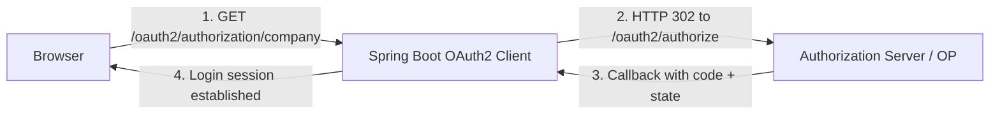
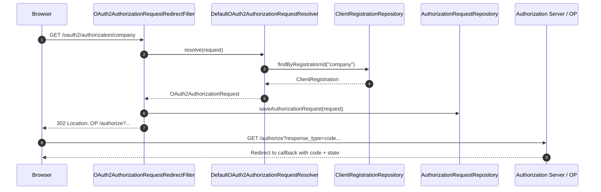

# 8.4. Configuring the Authorization Endpoint Base URI

In **Spring Security OAuth 2.0 / OIDC Client** on **Servlet**, a login flow typically begins when the browser accesses:

```text
GET /oauth2/authorization/company
```

The Spring Boot application looks up the client configuration with `registrationId=company`, builds an OAuth 2.0 authorization request, and responds with a redirect to the Authorization Server/OpenID Provider (OP).

The `/oauth2/authorization` path on the application side is called the **authorization request endpoint base URI** in Spring Security. You can change it to a path matching your routing conventions, such as `/sso/authorize`, so users initiate login at:

```text
GET /sso/authorize/company
```

This lesson explains **what that base URI actually is, where it is configured, how it affects filters and resolvers, and how to avoid confusing it with the OP's endpoint or the callback URI**.

> Primary scope: Spring Boot 3.x / Spring Security 6.x, Servlet application using `oauth2Login()` with the Authorization Code Flow and, when the `openid` scope is present, OIDC Login. Provider names, URIs, and domains in examples are for illustration only.

## 1. Three Addresses Commonly Called "Authorization Endpoint"

The term *authorization endpoint* can appear on both sides of the architecture. Distinguish them clearly before configuring anything.

| Concept | Where It Lives | Example | Function |
| --- | --- | --- | --- |
| **Spring Security authorization request base URI** | OAuth2 Client application | `/oauth2/authorization` or `/sso/authorize` | Accepts the request to **initiate** login |
| **OP/AS authorization endpoint URI** | Authorization Server | `https://id.example.test/oauth2/authorize` | Authenticates the user, prompts for consent if needed, and issues the authorization response |
| **Application redirect URI / callback** | OAuth2 Client application | `https://app.example.test/login/oauth2/code/company` | Receives the authorization code and state when the OP returns the browser |

With the default configuration:



**Changing `authorizationEndpoint().baseUri(...)` only changes the URL the client uses to *initiate* authorization.** It does not alter the OP's `authorization-uri`, does not change the callback, and does not change the destination page after login succeeds.

The four related URLs in a complete application might be:

```text
Initiation URL:
  https://app.example.test/sso/authorize/company

Authorization endpoint on OP:
  https://id.example.test/oauth2/authorize

Application callback:
  https://app.example.test/login/oauth2/code/company

Page the user lands on after login:
  https://app.example.test/account
```

Each URL has a distinct role and may be configured in a different place.

## 2. Default Mechanism in the Servlet SecurityFilterChain

When `oauth2Login()` is enabled, Spring Security installs the components that handle the Authorization Code Flow. The component that directly receives the flow-initiating request is:

**`OAuth2AuthorizationRequestRedirectFilter`**.

This filter uses **`OAuth2AuthorizationRequestResolver`** to determine whether the current request matches an initiation path and, if so, to create `OAuth2AuthorizationRequest`.

In a typical configuration:

- The default base URI is `/oauth2/authorization`.
- The initiation URL matches `/oauth2/authorization/{registrationId}`.
- The standard resolver is `DefaultOAuth2AuthorizationRequestResolver`.
- `registrationId` is used to look up a `ClientRegistration` in `ClientRegistrationRepository`.
- The authorization request is saved via `AuthorizationRequestRepository`, usually backed by the HTTP session.
- The filter returns a redirect to the **OP's authorization endpoint** and terminates that request branch.
- The subsequent callback is handled by **`OAuth2LoginAuthenticationFilter`**.



**Why is the repository needed before redirecting?** When the browser returns with `code` and `state`, the application must know which previously initiated request that response belongs to. Changing the base URI does not replace `state` verification or storing the original request.

### The Base URI Is an Application Path, Not a Client ID

In:

```text
/sso/authorize/company
```

- `/sso/authorize` is the **base URI** recognized by the filter/resolver.
- `company` is the internal **registrationId**, not an endpoint name and not necessarily the OP's client ID.
- The actual client ID is retrieved from `ClientRegistration` when the resolver builds the authorize request.

If there are multiple registrations, the same base URI works for multiple providers:

```text
/sso/authorize/company
/sso/authorize/partner
/sso/authorize/google
```

Each trailing segment of the URL must correspond to a `registrationId` with a valid configuration.

## 3. Minimal Example Before Changing the Base URI

Suppose the application has the following OIDC registration configuration:

```yaml
spring:
  security:
    oauth2:
      client:
        registration:
          company:
            provider: company
            client-id: ${OIDC_CLIENT_ID}
            client-secret: ${OIDC_CLIENT_SECRET}
            authorization-grant-type: authorization_code
            redirect-uri: "{baseUrl}/login/oauth2/code/{registrationId}"
            scope:
              - openid
              - profile
              - email

        provider:
          company:
            issuer-uri: https://id.example.test/realms/company
```

For a Servlet application, a simple security configuration:

```java
import org.springframework.context.annotation.Bean;
import org.springframework.context.annotation.Configuration;
import org.springframework.security.config.Customizer;
import org.springframework.security.config.annotation.web.builders.HttpSecurity;
import org.springframework.security.web.SecurityFilterChain;

@Configuration
class SecurityConfig {

    @Bean
    SecurityFilterChain securityFilterChain(HttpSecurity http) throws Exception {
        return http
            .authorizeHttpRequests(auth -> auth
                .requestMatchers("/", "/public/**", "/error").permitAll()
                .anyRequest().authenticated())
            .oauth2Login(Customizer.withDefaults())
            .build();
    }
}
```

If the home page has a link:

```html
<a href="/oauth2/authorization/company">Sign in with Company SSO</a>
```

the browser sends a request to the default endpoint. The filter builds an authorize request to the OP. Example parameters sent might include:

```text
response_type=code
client_id=<configured-client-id>
scope=openid profile email
redirect_uri=https://app.example.test/login/oauth2/code/company
state=<random-state>
```

Actual values must be generated and encoded per protocol; the example only illustrates structure. PKCE and additional OIDC parameters may appear depending on version, client type, and configuration.

**Note:** The callback URI `/login/oauth2/code/company` is the value the OP must allow for that client ID. The URI `/oauth2/authorization/company` is an endpoint *served by the application itself*, not a redirect callback registered with the OP.

## 4. Changing the Base URI with Java DSL

This is the most common and concise approach when you only want to change the login-initiation path.

### 4.1. Choosing the New Path

Suppose you want to change from:

```text
/oauth2/authorization/company
```

to:

```text
/sso/authorize/company
```

Choose the base URI:

```text
/sso/authorize
```

**Do not append `/company` to the base URI** if you want Spring Security to continue using the `{baseUri}/{registrationId}` pattern.

### 4.2. Configuring `authorizationEndpoint().baseUri()`

```java
import org.springframework.context.annotation.Bean;
import org.springframework.context.annotation.Configuration;
import org.springframework.security.config.annotation.web.builders.HttpSecurity;
import org.springframework.security.web.SecurityFilterChain;

@Configuration
class SecurityConfig {

    @Bean
    SecurityFilterChain securityFilterChain(HttpSecurity http) throws Exception {
        return http
            .authorizeHttpRequests(auth -> auth
                .requestMatchers("/", "/login", "/public/**", "/error").permitAll()
                .anyRequest().authenticated())
            .oauth2Login(oauth2 -> oauth2
                .loginPage("/login")
                .authorizationEndpoint(authorization ->
                    authorization.baseUri("/sso/authorize")))
            .build();
    }
}
```

The configuration above makes two independent changes:

1. `.authorizationEndpoint(authorization -> authorization.baseUri("/sso/authorize"))` sets the new path the filter matches to **initiate** authorization.
2. `.loginPage("/login")` tells the application to **serve its own login page** at `/login`. This option can be omitted if you want to keep default login page behavior when appropriate.

Example HTML page served by the application at `/login`:

```html
<!doctype html>
<html lang="en">
<head>
  <meta charset="utf-8">
  <title>Sign In</title>
</head>
<body>
  <a href="/sso/authorize/company">Sign in with Company SSO</a>
</body>
</html>
```

If `.loginPage("/login")` is configured, the application must actually have a view, controller, or router handling `/login`. Spring Security does not generate this custom page automatically.

You do not need to write `@GetMapping("/sso/authorize/company")`. The filter intercepts the request before the controller layer and performs the redirect.

### 4.3. Expected Result

Before changing:

```text
GET /oauth2/authorization/company
  -> OAuth2AuthorizationRequestRedirectFilter
  -> 302 to OP
```

After changing:

```text
GET /sso/authorize/company
  -> OAuth2AuthorizationRequestRedirectFilter
  -> 302 to OP
```

The old path is no longer an initiation endpoint matched by the newly configured default resolver. If any login button, bookmark, or redirect code still points to the old URL, update it to the new path.

**The callback is unchanged:**

```text
/login/oauth2/code/company?code=...&state=...
```

At this point, there is no need to change the Redirect URI registered at the OP merely because you changed the login *initiation* URL.

## 5. Separating Configuration of Authorization Base URI, Callback, and OP Endpoint

The following three parts can appear in a project and are easily confused:

### A. Client Initiation Request Base URI

Configured **in the Spring Security DSL**:

```java
.oauth2Login(oauth2 -> oauth2
    .authorizationEndpoint(authorization ->
        authorization.baseUri("/sso/authorize")))
```

Result: `/sso/authorize/company` is the URL the browser calls on the **application** to start the process.

### B. Client Callback Redirect URI

Configured in **client registration**:

```yaml
spring:
  security:
    oauth2:
      client:
        registration:
          company:
            redirect-uri: "{baseUrl}/login/oauth2/code/{registrationId}"
```

Result: The OP sends the browser back to `/login/oauth2/code/company` with `code` and `state`. By default, this endpoint is handled by `OAuth2LoginAuthenticationFilter`.

If you truly want to move the callback to `/sso/callback/company`, you must change **both the registration Redirect URI and the redirection endpoint filter**:

```java
.oauth2Login(oauth2 -> oauth2
    .authorizationEndpoint(authorization ->
        authorization.baseUri("/sso/authorize"))
    .redirectionEndpoint(redirection ->
        redirection.baseUri("/sso/callback/*")))
```

```yaml
spring:
  security:
    oauth2:
      client:
        registration:
          company:
            redirect-uri: "{baseUrl}/sso/callback/{registrationId}"
```

Then register the new callback at the OP. This is a **separate change** from changing the authorization request base URI and should only be done when the system actually wants to change the callback.

### C. Authorization Server's Authorization Endpoint

When using metadata discovery via `issuer-uri`, Spring Security can obtain `authorization_endpoint` from the OP's metadata. For providers without discovery, you may need to declare:

```yaml
spring:
  security:
    oauth2:
      client:
        provider:
          company:
            authorization-uri: https://id.example.test/oauth2/authorize
            token-uri: https://id.example.test/oauth2/token
```

`authorization-uri` is the **destination on the OP** to which the browser is redirected. Changing this value does not change Spring Boot's `/sso/authorize/company` URL.

### Configuration Reference Table

| What You Want to Change | Where to Edit | Example |
| --- | --- | --- |
| Path where users **start** SSO | `oauth2Login().authorizationEndpoint().baseUri(...)` | `/sso/authorize` |
| Where the browser **returns from** the OP | `registration.redirect-uri` + `redirectionEndpoint().baseUri(...)` | `/sso/callback/company` |
| OP URL receiving authorization requests | `provider.authorization-uri` or issuer metadata | `https://id.example.test/oauth2/authorize` |
| Page where users pick how to sign in | `oauth2Login().loginPage(...)` and app route/view | `/login` |
| Landing page after successful login | SavedRequest/success handler per configuration | `/account` |

## 6. Base URI with Multiple ClientRegistrations

An application can use multiple providers or multiple client types:

```yaml
spring:
  security:
    oauth2:
      client:
        registration:
          company:
            provider: company
            client-id: ${COMPANY_CLIENT_ID}
            client-secret: ${COMPANY_CLIENT_SECRET}
            authorization-grant-type: authorization_code
            scope: openid, profile

          partner:
            provider: partner
            client-id: ${PARTNER_CLIENT_ID}
            client-secret: ${PARTNER_CLIENT_SECRET}
            authorization-grant-type: authorization_code
            scope: openid, email

        provider:
          company:
            issuer-uri: https://id.example.test/realms/company
          partner:
            issuer-uri: https://login.partner.example.test/tenant
```

With `baseUri("/sso/authorize")`, the two paths are:

```text
/sso/authorize/company
/sso/authorize/partner
```

Each path causes the resolver to look up a different registration. The requests can then be redirected to **two different Authorization Servers**.

Example login page:

```html
<nav aria-label="Choose sign-in provider">
  <a href="/sso/authorize/company">Company SSO</a>
  <a href="/sso/authorize/partner">Partner SSO</a>
</nav>
```

You do not need two separate redirect filters just because there are two registrations. One base URI can initiate multiple authorization flows.

**Spotting errors:** if a user accesses `/sso/authorize/companies` while the config only defines `company`, the resolver cannot find a matching registration and the flow will not work as expected. The registration name in the URL must match the loaded key.

## 7. When a Custom `OAuth2AuthorizationRequestResolver` Is Needed

Changing the path with `baseUri(...)` is sufficient for most needs. However, you may need a **custom `OAuth2AuthorizationRequestResolver`** if the OP requires additional parameters, or if you want special conditions when building the request.

A common example is adding the OIDC parameter `prompt=login` to ask the OP to display an interactive re-authentication screen per its policy.

### 7.1. Using `DefaultOAuth2AuthorizationRequestResolver` with a Custom Base URI

```java
import org.springframework.context.annotation.Bean;
import org.springframework.context.annotation.Configuration;
import org.springframework.security.config.annotation.web.builders.HttpSecurity;
import org.springframework.security.oauth2.client.registration.ClientRegistrationRepository;
import org.springframework.security.oauth2.client.web.DefaultOAuth2AuthorizationRequestResolver;
import org.springframework.security.web.SecurityFilterChain;

@Configuration
class CustomAuthorizationRequestConfig {

    @Bean
    SecurityFilterChain securityFilterChain(
            HttpSecurity http,
            ClientRegistrationRepository registrations) throws Exception {

        DefaultOAuth2AuthorizationRequestResolver resolver =
            new DefaultOAuth2AuthorizationRequestResolver(
                registrations,
                "/sso/authorize"
            );

        resolver.setAuthorizationRequestCustomizer(builder ->
            builder.additionalParameters(parameters ->
                parameters.put("prompt", "login"))
        );

        return http
            .authorizeHttpRequests(auth -> auth
                .requestMatchers("/", "/login", "/error").permitAll()
                .anyRequest().authenticated())
            .oauth2Login(oauth2 -> oauth2
                .loginPage("/login")
                .authorizationEndpoint(endpoint ->
                    endpoint.authorizationRequestResolver(resolver)))
            .build();
    }
}
```

In this case, **the resolver itself receives the `/sso/authorize` base URI** when constructed. The `authorizationRequestResolver(resolver)` DSL tells Spring Security to use that resolver to build authorization requests.

It can build a request for `GET /sso/authorize/company`, add `prompt=login` to the authorize parameters, save the request, and redirect.

**Important when customizing:** a custom resolver can decide request matching itself. Once you supply a custom resolver, do not assume that also calling `authorizationEndpoint().baseUri(...)` will automatically update the resolver's matching logic. Use one consistent base URI across the resolver, DSL, and HTML links.

### 7.2. Why Not Append Query Strings to the Login Initiation Link?

An example you should not rely on:

```html
<a href="/sso/authorize/company?prompt=login">
  Sign in again
</a>
```

`prompt` in the URL **sent to the Spring Boot application** does not automatically become the `prompt` parameter of the authorization request **sent to the OP**. The resolver would have to forward that parameter under controlled rules.

For static parameter requirements, use a request customizer. If accepting dynamic parameters from the request, enforce an allowlist of valid values to prevent users from crafting out-of-policy authorization requests.

### 7.3. Changing Only the Base URI Does Not Need a Custom Filter

Do not write a new Servlet filter just to intercept `/sso/authorize/company` and call `sendRedirect(...)` to the OP manually. Doing so easily omits `state`, PKCE, client registration, the correlation repository, and callback logic.

The `authorizationEndpoint().baseUri(...)` DSL lets you change the path **while continuing to leverage Spring Security's standard mechanisms**.

## 8. Interaction with the Login Page and `AuthenticationEntryPoint`

Not every user types `/sso/authorize/company` directly. There are two entry paths into OAuth2 Login.

### 8.1. User Actively Clicks an SSO Button

```text
Browser
  -> GET /login
  -> Clicks /sso/authorize/company link
  -> OAuth2AuthorizationRequestRedirectFilter
  -> Redirects to OP
```

This is the most direct case. The `/login` page or UI component must use the new base URI URL.

### 8.2. User Accesses a Protected Page

```text
Browser
  -> GET /private
  -> Spring Security detects Authentication is required
  -> AuthenticationEntryPoint triggers login
  -> Login page (or configured provider redirect)
  -> GET /sso/authorize/company
  -> Redirects to OP
```

Whether Spring chooses a login page or redirects directly to a registration depends on the number of providers and the `AuthenticationEntryPoint` / `loginPage` configuration. Configuring `authorizationEndpoint().baseUri(...)` **does not by itself decide** which page users are sent to when accessing a protected URL.

If you use a custom `LoginUrlAuthenticationEntryPoint` or success handler, review any URLs hardcoded to `/oauth2/authorization/...`.

### 8.3. Generated Login Page vs. Custom Login Page

When using Spring Security's generated login page in certain configurations, provider URLs are built using registration awareness and framework configuration. If your application builds its own UI, it is responsible for using the new initiation links.

For easier control when changing the prefix, you can use a **self-managed login page** and write each link explicitly. When configuring `.loginPage("/login")`, create an actual route for `/login` to avoid a blank page or 404.

## 9. `SecurityFilterChain` and URL Matching

In Servlet, an HTTP request must pass through the right `SecurityFilterChain` containing `OAuth2AuthorizationRequestRedirectFilter`. If there are multiple chains, the URL you chose might fall outside the chain configured with `oauth2Login()`.

### 9.1. Distinguishing `securityMatcher` and `requestMatchers`

- **`http.securityMatcher(...)`**: defines the scope of requests to which **the entire SecurityFilterChain** applies.
- **`authorizeHttpRequests(...requestMatchers(...).permitAll())`**: defines authorization rules for requests **already inside the chain**.
- **`authorizationEndpoint().baseUri(...)`**: specifies the path the OAuth2 resolver/filter matches to **start the authorization flow**.

If a chain only matches `/web/**`, a request to `/sso/authorize/company` may not enter the redirect filter even when `baseUri("/sso/authorize")` is configured correctly.

### 9.2. Multi-Chain Example: API and Web

Suppose the API uses bearer tokens while the website uses login redirects. A common layout:

```text
/api/**             -> API SecurityFilterChain, stateless
/sso/authorize/**   -> Web SecurityFilterChain, oauth2Login()
/login/oauth2/**    -> Web SecurityFilterChain, oauth2Login()
/web/**             -> Web SecurityFilterChain, oauth2Login()
```

If `/sso/authorize/**` lands in the API chain or a chain without OAuth2 Login, the browser may receive 401, 403, 404, or fail to redirect to the OP, depending on the other filters.

An illustrative configuration with two chains:

```java
import org.springframework.context.annotation.Bean;
import org.springframework.context.annotation.Configuration;
import org.springframework.core.annotation.Order;
import org.springframework.security.config.Customizer;
import org.springframework.security.config.annotation.web.builders.HttpSecurity;
import org.springframework.security.web.SecurityFilterChain;

@Configuration
class MultipleChainsConfig {

    @Bean
    @Order(1)
    SecurityFilterChain apiChain(HttpSecurity http) throws Exception {
        return http
            .securityMatcher("/api/**")
            .authorizeHttpRequests(auth -> auth.anyRequest().authenticated())
            .oauth2ResourceServer(resource -> resource.jwt(Customizer.withDefaults()))
            .build();
    }

    @Bean
    @Order(2)
    SecurityFilterChain webChain(HttpSecurity http) throws Exception {
        return http
            .authorizeHttpRequests(auth -> auth
                .requestMatchers("/", "/login", "/error").permitAll()
                .anyRequest().authenticated())
            .oauth2Login(oauth2 -> oauth2
                .loginPage("/login")
                .authorizationEndpoint(authorization ->
                    authorization.baseUri("/sso/authorize")))
            .build();
    }
}
```

Here the API chain applies only to `/api/**`; the remaining web chain receives `/sso/authorize/company` and the default callback. This is an illustrative configuration; real applications still need appropriate CSRF, session, authorization, and API rules per business requirements.

**Why doesn't `permitAll()` replace chain matching?** `permitAll()` only says the request is not blocked by that chain's authorization rules. It does not inject the OAuth2 filter into a chain the request never enters.

### 9.3. Adding Explicit Matchers When the Web Chain Is Scoped

If you restrict the web chain to run only at `/web/**`, expand its match scope to include **the initiation endpoint and callback endpoint**, plus any required login/error URLs. Conceptual example:

```text
Web chain scope:
  /web/**
  /login
  /sso/authorize/**
  /login/oauth2/code/**
  /error
```

Exact paths depend on your framework/router and matcher configuration. The goal is to ensure both **leaving for the OP** and **returning from the OP** pass through the chain with OAuth2 Login.

## 10. Base URI Under a Context Path and Reverse Proxy

`baseUri("/sso/authorize")` is normally a path **relative to the Servlet application's context path**, not a full public URL with a hostname.

### 10.1. Application Running Under a Context Path

Example:

```yaml
server:
  servlet:
    context-path: /portal
```

And:

```java
authorization.baseUri("/sso/authorize")
```

With the application exposed at `http://localhost:8080/portal`, the browser will use:

```text
http://localhost:8080/portal/sso/authorize/company
```

In HTML served under a context path, generate links accordingly. Hardcoding `href="/sso/authorize/company"` sends the browser to the domain root and **omits `/portal`**. Use your framework or template engine's context-path-aware URL generation.

Example with Thymeleaf:

```html
<a th:href="@{/sso/authorize/company}">Sign in with SSO</a>
```

The template engine handles the context path in the URL when rendered in the right context. If the application has path rewriting at a proxy, also account for the public prefix.

### 10.2. Reverse Proxy Terminating HTTPS

Typical topology:

```text
Browser
  HTTPS https://app.example.test/portal
        |
        v
Reverse Proxy / Ingress :443
        |
        v
Spring Boot HTTP :8080
```

The browser clicks `https://app.example.test/portal/sso/authorize/company`. The reverse proxy must forward the request to the path the filter actually sees.

Assuming the proxy preserves the `/portal` prefix and the app has `server.servlet.context-path=/portal`, callbacks can be handled cleanly. If the proxy strips the prefix and the app runs at root, public links still need the prefix while the backend filter only receives `/sso/authorize/company`.

In such environments:

1. Determine which URL the browser accesses.
2. Determine how the proxy rewrites paths.
3. Determine what `context-path` Spring Boot uses.
4. Configure `baseUri` to match the actual request path seen by the resolver.
5. Verify the OP callback is also routed by the proxy to the right filter.

### 10.3. Forwarded Headers and Redirect URI

Normally `{baseUrl}` in `registration.redirect-uri` is derived from the HTTP request. Behind a proxy, if Spring Boot does not know the public scheme/host, the callback can be constructed incorrectly:

```text
Wrong:
http://spring-app:8080/login/oauth2/code/company

Right:
https://app.example.test/login/oauth2/code/company
```

Infrastructure configuration option:

```yaml
server:
  forward-headers-strategy: framework
```

And ensure your trusted reverse proxy sets/overwrites headers such as `Forwarded`, `X-Forwarded-Proto`, `X-Forwarded-Host`, `X-Forwarded-Port`, and `X-Forwarded-Prefix` as appropriate.

**Security:** the application must only trust forwarded headers produced by a trusted proxy; do not allow Internet requests to supply `X-Forwarded-Host` to manipulate generated URLs.

Forwarded headers directly affect the **public callback URI** and links containing host/scheme. `authorizationEndpoint().baseUri("/sso/authorize")` itself remains an internal path, so do not try to solve proxy issues by changing the base URI value.

## 11. Local, Staging, and Production Environments

You can use **the same base URI** `/sso/authorize` and **the same registrationId** `company` across all three environments. Only the public origin, client credentials, issuer, and public Redirect URI vary by environment.

| Environment | Login Initiation URL | Callback Usually Registered at OP |
| --- | --- | --- |
| Local | `http://localhost:8080/sso/authorize/company` | `http://localhost:8080/login/oauth2/code/company` |
| Staging | `https://staging.app.example.test/sso/authorize/company` | `https://staging.app.example.test/login/oauth2/code/company` |
| Production | `https://app.example.test/sso/authorize/company` | `https://app.example.test/login/oauth2/code/company` |

These examples assume the application runs at the root context. If using `/portal`, prepend the prefix to the corresponding public URLs.

Key point to remember: **The Authorization Server registers the callback Redirect URI, not the initiation URL `/sso/authorize/company`**. When changing only the base URI from `/oauth2/authorization` to `/sso/authorize`, the callback allowlist at the OP does not need to change.

To isolate environments, issue a separate client ID per environment at the OP:

```text
local   -> client ID app-local   -> localhost callback
staging -> client ID app-stage   -> staging callback
prod    -> client ID app-prod    -> production callback
```

Separating client IDs/secrets reduces credential sharing and limits blast radius if staging is misconfigured or a secret leaks.

## 12. Procedure for Verifying Endpoint Behavior

When setting up a new base URI, verify the URL **entering the application** first, then verify the redirect result.

### 12.1. With a Browser

1. Open the website using the proper public origin.
2. Click the login button pointing to `/sso/authorize/company`.
3. In Developer Tools → Network, locate the request to the clicked URL.
4. Confirm the response from the application is a redirect to the **OP's authorization endpoint**.
5. Check query parameters in `Location`: it should contain `response_type=code`, the right `client_id`, the public `redirect_uri`, and a generated `state`.
6. Complete login on the OP with a test account to confirm the callback returns and the login session is established.

Do not copy raw `state`, `code`, access token, or ID token values into tickets or logs. When reporting errors, record only paths, parameter names, hostnames, and HTTP status with sensitive data redacted.

### 12.2. Observing the Redirect Step with `curl`

For a local application:

```bash
curl -i http://localhost:8080/sso/authorize/company
```

On success, you should see a response similar to:

```http
HTTP/1.1 302 Found
Location: https://id.example.test/oauth2/authorize?response_type=code&client_id=...&redirect_uri=...&state=...
```

`curl` here only verifies the **OAuth2 authorization initiation step**. It does not perform full browser login, cookie handling, MFA, PKCE, or OIDC token exchange. Using `curl -L` to follow redirects may land on the OP's login page; that is not the right way to verify the entire flow.

### 12.3. Observing `SecurityFilterChain`

When requests do not flow through filters as expected, you can temporarily enable DEBUG logging in a controlled environment:

```yaml
logging:
  level:
    org.springframework.security.web.FilterChainProxy: DEBUG
    org.springframework.security.oauth2.client: DEBUG
```

The goal is to see which chain `/sso/authorize/company` enters and whether authorization request creation is triggered. Do not enable detailed payload/token logging in production, and never log full authorization responses containing sensitive information.

## 13. Common Errors When Changing the Base URI

| Symptom | Common Cause | How to Fix |
| --- | --- | --- |
| New link returns 404 | Base URI not applied in the active chain, or URL/link differs from configuration | Check `oauth2Login().authorizationEndpoint().baseUri()` and chain matching |
| Old link still works in UI or fails to redirect to OP | UI still points to `/oauth2/authorization/company` after switching to `/sso/authorize` | Update links, entry points, and hardcoded routes |
| New path returns 401/403 | Request enters API chain or a chain without OAuth2 Login, intercepted by authorization rules | Redesign `securityMatcher` and filter chains |
| OP returns `invalid_redirect_uri` | Callback URI in authorize request does not match allowlist | Check `registration.redirect-uri`, proxy, public origin, and OP config |
| Redirect to OP has wrong `client_id` | URL has unexpected registrationId or env vars select wrong client | Compare registration key, client ID, and active profile |
| Browser returns to callback with state mismatch | Session/cookie or original authorization request lost | Check session persistence, host, cookies, and multi-replica setup |
| `/sso/authorize/company` returns 404 under `/portal` | Link omits context path or proxy rewrite is wrong | Generate URL with context path; check ingress routing |
| Custom resolver does not match new path | Resolver was constructed with old base URI | Initialize resolver with the chosen base URI |
| Changing callback breaks login | Changed only `redirect-uri` without updating callback filter or OP allowlist | Update both callback filter and OP when actually needed |
| OP rejects prompt/hint | Extension parameter not supported by OP or resolver did not add it | Check OP documentation and active customizer |

### Scenario A — Changed DSL but Login Button Still Points to Old URL

Code:

```java
.authorizationEndpoint(authorization ->
    authorization.baseUri("/sso/authorize"))
```

But HTML:

```html
<a href="/oauth2/authorization/company">Sign in</a>
```

Result: the request hits the old path. That URI itself is no longer an initiation pattern matched by the newly configured resolver. **Fix in the right place:** change the HTML link to `/sso/authorize/company`. No need to change the OP authorization endpoint or callback.

### Scenario B — Changed Base URI but OP Reports Redirect Mismatch

The application sends:

```text
GET https://id.example.test/oauth2/authorize?
    redirect_uri=http%3A%2F%2Fspring-app%3A8080%2Flogin%2Foauth2%2Fcode%2Fcompany
```

The browser actually opened `https://app.example.test`. This is a **callback/public origin** problem, usually caused by proxy forwarded headers or a wrong `redirect-uri`, not by the `/sso/authorize` base URI. Fix it in client registration and public request forwarding.

### Scenario C — Multiple `SecurityFilterChain` Beans

```text
Chain 1: securityMatcher("/sso/**"), oauth2ResourceServer()
Chain 2: remaining SecurityFilterChain, oauth2Login()
```

The request `/sso/authorize/company` matches Chain 1 first, so it never reaches Chain 2's `OAuth2AuthorizationRequestRedirectFilter`. Design matchers and ordering so the SSO initiation endpoint enters the chain with OAuth2 Login.

### Scenario D — Changing Both Start URL and Callback, but Only Updating One Side

App configuration:

```text
Start URL: /sso/authorize/company
Callback URL: /sso/callback/company
```

If you change the callback in registration while `OAuth2LoginAuthenticationFilter` still only matches `/login/oauth2/code/*`, the browser returns to a path Spring Security does not process. Therefore, update `redirectionEndpoint().baseUri("/sso/callback/*")`, registration `redirect-uri`, and the OP allowlist together if you want to change the callback.

## 14. Security When Customizing the Authorization Request Endpoint

### 14.1. Only Start Flows for Valid Registrations

The resolver queries `ClientRegistrationRepository` by `registrationId`. Never build a mechanism that accepts arbitrary `client_id`, `authorization_uri`, or callbacks supplied by a request without validation. Those parameters must come from trusted client configuration.

### 14.2. Protect State and PKCE

Changing the SSO initiation URL must not weaken Authorization Code Flow protections. `state` must bind the initiating request to the callback; PKCE binds the authorization code to the matching `code_verifier` when enabled. Never generate a fixed state or share one across sessions.

### 14.3. Keep the Redirect URI Within the OP Allowlist

The authorization request sent to the OP must use a valid Redirect URI registered for that client ID. Do not inject dynamic callbacks from user-controlled query parameters. Just because the start URL is publicly accessible does not mean users get to choose where the authorization code is sent.

### 14.4. Never Embed Secrets in the Authorize URL

Client secrets belong to the appropriate channel and client authentication method, not as query parameters in a redirect to the OP. Access tokens, refresh tokens, and ID tokens are not part of a standard Authorization Code Flow initiation URL.

### 14.5. Sessions and Cookies

With Servlet login, the authorization request is normally stored in the HTTP session. Session cookies must be properly configured for HTTPS, `HttpOnly`, `Secure`, `SameSite`, and reverse proxy topology. With multiple instances, ensure the callback can read the stored request state. Never disable `state` checks to mask a session configuration bug.

### 14.6. Prevent Open Redirects and Login CSRF

Custom resolvers or custom login pages must avoid allowing `redirect_uri` outside the allowlist. If there is a "return after login" URL, validate it strictly in its own role and never turn it into an OAuth callback. Use the proper request cache/success handler mechanism for post-login navigation.

## 15. End-to-End Practice Exercise

**Problem:** A Spring MVC application uses OIDC with registration `company`. The organization wants all SSO links to start at `/sso/authorize/{registrationId}` instead of the default endpoint. The OP callback remains `/login/oauth2/code/{registrationId}`.

### Step 1 — Declare the Registration

```yaml
spring:
  security:
    oauth2:
      client:
        registration:
          company:
            provider: company
            client-id: ${OIDC_CLIENT_ID}
            client-secret: ${OIDC_CLIENT_SECRET}
            authorization-grant-type: authorization_code
            redirect-uri: "{baseUrl}/login/oauth2/code/{registrationId}"
            scope: openid, profile, email

        provider:
          company:
            issuer-uri: ${OIDC_ISSUER_URI}
```

### Step 2 — Change the Start Base URI

```java
@Configuration
class SecurityConfig {

    @Bean
    SecurityFilterChain securityFilterChain(HttpSecurity http) throws Exception {
        return http
            .authorizeHttpRequests(auth -> auth
                .requestMatchers("/", "/login", "/error").permitAll()
                .anyRequest().authenticated())
            .oauth2Login(oauth2 -> oauth2
                .loginPage("/login")
                .authorizationEndpoint(endpoint ->
                    endpoint.baseUri("/sso/authorize")))
            .build();
    }
}
```

This snippet focuses on the DSL; imports are the same as in the example in section 4.2.

### Step 3 — Update the UI

```html
<a href="/sso/authorize/company">Sign in via Company SSO</a>
```

If using a context path, generate the link with the proper prefix, such as Thymeleaf `@{/sso/authorize/company}`.

### Step 4 — Keep the Callback Registered on the OP

For a production root context:

```text
https://app.example.test/login/oauth2/code/company
```

This is the URI the client sends in `redirect_uri` and the OP must permit. **Do not register `https://app.example.test/sso/authorize/company` as the callback merely because it is the new start URL.**

### Step 5 — Observe Request and Redirect

Open:

```text
https://app.example.test/sso/authorize/company
```

The application must respond with a redirect to the OP. Verify the authorize request contains:

```text
response_type=code
client_id=<production-client-id>
redirect_uri=https://app.example.test/login/oauth2/code/company
scope=openid profile email
state=<unique-state>
```

After completing interaction on the OP, the browser should return to the callback and Spring Security should process the login. If the request does not redirect, check the filter chain, base URI, and registrationId.

## 16. Self-Check Questions

**Q1.** You configure:

```java
.authorizationEndpoint(endpoint -> endpoint.baseUri("/sso/start"))
```

and have registration `company`. Which URL initiates login by default convention?

> `/sso/start/company`. `/sso/start` is the base URI; `company` is the registrationId.

**Q2.** Does changing the base URI from `/oauth2/authorization` to `/sso/start` require updating the Redirect URI allowlist at the OP?

> No, if the application's callback remains unchanged. The OP needs the **callback URI** allowlisted, e.g. `/login/oauth2/code/company`. The new base URI is the client-side login initiation path.

**Q3.** In `spring.security.oauth2.client.provider.company.authorization-uri`, you declare `https://id.example.test/oauth2/authorize`. Is that the Spring Security filter's base URI?

> No. That is the authorization endpoint on the Authorization Server. The filter URL lives on the Spring Boot application and is configured via `authorizationEndpoint().baseUri(...)` or an appropriate resolver.

**Q4.** Why does `GET /sso/start/company` return 401 even though you enabled `oauth2Login()` on a `SecurityFilterChain`?

> The request may be entering another chain, such as a stateless API chain, or falling outside the matcher of the chain with OAuth2 Login. Check `securityMatcher`, chain ordering, and active filters.

**Q5.** The application has context path `/portal` and base URI `/sso/start`. Which URL must the browser call on `http://localhost:8080`?

> `http://localhost:8080/portal/sso/start/company`, assuming no proxy rewrite changes it. The base URI is relative to the application's context.

**Q6.** A custom `DefaultOAuth2AuthorizationRequestResolver` is still initialized with `/oauth2/authorization`, while the HTML was switched to `/sso/start/company`. Why is there no redirect?

> Because the resolver still matches the old path. Initialize the resolver with `/sso/start`, or use the `baseUri(...)` DSL if a custom resolver is not needed.

**Q7.** An `invalid_state` error appears after the browser returns from the OP. Will changing `authorizationEndpoint().baseUri(...)` fix it directly?

> No. That indicates the callback could not match the original authorization request; check cookies/sessions, state, multi-instance setup, origin, and the repository. Do not disable state verification.

---

## Key Takeaways

**The Authorization Endpoint Base URI in Spring Security is where the browser *initiates* OAuth2/OIDC authorization on the client application**:

```text
Default: /oauth2/authorization/{registrationId}
Custom:  /sso/authorize/{registrationId}
```

Typical configuration:

```java
.oauth2Login(oauth2 -> oauth2
    .authorizationEndpoint(endpoint ->
        endpoint.baseUri("/sso/authorize")))
```

After changing it, update login links and ensure the new path belongs to the right `SecurityFilterChain`. **The OP's authorization endpoint and the callback Redirect URI are two separate settings**; only change them if your deployment actually requires it. Keep Spring Security's `state`, PKCE, repository, and callback handling intact so the login flow stays secure.

### Reference Documentation

- [Spring Security — OAuth 2.0 Login: Advanced Configuration](https://docs.spring.io/spring-security/reference/servlet/oauth2/login/advanced.html)
- [Spring Security API — OAuth2AuthorizationRequestRedirectFilter](https://docs.spring.io/spring-security/reference/api/java/org/springframework/security/oauth2/client/web/OAuth2AuthorizationRequestRedirectFilter.html)
- [Spring Security API — DefaultOAuth2AuthorizationRequestResolver](https://docs.spring.io/spring-security/reference/api/java/org/springframework/security/oauth2/client/web/DefaultOAuth2AuthorizationRequestResolver.html)
