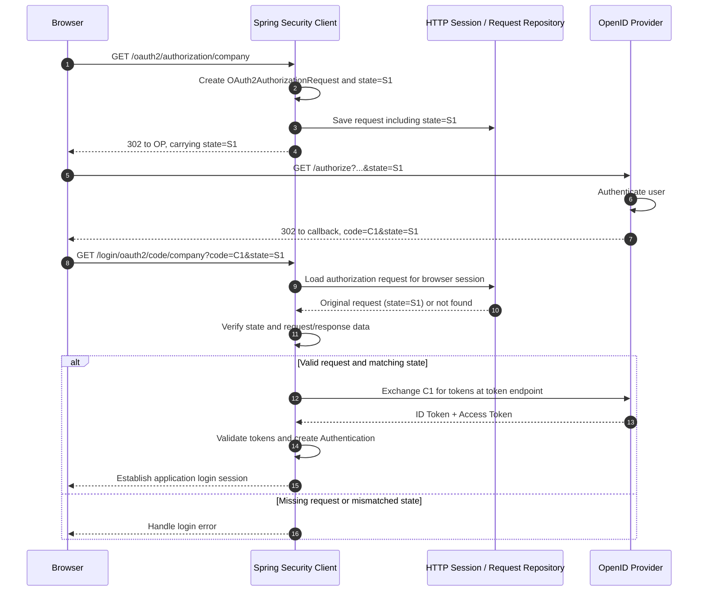

# 8.5. Managing `state` and Binding Requests to Browser Sessions

When a user logs into a Spring Boot application via **Spring Security OAuth 2.0 / OpenID Connect (OIDC) Client**, the browser leaves the application's website for the Authorization Server or OpenID Provider (OP), and is then redirected back. The two HTTP requests on the application side—the login-initiation request and the callback request—are separated by multiple external interaction steps.

How can the application be sure that **the incoming callback belongs to the exact login attempt initiated by this same browser**? That is the role of **`state`** and the mechanism for storing the **authorization request** while awaiting the response.

In a typical Spring Security Servlet configuration, the framework generates an unpredictable `state` value, creates an `OAuth2AuthorizationRequest`, saves the request in the application's **HTTP session**, and redirects the browser to the OP. When the OP returns the browser with `code` and `state`, Spring Security retrieves the saved authorization request from the corresponding session and compares the data before proceeding to exchange the code, validate tokens, and establish the login session.

This lesson focuses on **the lifecycle of `state`, its binding to the browser session, the responsibilities of Spring Security filters, and safe design across multiple tabs, reverse proxies, or multiple instances**.

## 1. Why Does an Authorization Request Need a `state` Value?

Suppose an order-management website uses OIDC for login:

- Application: `https://orders.example.org`.
- OP: `https://login.example.org`.
- Spring Security client registration: `company`.
- Callback: `https://orders.example.org/login/oauth2/code/company`.

An unauthenticated user opens `/orders` and is routed to:

```text
GET https://orders.example.org/oauth2/authorization/company
```

The client creates an authorization request with a fresh `state`:

```http
HTTP/1.1 302 Found
Location: https://login.example.org/authorize?response_type=code&client_id=orders-web&redirect_uri=https%3A%2F%2Forders.example.org%2Flogin%2Foauth2%2Fcode%2Fcompany&scope=openid&state=s_8hK2...
```

After the OP authenticates the user and issues an authorization code, the browser returns:

```http
GET /login/oauth2/code/company?code=c_Q7...&state=s_8hK2... HTTP/1.1
Host: orders.example.org
Cookie: JSESSIONID=<opaque-session-id>
```

The application must not simply see `code` and assume it is a valid response. It must verify that the returned `state` matches the value the application **generated and stored for that prior login attempt**.

### 1.1. What Is an Attacker Trying to Exploit?

A classic scenario is **login CSRF**: an attacker initiates a login flow with their own account and tries to trick the victim's browser into completing the callback for that flow. If the client accepts an authorization response without binding it to the victim's own request, the victim could be silently logged into the attacker's account and inadvertently perform actions or enter data under that account.

`state` prevents this kind of mix-up when implemented properly: a response is accepted only if it links back to an **authorization request initiated by the client for the corresponding browser session**.

Key protection goals include:

1. **Correlating request and response:** knowing which authorization attempt a response belongs to.
2. **Binding to browser context:** preventing a callback created in session A from being used as a callback for session B.
3. **Mitigating forged or injected responses:** an unpredictable, properly verified `state` causes unsolicited responses lacking an original request to be rejected.
4. **Preventing login flow confusion:** distinguishing pending requests when the application has multiple client registrations, multiple tabs, or different navigation paths.

`state` **is not a login token** and **does not verify user identity by itself**. It only proves the link between an authorization response and an authorization request when the client properly stores, protects, and validates state.

## 2. When Is `state` Created and Used?

The authorization request lifecycle can be divided into four stages.

| Stage | What Does Spring Security Client Do? | How Is `state` Used? |
|---|---|---|
| **Initiation** | Selects `ClientRegistration`, generates `OAuth2AuthorizationRequest` and a random `state`. | Creates a unique, unpredictable value for this authorization attempt. |
| **Pre-redirect storage** | Saves the authorization request in `AuthorizationRequestRepository`. | Keeps the original `state` and binding data needed at callback. |
| **Redirect to OP** | Sends the browser to the authorization endpoint with the `state` parameter. | OP receives and echoes `state` back in the authorization response without needing to interpret its contents. |
| **Callback handling** | Retrieves the authorization request, matches `state`, and validates the authorization response. | If missing or mismatched, authentication does not succeed. |



**`state` verification occurs before the client trusts the login outcome.** Arriving on the right callback path or carrying a seemingly valid authorization code is not sufficient to create an `Authentication`.

### 2.1. What Properties Should a `state` Value Have?

`state` should be an **unpredictable, high-entropy value generated by a cryptographically secure random source**, strong enough to resist guessing or forgery. Each new authorization request needs an appropriate fresh value; never reuse a fixed string across all users or sessions.

An illustrative example:

```text
state=6d8V2B...rN7p
```

The ellipsis is only for brevity; in operation, Spring Security generates the full value. **Never choose `state=userId`, `state=company`, `state=true`, or a predictable timestamp.**

`state` has no mandatory business data format. The OP does not need to read what is inside. Never pack passwords, Access Tokens, sensitive emails, or personal data into `state`, since it travels through URLs, browser history, and potentially infrastructure logs if uncontrolled.

### 2.2. How Does the OP Handle `state`?

According to the Authorization Code Flow, the client sends `state` in the authorization request; the OP returns that value in the authorization response whenever `state` was originally provided, including protocol error responses redirected back to the redirect URI.

The OP knows nothing about the Spring Boot application's HTTP session; the OP only sees the parameter in the authorization request and echoes the exact value back. **The client is responsible for ensuring `state` links back to the browser session and authorization request it created.**

Therefore, client-side verification cannot be skipped with "the OP returned `state`, so the callback must be legitimate." Any browser can send a callback URL; anti-forgery rests on the client looking up and verifying the original request.

## 3. Where Does Spring Security Store the Authorization Request?

In the Servlet stack, the main components are:

| Component | Responsibility |
|---|---|
| `OAuth2AuthorizationRequestRedirectFilter` | Handles the `/oauth2/authorization/{registrationId}` initiation endpoint, creates and stores the authorization request, then sends a redirect to the OP. |
| `OAuth2AuthorizationRequestResolver` | Builds `OAuth2AuthorizationRequest` from `ClientRegistration` and the current request. |
| `OAuth2AuthorizationRequest` | Object describing the request, including authorization URI, client ID, redirect URI, scopes, `state`, attributes, and related additional parameters. |
| `AuthorizationRequestRepository<OAuth2AuthorizationRequest>` | Contract for saving, loading, and removing authorization requests between redirect and callback. |
| `HttpSessionOAuth2AuthorizationRequestRepository` | Common default implementation used by Spring Security Servlet to store requests in the HTTP session. |
| `OAuth2LoginAuthenticationFilter` | Receives the callback, retrieves the matching authorization request, validates the response, and continues the login process. |
| `SecurityContextRepository` | Saves/restores the logged-in user's state **after** authentication succeeds. It is not a store for pending authorization requests. |

In the common default setup, `HttpSessionOAuth2AuthorizationRequestRepository` saves an `OAuth2AuthorizationRequest` into the current browser's session. At callback, the repository checks `state` and returns or removes the corresponding request only when the data matches according to its implementation.

### 3.1. Two Kinds of State in the Same HTTP Session

A key point is that **a session can exist before the user is authenticated**.

While awaiting the OP:

```text
Browser HTTP Session
└── OAuth2AuthorizationRequest
    ├── registration/provider context
    ├── redirect_uri
    ├── scope
    ├── state
    ├── nonce (if OIDC uses it)
    └── PKCE verifier (if PKCE is used)
```

After a successful callback, the application also holds authenticated login state:

```text
Browser HTTP Session
└── SecurityContext
    └── Authentication (principal + authorities)
```

These are **two distinct storage purposes**. The authorization request is stored to verify correspondence between the two ends of the flow; `SecurityContext` is stored to identify the user on subsequent application requests after login. Depending on configuration, storage for authorized clients/tokens is yet another separate component.

A browser holding a `JSESSIONID` cookie while awaiting the OP **is not necessarily logged in**: that session may contain only `state` and authorization request data. After login, Spring Security may also rotate the session ID to prevent session fixation.

### 3.2. Example of a Session Awaiting Callback

Suppose the browser receives a session cookie before being redirected to the OP:

```http
HTTP/1.1 302 Found
Location: https://login.example.org/authorize?client_id=orders-web&response_type=code&state=s_9G...
Set-Cookie: JSESSIONID=a73...; Path=/; Secure; HttpOnly; SameSite=Lax
```

The header above merely illustrates one possible cookie configuration; actual attributes depend on the servlet container, reverse proxy, Spring Boot version, and application session configuration.

The browser stores the cookie for the **application domain**. When the OP returns the browser:

```http
GET /login/oauth2/code/company?code=c_4K...&state=s_9G... HTTP/1.1
Host: orders.example.org
Cookie: JSESSIONID=a73...
```

The Session ID helps the backend find the saved authorization request. Then the client compares `state` in the callback against `state` in the loaded request.

**The binding is not proven by the cookie name itself**, but by the session and repository mechanism: a browser can only complete the flow when it returns with the application session holding the matching authorization request. The OP's SSO cookie is a separate cookie on the OP's domain; it is not used in place of the application session cookie.

### 3.3. The Authorization Request Is Usually Consumed at Callback

An authorization response must be treated as **the result of a single pending request**, not a reusable ticket. In the standard flow, the repository loads and removes the authorization request once the callback is properly processed.

This helps because:

- It avoids keeping `state` from completed logins indefinitely.
- It reduces the chance of an old callback being re-associated with an old request.
- It keeps the flow lifecycle clean on both success and failure.

Even though the request is removed from the repository, the Authorization Server must still enforce single-use and short lifetimes for the authorization code. **Single-use codes are an OP control; consuming the authorization request is a client control**. The two mechanisms reinforce each other.

## 4. Binding Between Browser Session and `state`

The conceptual verification logic can be expressed as:

```text
authorizationRequest = repository.loadForCurrentBrowserSession(callback)

if (authorizationRequest is absent):
    reject login

if (callback.state != authorizationRequest.state):
    reject login

continue OIDC authorization-code processing
```

This is **pseudo-code explaining the principle**, not the exact implementation code of Spring Security's filter. In the real implementation, Spring Security also handles OAuth2 error responses, client registrations, redirect URIs, code exchange, PKCE, and ID Token validation.

### 4.1. Why Can a Real `state` Still Be Rejected?

Suppose Browser A initiates login and gets:

```text
session A -> pending state = AAA
```

Browser B has a different session:

```text
session B -> pending state = BBB
```

If A's callback is sent to B:

```text
GET /login/oauth2/code/company?code=fromA&state=AAA
Cookie: JSESSIONID=<session-B>
```

The client checks session B and finds `BBB`, which does not match `AAA`, so it must reject the request. The goal is not to verify whether `AAA` "ever existed somewhere," but to verify that **`AAA` belongs to the exact browser session performing the callback**.

Likewise, a valid `state` on one machine will not make the callback succeed if the session cannot be retrieved on another instance. Data must be stored and restored consistently throughout the flow's lifecycle.

### 4.2. `state` Is Not a Session Identifier

Do not treat `state` as equivalent to `JSESSIONID`:

| Value | Created By | Role |
|---|---|---|
| `state` | OAuth2/OIDC Client when building the authorization request. | Links one specific authorization request to its response. |
| `JSESSIONID` or custom session cookie name | Application/container managing HTTP sessions. | Helps the browser locate its application session across requests. |
| `nonce` | OIDC Client when creating an OIDC request with nonce. | Binds an ID Token to a specific authorization request. |
| `code_verifier` | OAuth2 Client when using PKCE. | Proves authorization to exchange the authorization code at the token endpoint. |

Do not set the session ID as `state` or infer session state solely from `state`. Normally Spring Security generates a separate `state` and saves it alongside the authorization request in the session.

### 4.3. Session Fixation vs. Login CSRF

Session fixation is when an attacker tries to impose a known session ID and exploit it after the user logs in. Spring Security has session fixation protections applied upon authentication.

`state` prevents forged authorization responses, while session fixation protection safeguards the session ID lifecycle when a user transitions from unauthenticated to authenticated. **Both are needed**, because a system could verify `state` properly yet still be vulnerable if sessions or cookies can be hijacked or weakly managed.

## 5. How `state` Is Handled in Spring Security Servlet

With registration `company`, the flow initiation path is typically:

```text
/oauth2/authorization/company
```

The default callback path:

```text
/login/oauth2/code/company
```

Processing sequence:

1. `OAuth2AuthorizationRequestRedirectFilter` receives the initiation request.
2. `OAuth2AuthorizationRequestResolver` builds the authorization request for `company`.
3. `AuthorizationRequestRepository` saves the authorization request within the browser session context.
4. The filter returns HTTP `302`; the browser goes to the OP's authorization endpoint carrying `state`.
5. The OP authenticates the user, issues an authorization code, and returns the browser to the callback with `code` and `state`.
6. `OAuth2LoginAuthenticationFilter` receives the callback, looks up the authorization request, and validates the response.
7. If the request and response cannot be matched, login fails. Only if valid does the client proceed to token exchange and OIDC validation.
8. Upon completion, Spring Security creates `Authentication`, saves `SecurityContext`, and redirects to an application page.

Exact classes may differ slightly depending on framework version or configured extensions, but the rule **save the request before redirecting and verify it at callback** stays the same.

### 5.1. Repository APIs to Know

The `AuthorizationRequestRepository<T extends OAuth2AuthorizationRequest>` interface conceptually provides these operations:

```java
T loadAuthorizationRequest(HttpServletRequest request);

void saveAuthorizationRequest(
    T authorizationRequest,
    HttpServletRequest request,
    HttpServletResponse response
);

T removeAuthorizationRequest(
    HttpServletRequest request,
    HttpServletResponse response
);
```

This is a simplified form to understand the API operations. These methods are invoked by Spring Security at different stages:

- `saveAuthorizationRequest`: persists the pending request before redirecting.
- `loadAuthorizationRequest`: finds the request when inspecting or matching an authorization response.
- `removeAuthorizationRequest`: retrieves and removes the matching request as the flow consumes the response.

With `HttpSessionOAuth2AuthorizationRequestRepository`, operations use the current request's HTTP session. Never replace it with a single global variable shared across all users: that destroys the browser-to-request binding and causes flow mix-ups.

### 5.2. When Should You Customize the Repository?

The default configuration works well for many Spring MVC applications using HTTP sessions. Consider a custom repository when:

- You need to support **multiple concurrent authorization requests** in the same browser session.
- Application resources are distributed across multiple instances with custom state storage architecture.
- The login flow must integrate with an organization's specialized session or storage mechanism.
- You need a storage/consumption model with explicit TTL and atomicity guarantees.

When customizing, preserve core security properties: securely generated `state`, binding requests to the right browser, retaining original data needed for code exchange/PKCE/nonce, enforcing timeouts, preventing request reuse, and blocking one browser from reading or modifying another browser's requests.

**A cookie containing only plaintext `state` is not enough** without integrity protection, session binding, and tamper/forgery prevention. A cookie-based or client-side repository requires dedicated cryptographic protection and security review; do not copy ad-hoc cookie examples into production.

## 6. Standard Configuration Example with `oauth2Login()`

### 6.1. OIDC Client Configuration

A Spring Boot Servlet application uses a typical configuration:

```yaml
spring:
  security:
    oauth2:
      client:
        registration:
          company:
            provider: company-idp
            client-id: ${OIDC_CLIENT_ID}
            client-secret: ${OIDC_CLIENT_SECRET}
            authorization-grant-type: authorization_code
            redirect-uri: "{baseUrl}/login/oauth2/code/{registrationId}"
            scope:
              - openid
              - profile
              - email
        provider:
          company-idp:
            issuer-uri: https://login.example.org/realms/company

server:
  servlet:
    session:
      timeout: 30m
```

`client-id` and `client-secret` must match the registration at the OP. Keep the secret server-side and load it from the environment or a secret manager. `issuer-uri` must be an OIDC issuer trusted by the application. The `30m` duration is an example **application** session policy, not a direct timeout for individual authorization requests or authorization code lifetime at the OP.

### 6.2. Enabling OAuth2 Login

```java
import org.springframework.context.annotation.Bean;
import org.springframework.context.annotation.Configuration;
import org.springframework.security.config.Customizer;
import org.springframework.security.config.annotation.web.builders.HttpSecurity;
import org.springframework.security.web.SecurityFilterChain;

@Configuration
public class SecurityConfiguration {

    @Bean
    SecurityFilterChain securityFilterChain(HttpSecurity http)
            throws Exception {
        http
            .authorizeHttpRequests(requests -> requests
                .requestMatchers("/", "/public/**").permitAll()
                .anyRequest().authenticated()
            )
            .oauth2Login(Customizer.withDefaults());

        return http.build();
    }
}
```

With this configuration, Spring Security provides appropriate default filters and repository to manage authorization requests in a session-based login flow, including generating and checking `state`. Developers do not need to generate `state` manually in a controller or implement the callback themselves.

A login page can include:

```html
<a href="/oauth2/authorization/company">
  Sign in with corporate account
</a>
```

If `/orders` requires authentication, Spring Security's success handler can redirect users back to the originally requested URL after login, depending on `RequestCache` and success handler settings.

### 6.3. Explicitly Configuring the Default Repository

When you want to illustrate or swap out authorization request management, Spring Security lets you configure a repository on the authorization endpoint; the repository is wired into the login flow so the callback uses the same storage and lookup mechanism.

Example explicitly wiring the same repository instance:

```java
import org.springframework.context.annotation.Bean;
import org.springframework.context.annotation.Configuration;
import org.springframework.security.config.annotation.web.builders.HttpSecurity;
import org.springframework.security.oauth2.client.web.AuthorizationRequestRepository;
import org.springframework.security.oauth2.client.web.HttpSessionOAuth2AuthorizationRequestRepository;
import org.springframework.security.oauth2.core.endpoint.OAuth2AuthorizationRequest;
import org.springframework.security.web.SecurityFilterChain;

@Configuration
public class OAuth2RequestConfiguration {

    @Bean
    AuthorizationRequestRepository<OAuth2AuthorizationRequest>
            authorizationRequestRepository() {
        return new HttpSessionOAuth2AuthorizationRequestRepository();
    }

    @Bean
    SecurityFilterChain securityFilterChain(
            HttpSecurity http,
            AuthorizationRequestRepository<OAuth2AuthorizationRequest>
                    authorizationRequestRepository
    ) throws Exception {
        http
            .authorizeHttpRequests(auth -> auth
                .requestMatchers("/", "/public/**").permitAll()
                .anyRequest().authenticated()
            )
            .oauth2Login(oauth2 -> oauth2
                .authorizationEndpoint(authorization -> authorization
                    .authorizationRequestRepository(authorizationRequestRepository)
                )
            );

        return http.build();
    }
}
```

The example above shows **an alternative configuration replacing the previous `SecurityFilterChain` bean**—do not place both beans with the same name in the same project. In typical applications, this explicit setup is unnecessary because Spring Security already configures a default.

Key design point to grasp: **both the authorization-request creation side and the callback-handling side must use compatible repositories**, otherwise one writes where the other cannot read. When customizing the repository, ensure both filters look at the same store and storage conventions.

### 6.4. Reading the Principal After `state` Has Been Verified

Once the callback succeeds, Spring Security has already performed the necessary checks before creating `Authentication`. A business controller simply reads the current principal:

```java
import java.util.Map;
import org.springframework.security.core.annotation.AuthenticationPrincipal;
import org.springframework.security.oauth2.core.oidc.user.OidcUser;
import org.springframework.web.bind.annotation.GetMapping;
import org.springframework.web.bind.annotation.RestController;

@RestController
public class ProfileController {

    @GetMapping("/me")
    public Map<String, String> currentUser(@AuthenticationPrincipal OidcUser user) {
        return Map.of(
            "issuer", user.getIdToken().getIssuer().toString(),
            "subject", user.getSubject()
        );
    }
}
```

`/me` does not re-check `state`. It relies on the authenticated session's `SecurityContext` established by Spring Security. Business authorization checks (such as which documents a user may view) must still be enforced in the respective controller, service, or resource server.

## 7. `state`, `nonce`, PKCE, and CSRF Tokens: How Do They Differ?

When reading OAuth 2.0/OIDC documentation, several protection mechanisms appear together in the authorization request. They serve distinct purposes:

| Mechanism | Where Generated / Kept | Where Verified | Main Goal |
|---|---|---|---|
| **`state`** | Generated by client, saved with authorization request. | Client upon receiving authorization response. | Binds callback to authorization request and browser context. |
| **`nonce`** | Generated and kept by OIDC Client for comparison. | Client when validating ID Token if nonce was sent. | Binds ID Token to OIDC request, reducing token replay risk. |
| **PKCE** | Client generates `code_verifier`, sends `code_challenge` in authorization request. | OP checks verifier at token endpoint. | Prevents stolen authorization codes from being exchanged for tokens. |
| **Client authentication** | Confidential client holds secret/key or appropriate credential. | OP at token endpoint. | Authenticates the identity of the client requesting tokens. |
| **Web application CSRF token** | Web app generates per its own CSRF mechanism. | App upon receiving cookie-authenticated state-changing requests. | Prevents forged business requests from another site. |

`state` cannot replace ID Token signature or audience verification. `nonce` cannot prove the browser initiated the incoming authorization request if the client fails to protect session binding. PKCE protects the code exchange, while receiving and validating the authorization response must still follow OAuth2/OIDC requirements and corresponding security policies.

### 7.1. Why Not Use `state` to Redirect Users Arbitrarily?

Some systems want to return to the page visited before login, such as `/orders/123`. It is tempting to set:

```text
state=https://orders.example.org/orders/123
```

That destroys unpredictability and misuses `state`. Instead, in Spring Security Servlet you can use `RequestCache` and a success handler to store the return URL within the session context.

If the application needs to keep extra metadata, associate that data with a securely generated `state` in **server-side storage** or an integrity-protected structure, and validate the target URL to prevent **open redirects**. Never use a redirect target taken directly from an untrusted callback.

### 7.2. Do Not Use `state` as a Session ID or Access Token

`state` can appear in URLs and logs. Never use it to prove API access permissions or as a sole key granting access to business data. Only appropriate authentication and authorization components govern access.

In OIDC, the ID Token provides authentication proof to the client once verified; the Access Token is for the Resource Server. The application's session cookie serves to restore `SecurityContext`. These four artifacts are not interchangeable.

## 8. Multiple Tabs and Multiple Authorization Requests in the Same Session

Real-world scenario:

1. A user opens **Tab A**, clicks sign in via OP, and the client saves a request with `state=A1`.
2. Before Tab A returns, the user opens **Tab B**, clicks sign in again, and the client saves a request with `state=B1`.
3. The OP redirects Tab A back to the callback with `state=A1`.

If the repository only has **one slot for a pending authorization request per session** and the second request overwrote the first, Tab A's callback cannot find request `A1`. The result is usually a `state` error or `authorization_request_not_found`.

This easily occurs with `HttpSessionOAuth2AuthorizationRequestRepository`'s model of storing a single pending request in the HTTP session. Applications should be aware of this default storage limitation under concurrent logins, especially if the product offers multiple IdP choices or users frequently open multiple tabs.

### 8.1. Do Not Solve This by Accepting Any `state`

A flawed workaround is: "If state doesn't match, try exchanging the code anyway; the user already logged in at the OP." That removes the very protection against login CSRF and cross-session response injection.

Better design directions depending on product needs:

- Keep flows simple and avoid starting multiple concurrent login flows in the same browser.
- If concurrent flows must be supported, use a repository designed to store **multiple requests keyed by `state`**, with proper browser session binding, expiration, and single-consumption policies.
- When a user switches login choices, explicitly invalidate the previous flow and initiate a new one.
- At callback, consume only the matching request—never accept a different `state` just because "some request exists."

Any custom repository must handle race conditions, TTL, limits on pending requests, and prevent one browser from reading another browser's requests.

### 8.2. Back Button and Callback Refresh

After an authorization code has been used successfully, hitting Back/Refresh on the old callback URL can resend the old request. An already consumed authorization request or an already used authorization code typically causes an error. This is the right behavior to prevent replay.

A success handler should redirect the user to an application URL without `code`/`state` after login. Do not design the callback as a page users might manually refresh to complete the protocol.

## 9. Session Cookies and Browser Policies

When `HttpSessionOAuth2AuthorizationRequestRepository` is used, the browser must retain the **application's** session cookie across the redirect to the OP and back to the callback. Practical issues include:

### 9.1. `SameSite` and Authorization Response Mode

In flows using a GET redirect from the OP back to the application, a cookie configured with `SameSite=Lax` can generally be sent on top-level navigations under modern browser policies. However, do not assume every OIDC flow is compatible with the same cookie policy:

- If the OP returns the authorization response using **`response_mode=form_post`**, the callback can be a cross-site POST, and `SameSite=Lax` may prevent the browser from sending the cookie as expected.
- If the app runs inside an iframe or involves complex redirect chains, third-party cookie restrictions can break the flow.
- `SameSite=None` normally requires `Secure` in modern browsers and raises corresponding CSRF/cookie protection requirements.

Therefore, identify the **actual response mode** and verify whether the cookie is returned on the callback. Do not flip all cookies to `SameSite=None` blindly just to see if an error goes away without understanding the consequences.

### 9.2. Domain, Path, and HTTPS

Suppose the authorization request starts at:

```text
https://orders.example.org/oauth2/authorization/company
```

but the callback lands on:

```text
https://login-orders.example.org/login/oauth2/code/company
```

Two different hostnames can prevent `orders.example.org`'s `JSESSIONID` cookie from being sent to the callback. If the callback uses a different domain or path from where the session was stored, the repository cannot locate the original request. Redirect URI configuration must align with the public URL and cookie scope.

Similarly, `Secure` cookies are sent only over HTTPS. A callback mistakenly generated as HTTP due to reverse proxy misconfiguration can drop the cookie and introduce security issues. Fix scheme/host handling on both proxy and application.

### 9.3. Browser and SSO Sessions Do Not Share the Same Cookie

The OP may maintain an SSO cookie at `login.example.org`. The application maintains a session cookie at `orders.example.org`. A user successfully signing into the OP only proves **the OP's SSO cookie works**; it does not prove the application's session cookie was sent at callback.

When debugging, inspect the right cookie on the right domain. Do not assume "the IdP still remembers the user" means `HttpSessionOAuth2AuthorizationRequestRepository` still has the request.

## 10. Reverse Proxies, Load Balancers, and Multiple Instances

A common architecture:

```text
Browser: https://orders.example.org
           |
           v
     Reverse Proxy / LB
        /           \
       v             v
  Spring A        Spring B
     \               /
       Shared Session Store (if configured)
```

At initiation, the request may hit **Spring A**, which saves `OAuth2AuthorizationRequest` in session. After the user authenticates at the OP, the callback may hit **Spring B**.

If A and B only hold sessions in local memory and the load balancer does not route the same session to the same node, B will not find the authorization request. The usual result is a `state` error, even though the callback URL, client ID, and code are all valid.

### 10.1. Appropriate Operational Solutions

Options depend on architecture:

- Use suitable **shared/distributed HTTP session storage**, such as a Spring Session implementation backed by a shared store.
- Use **session affinity** if it meets requirements and you plan for node replacements/restarts; do not treat affinity as a complete substitute for session lifecycle management.
- Use a dedicated `AuthorizationRequestRepository` supporting distributed storage, browser binding, and safe request consumption.
- Keep session/cookie/proxy configuration consistent across instances: same public host, cookie path, state serialization/deserialization, and appropriate expiration policies.

A shared session also helps restore `SecurityContext` after login. Still, **authorization request storage** and **post-authentication session storage** can be separate concerns if your system is customized; design both.

### 10.2. Forwarded Headers and `redirect_uri`

If the public endpoint is:

```text
https://orders.example.org/login/oauth2/code/company
```

but the backend sees an internal request:

```text
http://orders-app:8080/login/oauth2/code/company
```

then `{baseUrl}` may be computed incorrectly, causing the OP to reject `redirect_uri` or sending the callback to a host without the right cookie. Configure the reverse proxy and application to recognize the public URL, accepting `Forwarded`/`X-Forwarded-*` headers only from trusted proxies.

Never loosen the redirect URI into a broad wildcard or disable `state` checking to compensate for misconfigured infrastructure.

## 11. Can a Stateless Application Manage `state`?

It is possible to design an OAuth2/OIDC client without traditional server-side HTTP sessions, but **the authorization request must still be bound to and verified against the browser that initiated the flow**.

If an application configures `SessionCreationPolicy.STATELESS` while still using `oauth2Login()` with the default `HttpSessionOAuth2AuthorizationRequestRepository` and no alternative, the flow may lose where to store the authorization request or lack a suitable login session model.

Approaches without traditional sessions may use:

- A server-side store with TTL, storing requests keyed by `state` plus a secure browser binding.
- A client-side cookie/token mechanism with integrity and confidentiality protections as needed to prevent tampering, replay, and cross-browser confusion.
- A **Backend for Frontend (BFF)** or backend session-based pattern when the goal is keeping OAuth tokens out of the browser.
- A dedicated SPA/public client flow using Authorization Code + PKCE with storage and protections suited to that client type.

Never drop security checks simply because an application aims to be "stateless." Verifying `state` and request/response bindings are protocol and security requirements; the storage medium can change, but the security invariants must hold.

## 12. Customizing the Authorization Request While Keeping `state` Safe

Spring Security supports customizing authorization requests via `OAuth2AuthorizationRequestResolver`. Some applications need extra parameters such as `prompt=login`, `login_hint`, or provider-specific parameters. This is **different** from replacing `state` generation or removing the repository.

Example customizing via the built-in resolver, adding `prompt=login` for registration `company`:

```java
import org.springframework.context.annotation.Bean;
import org.springframework.context.annotation.Configuration;
import org.springframework.security.config.annotation.web.builders.HttpSecurity;
import org.springframework.security.oauth2.client.registration.ClientRegistrationRepository;
import org.springframework.security.oauth2.client.web.DefaultOAuth2AuthorizationRequestResolver;
import org.springframework.security.oauth2.client.web.OAuth2AuthorizationRequestResolver;
import org.springframework.security.web.SecurityFilterChain;

@Configuration
public class AuthorizationRequestConfiguration {

    @Bean
    SecurityFilterChain securityFilterChain(
            HttpSecurity http,
            ClientRegistrationRepository registrations
    ) throws Exception {

        DefaultOAuth2AuthorizationRequestResolver resolver =
            new DefaultOAuth2AuthorizationRequestResolver(
                registrations,
                "/oauth2/authorization"
            );

        resolver.setAuthorizationRequestCustomizer(builder ->
            builder.additionalParameters(parameters ->
                parameters.put("prompt", "login")
            )
        );

        http
            .authorizeHttpRequests(auth -> auth
                .requestMatchers("/", "/public/**").permitAll()
                .anyRequest().authenticated()
            )
            .oauth2Login(oauth2 -> oauth2
                .authorizationEndpoint(authorization ->
                    authorization.authorizationRequestResolver(resolver)
                )
            );

        return http.build();
    }
}
```

This is a standalone example configuration—do not combine it with the earlier `SecurityFilterChain` beans in the same project. For custom parameters, verify against OP documentation since not every OP supports `prompt` or the same values.

The example uses the default resolver to preserve Spring Security's core flow. When adding parameters, ensure `OAuth2AuthorizationRequest` keeps `state` and essential attributes for nonce/PKCE. Never use a custom `OAuth2AuthorizationRequestResolver` that constructs requests missing `state` or drops information needed to complete the callback.

## 13. Handling `state`-Related Errors in Practice

| Symptom | Causes to Check | Meaning |
|---|---|---|
| Callback reports `authorization_request_not_found`. | Original request missing from `AuthorizationRequestRepository`; lost cookie/session or overwritten request. | Client cannot find valid context to process callback. |
| Callback reports `invalid_state_parameter` or similar state error. | `state` does not match saved request, wrong browser session, or forged response. | Request/response binding could not be verified. |
| Login succeeds at OP but fails after redirect. | Application cookie, session timeout, multiple tabs, multiple instances, proxy. | OP authentication success does not guarantee the client recovered the authorization request. |
| Fails only when opening two login tabs. | Single pending-request storage slot; later flow overwrote earlier flow. | Need to handle concurrent authorization requests. |
| Fails only when scaling to multiple instances. | Node-local session, load balancer without affinity, missing shared storage. | Callback cannot access state stored on another node. |
| Fails only in one browser or privacy mode. | SameSite, third-party cookie restrictions, blocked cookies, browser extensions. | Required cookie never reached the callback. |
| Fails only after changing hostname/context path. | `redirect-uri`, cookie domain/path, forwarded headers. | Callback is not in the same session context as initiation. |
| Fails occasionally when users take long to sign in. | Session timeout or authorization request TTL; MFA/consent duration. | Pending request expired before callback. |
| Refreshing an old callback fails. | Authorization request already consumed; code already used. | Correct behavior to prevent replay. |
| `state` matches but token exchange fails. | Code, PKCE verifier, client authentication, redirect URI. | Matching state alone does not guarantee valid code/tokens. |

### 13.1. Why Shouldn't You "Disable State to Test"?

During development, `state` errors can feel frustrating because they appear right after the user successfully logs in at the OP. However, **disabling `state` checks removes a critical callback protection constraint**. Such errors should be investigated as cookie, session, repository, or authorization response validity issues.

Never route a callback whose authorization request was not found into a fallback branch that exchanges the code anyway; that branch lacks the data to verify the flow properly and can introduce a login CSRF vulnerability.

### 13.2. A Callback with a Valid `state` Still Has More Steps Before Login Completes

After `state` verification, there are still:

1. Validating the authorization response and matching registration/provider.
2. Exchanging the authorization code at the token endpoint.
3. Verifying client authentication and PKCE when used.
4. Validating the ID Token in OIDC: signature, issuer, audience, timestamps, nonce, and required conditions.
5. Creating `Authentication` and saving `SecurityContext`, then enforcing authorization when accessing resources.

`state` **protects the relationship between request and response**; it does not replace the entire authentication pipeline.

## 14. Observing the Flow Without Leaking Sensitive Data

When investigating issues, trace each stage in browser developer tools and application logs while respecting security policies:

1. Did the browser send a request to `/oauth2/authorization/company`?
2. Did the application return a redirect to the right OP's authorization endpoint and initialize the proper session?
3. Did the browser store the **application's** session cookie and send it back on the callback?
4. Did the callback hit the exact path `/login/oauth2/code/company`, the right host/scheme, and the right Security Filter Chain?
5. Can the session handling the callback retrieve the original authorization request?
6. Did the client match `state` successfully?
7. If so, did token exchange and ID Token validation succeed?
8. Was `SecurityContext` persisted and restored on the next request?

In production systems, you can log **credential-free** events such as registration name, callback timestamp, error type, and a safe correlation ID. To correlate events, use a separate internal logging ID; never treat real `state` or session IDs as public identifiers to display on dashboards.

Never log full callback URLs containing `code`, `state`, Authorization headers, session cookies, `client_secret`, `code_verifier`, ID Tokens, Access Tokens, or Refresh Tokens. Such data can leak through access logs, tracing, metrics labels, or Network panel screenshots.

### 14.1. Timing-Related Error Groups

An easy-to-follow diagnostic model:

```text
Before redirect:
  Failed to create/save authorization request
        |
        v
At OP:
  User authenticates or denies authorization
        |
        v
At callback:
  Missing session / state mismatch
        |
        v
After state:
  Code exchange, PKCE, client authentication, or ID Token error
        |
        v
After login:
  SecurityContext / cookie / session not restored
```

Separating failures by stage avoids confusing `state` errors with password, PKCE, token, role, or SSO logout errors.

## 15. Key Takeaways

In Spring Security OAuth 2.0/OIDC Client, `state` is an unpredictable value **generated by the client per authorization request**. The client saves the authorization request along with `state` and related metadata, redirects the browser to the OP, and accepts the callback only when it recovers the **original request within the browser session context** and verifies the matching response.

- `OAuth2AuthorizationRequestRedirectFilter` creates and saves the authorization request before redirecting.
- `AuthorizationRequestRepository` handles saving and restoring pending requests; `HttpSessionOAuth2AuthorizationRequestRepository` typically uses the HTTP session in Servlet.
- `OAuth2LoginAuthenticationFilter` processes callbacks; having the right URL and a `code` is **not enough** to log in.
- The browser's session cookie locates the original request; the OP's SSO cookie belongs to a separate session.
- `state`, `nonce`, and PKCE protect different layers of the protocol; `state` is not a Session ID, ID Token, or business CSRF token.
- Multiple tabs, session timeouts, cookie policies, reverse proxies, and multiple instances can break the link between callback and initiation request.
- Never disable `state` verification to "fix" errors; resolve the root cause in the repository, session, and login flow.

### References

- [Spring Security Reference — OAuth2 Login (Servlet)](https://docs.spring.io/spring-security/reference/servlet/oauth2/login/index.html)
- [Spring Security Reference — OAuth2 Client Core](https://docs.spring.io/spring-security/reference/servlet/oauth2/client/core.html)
- [Spring Security API — HttpSessionOAuth2AuthorizationRequestRepository](https://docs.spring.io/spring-security/site/docs/current/api/org/springframework/security/oauth2/client/web/HttpSessionOAuth2AuthorizationRequestRepository.html)
- [OAuth 2.0 RFC 6749 — Authorization Request and state](https://www.rfc-editor.org/rfc/rfc6749#section-4.1.1)
- [OAuth 2.0 Security Best Current Practice — RFC 9700](https://www.rfc-editor.org/rfc/rfc9700)
- [OpenID Connect Core 1.0 — Authorization Code Flow](https://openid.net/specs/openid-connect-core-1_0.html#CodeFlowAuth)

The right mental model is that **`state` links the two HTTP requests of a single authorization attempt**, while **the HTTP session and authorization request repository establish that those two requests truly belong to the same browser context**. Only after this binding is verified does Spring Security proceed to validate the code/tokens and establish the application login session.
