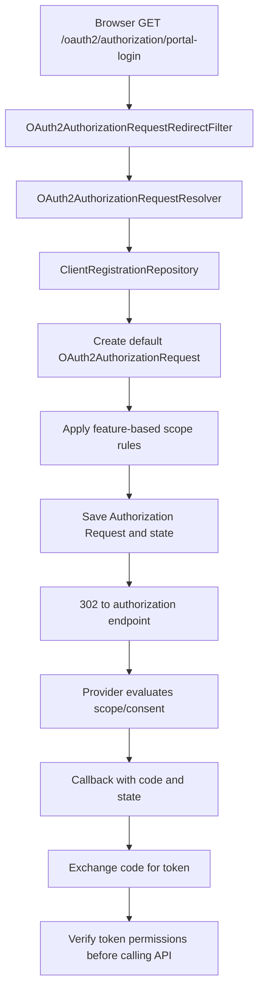
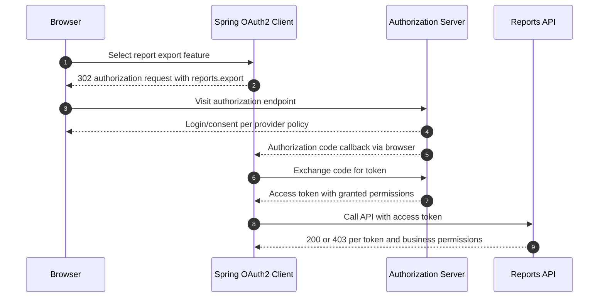
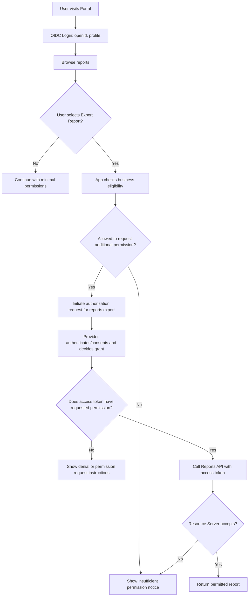

# 8.8. Customizing Scopes Based on Business Needs

In Spring Security OAuth 2.0 / OpenID Connect (OIDC) Client, **scope** is an important part of `OAuth2AuthorizationRequest`: the application declares the permissions or data groups it wants the Authorization Server to consider granting to the client. When a user logs in, scopes are typically sent on the redirect request to the authorization endpoint. A well-chosen set of scopes lets the application receive the right information, limits the access token's privileges, and avoids asking users for overly broad permissions.

In a real application, not every feature requires the same permissions. For instance, a user logging in only to view their profile might need `openid profile`, whereas when actively exporting a report, the application may need to request `reports.export`. This lesson shows how to **design, configure, and customize scopes based on business needs** in Spring Security OAuth2/OIDC Client, specifically during Authorization Request construction for the `authorization_code` flow on Servlet.

## 1. Understanding the True Role of Scopes

In OAuth 2.0, the `scope` parameter is a list of strings defined by the Authorization Server and Resource Server. At the authorization endpoint, they are usually expressed as a space-delimited value:

```text
scope=openid profile reports.read
```

When placed in a URL, spaces are URL-encoded. For example:

```http
GET /authorize?response_type=code
    &client_id=portal-client
    &redirect_uri=https%3A%2F%2Fportal.example.org%2Flogin%2Foauth2%2Fcode%2Fportal-login
    &scope=openid%20profile%20reports.read
    &state=RANDOM_VALUE
```

The HTTP snippet above illustrates only the main parameters. An actual Authorization Request may also include `nonce`, PKCE parameters, and provider-specific parameters.

| Concept | Meaning |
|---|---|
| **Requested scopes** | The set of scopes the client **requests** in the Authorization Request. |
| **Granted scopes** | The set of scopes the Authorization Server actually **grants**; may be smaller than the requested set. |
| **Client registration scopes** | The default scope set configured for a `ClientRegistration`. |
| **OAuth2AuthorizedClient** | Data associated with an authorized client: registration, principal, access token, and possibly refresh token. |
| **Access-token scopes** | Permissions attached to the access token; the Resource Server may use them to check access rights. |
| **OIDC scopes** | Standard scopes such as `openid`, `profile`, `email`, `address`, `phone`; affect the authentication protocol and which claims may be provided. |

**Scopes are not synonymous with user roles inside the application.** For example, the `reports.export` scope may allow a client to call the report-export API, yet the API must still verify the token, the subject, and business rules—such as ensuring a user can only export reports for their own department. Simply having the client request extra scopes does not guarantee the provider will grant them, nor can it bypass Resource Server authorization policies.

In OIDC, `openid` is a special scope signaling an authentication request under the OpenID Connect protocol. `profile` or `email` can request additional claims, though not every provider returns all claims merely because the application requested those scopes. Do not treat `email` as a universal API permission across all providers.

## 2. From Business Requirements to a Scope Set

Scope design should start from **permitted operations** and the APIs actually called, then translate into technical parameters. Suppose an employee portal has these capabilities:

| Business Scenario | Scopes Potentially Needed | When to Request | Notes |
|---|---|---|---|
| Sign in and display user's name | `openid profile` | Initial login | `openid` is required for OIDC; request `profile` only if profile info is needed. |
| Display contact email | `openid email` | When the UI needs email | Claim may be absent; handle cases where the provider does not return it. |
| View reports | `reports.read` | When activating report viewing, or at login if mandatory | Custom scope supported by API/provider; not a standard OIDC scope. |
| Export sensitive data | `reports.export` | When the user triggers export | Consider on-demand authorization; API still checks business permissions. |
| Sync data outside login session | `offline_access` or provider-defined refresh mechanism | Only when legitimately needed | Provider may require consent and separate conditions; scope does not guarantee receiving a refresh token. |
| Machine-to-machine job | `inventory.read` with `client_credentials` | When backend requests a service access token | Not a user login via the authorization endpoint. |

Names like `reports.read` and `reports.export` are only examples. In a real application, scope names and meanings must be agreed upon with the Authorization Server and Resource Server. Never invent arbitrary scope strings if the provider has not registered or recognized them.

### 2.1. Four Design Questions

1. **Who is performing the action?** Is a user logging in interactively, or is a service calling an API under the client's own identity?
2. **Which API receives the access token?** A permission on one API is not automatically valid for another API or a different audience.
3. **Is the permission needed right at login or only when activating a feature?** Requesting every scope at initial login can trigger broad consent prompts and violate least-privilege principles.
4. **Does the provider support requesting additional scopes later?** Some providers support incremental authorization/consent, while others require a fresh authorization flow or separate client registration.

These answers determine whether to use **fixed per-registration scopes**, **multiple registrations**, or **context-driven Authorization Request customization**.

## 3. Default Configured Scopes via ClientRegistration

In Spring Boot, the simplest approach is declaring scopes in `spring.security.oauth2.client.registration.<registrationId>.scope`.

```yaml
spring:
  security:
    oauth2:
      client:
        registration:
          portal-login:
            provider: company
            client-id: "${PORTAL_CLIENT_ID}"
            client-secret: "${PORTAL_CLIENT_SECRET}"
            authorization-grant-type: authorization_code
            client-authentication-method: client_secret_basic
            redirect-uri: "{baseUrl}/login/oauth2/code/{registrationId}"
            scope:
              - openid
              - profile
              - reports.read
        provider:
          company:
            issuer-uri: https://idp.example.org/realms/company
```

With registration `portal-login`, users can initiate login via the default URL:

```text
GET /oauth2/authorization/portal-login
```

When `oauth2Login()` is enabled, Spring Security looks up the `ClientRegistration` with ID `portal-login`, puts the configured scopes into `OAuth2AuthorizationRequest`, and redirects the browser to the provider's authorization endpoint.

Minimal Servlet configuration:

```java
import org.springframework.context.annotation.Bean;
import org.springframework.context.annotation.Configuration;
import org.springframework.security.config.Customizer;
import org.springframework.security.config.annotation.web.builders.HttpSecurity;
import org.springframework.security.web.SecurityFilterChain;

@Configuration
class SecurityConfig {

    @Bean
    SecurityFilterChain securityFilterChain(HttpSecurity http) throws Exception {
        http
            .authorizeHttpRequests(authorize -> authorize
                .requestMatchers("/", "/error").permitAll()
                .anyRequest().authenticated()
            )
            .oauth2Login(Customizer.withDefaults())
            .oauth2Client(Customizer.withDefaults());
        return http.build();
    }
}
```

`oauth2Login()` builds the login flow with an authorization-code redirect, while `oauth2Client()` supports scenarios where the application needs to manage authorized clients to call downstream APIs. Both can be used together.

A controller does not need to build the authorization URL or concatenate scope strings itself. `OAuth2AuthorizationRequestRedirectFilter` and `DefaultOAuth2AuthorizationRequestResolver` handle initiating the request per the registration.

### 3.1. Inspecting Scope Values from `ClientRegistration`

Once Spring creates the repository from configuration, you can look up a registration:

```java
ClientRegistration registration =
        clientRegistrationRepository.findByRegistrationId("portal-login");

Set<String> scopes = registration.getScopes();
```

`ClientRegistration.getScopes()` shows **the client's defaults**, not necessarily the scopes actually granted in the token after login. Never use this value as proof that the user granted `reports.read`.

### 3.2. When Are Fixed Scopes Enough?

Fixed scopes fit when every user of a registration genuinely needs the same permissions—for example, an internal app that always calls profile-read and task-list APIs after login. This approach is simple to implement, easy to observe, and has fewer branching paths.

If only a small subset of users needs a sensitive permission like `reports.export`, requesting that scope on every login may be inappropriate. In that case, consider splitting by feature.

## 4. Using Multiple `ClientRegistration` Entries for Distinct Permission Groups

A manageable option is declaring distinct registrations, each with its own scope set. For example:

```yaml
spring:
  security:
    oauth2:
      client:
        registration:
          portal-login:
            provider: company
            client-id: "${PORTAL_CLIENT_ID}"
            client-secret: "${PORTAL_CLIENT_SECRET}"
            authorization-grant-type: authorization_code
            scope: [openid, profile]
          portal-export:
            provider: company
            client-id: "${PORTAL_EXPORT_CLIENT_ID}"
            client-secret: "${PORTAL_EXPORT_CLIENT_SECRET}"
            authorization-grant-type: authorization_code
            scope: [openid, profile, reports.export]
        provider:
          company:
            issuer-uri: https://idp.example.org/realms/company
```

Both registrations share one provider, yet can have separately registered client IDs, secrets, and permissions. By default:

```text
/oauth2/authorization/portal-login
/oauth2/authorization/portal-export
```

When selecting a registration, Spring uses its corresponding scope set and the redirect callback contains the chosen registration's `registrationId`. If the provider requires explicit callback registration, declare both URIs:

```text
https://portal.example.org/login/oauth2/code/portal-login
https://portal.example.org/login/oauth2/code/portal-export
```

Points to keep in mind:

- A `registrationId` is an internal key in the repository; two registrations can point to the same provider, provided the actual configuration is accepted by the provider.
- For applications needing genuinely separate privilege levels, using a **separate client registration on the provider** can help with consent, auditing, and least privilege.
- The multi-registration approach separates `OAuth2AuthorizedClient` instances by registration key, though re-authentication UX and token selection must be designed clearly.
- Selecting `portal-export` cannot replace business permission checks in the controller and Resource Server. If a user is not allowed to export data, the API must still deny access.

If two features share a provider yet the application needs to add scopes across many fine-grained contexts, creating endless registrations can make configuration unwieldy. In that case, customize scopes when constructing each Authorization Request.

## 5. Where Scope Customization Fits in the Authorization Request

In Servlet, initiating OAuth2 Login goes through:



Objects to distinguish:

| Component | Responsibility |
|---|---|
| `ClientRegistrationRepository` | Supplies client configuration, including default scopes. |
| `OAuth2AuthorizationRequestResolver` | Selects the registration and creates the Authorization Request from the HTTP request. |
| `DefaultOAuth2AuthorizationRequestResolver` | Default resolver; can be wrapped or customized to add behavior. |
| `OAuth2AuthorizationRequest` | Holds authorization URI, grant request, scopes, `state`, redirect URI, parameters, and attributes. |
| `OAuth2AuthorizationRequestRepository` | Saves the created request to verify against on callback. |
| `OAuth2LoginAuthenticationFilter` | Handles callback, validates response, and exchanges code for tokens per Spring Security's mechanism. |
| `OAuth2AuthorizedClientManager` | Manages an authorized client and token acquisition/refresh calls; not the default place to add scopes to browser Authorization Requests. |

To customize scopes when the browser initiates login, hook into the **Authorization Request Resolver** rather than manually editing the `Authorization` header of outbound requests.

## 6. Customizing Scopes per Feature with `AuthorizationRequestResolver`

Suppose a reporting portal has two requirements:

- Standard login: `openid profile`.
- When the user selects "Export Report" and the app starts an authorization flow for that feature: add `reports.export`.

Initiation URLs used in the example:

```text
/oauth2/authorization/portal-login
/oauth2/authorization/portal-login?feature=export
```

We can wrap `DefaultOAuth2AuthorizationRequestResolver`. The default resolver builds the complete request first; the wrapper only adjusts the scope set while keeping `state`, redirect URI, `nonce`, PKCE, and other Spring-prepared properties intact.

### 6.1. Business-Aware Resolver Class

```java
import jakarta.servlet.http.HttpServletRequest;
import java.util.LinkedHashSet;
import java.util.Set;
import org.springframework.security.oauth2.client.registration.ClientRegistrationRepository;
import org.springframework.security.oauth2.client.web.DefaultOAuth2AuthorizationRequestResolver;
import org.springframework.security.oauth2.client.web.OAuth2AuthorizationRequestResolver;
import org.springframework.security.oauth2.core.endpoint.OAuth2AuthorizationRequest;

public final class BusinessScopeAuthorizationRequestResolver
        implements OAuth2AuthorizationRequestResolver {

    private static final String START_URI =
            "/oauth2/authorization/portal-login";
    private static final String EXPORT_SCOPE = "reports.export";

    private final OAuth2AuthorizationRequestResolver delegate;

    public BusinessScopeAuthorizationRequestResolver(
            ClientRegistrationRepository registrations) {
        this.delegate = new DefaultOAuth2AuthorizationRequestResolver(
                registrations, "/oauth2/authorization");
    }

    @Override
    public OAuth2AuthorizationRequest resolve(HttpServletRequest request) {
        return customize(request, delegate.resolve(request));
    }

    @Override
    public OAuth2AuthorizationRequest resolve(
            HttpServletRequest request, String clientRegistrationId) {
        return customize(
                request, delegate.resolve(request, clientRegistrationId));
    }

    private OAuth2AuthorizationRequest customize(
            HttpServletRequest request,
            OAuth2AuthorizationRequest original) {

        if (original == null) {
            return null;
        }

        // Only apply to the initiation endpoint of the desired registration.
        if (!START_URI.equals(request.getServletPath())) {
            return original;
        }

        // Only one feature is allowed to expand scopes.
        if (!"export".equals(request.getParameter("feature"))) {
            return original;
        }

        Set<String> scopes = new LinkedHashSet<>(original.getScopes());
        scopes.add(EXPORT_SCOPE);

        return OAuth2AuthorizationRequest.from(original)
                .scopes(scopes)
                .build();
    }
}
```

This example intentionally restricts its scope to the `portal-login` path and accepts only the `feature=export` option; it does **not** read an arbitrary scope list from the query string. Using `request.getServletPath()` fits the example's default servlet mapping. If the app uses custom servlet mappings or reverse-proxy path rewrites, apply path matching suitable for your setup.

`OAuth2AuthorizationRequest.from(original)` creates a builder from the default request. Modifying only `scopes` preserves the fields already built by the framework, instead of constructing a new request by hand and risking dropping security parameters.

**Security boundary of the example:** the `feature` query parameter sent by the browser is untrusted input. The demo only allows requesting **a single pre-listed scope**; it does not prove the user is authorized to export reports. If requesting privileged scopes must also be restricted per user, the system must check business eligibility via an appropriate server-side component, control flow initiation, and enforce authorization at the API. Never treat a query parameter as proof of authorization.

### 6.2. Wiring the Resolver into Spring Security Servlet

```java
import org.springframework.context.annotation.Bean;
import org.springframework.context.annotation.Configuration;
import org.springframework.security.config.annotation.web.builders.HttpSecurity;
import org.springframework.security.oauth2.client.registration.ClientRegistrationRepository;
import org.springframework.security.web.SecurityFilterChain;

@Configuration
class SecurityConfig {

    @Bean
    SecurityFilterChain securityFilterChain(
            HttpSecurity http,
            ClientRegistrationRepository registrations) throws Exception {

        var resolver =
                new BusinessScopeAuthorizationRequestResolver(registrations);

        http
            .authorizeHttpRequests(authorize -> authorize
                .requestMatchers("/", "/error").permitAll()
                .anyRequest().authenticated()
            )
            .oauth2Login(oauth2 -> oauth2
                .authorizationEndpoint(endpoint ->
                    endpoint.authorizationRequestResolver(resolver)
                )
            );

        return http.build();
    }
}
```

`authorizationEndpoint().authorizationRequestResolver(...)` replaces the resolver used during the redirect-creation stage. The callback filter continues using Spring Security's login flow. You do not need to manually implement token exchange or `state` checking.

Note: the two code blocks in section 6 are parts of **the same example**, whereas the `SecurityFilterChain` configurations in earlier sections are alternative configurations illustrating different approaches.

### 6.3. UI Links

```html
<a href="/oauth2/authorization/portal-login">
    Standard Sign In
</a>

<a href="/oauth2/authorization/portal-login?feature=export">
    Continue with report export permission
</a>
```

These are browser navigation links. For an OIDC login flow redirecting through a provider, do not treat the initiation URL like a JSON endpoint that the frontend calls with `fetch()` expecting immediate data.

When the app runs under a context path, generate links accounting for the context path (e.g. using Thymeleaf URL expressions). When changing the base URI in `DefaultOAuth2AuthorizationRequestResolver` or `authorizationEndpoint().baseUri(...)`, update links consistently.

### 6.4. Allowed Scopes and Policy Selection

Avoid implementations like:

```java
// DO NOT DO THIS: let the browser pick arbitrary scopes.
String raw = request.getParameter("scope");
Set<String> scopes = Set.of(raw.split(" "));
```

That can inject `admin`, `payments.write`, or other sensitive scopes into the Authorization Request even when the feature does not need them. The provider might reject them, yet some provider configs still grant broad privileges; moreover, logs, consent, and application behavior become hard to control.

Instead, define an allowlist of scopes the application understands and a fixed mapping from feature:

```java
Map<String, Set<String>> featureScopes = Map.of(
    "view", Set.of("reports.read"),
    "export", Set.of("reports.export")
);
```

Apply scopes only after validating the registration and checking feature policy. If a scope contains spaces, unusual characters, or is outside the provider contract, never forward it directly from user input.

## 7. Static Customization via Customizer

When **every Authorization Request** for a registration should include a known set of extra scopes, `DefaultOAuth2AuthorizationRequestResolver` also provides `setAuthorizationRequestCustomizer(...)`. Conceptual example:

```java
DefaultOAuth2AuthorizationRequestResolver resolver =
        new DefaultOAuth2AuthorizationRequestResolver(
                registrations, "/oauth2/authorization");

resolver.setAuthorizationRequestCustomizer(builder ->
        builder.scopes(scopes -> scopes.add("reports.read")));
```

The customizer receives `OAuth2AuthorizationRequest.Builder`, which fits static adjustments to scopes or authorization parameters. However:

- This callback does not directly receive `HttpServletRequest`. If you need to know an action the user just chose via the HTTP request, wrapping the resolver as in section 6 gives clearer context control.
- Adjusting across multiple providers requires ensuring scopes match each `ClientRegistration`; a shared customizer could accidentally send API A's scopes to provider B.
- When replacing the default customizer, understand interactions with security customizers like PKCE in your Spring Security version. Wrapping the already-created Authorization Request as in section 6 preserves default parameters.
- Adding static scopes via YAML `ClientRegistration` is usually simpler if programmatic logic is not genuinely needed.

## 8. Authorization Request, Consent, and Granted Tokens

Adding `reports.export` to the Authorization Request only changes **the requested permissions**. What happens next may look like:



The provider may:

1. Grant all requested scopes.
2. Grant only a subset—for example, omitting `reports.export` even though the user logged in.
3. Prompt the user to consent to the extra permissions.
4. Reject the authorization request due to `invalid_scope` or client policy.
5. Apply its own incremental authorization/consent mechanism.

Never infer granted permissions simply because the Authorization Request contained the desired scope. Check the actual result and let the Resource Server verify permissions when receiving the bearer access token.

### 8.1. Distinguishing Requested and Granted Scopes in Code

Once you have `OAuth2AuthorizedClient`, the client's access token can provide information about granted scopes:

```java
OAuth2AccessToken accessToken = authorizedClient.getAccessToken();
Set<String> grantedScopes = accessToken.getScopes();

if (!grantedScopes.contains("reports.export")) {
    // Do not assume the client was granted report export permission.
}
```

This is a signal on the OAuth2 Client side. Providers may represent scopes differently, especially with opaque tokens or tokens without full metadata. The Resource Server must be the final authority checking tokens and access policy. With JWT tokens, the Resource Server can map scope claims per application policy; there is no single mandatory claim format across every provider.

### 8.2. Scopes and OIDC Claims

The `openid` scope activates the OIDC flow, in which the client receives an ID Token per protocol if supported by the provider and the request is valid. `profile` and `email` may influence claims returned in the ID Token or UserInfo endpoint depending on the provider.

Do not confuse:

- **ID Token**: confirms login identity to the client (issuer, subject, audience, and OIDC checks).
- **Access Token**: used to request access at a Resource Server.
- **Scope**: expresses requested permissions or claim groups, evaluated for issuance by the provider.

Never send an ID Token in place of an access token when calling the Reports API; nor treat the `email` scope as permission to export reports.

## 9. Incremental Permissions After Login: Limitations to Understand

Common scenario: a user logs in with `openid profile`, uses the app for a while, then clicks "Export Report." Now the app wants to request `reports.export` without always requesting broad scopes at initial login.

This is often called **incremental authorization** or just-in-time consent. Feasibility depends on the Authorization Server and OAuth2 Client design:

- If the provider supports requesting additional scopes, the app can initiate a new authorization-code flow with the expanded scope set.
- The provider may show a consent screen or ask for re-authentication; behavior depends on SSO policies and `prompt`/`max_age` if used.
- When reusing the same `registrationId`, the authorized client stored for that principal may be updated/replaced by the new authorization result. The app must know which token is being used for which feature.
- `OAuth2AuthorizedClientManager` **does not automatically** request additional scopes whenever a controller needs a new permission. It typically uses `ClientRegistration`, the existing authorized client, and configured grant providers to manage tokens.
- A normal refresh token **does not expand permissions** beyond what was already granted. Obtaining a new scope usually requires an appropriate authorization request permitted by the provider.
- Requesting a new scope does not guarantee the issued token matches the Reports API's audience. Scopes, resource/audience, and provider rules must be evaluated together.

For complex applications, separating registrations per feature or organizing dedicated authorization-code flows can make token storage and consent clearer than mutating scopes on one registration per request.

### 9.1. Why Doesn't a Refresh Token Replace a New Authorization Flow?

For example, after login, the access token only has `reports.read`. The app exchanges a refresh token for a new access token. Under the OAuth 2.0 model, a refresh request must not broaden scopes beyond what was originally granted. If the app needs `reports.export` and it was not granted, a new provider-permitted authorization step is required.

Never manually edit `OAuth2AuthorizedClient` or add `reports.export` to an in-memory scope set and treat the token as holding that permission. Permissions are governed by token issuance and verification, not by strings appended on the Client.

## 10. Servlet Session Considerations and Multiple Authorization Requests

In Spring Security Servlet, the Authorization Request is usually saved in `HttpSessionOAuth2AuthorizationRequestRepository` before redirecting. The callback relies on `state` to find the original request and proceed with exchanging the authorization code.

When an application supports multiple scope-based authorization entry points, design these cases carefully:

| Scenario | Potential Issue |
|---|---|
| User opens two tabs and starts two OAuth2 Logins in parallel | Repository/session and state must correlate each request properly; behavior depends on version/config. |
| User clicks "export", then switches to "view" before callback | Authorization requests carry different scopes; never infer the callback's scopes from current UI state. |
| Load balancer routes callback to another instance | Session or Authorization Request lost without shared/compatible session storage. |
| Callback carries a different session cookie | Spring may be unable to verify `state` or locate the saved request. |
| App stores tokens for multiple registrations | Must pick the right registration/principal when calling downstream APIs, avoiding tokens from another feature. |

Never disable `state` checking, never use a fixed `state` string, and never pass business privileges as unprotected request parameters treated as confirmed authorization.

If business context must survive a redirect, store server-side state or use an integrity- and lifetime-protected mechanism bound to the Authorization Request/user session. Never put sensitive data in query parameters or log redirect URLs.

## 11. Distinguishing Login Scopes from Service-to-Service Scopes

Not every OAuth2 Client uses `OAuth2AuthorizationRequestRedirectFilter`. With `client_credentials`, the application requests a token directly at the token endpoint for one service to call another, with no user entering credentials on a provider page or browser callback.

Example registration for batch export:

```yaml
spring:
  security:
    oauth2:
      client:
        registration:
          reports-batch:
            provider: company
            client-id: "${BATCH_CLIENT_ID}"
            client-secret: "${BATCH_CLIENT_SECRET}"
            authorization-grant-type: client_credentials
            client-authentication-method: client_secret_basic
            scope:
              - reports.read
              - reports.export
        provider:
          company:
            token-uri: https://idp.example.org/realms/company/protocol/openid-connect/token
```

With this registration:

- Scopes are part of the client-credentials token request as supported by the provider and Spring Security—not query parameters on `/oauth2/authorization/reports-batch`.
- Permissions are granted to the client/service identity, not representing a specific end user.
- Use `OAuth2AuthorizedClientManager` with an authorized-client store suited for background jobs, such as `AuthorizedClientServiceOAuth2AuthorizedClientManager` when no `HttpServletRequest` exists.
- Do not add the OIDC `openid` scope to service-to-service registrations merely because interactive login shares the same provider.

If an API requires end-user authorization, switching from authorization-code flow to `client_credentials` will not satisfy that requirement.

## 12. Common Errors When Customizing Scopes

| Symptom | Possible Cause | How to Handle |
|---|---|---|
| Provider returns `invalid_scope` | Scope does not exist, client is not allowed, syntax error, or unsupported grant type | Check provider metadata/docs and scope setup at Authorization Server. |
| New scope does not appear in redirect | Resolver not attached to security chain, wrong registration/path, or customizer did not run | Check initiation link, active chain, and `scope` parameter in Authorization Request. |
| User is prompted for consent more than expected | Every login requests broad scopes, or provider requires consent for new scope | Review feature-to-scope mapping; request scopes only when actually needed. |
| Login succeeds, but API returns `403` | Provider withheld scope, wrong access token audience, or user lacks business permission | Compare granted scopes, target API, and Resource Server policies. |
| Scope present, yet ID Token lacks `email` | `email` scope does not guarantee claims appear in ID Token; provider may use UserInfo | Read provider OIDC contract, handle missing claims, and check UserInfo when appropriate. |
| Adding scope breaks OIDC login | Accidentally removed `openid` or dropped `nonce`/PKCE when building request manually | Merge scopes with the original set; start from `OAuth2AuthorizationRequest.from(original)`. |
| New permission missing after refresh token | Refresh does not expand previously granted scopes | Initiate a new authorization flow as supported by the provider. |
| Feature receives token from wrong registration | Selected wrong registration when retrieving `OAuth2AuthorizedClient` or used wrong default client | Specify registration/authorized client explicitly for outbound calls and check API audience. |
| Initiation link changed, yet resolver does not run | Base URI changed on one side only, or multiple security chains exist | Align resolver base URI, UI links, and `securityMatcher`. |
| Callback fails across multiple tabs | Authorization Request or session/state not correlated as expected | Check repository, state, and session mechanism; never skip validation. |

### 12.1. Debugging by Stage

Separate three distinct questions:

1. **Which scopes did the Authorization Request ask for?** Inspect `scope` on the redirect URL from client to provider in a test environment; avoid publishing `state`, code, or session cookies.
2. **Which permissions did the provider grant?** Check the token response and token metadata through secure mechanisms, or via provider-supported introspection/claims.
3. **What does the Resource Server actually enforce?** Scopes are only part of it; the API may also check issuer, audience, subject, organization, roles, and business constraints.

These three sets can differ. Do not rewrite custom resolver code if `scope` on the redirect is already right while the provider withheld the privilege.

## 13. Complete Business Flow: Exporting Reports on Demand

Suppose a system has a Web Portal, Corporate IdP, and Reports API. Business rules state that most employees only need to view reports; exporting reports involves sensitive data and requires separate approval.



Practical implementation steps:

1. **Baseline login:** configure `portal-login` with `openid profile`, limiting unnecessary scopes.
2. **Define permissions:** agree with Reports API that `reports.export` is a provider-recognized scope, and explicitly define business authorization rules beyond scope.
3. **Choose timing:** when the user clicks export, decide whether to start a new authorization flow or use a separate registration per provider design.
4. **Build Authorization Request:** enforce an allowlist and preserve `state`, `nonce`, PKCE, and original attributes.
5. **Handle outcome:** if the provider does not grant the additional scope, show an appropriate message; never bypass scope checks or borrow tokens from another flow.
6. **Call API:** select the right `OAuth2AuthorizedClient` and send its access token to Reports API; at the API, validate the token and authorize access to the specific report resource.
7. **Operational observability:** track `registrationId`, feature codes, and sanitized error codes without logging access tokens, refresh tokens, authorization codes, or secrets.

In this design, scopes govern **what permissions the client requests and receives**, while permission to export a specific report remains protected by the API's business policy. That separation prevents a token with `reports.export` from being treated as blanket permission to export data from every department.

## 14. Hands-On Flow Verification

In a test environment with an Authorization Server, you can observe two cases:

**Flow A – Standard Login**

```text
GET /oauth2/authorization/portal-login
=> 302 Location: https://idp.example.org/...&scope=openid%20profile&state=...
```

**Flow B – User Chooses Export Feature**

```text
GET /oauth2/authorization/portal-login?feature=export
=> 302 Location: https://idp.example.org/...&scope=openid%20profile%20reports.export&state=...
```

This is the expected illustrative output when applying the corresponding configuration examples, not a guarantee that the provider will grant all scopes. Scope ordering in the URL may vary without changing the meaning of the scope set.

When analyzing runs, note:

- Initiation belongs to `OAuth2AuthorizationRequestRedirectFilter` and returns a redirect; do not expect tokens directly from this endpoint.
- The provider may reject or ask for consent; the token response may reflect granted scopes different from requested scopes.
- Spring Security must retain state between the initiation request and callback to verify `state`.
- After login, downstream APIs must validate access tokens and enforce corresponding authorization policies.
- The `feature=export` examples illustrate custom requests; in production, protect business privileges and rely on trustworthy feature-decision sources.

## 15. Review Questions

1. Why do scopes in `ClientRegistration` not prove that the access token actually holds those permissions?
2. How do `openid`, `profile`, and `reports.export` differ in purpose?
3. When are fixed scopes in YAML sufficient, and when should you use a separate registration for a feature?
4. Why should you never take raw `scope` values from a browser query parameter and pass them straight into the Authorization Request?
5. How do `DefaultOAuth2AuthorizationRequestResolver` and `OAuth2AuthorizationRequestRedirectFilter` work together to send scopes to the provider?
6. Why is creating a request via `OAuth2AuthorizationRequest.from(original)` safer than building a brand-new request from scratch just to add a scope?
7. If a user already has an access token with `reports.read`, why does a refresh token not automatically grant `reports.export`?
8. The provider granted `reports.export`, yet Reports API still returns 403; what else must be checked?
9. In a multi-provider application, what risk arises from adding a scope to every request using a single global customizer?
10. Should the `/oauth2/authorization/{registrationId}` endpoint be used to obtain tokens for `client_credentials`? Why or why not?

## References

- [Spring Security Reference — OAuth2 Login, Core Configuration (Servlet)](https://docs.spring.io/spring-security/reference/servlet/oauth2/login/core.html)
- [Spring Security Reference — OAuth2 Login, Advanced Configuration (Servlet)](https://docs.spring.io/spring-security/reference/servlet/oauth2/login/advanced.html)
- [Spring Security Reference — OAuth2 Client (Servlet)](https://docs.spring.io/spring-security/reference/servlet/oauth2/client/index.html)
- [Spring Security API — DefaultOAuth2AuthorizationRequestResolver](https://docs.spring.io/spring-security/reference/api/java/org/springframework/security/oauth2/client/web/DefaultOAuth2AuthorizationRequestResolver.html)
- [Spring Security API — OAuth2AuthorizationRequest](https://docs.spring.io/spring-security/reference/api/java/org/springframework/security/oauth2/core/endpoint/OAuth2AuthorizationRequest.html)
- [RFC 6749 — OAuth 2.0 Authorization Framework, Scope](https://datatracker.ietf.org/doc/html/rfc6749#section-3.3)
- [OpenID Connect Core 1.0 — Scope Values](https://openid.net/specs/openid-connect-core-1_0.html#ScopeClaims)
