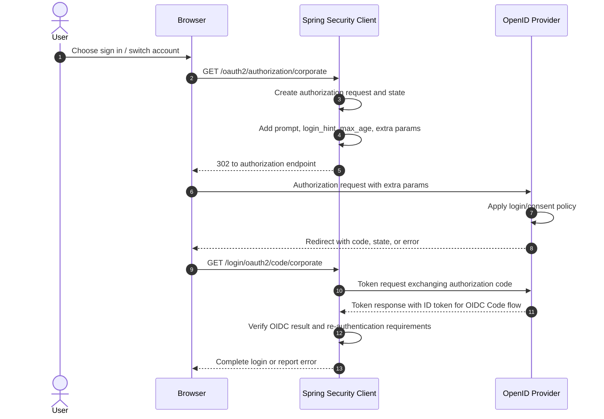

# 8.9. Adding `prompt`, `login_hint`, `max_age`, and Provider-Specific Parameters

> **Module:** Spring Security OAuth 2.0 OIDC Client  
> **Chapter:** 8. Authorization Request  
> **Scope:** Spring Boot applications using Spring Security OAuth 2.0/OIDC Client on the Servlet stack, initiating the Authorization Code flow via the browser and customizing parameters sent to the Authorization Server/OpenID Provider (OP).

An application using `oauth2Login()` typically initiates login through `/oauth2/authorization/{registrationId}`. Spring Security creates an authorization request with `client_id`, `redirect_uri`, `response_type`, `scope`, `state`, and required security parameters. In many product scenarios, default configuration is not enough: the application wants to ask the user to choose an account, force re-authentication before a sensitive action, prefill a known username, or route to a specific identity provider in an SSO system.

OAuth 2.0 and OpenID Connect support extending the authorization request to meet these needs. The four groups this lesson focuses on are:

- **`prompt`:** asks the OP to control how it interacts with the user.
- **`login_hint`:** hints which account the user likely intends to use.
- **`max_age`:** requests a maximum age for the user's authentication session at the OP.
- **Provider-specific parameters:** such as `hd` for Google, `kc_idp_hint` for Keycloak, or other options documented by the provider.

You must distinguish between **the parameter sent**, **how the OP may interpret it**, and **what conditions the application must verify after receiving the result**. Simply adding a query parameter does not guarantee the provider honors every request or automatically produces strong enough authentication proof.

## 1. Learning Objectives

After this lesson, you will be able to:

1. Locate the authorization request within the Authorization Code and OIDC login flows.
2. Explain `prompt=login`, `prompt=consent`, `prompt=select_account`, `prompt=none`, and their interaction constraints.
3. Know when `login_hint` is helpful, why it is only a hint, and how to protect personal data.
4. Use `max_age` to require recent authentication, distinguishing it from access token lifetime, ID token lifetime, and application session timeout.
5. Recognize the OIDC requirement for the `auth_time` claim when sending `max_age`, and identify what verification the application must enforce.
6. Add parameters using `DefaultOAuth2AuthorizationRequestResolver` and `OAuth2AuthorizationRequest.Builder.additionalParameters(...)`.
7. Apply parameter policies per `registrationId` without accidentally sending provider A's options to provider B.
8. Preserve `state`, OIDC `nonce`, PKCE, and callback metadata managed by Spring Security.
9. Observe, troubleshoot, and handle cases where the OP does not support a parameter, rejects invalid interaction requests, or fails to satisfy re-authentication policies.

## 2. Where Does the Authorization Request Fit?

In the Authorization Code flow, the **authorization request** is the request the browser sends to the provider's authorization endpoint. It occurs **before** the Client receives an authorization code and before the Client exchanges the code for tokens.

Readable example URL (not a live URL to paste into a browser):

```text
GET https://login.example.test/authorize
    ?response_type=code
    &client_id=portal-web
    &redirect_uri=https%3A%2F%2Fapp.example.test%2Flogin%2Foauth2%2Fcode%2Fcorporate
    &scope=openid%20profile%20email
    &state=<generated-state>
    &prompt=select_account
    &login_hint=user%40example.test
    &max_age=300
```

Values such as `state`, `nonce`, or PKCE `code_challenge` may be generated by Spring Security and bound to the transaction. The example above displays only the three parameters under study; a real OIDC transaction may include other parameters as well.

Flow overview:



**Do not confuse the three request types:** the authorization request travels via the browser to the authorization endpoint; the token request goes from the Client to the token endpoint; requests to a Resource Server carry the access token. Parameters like `prompt` and `max_age` belong to the **OIDC authentication/authorization request**, not headers for calling APIs.

### 2.1. Parameter Categories

| Category | Examples | Who Usually Manages It |
|---|---|---|
| Core OAuth 2.0 | `response_type`, `client_id`, `redirect_uri`, `scope`, `state` | Spring Security based on ClientRegistration |
| Flow protection | PKCE `code_challenge`, `code_challenge_method`; OIDC `nonce` | Spring Security and Client configuration |
| OIDC authentication request | `prompt`, `login_hint`, `max_age`, `acr_values`, `ui_locales` | Client adds per policy; OP interprets |
| Provider-specific parameters | `hd`, `kc_idp_hint`, `access_type`, ... | Per provider contract and documentation |

In Spring Security, OIDC extensions and provider parameters are typically added to **`additionalParameters`** of `OAuth2AuthorizationRequest`. The `attributes` map of the authorization request is for application/framework-internal data; do not confuse it with query parameters sent to the OP.

## 3. `prompt`: Requesting How the OP Interacts with the User

`prompt` is an optional OIDC-standardized parameter. It contains one or more space-delimited values; the OP applies them according to each value's semantics and the current session state.

Core values in OIDC Core:

| Value | Purpose | Scenario |
|---|---|---|
| `login` | Asks the OP to re-authenticate the user | Before a sensitive operation or when starting a fresh login |
| `consent` | Requests displaying a consent interaction | User needs to review/re-approve permissions per OP policy |
| `select_account` | Requests UI for the user to choose an account | Browser has multiple accounts/sessions at the same OP |
| `none` | Do not display any authentication or consent UI | Try checking an existing session without interrupting the UI |

Examples:

```text
prompt=select_account
prompt=login
prompt=login consent
prompt=none
```

**Important rule:** `none` **must not be combined with other values**. Never send `prompt=none login` or `prompt=none consent`. If the OP needs user interaction to fulfill a `prompt=none` request, it returns the appropriate OIDC error rather than displaying an interactive UI.

### 3.1. `prompt=login`

When an SSO session already exists at the OP, redirecting to the OP can finish almost instantly without showing a login screen. `prompt=login` asks the OP to **re-authenticate** instead of silently reusing the existing session.

However, exact behavior depends on the OP, authentication method, SSO policy, and compliance. If the application needs proof that the user authenticated recently for a sensitive action, simply seeing `prompt=login` in the request is **not enough**. You must receive a result proving the authentication timestamp and enforce verification policy on the Client (see `max_age` and `auth_time`).

A re-authentication step may differ from entering a password: the OP might use a passkey, MFA, or equivalent method per policy.

### 3.2. `prompt=consent`

`prompt=consent` asks the OP to show a consent prompt. It is useful when the user needs to review permissions requested by the application, or when a provider requires consent before issuing certain permissions or tokens.

Do not assume that `prompt=consent`:

- always returns a refresh token;
- grants additional scopes the Client is not allowed to request;
- overrides the OP's refresh token restriction policies;
- replaces user re-authentication requirements.

Some providers require proprietary parameters, client settings, or specific consent policies. Read the documentation for the OP you are integrating.

### 3.3. `prompt=select_account`

`prompt=select_account` asks the OP to present an account chooser if supported. This fits cases where a user may sign in with multiple accounts on the same OP or wants to switch from a personal account to a work account.

Account selection is an **interaction at the OP**. The Client must still verify the ID token and map identity by `iss`/`sub`; the account name shown in UI never replaces token verification.

If a user wants to switch accounts within the application itself, consider both the current application session and the SSO session at the OP. Simply adding `prompt=select_account` does not automatically clear the web session or old account association.

### 3.4. `prompt=none`

`prompt=none` asks the OP not to display any UI. If no suitable session exists, fresh consent is required, or the user must choose an account, the OP may return errors such as:

- `login_required`;
- `consent_required`;
- `interaction_required`;
- `account_selection_required`.

Exact error codes and when they occur depend on the situation. The Client must handle error callbacks, verify `state`, and transition the user to an interactive flow when appropriate.

**Avoid login loops:** if the OP returns `login_required` for `prompt=none`, do not redirect back with `prompt=none` endlessly. Design a clear branch from silent attempt to interactive login.

Modern browsers and cookie policies can restrict silent authentication inside iframes or third-party cookie contexts. Do not build product UX assuming `prompt=none` will always succeed.

## 4. `login_hint`: Identity Hint, Not Identity Authentication

`login_hint` is an optional OIDC parameter allowing the Client to hint at which user is expected to sign in. The OP can use this value to prefill the username, pick the right login screen, or route the sign-in process.

Example:

```text
login_hint=staff.member@example.test
```

**Meaning:** "If helpful, use this hint in the login experience."  
**Does NOT mean:** "This user is already authenticated," "issue an ID token for this `sub`," or "skip password/MFA verification."

### 4.1. Suitable Scenarios

- The application already knows a username supplied by the user in an earlier step and wants to avoid asking again.
- The user already authenticated in another system within a trusted handoff flow and is being sent to the OP.
- The system has multiple accounts and wants to suggest the relevant account while letting the OP decide.
- An organizational login page wants to hint the account name chosen by the user.

The OP may ignore it, interpret it differently, or expect a different identifier type instead of email. Thus, the hinted login name must follow the active provider's contract.

### 4.2. Be Careful with Personal Data in URLs

`login_hint` usually travels in the authorization URL. Even over HTTPS, URLs can appear in browser history, telemetry, reverse proxy/access logs, monitoring, or referrer metadata. Therefore:

1. Send only genuinely needed hints.
2. Avoid sensitive identifiers such as government ID numbers, medical info, or unrelated data.
3. Never put access tokens, ID tokens, passwords, client secrets, or session IDs in `login_hint`.
4. Never write raw authorization URLs to shared logs.
5. If a hint comes from an HTTP request, validate its source, format, and length, and never use it as a basis for authorization.
6. Allow users to switch accounts if the OP supports it; never force identity based solely on a hint.

**Design rule:** the application accepts a logged-in user only after completing OIDC processing and validating the proper ID token, regardless of `login_hint`.

## 5. `max_age`: Limiting Time Since Authentication at the OP

`max_age` is a standard OIDC parameter expressing **the maximum acceptable elapsed time in seconds since the user's last active authentication at the OP**.

Examples:

```text
max_age=300    # require authentication no older than 5 minutes
max_age=0      # ask OP to actively re-authenticate
```

The value must be a non-negative integer number of seconds per the specification. Do not set `max_age=5m`, `max_age=-1`, or an absolute timestamp. In actual URLs, send only a numeric string like `300`.

### 5.1. Distinguishing `max_age` from Token Lifetimes and Sessions

| Component | Interpretation |
|---|---|
| `max_age` | Requirement on **recency of authentication at the OP** when handling the OIDC request |
| ID token `exp` | Expiration timestamp of the **ID token** |
| Access token `expires_in`/`exp` | Validity duration of the **access token** |
| HTTP session timeout | How long the web app maintains session state per policy |
| `auth_time` | Timestamp reported by the OP indicating when the user authenticated |

For example, the OP issues an ID token valid for 60 minutes, yet the user authenticated 2 hours ago. A new request with `max_age=300` must not be considered compliant simply because the new token's `exp` is in the future. Conversely, an expired API access token does not automatically mean the user must re-authenticate at the OP.

### 5.2. Relationship Between `max_age` and `auth_time`

According to OIDC Core, when the Client requests `max_age`, the OP **must include the `auth_time` claim in the ID token**. This claim uses NumericDate format (Unix epoch seconds).

Illustrative payload:

```json
{
  "iss": "https://login.example.test",
  "sub": "user-42",
  "aud": "web-client",
  "iat": 1893453000,
  "exp": 1893456600,
  "auth_time": 1893452760
}
```

In this example, the interval between `iat` and `auth_time` is 240 seconds. If the Client requested `max_age=300` and the verification timestamp is within 300 seconds of `auth_time` (accounting for reasonable clock skew), this satisfies the freshness requirement. This payload is illustrative only; the Client must verify signature, issuer, audience, expiration, and OIDC rules before trusting any claim.

**For sensitive operations**, the Client should explicitly check:

- The ID token is valid per OIDC.
- `auth_time` is present when `max_age` was requested.
- `auth_time` is a valid NumericDate, not unexpectedly in the future.
- The difference between a trusted current timestamp and `auth_time` is within policy threshold, allowing minor clock skew if needed.
- Required permissions and assurance levels for the operation are still checked independently.

Do not assume every library/framework version automatically enforces business policies on `auth_time` merely because the authorization request carried `max_age`. Check the default behavior of your Spring Security version; if needed, add policy validation at the right point after ID token verification.

### 5.3. Do `max_age=0` and `prompt=login` Replace Each Other?

Both can cause the OP to prompt the user to re-authenticate, yet their semantics and output evidence differ:

| Configuration | Primary Goal | Data to Check |
|---|---|---|
| `prompt=login` | Ask OP to put the user through re-authentication | OP behavior and actual auth requirement; `auth_time` if policy needs recency proof |
| `max_age=0` | Require OP to actively re-authenticate per OIDC rules | OP must include `auth_time`; Client verifies validity and freshness |
| `prompt=login&max_age=0` | Combine UI/re-authentication request with freshness constraint | Verify ID token and `auth_time` to prove compliance |

Do not rely on `prompt=login` alone as machine-verifiable proof that re-authentication occurred at the required time. If the application has a policy like "MFA within the last 5 minutes," `max_age` alone also cannot confirm **which authentication method/MFA** was used; you need an assurance mechanism such as `acr_values` or `acr`/`amr` claims per OP contract and trust policy.

## 6. Other Standard OIDC Parameters and Provider-Specific Parameters

Customized requests can carry additional parameters:

| Parameter | Type | Purpose | Limits to Remember |
|---|---|---|---|
| `ui_locales` | Standard OIDC | Hints OP UI languages using BCP 47 tags, e.g. `vi en` | OP may ignore it or pick another language |
| `acr_values` | Standard OIDC | Requests Authentication Context Class References in order of preference | OP support varies; must check returned `acr` against policy |
| `id_token_hint` | Standard OIDC | Hints a known session/identity in certain flows | Must follow OIDC rules; never put arbitrary tokens in URLs |
| `hd` | Google-specific | Hints Google Workspace/hosted domain | **Not an authorization check**; verify claims/provider policy on result |
| `kc_idp_hint` | Keycloak-specific | Hints an identity provider in Keycloak's broker flow | Meaningful only when the realm/broker is configured and supports it |
| `access_type=offline` | Google-specific OAuth2 | Requests offline access capability per Google policy | Does not guarantee receiving a refresh token; subject to consent and provider rules |
| `domain_hint` | Certain specific providers | Hints domain/tenant, possibly affecting account discovery | Provider-dependent; never use instead of issuer/tenant validation |

**There is no universal parameter table that works for every provider.** A parameter valid for Keycloak may be ignored by Google; a Google parameter may cause another provider to return `invalid_request`. Consult documentation for your actual IdP/realm/tenant version and configure per `registrationId`.

### 6.1. Google `hd` Example

In an application signing in with Google Workspace, you can add:

```text
hd=example.com
```

This hints Google to prioritize accounts belonging to that hosted domain. **Never** rely on having sent `hd` to conclude the user actually belongs to the organization. If policy permits only that domain, inspect the verified identity data returned by Google per provider guidance alongside internal membership rules. Even checking whether an email ends with `@example.com` may be insufficient for your organization/tenant model.

### 6.2. Keycloak `kc_idp_hint` Example

A Keycloak realm can broker multiple Identity Providers. The parameter:

```text
kc_idp_hint=partner-oidc
```

can ask Keycloak to route directly to the identity provider aliased `partner-oidc` in that realm. That alias belongs to Keycloak configuration and must actually exist. It does not replace token validation, does not grant roles, and does not apply uniformly across all providers or login flows.

### 6.3. Distinguishing Hints from Mandatory Requirements

Parameters containing the word "hint" are an important signal: they express a Client preference, not a Resource Server authorization policy. If a security requirement states "the user must belong to tenant A and have authenticated with MFA," the application must obtain **trustworthy authentication results and enforce policy checks** after login.

## 7. How Does Spring Security Build the Default Authorization Request?

With a Servlet configuration:

```java
import org.springframework.context.annotation.Bean;
import org.springframework.context.annotation.Configuration;
import org.springframework.security.config.Customizer;
import org.springframework.security.config.annotation.web.builders.HttpSecurity;
import org.springframework.security.web.SecurityFilterChain;

@Configuration
class SecurityConfig {

    @Bean
    SecurityFilterChain securityFilterChain(HttpSecurity http) throws Exception {
        return http
            .authorizeHttpRequests(auth -> auth
                .requestMatchers("/", "/error").permitAll()
                .anyRequest().authenticated()
            )
            .oauth2Login(Customizer.withDefaults())
            .build();
    }
}
```

And a `ClientRegistration` may have properties:

```yaml
spring:
  security:
    oauth2:
      client:
        registration:
          corporate:
            provider: corporate
            client-id: web-client
            client-secret: ${OIDC_CLIENT_SECRET}
            authorization-grant-type: authorization_code
            redirect-uri: "{baseUrl}/login/oauth2/code/{registrationId}"
            scope: [openid, profile, email]
        provider:
          corporate:
            issuer-uri: https://login.example.test/realms/staff
```

When the user visits `/oauth2/authorization/corporate`, Spring Security uses `OAuth2AuthorizationRequestRedirectFilter` together with `OAuth2AuthorizationRequestResolver` to construct the request. The default Servlet implementation is normally `DefaultOAuth2AuthorizationRequestResolver`.

`scope: [openid, profile, email]` in `application.yml` is **Client registration** configuration. It does not automatically add `prompt`, `login_hint`, or `max_age`. Additional parameters typically go through authorization request resolver customization.

### 7.1. Why Customize at the Authorization Request Resolver?

Because the resolver controls data **before redirecting to the OP**, it is the right place to:

- add `prompt`, `login_hint`, `max_age`, `ui_locales`;
- add parameters documented as supported by the provider;
- apply policies per registration or login context when needed;
- leave callback handling and token exchange to Spring Security's standard components.

By contrast, customizing `OAuth2UserService`, `OidcUserService`, or an authentication success handler runs **after** the authorization request and cannot alter query parameters sent at login initiation.

## 8. Example A — Adding Static Parameters with `DefaultOAuth2AuthorizationRequestResolver`

If an application has **one OIDC registration** and wants to apply the same group of parameters to every authorization request handled by the resolver, use `setAuthorizationRequestCustomizer(...)`.

### 8.1. Creating the Resolver

```java
import org.springframework.context.annotation.Bean;
import org.springframework.context.annotation.Configuration;
import org.springframework.security.oauth2.client.registration.ClientRegistrationRepository;
import org.springframework.security.oauth2.client.web.DefaultOAuth2AuthorizationRequestResolver;
import org.springframework.security.oauth2.client.web.OAuth2AuthorizationRequestResolver;
import org.springframework.security.oauth2.client.web.OAuth2AuthorizationRequestRedirectFilter;

@Configuration
class AuthorizationRequestConfig {

    @Bean
    OAuth2AuthorizationRequestResolver authorizationRequestResolver(
            ClientRegistrationRepository registrations) {

        DefaultOAuth2AuthorizationRequestResolver resolver =
            new DefaultOAuth2AuthorizationRequestResolver(
                registrations,
                OAuth2AuthorizationRequestRedirectFilter
                    .DEFAULT_AUTHORIZATION_REQUEST_BASE_URI
            );

        resolver.setAuthorizationRequestCustomizer(builder ->
            builder.additionalParameters(parameters -> {
                parameters.put("prompt", "select_account");
                parameters.put("max_age", "300");
            })
        );

        return resolver;
    }
}
```

`setAuthorizationRequestCustomizer(...)` takes a `Consumer<OAuth2AuthorizationRequest.Builder>`. Inside it, `additionalParameters(...)` lets you modify the map of extra parameters placed on the authorization request.

Why pass `"300"` as a string? Query parameters travel in URLs as text. Even if some APIs accept numeric objects and convert them, using an explicit numeric string makes requests clearer to read and verify.

### 8.2. Wiring the Resolver into `oauth2Login()`

```java
import org.springframework.context.annotation.Bean;
import org.springframework.context.annotation.Configuration;
import org.springframework.security.config.annotation.web.builders.HttpSecurity;
import org.springframework.security.web.SecurityFilterChain;
import org.springframework.security.oauth2.client.web.OAuth2AuthorizationRequestResolver;

@Configuration
class WebSecurityConfig {

    @Bean
    SecurityFilterChain webSecurityFilterChain(
            HttpSecurity http,
            OAuth2AuthorizationRequestResolver authorizationRequestResolver)
            throws Exception {

        return http
            .authorizeHttpRequests(auth -> auth
                .requestMatchers("/", "/error").permitAll()
                .anyRequest().authenticated()
            )
            .oauth2Login(oauth2 -> oauth2
                .authorizationEndpoint(authorization -> authorization
                    .authorizationRequestResolver(authorizationRequestResolver)
                )
            )
            .build();
    }
}
```

When login is triggered via `/oauth2/authorization/corporate`, the request to the OP includes `prompt=select_account` and `max_age=300` alongside standard fields.

**Condition for Example A:** use this only when every registration handled by the resolver accepts these parameters. If the app has a non-OIDC OAuth 2.0 registration or multiple providers with differing policies, customize per registration instead of applying globally.

### 8.3. Why Is This Safer Than Building the URL Manually?

`DefaultOAuth2AuthorizationRequestResolver` continues constructing the core parts of the authorization request from `ClientRegistration` and Spring Security's default mechanisms. The customizer **only adds parameters**; you do not have to manually generate `state`, compute PKCE `code_challenge`, or set up OIDC `nonce`.

Never concatenate URLs manually like:

```java
// Avoid manually building a fixed authorization URL and bypassing Spring Security's resolver.
String loginUrl =
    "https://login.example.test/authorize?client_id=web-client" +
    "&redirect_uri=https://app.example.test/callback" +
    "&prompt=login";
```

Ad-hoc string concatenation easily omits `state`, `response_type`, `scope`, PKCE, OIDC `nonce`, URL encoding, and callback storage/verification. Let Spring Security handle the standard protocol mechanics.

## 9. Example B — Adding `login_hint` from Trusted Context

In many applications, `login_hint` is not a global constant. The user may have entered an email in a prior step, or the app may hold a valid login hint in session.

Implementation principles:

1. Collect the hint in a controlled step dedicated to login routing.
2. Define the data source and format validation rules per provider.
3. Store it temporarily in session context or server-side storage with an appropriate lifetime.
4. Add `login_hint` only when a value exists and the provider accepts it.
5. Never treat the hint as proof of authentication or authorization after callback.

Example reading from a session attribute prepared earlier by the application:

```java
import jakarta.servlet.http.HttpServletRequest;
import jakarta.servlet.http.HttpSession;

static String serverSideLoginHint(HttpServletRequest request) {
    HttpSession session = request.getSession(false);
    if (session == null) {
        return null;
    }

    Object value = session.getAttribute("trustedLoginHint");
    if (!(value instanceof String hint)) {
        return null;
    }

    hint = hint.trim();
    if (hint.isEmpty() || hint.length() > 254) {
        return null;
    }

    return hint;
}
```

This snippet illustrates reading the hint server-side. It **does not by itself prove the input is trustworthy**: whatever code sets `trustedLoginHint` must validate source, validity, and intended use. An attribute name alone never makes data safe.

Once you have the hint, the resolver can add:

```java
if (hint != null) {
    builder.additionalParameters(parameters ->
        parameters.put("login_hint", hint));
}
```

For a resolver supporting both `resolve(request)` and `resolve(request, registrationId)` signatures, accessing `HttpServletRequest` is cleaner using a wrapper class like Example C in the next section.

**Do not do this:** take `request.getParameter("email")` directly and push it into the authorization URL without bounding format, length, target provider, and purpose; log raw authorization URIs; or use `login_hint` to skip matching the ID token to a verified account.

## 10. Example C — Customizing by `registrationId` and Provider

This is the right approach for applications with multiple OAuth 2.0/OIDC Client registrations. For example:

- `corporate`: internal OIDC, wants `prompt=login` and `max_age=300`.
- `google-work`: Google OIDC, uses `prompt=select_account` and `hd=example.com`.
- `partner-sso`: Keycloak broker OIDC, uses `kc_idp_hint=partner-oidc`.
- `legacy-api`: plain OAuth 2.0 (not OIDC); do not add OIDC parameters if unsupported by the provider.

### 10.1. Configuring Registrations

Abbreviated `application.yml` example; replace issuers, client IDs, and secrets with values from your real environment:

```yaml
spring:
  security:
    oauth2:
      client:
        registration:
          corporate:
            provider: corporate-op
            client-id: corporate-web
            client-secret: ${CORPORATE_CLIENT_SECRET}
            authorization-grant-type: authorization_code
            redirect-uri: "{baseUrl}/login/oauth2/code/{registrationId}"
            scope: [openid, profile, email]

          google-work:
            provider: google
            client-id: ${GOOGLE_CLIENT_ID}
            client-secret: ${GOOGLE_CLIENT_SECRET}
            authorization-grant-type: authorization_code
            redirect-uri: "{baseUrl}/login/oauth2/code/{registrationId}"
            scope: [openid, profile, email]

          partner-sso:
            provider: partner-op
            client-id: partner-web
            client-secret: ${PARTNER_CLIENT_SECRET}
            authorization-grant-type: authorization_code
            redirect-uri: "{baseUrl}/login/oauth2/code/{registrationId}"
            scope: [openid, profile]

        provider:
          corporate-op:
            issuer-uri: https://id.example.test/realms/staff
          partner-op:
            issuer-uri: https://partner-login.example.test/realms/broker
```

Here `corporate`, `google-work`, and `partner-sso` are **registration IDs**. Code selects configuration by registration ID, not by the login button label or by guessing provider hostnames.

### 10.2. Wrapper Preserving Requests Created by Spring Security

You can wrap `DefaultOAuth2AuthorizationRequestResolver` and clone the authorization request from the original object:

```java
import jakarta.servlet.http.HttpServletRequest;
import jakarta.servlet.http.HttpSession;

import org.springframework.security.oauth2.client.registration.ClientRegistrationRepository;
import org.springframework.security.oauth2.client.web.DefaultOAuth2AuthorizationRequestResolver;
import org.springframework.security.oauth2.client.web.OAuth2AuthorizationRequestRedirectFilter;
import org.springframework.security.oauth2.client.web.OAuth2AuthorizationRequestResolver;
import org.springframework.security.oauth2.core.OAuth2ParameterNames;
import org.springframework.security.oauth2.core.endpoint.OAuth2AuthorizationRequest;

public final class PolicyAuthorizationRequestResolver
        implements OAuth2AuthorizationRequestResolver {

    private final DefaultOAuth2AuthorizationRequestResolver delegate;

    public PolicyAuthorizationRequestResolver(
            ClientRegistrationRepository registrations) {

        this.delegate = new DefaultOAuth2AuthorizationRequestResolver(
            registrations,
            OAuth2AuthorizationRequestRedirectFilter
                .DEFAULT_AUTHORIZATION_REQUEST_BASE_URI
        );
    }

    @Override
    public OAuth2AuthorizationRequest resolve(HttpServletRequest request) {
        return customize(delegate.resolve(request), request);
    }

    @Override
    public OAuth2AuthorizationRequest resolve(
            HttpServletRequest request, String registrationId) {

        return customize(delegate.resolve(request, registrationId), request);
    }

    private OAuth2AuthorizationRequest customize(
            OAuth2AuthorizationRequest original,
            HttpServletRequest servletRequest) {

        if (original == null) {
            return null;
        }

        String registrationId =
            original.getAttribute(OAuth2ParameterNames.REGISTRATION_ID);

        if ("corporate".equals(registrationId)) {
            String hint = readTrustedLoginHint(servletRequest);

            return OAuth2AuthorizationRequest.from(original)
                .additionalParameters(parameters -> {
                    parameters.put("prompt", "login");
                    parameters.put("max_age", "300");

                    if (hint != null) {
                        parameters.put("login_hint", hint);
                    }
                })
                .build();
        }

        if ("google-work".equals(registrationId)) {
            return OAuth2AuthorizationRequest.from(original)
                .additionalParameters(parameters -> {
                    parameters.put("prompt", "select_account");
                    parameters.put("hd", "example.com");
                })
                .build();
        }

        if ("partner-sso".equals(registrationId)) {
            return OAuth2AuthorizationRequest.from(original)
                .additionalParameters(parameters ->
                    parameters.put("kc_idp_hint", "partner-oidc"))
                .build();
        }

        // Keep default behavior for other registrations.
        return original;
    }

    private static String readTrustedLoginHint(HttpServletRequest request) {
        HttpSession session = request.getSession(false);
        if (session == null) {
            return null;
        }
        Object value = session.getAttribute("trustedLoginHint");
        if (!(value instanceof String hint)) {
            return null;
        }
        hint = hint.trim();
        return hint.isEmpty() || hint.length() > 254 ? null : hint;
    }
}
```

**How to wire it in configuration:**

```java
import org.springframework.context.annotation.Bean;
import org.springframework.context.annotation.Configuration;
import org.springframework.security.config.annotation.web.builders.HttpSecurity;
import org.springframework.security.oauth2.client.registration.ClientRegistrationRepository;
import org.springframework.security.oauth2.client.web.OAuth2AuthorizationRequestResolver;
import org.springframework.security.web.SecurityFilterChain;

@Configuration
class OAuth2LoginSecurityConfiguration {

    @Bean
    OAuth2AuthorizationRequestResolver authorizationRequestResolver(
            ClientRegistrationRepository registrations) {
        return new PolicyAuthorizationRequestResolver(registrations);
    }

    @Bean
    SecurityFilterChain webSecurityChain(
            HttpSecurity http,
            OAuth2AuthorizationRequestResolver resolver)
            throws Exception {

        return http
            .authorizeHttpRequests(auth -> auth
                .requestMatchers("/", "/error").permitAll()
                .anyRequest().authenticated()
            )
            .oauth2Login(oauth2 -> oauth2
                .authorizationEndpoint(endpoint ->
                    endpoint.authorizationRequestResolver(resolver))
            )
            .build();
    }
}
```

### 10.3. Why Must Both `resolve` Methods Be Overridden?

`OAuth2AuthorizationRequestResolver` has two overloads:

```java
OAuth2AuthorizationRequest resolve(HttpServletRequest request);
OAuth2AuthorizationRequest resolve(
    HttpServletRequest request, String clientRegistrationId);
```

Depending on how a filter or application initiates the request, either overload may be called. If a wrapper customizes only one overload, other initiation paths can bypass the desired policy. Example C guarantees the same `customize(...)` logic runs for both.

### 10.4. Why Use `from(original)`?

`OAuth2AuthorizationRequest.from(original)` creates a builder from the authorization request already constructed by Spring Security. This preserves framework-generated values and transaction bindings:

- `client_id`, `redirect_uri`, `response_type`, `scope`;
- `state` and its matching context;
- OIDC `nonce` and attributes used for nonce verification;
- PKCE `code_challenge`, `code_challenge_method`, and related verifier metadata;
- `registrationId` in attributes;
- any `additionalParameters` already present prior to customization.

If you build a new authorization request from scratch with just a few basic fields, it is very easy to omit flow-protection and callback-handling attributes. When PKCE or `nonce` is active, losing correlation data can break token exchange/login or weaken protections.

**Do not overwrite security fields:** a customizer for `prompt` or `login_hint` must never arbitrarily replace `state`, `nonce`, `code_challenge`, `redirect_uri`, or `client_id`. If a protocol field truly needs modification, use official extension points and understand the consequences for callback and token requests.

### 10.5. Which Behaviors Are Provider-Specific?

In Example C:

| Registration | Added Parameters | Expected Effect |
|---|---|---|
| `corporate` | `prompt=login`, `max_age=300`, `login_hint` if present | Requests re-login/freshness, hints account to OP |
| `google-work` | `prompt=select_account`, `hd=example.com` | Hints account chooser and domain at Google |
| `partner-sso` | `kc_idp_hint=partner-oidc` | Hints brokered IdP configured in Keycloak |
| Other registrations | None added | Preserves framework defaults |

Values like `hd` and `kc_idp_hint` only have meaning when supported by the active provider. Code sending a parameter **does not prove the provider enforced it**, so observe behavior in an integration environment and verify the resulting authentication.

## 11. Choosing Parameters per Login Attempt

An application does not necessarily require `prompt=login` for **every** request. Normal sign-in might accept existing SSO, while changing payout accounts might demand recent re-authentication.

Example policy:

| Action | Suggested Authorization Request |
|---|---|
| Normal sign-in | Use defaults, or `prompt=select_account` if UX requires |
| Switch to another account | `prompt=select_account` |
| Sensitive operation needing recent auth | `max_age=300` or `max_age=0` per policy; check `auth_time` |
| Need scope re-consent | `prompt=consent` if supported by OP and appropriate for policy |
| Silent SSO probe | `prompt=none`; design non-looping error/fallback handling |
| Username/email known from earlier step | Validated, time-bounded `login_hint` |

### 11.1. Passing Context Without Trusting Arbitrary Query Parameters

One pattern is having the application create **server-side login context**: login intent, permitted registration, required authentication level, and a validated account hint. The resolver reads this context from the request/HTTP session and adds only permitted parameters.

Never accept a URL such as:

```text
/oauth2/authorization/corporate?prompt=none&max_age=999999&login_hint=someone@example.test
```

and blindly copy all query values to the OP as requested by the caller. If this endpoint serves a sensitive action, a caller could relax `max_age` or pick an inappropriate `prompt`. Freshness policy must **be decided by the server**; users may select UX options like choosing an account, but never downgrade authentication standards.

### 11.2. Do Not Confuse "Logged into the App" with "Re-Authenticated at the OP"

A user might have logged into the web app in the morning, click "Re-authenticate" in the afternoon, and the OP returns a new ID token. The application must not simply see a fresh `iat` and let it pass. `iat` is **when the token was issued**, whereas `auth_time` is **when the user actually authenticated at the OP**.

A new ID token can be issued based on an existing SSO session without new active user authentication, depending on the request. For step-up authentication, verify `auth_time` and `acr`/`amr` levels when policy requires them, alongside other protocol checks.

## 12. After Callback: What to Verify?

Authorization request parameters are only half of the contract. The returned result must be verified accordingly.

### 12.1. Verifying the ID Token

In the OIDC Code flow, Spring Security uses `OidcAuthorizationCodeAuthenticationProvider` and related OIDC mechanisms to validate the ID token. Baseline checks include signature, issuer, audience/client ID, expiration, and applicable nonce rules. Never write custom Base64 decoding and trust unverified claims.

If the application sent `max_age`, identify clearly **which framework version or custom validation component checks `auth_time` and freshness**. If none does so automatically, add policy checks at the right point after the ID token is validated and before permitting sensitive operations.

### 12.2. Confirming the Actual Account

`login_hint` or `prompt=select_account` does not guarantee the user chose the exact person the application expected. After login, use verified identity—such as the `(iss, sub)` pair—to map the account. If the flow links an existing account, verify ownership according to application policy.

Never use an unverified display email to automatically link a privileged account.

### 12.3. Confirming Domain, Tenant, and Authentication Method

If an application requires employees to belong to a specific organization, verify the corresponding claims and provider contract—do not rely solely on having sent `hd` or `domain_hint`.

If MFA or a high assurance level is required, check the actual `acr`/`amr` claims and rules published by the OP; `max_age` only speaks to authentication **recency**, not which authentication method was used.

### 12.4. Handling Authorization Endpoint Errors

The OP may reject due to:

- invalid `prompt` or `max_age` parameters;
- `prompt=none` when interaction is required;
- unsupported provider-specific values;
- login/consent canceled by the user;
- invalid redirect URI or client registration.

The Client must handle `error` callbacks, validate `state` properly, avoid login loops, and present a friendly recovery path.

## 13. Hands-On Labs

### Lab A — Requesting Account Selection via `prompt`

**Goal:** observe how Spring Security adds the parameter and how the OP responds.

**Prerequisites:** OP supports OIDC and `prompt=select_account`, valid Client registration, and two lab accounts or account selection enabled.

**Steps:**

1. Use Example A's resolver configuration with `prompt=select_account`; if your OP does not support it, choose a lab environment that does.
2. Start Spring Boot and visit `/oauth2/authorization/corporate`.
3. In DevTools → Network, locate the redirect request from the app to the authorization endpoint.
4. Confirm the URL contains `prompt=select_account`. Redact `state`, `nonce`, code, and session values before saving screenshots.
5. Complete login and note what interaction the OP displays.
6. Remove the extra parameter and repeat in an appropriate session to compare UX.

**Expected result:** the request carries the right query parameter; the OP UI may offer account selection per its capabilities and policy. Specific UI behavior depends on the OP; seeing the parameter in the URL does not itself prove the OP honored it.

**Question:** why might a browser not see an account chooser screen even though the Client sent `prompt`? Who decides the final UI?

### Lab B — Hinting with `login_hint`

**Goal:** add a login hint from server-side data without using it to authenticate the user.

**Prerequisites:** non-sensitive test data, a controlled process placing `trustedLoginHint` into server-side session, and an OP supporting `login_hint`.

**Steps:**

1. Prepare a session storing a test value like `learner@example.test`.
2. Use Example C so the resolver reads the hint from session for `corporate`.
3. Start login via `/oauth2/authorization/corporate`.
4. Inspect the encoded authorization URL to confirm `login_hint` is sent to the right provider.
5. Complete login with an OP-permitted account; compare `login_hint` against the actual subject/issuer after Spring Security validates the ID token.
6. Clear the hint or use a fresh session to test the no-hint case.

**Expected result:** when a valid value exists, the OP receives the hint; when absent, login still proceeds normally. The hint value does not dictate which subject is accepted.

**Question:** if the user switches to a different account at the OP, should the Client assign the account from the initial hint? Why or why not?

### Lab C — `max_age` and Re-Authentication

**Goal:** distinguish `iat`, `auth_time`, SSO session, and web session.

**Prerequisites:** OP supports `max_age`, a test account, and an environment allowing safe inspection of `auth_time`. Never use production tokens.

**Steps:**

1. Log in normally to establish an SSO session at the OP.
2. Set `max_age=300` for a new OIDC flow and observe the outcome.
3. Note the authentication timestamp reported via `auth_time` after token verification. Do not export raw tokens into lab notes.
4. Try `max_age=0` on a fresh login attempt to request active re-authentication.
5. Compare `auth_time`, `iat`, and current time using placeholder timestamps or redacted data.
6. Verify whether the OP emits `auth_time` per spec when `max_age` is requested, and check the app's freshness policy.
7. Restore the resolver to appropriate values after the lab.

**Expected result:** the OP handles the freshness limit per policy and emits `auth_time` in the ID token. The Client does not equate a newly issued ID token with a fresh user authentication event.

**Question:** why are `exp` or `iat` insufficient to prove the user just re-authenticated? If `auth_time` is missing despite sending `max_age`, how should the Client evaluate it?

### Lab D — Provider-Specific Parameters for Google and Keycloak

**Goal:** see the difference between standard OIDC parameters and provider extensions.

**Prerequisites:** lab registrations permitted for Google and Keycloak or equivalent mock environments; Keycloak realm has a matching broker alias if testing `kc_idp_hint`.

**Steps:**

1. Enable `google-work` with `hd=example.com`, open the login URL, and inspect the authorization request.
2. Verify `hd` appears only on the Google registration and does not replace domain checking on the login result.
3. Enable `partner-sso` with `kc_idp_hint=partner-oidc`, test login, and observe the broker flow.
4. Confirm `kc_idp_hint` is not sent to Google and `hd` is not sent to Keycloak.
5. Temporarily remove each parameter to observe default flow and then restore.

**Expected result:** the resolver applies the right rule per registration; providers interpret extensions according to their capabilities. An unsupported parameter may be ignored or rejected, so verify documentation and live behavior.

### Lab E — `prompt=none` and Error Handling

**Goal:** avoid assuming silent login always succeeds.

**Prerequisites:** OP supports `prompt=none` and a test environment allows sessions with or without active SSO.

**Steps:**

1. In a session without an active matching SSO session, initiate an OIDC authentication request with `prompt=none`.
2. Observe an error callback such as `login_required` or an equivalent code returned by the OP.
3. Ensure the app handles the error via an appropriate failure handler/navigation policy.
4. Perform a normal interactive login to establish an OP session.
5. Retry the silent request and observe behavior, noting cookie/browser policies that may affect it.
6. Verify there is no loop repeatedly sending the user back to `prompt=none`.

**Expected result:** when unable to complete without interaction, the OP returns an error rather than forcing UI open. The app transitions gracefully to interactive login instead of treating the error as lost API permissions.

## 14. Decision Table for Choosing `prompt`, `login_hint`, and `max_age`

| Product Requirement | Parameters to Consider | What to Verify Next |
|---|---|---|
| Want user to choose an account | `prompt=select_account` | Actual subject in ID token; account-linking policy |
| Want to suggest an account | `login_hint` | Source data, URL privacy, verified identity after login |
| Want OP to ask for re-authentication | `prompt=login` | OP support; if freshness proof is needed, check `auth_time` |
| Want authentication no older than 5 minutes | `max_age=300` | `auth_time` claim, current time, clock skew, and policy |
| Want fresh active authentication | `max_age=0`, optionally with `prompt=login` | `auth_time` and required assurance level |
| Want to re-request consent | `prompt=consent` | Whether provider supports it and actual granted consent |
| Want to try silent SSO | `prompt=none` | `login_required`/similar errors; non-looping fallback plan |
| Want to prioritize a Google Workspace domain | `hd` if supported by Google | Trusted claim/domain in result; membership policy |
| Want to route via a broker IdP in Keycloak | `kc_idp_hint` | Valid broker alias and realm configuration |
| Want MFA at a defined assurance level | `acr_values` per OP contract, optionally with `max_age` | Verify `acr`/`amr` and `auth_time` per policy |

For high-security requirements, start from **the conditions that must hold after login**, then choose request parameters to ask the OP to satisfy them. Never design backward by picking parameters with "safe-sounding" names and assuming the output is valid.

## 15. Common Implementation Mistakes

### 15.1. Putting Extra Parameters in the Wrong Place

Some developers add:

```yaml
spring:
  security:
    oauth2:
      client:
        registration:
          corporate:
            prompt: login
            login_hint: user@example.test
            max_age: 0
```

These properties are **not universal standard Spring Boot registration fields** that automatically turn into query params across versions. The approach compatible with Spring Security Servlet's extension points is using `OAuth2AuthorizationRequestResolver` and `additionalParameters(...)`, or a provider configuration mechanism explicitly confirmed in documentation.

### 15.2. Adding `prompt` on the Callback or Token Request

`prompt`, `login_hint`, and `max_age` must be sent **before the OP authenticates the user**, in the authorization request. Adding them to the authorization-code exchange request at the token endpoint has no equivalent OIDC-standardized effect.

### 15.3. Combining `prompt=none` with `login` or `consent`

The `none` value must never be combined with other prompt values. For instance, `prompt=none login` may be rejected with `invalid_request`. To try silent SSO, send `prompt=none` alone.

### 15.4. Believing `login_hint` Is a Verified Identifier

The OP can receive a hint and still authenticate a different account. When mapping accounts, use verified identity claims from the ID token; validate account linking per policy, never relying on a query parameter.

### 15.5. Using `max_age` to Limit Access Token Lifetime

`max_age` refers to when the user authenticated, not access token TTL. API access tokens can expire independently; controlling token lifetimes requires appropriate OP and Resource Server configuration/capabilities.

### 15.6. Checking Only `iat` After Sending `max_age=0`

A newly issued ID token with a recent `iat` can still derive from an older SSO session. What is required is `auth_time` evidence from the OP per OIDC and your freshness policy, plus assurance checks if the operation demands them.

### 15.7. Overwriting `state`, `nonce`, or PKCE When Building the URL

If a customizer constructs a new request from scratch or replaces transaction-binding fields without preserving original state, callbacks can be rejected or protections broken. Use a builder from the original request or the default resolver's extension points.

### 15.8. Applying One Provider's Parameters to Every Registration

An application has Google, Keycloak, and a standard OAuth2 Authorization Server. Adding `kc_idp_hint` and `hd` globally can produce confusing URLs or cause providers to reject requests. Scope parameters by registration and provider contract.

### 15.9. Treating Request URL Parameters as Successful Authentication Results

Seeing `prompt=login` or `max_age=300` in the browser does not prove the OP satisfied it; error callbacks or ID tokens lacking required proof must still be rejected. The authorization request is the **desired input**; the verified ID token and application policy are the **basis for evaluating the result**.

### 15.10. Mixing Scopes and Provider-Specific Parameters

`scope` is a standard part of an OAuth2 ClientRegistration/authorization request. For example, `scope=openid profile email` is not the same as a proprietary parameter like `hd=example.com`. Never alter `scope` with arbitrary strings to smuggle an extension, and never stuff API permissions into `login_hint`.

## 16. Observing and Diagnosing in Real Applications

When issues occur, inspect four places in order:

1. **Registration configuration:** `registrationId`, issuer/provider, `openid` scope, redirect URI, Client type, and OP capabilities.
2. **Actual authorization request:** which endpoint the browser is redirected to, and whether the query carries the right `prompt`, `max_age`, and extra parameters.
3. **Response from the OP:** code or error callback, how the OP interacted per policy, and whether an ID token and needed claims are present.
4. **Validation/authorization at the Client:** whether the ID token was verified, whether `auth_time`/`acr` meet policy, and whether the account/roles are authorized appropriately.

### 16.1. DevTools: Record Only Safe Metadata

You can use the Network tab to inspect the `302` response from `/oauth2/authorization/corporate` and query parameters on the request to the OP. However, URLs also contain `state`, `nonce`, possibly an email in `login_hint`, and other sensitive codes. Never paste raw full URLs into tickets or documentation.

When documenting an example, record:

```text
registrationId=corporate
prompt=login
max_age=300
login_hint=[redacted]
state=[redacted]
nonce=[redacted]
redirect_uri=[expected]
result=OIDC login success / login_required / invalid_request
```

### 16.2. Enabling Logging at an Appropriate Level

In development you can use:

```yaml
logging:
  level:
    org.springframework.security: DEBUG
```

Avoid overly verbose logs containing sensitive data, especially raw authorization URLs, access tokens, refresh tokens, ID tokens, authorization codes, and session cookies. Troubleshooting logs should favor registration ID, event type, endpoint, error code, and a secret-free correlation ID.

### 16.3. Quick Diagnostic Table

| Symptom | Possible Cause | How to Address |
|---|---|---|
| Authorization URL lacks `prompt` | Custom resolver not wired into `oauth2Login()` | Check `authorizationEndpoint().authorizationRequestResolver(...)` DSL |
| Parameter appears on registration A but not B | Resolver customizes by registration ID | Review mapping rules to verify intent |
| OP returns `invalid_request` | Invalid value/syntax or unsupported by OP | Check `prompt`, `max_age`, and provider-specific parameters |
| `prompt=none` returns `login_required` | No matching session or interaction required | Transition cleanly to interactive login, avoiding loops |
| `prompt=select_account` shows no chooser | OP/login context does not support or need it | Check OP docs and behavior; never rely on URL alone as a guarantee |
| `login_hint` does not match logged-in user | Hint is not binding | Use verified `iss`/`sub` for the actual account |
| `max_age` sent but `auth_time` missing | OP not OIDC-compliant or wrong flow | Reject freshness policy; inspect OP config and OIDC flow |
| Old `auth_time` with fresh `iat` | OP issued token from old SSO session | Enforce actual freshness check and require re-authentication |
| Rejected at callback | Wrong state/nonce/PKCE/redirect or OP error | Keep default resolver, verify Client/OP config and correlation |
| Google received `hd` yet external user appeared | `hd` is only a hint | Enforce verified tenant/domain policy in the application |
| Keycloak ignores `kc_idp_hint` | Mismatched broker alias/realm or version | Check broker configuration and Keycloak docs |
| After customization, OAuth2 logins frequently fail | Applied OIDC/extension parameters to another provider | Restrict extra params by registration ID |

## 17. Self-Check Questions

**Q1.** When does adding `prompt=select_account` make more sense than `prompt=login`?

*Hint:* when the goal is letting the user pick an account rather than necessarily forcing fresh authentication.

**Q2.** Why can `login_hint=user@example.test` never replace ID token verification?

*Hint:* it is client-supplied request data; both OP and Client must still perform authentication and identity verification.

**Q3.** How does `max_age=300` differ from an ID token `exp` 300 seconds in the future?

*Hint:* one constrains how recent the authentication at the OP must be; the other is the token's validity expiration.

**Q4.** If `max_age` was requested, which OIDC claim must appear so the Client can verify authentication time?

*Hint:* `auth_time`.

**Q5.** Should you send `prompt=none login` to tell the OP to stay silent while requiring a password?

*Hint:* no; `none` cannot be combined with other values.

**Q6.** Why should adding `prompt` use the authorization request builder's `additionalParameters(...)` instead of assembling the authorization URL manually?

*Hint:* you must preserve `state`, `nonce`, PKCE, redirect URI, scopes, and transaction correlation data.

**Q7.** An application uses both Google and Keycloak. Should you add `hd` and `kc_idp_hint` to both simultaneously?

*Hint:* each extension only has semantics for the provider that supports it; apply rules per registration.

**Q8.** An application requires MFA within the last 5 minutes. Is adding `max_age=300` alone sufficient?

*Hint:* not yet. You must verify `auth_time` and evidence of authentication level/method per OP contract, and enforce policy in the app.

**Q9.** Does a `login_required` error after `prompt=none` necessarily indicate a misconfigured Client?

*Hint:* no; it can be the normal response when the OP requires interaction.

**Q10.** In Spring Security, which component is responsible for adding extra query parameters before redirecting to the OP?

*Hint:* `OAuth2AuthorizationRequestResolver`, typically extending `DefaultOAuth2AuthorizationRequestResolver`.

## 18. Suggestions for Organizing Code as Projects Grow

As the number of OIDC providers and login policies grows, stuffing all logic into one lambda inside `SecurityConfig` becomes hard to maintain. You can organize it as:

```text
security/
├── WebSecurityConfiguration.java
├── OAuth2AuthorizationRequestConfiguration.java
├── authorization/
│   ├── PolicyAuthorizationRequestResolver.java
│   ├── AuthorizationRequestPolicy.java
│   └── LoginContextService.java
└── oidc/
    ├── AuthenticationFreshnessPolicy.java
    └── OidcPrincipalMappingService.java
```

Responsibilities:

- `PolicyAuthorizationRequestResolver` adds the right parameters to the request built by the framework.
- `AuthorizationRequestPolicy` maps `registrationId` and business needs to permitted parameters.
- `LoginContextService` provides login hints and required authentication levels from trusted server-side context.
- `AuthenticationFreshnessPolicy` validates `auth_time` and assurance levels after the ID token is verified.
- `OidcPrincipalMappingService` maps `iss`/`sub` and trusted claims to internal accounts/roles.

**Note:** this is a suggested structure, not built-in Spring Security classes. Custom classes should keep clean boundaries: resolvers build **requests**, validators/policies check **results**, and authorization rules govern **access permissions**.

## 19. References

- [Spring Security — OAuth 2.0 Login](https://docs.spring.io/spring-security/reference/servlet/oauth2/login/index.html): Servlet login flow and authorization endpoint configuration hooks.
- [Spring Security — Advanced OAuth 2.0 Login Configuration](https://docs.spring.io/spring-security/reference/servlet/oauth2/login/advanced.html): customizing authorization request resolvers and other endpoints.
- [Spring Security API — DefaultOAuth2AuthorizationRequestResolver](https://docs.spring.io/spring-security/site/docs/current/api/org/springframework/security/oauth2/client/web/DefaultOAuth2AuthorizationRequestResolver.html): constructors and `setAuthorizationRequestCustomizer(...)`.
- [Spring Security API — OAuth2AuthorizationRequest](https://docs.spring.io/spring-security/site/docs/current/api/org/springframework/security/oauth2/core/endpoint/OAuth2AuthorizationRequest.html): `additionalParameters`, `attributes`, and builder.
- [OpenID Connect Core 1.0 — Authentication Request](https://openid.net/specs/openid-connect-core-1_0.html#AuthRequest): `prompt`, `login_hint`, `max_age`, `acr_values`, `ui_locales`.
- [OpenID Connect Core 1.0 — ID Token](https://openid.net/specs/openid-connect-core-1_0.html#IDToken): `auth_time`, issuer, audience, and identity verification.
- [Google OpenID Connect](https://developers.google.com/identity/openid-connect/openid-connect): Google login parameters, hosted domains, and identity verification.
- [Keycloak — Server Administration Guide](https://www.keycloak.org/docs/latest/server_admin/): Identity Brokering and settings related to identity provider selection.
- [RFC 9700 — Best Current Practice for OAuth 2.0 Security](https://www.rfc-editor.org/rfc/rfc9700): principles for securing authorization codes, redirects, and modern OAuth 2.0 flows.

**Key takeaway:** customizing the authorization request is how the Client **asks** the OP to perform desired authentication or routing behavior. Use `DefaultOAuth2AuthorizationRequestResolver` or a wrapper around it to add `prompt`, `login_hint`, `max_age`, and provider-specific extensions without breaking `state`, `nonce`, and PKCE. After callback, the application must still verify OIDC results—especially `auth_time` when freshness is required—and enforce identity and access policies independently.
