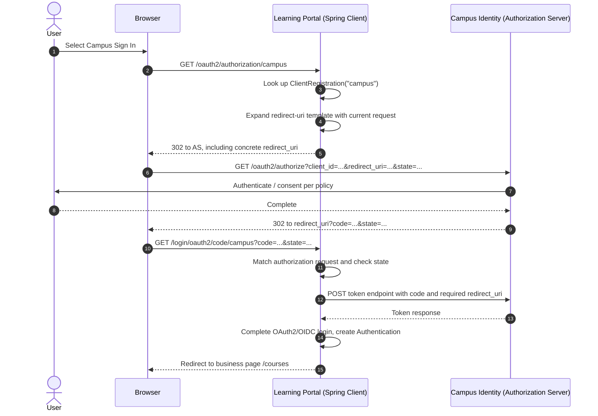
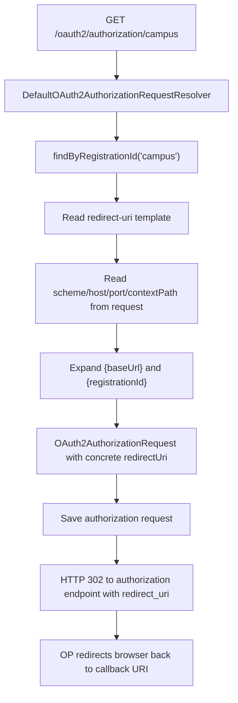
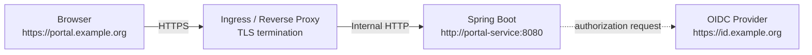

# 8.11. Computing the Redirect URI from Templates and Request Context

## Lesson Objectives

After this lesson, you will be able to:

- Explain accurately what a **redirect URI** is in OAuth 2.0 Authorization Code Flow and OpenID Connect (OIDC), and distinguish it from the login initiation URL, the Authorization Server URL, and the post-login landing page.
- Understand how Spring Security OAuth2 Client expands `ClientRegistration.redirectUri` from a **URI template** using data from the HTTP request initiating authorization.
- Distinguish placeholders such as `{baseUrl}`, `{baseScheme}`, `{baseHost}`, `{basePort}`, `{basePath}`, and `{registrationId}`; predict the redirect URI in local, context-path, and reverse-proxy environments.
- Trace the `redirect_uri` value from the authorization request through the callback and token request to diagnose `redirect_uri_mismatch` errors.
- Properly configure related Spring Security Servlet components: `ClientRegistration`, `OAuth2AuthorizationRequestRedirectFilter`, `OAuth2LoginAuthenticationFilter`, redirection endpoints, and forwarded headers.
- Avoid bugs and security risks when using `Host`, `Forwarded`, `X-Forwarded-*`, or user-controlled paths to construct security-sensitive URIs.

## 1. Where Does the Redirect URI Fit in OAuth 2.0/OIDC?

Suppose the **Learning Portal** web application runs at:

```text
https://portal.example.org
```

Portal is an **OAuth2/OIDC Client**. Users click "Sign in with Campus SSO", get redirected to **Campus Identity** (the Authorization Server/OpenID Provider), log in there, and return to Portal.

When initiating login, Portal sends the Authorization Server a crucial parameter:

```text
redirect_uri=https://portal.example.org/login/oauth2/code/campus
```

This is the **redirect URI**: the address to which the Authorization Server is permitted to deliver the transaction's **authorization response** back to the client. In the Authorization Code Flow, a successful response typically contains `code` and `state` in the callback URL.

It answers the question:

> "After completing authorization, to **which Client endpoint** should the Authorization Server redirect the user's browser to deliver the result?"

The redirect URI is **not** where the user enters their password, **not** the API token endpoint, and **not necessarily** the application page shown after login succeeds.

### 1.1. Four Easily Confused URLs

| Example URL | Owned By | Purpose |
| --- | --- | --- |
| `https://portal.example.org/oauth2/authorization/campus` | Learning Portal (Client) | Initiates an authorization request using registration `campus` |
| `https://id.example.org/oauth2/authorize` | Campus Identity (Authorization Server) | Receives authorization requests and handles authentication/consent |
| `https://portal.example.org/login/oauth2/code/campus` | Learning Portal (Client) | **Redirect URI** receiving the `code` and `state` callback |
| `https://portal.example.org/courses` | Learning Portal (application) | Business page the user lands on after Spring completes login |

As shown, the redirect URI targets the endpoint handling **the OAuth/OIDC protocol**, not the `/courses` UI destination.

### 1.2. Flow Diagram



In this example, **Spring Security computes the redirect URI before redirecting the browser to the Authorization Server**, then uses it in the transaction. The value sent in the authorization request must match the list of URIs registered at the Authorization Server.

## 2. Redirect URI Is a Security Boundary, Not Just a Navigation URL

A trustworthy Authorization Server must restrict where authorization responses can be sent. If a client could pass arbitrary URIs, authorization codes could be redirected to an attacker-controlled domain.

For example, a valid client has:

```text
https://portal.example.org/login/oauth2/code/campus
```

Whereas an untrusted URI is:

```text
https://attacker.example.net/receive-code
```

The Authorization Server must not send codes to the second URI merely because an HTTP request parameter asked for it. Redirect URIs are managed in the **client registration at the Authorization Server** and matched per OAuth policy.

Key requirements:

1. The URI sent in the authorization request must match a URI registered for **that exact `client_id`**.
2. In the Authorization Code Grant, if the client includes `redirect_uri` in the authorization request, the token request must use the exact same value per protocol rules; the Authorization Server checks the binding between code, client, and URI.
3. The client must receive the callback at that matching address, aligned with its configured filter or handler.
4. `state`, PKCE, client authentication where needed, and OIDC ID Token validation must still operate in full; the redirect URI does not replace them.

For typical web clients, redirect URIs use **HTTPS** in production environments. Controlled exceptions like loopback redirects for native apps are addressed separately by standards and should not be applied arbitrarily to web servers.

## 3. `ClientRegistration.redirectUri`: Fixed Value or Template?

Spring Security stores OAuth2/OIDC Client registration settings in `ClientRegistration`. One key property is the **redirect URI**.

Common configuration in Spring Boot:

```yaml
spring:
  security:
    oauth2:
      client:
        registration:
          campus:
            provider: campus
            client-id: ${CAMPUS_CLIENT_ID}
            client-secret: ${CAMPUS_CLIENT_SECRET}
            client-authentication-method: client_secret_basic
            authorization-grant-type: authorization_code
            scope:
              - openid
              - profile
              - email
            redirect-uri: "{baseUrl}/login/oauth2/code/{registrationId}"
        provider:
          campus:
            issuer-uri: https://id.example.org
```

This is a backend **confidential client**; domains and values are illustrative. A real application must register the client at the Authorization Server, supply credentials securely, and declare the exact redirect URI with the provider.

Notably:

```yaml
redirect-uri: "{baseUrl}/login/oauth2/code/{registrationId}"
```

This is **not the final URI** sent to the OP. It is a **template**. When a user starts OAuth2 Login, Spring expands each placeholder based on:

- **The current HTTP request:** scheme, host, port, and context path after appropriate application/proxy processing;
- **The selected `ClientRegistration`:** specifically `registrationId`;
- **The configured URI pattern:** static segments such as `/login/oauth2/code/`.

Example:

```text
Template:
  {baseUrl}/login/oauth2/code/{registrationId}

Request public origin:
  https://portal.example.org

Registration ID:
  campus

Result:
  https://portal.example.org/login/oauth2/code/campus
```

### 3.1. When Is the Template Expanded?

Distinguish two points in time:

- **At startup:** Spring Boot reads YAML and constructs `ClientRegistration` with the template-form redirect URI field.
- **When a request initiates authorization:** the authorization request resolver uses the current request to expand the template into a concrete URI.

Thus the same configuration can produce different URIs depending on request or environment—for example, `http://localhost:8080` locally versus `https://portal.example.org` in production when the template depends on `{baseUrl}`.

This dynamic resolution is convenient across environments, but it is also a common source of errors when requests traverse reverse proxies or untrusted hosts.

### 3.2. Where Does `registrationId` Come From?

In YAML:

```yaml
registration:
  campus:
    client-id: learning-portal-web
```

The value `campus` is Spring's **registration ID**, used to look up `ClientRegistration` and expand `{registrationId}`.

It is distinct from:

```text
client_id = learning-portal-web
```

`client_id` is the OAuth Client identifier recognized by the Authorization Server. When the initiation URL is:

```text
/oauth2/authorization/campus
```

Spring picks registration `campus`, reads the **client ID** from the registration, and expands the callback using the **registration ID**. Do not substitute `clientId` or display `clientName` for `{registrationId}` unless your URL design specifically requires otherwise.

## 4. Placeholders Commonly Supported by Spring Security

For request-based redirect URI templates in Servlet applications, common variables include:

| Placeholder | Meaning | Example |
| --- | --- | --- |
| `{baseUrl}` | Application root URL, typically including scheme, host, port if needed, and context path | `https://portal.example.org/learning` |
| `{baseScheme}` | Scheme recognized by the app for the public request | `https` |
| `{baseHost}` | Host recognized by the app | `portal.example.org` |
| `{basePort}` | Port portion of the base URL when needed | `:8443` or empty if default port |
| `{basePath}` | Application context path (if any) | `/learning` |
| `{registrationId}` | Key of the selected `ClientRegistration` | `campus` |

Templates you may encounter:

```text
{baseUrl}/login/oauth2/code/{registrationId}
{baseScheme}://{baseHost}{basePort}{basePath}/login/oauth2/code/{registrationId}
https://portal.example.org/login/oauth2/code/{registrationId}
https://portal.example.org/oauth/callback
```

The last template has no placeholders: it is a **fixed redirect URI**.

**Port details:** how a URI represents ports depends on effective request values and normalization logic. When using `{basePort}`, let Spring handle it instead of manually inserting `:` and risking `::8443` or trailing colons. Never guess exact placeholder string formatting without knowing the actual request.

### 4.1. `baseUrl` Is Not the Full URL of the Currently Open Page

Suppose the user is visiting:

```text
https://portal.example.org/learning/courses/123?tab=lessons
```

When starting login, the request to Spring might be:

```text
https://portal.example.org/learning/oauth2/authorization/campus
```

For the `{baseUrl}` template, the usual result is:

```text
https://portal.example.org/learning
```

And **not**:

```text
https://portal.example.org/learning/courses/123?tab=lessons
```

nor:

```text
https://portal.example.org/learning/oauth2/authorization/campus
```

`baseUrl` reflects **the application's root address in the request context**, while the callback path is appended from the template. The query string and path of the initiating request do not become the redirect URI.

### 4.2. `basePath` Usually Relates to the Servlet Context Path

A Servlet app may run at the root context:

```text
contextPath = ""
baseUrl     = https://portal.example.org
```

Or be deployed under context `/learning`:

```text
contextPath = /learning
baseUrl     = https://portal.example.org/learning
```

If using:

```text
{baseUrl}/login/oauth2/code/{registrationId}
```

the expanded callback URIs are respectively:

```text
https://portal.example.org/login/oauth2/code/campus
https://portal.example.org/learning/login/oauth2/code/campus
```

**Context path and request path are two different concepts.** Do not mistake `{basePath}` for "everything after the domain"; in Servlet applications, it generally corresponds to the context path observed by the app.

## 5. Examples of Computing Redirect URIs Across Environments

Consider the lesson's default template:

```text
{baseUrl}/login/oauth2/code/{registrationId}
```

With `registrationId = campus`:

| Public Request Context | Expected `baseUrl` | Computed Redirect URI |
| --- | --- | --- |
| Local, port 8080 | `http://localhost:8080` | `http://localhost:8080/login/oauth2/code/campus` |
| HTTPS production, root context | `https://portal.example.org` | `https://portal.example.org/login/oauth2/code/campus` |
| HTTPS with context path `/learning` | `https://portal.example.org/learning` | `https://portal.example.org/learning/login/oauth2/code/campus` |
| HTTPS on external port 8443 | `https://portal.example.org:8443` | `https://portal.example.org:8443/login/oauth2/code/campus` |
| Test env with separate host | `https://staging.example.org` | `https://staging.example.org/login/oauth2/code/campus` |

The table assumes Spring accurately detects the scheme/host/port/context path seen by the browser. In practice, proxies, forwarded headers, or servlet settings can alter them.

### 5.1. `localhost` Is a Conditional Example

Many providers allow local redirect URIs in development under certain rules, though not every provider permits arbitrary `http://localhost` URIs. Follow your Authorization Server's exact policy.

Example:

```text
Registered redirect URI (dev):
http://localhost:8080/login/oauth2/code/campus
```

When moving to production, register the proper production URI. Never carry dev callbacks into production or put production client secrets inside unprotected local apps.

### 5.2. Multiple Registrations Produce Multiple Callbacks

Example:

```yaml
registration:
  campus-student:
    ...
    redirect-uri: "{baseUrl}/login/oauth2/code/{registrationId}"

  campus-staff:
    ...
    redirect-uri: "{baseUrl}/login/oauth2/code/{registrationId}"
```

On the same host:

```text
https://portal.example.org/login/oauth2/code/campus-student
https://portal.example.org/login/oauth2/code/campus-staff
```

The two redirect URIs differ because of `{registrationId}`. If both registrations use different OAuth `client_id` values, the Authorization Server must register the matching callback for **each respective client registration**.

Seeing the word `staff` in the callback **does not prove** the logged-in user is staff: it is merely a technical registration identifier, and real permissions must be enforced in the application.

## 6. How Spring Security Expands the URI in the Authorization Request

In Servlet OAuth2 Login, common components include:

| Component | Responsibility |
| --- | --- |
| `ClientRegistrationRepository` | Stores or looks up `ClientRegistration` by `registrationId` |
| `OAuth2AuthorizationRequestRedirectFilter` | Handles the OAuth2 initiation URL and redirects the browser to the Authorization Server |
| `OAuth2AuthorizationRequestResolver` | Builds the authorization request, resolving registration, redirect URI, scopes, and security parameters |
| `DefaultOAuth2AuthorizationRequestResolver` | Spring Security's default resolver |
| `OAuth2AuthorizationRequestRepository` | Saves the authorization request before the browser leaves for the Authorization Server so callbacks can be correlated |
| `OAuth2LoginAuthenticationFilter` | Receives callbacks, validates authorization request correlation, and exchanges the authorization code to log in |

The URI computation path can be visualized as:



Step-by-step sequence:

1. The browser visits the OAuth2 Login initiation endpoint, by default `/oauth2/authorization/campus`.
2. The resolver extracts **registration ID `campus`** from the URL according to the authorization request base URI configuration.
3. The repository looks up the registration containing `clientId`, authorization endpoint, scopes, and `redirectUri` template.
4. The resolver expands the template using the effective `HttpServletRequest` and registration.
5. An authorization request is built with a **concrete** `redirectUri` field, with placeholders resolved.
6. Spring saves the authorization request context and returns a redirect to the Authorization Server, passing `redirect_uri` as a query parameter.
7. Upon receiving the callback and verifying `state`/authorization request, Spring performs token exchange; binding values must follow flow requirements.

In the example, the encoded authorization request URL might look like:

```text
https://id.example.org/oauth2/authorize
  ?response_type=code
  &client_id=learning-portal-web
  &redirect_uri=https%3A%2F%2Fportal.example.org%2Flogin%2Foauth2%2Fcode%2Fcampus
  &scope=openid%20profile
  &state=<random-state>
```

Lines are wrapped for readability; the actual URL is a single valid URL string and may also include `nonce`, PKCE `code_challenge`, and security or extension parameters depending on configuration.

### 6.1. How Is `redirect_uri` Encoded in the Authorization Request?

When placing a URI inside a **query parameter** of another URI, characters such as `:`, `/`, and `?` must be encoded per URI rules.

Example logical value:

```text
https://portal.example.org/login/oauth2/code/campus
```

In the authorization endpoint query string it becomes:

```text
redirect_uri=https%3A%2F%2Fportal.example.org%2Flogin%2Foauth2%2Fcode%2Fcampus
```

Both strings represent the same redirect URI once parsed properly, so when diagnosing mismatches, inspect the **decoded value** that the Authorization Server compares. Do not confuse URL-encoded display differences with actual differences in scheme, host, port, or path.

### 6.2. Spring Does Not Take the URI from `Referer` or Arbitrary Frontend Values

In the default configuration, the redirect URI is constructed from the registration template and effective request context. A frontend button:

```html
<a href="/oauth2/authorization/campus">Sign in</a>
```

only triggers the registration flow. It does **not** get to choose:

```text
redirect_uri=https://somewhere.example
```

unless the backend intentionally supports such customization. Allowing the browser to pick arbitrary callbacks is a risky design and is normally rejected by the Authorization Server.

## 7. Request Context: Scheme, Host, Port, Context Path

To understand why templates behave differently across environments, you need to know **what Spring actually sees in the HTTP request**.

A Servlet request exposes properties such as:

```java
request.getScheme();      // e.g. "https"
request.getServerName();  // e.g. "portal.example.org"
request.getServerPort();  // e.g. 443
request.getContextPath(); // e.g. "/learning"
request.getRequestURI();  // e.g. "/learning/oauth2/authorization/campus"
```

In OAuth2 Login, Spring must determine the proper **public origin/context** to build the callback. `getRequestURI()` contains the login-initiation endpoint path, while `getContextPath()` indicates where the app is mounted in the Servlet container.

A simplified mental model of URI expansion (this is **not** replacement code for Spring's resolver):

```text
scheme      = https
host        = portal.example.org
publicPort  = 443
contextPath = /learning
registrationId = campus

baseUrl     = https://portal.example.org/learning
redirectUri = baseUrl + /login/oauth2/code/ + registrationId
```

Do not reimplement this algorithm via unchecked string concatenation in application code. Spring supports URI templates, handles most edge cases, and keeps logic consistent across OAuth2 Login components.

### 7.1. Request Path Does Not Determine Callback Path

If a user accesses:

```text
GET /learning/oauth2/authorization/campus
```

the `/oauth2/authorization/campus` portion selects the `ClientRegistration`, while the callback path is governed by the **template**:

```text
/login/oauth2/code/campus
```

It is not a mirror of the authorization-start URL.

### 7.2. When the Application Has a Servlet Context Path

Example:

```yaml
server:
  servlet:
    context-path: /learning
```

Browser paths will usually include the prefix:

```text
/learning/oauth2/authorization/campus
/learning/login/oauth2/code/campus
```

Meanwhile, the pattern in `oauth2Login().redirectionEndpoint().baseUri(...)` is usually defined as a path **within the context** handled by the filter. Do not manually duplicate `/learning` in both the `{baseUrl}` template and the callback pattern, or the prefix will appear twice.

### 7.3. Multiple Public Hosts on the Same Application

If an application is reachable via:

```text
https://portal.example.org
https://academy.example.org
```

then `{baseUrl}` can produce two different callbacks depending on the request:

```text
https://portal.example.org/login/oauth2/code/campus
https://academy.example.org/login/oauth2/code/campus
```

The Authorization Server must permit all registered URIs per policy; never assume that because two hosts route to the same backend, the OP will automatically accept both.

For multi-hostname/multi-tenant setups, design a reliable mechanism to select registrations, issuers, and callbacks. Never let an arbitrary `Host` header dictate the client callback without validating host and tenant.

## 8. Reverse Proxies: Why `{baseUrl}` Easily Miscalculates

Production deployments commonly place Spring Boot behind an ingress, load balancer, or reverse proxy:



The browser sees:

```text
https://portal.example.org
```

yet without forwarded header handling, the Servlet request inside Spring may see:

```text
scheme = http
host   = portal-service
port   = 8080
```

Spring may then compute:

```text
http://portal-service:8080/login/oauth2/code/campus
```

This is an internal address, unreachable by the browser and absent from the OP's redirect URI allowlist.

Result: users click login, but the Authorization Server rejects it with `redirect_uri_mismatch` or `invalid_request`.

### 8.1. Role of Forwarded Headers

Reverse proxies typically attach metadata describing the public request, such as:

```http
Forwarded: proto=https;host=portal.example.org
```

or:

```http
X-Forwarded-Proto: https
X-Forwarded-Host: portal.example.org
X-Forwarded-Port: 443
X-Forwarded-Prefix: /learning
```

Depending on the environment, headers are added or rewritten by the ingress and upstream infrastructure. Spring Boot provides forwarded-header handling so requests are interpreted properly when **the proxy is a trusted source**.

One setting applicable in certain Servlet deployments:

```yaml
server:
  forward-headers-strategy: framework
```

Spring Boot also offers other header-handling strategies depending on container and infrastructure. Choose according to your real deployment and how your ingress/container manages forwarded headers.

**Critical risk:** never blindly trust arbitrary `Forwarded` or `X-Forwarded-*` headers from the Internet. If a client sends `X-Forwarded-Host: attacker.example.net` and the proxy fails to strip or overwrite it, the app could construct redirect URIs using a spoofed host. Configure the proxy edge to sanitize, strip, or overwrite untrusted headers and enforce valid hostnames.

### 8.2. Wrong Scheme Example Due to TLS Termination

Suppose:

```text
Public:  https://portal.example.org
Backend: http://portal-service:8080
```

Template:

```text
{baseUrl}/login/oauth2/code/{registrationId}
```

Wrong result if Spring sees only the internal hop:

```text
http://portal-service:8080/login/oauth2/code/campus
```

Desired result when forwarded metadata is handled trustworthily:

```text
https://portal.example.org/login/oauth2/code/campus
```

Three elements must align:

1. The proxy forwards accurate public scheme/host/port metadata.
2. Spring Boot/Spring Security interprets that metadata under a trusted configuration.
3. The OP has the matching public redirect URI registered for that exact OAuth Client.

Changing `clientName` or `registrationId` will not fix a **wrong scheme or host** error.

### 8.3. Proxy Adding or Stripping a Prefix

Suppose the browser visits:

```text
https://example.org/learning/oauth2/authorization/campus
```

but the reverse proxy forwards the internal request to:

```text
http://portal-service:8080/oauth2/authorization/campus
```

If the application does not know about the `/learning` public prefix, the computed URI may miss it:

```text
https://example.org/login/oauth2/code/campus
```

instead of:

```text
https://example.org/learning/login/oauth2/code/campus
```

Check how the proxy performs prefix rewrites and which headers Spring Boot actually processes. Avoid configuring both a `/learning` servlet context path **and** a proxy/forwarded prefix in a way that doubles the prefix:

```text
https://example.org/learning/learning/login/oauth2/code/campus
```

There is no single YAML line that fixes every proxy prefix topology. Map out the public route, internal route, context path, and proxy trust settings explicitly.

### 8.4. Some Environments Should Use a Fixed Redirect URI

If an application has **only one permitted production origin**, you can choose a fixed configuration:

```yaml
spring:
  security:
    oauth2:
      client:
        registration:
          campus:
            redirect-uri: "https://portal.example.org/login/oauth2/code/campus"
```

Advantages:

- Does not depend on `Host`/`X-Forwarded-Host` to compute the callback hostname.
- Convenient when the OP requires one fixed callback.
- Reduces the risk of requests arriving on unexpected host aliases changing `redirect_uri`.

In return, each environment with a different origin requires its own configuration, and the fixed callback must route to the right app/filter. Even with a fixed redirect URI, the app must still secure requests, cookies, sessions, proxies, and the OIDC flow properly.

## 9. Callback URL Must Match the Filter Handling the Response

Computing the right redirect URI is not enough. Spring Security must also **receive the callback request** at that path.

Default for Servlet OAuth2 Login:

```text
/login/oauth2/code/{registrationId}
```

Example callback:

```http
GET /login/oauth2/code/campus?code=<authorization-code>&state=<state> HTTP/1.1
Host: portal.example.org
```

The component handling the callback in Spring Security is usually `OAuth2LoginAuthenticationFilter`. That filter needs a request matcher matching the callback URI's path. If the external URI is properly registered yet Spring does not handle the path, login still fails.

### 9.1. Aligned Default Configuration

```yaml
redirect-uri: "{baseUrl}/login/oauth2/code/{registrationId}"
```

When keeping OAuth2 Login's default callback path, the path produced by the template matches the default matcher.

### 9.2. Customizing the Callback Consistently in Both Places

Suppose you want a callback like:

```text
https://portal.example.org/auth/callback/campus
```

You must update the registration's **redirect URI**:

```yaml
spring:
  security:
    oauth2:
      client:
        registration:
          campus:
            redirect-uri: "{baseUrl}/auth/callback/{registrationId}"
```

And configure Spring Security to receive the callback:

```java
@Bean
SecurityFilterChain securityFilterChain(HttpSecurity http) throws Exception {
    http
        .authorizeHttpRequests(auth -> auth
            .anyRequest().authenticated()
        )
        .oauth2Login(oauth2 -> oauth2
            .redirectionEndpoint(redirection -> redirection
                .baseUri("/auth/callback/*")
            )
        );

    return http.build();
}
```

At the same time, register the final redirect URI at the OP:

```text
https://portal.example.org/auth/callback/campus
```

Note the distinction:

- `redirect-uri: "{baseUrl}/auth/callback/{registrationId}"` is the template for computing the **full URI sent to the OP**.
- `.redirectionEndpoint().baseUri("/auth/callback/*")` configures **the path where Spring's filter receives callbacks**.
- `*` is Spring's path matcher wildcard; the callback actually registered at the OP is normally a concrete URI with no wildcards.

If you change only YAML and forget the filter, or change only the filter and forget YAML and the OP, the callback will be out of sync.

### 9.3. Changing the Login Initiation URL Does Not Automatically Change the Callback

These are three separate configuration points:

```text
Login page:
  /login

Authorization start endpoint:
  /oauth2/authorization/{registrationId}

Authorization callback:
  /login/oauth2/code/{registrationId}
```

You can customize the authorization start endpoint:

```java
http.oauth2Login(oauth2 -> oauth2
    .authorizationEndpoint(authorization -> authorization
        .baseUri("/signin/oauth2")
    )
);
```

Then the login initiation link can be:

```text
/signin/oauth2/campus
```

Yet the callback redirect URI **does not automatically switch** to `/signin/oauth2/...`; it is still governed by `ClientRegistration.redirectUri`.

Likewise, changing the login page to `/signin` for nicer UX does not change the redirect URI unless you also alter callback settings.

## 10. Callback Correlation, `state`, and Token Requests

In the Authorization Code Flow, when requesting authorization, the client usually creates and stores an `OAuth2AuthorizationRequest` holding:

- The OP's Authorization URI.
- Client ID, requested scopes, and protocol parameters.
- The expanded Redirect URI.
- Random `state` to correlate the response with the initial request.
- PKCE parameters and `nonce` when used.

When the OP returns the browser:

```text
https://portal.example.org/login/oauth2/code/campus?code=abc&state=xyz
```

Spring must restore the saved authorization request and validate the callback against a valid transaction. The authorization code is then exchanged at the token endpoint via direct communication between Client and Authorization Server.

When `redirect_uri` was supplied in the authorization request, the token request must send that same value per OAuth constraints. A common mistake when customizing the flow manually is:

```text
Authorization request:
  redirect_uri=https://portal.example.org/login/oauth2/code/campus

Token request built by custom code:
  redirect_uri=http://portal-service:8080/login/oauth2/code/campus
```

The two values do not match; the Authorization Server can reject the token exchange. With Spring Security's default mechanism, avoid rebuilding the redirect URI at the token request stage: let the framework retain the exact value used in the authorization request.

### 10.1. Do Not Use Redirect URI to Replace `state`

Properly registering the redirect URI restricts where responses can be sent, yet does not prove the incoming callback belongs to a login transaction started by **this specific browser**.

`state` is critical for binding the authorization response to the prior request and preventing CSRF/login CSRF. PKCE protects code exchange where applicable. In OIDC, the client must also verify the ID Token and `nonce` when sent per protocol rules.

Never fix a `state` error by disabling verification. Check for lost sessions, cookies, authorization request repository state, or proxy misconfiguration.

### 10.2. Why Can a Callback Work in One Browser but Fail in Another?

Several causes:

- The session cookie does not follow redirects due to domain, path, `SameSite`, `Secure`, or HTTPS mismatches.
- The browser lands on a different host from the host that started login.
- A proxy alters routes or cookie paths.
- A load balancer routes the request to another instance while authorization request state lives only in local unshared session memory.
- Custom code mutates `state` or redirect URI between the two steps.

These cases are not necessarily caused by a bad URI template; inspect **end-to-end transaction consistency**.

## 11. Using Java to Inspect Configuration and Request Context

One way to clarify inputs is inspecting `ClientRegistration` in server-side code.

### 11.1. Reading the Redirect URI Template

```java
@Component
class ClientRegistrationReporter {

    private final ClientRegistrationRepository repository;

    ClientRegistrationReporter(ClientRegistrationRepository repository) {
        this.repository = repository;
    }

    void reportConfiguration() {
        ClientRegistration registration =
            repository.findByRegistrationId("campus");

        if (registration == null) {
            throw new IllegalStateException(
                "Missing OAuth2 client registration: campus"
            );
        }

        String registrationId = registration.getRegistrationId();
        String redirectUriTemplate = registration.getRedirectUri();

        // Use these values to verify internal configuration.
        // Never log clientSecret or tokens.
    }
}
```

`registration.getRedirectUri()` may return the **template**, such as `{baseUrl}/login/oauth2/code/{registrationId}`. It is not necessarily the per-request expanded URI.

### 11.2. Inspecting Request Components in a Test Environment

An internal handler (never expose as-is in public production) can reveal what Spring sees in the request:

```java
@GetMapping("/internal/request-context")
Map<String, Object> requestContext(HttpServletRequest request) {
    Map<String, Object> result = new LinkedHashMap<>();
    result.put("scheme", request.getScheme());
    result.put("serverName", request.getServerName());
    result.put("serverPort", request.getServerPort());
    result.put("contextPath", request.getContextPath());
    result.put("requestURI", request.getRequestURI());
    return result;
}
```

Example response data:

```json
{
  "scheme": "https",
  "serverName": "portal.example.org",
  "serverPort": 443,
  "contextPath": "/learning",
  "requestURI": "/learning/internal/request-context"
}
```

This is purely for **inspecting raw inputs** to understand expansion—not a security API or a replacement for framework logic. In production, host and route metadata can be sensitive; restrict such endpoints to admin/debug environments with proper access controls, or omit them altogether.

In particular, **never log access tokens, authorization codes, `state`, `clientSecret`, session cookies, or full HTTP headers** while diagnosing redirects.

### 11.3. An Advanced Extension Point: Authorization Request Resolver

If special logic is needed, Spring Security allows configuring a custom `OAuth2AuthorizationRequestResolver`:

```java
http.oauth2Login(oauth2 -> oauth2
    .authorizationEndpoint(authorization -> authorization
        .authorizationRequestResolver(customResolver)
    )
);
```

`customResolver` must be created and managed by your application; the snippet only illustrates the **extension hook**, not an auto-provided bean.

In many cases you can delegate to `DefaultOAuth2AuthorizationRequestResolver` and add only the truly needed authorization parameters. Any intervention in redirect URI, `state`, `nonce`, or PKCE must uphold OAuth/OIDC security invariants and align with URIs registered at the OP.

Never construct a redirect URI by accepting arbitrary query parameters, such as:

```text
/oauth2/authorization/campus?callback=https://user-input.example
```

and copying that value directly into the `redirect_uri` sent to the OP.

## 12. Diagnosing `redirect_uri_mismatch` Component by Component

Suppose Learning Portal sends:

```text
client_id=learning-portal-web
redirect_uri=http://portal-service:8080/login/oauth2/code/campus
```

while the OP has registered:

```text
https://portal.example.org/login/oauth2/code/campus
```

The user sees a redirect URI error from the OP.

To pinpoint the discrepancy, break down each component:

| Component | URI Sent by Spring | URI Registered at OP | Match? |
| --- | --- | --- | --- |
| Scheme | `http` | `https` | No |
| Host | `portal-service` | `portal.example.org` | No |
| Port | `8080` | Default HTTPS port | No |
| Path | `/login/oauth2/code/campus` | `/login/oauth2/code/campus` | Yes |
| Registration ID | `campus` | `campus` | Yes |

The problem lies in the **public origin/request context**, not the callback path. The fix is configuring proxy/forwarded metadata properly or using a fixed redirect URI for the public host.

### 12.1. Common Error Variants

| Symptom | Possible Cause | How to Check |
| --- | --- | --- |
| OP reports `redirect_uri_mismatch` | Scheme, host, port, context path, or callback path does not match registration | Compare decoded URI in authorization request with URI registered at OP |
| Redirect URI has `http://` in HTTPS production | Spring sees internal HTTP after TLS termination | Check proxy and forwarded headers |
| Redirect URI has internal service hostname | Spring did not receive public host from proxy | Check `Host`/`Forwarded`/`X-Forwarded-Host` handling |
| Callback missing `/learning` | Misaligned proxy prefix rewrite and context path | Compare public path, internal path, and forwarded prefix |
| Callback has `/learning/learning` | Prefix applied twice | Check context path and proxy config |
| URL has `:8080` even though public uses 443 | Internal port leaked into base URL | Check forwarded port and header strategy |
| Login starts, yet callback returns 404 | Callback path mismatches filter or proxy route | Check `redirect-uri`, `redirectionEndpoint.baseUri`, and ingress |
| Callback has `code` but Spring reports state error | Lost session/authorization request, wrong browser, or host changed at callback | Check cookies, session, proxy, and repository |
| Login works on one hostname, fails on another | `{baseUrl}` depends on request host while OP only registered one host | Canonicalize hostname or register permitted callbacks per policy |
| OP rejects after changing `registrationId` | URI template generates new path while OP still has old URI | Update OP callback and related links/lookups |
| Changed login page to `/signin` yet callback stays `/login/oauth2/code/...` | Two independent endpoints; this is usually right | Change callback only if intentionally desired and configured consistently |
| Token endpoint returns `invalid_grant` after callback | Reused/expired code, client/redirect URI mismatch, or wrong PKCE | Check token request and saved authorization request |
| Some requests redirect to an unexpected host | Proxy trusts client-supplied Host or forwarded headers | Audit trust boundaries, host allowlists, and proxy header stripping |

### 12.2. Step-by-Step Troubleshooting Sequence

When an error occurs, trace the data in order:

1. **Identify the exact selected registration** from the start path, e.g. `/oauth2/authorization/campus`, and match `registration.campus.client-id`.
2. **Inspect the template** at `registration.campus.redirect-uri`.
3. **Determine the public scheme/host/port/prefix** accessed by the browser and the effective request context seen by Spring.
4. **Determine the final redirect URI** in the authorization request sent to the OP (URL-decoded value) and compare it character-for-character with the URI permitted by the OP for that `client_id`.
5. **Check Spring's callback matcher** against the path in the redirect URI.
6. If the callback reaches Spring yet login still fails, proceed to check `state`, session, PKCE, code exchange, and OIDC validation rather than blaming the URI template by default.

Never fix the issue by turning off redirect URI validation at the Authorization Server or enabling arbitrary wildcards; that destroys the authorization response security boundary.

## 13. Illustrative Scenarios

### Scenario A — Works Locally, Fails in Production

Configuration in both environments:

```yaml
redirect-uri: "{baseUrl}/login/oauth2/code/{registrationId}"
```

Local:

```text
Request:      http://localhost:8080/oauth2/authorization/campus
Redirect URI: http://localhost:8080/login/oauth2/code/campus
```

Production behind a reverse proxy without forwarded-header handling:

```text
Browser:      https://portal.example.org/oauth2/authorization/campus
Backend sees: http://portal-service:8080/oauth2/authorization/campus
Redirect URI: http://portal-service:8080/login/oauth2/code/campus
```

**Explanation:** same template, different request context. Trust and configure public URL forwarding properly or use a fixed production redirect URI; the OP must also have that matching URI registered.

### Scenario B — Application Mounted Under `/academy`

Spring Boot:

```yaml
server:
  servlet:
    context-path: /academy
```

With `registrationId = campus` and public URL `https://portal.example.org`, the expected URI is:

```text
https://portal.example.org/academy/login/oauth2/code/campus
```

**Explanation:** `{baseUrl}` includes the context path recognized by the application. If the OP only registered the path without `/academy`, update the registered callback or align routing/context consistently.

### Scenario C — Two Sign-In Providers

Registrations:

```text
google  -> Google clientId
campus  -> Campus Identity clientId
```

Shared template:

```text
{baseUrl}/login/oauth2/code/{registrationId}
```

On the public domain, the respective callbacks are:

```text
https://portal.example.org/login/oauth2/code/google
https://portal.example.org/login/oauth2/code/campus
```

**Explanation:** the same template expands per registration. Each Authorization Server validates the callback belonging to the OAuth Client it manages.

### Scenario D — Changed Login Page to `/signin`

The application configures:

```java
http.oauth2Login(oauth2 -> oauth2
    .loginPage("/signin")
);
```

While keeping:

```yaml
redirect-uri: "{baseUrl}/login/oauth2/code/{registrationId}"
```

**Conclusion:** this configuration can be completely valid. `/signin` is the provider-selection page; `/login/oauth2/code/campus` is the protocol callback endpoint. You do not need to change the callback just to match the login page's naming aesthetically.

### Scenario E — Receiving Callback at `/sso/callback/campus` Returns 404

URI registered at the OP:

```text
https://portal.example.org/sso/callback/campus
```

YAML:

```yaml
redirect-uri: "{baseUrl}/sso/callback/{registrationId}"
```

Yet Spring still uses the default redirection endpoint matcher.

**Explanation:** the OP redirects to the new URI correctly, but `OAuth2LoginAuthenticationFilter` does not recognize that path under current settings. Configure `.redirectionEndpoint(...baseUri("/sso/callback/*"))` to match.

### Scenario F — Browser Chooses an Arbitrary Host

The app serves both `portal.example.org` and an unmanaged host alias; `{baseUrl}` depends on `Host`. If the host alias is not in the OP's redirect URI allowlist, login fails. Even worse, if the proxy trusts a spoofed host from a forwarded header, URI computation becomes a security risk.

**Solution:** define a canonical hostname, enforce a host allowlist at the edge, and configure trusted proxy headers; consider a fixed redirect URI when only one official callback exists.

## 14. Security When Computing Dynamic Redirect URIs

By nature, the redirect URI is a trust anchor in OAuth. For Spring Security Servlet apps, uphold these principles:

1. **Accept only trusted public hosts:** configure an allowlist at the reverse proxy/ingress and strip/sanitize `Host`, `Forwarded`, and `X-Forwarded-*` from untrusted clients.
2. **Keep redirect URIs within the registered set:** never interpolate user-supplied hosts or URLs into the template.
3. **Use HTTPS in production:** prevent authorization responses from traversing unencrypted connections.
4. **Separate client callback from post-login success URL:** the callback is a protocol endpoint; the post-login landing page is governed by saved requests, success handlers, or application config.
5. **Preserve `state`/PKCE/nonce:** an exact redirect URI does not replace transaction correlation and OIDC identity verification.
6. **Select registrations using the right local identifier:** the initiation URL uses `registrationId`, while the OP verifies `client_id` and registered URIs.
7. **Keep callbacks aligned on both sides:** the final URI must both be allowed by the Authorization Server and matched by Spring's filter.
8. **Never log secret data:** log only sanitized metadata—never put authorization codes, tokens, `state`, client secrets, or cookies into logs.
9. **Avoid rewriting expansion logic unnecessarily:** prefer standard template configuration, and write custom resolvers only for specific needs with full understanding of OAuth/OIDC security boundaries.
10. **Protect sessions and cookies behind reverse proxies:** prevent losing authorization requests or mixing sessions due to host/prefix shifts at callback.

## 15. Practice Exercises

### Exercise 1 — Computing the URI from a Template

Given:

```text
redirect-uri template:
{baseUrl}/login/oauth2/code/{registrationId}

request:
scheme      = https
serverName  = learning.example.org
serverPort  = 443
contextPath = /portal

registrationId = university
```

**Question:** What is the computed Redirect URI?

**Answer:**

```text
https://learning.example.org/portal/login/oauth2/code/university
```

### Exercise 2 — Distinguishing Client Name and Registration ID

Given registration:

```yaml
registration:
  school:
    client-id: portal-production-client
    client-name: "SSO Sign In"
    redirect-uri: "{baseUrl}/login/oauth2/code/{registrationId}"
```

The application is accessed at:

```text
https://portal.example.org
```

**Question:** What is `{registrationId}`? Which `client_id` does the OP receive? What is the callback?

**Answer:**

```text
registrationId = school
client_id      = portal-production-client
redirect_uri   = https://portal.example.org/login/oauth2/code/school
```

`clientName = "SSO Sign In"` is only a display name; it never substitutes for `{registrationId}`.

### Exercise 3 — Identifying a Proxy Error

Spring sends:

```text
http://localhost:8080/login/oauth2/code/campus
```

The OP only accepts:

```text
https://portal.example.org/login/oauth2/code/campus
```

**Question:** What should you check first?

**Answer:** Inspect the request context Spring sees after the request passes through the proxy, TLS termination, and trusted forwarded headers. The host and scheme mismatch—it is not a `{registrationId}` bug.

### Exercise 4 — Customizing the Callback

You want the callback:

```text
https://portal.example.org/security/callback/campus
```

**Question:** Which configurations must align?

**Answer:** Set `redirect-uri: "{baseUrl}/security/callback/{registrationId}"`, configure Spring OAuth2 Login's redirection endpoint to match `/security/callback/*`, and register the full callback at the OP for that exact `client_id`.

### Exercise 5 — Changing the Login Page URL

The `/login` page is changed to `/signin`. Must you change the redirect URI?

**Answer:** Not required. `/signin` chooses the provider; the OAuth callback redirect URI is a separate endpoint. Change the callback only when protocol design requires it and both sides are updated together.

### Exercise 6 — Multiple Hostnames

The app is reachable at `https://a.example.org` and `https://b.example.org` with template `{baseUrl}/login/oauth2/code/{registrationId}`. The OP registered callbacks only on host `a`.

**Question:** What happens if a user starts login from `b`?

**Answer:** If Spring computes `{baseUrl}` from the request on host `b`, it will send a callback on host `b` and the OP will reject it. Route users to the canonical hostname or manage registered callbacks in a controlled way.

## 16. Review Questions

**1. Is `redirect_uri` computed when Spring Boot reads YAML or when a user initiates login?**

> The template is configured when `ClientRegistration` is created, yet with request-based placeholders, the concrete URI is expanded when Spring handles the user's authorization request.

**2. Does `{baseUrl}` include `/oauth2/authorization/campus` from the login-initiation request?**

> No, under this placeholder's standard semantics. It represents the application's root URL built from scheme, host, port, and context path; the callback path comes from the template.

**3. Is `registrationId` the OAuth `client_id` sent to the OP?**

> No. `registrationId` is Spring's local key; `clientId` inside the registration is the OAuth `client_id` parameter.

**4. Why does a `{baseUrl}` `redirect-uri` work on localhost yet fail in production behind a proxy?**

> Spring may see the internal HTTP host/port instead of the public HTTPS origin. Configure the proxy and trusted forwarded headers, or use a fixed URI, and align with the OP registration.

**5. Why do OPs validate redirect URIs strictly?**

> To prevent delivering authorization responses/codes to endpoints not registered for that client, reducing code-theft and client mix-up risks.

**6. If you change only `.authorizationEndpoint().baseUri(...)`, does the callback redirect URI change automatically?**

> No. The authorization initiation endpoint and callback reception endpoint are two independent configurations.

**7. If the OP redirected correctly yet Spring returns 404, what should you check?**

> Compare the callback path against `oauth2Login().redirectionEndpoint().baseUri(...)`, context path, ingress routes, and filter chains.

**8. Is `state` still needed once the redirect URI is registered accurately?**

> Yes. The redirect URI restricts where responses go; `state` binds the callback to the user's session authorization request, while PKCE and OIDC checks protect other parts of the transaction.

**9. Is configuring `X-Forwarded-Host` always safe if it makes login work?**

> No. This header should be trusted only when controlled or overwritten by a trusted reverse proxy. Trusting values supplied by Internet clients lets attackers make Spring compute callbacks pointing to spoofed hosts.

---

## Key Takeaways

The **Redirect URI** is the callback address an OAuth2/OIDC Client registers with the Authorization Server to receive authorization results. In Spring Security Servlet, `ClientRegistration.redirectUri` can be a template such as **`{baseUrl}/login/oauth2/code/{registrationId}`**. When initiating an authorization request, Spring expands `{baseUrl}` from the **effective HTTP request context** and `{registrationId}` from the **selected client registration**. The expanded URI must match both the URI allowed by the Authorization Server and the callback endpoint handled by Spring Security. When deploying under a context path or reverse proxy, align public scheme/host/port/prefix, configure trusted forwarded headers, and preserve `state`, PKCE, token exchange, and OIDC validation constraints.
