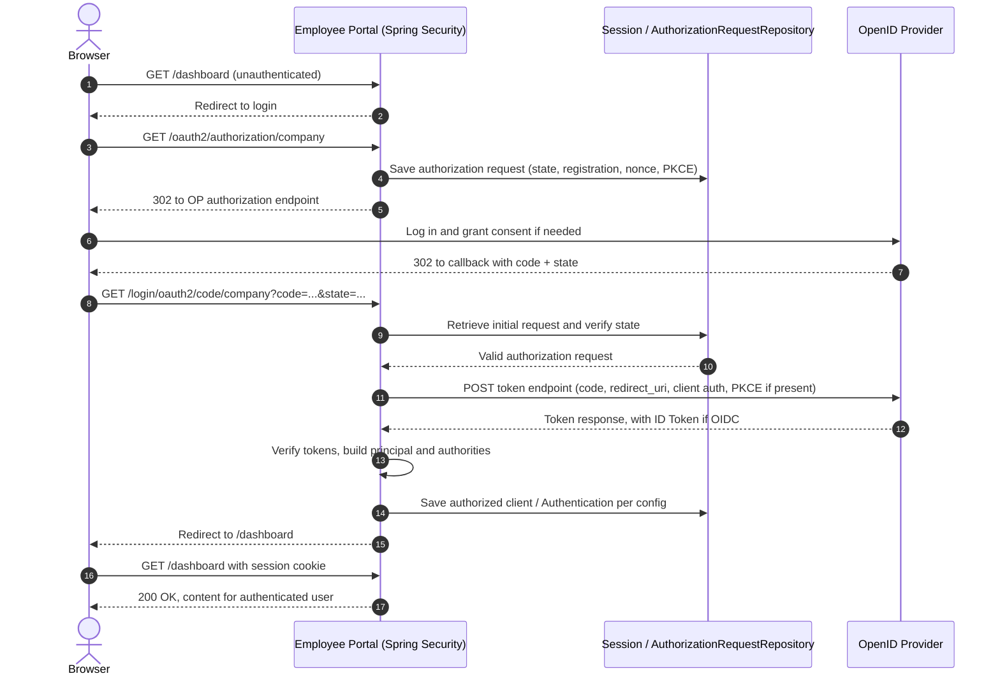

# 9.5. Handling a Successful Callback Containing an Authorization Code

## 1. Scenario: The User Returns to the Application After Logging In at the OIDC Provider

Suppose the **Employee Portal** application built with Spring Boot and Spring Security lets employees sign in through an OpenID Provider (OP). An unauthenticated user opens `/dashboard`. The application redirects them to the OP's authentication page, and then the OP sends the browser back to the registered callback address:

```http
GET /login/oauth2/code/company?code=<authorization-code>&state=<state-value> HTTP/1.1
Host: portal.example.com
Cookie: JSESSIONID=<session-id>
```

This callback indicates that **the Authorization Server has issued an authorization code**, yet **that alone is not enough to conclude the user has successfully logged into Employee Portal**. The application still has to correlate the callback with the initial request, exchange the code for tokens, validate the tokens per OAuth 2.0/OIDC rules, and establish the login state.

What matters in the **Callback and Correlation** chapter is understanding how Spring Security recognizes that the callback belongs to the exact login attempt initiated by that browser/session, the right `ClientRegistration`, and the right provider.

After this lesson, you will know how to:

- Distinguish **authorization code**, **state**, **nonce**, and **PKCE code verifier** in a callback.
- Trace the processing order of **`OAuth2LoginAuthenticationFilter`**, `AuthorizationRequestRepository`, and authentication providers in the Servlet stack.
- Configure `SecurityFilterChain` / `oauth2Login` to accept the default callback or a custom callback.
- Understand when **`OAuth2AuthorizedClient`**, **`Authentication`**, **`SecurityContext`**, and the HTTP session are created/saved.
- Redirect after login using a **success handler** while preserving the request cache and avoiding open redirects.
- Handle cases where a callback carries a code yet lacks state/session, or fails during code exchange or ID Token verification.

> **Principle:** An authorization code is a **temporary code to exchange for tokens**. An HTTP-successful callback still must pass full correlation, token exchange, and token validation before Spring Security considers the user authenticated.

## 2. Overview of the Authorization Code + OIDC Login Flow

In the example:

| Component | Role |
| --- | --- |
| **Browser** | Holds the session cookie, performs the redirect to the OP, and returns to the application |
| **Employee Portal** | Spring Security OAuth2/OIDC Client (Relying Party) |
| **OpenID Provider** | Authenticates the user, issues the authorization code and tokens |
| **ClientRegistrationRepository** | Stores client configuration `company`, client ID, issuer, endpoints, scopes, and redirect URI |
| **AuthorizationRequestRepository** | Temporarily stores the authorization request to pair the callback with login initiation |
| **SecurityContext** | Stores `Authentication` details after successful login |

### 2.1. Sequence Diagram



Normally, **the authorization code travels through the browser**, whereas **exchanging the code for tokens** is a backend HTTP request from Employee Portal to the token endpoint. Consequently, Browser DevTools shows the callback but will not show the server-to-server token request.

### 2.2. State Milestones to Distinguish

| Milestone | What exists? | What does not exist yet? |
| --- | --- | --- |
| Before starting login | `ClientRegistration` configured in Spring | No specific login request yet |
| After `GET /oauth2/authorization/company` | Authorization request, state, and correlation data are saved | User is not yet authenticated by any callback |
| Immediately as browser returns with `code` and `state` | Authorization response from OP | No guarantee yet that the code is valid or tokens are valid |
| After correlation and token exchange succeed | Token response, including ID Token in OIDC | Claims/UserInfo verification steps may not all be finished yet |
| After validation and authentication complete | `Authentication` and appropriate authorized client | Application authorization checks per URL may still apply |
| After success handler runs | May redirect to saved request or target page | Does not imply OP logged out old sessions or granted every API permission |

## 3. What Is an Authorization Code, and Why Does the Callback Only Receive a Code?

An **Authorization code** is a temporary value issued by the Authorization Server following a valid authorization request. The Client uses the code in the **Authorization Code Grant** to exchange for tokens.

Characteristics of the code:

- **Short-lived** and **single-use** under OAuth 2.0: once exchanged for tokens, a code cannot be reused.
- Issued to **a specific client**, bound to the redirect URI and authorization request.
- May require proof of the **PKCE code verifier** when the token endpoint processes the code.
- The code itself is **not an access token**, **not an ID Token**, and must never be used to call APIs or directly establish a user principal.

Example callback:

```text
https://portal.example.com/login/oauth2/code/company
    ?code=SplxlOBeZQQYbYS6WxSbIA
    &state=0wZ4xYpA9m2U
```

These values are illustrative only. In real HTTP, the URL is on a single line; `code` and `state` should be sufficiently random/unpredictable. Never hard-code either value in application code.

### 3.1. How Authorization Code Differs from Subsequent Tokens

| Data | Where does it appear? | Purpose |
| --- | --- | --- |
| **Authorization code** | Callback from OP to client; then sent to token endpoint | Exchange for tokens |
| **Access token** | OP token response | Call Resource Server/API matching audience and scopes |
| **ID Token** | Token response when using OIDC | Lets the OIDC Client verify the user's authentication identity |
| **Refresh token** | May appear in token response depending on scopes/policy | Request a new access token without running the full interactive flow |
| **State** | Authorization request and callback | Flow correlation/anti-forgery |
| **Nonce** | Authorization request and matching claim in ID Token when used | Binds the ID Token to the initial authentication request |
| **Code verifier** | Internal client data and token request when using PKCE | Proves the party exchanging the code holds the ephemeral secret that initiated the request |

**Never send an ID Token as a Bearer access token to an API**, and never use an access token in place of an ID Token to determine identity on an OIDC Client. Where each token may be used also depends on issuer, audience, scopes, and system policy.

## 4. Correlation: Why Does `state` Matter More Than the Callback Having a `code`?

If an attacker injects a callback containing a code from another login session, the application must never accept it as a successful login for the victim. Spring Security solves request-response binding using the **saved authorization request** together with **`state`**.

### 4.1. Before the Callback Arrives, What Does Spring Save?

When the user opens:

```text
GET /oauth2/authorization/company
```

`OAuth2AuthorizationRequestRedirectFilter` and the resolver create an `OAuth2AuthorizationRequest`, which may contain:

- The OP's Authorization URI per `ClientRegistration`.
- `client_id`, `redirect_uri`, `scope`, and `response_type=code`.
- Random `state`.
- `nonce` and related data when OIDC uses nonce.
- `code_challenge` / `code_challenge_method` and client-retained `code_verifier` when using PKCE.
- Internal attributes such as the registration ID to restore context on callback.

By default in Servlet OAuth2 Login, Spring typically uses **`HttpSessionOAuth2AuthorizationRequestRepository`** to temporarily store the request in the HTTP session. The session cookie in the browser allows the callback to retrieve the exact state of the login initiation.

### 4.2. How Is the Callback Correlated?

When the browser calls:

```text
GET /login/oauth2/code/company?code=...&state=abc
```

Spring attempts to restore the authorization request matching the saved state/context. The OAuth2 Authorization Code processing components then verify that the response matches the initial request. Exact implementation steps depend on the Spring Security version, but the mandatory rules are:

1. The initial authorization request must be found.
2. The response's `state` must match the request's `state`.
3. The matching registration/client and redirect URI must be used.
4. Proceed to exchange the code only if the authorization response is valid.
5. Request data must not be accepted repeatedly without limit once the callback has been processed.

If `state` is wrong or the initial request is missing, a callback carrying a seemingly valid `code` string **must still fail**.

### 4.3. Correlation Is Not Only `state`

| Binding data | Threat it addresses | Where is it checked? |
| --- | --- | --- |
| **State** | Forged callback, responses mixed across sessions/login requests | OAuth2 Client upon receiving callback |
| **Session / authorization request** | Unknown original login, registration, redirect, and PKCE data | Authorization request repository |
| **Redirect URI** | Authorization code diverted to another endpoint or wrong client flow | OP at authorization/token endpoint; Spring sends URI per registration |
| **Client authentication** | Another client attempting to exchange the app's code | Token endpoint |
| **PKCE** | Party stealing a code trying to exchange for tokens without the code verifier | Token endpoint |
| **OIDC Nonce** | ID Token replayed/paired with another authentication request | OIDC Client when verifying ID Token |
| **Issuer / audience** | Token originating from another OP or intended for another client | OIDC token validation |

No single value replaces all of these bindings. For instance, **a matching `state` does not mean the ID Token is valid**; conversely, an ID Token with a valid signature but wrong audience/nonce must still be rejected.

## 5. Configuring Spring Security Servlet to Handle the Default Callback

Examples use **Spring Boot 3.x / Spring Security 6.x** and **Spring MVC/Servlet**. The illustrative OIDC provider has issuer `https://id.example.com/realms/company`.

### 5.1. Dependencies

```xml
<dependencies>
    <dependency>
        <groupId>org.springframework.boot</groupId>
        <artifactId>spring-boot-starter-web</artifactId>
    </dependency>
    <dependency>
        <groupId>org.springframework.boot</groupId>
        <artifactId>spring-boot-starter-security</artifactId>
    </dependency>
    <dependency>
        <groupId>org.springframework.boot</groupId>
        <artifactId>spring-boot-starter-oauth2-client</artifactId>
    </dependency>
</dependencies>
```

This uses the Servlet stack with `HttpSecurity` and `SecurityFilterChain`. If the project uses Spring WebFlux, the corresponding APIs are `ServerHttpSecurity` and `SecurityWebFilterChain`; do not mix both configuration styles in the same example.

### 5.2. Client Registration in `application.yml`

```yaml
server:
  port: 8080

spring:
  security:
    oauth2:
      client:
        registration:
          company:
            provider: company-idp
            client-id: ${COMPANY_CLIENT_ID}
            client-secret: ${COMPANY_CLIENT_SECRET}
            client-authentication-method: client_secret_basic
            authorization-grant-type: authorization_code
            redirect-uri: "{baseUrl}/login/oauth2/code/{registrationId}"
            scope:
              - openid
              - profile
              - email
        provider:
          company-idp:
            issuer-uri: https://id.example.com/realms/company
```

Environment values holding client ID/secret must be provided securely via runtime configuration or a secret manager. Never commit client secrets into the repository, browser, logs, or URLs.

**`company` is the registration ID in Spring**, whereas `COMPANY_CLIENT_ID` holds the client ID at the OP. The registration ID determines the tail of `/oauth2/authorization/company` and the default callback `/login/oauth2/code/company`.

At the OP, register the exact callback the application sends:

```text
Local:
http://localhost:8080/login/oauth2/code/company

Production:
https://portal.example.com/login/oauth2/code/company
```

### 5.3. Minimal `SecurityFilterChain`

```java
package com.example.portal.security;

import org.springframework.context.annotation.Bean;
import org.springframework.context.annotation.Configuration;
import org.springframework.security.config.Customizer;
import org.springframework.security.config.annotation.web.builders.HttpSecurity;
import org.springframework.security.web.SecurityFilterChain;

@Configuration
public class SecurityConfig {

    @Bean
    SecurityFilterChain securityFilterChain(HttpSecurity http) throws Exception {
        http
            .authorizeHttpRequests(authorize -> authorize
                .requestMatchers("/", "/css/**", "/js/**", "/error").permitAll()
                .anyRequest().authenticated()
            )
            .oauth2Login(Customizer.withDefaults());

        return http.build();
    }
}
```

With `oauth2Login(Customizer.withDefaults())`, Spring Security registers the mechanism to initiate authorization requests and handle OAuth2 Login callbacks. **You do not need to create a `@GetMapping("/login/oauth2/code/company")` controller** to manually receive `code` and exchange tokens.

Key default endpoints:

| URL | Role |
| --- | --- |
| `/oauth2/authorization/company` | Initiates login for registration `company` and redirects to the OP |
| `/login/oauth2/code/company` | Callback for `OAuth2LoginAuthenticationFilter` to process the authorization response |
| `/login` | Default login page or custom application login page |
| `/dashboard` | Example page requiring `authenticated()` |

The callback does not need a separate `permitAll()` when using the default filter mechanism properly; Spring Security configures the appropriate authentication handling inside `oauth2Login`. If the application has multiple filter chains, ensure the callback is handled in the chain with `oauth2Login` enabled.

## 6. Which Filter Processes the Callback Containing `code`?

### 6.1. `OAuth2LoginAuthenticationFilter` Is the Callback Entry Point

In Servlet OAuth2 Login, **`OAuth2LoginAuthenticationFilter`** matches the default callback `/login/oauth2/code/*`. It reads the authorization response and saved authorization request details, constructs an authentication request, and delegates to `AuthenticationManager`.

Key classes:

| Component | Typical responsibility |
| --- | --- |
| `OAuth2AuthorizationRequestRedirectFilter` | Starts the flow, saves the request, and redirects to the OP |
| `HttpSessionOAuth2AuthorizationRequestRepository` | Temporarily saves/loads/removes the authorization request from the session |
| `OAuth2LoginAuthenticationFilter` | Receives the callback and constructs `OAuth2LoginAuthenticationToken` for authentication |
| `OAuth2LoginAuthenticationProvider` | Handles standard OAuth2 Authorization Code login |
| `OidcAuthorizationCodeAuthenticationProvider` | Handles the OIDC portion, including ID Token verification |
| `OAuth2AccessTokenResponseClient<OAuth2AuthorizationCodeGrantRequest>` | Exchanges the authorization code at the token endpoint |
| `OAuth2UserService` / `OidcUserService` | Builds the principal from user information appropriate to the login type |
| `OAuth2AuthorizedClientRepository` or service | Stores the client state that received tokens |
| `SecurityContextRepository` | Saves `SecurityContext` to persist authentication |
| `AuthenticationSuccessHandler` | Handles success, usually redirecting back to the requested page |

Providers may involve additional UserInfo, token validation, or authority mapping steps depending on configuration. Never replicate these filters as hand-written controllers; they coordinate with state, nonce, token exchange, session, and framework exception handling.

### 6.2. Logical Processing Order

```text
Browser callback: GET /login/oauth2/code/company?code=...&state=...
    |
    v
OAuth2LoginAuthenticationFilter receives callback
    |
    v
Restore saved authorization request
    |
    +-- Request missing / state mismatch → authentication failure
    |
    v
Identify ClientRegistration and token endpoint
    |
    v
Exchange authorization code for tokens (client auth, PKCE if present)
    |
    +-- invalid_grant / invalid_client / timeout → authentication failure
    |
    v
Verify ID Token if OIDC, fetch UserInfo if applicable
    |
    +-- Invalid ID Token / wrong issuer-audience-nonce → failure
    |
    v
Create authenticated principal + authorities
    |
    v
Save authorized client and SecurityContext
    |
    v
AuthenticationSuccessHandler → redirect to target page
```

Note: **“Successful callback”** in this lesson's context means **the entire authentication chain completes**. An HTTP GET callback merely returning 302 is not enough; it might be a redirect to an error page.

## 7. Token Exchange: What Does Spring Do with the Authorization Code?

Once correlation succeeds, the OAuth2 Client sends a POST to the token endpoint obtained from `ClientRegistration` or OIDC Discovery.

### 7.1. Token Request at the Protocol Level

Example confidential client using `client_secret_basic`:

```http
POST /realms/company/protocol/openid-connect/token HTTP/1.1
Host: id.example.com
Content-Type: application/x-www-form-urlencoded
Authorization: Basic <base64(client_id:client_secret)>

grant_type=authorization_code&
code=<authorization-code>&
redirect_uri=https%3A%2F%2Fportal.example.com%2Flogin%2Foauth2%2Fcode%2Fcompany
```

Line breaks are added for readability. A real form-encoded request is sent per HTTP rules. If the client uses **PKCE**, the form body also includes:

```text
code_verifier=<original-code-verifier>
```

If the OP requires another client authentication method (such as `private_key_jwt`, `client_secret_post`, or mTLS), the way the client authenticates at the token endpoint must match the actual registration.

### 7.2. Illustrative Token Response

```json
{
  "access_token": "<access-token>",
  "id_token": "<id-token>",
  "token_type": "Bearer",
  "expires_in": 300,
  "scope": "openid profile email"
}
```

Some OPs also issue a `refresh_token` depending on policy and granted scopes; not every OIDC callback receives a refresh token.

| Response field | What does Spring use it for? |
| --- | --- |
| `access_token` | Used for UserInfo or authorized APIs; stored in the authorized client per configuration |
| `id_token` | Verifies the user's identity per OIDC rules |
| `expires_in` | Determines access token lifetime |
| `refresh_token` | If present, can be used to refresh the access token in the future |
| `scope` | Actually granted permissions, which may be narrower than requested scopes |

The Authorization Server validates the code, client, redirect URI, and PKCE as required. A code that has been successfully exchanged **must not be accepted a second time**. The token endpoint may return `invalid_grant` if the code expired, was reused, or does not match the request.

### 7.3. Why Are Tokens Not Returned Directly in the Callback?

In the Authorization Code flow, the browser typically forwards only the **code** to the backend. The access token and ID Token are received over a backend connection to the token endpoint, reducing exposure of tokens directly in callback URLs.

Even so, the authorization code must still be protected: it can appear in browser history, proxy logs, or referrer headers if misconfigured. Use HTTPS, never write callback query strings containing codes to shared logs, and never leak codes to third-party pages.

## 8. For OIDC: Verify the ID Token Before Creating the Principal

When `ClientRegistration` requests the `openid` scope and the OP supports OIDC, the token response must include a valid **ID Token**. Spring Security OIDC Client uses the OIDC pipeline to validate the token, construct an `OidcUser` principal, and enrich user info if appropriate.

### 8.1. Core Validations

| Check | Meaning |
| --- | --- |
| **Digital signature / JWKS** | Token was signed by a trusted OP key and contents were not altered |
| **`iss`** | Token issuer must match the configured OP |
| **`aud`** | ID Token must be intended for the right client ID |
| **`exp`**, **`iat`** | Expiration and issuance times per OIDC rules |
| **`nonce`** | If the request included a nonce, the nonce claim must match the initial authorization request |
| **`azp`**, **`auth_time`**, **`at_hash`** | Evaluated per specific OIDC rules and conditions |
| **Signing algorithm** | Accept only configured/trusted algorithms; never blindly trust the `alg` header |

Spring Security needs to know the issuer and signing keys (typically via OIDC Discovery/JWKS). Never parse a JWT by Base64URL-decoding it yourself and trusting its claims, because a readable payload **does not prove a valid signature**.

### 8.2. Distinguishing `state` and `nonce`

- `state` is carried in the **authorization request and authorization response**; the application checks correlation on callback.
- `nonce` is sent in the OIDC authorization request (when applicable) and bound into the **ID Token**; checking nonce protects the binding between the ID Token and the authentication attempt.

For example, **a valid state with a wrong ID Token nonce** must still be rejected. Similarly, an ID Token with a valid signature whose `aud` belongs to a different client must not be accepted.

### 8.3. UserInfo Does Not Replace ID Token Validation

Some OPs return user profile data via the **UserInfo endpoint**. Spring can fetch this with the access token to construct/enrich `OidcUser`. However, UserInfo does not turn an invalid ID Token into a valid one. When UserInfo is used, OIDC requires verifying that its `sub` claim matches the ID Token's subject per applicable rules.

Never use an unverified email or an unchecked claim as standalone proof that the callback belongs to the right user.

## 9. How Does a Successful Callback Create `Authentication` and `SecurityContext`?

After token exchange and user validation, Spring Security creates an authenticated authentication result. With OIDC login, controllers typically see an `OidcUser` principal; `Authentication` is typically of type `OAuth2AuthenticationToken`.

```java
import org.springframework.security.core.Authentication;
import org.springframework.security.oauth2.client.authentication.OAuth2AuthenticationToken;

public void inspectAuthentication(Authentication authentication) {
    if (authentication instanceof OAuth2AuthenticationToken oauth) {
        String registrationId = oauth.getAuthorizedClientRegistrationId();
        boolean authenticated = oauth.isAuthenticated();
        // Example only illustrates reading non-sensitive metadata.
    }
}
```

Artifacts to distinguish:

| Artifact | Role |
| --- | --- |
| `ClientRegistration` | Describes the OAuth2/OIDC client and provider |
| `OAuth2AuthorizedClient` | Binds the registration and principal to the received access/refresh tokens |
| `Authentication` | Represents the authenticated user's principal and authorities |
| `SecurityContext` | Holds `Authentication` for request security enforcement |
| `HttpSession` | Can persist state so the browser maintains login via cookie |
| `SavedRequest` | The initial request the user intended to visit, e.g., `/dashboard` |

### 9.1. `SecurityContext` Used on Subsequent Requests

In session-based Servlet apps, after login, Spring Security saves `SecurityContext` via the configured `SecurityContextRepository`. On subsequent requests, the browser sends the session cookie and Spring restores `Authentication` to enforce `authenticated()`, `hasRole(...)`, or other authority rules.

**A session cookie is not an access token.** For server-side web apps, the browser does not need to hold raw ID Tokens/access tokens in JavaScript to maintain a login session. If the application needs to call APIs on the user's behalf, the backend uses `OAuth2AuthorizedClient` to manage tokens via the appropriate flow.

### 9.2. Inspecting the Principal in a Controller

```java
package com.example.portal.web;

import java.util.Map;

import org.springframework.security.core.annotation.AuthenticationPrincipal;
import org.springframework.security.oauth2.core.oidc.user.OidcUser;
import org.springframework.web.bind.annotation.GetMapping;
import org.springframework.web.bind.annotation.RestController;

@RestController
public class ProfileController {

    @GetMapping("/me")
    public Map<String, String> me(@AuthenticationPrincipal OidcUser user) {
        return Map.of(
                "subject", user.getSubject(),
                "issuer", user.getIssuer().toString(),
                "name", user.getFullName() != null
                        ? user.getFullName()
                        : user.getSubject()
        );
    }
}
```

The `/me` endpoint is protected by `anyRequest().authenticated()`. The example assumes the app only uses OIDC login for this URL; if multiple authentication mechanisms are supported, the principal may not always be an `OidcUser` and code must handle that accordingly.

`sub` identifies the user **within the scope of an issuer**. If the application supports multiple OPs, combine `iss` and `sub` when designing user identity keys rather than trusting email alone (which may change or be absent).

### 9.3. Successful Authentication Does Not Mean Every URL Is Permitted

`authenticated()` only requires a valid session/Authentication. A sensitive path such as `/admin/**` may additionally require `ROLE_ADMIN` or specific privileges:

```java
http.authorizeHttpRequests(authorize -> authorize
    .requestMatchers("/", "/css/**").permitAll()
    .requestMatchers("/admin/**").hasRole("ADMIN")
    .anyRequest().authenticated()
);
```

An OIDC provider might not emit roles in the structure Spring expects out of the box. If a user logs in successfully yet receives **403** on an admin page, you usually need to inspect authority mapping/business authorization policy rather than modifying the callback or client secret.

## 10. Where Does the User Go After a Successful Callback?

Once authentication finishes, **`AuthenticationSuccessHandler`** determines the next response. By default, Spring Security typically uses **`SavedRequestAwareAuthenticationSuccessHandler`** to return the user to the URL they requested before being sent to login.

Example:

```text
1. Browser requests /dashboard
2. Spring saves SavedRequest and redirects to login
3. Browser logs in at OP, calls back to Spring
4. Spring authenticates successfully
5. Success handler redirects back to /dashboard
```

**`SavedRequest` differs from the authorization request**:

- The authorization request stores OAuth parameters (`state`, registration, PKCE/nonce) to process the callback.
- `SavedRequest` stores the **initial business URL or HTTP request** so the user returns there after login.

### 10.1. Setting a Default Page on Successful Login

```java
http.oauth2Login(oauth2 -> oauth2
        .defaultSuccessUrl("/dashboard", false)
);
```

The `false` argument lets the handler prioritize the saved request; `/dashboard` is the fallback URL when there is no valid request to return to. Passing `true` makes the default handler always redirect to the configured target URL.

In real applications, target URLs must follow your product's navigation policy. Never take a raw query parameter like `?next=https://evil.example` and pass it to `sendRedirect` unvalidated; doing so can introduce a post-login **open redirect**.

### 10.2. Writing a Success Handler for Additional Processing

Some applications need to record audit events, sync profile data, or measure login timing. You can plug in a custom success handler and then **delegate the redirect to the default handler**:

```java
package com.example.portal.security;

import org.slf4j.Logger;
import org.slf4j.LoggerFactory;
import org.springframework.context.annotation.Bean;
import org.springframework.context.annotation.Configuration;
import org.springframework.security.config.annotation.web.builders.HttpSecurity;
import org.springframework.security.oauth2.client.authentication.OAuth2AuthenticationToken;
import org.springframework.security.web.SecurityFilterChain;
import org.springframework.security.web.authentication.SavedRequestAwareAuthenticationSuccessHandler;

@Configuration
public class LoginSuccessConfig {

    private static final Logger log =
            LoggerFactory.getLogger(LoginSuccessConfig.class);

    @Bean
    SecurityFilterChain loginSecurity(HttpSecurity http) throws Exception {
        SavedRequestAwareAuthenticationSuccessHandler delegate =
                new SavedRequestAwareAuthenticationSuccessHandler();
        delegate.setDefaultTargetUrl("/dashboard");

        http.authorizeHttpRequests(authorize -> authorize
                .requestMatchers("/", "/css/**", "/error").permitAll()
                .anyRequest().authenticated()
            )
            .oauth2Login(oauth2 -> oauth2
                .successHandler((request, response, authentication) -> {
                    if (authentication instanceof OAuth2AuthenticationToken oauth) {
                        log.info(
                            "OIDC login success for registration={}",
                            oauth.getAuthorizedClientRegistrationId()
                        );
                    }
                    delegate.onAuthenticationSuccess(
                            request, response, authentication);
                })
            );

        return http.build();
    }
}
```

This is an **alternative configuration** to the `SecurityFilterChain` in section 5; do not declare both beans with the same default matcher in the same demo app. The snippet logs only the `registrationId` metadata, never authorization codes, ID Tokens, access tokens, refresh tokens, or client secrets.

Because a custom success handler replaces the default handler's behavior, if you have custom redirect requirements you must ensure your logic still handles `SavedRequest` properly and restricts targets safely. If you only need a default landing page, `defaultSuccessUrl(...)` in section 10.1 is simpler.

### 10.3. Never Use a Success Handler to Bypass Token Validation

The success handler is only invoked after authentication has succeeded through Spring Security's pipeline. Never grab a raw `code` in a success handler, decode it manually, call UserInfo with the code, or fabricate an `Authentication` to skip OIDC verification. Those responsibilities belong to the token exchange/authentication providers or user services depending on integration type.

## 11. Customizing the Callback URI When the Default Path Doesn't Fit

Normally you should stick to `/login/oauth2/code/{registrationId}`. If the project must accept callbacks at `/sso/callback/company`, update **both** the filter matcher and the URI the client sends to the OP.

### 11.1. Configuring the Callback Filter

```java
http.oauth2Login(oauth2 -> oauth2
        .redirectionEndpoint(redirection -> redirection
                .baseUri("/sso/callback/*"))
);
```

### 11.2. Configuring `ClientRegistration`

```yaml
spring:
  security:
    oauth2:
      client:
        registration:
          company:
            redirect-uri: "{baseUrl}/sso/callback/{registrationId}"
```

### 11.3. Registering the Allowed Callback at the OIDC Provider

```text
http://localhost:8080/sso/callback/company

# Or production:
https://portal.example.com/sso/callback/company
```

Ensure all three places agree:

1. **`redirectionEndpoint().baseUri(...)`**: path where `OAuth2LoginAuthenticationFilter` accepts requests.
2. **`ClientRegistration.redirectUri`**: redirect URI sent in the authorization request and tied to token exchange.
3. **Allowed redirect URI at OP**: destination permitted to receive the code.

Changing the URI in only one place usually causes `redirect_uri_mismatch` or prevents the callback from reaching the right filter. **Never add a controller on the same callback URL** if you intend for `oauth2Login` to handle the flow.

## 12. Callbacks Behind a Reverse Proxy and Across Multiple Instances

A typical production topology:

```text
Browser
   |
   | https://portal.example.com
   v
Reverse Proxy / Ingress (TLS termination)
   |
   | http://employee-portal:8080
   v
Spring Boot Servlet
```

Spring must generate the **public** redirect URI `https://portal.example.com/login/oauth2/code/company`, even though internal traffic arrives over HTTP. When the proxy infrastructure defines a clear trust boundary, one Spring Boot option is:

```yaml
server:
  forward-headers-strategy: framework
```

The proxy must control and overwrite `Forwarded`/`X-Forwarded-*` sent by external clients. Never trust unvalidated forwarded headers, as they can manipulate URLs constructed from requests.

### 12.1. The Session Must Persist Until the Callback Returns

The initial authorization request typically lives in the HTTP session. The browser must send the right cookie when returning to the callback. Causes of lost state include:

- Cookie has the wrong `Domain` or `Path`.
- `Secure` cookie is not handled properly over HTTPS.
- `SameSite` policy is incompatible with the redirect/response mode.
- Browser blocks cookies or the user opens the callback in another browser/session.
- HTTP session expires while the user takes too long on MFA/consent.
- Load balancer routes the callback to an instance without shared sessions.
- Proxy alters host/path/scheme between login start and callback.

For the common GET-redirect Authorization Code flow, a `SameSite=Lax` cookie normally works since the callback is a top-level navigation. If using `response_mode=form_post` or embedding in an iframe/cross-site context, cookie policies differ; verify Spring/provider support for that response mode and configure security settings appropriately.

In multi-instance deployments, use session affinity or **Spring Session** with a shared store depending on architecture. Never solve lost-session callback issues by disabling `state` matching.

### 12.2. Correlation with Multiple Browser Tabs

A user may click login multiple times or open several tabs concurrently. When multiple authorization requests run in parallel within one browser session, the temporary request storage must handle saving/selecting `state` properly.

The default `HttpSessionOAuth2AuthorizationRequestRepository` stores authorization requests using its own mechanism; depending on version/configuration, parallel flows can interfere with one another. If your product heavily requires **multi-tab concurrent login**, examine your repository's behavior and design an `AuthorizationRequestRepository` that safely correlates by `state` while cleaning up expired entries. Never blindly overwrite an arbitrary session attribute assuming all parallel callbacks will work.

## 13. A Successful Callback Needs No Java Controller Handling `code`

A common mistake is writing a controller like:

```java
// Example NOT to use when default oauth2Login is enabled.
@GetMapping("/login/oauth2/code/company")
public String callback(@RequestParam String code) {
    // Manually POST token endpoint and save session here.
    return "redirect:/dashboard";
}
```

In Spring Security Servlet, the callback is already handled by `OAuth2LoginAuthenticationFilter`. A manual controller on this URL typically will not be invoked as expected or causes duplicate handling and risks bypassing state, nonce, PKCE, and issuer/audience validation.

If the application needs post-login logic, use:

- `AuthenticationSuccessHandler` for redirection, auditing, or post-login actions.
- `OAuth2UserService` / `OidcUserService` to enrich/map user details from trusted sources.
- An **authenticated** service/controller to serve application business logic.
- `OAuth2AuthorizedClientManager`/repository to use access tokens when calling APIs.

Only when intentionally building a custom OAuth2/OIDC Client without `oauth2Login` would you implement correlation, token exchange, and standards-compliant validation yourself. That carries a much larger engineering surface, easily introduces security flaws, and is unnecessary here.

## 14. Handling Failure: `code` Is Present, Yet the Callback Still Fails

A callback carrying both `code` and `state` can fail at multiple stages.

| Symptom | Possible cause | What to check |
| --- | --- | --- |
| `authorization_request_not_found` or equivalent error | Initial request not found; session expired, cookie lost, different node store | `AuthorizationRequestRepository`, cookies, session store, load balancer |
| `invalid_state` / state mismatch | Callback does not match request, replayed, or custom code altered state | Resolver, session, state/correlation |
| `redirect_uri_mismatch` | Callback built by Spring differs from URI allowed at OP | `redirect-uri`, registration ID, proxy, and OP |
| Token endpoint returns `invalid_grant` | Code expired, reused, wrong redirect, or wrong PKCE | Token request and code policy |
| Token endpoint returns `invalid_client` | Wrong client ID/secret or client auth method | OP registration, secret manager, and `client-authentication-method` |
| Token endpoint timeout/5xx | OP or network between backend and OP failed | DNS/TLS/network, timeouts, OP service |
| `nonce` mismatch | ID Token does not correspond to authorization request | OIDC nonce and session state |
| Invalid ID Token signature/JWKS | Wrong issuer/key, stale JWKS cache, or tampered token | OIDC Discovery, JWKS, algorithms |
| Invalid `iss` / `aud` / `exp` | Token from another issuer, meant for another client, or expired | Client registration and token validation |
| Login succeeds, yet `/dashboard` returns 403 | User lacks required business role/authority | Authorization rules and authority mapping |
| Callback receives code then loops back to login | `SecurityContext`/session does not persist across requests, wrong cookie/proxy | `SecurityContextRepository`, session/cookie |
| Some instances fail while others work | Unshared session/cookie, inconsistent client/secret config | Load balancer, deployment, and session store |

### 14.1. Recognizing an "Error" Callback vs. a "Success" Callback

A callback that **succeeded at the authorization step** normally carries `code` and `state`. An OP can also return an **error response** such as:

```text
/login/oauth2/code/company?error=access_denied&state=<state>
```

Having `error` instead of `code` falls under **authorization failure**. Having `code` but failing token exchange or OIDC validation is **post-callback authentication failure**. Spring Security handles both through OAuth2 Login error handling; you can configure `failureUrl(...)` to direct users to an appropriate error page.

Example:

```java
http.oauth2Login(oauth2 -> oauth2
        .failureUrl("/login?error")
);
```

This is a customization on a chain with OAuth2 Login enabled. The error page should display only user-appropriate messaging; never expose codes/tokens/secrets or stack traces in the response.

### 14.2. Troubleshooting Trace Path

```text
Browser returns to callback /login/oauth2/code/company?code=...&state=...
        |
        +-- Callback does not reach OAuth2LoginAuthenticationFilter?
        |      -> securityMatcher / @Order / callback baseUri / proxy
        |
        v
Restore saved authorization request
        |
        +-- Request missing / state mismatch?
        |      -> session / cookie / state / multiple tabs / different node
        |
        v
Identify registration and exchange code for tokens
        |
        +-- invalid_client / invalid_grant / timeout?
        |      -> secret / grant / redirect_uri / PKCE / token endpoint
        |
        v
Verify OIDC ID Token and UserInfo
        |
        +-- Wrong issuer / audience / signature / nonce / clock?
        |      -> OP config / JWKS / client registration
        |
        v
Create Authentication, save SecurityContext/AuthorizedClient
        |
        +-- Subsequent request acts unauthenticated?
        |      -> SecurityContextRepository / session / cookie
        |
        v
SuccessHandler redirects to business page
        |
        +-- 403?
               -> application role/authority/policy
```

## 15. Security Guardrails When Handling Callbacks

### 15.1. Never Use `code` Without Correlating Against the Initial Request

Never accept an arbitrary `code` from a query string and fetch tokens while skipping `state`. That destroys your ability to bind the callback to a valid flow and opens the door to login CSRF or identity confusion.

### 15.2. Never Log Codes, Tokens, or Full Callback URLs

Authorization codes are short-lived yet still sensitive. Avoid:

```text
INFO Callback: /login/oauth2/code/company?code=REAL_CODE&state=REAL_STATE
DEBUG TokenResponse: { access_token: REAL_TOKEN, id_token: REAL_TOKEN }
```

Use minimal logging instead:

```text
INFO OAuth2 login completed: registration=company, result=success
WARN OAuth2 login failed: registration=company, category=state_mismatch
```

When deeper diagnostics are required, log timestamps, a dedicated internal request correlation ID, registration ID, HTTP status, and error category. Never use raw `code` or tokens as correlation IDs in monitoring systems.

### 15.3. HTTPS Callbacks and Exact Redirect URIs

The provider should only send codes to URIs registered for the client. Production requires HTTPS and explicit callbacks, avoiding wildcards. Verify proxy forwarding and prevent arbitrary requests from altering the host/scheme of the redirect URI.

### 15.4. Never Create `Authentication` Simply Because the Token Endpoint Returned 200

After the token endpoint returns tokens, the application still must validate the **ID Token per OIDC** and provider policies. Access tokens and ID Tokens are not interchangeable. A successful token endpoint response does not prove the user holds admin privileges or can access all data.

### 15.5. Keep Callback State Short-Lived

The authorization request, state, nonce, and PKCE verifier exist solely to complete a single login attempt. Storage should enforce an appropriate lifetime, clean up after processing, and forbid replaying used callbacks. If building a custom `AuthorizationRequestRepository`, actively implement TTL, single-use consumption, concurrency safety across requests, and confidentiality of temporary data.

### 15.6. Never Trust Every Parameter Supplied by the Browser

Browsers can alter query parameters. Clients must never use unvalidated `registrationId`, `returnUrl`, or `next` inputs to switch issuers, token endpoints, client IDs, or perform arbitrary redirects. **The source of truth for an OAuth client is the configured `ClientRegistration`** and a validly correlated authorization request.

## 16. Guide to Observing the Callback Flow in a Test Environment

The following steps are an **illustrative scenario to run in an environment with a valid OIDC Provider and client registration**, not live execution output from this lesson.

### 16.1. Successful Login

1. Start the Spring Boot app on `http://localhost:8080` with registration `company`.
2. Register the callback `http://localhost:8080/login/oauth2/code/company` at the provider.
3. Open a private browser window and visit `/dashboard`.
4. Watch the redirect to login and `/oauth2/authorization/company`.
5. Log in at the OP; the browser returns to the callback with `code` and `state`.
6. Observe the browser being forwarded to `/dashboard`.
7. Open `/me` and verify the app displays the subject/issuer from `OidcUser`.
8. Reload the page; with a valid session, the app does not re-run the callback on every request.

### 16.2. Observing with Browser DevTools

In the browser's Network tab, you will typically see:

| Request | Typical behavior |
| --- | --- |
| `GET /dashboard` (anonymous) | 302 to login |
| `GET /oauth2/authorization/company` | 302 to the OP's authorization endpoint |
| Requests to OP | User authenticates, MFA/consent if prompted |
| `GET /login/oauth2/code/company?code=...&state=...` | Spring handles callback, typically returning a redirect |
| `GET /dashboard` after callback | Browser sends session cookie, receives authenticated content |

**Token exchange** is a backend-to-OP call, so it will not necessarily show up in the browser's Network tab. Do not mistake the absence of the token endpoint in browser requests for an error.

### 16.3. Testing Valid Rejections

To deepen understanding of correlation, design a controlled test environment covering scenarios such as:

- Callback missing `state`.
- Callback carrying a wrong state or an already-used state.
- Browser session cleared before callback.
- Expired/already-used authorization code.
- Wrong client secret or mismatched token request redirect URI.
- ID Token with wrong issuer, audience, or nonce under permitted test mechanisms.
- Login succeeds, yet application permissions deny access to a sensitive URL.

These cases help separate **lost correlation**, **token exchange failure**, **OIDC validation failure**, **session persistence failure**, and **business authorization denial**. Never run tests using real user codes/tokens outside authorized environments.

## 17. Frequently Asked Questions

**1. Why does Spring still fail to log in when `code` is present in the callback?**

Because Spring still needs the original authorization request and matching `state`, a successful code-for-token exchange, and OIDC token validation. The presence of `code` alone does not prove every step is valid.

**2. Do I need to write `@GetMapping("/login/oauth2/code/company")`?**

No, when using `oauth2Login` on Servlet. `OAuth2LoginAuthenticationFilter` already handles the callback. Post-login business logic belongs in authenticated controllers, user services, or success handlers as appropriate.

**3. How do `state` and `nonce` differ?**

`state` matches the authorization response against the initial request; `nonce` binds the ID Token to the OIDC request when used. They protect two different layers and do not replace each other.

**4. Can an authorization code be reused to call APIs?**

No. A code is exchanged once for tokens. APIs typically require a valid **access token** and appropriate permissions.

**5. Why can refreshing the browser on the callback URL produce an error?**

Codes are single-use and the authorization request may already have been retrieved/deleted on the first pass. Reloading the callback can lead to a missing authorization request or `invalid_grant`. Users should be redirected to a normal page immediately after login.

**6. Why does login succeed, yet the next page still treats the user as anonymous?**

Inspect cookies/sessions and how `SecurityContext` is saved/restored. In multi-node setups, session affinity or a shared session store may be required. It is not always a token error.

**7. Can the callback use POST instead of GET?**

Some OPs support `response_mode=form_post`, but you must ensure Spring Security, browser cookies, and CSRF/session settings are compatible with that response mode. This lesson's default configuration focuses on **query responses via GET redirect**. Do not assume every provider/config supports `form_post`.

**8. If I only want to change the landing page after login, do I need to customize `OAuth2LoginAuthenticationFilter`?**

No. Use `defaultSuccessUrl(...)` or `AuthenticationSuccessHandler`. Those are the right hooks after Authentication succeeds.

**9. Does the browser need to pass the access token to the app in the callback URL?**

No, not in the standard Authorization Code flow. The browser receives `code`, the backend exchanges it at the token endpoint, and then stores the authentication state and authorized client appropriately.

**10. How does OIDC Login differ from an API accepting a JWT Bearer token?**

OIDC Login uses an **authorization code callback** to sign a user into a web client. A Resource Server receives an **access token** on each API request and validates the token/permissions. A Resource Server does not need a browser callback to authenticate a standard Bearer request.

## 18. Summary for Employee Portal

A successful callback containing an authorization code in Spring Security Servlet goes through a clear sequence:

1. **Spring saved the authorization request** when the user initiated login, including `state` and required correlation data.
2. **The browser returns to the callback** `/login/oauth2/code/company?code=...&state=...`.
3. **`OAuth2LoginAuthenticationFilter`** receives the response, restores the request, and coordinates correlation checks.
4. **The OAuth2 Client exchanges the code** for tokens using the matching client registration, redirect URI, client authentication, and PKCE if present.
5. **The OIDC Client verifies the ID Token** (signature, issuer, audience, expiration, nonce, and required claims).
6. **Spring creates `Authentication`** and persists the authorized client/`SecurityContext` per configuration to maintain the session.
7. **The success handler redirects** to the originally requested page or default landing page; subsequent controllers see an authenticated user.

The single most important takeaway of the callback and correlation chapter is **never treat the `code` parameter as standalone proof of login**. Preserve Spring Security's default request–response correlation mechanisms, use the built-in callback filter, and customize only what is needed—such as the target landing page or authority mapping—to keep the entire OAuth2/OIDC login flow intact.

### References

- [Spring Security — OAuth2 Login (Servlet)](https://docs.spring.io/spring-security/reference/servlet/oauth2/login/index.html)
- [Spring Security — OAuth2 Login Advanced Configuration](https://docs.spring.io/spring-security/reference/servlet/oauth2/login/advanced.html)
- [Spring Security — OAuth2 Login Core Configuration](https://docs.spring.io/spring-security/reference/servlet/oauth2/login/core.html)
- [Spring Security — OAuth2 Client Authorization Code](https://docs.spring.io/spring-security/reference/servlet/oauth2/client/authorization-grants.html)
- [RFC 6749 — Authorization Code Grant](https://www.rfc-editor.org/rfc/rfc6749#section-4.1)
- [RFC 7636 — Proof Key for Code Exchange (PKCE)](https://www.rfc-editor.org/rfc/rfc7636)
- [OpenID Connect Core 1.0 — Authorization Code Flow](https://openid.net/specs/openid-connect-core-1_0.html#CodeFlowAuth)
