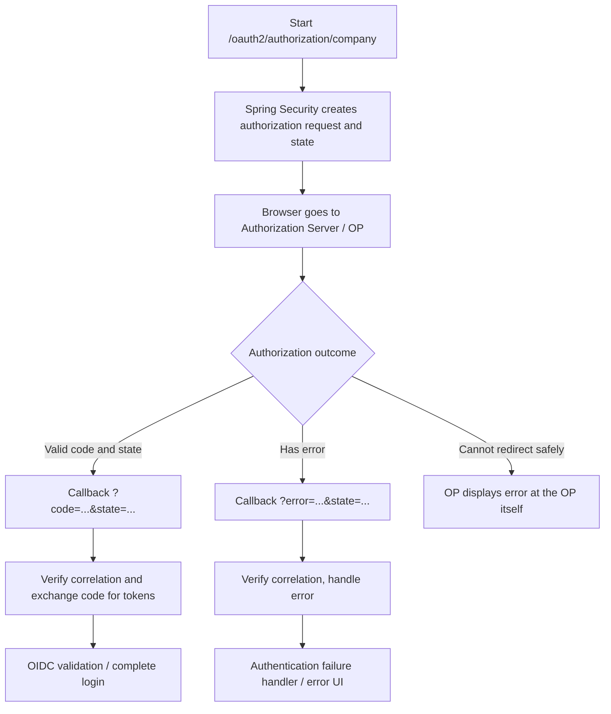
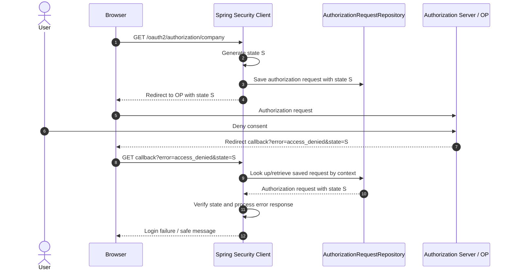

# 9.6. Handling error, error_description, and error_uri from the Provider

In **Spring Security OAuth 2.0 / OIDC Client**, callbacks from the Authorization Server (or OpenID Provider, abbreviated **OP**) do not always carry a `code`. The user may decline consent, the login session at the OP may expire, the request may lack a scope, or the provider may experience an outage. Whenever it can safely return an error via a valid redirect, the provider typically sends an **authorization error response** containing `error` along with optional parameters `error_description`, `error_uri`, and `state`.

A well-behaved application must fulfill two responsibilities at once:

1. **Handle the protocol correctly:** distinguish success callbacks from error callbacks; correlate the callback with the initial authorization request; never proceed to exchange an authorization code when the callback reports an error.
2. **Handle it safely for users and the system:** display an appropriate message, record error codes for diagnostics, and avoid placing untrusted provider data into HTML, redirects, or logs.

This lesson focuses on the **Authorization Code Flow on the Servlet stack** with Spring Security OAuth 2.0 Login/OIDC Login. Examples use Spring Boot 3.x and Spring Security 6.x with standard APIs; URLs and error codes are illustrative.

## 1. Two Branches of an Authorization Code Flow Callback

Suppose the application has a registration named `company`. The user initiates login at:

```text
GET https://app.example.test/oauth2/authorization/company
```

Spring Security creates the authorization request, saves correlation state, and redirects the browser to the OP. After interaction at the OP, there are two main outcomes.

### 1.1. Success Callback

```http
GET /login/oauth2/code/company?code=AUTHORIZATION_CODE&state=ORIGINAL_STATE HTTP/1.1
Host: app.example.test
```

The client must verify the response matches the original request before using the authorization code to call the token endpoint. With OIDC, the client also performs verification steps on the returned identity information.

### 1.2. Error Callback

```http
GET /login/oauth2/code/company?error=access_denied&error_description=User%20cancelled%20authorization&state=ORIGINAL_STATE HTTP/1.1
Host: app.example.test
```

This is an error authorization response. With this kind of callback, the application must terminate the current authentication attempt in a failure state. It **does not have a valid authorization code to exchange for tokens** simply because the callback endpoint was hit.



The last branch is vital: **not every error at the OP is sent back to the callback**. If `client_id` is invalid or `redirect_uri` is invalid/violates policy, the Authorization Server must normally stop at the OP to avoid sending an authorization response to an unverified URI.

## 2. Exact Meaning of the Three Error Parameters

A complete example, with the URL wrapped for readability:

```text
https://app.example.test/login/oauth2/code/company
  ?error=access_denied
  &error_description=The%20resource%20owner%20denied%20the%20request
  &error_uri=https%3A%2F%2Fid.example.test%2Fdocs%2Ferrors%23access-denied
  &state=STATE_FROM_ORIGINAL_REQUEST
```

Under the OAuth 2.0 model, the fields mean:

| Parameter | Required in error response? | Meaning | How the app should handle it |
| --- | --- | --- | --- |
| **`error`** | Yes | Protocol error code, such as `access_denied` or `invalid_scope` | Classify and map to known internal behavior/messages |
| **`error_description`** | No | Server-supplied description to help developers understand the cause | Use only for controlled diagnostics; do not display directly |
| **`error_uri`** | No | URI pointing to supplementary documentation about the error | Never auto-redirect or fetch; only use if validated against a trusted allowlist |
| **`state`** | Yes, if authorization request sent `state` | Value used to bind the response to the initiating request | Match against saved state; do not rely on mismatched callbacks |

**`error` is a machine-readable code**, not an end-user message. For instance, `access_denied` can typically map to "You did not grant login/access permission," yet you cannot automatically infer every vendor-specific code.

**`error_description` is not guaranteed to be stable text**. Providers may change wording, language, punctuation, extra parameters, or formatting without changing the error type. Never branch business logic by matching exact descriptive text.

**`error_uri` is not the application's Redirect URI.** The Redirect URI is where the OP sends the callback; the error URI is a documentation link declared by the OP. These two URIs serve different purposes.

### 2.1. All Three Parameters Travel Through the Browser

In a typical Authorization Code Flow, error callbacks traverse the **front channel** (browser). Even though a legitimate OP is the expected source, a callback request to the application could also be crafted and submitted manually by a user or another party.

Therefore, never treat a URL containing:

```text
?error=access_denied&state=anything
```

as definitive proof of a valid OAuth transaction. **Correlation with the original authorization request** remains an essential prerequisite before interpreting this result in a login context.

### 2.2. Spaces, Special Characters, and URL Encoding

`error_description` and `error_uri` values are typically percent-encoded in the query string. The framework receives and decodes request parameters via Servlet mechanisms.

For example:

```text
error_description=Login%20required
```

becomes the string "Login required" after decoding.

Do not double-decode manually or concatenate raw query strings into HTML. **Decoding does not make data safe to render**. The string can still contain XSS payloads if the application injects it unescaped into HTML.

## 3. Common OAuth 2.0 Error Codes

The following codes commonly occur at the **authorization endpoint** per OAuth 2.0:

| `error` | Basic meaning | Diagnostic direction |
| --- | --- | --- |
| **`access_denied`** | Resource Owner or Authorization Server denied the request | Did the user click Cancel/Deny? Did an access/permission policy block it? |
| **`invalid_request`** | Authorization request missing/extra/invalid parameter or malformed structure | Check `response_type`, `client_id`, `redirect_uri`, `state`, extension parameters |
| **`unauthorized_client`** | Client is not authorized to request authorization using this method | Is the grant type/response type enabled for this client ID? |
| **`unsupported_response_type`** | Authorization Server does not support the requested response type | Did client send `response_type=code`? Does AS allow Code Flow? |
| **`invalid_scope`** | Requested scope is invalid, unknown, or outside permitted bounds | Check registered scopes, consent policy, and environment scopes |
| **`server_error`** | Authorization Server failed to process the request due to an internal error | OP outage; check status, request ID, and logs at the OP |
| **`temporarily_unavailable`** | Authorization Server is temporarily unavailable, e.g., maintenance/overload | Check OP health, wait for recovery, then start a new transaction |

These codes can occur in multiple circumstances, and some providers classify them differently per policy. Never infer the exact root cause from a single code without supporting evidence.

### 3.1. Additional OIDC Error Codes

OIDC Core defines additional errors related to authentication requests, particularly when clients pass parameters like `prompt=none`:

| Code | Possible situation |
| --- | --- |
| **`login_required`** | OP requires user login, so the request cannot complete without interaction |
| **`interaction_required`** | User interaction is required, which the current mode forbids |
| **`consent_required`** | Consent approval must be requested |
| **`account_selection_required`** | User must select an account |

For example, when a client attempts an OIDC request without showing UI:

```text
prompt=none
```

and the OP lacks a suitable active login session, the OP may return:

```text
error=login_required
```

This does not necessarily mean a wrong password; **the OP is reporting it cannot complete authentication silently**. If business logic requires the user to log in, the application can guide them to start a **new interactive login transaction**, depending on client type and policy.

### 3.2. Custom Error Codes

An Identity Provider may return a code outside the standard table, or use proprietary codes reflecting organizational policy. Treat unknown codes as **unclassified errors**:

- Never display the raw code or description in the UI unchecked.
- Never treat an unknown code as success.
- Never use an unknown code as an arbitrary routing parameter.
- You may record a sanitized/bounded code for internal diagnostics along with permitted provider info and request IDs.

In applications with specific UX requirements, maintain a **mapping: error code → internal error category → UI message**.

## 4. Error Callbacks Differ from Token Endpoint Errors

A common confusion is seeing the same `error` field at multiple stages and concluding every error occurs in the callback.

### 4.1. Authorization Endpoint Error: Arrives via Browser

Example:

```http
GET /login/oauth2/code/company?error=access_denied&state=... HTTP/1.1
Host: app.example.test
```

The user was interacting with the OP and the OP redirected an error response to the callback. Spring Security processes the login failure branch.

### 4.2. Token Endpoint Error: Occurs After a Callback with `code`

The callback may be completely valid:

```http
GET /login/oauth2/code/company?code=CODE&state=... HTTP/1.1
Host: app.example.test
```

Yet when the backend exchanges the code for tokens, the token endpoint returns a JSON error:

```http
HTTP/1.1 400 Bad Request
Content-Type: application/json

{
  "error": "invalid_grant",
  "error_description": "Authorization code is expired or invalid"
}
```

Here, `invalid_grant` is a **token endpoint error**, not an authorization redirect error response. Causes may include an expired code, a reused code, a mismatched redirect URI during code exchange, or a wrong PKCE verifier.

To the end user, both lead to login failure, yet **diagnostics and where to inspect logs differ**:

| Error layer | Symptom | Where handled |
| --- | --- | --- |
| Authorization redirect error | Callback contains `error=...` | OAuth2 Login callback/filter |
| Token exchange error | Callback has `code`, but token endpoint POST is rejected | OAuth2 token response client / authentication provider |
| OIDC ID token validation error | Token endpoint succeeds, yet ID token fails validation | OIDC authentication provider and token validator |
| UserInfo/API error | Login or token succeeds, yet subsequent call fails | OIDC UserInfo client / resource API caller |
| Session/correlation error | Authorization request not found or invalid state | AuthorizationRequestRepository and callback processing |

You cannot fix a token endpoint error merely by changing UI code that reads callback `error_description`.

## 5. Correlation: Why Verify State Even When the Provider Reports an Error?

In Authorization Code Flow, Spring Security typically creates an `OAuth2AuthorizationRequest` before redirecting the browser to the provider. This request contains a random `state` plus details like registration, redirect URI, scopes, and attributes for PKCE/OIDC when configured.

The pending request is saved via **`AuthorizationRequestRepository<OAuth2AuthorizationRequest>`**. For standard Servlet login, Spring Security uses **`HttpSessionOAuth2AuthorizationRequestRepository`**.

When the provider returns either a success callback **or** an error callback, the app must verify the response belongs to an authorization request genuinely initiated by the application.



### 5.1. What If State Does Not Match?

Suppose the application holds a saved request with `state=S1`, yet the callback carries:

```text
?error=access_denied&state=S2
```

This callback must not be accepted as the outcome of request `S1`. Possible reasons include:

- Callback was altered or injected externally.
- Browser lost its old cookie/session, or another tab started a new transaction.
- Application runs multiple instances without sharing authorization request state.
- Callback landed on a different hostname/context path, preventing the session cookie from being sent.
- Authorization request timed out before the user finished at the OP.

A correlation failure must be treated as a **security failure of the current transaction**, not as an ordinary `access_denied` confirmed by the OP.

### 5.2. Should `error_description` Be Compared Against the Initial Request?

No. Correlation relies on protocol-designed values and metadata, primarily `state` paired with the saved authorization request. `error_description` is diagnostic prose, not a message authentication mechanism.

### 5.3. When the Provider Omits State

Per OAuth 2.0, if the client sends `state` in the authorization request, the provider must return the exact same value in the matching authorization response. If it is missing or mismatched, the application must not skip validation merely because `error` is present.

Do not apply a "quick fix" by fabricating a default state, skipping session checks, or accepting every error callback as valid.

## 6. Which Components Handle Error Callbacks in Spring Security?

With `oauth2Login()` on the Servlet stack, the callback typically sits at:

```text
/login/oauth2/code/{registrationId}
```

**`OAuth2LoginAuthenticationFilter`** handles this request. It participates in constructing and validating the authorization response, checks the initial request context, and delegates to the appropriate authentication providers. If an error occurs, authentication fails and **`AuthenticationFailureHandler`** gets to decide what response is returned to the browser.

A mental model:

```text
OAuth2AuthorizationRequestRedirectFilter
  └── Builds authorization request and state
      └── AuthorizationRequestRepository.save(...)
          └── 302 to OP

Browser returns to /login/oauth2/code/company
  └── OAuth2LoginAuthenticationFilter
      ├── Reads authorization response (code or error)
      ├── Restores original authorization request
      ├── Checks correlation and runs authentication
      └── On failure:
          └── AuthenticationFailureHandler
              ├── Records safe error category
              └── Renders appropriate login/error page
```

In practice, code exchange and OIDC validation are divided across the filter, authentication manager/providers, and supporting clients/services. Do not write a Servlet controller to decode `error` manually and bypass Spring Security's built-in callback pipeline.

### 6.1. The `OAuth2Error` Object

Spring Security provides **`org.springframework.security.oauth2.core.OAuth2Error`** to represent an OAuth2 error:

```java
String code = error.getErrorCode();
String description = error.getDescription();
String uri = error.getUri();
```

These fields represent **protocol error data**; that does not mean description and URI are sanitized or vetted content.

In several OAuth2-related authentication failures, you may encounter **`OAuth2AuthenticationException`** and obtain `OAuth2Error` via `getError()`. However, not every login failure carries a raw provider code: correlation errors, token parsing, network failures, token validation errors, or other exceptions may be represented by framework-generated codes or exceptions.

Consequently, your handler should **have a fallback branch** and never assume it will always receive `access_denied`.

### 6.2. AuthenticationFailureHandler

`AuthenticationFailureHandler` receives:

```java
void onAuthenticationFailure(
        HttpServletRequest request,
        HttpServletResponse response,
        AuthenticationException exception)
```

Its typical responsibilities are:

1. Map the error to a safe internal category for observability.
2. Return a fixed page or redirect to the user.
3. Prevent the current login request from entering an authenticated state.
4. Never reflect raw `error_description` or `error_uri` from the URL into the response.

Spring Security's default failure redirect behavior can vary based on `loginPage`, failure URL/handler configuration, and version. Never assume every application displays the same `/login?error` without checking the actual configuration.

## 7. Example: Configuring a Safe Failure Handler in Spring Security

Suppose the application has an OIDC registration `company`, and you want all login errors to redirect to `/login?authError=1` while logging a safe error category.

### 7.1. Client Registration

```yaml
spring:
  security:
    oauth2:
      client:
        registration:
          company:
            provider: company
            client-id: ${OIDC_CLIENT_ID}
            client-secret: ${OIDC_CLIENT_SECRET}
            authorization-grant-type: authorization_code
            redirect-uri: "{baseUrl}/login/oauth2/code/{registrationId}"
            scope:
              - openid
              - profile
              - email

        provider:
          company:
            issuer-uri: ${OIDC_ISSUER_URI}
```

The issuer URI in the example must point to a real OP and support discovery configuration. Secrets must be managed outside the repository.

### 7.2. SecurityFilterChain with Failure Handler

```java
import org.slf4j.Logger;
import org.slf4j.LoggerFactory;
import org.springframework.context.annotation.Bean;
import org.springframework.context.annotation.Configuration;
import org.springframework.security.authentication.AuthenticationServiceException;
import org.springframework.security.config.annotation.web.builders.HttpSecurity;
import org.springframework.security.core.AuthenticationException;
import org.springframework.security.oauth2.core.OAuth2AuthenticationException;
import org.springframework.security.web.SecurityFilterChain;

@Configuration
class OidcLoginSecurityConfig {

    private static final Logger log =
            LoggerFactory.getLogger(OidcLoginSecurityConfig.class);

    @Bean
    SecurityFilterChain securityFilterChain(HttpSecurity http) throws Exception {
        return http
            .authorizeHttpRequests(auth -> auth
                .requestMatchers("/", "/login", "/error", "/assets/**").permitAll()
                .anyRequest().authenticated())
            .oauth2Login(oauth2 -> oauth2
                .loginPage("/login")
                .failureHandler((request, response, exception) -> {
                    String category = safeCategory(exception);

                    // Log categorized metadata only; never log callback URL, state,
                    // error_description, error_uri, tokens, or raw exception details.
                    log.warn("OAuth2 login failed: category={}", category);

                    response.sendRedirect(
                        request.getContextPath() + "/login?authError=1");
                }))
            .build();
    }

    private static String safeCategory(AuthenticationException exception) {
        if (exception instanceof OAuth2AuthenticationException oauth2) {
            String code = oauth2.getError().getErrorCode();

            return switch (code) {
                case "access_denied" -> "access_denied";
                case "login_required" -> "login_required";
                case "interaction_required" -> "interaction_required";
                case "consent_required" -> "consent_required";
                case "invalid_scope" -> "invalid_scope";
                case "server_error", "temporarily_unavailable" ->
                    "provider_unavailable";
                default -> "oauth2_authentication_failed";
            };
        }

        if (exception instanceof AuthenticationServiceException) {
            return "authentication_service_failed";
        }

        return "authentication_failed";
    }
}
```

**Key points of this example:**

- The handler uses a **fixed redirect target**, avoiding constructing URLs from untrusted `error_uri` or descriptions.
- `safeCategory(...)` returns only labels from a fixed allowlist. Never use raw error codes as paths, HTML, or unbounded-cardinality metric labels.
- Never call `exception.getMessage()` to render on the login page; exception messages may contain provider-supplied data.
- If the framework wraps an error differently, the `authentication_failed` category remains safe and meaningful.
- This snippet only illustrates error callback handling. A real app must provide the `/login` route/view and manage logging/observability per system architecture.

### 7.3. What Message Should the Login Page Display?

Example application-owned UI content:

```html
<div role="alert" id="login-error" hidden>
  Unable to complete sign-in. Please try again
  or contact support if the problem persists.
</div>

<a href="/oauth2/authorization/company">Sign in with Company SSO</a>
```

UI code should decide whether to show the alert based on the fixed `authError=1` parameter or controlled internal state, and must enforce XSS protection. This parameter **only controls UI**—it does not prove the provider sent a real error; users can manually type `/login?authError=1`.

If you want to show a specific message like "You cancelled sign-in," use a safe backend-generated error category stored temporarily via an appropriate mechanism rather than rendering raw `error_description`. Consider session lifecycle and whether the message persists after redirect.

### 7.4. Why Not Log the Raw `AuthenticationException`?

Some exceptions may embed provider-supplied descriptions. Logging `exception.getMessage()` or full stack traces every time a user clicks Cancel creates noise and risks leaking callback data, internal context, or sensitive content.

For expected user actions like `access_denied` from cancellation, logging at INFO or recording a fixed-label metric may suffice; system errors warrant deeper logging over protected, sanitized channels. The snippet above uses `WARN` for visibility, which may not be the optimal log level for every organization.

## 8. Mapping Error Codes to Application Behavior

A good policy separates **protocol error codes** from **product UX** and **technical investigation**.

| Group | Illustrative codes | Appropriate UI behavior | System behavior |
| --- | --- | --- | --- |
| **User cancelled/denied** | `access_denied` | "You did not complete sign-in." | Stay unauthenticated; allow user to restart |
| **Interaction required** | `login_required`, `interaction_required`, `consent_required` | "Authentication or permission confirmation is required." | Guide into a new interactive flow if appropriate |
| **Client/scope misconfiguration** | `invalid_scope`, `unauthorized_client`, `unsupported_response_type` | "Sign-in is unavailable right now. Please contact support." | Alert ops, verify registration/OP configuration |
| **Provider outage** | `server_error`, `temporarily_unavailable` | "The sign-in service is temporarily unavailable. Please try again later." | Log safe provider/correlation ID; monitor OP health |
| **Invalid correlation or callback** | Missing/wrong state, missing original request | Generic failure message | Abort transaction; inspect session/cookie/routing |
| **Unrecognized error** | Proprietary vendor code or other exception | Generic message | Record controlled internal code for investigation |

**Never auto-retry infinitely** on `access_denied` or `login_required`. Every interactive authorization attempt must be initiated through the proper flow, avoiding continuous redirect loops between the application and the OP.

Applications must distinguish **deliberate user cancellation** from technical failures. Even though both result in failed authentication, they call for different messaging and alerting levels.

## 9. Handling `error_description` Safely

`error_description` is helpful for developers, yet it is **external data**. Three common pitfalls:

### 9.1. XSS and HTML Injection

Suppose a callback contains an unsafe description:

```text
error_description=<script>alert('unexpected')</script>
```

A hand-written controller could introduce a vulnerability if it embeds the description straight into HTML via `innerHTML` or an unescaped template.

Example of **what not to do**:

```javascript
const params = new URLSearchParams(window.location.search);
document.getElementById("error").innerHTML =
    params.get("error_description");
```

The code above turns a URL string into executable HTML. Using fixed internal messages is best. If external text must be shown in an internal admin tool, apply proper escaping, content sanitization policies, length caps, and strict access controls.

### 9.2. Description Is Not a Stable API

A provider may change from:

```text
User denied consent
```

to:

```text
The user cancelled the authorization request
```

while both still carry `access_denied`.

If the app classifies errors via `description.contains("cancelled")`, text changes will break logic. Use **`error` or internal exception types** for grouping; descriptions are diagnostic hints that may be omitted or altered.

### 9.3. Log Injection and Information Disclosure

Descriptions can contain newlines, log-forging text, email/account hints, or provider-generated details. Logging raw strings can corrupt log parsing or leak unintended data into observability platforms.

Recommended handling:

- Log **allowlisted error category codes** and non-sensitive metadata.
- Never log raw callback query strings, state, authorization codes, access tokens, ID tokens, or refresh tokens.
- If a support workflow genuinely requires descriptions, strip control characters, cap length, redact sensitive data, and store in protected logs with bounded retention.
- Use a system-generated and managed request/correlation ID instead of turning `state` into a public tracking token.

## 10. Handling `error_uri` Safely

`error_uri` may contain a documentation address from the provider:

```text
https://id.example.test/docs/errors/access_denied
```

Yet it could also be an unexpected URL in a forged callback:

```text
https://untrusted.example.test/collect?data=...
```

**Never automatically:**

- Call `response.sendRedirect(errorUri)`.
- Perform an HTTP GET to that URI from the backend merely because the provider returned it.
- Render it as an unchecked clickable link in the UI.
- Send cookies, tokens, or user details to that URI.

If your product wants to offer a "Learn more" link, use a **fixed, configured documentation URL** owned by your organization or a verified OP. If you ever must use `error_uri` from a response, validate the HTTPS scheme, an allowlisted hostname, path/policy constraints, and safe link opening. Issuing backend HTTP requests to arbitrary URIs also introduces SSRF risks.

**The purpose of `error_uri` is documentation reference, not a destination in the authentication flow.**

## 11. Callback Cases That Must Not Be Treated as Ordinary Provider Errors

### 11.1. Missing Correlation

```text
/login/oauth2/code/company?error=access_denied&state=UNKNOWN
```

Without a matching authorization request, the application lacks the context to accept the response. This must be treated as an invalid transaction rather than trusting `error` to confirm a provider-rejected session.

### 11.2. Both `code` and `error` Present Together

A standard success response contains an authorization code, while an error response contains `error`. If a callback contains both:

```text
?code=SOME_CODE&error=access_denied&state=...
```

this is malformed/anomalous data. Do not pick the "success" branch just because a code is present. Let the library reject it under protocol validation and treat inconsistent data as a failure requiring investigation.

### 11.3. Invalid Redirect URI

If the application sends:

```text
redirect_uri=https://wrong.example.test/login/oauth2/code/company
```

while the OP only permits callbacks at `https://app.example.test/login/oauth2/code/company`, the provider may display an error directly on its own page. The application **never receives** `?error=invalid_request` at the callback, because the OP must not redirect to an unverified URI.

When debugging, inspect the authorization request response and logs at the OP/AS rather than only searching for `AuthenticationFailureHandler` inside your app.

### 11.4. User Closes Tab or Leaves the OP

If the user closes the login window before the OP returns a callback, **there is no HTTP callback** for the app to process. A timeout or subsequent page visit must be distinguished from a real provider error response.

### 11.5. Form POST Response Mode

Some OIDC deployments use `response_mode=form_post` so the OP sends the authorization response via a POST form instead of GET redirect query parameters. In that case, error parameters may arrive in the **form body**; session cookies and CSRF protection must be configured accordingly.

Do not assume every `error` arrives in a GET query string. At the same time, never change CSRF handling just to accept POST callbacks without thoroughly assessing Spring Security version support and browser `SameSite`/cross-site policies.

## 12. Login Errors and User Session State

An error callback **does not create a new `OAuth2AuthorizedClient`** and does not prove the user is authenticated.

However, distinguish two states:

- **Pending authorization request:** data attached to the redirect flow that just started. It should be consumed/removed per callback mechanics and never reused as a new transaction.
- **Pre-existing `SecurityContext` or login session:** if an already signed-in user initiates a new account-linking flow, a failure in the new authorization does not automatically mean their entire prior session was destroyed.

When using `OAuth2LoginAuthenticationFilter` with a default or custom failure handler, whether security context/session is cleared, exceptions are stored, or redirects occur depends on filter configuration and session policy. Never write naive manual logic like "provider error → wipe entire session" without considering business intent, logout semantics, and account-linking workflows.

When the login screen reports failure, the UI state must reflect **that login transaction**; never falsely claim the user has been logged out of the OP or that tokens were remotely revoked.

## 13. Observing and Diagnosing Errors Across Environments

A callback failure typically involves at least three places:

1. **Browser/Network:** authorization request, redirect to OP, callback URL/HTTP status.
2. **Spring Boot Client:** `SecurityFilterChain`, OAuth2 Login filter, authorization request repository, failure handler, session/cookies.
3. **Authorization Server / OP:** client config, scopes, Redirect URI allowlist, consent/MFA policy, and internal outages.

Common scenarios follow:

| Symptom | Possible error layer | Where to investigate |
| --- | --- | --- |
| User clicks "Cancel" and returns to login page | `access_denied` | Confirm cancellation flow works properly and UI offers a retry button |
| OP shows "Redirect URI mismatch" and does not return to app | Authorization request validation error at OP | Compare `redirect_uri` against the allowlist for the exact client ID |
| Callback has `error=invalid_scope` | Requested scope invalid/disallowed | Check registration scopes, client grants, and OP environment |
| Callback has `error=login_required` | OP requires user interaction | Was `prompt=none` or silent authorization used? |
| Callback has `error=temporarily_unavailable` | OP temporarily unavailable | Check OP status, maintenance schedule, retry later via a fresh flow |
| Callback has valid error, yet app reports state mismatch | Session/correlation | Inspect session cookie, domain, timeout, multiple instances |
| Callback has code, yet token endpoint returns `invalid_grant` | Token exchange | Check code lifetime, PKCE, redirect URI, clock skew, and token request |
| OIDC login fails even though token endpoint succeeded | ID token validation | Check issuer, audience, signature/JWKS, expiry, nonce |
| User sees nothing, browser remains on OP | No callback or OP failed locally | Check Network/OP; do not assume app failure handler ran |
| UI displays technical strings or strange URLs | App renders raw provider response | Replace with controlled message mapping |

### 13.1. Local

Locally, callbacks typically look like:

```text
http://localhost:8080/login/oauth2/code/company
```

Switching `localhost` to `127.0.0.1` or changing ports can cause cookies/sessions and the Redirect URI allowlist to mismatch. The outcome may look like a provider bug, while the real cause is local configuration.

### 13.2. Staging

Staging typically sits behind an HTTPS reverse proxy. If Spring Boot infers `http://internal-service:8080` when building the Redirect URI, the OP may reject the authorization request immediately or send the browser to the wrong origin. Configure forwarded headers from a trusted proxy or an explicit Redirect URI.

### 13.3. Production

Production must avoid logging unfiltered callback queries, protect sessions across multiple instances, restrict log access, and separate user cancellations from system errors. When `server_error` or `temporarily_unavailable` spikes abnormally, operations can investigate provider health using sanitized metadata without collecting tokens or passwords.

## 14. Designing Structured Error Observability

A failed login event can be recorded as:

```json
{
  "event": "oauth2_login_failure",
  "registration_id": "company",
  "category": "access_denied",
  "environment": "staging",
  "request_id": "internal-trace-id",
  "result": "authentication_failed"
}
```

This is a **suggested schema**, not JSON automatically emitted by Spring Security. Values must come from internal configuration/controlled metadata; **never pull `registration_id` or `request_id` blindly from user callback query parameters**.

Exclude from this event:

- Raw `state` values.
- Authorization codes or full callback URLs.
- Access tokens, ID tokens, refresh tokens, or client secrets.
- Passwords, session cookies, or raw error messages containing PII.
- Unvalidated `error_uri`.
- Unfiltered `error_description`.

For metrics, use bounded-value labels like `category` and configured `registration_id`. Avoid letting raw `error` or `error_description` create unbounded label cardinality.

### When Detailed Investigation Is Needed

For hard-to-reproduce issues, enable selective security logging in a controlled environment, e.g.:

```yaml
logging:
  level:
    org.springframework.security.oauth2.client: DEBUG
    org.springframework.security.web.FilterChainProxy: DEBUG
```

The goal is seeing which chain a request enters and at which step an exception occurs. Never enable broad TRACE or log raw headers, raw queries/bodies, or token exchange payloads in production. Before sharing Network captures, redact `code`, `state`, cookies, and all tokens/secrets.

## 15. Handling Guide by Error Type

### 15.1. `access_denied`: User Declined Consent

**Scenario:** the user clicks Cancel on the consent screen. The OP redirects back to:

```text
/login/oauth2/code/company?error=access_denied&state=...
```

**Desired behavior:**

- Do not create a new login session from that transaction.
- Return to the login page with a neutral message.
- Let the user explicitly click to sign in again.
- Never immediately auto-redirect back to the OP, as that can create a loop and override the user's explicit refusal.

### 15.2. `login_required`: Silent Login Failed

**Scenario:** the app sent an authorize request with `prompt=none`, but the OP requires interactive authentication. The OP returns:

```text
?error=login_required&state=...
```

The app can prompt the user to start a regular interactive login flow. Never strip MFA checks or assume the OP suffered a system outage.

### 15.3. `invalid_scope`: Misconfigured Requested Permissions

**Scenario:** local uses `scope=openid profile report.read`, but the client ID has not been granted `report.read`.

**Remediation:** inspect `spring.security.oauth2.client.registration.company.scope`, client grants/scopes at the OP, and environment policies. This is usually a configuration issue needing engineering intervention rather than telling users to keep retrying.

### 15.4. `server_error` or `temporarily_unavailable`

**Scenario:** the OP is overloaded or under maintenance.

**Remediation:** display a message like "The sign-in service is temporarily unavailable," record the operational event, and recommend only bounded retries after the user or workflow starts a fresh session. Never replay an old authorization response or reuse an authorization code if one exists.

### 15.5. Correlation Failure on an Error Callback

**Scenario:** the callback carries `error=access_denied`, yet no matching authorization request exists in the session.

**Remediation:** prioritize investigating session and correlation security. Do not state definitively "You declined permission" if the app cannot verify the transaction; a message like "Your sign-in session is no longer valid. Please start again" is more appropriate.

## 16. What Not to Do in a Callback Controller

An anti-pattern is creating a controller:

```java
// Flawed design example: do not use in place of OAuth2LoginAuthenticationFilter.
@GetMapping("/login/oauth2/code/company")
String callback(@RequestParam(required = false) String error,
                @RequestParam(required = false) String error_description) {
    // Wrong: blindly reading query params, bypassing state/repository,
    // and rendering error_description directly.
    return error_description;
}
```

Problems:

1. The controller does not replace checking `state`/the initial authorization request.
2. Returning raw descriptions can leak data or allow injection depending on rendering.
3. Fails to properly handle token exchange, PKCE, OIDC validation, and other error branches.
4. Can conflict with the URL owned by Spring Security's callback filter.

In a Servlet application using `oauth2Login()`, **let the standard filter and authentication providers handle the protocol callback**, and customize **`AuthenticationFailureHandler`** to control UI responses and observability.

If a system integrates with a non-standard provider callback protocol, evaluate the provider's compatibility constraints and use proper extension mechanisms; never disable validation just to make a callback "work."

## 17. Practical Exercise: Distinguishing Errors and Deciding Responses

Suppose the application has the registration:

```yaml
spring:
  security:
    oauth2:
      client:
        registration:
          company:
            provider: company
            client-id: ${OIDC_CLIENT_ID}
            client-secret: ${OIDC_CLIENT_SECRET}
            authorization-grant-type: authorization_code
            redirect-uri: "{baseUrl}/login/oauth2/code/{registrationId}"
            scope: openid, profile
        provider:
          company:
            issuer-uri: ${OIDC_ISSUER_URI}
```

When testing, use only a **test/staging OP** and test accounts. Useful observations:

1. Start login from `/oauth2/authorization/company` so Spring Security generates a real authorization request and state.
2. On the OP's consent screen, choose Deny if supported by the OP to observe an `access_denied` callback.
3. Use browser Network tools to inspect `error` and check for `state`; never share raw state values.
4. Confirm the app does not establish a new `Authentication` and redirects to a safe error/login page.
5. If triggering `invalid_scope` with an invalid scope on the OP, do so on a test client to avoid breaking production clients.
6. Rehearse a controlled session error by letting the authorization request expire, then observe the mismatched callback and verify the app treats it as a failed transaction.

**Do not try the trick of typing `?error=access_denied&state=FAKE` directly and concluding Spring Security lacks error callback support.** A forged callback with no pending transaction should be blocked by correlation; that is the intended behavior.

### Expected Behavior Matrix

| Test | Expected result |
| --- | --- |
| User cancels consent, valid state | Login fails safely, no code exchange, shows appropriate page/message |
| Callback missing or wrong state | Rejected, no `Authentication` established |
| Callback description contains HTML/script | Never rendered as executable HTML |
| Callback has `error_uri` pointing to unknown domain | Never auto-redirected or fetched by backend |
| Provider returns unrecognized error code | Falls into default failure category, never treated as success |
| Token endpoint returns `invalid_grant` after code callback | Classified as token exchange error; not confused with authorization redirect error |
| OP rejects redirect URI directly at authorize request | May produce no callback; diagnose at OP/authorize request |
| User closes tab before OP callback | No callback error to handle; pending flow expires per policy |
| Successful login from provider | Skips failure handler; proceeds to OIDC validation and login state setup |

## 18. Self-Check Questions

**Q1.** A callback contains:

```text
?error=access_denied&error_description=Denied&state=EXPECTED_STATE
```

Should a token request be sent?

> No. This is the authorization error branch. The application must verify correlation and terminate the transaction as failed, never requesting tokens with a non-existent authorization code.

**Q2.** Why should `error_description` not be rendered verbatim onto a web page?

> It arrives over the front channel and is not guaranteed to be safe or stable. It may contain XSS payloads or unsuitable user-facing text. Map internal error codes to controlled messages instead.

**Q3.** How does `error_uri` differ from `redirect_uri`?

> `redirect_uri` is the callback where the OP returns the browser. `error_uri` is an informational documentation URL about the error, not a destination the app should redirect to.

**Q4.** If an error callback has a `state` different from the authorization request in the session, can we ignore the mismatch because "the provider is just reporting an error"?

> No. Error responses still require correlation. A mismatched callback must be treated as an invalid transaction rather than trusting `error` as a confirmed result from the OP.

**Q5.** The OP displays `invalid_redirect_uri` and the browser never returns to the application. Why didn't `AuthenticationFailureHandler` run?

> Because the OP can reject an authorization request before redirecting, avoiding sending a response to an unverified URI. No callback ever arrives at Spring Security for the filter to handle.

**Q6.** The callback has a valid `code` and `state`, yet the token endpoint returns JSON `error=invalid_grant`. Is this an authorization callback error?

> No. This is a code-exchange error occurring on the backend after the callback. The user still experiences a failed login, yet diagnostics should target the token request, PKCE, code lifetime, and redirect URI.

**Q7.** When customizing a failure handler, what should be logged?

> A filtered error category code, configured registration/provider, environment, internal trace ID, and outcome. Never log raw callback URLs, state, tokens, `error_uri`, or unfiltered descriptions.

**Q8.** Should the browser automatically be sent to `error_uri` because the provider offers help there?

> No. It is merely a documentation reference and may be untrusted. To provide help links, use a fixed documentation URL or a link verified against an allowlist and product policy.

---

## Key Takeaways

In an OAuth2/OIDC login flow, an error callback can be recognized by:

```text
/login/oauth2/code/{registrationId}
    ?error=<error-code>
    &error_description=<optional-text>
    &error_uri=<optional-reference>
    &state=<original-state-if-sent>
```

Four principles to uphold:

- **`error`** is for classification; **`error_description`** is a diagnostic hint; **`error_uri`** is a documentation reference.
- An error callback must still be **properly correlated to the initial authorization request via `state` and the repository**; never trust callback data merely because `error` is present.
- In Spring Security Servlet, let **`OAuth2LoginAuthenticationFilter` and the authentication providers** handle the protocol, and customize **`AuthenticationFailureHandler`** for UX and observability.
- Never render or redirect directly using untrusted descriptions/URIs; never log tokens, codes, state, cookies, or secrets.

### References

- [RFC 6749 — OAuth 2.0, Authorization Code Grant: Error Response](https://www.rfc-editor.org/rfc/rfc6749#section-4.1.2.1)
- [OpenID Connect Core 1.0 — Authentication Error Response](https://openid.net/specs/openid-connect-core-1_0.html#AuthError)
- [Spring Security — OAuth 2.0 Login Advanced Configuration](https://docs.spring.io/spring-security/reference/servlet/oauth2/login/advanced.html)
- [Spring Security API — OAuth2LoginAuthenticationFilter](https://docs.spring.io/spring-security/reference/api/java/org/springframework/security/oauth2/client/web/OAuth2LoginAuthenticationFilter.html)
