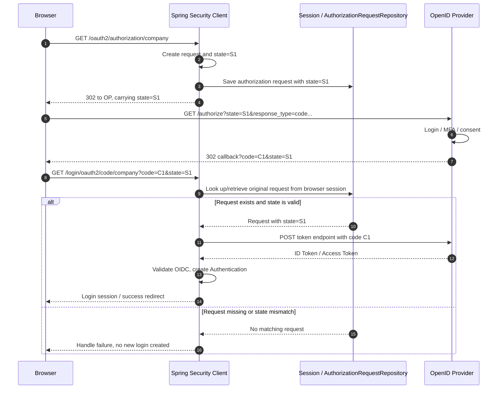

# 9.7. State Mismatch, Missing Requests, and Expired Sessions

When a Spring Boot application using **Spring Security OAuth 2.0 / OpenID Connect (OIDC) Client** receives a callback after the user logs in at the identity provider, three easily confused errors are **`state` mismatch**, **unable to find the saved authorization request**, and **expired browser session**. The user may see a successful sign-in screen at the OpenID Provider (OP), yet the application still cannot finish login because it cannot correlate the callback with the initial request.

These are **correlation** failures: the application must prove the authorization response was returned for **the right authorization request**, within **the right browser context**, and qualifies to proceed with exchanging the authorization code for tokens. You cannot infer a callback is valid solely because the URL carries `code` or because the OP authenticated a password/MFA successfully.

This lesson distinguishes each symptom, describes the mechanism Spring Security Servlet uses to persist authorization requests, explains root causes across cookies/sessions, multiple tabs, reverse proxies, and multiple instances, and provides an investigation and remediation approach that preserves OAuth 2.0/OIDC security guarantees.

## 1. Context: The Callback Must Locate the Original Authorization Request

Suppose an order management application runs at `https://orders.example.org`, logging in through an OP at `https://login.example.org`. In Spring Security, the client registration is named `company`.

A typical Authorization Code Flow:

1. The browser visits `/oauth2/authorization/company` on **the application**.
2. Spring Security creates an `OAuth2AuthorizationRequest` containing `state` and other required data.
3. The application saves the pending request and redirects the browser to the OP's authorization endpoint.
4. The user authenticates at the OP; the OP returns the browser to `/login/oauth2/code/company?code=...&state=...`.
5. The application retrieves the original authorization request, verifies `state`, and only then exchanges the authorization code at the token endpoint.
6. With OIDC, the application verifies the ID Token before creating `Authentication` and saving `SecurityContext` to establish the local login session.



On the Servlet side, the primary components include:

| Component | Role |
|---|---|
| `OAuth2AuthorizationRequestRedirectFilter` | Initiates and saves the authorization request, then redirects the browser to the OP. |
| `OAuth2AuthorizationRequestResolver` | Builds the authorization request from `ClientRegistration` and request context. |
| `OAuth2AuthorizationRequest` | Holds request parameters like `state`, `redirect_uri`, scopes, and related extra data. |
| `AuthorizationRequestRepository<OAuth2AuthorizationRequest>` | Contract for saving, loading, and consuming pending requests across two HTTP requests. |
| `HttpSessionOAuth2AuthorizationRequestRepository` | Common default repository in Spring Security Servlet, storing authorization requests via HTTP session. |
| `OAuth2LoginAuthenticationFilter` | Receives callbacks at `/login/oauth2/code/*`, restores the original request, and triggers OAuth2/OIDC authentication. |
| `SecurityContextRepository` | Stores state **after login succeeds**, serving a different purpose from the repository holding pending authorization requests. |

**Core idea:** when the authorization response returns, Spring Security must recover the request created earlier. Correlation errors occur before or during binding the response to the request, so login cannot yet be considered successful in the application.

## 2. Distinguishing the Three Main Symptoms

Exact error names displayed depend on Spring Security version, failure handler, and repository implementation. Codes like `authorization_request_not_found` or `invalid_state_parameter` may surface as `OAuth2AuthenticationException`/`OAuth2Error`; sometimes the app simply shows `/login?error`.

| Symptom | What is happening? | Common signs |
|---|---|---|
| **State mismatch** | An authorization response arrived, yet `state` does not match the authorization request the client was expecting. | Callback carries `state=S1`, repository holds request with `state=S2`, or comparison logic flags response invalid. |
| **Missing authorization request** | Client cannot find the initial authorization request in the repository upon callback. | `authorization_request_not_found` or similar message, even though the callback URL carries `code` and `state`. |
| **Expired session** | The HTTP session holding the pending request expired before the callback arrived; thus the authorization request is gone too. | Callback returns after slow MFA/consent; browser sends cookie yet server no longer has the session, or fails to send cookie. |

Their relationship is **cause and symptom**, not three mutually exclusive states:

- **An expired session** can cause a **missing request**.
- **Multiple tabs** can cause a later request to overwrite an earlier one, manifesting as a **missing request** or **state mismatch**.
- **Lost cookies, bad proxy config, or multiple nodes** can prevent the repository from seeing the original request, mimicking an expired session.
- **A forged callback** can also carry an incorrect `state`; never assume all state errors are harmless infrastructure glitches.

Conversely, a callback that passes the state check can still fail at the token endpoint or during ID Token verification. Always identify the **first failing step** instead of lumping every OIDC failure under "state error."

## 3. What Is `state`, and Why Must It Match?

`state` is an OAuth 2.0 authorization request parameter **generated by the client before redirecting** to the Authorization Server. In a secure implementation, this value is sufficiently random, unpredictable, bound to the authorization request, and tied to the browser context.

Example authorization request:

```text
GET https://login.example.org/authorize
  ?response_type=code
  &client_id=orders-web
  &redirect_uri=https%3A%2F%2Forders.example.org%2Flogin%2Foauth2%2Fcode%2Fcompany
  &scope=openid%20profile
  &state=S1_random_value
```

After authentication, the OP sends the browser back to:

```text
https://orders.example.org/login/oauth2/code/company
  ?code=C1_short_lived_code
  &state=S1_random_value
```

The application must look up the original request for **that exact browser** and verify the returned `state` equals `S1_random_value`. If the saved request holds `S2_random_value`, the response must be rejected.

### 3.1. Login CSRF Protection Mechanism

Without proper binding between request and response, an attacker could try completing a response originating from their own flow inside a victim's browser. This could log the victim into the attacker's account or mix up authentication flows.

`state` mitigates **login CSRF/authorization response injection** when securely generated by the client, saved alongside the authorization request, and verified against the exact browser. Merely having a state value present in the callback is not enough; the client must know which valid request it belongs to.

### 3.2. What Values Is `state` Distinct From?

| Value | Function |
|---|---|
| `state` | Binds the authorization response to the initiated authorization request. |
| `nonce` | In OIDC, binds the ID Token to the authentication request when a nonce was sent. |
| `code_verifier` / PKCE | Binds authorization code exchange at the token endpoint to the client that created the code challenge. |
| `JSESSIONID` / session cookie | Lets the browser reference the application's HTTP session; that session may hold a pending authorization request. |
| Application CSRF token | Protects business state-changing requests authenticated by cookies. |
| ID Token | OIDC identity assertion for the client once verified. |
| Access Token | Token to access Resource Servers within granted scopes. |

Never use `state` as a session ID, never use it as an API access token, and never hard-code a fixed string like `state=company` across logins. Never disable state checks just because PKCE or `nonce` is enabled: each constraint serves a different role.

### 3.3. Why Is the Right Callback URL Alone Insufficient?

Anyone can attempt to invoke a URL such as:

```http
GET /login/oauth2/code/company?code=some-code&state=some-state HTTP/1.1
Host: orders.example.org
```

The name `company` in the path only identifies part of configuration; it does not prove the browser started login. The client must check the saved authorization request, `state`, and associated client/issuer before proceeding to token exchange.

In multi-OP systems, never trust an arbitrary query parameter to switch issuers/token endpoints. Bind the response to the pre-selected registration/issuer and verify the corresponding ID Token; this also helps defend against **authorization server mix-up**.

## 4. How Is the Authorization Request Stored?

Spring Security Servlet typically defaults to `HttpSessionOAuth2AuthorizationRequestRepository`. When the browser visits the OAuth2 login initiation endpoint, the repository saves `OAuth2AuthorizationRequest` into the application's HTTP session.

Conceptual diagram:

```text
Before redirecting to OP:

Browser
  Cookie: JSESSIONID=SESSION_A
    |
    v
HTTP session SESSION_A
  └── OAuth2AuthorizationRequest
       ├── registration / provider context
       ├── redirect_uri
       ├── scopes
       ├── state = S1
       ├── nonce (if OIDC applies)
       └── code_verifier (if PKCE applies)
```

At callback time, the browser must return to the **matching session context**:

```text
GET /login/oauth2/code/company?code=C1&state=S1
Cookie: JSESSIONID=SESSION_A
```

The repository uses the HTTP session in the current request to locate the saved authorization request. State matching is meaningful only when **the original request is fetched from the right storage**.

### 4.1. Why Can a Session Exist Before Login?

Before the user enters a password at the OP, the application may still need an HTTP session to hold:

- The authorization request and `state`.
- `nonce`/PKCE data needed to complete the OIDC Code Flow.
- The application request the user intended to visit after login (for example, via `RequestCache`).

Thus, a browser holding `JSESSIONID` **does not mean** the user is already logged in. Only after login succeeds does Spring Security create `Authentication` and save `SecurityContext` per the configured repository. Session fixation protection may also rotate the session ID after authentication.

### 4.2. Authorization Requests Are Typically Consumed

When a callback is processed properly, the authorization request is retrieved and removed from storage per the repository's implementation. Never rely on reusing `state` indefinitely.

Distinguish two constraints:

- **The OP** enforces authorization code expiration and ensures codes are exchanged only under allowed conditions, normally once.
- **The Client** manages the pending authorization request and checks `state` before continuing.

If a user refreshes an old callback URL, the request may already have been consumed and the code already used. An error upon refresh is expected behavior, not necessarily evidence that the first login failed.

### 4.3. Default Storage and the Multi-Tab Limitation

`HttpSessionOAuth2AuthorizationRequestRepository` by default typically stores **one pending authorization request per HTTP session**. When another tab starts a new login before the first callback returns, the new request can replace the old one.

Example:

```text
09:00:00  Tab A starts login -> state=A1, saves request A
09:00:04  Tab B starts login -> state=B1, saves request B
09:00:07  Tab A receives callback -> state=A1
09:00:07  Repository currently holds request B (state=B1)
09:00:07  Cannot complete Tab A's callback as a valid request
```

This situation must not be "fixed" by accepting any `state` that ever existed. If the product requires parallel logins across multiple tabs or OPs, implement a repository supporting **multiple pending requests**, still bound to the right browser, with TTLs and single-use consumption rules.

## 5. State Mismatch: Specific Causes

A mismatch can be a security violation to reject, or an operational consequence of overwritten state. Investigation must begin with verifiable evidence.

### 5.1. Browser Opens Two Login Flows Simultaneously

As in the two-tab example, the newer request overwrites the older request. When the older request's callback arrives, `state` no longer matches.

Signs:

- Single-tab login usually succeeds; two tabs or double-clicking login often fails.
- Each login initiation generates a new authorization request.
- The failing callback is typically from the earlier initiation.

Remediation:

- Limit concurrent login initiations if the product only supports one flow per browser session.
- If parallel logins are genuinely needed, build a multi-request `AuthorizationRequestRepository` with count/TTL caps and browser binding.
- Never auto-exchange a code from a callback with a mismatched state.

### 5.2. Callback Sent to a Different Session

A callback generated in browser A is opened in browser B, another incognito profile, or another device lacking the corresponding session. Even though `state` in the URL once existed in A, it does not belong to B's authorization request.

Remediation: the user must restart the flow within **the same browser and cookie context**; the system must continue rejecting uncorrelated callbacks.

### 5.3. Altered Callback URL or Forged Callback

If a script, plugin, intermediary app, or another actor submits a wrong `state`, that indicates an untrusted response. Never shrug it off as a minor glitch and skip verification.

Especially when supporting multiple providers, checking `state` alongside saved registration/issuer metadata helps detect responses that do not belong to the original request.

### 5.4. Inconsistent Custom Resolver/Repository on the Client

A hand-written `OAuth2AuthorizationRequestResolver` might accidentally:

- Alter `state` after the request was saved.
- Drop attributes tied to registration, `nonce`, or PKCE.
- Build one request to save, yet construct a different request for the redirect.
- Use two different repositories between initiation and callback.
- Fail to implement load/remove logic using consistent state conventions.

In such cases, even a legitimate OP callback can be rejected. If you only need to add `prompt`, `login_hint`, or valid OP parameters, use Spring Security's extension points so default state generation and request saving remain intact.

## 6. Missing Authorization Request: Specific Causes

An error like `authorization_request_not_found` usually means **the client could not restore the initial authorization request**. It does not automatically prove the OP is broken.

### 6.1. Session Cookie Does Not Return on Callback

The authorization request lives in the application's HTTP session. If the browser fails to send the cookie referencing that session, the server treats the callback like a brand-new browser.

Common causes:

- Cookie domain/path does not cover the callback URL.
- Cookie has the `Secure` flag while the callback runs over plain HTTP.
- `SameSite` policy conflicts with the callback method.
- Browser blocks cookies or runs inside an embedded iframe/third-party context.
- User opens the callback from a different browser or device.
- Host mismatch, e.g., starting on `localhost` while the callback lands on `127.0.0.1`, or switching subdomains mid-flow.

Always inspect **the application's cookie on both start and callback requests**, not just the OP's SSO cookie.

### 6.2. Session Deleted or Expired on the Server

The browser may still send `JSESSIONID`, yet the backend has already purged the session due to timeout, node restart, eviction, session store data loss, or explicit session invalidation. Presence of a cookie does not guarantee the session still exists.

In that case, the repository finds no authorization request. Rejecting login is necessary since there is no data left to validate the response against.

### 6.3. Another Request Replaced or Consumed the Request

Clicking login multiple times, opening multiple tabs, submitting the callback twice, or faulty retries can overwrite or remove the first request. These causes stem from the **authorization request lifecycle**, not the OP losing the ability to authenticate users.

### 6.4. Callback Misses the Expected Filter/Repository

With multiple `SecurityFilterChain` beans, reverse proxy path rewrites, custom callback URIs, or multiple apps sharing a hostname, the callback can land in the wrong place. Depending on configuration, this may return 404/401/redirect or request-not-found.

The default Servlet flow listens at `/login/oauth2/code/{registrationId}` via `OAuth2LoginAuthenticationFilter`. If you change the URL, synchronize registration `redirect-uri`, the redirection endpoint matcher, and the callback list at the OP.

### 6.5. Multiple Instances Do Not Share Sessions

When login starts on node A, the authorization request may sit in A's local memory session. The callback routed through a load balancer hits node B, which lacks that data.

```text
Browser -> Load Balancer -> Spring A
                           saves SESSION_A / OAuth2AuthorizationRequest

Browser -> OP -> callback -> Load Balancer -> Spring B
                                          cannot find SESSION_A
                                          -> missing request
```

This is a classic symptom when scaling from one instance to multiple instances without solving session persistence or affinity.

## 7. Expired Session: Distinguish the Timing and Session Type

"Session expired" can refer to several distinct phenomena. In an OIDC Client, distinguish:

| Type | Who manages it? | What does expiration typically cause? |
|---|---|---|
| **App HTTP session before callback** | Spring Boot app/session store | Pending authorization request vanishes; callback is rejected. |
| **App HTTP session after login** | Spring Boot app | Subsequent business request lacks authentication; may trigger a fresh login. |
| **SSO session at OP** | OpenID Provider | Upon redirect to OP, user may have to re-enter credentials/MFA. |
| **Authorization code** | Authorization Server/OP | Token endpoint may return `invalid_grant` due to expired/used code, even when state is valid. |
| **ID Token / Access Token** | OP/Authorization Server with respective validation rules | Affects token verification or API calls; independent of the app's HTTP session timeout. |

### 7.1. Session Expires Before Callback

Example:

```text
09:00   App creates authorization request, state=S1, session=SESSION_A
09:01   User redirects to OP and starts MFA
09:15   App-side session expires per timeout or eviction
09:18   User finishes MFA, OP sends callback state=S1 to app
09:18   App cannot find SESSION_A/request S1 -> login fails
```

Here **MFA succeeded**, yet the request could not complete because the client's authorization request/session lifetime was too short.

Valid remediations:

- Tune session/authorization request store timeouts to cover realistic authentication durations without making them infinite.
- Eliminate actions that drop or invalidate sessions between redirect and callback.
- Display a clear message letting the user **restart login** when the flow expires.
- If using a dedicated TTL for authorization requests, configure an appropriate TTL and clean up stale entries.
- Never accept a stale callback just because the user claims they just authenticated at the OP.

### 7.2. Session Expires After Login

An established login session can expire after an idle period. Visiting `/orders` later may initiate a **new** authorization request. If the OP still has an active SSO cookie, the browser may bounce back almost immediately, leading users to think the app session never expired.

This is normal when the **application session** and **OP SSO session** are independent. Never conclude there is a state bug merely because the app restarts login after a timeout.

### 7.3. Authorization Code Expiration Is Not Session Expiration

If the client locates the request and `state` matches, yet the backend exchanges the code too late, the OP can reject the code (commonly `invalid_grant`). Investigation shifts from session/state to **token exchange**: expired code, reused code, wrong redirect URI, or wrong PKCE.

Always identify the **first failing step**:

- Original request not found: correlation/session repository issue.
- Request found, yet `state` mismatches: state/callback correlation issue.
- Valid state, token endpoint returns error: code/client/PKCE/provider issue.
- Valid tokens, yet post-login request is anonymous: `SecurityContext`/post-login session persistence issue.

## 8. Cookies and Browsers: Details That Easily Lose Requests

### 8.1. Application Session Cookie Differs from OP SSO Cookie

Example:

```text
orders.example.org -> Application's JSESSIONID
login.example.org  -> OP's SSO cookie
```

Seeing the user still signed in on the OP screen does not prove the application's HTTP session still exists. In DevTools, inspect cookie domain/path and the **`Cookie` request header sent to the application's callback**.

### 8.2. `SameSite` Depends on the Callback Method

For common top-level **GET** redirect OAuth2/OIDC callbacks, a `SameSite=Lax` cookie is normally sent under modern browser policies. However, if the OP uses **`response_mode=form_post`**, the callback can be a **cross-site POST**; many browsers withhold `SameSite=Lax` cookies in that scenario.

Without the session cookie, the authorization request becomes "not found" even though `state` in the URL/body is accurate. Do not immediately set every cookie to `SameSite=None`: that requires `Secure` and expands the application's CSRF surface.

Verify the actual response mode, browser flow, cookie policies, and provider support before choosing a configuration.

### 8.3. `Secure`, Domain, Path, and Host

If the app starts at `https://orders.example.org` yet generates a callback at `http://orders.example.org`, a `Secure` cookie will not be sent over HTTP, and the transport fails secure deployment requirements.

Similarly, a host-only cookie for `orders.example.org` is not automatically sent to `auth.orders.example.org`. If using context path `/app`, the actual callback must traverse the right path and the cookie path must cover the needed endpoints.

Never broaden cookie domains excessively just to patch a login bug without evaluating trusted subdomain boundaries.

### 8.4. Impact of Refresh, Back, and Retries

Once a callback has been processed, refreshing the exact URL containing `code`/`state` in the browser can error because:

- The authorization request was already consumed.
- The single-use authorization code was already spent.
- The session ID may have rotated after successful login for session fixation protection.

The application should redirect away from the callback to a clean business URL without `code`/`state`. Users should not bookmark or refresh callback URLs.

## 9. Reverse Proxies and Multiple Instances

When public URL and backend URL differ:

```text
Browser:
https://orders.example.org/oauth2/authorization/company

Reverse proxy / Ingress:
https://orders.example.org -> http://orders-service:8080

Backend:
http://orders-service:8080/oauth2/authorization/company
```

If Spring constructs `{baseUrl}` using the internal host/scheme, the Authorization Server may reject the redirect URI or return the browser to a host lacking the initial cookie. With the default `redirect-uri`:

```yaml
redirect-uri: "{baseUrl}/login/oauth2/code/{registrationId}"
```

ensure `{baseUrl}` represents the **public** address. The proxy must pass and the app must honor forwarded headers only along trusted infrastructure; never accept forged forwarded headers from external clients.

### 9.1. Sample Session Configuration

Illustrative Spring Boot Servlet configuration:

```yaml
server:
  servlet:
    session:
      timeout: 30m
      cookie:
        http-only: true
        secure: true
        same-site: lax
```

`30m` is purely an example and must match login UX and organizational policy. `secure: true` assumes external access over HTTPS; local HTTP dev environments need appropriate environment-specific settings. `same-site: lax` suits many GET callbacks, though not necessarily `form_post` or embedded flows.

If a reverse proxy sends trusted forwarded headers, configure Spring Boot/Servlet container forwarded-header handling accordingly. Always restrict header acceptance to controlled proxies.

### 9.2. Designing Sessions for Multiple Nodes

Common architectural options:

| Approach | Benefits | Caveats |
|---|---|---|
| **Shared session store**, e.g., Spring Session on shared backing store | Callback node can read sessions created on another node. | TTL, availability, serialization, session store security, and operations. |
| **Session affinity** at load balancer | Can route callback back to the initiating node. | Node restarts/failovers can drop sessions; understand affinity limits. |
| **Distributed custom `AuthorizationRequestRepository`** | Can manage multiple pending requests and explicit TTLs. | Must preserve browser binding, integrity, and safe single-use consumption. |
| **Single node in small/dev setups** | Simple to deploy and diagnose. | Does not replace proper session architecture when scaling. |

In distributed systems, beyond the authorization request there is also the **post-login `SecurityContext`** and possibly `OAuth2AuthorizedClient`/token storage. They have distinct lifecycles and responsibilities; define clearly what must be shared when scaling out.

## 10. Spring Security Configuration and Where Correlation Is Managed

### 10.1. Minimal OIDC Client Example

In `application.yml`:

```yaml
spring:
  security:
    oauth2:
      client:
        registration:
          company:
            provider: company-oidc
            client-id: ${OIDC_CLIENT_ID}
            client-secret: ${OIDC_CLIENT_SECRET}
            authorization-grant-type: authorization_code
            redirect-uri: "{baseUrl}/login/oauth2/code/{registrationId}"
            scope:
              - openid
              - profile
              - email
        provider:
          company-oidc:
            issuer-uri: https://login.example.org/realms/company
```

In Servlet security configuration:

```java
import org.springframework.context.annotation.Bean;
import org.springframework.context.annotation.Configuration;
import org.springframework.security.config.Customizer;
import org.springframework.security.config.annotation.web.builders.HttpSecurity;
import org.springframework.security.web.SecurityFilterChain;

@Configuration
public class SecurityConfiguration {

    @Bean
    SecurityFilterChain webSecurityFilterChain(HttpSecurity http)
            throws Exception {
        http
            .authorizeHttpRequests(auth -> auth
                .requestMatchers("/", "/login", "/public/**").permitAll()
                .anyRequest().authenticated()
            )
            .oauth2Login(Customizer.withDefaults());

        return http.build();
    }
}
```

With this standard setup, Spring Security uses default components to manage Servlet-side authorization requests and state. You do not need to write a callback controller to read `code` and exchange tokens; `OAuth2LoginAuthenticationFilter` handles the callback.

If using a custom login page, success handler, or failure handler, keep all authentication constraints of the flow intact.

### 10.2. Why Not Use `STATELESS` Indiscriminately?

Spring Security Servlet OAuth2 Login relies on a repository by default to hold the authorization request while the browser is away from the app. If an application sets the entire flow to `SessionCreationPolicy.STATELESS` without designing a custom repository/binding, recovering the request and maintaining sessions will not work as expected.

A stateless architecture must still securely solve:

- Generating an unpredictable `state` for the authorization request.
- Storing correlation data in a controlled store or integrity-protected payload.
- Binding the request to the **initiating browser**.
- Retaining `nonce`/PKCE verifier tied to the request when used.
- Enforcing TTLs, single-use consumption, and anti-forgery checks.
- Separately defining how post-login business requests restore authentication.

Merely dropping HTTP sessions does not eliminate the need to protect correlation.

### 10.3. Explicit Repository Configuration

To make storage and lookup explicit, you can declare `HttpSessionOAuth2AuthorizationRequestRepository` and wire it into `oauth2Login()`:

```java
import org.springframework.context.annotation.Bean;
import org.springframework.context.annotation.Configuration;
import org.springframework.security.config.annotation.web.builders.HttpSecurity;
import org.springframework.security.oauth2.client.web.AuthorizationRequestRepository;
import org.springframework.security.oauth2.client.web.HttpSessionOAuth2AuthorizationRequestRepository;
import org.springframework.security.oauth2.core.endpoint.OAuth2AuthorizationRequest;
import org.springframework.security.web.SecurityFilterChain;

@Configuration
public class OAuth2CorrelationConfiguration {

    @Bean
    AuthorizationRequestRepository<OAuth2AuthorizationRequest>
            authorizationRequestRepository() {
        return new HttpSessionOAuth2AuthorizationRequestRepository();
    }

    @Bean
    SecurityFilterChain securityFilterChain(
            HttpSecurity http,
            AuthorizationRequestRepository<OAuth2AuthorizationRequest>
                    authorizationRequestRepository) throws Exception {

        http
            .authorizeHttpRequests(auth -> auth
                .requestMatchers("/", "/login", "/public/**").permitAll()
                .anyRequest().authenticated()
            )
            .oauth2Login(oauth2 -> oauth2
                .authorizationEndpoint(endpoint -> endpoint
                    .authorizationRequestRepository(authorizationRequestRepository)
                )
            );

        return http.build();
    }
}
```

This snippet is an **alternative configuration** to the previous `SecurityFilterChain` example; do not register two chains with overlapping scope in the same project. When standard behavior suffices, declaring this bean is optional since Spring Security provides the default repository. When customizing, ensure login initiation and callback reception **use compatible storage mechanisms**.

### 10.4. Never Alter `state` via Arbitrary Customization

To add provider parameters like `prompt=login` or `login_hint`, use `DefaultOAuth2AuthorizationRequestResolver` and an appropriate customizer. Never construct a brand-new `OAuth2AuthorizationRequest` that drops `state`, `nonce`, PKCE, or client registration binding attributes.

Never design a request resolver that sets `state` to a business URL or browser-supplied value. Post-login return URLs belong in `RequestCache` or a separately validated mechanism; reserve `state` for correlation.

## 11. How to Investigate: Trace Each Leg to Find Where Data Was Lost

Always investigate from the initial request onward, because **the callback is merely the final leg of a previously saved request**.

| Step | What to verify | Clarifying question |
|---|---|---|
| **1. Initiation** | Did the browser hit `/oauth2/authorization/company` on the right app? | Was a new authorization request actually created? |
| **2. Redirect** | Did the app redirect to the OP with the right issuer/client and `state`? | Are registration and base URL correct? |
| **3. App cookie** | Did the browser receive a session cookie on start and send back the matching cookie on callback? | Can the same session be restored? |
| **4. Callback route** | Did the callback reach `/login/oauth2/code/company` and the right Security Filter Chain? | Did the OAuth2 login filter process the request? |
| **5. Repository** | Was the authorization request found for the callback session? | Is the request missing or still present? |
| **6. State** | Does the callback `state` match the saved request? | Mismatch or correlation pass? |
| **7. Token exchange** | With valid state, did the token endpoint accept the code? | Separates code/PKCE/client auth errors from state errors. |
| **8. Post-login session** | Was `SecurityContext` saved and restored on the next request? | Did login succeed only for the app session to vanish afterward? |

### 11.1. Signals in the Network Panel

A valid sequence typically looks like:

```text
GET /oauth2/authorization/company
    -> 302 Location: https://login.example.org/authorize?...&state=...

GET https://login.example.org/authorize?...   (browser at OP)
    -> login/MFA/consent interaction
    -> 302 Location: https://orders.example.org/login/oauth2/code/company?code=...&state=...

GET /login/oauth2/code/company?code=...&state=...
    -> backend processes callback
    -> 302 Location: /orders

GET /orders
    -> sends app session cookie
    -> receives content if authenticated and authorized
```

This is an illustrative diagram; other response modes may use POST on callback. The browser normally **does not see** the backend POST to the token endpoint, as that is a direct connection between Spring Boot and the OP.

In the browser, inspect cookie presence and attributes, host/scheme/path, number of login initiations, callback HTTP method, and the redirect chain. Never post or share raw callback URLs containing authorization codes or session cookies in public tickets.

### 11.2. What Should Server Logs Record?

You may log **non-sensitive** details such as:

- Configured registration name, when known from trusted context.
- Stage name: authorization start, callback arrived, request lookup result, state validation outcome, token endpoint status, authentication success/failure.
- Bounded/normalized OAuth2 error codes.
- An **internal diagnostic correlation ID** generated solely for logging, never raw `state` or session IDs.
- Booleans such as "session cookie present?", "session exists on server?", "authorization request found?" when safely collectible.
- Receiving node/instance and timestamp, to catch load balancer issues.

Never log **authorization codes, full `state`, `code_verifier`, `nonce`, ID Tokens, Access Tokens, Refresh Tokens, client secrets, `Authorization` headers, session cookies, or full callback URLs**. Logs need enough correlation to investigate without becoming a credential store.

### 11.3. Example Failure Handler Reporting Errors to Users

Failed logins should direct to a clear page without exposing stack traces or raw OP data:

```java
import org.springframework.context.annotation.Bean;
import org.springframework.context.annotation.Configuration;
import org.springframework.security.config.annotation.web.builders.HttpSecurity;
import org.springframework.security.web.SecurityFilterChain;

@Configuration
public class LoginErrorConfiguration {

    @Bean
    SecurityFilterChain securityFilterChain(HttpSecurity http) throws Exception {
        http
            .authorizeHttpRequests(auth -> auth
                .requestMatchers("/", "/login", "/public/**").permitAll()
                .anyRequest().authenticated()
            )
            .oauth2Login(oauth2 -> oauth2
                .failureUrl("/login?oauth2Error")
            );

        return http.build();
    }
}
```

This is a standalone configuration replacing the `SecurityFilterChain` bean in other examples. The app must provide an unauthenticated `/login` page with an appropriate message like "Your sign-in session expired or the request is no longer valid. Please start again." Letting the user restart the flow **does not** permit the server to reuse old codes or states.

If building a custom `AuthenticationFailureHandler` to log error codes, restrict what gets logged and never dump raw exceptions, authorization requests, or token responses. You can display a self-generated diagnostic ID on the error screen and in logs for internal cross-referencing.

## 12. Typical Scenarios

### Scenario A — Single-Tab Login Succeeds, Two Tabs Fail

**Sequence:** Tab A initiates state `A1`. Tab B initiates state `B1` before A completes. Tab A's callback arrives while the repository holds B.

**Interpretation:** This is typically a limitation of the single-pending-request-per-session model, or the app replaced the request due to a new login flow.

**Resolution:** Allow only one pending login when appropriate for the product, or design a multi-request repository enforcing browser binding, state, TTL, single-use consumption, and resource bounds. Never let callback `A1` consume request `B1`.

### Scenario B — After Slow MFA, Callback Reports Request Not Found

**Sequence:** The session holding the authorization request expires while the user completes MFA.

**Interpretation:** The OP authenticated the user, yet the client lost correlation. This is usually a **pre-callback session timeout**, not an expired access token.

**Resolution:** Review real-world MFA/consent durations and session/authorization request TTL policies; configure sensible timeouts and support safely restarting login.

### Scenario C — Fails Only in Production, Localhost Always Works

**Sequence:** Dev runs a single node; production has a reverse proxy and multiple replicas. Callbacks occasionally land on another node or cookies have wrong path/scheme.

**Interpretation:** Identical OIDC URLs, yet different session infrastructure.

**Resolution:** Check forwarded headers, public redirect URI, cookies, session affinity/shared store, and session lifetime. Never fix by relaxing state matching.

### Scenario D — Provider Reports Login Succeeded, App Still Prompts for Login

**Sequence:** Either the callback succeeded yet the next request failed to restore `SecurityContext`, or the callback was rejected earlier because no authorization request was found.

**Interpretation:** Distinguish **pre-token-exchange failures** from **post-login session save/restore failures**.

**Resolution:** Trace callback execution, token endpoint, authentication success handler, and cookies/`SecurityContextRepository` on subsequent requests. Do not lump every redirect loop into state mismatch.

### Scenario E — Refreshing an Old Callback Throws an Error

**Sequence:** The user already logged in, then refreshes `/login/oauth2/code/company?code=...&state=...` from browser history.

**Interpretation:** Both code and request were already used/consumed; the old flow is no longer valid.

**Resolution:** Redirect users to a clean post-login URL; if re-authentication is needed, initiate a fresh authorization request. Never re-exchange old codes or allow replays.

### Scenario F — Valid State, Yet OP Returns `invalid_grant`

**Sequence:** Client finds the authorization request and `state` matches, yet the token endpoint rejects the code as expired, reused, wrong PKCE verifier, or wrong redirect URI.

**Interpretation:** This is **not** `authorization_request_not_found`. The root cause lies after correlation.

**Resolution:** Inspect token request, grant type, client authentication, redirect URI, PKCE, and code timing. Never disable state checks to debug token endpoint errors.

### Scenario G — IdP Still Has SSO, Yet App Lost Its Session

**Sequence:** The app's HTTP session expired; upon access, the app initiates a fresh OIDC login. The OP still holds an SSO cookie and immediately issues a new code.

**Interpretation:** Two independent sessions; this behavior can be completely valid.

**Resolution:** Clearly define app/SSO session policies and post-timeout UX. Ensure the new flow uses a fresh authorization request/state; never assume an SSO cookie keeps the app's HTTP session alive.

## 13. Troubleshooting Mindset: Fix the Exact Root Cause

| Identified cause | Appropriate action | What to avoid |
|---|---|---|
| Browser does not send session cookie on callback. | Fix cookie domain/path, HTTPS, `SameSite`, and callback method. | Disabling state validation or widening cookie domain indefinitely. |
| Session expires during MFA. | Tune TTL/timeouts sensibly; let users start a fresh flow. | Reusing old callbacks/codes. |
| Two tabs overwrite pending request. | Enforce single-flow UX or build a safe multi-request repository. | Accepting mismatches because the user already signed into the OP. |
| Callback lands on a node lacking the session. | Shared session store, proper session affinity, or distributed repository. | Relying on local in-memory sessions in a cluster without routing control. |
| Wrong public URL/reverse proxy config. | Fix scheme/host/path, trusted forwarded headers, OP redirect URI. | Broad wildcard redirect URIs or exposing internal backend URLs. |
| Custom resolver/repository drops state. | Use proper extension points and preserve required data/bindings. | Manually exchanging codes in a controller. |
| Valid state, code exchange fails. | Investigate code, PKCE, client authentication, and token endpoint. | Misdiagnosing as a session timeout. |
| Login succeeds, yet post-login session disappears. | Inspect `SecurityContextRepository`, cookies, session store, fixation, and redirects. | Re-running token exchange on every request. |

**Security principle:** when a callback lacks a valid authorization request or `state` does not match, the client must **refuse to complete login**. UX can be improved with clear messaging and a link to restart the flow, never by weakening correlation checks.

## 14. Separating Pre-Login Correlation from Post-Login Session Management

Both stages use distinct data:

```text
Before login:
  OAuth2AuthorizationRequest
    ├── state
    ├── registration / redirect_uri
    ├── nonce (if OIDC uses it)
    └── code_verifier (if PKCE uses it)
      |
      v
  Callback: find request, verify state
      |
      v
  Token exchange, ID Token verification, Authentication succeeds
      |
      v
After login:
  SecurityContext
    └── Authentication (principal, authorities)
  Session cookie lets subsequent requests restore SecurityContext
```

A session ID may **change after login** due to session fixation protection. Therefore, when investigating, do not demand that the pre-redirect session ID stay identical to the session ID on post-authentication business requests. What matters is that the authorization request is found on callback **before login completes**, and `SecurityContext` is saved/restored on subsequent requests.

An HTTP session can still exist while the authorization request was overwritten or consumed. Conversely, the authorization request may still be found while the OP rejects the code. Always identify precisely **which data was lost** and **at which step**.

## 15. References

- [Spring Security — OAuth 2.0 Login (Servlet)](https://docs.spring.io/spring-security/reference/servlet/oauth2/login/index.html)
- [Spring Security — OAuth 2.0 Client Core](https://docs.spring.io/spring-security/reference/servlet/oauth2/client/core.html)
- [Spring Security API — HttpSessionOAuth2AuthorizationRequestRepository](https://docs.spring.io/spring-security/site/docs/current/api/org/springframework/security/oauth2/client/web/HttpSessionOAuth2AuthorizationRequestRepository.html)
- [Spring Security — Session Management (Servlet)](https://docs.spring.io/spring-security/reference/servlet/authentication/session-management.html)
- [OAuth 2.0 RFC 6749 — Authorization Code Flow and `state`](https://www.rfc-editor.org/rfc/rfc6749#section-4.1)
- [OAuth 2.0 Security Best Current Practice — RFC 9700](https://www.rfc-editor.org/rfc/rfc9700)
- [OpenID Connect Core 1.0 — Authorization Code Flow](https://openid.net/specs/openid-connect-core-1_0.html#CodeFlowAuth)

When troubleshooting callback errors in Spring Security OIDC Client, remember that **`state` is only meaningful if the client still holds the original authorization request tied to the right browser context**. A state mismatch signals an unacceptable response; a missing request signals unreachable correlation data; an expired session is one common cause of a missing request. Distinguishing these three phenomena leads straight to the root cause in the browser, repository, proxy, or session infrastructure while keeping OAuth2/OIDC security guarantees intact.
