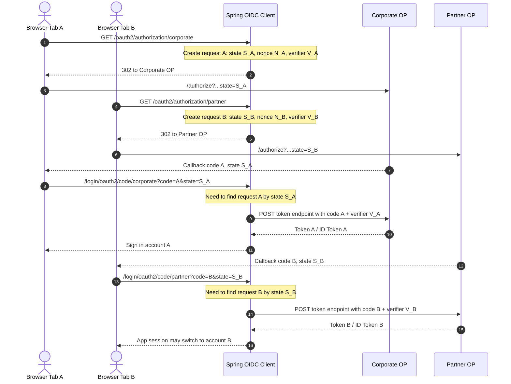

# 9.8. Concurrent Logins Across Multiple Tabs and Multiple Providers

A website using **Spring Security OAuth 2.0 / OpenID Connect (OIDC) Client** can let users sign in through multiple identity providers, such as a corporate SSO system and a partner's OpenID Provider. At the same time, a user might open two tabs, click the login button twice, return from two providers in arbitrary order, or complete one login flow while the other is still pending.

The hard part is not rendering two "Sign in" buttons. Each callback must be **properly correlated to the exact authorization request that initiated it**, including provider, client registration, `state`, `nonce`/PKCE data, redirect URI, and HTTP session. Meanwhile, the application must decide when a new login is allowed to **replace an active `Authentication`** in the browser.

This lesson examines two forms of concurrency:

1. **Multiple pending authorization requests** in the same browser session: two tabs start login before either finishes.
2. **Multiple configured providers** in the same application: each login may choose a different OpenID Provider.

Examples target **Spring Boot 3.x, Spring Security 6.x, Servlet/Spring MVC applications**, using `oauth2Login()` and the Authorization Code Flow. Repository/filter specifics may vary by version or custom configuration, so each example states its assumptions and responsibility boundaries.

## 1. Distinguishing Scenarios Often Lumped Together

| Scenario | What is happening? | Primary risk |
| --- | --- | --- |
| User opens two tabs, both picking the same OP | Two authorization requests share the application's session cookie | The later request may overwrite the earlier pending state; the first callback fails to find its `state`. |
| Two tabs pick two different OPs | Each authorization request belongs to its own `ClientRegistration` and issuer | Provider mix-up, cross-login contamination, or lost pending state. |
| Tab A already logged in; Tab B finishes login later | Both tabs share the session cookie and typically share `SecurityContext` | The browser session's `Authentication` may switch to the newly completed account/provider. |
| User opens two windows in the same browser profile | Usually shares the same cookie jar, hence the same app session | Can trigger the same risks as two tabs. |
| Two separate browser profiles/incognito contexts | Cookie jars and sessions are typically isolated | Flows are independent; never assume identities sync across them. |
| Multiple users on different machines | Each user has their own browser/session | Primarily concerns load scale, distributed session management, and OP configuration. |

**One tab does not equal one HTTP session.** Tabs in the same browser profile and same origin normally send the same `JSESSIONID` cookie. Consequently, "each tab logs in independently" does not happen automatically just because there are two browser tabs.

On the other hand, **multiple pending authorization requests** does not mean the application supports **multiple concurrently logged-in accounts in one session**. Those are two distinct product and security problems.

## 2. Correlation: How Do We Know Which Flow a Callback Belongs To?

Each login initiation generates a set of correlation data. Example:

```text
Authorization request A:
  registrationId: corporate
  issuer:         https://sso.corp.example.com/realms/staff
  state:          S_A
  nonce:          N_A
  PKCE verifier:  V_A
  redirect_uri:   https://app.example.com/login/oauth2/code/corporate

Authorization request B:
  registrationId: partner
  issuer:         https://login.partner.example.com/tenant/training
  state:          S_B
  nonce:          N_B
  PKCE verifier:  V_B
  redirect_uri:   https://app.example.com/login/oauth2/code/partner
```

These values are purely illustrative symbols. In a real application, `state`, nonce, and PKCE verifier must be generated via the framework's secure mechanisms as fresh values per request.

The callback from the OP does not carry all of the details above. In the Authorization Code Flow using query responses:

```http
GET /login/oauth2/code/corporate?code=CODE_A&state=S_A HTTP/1.1
Host: app.example.com
Cookie: JSESSIONID=APP_SESSION
```

The client must locate the saved **authorization request A**, match `state=S_A`, retrieve the right `ClientRegistration`, and perform token exchange against the **corporate OP's token endpoint**. Never take `code` and guess the provider or pick a token endpoint based solely on untrusted callback inputs.

A flow is properly correlated when:

- **The authorization response's `state`** matches the pending request exactly, and that request belongs to a valid session/browser and has not been consumed.
- **The expected client registration and provider** come from the initiated request or an equivalent trusted context.
- **The authorization code** is exchanged at the right token endpoint with the right client, redirect URI, client authentication, and PKCE verifier when applicable.
- **The ID Token** passes signature, issuer, audience, expiration, and nonce checks per OIDC.
- Only after these steps does Spring Security create the application's `Authentication`.

### 2.1. Why Is the Callback URL Alone Insufficient to Identify the Provider?

The path `/login/oauth2/code/corporate` may contain the registration ID in its route. However, HTTP requests and query strings sent by the browser can be manipulated externally. **Trusted identity context must come from the authorization request saved by the application itself** and verified per protocol.

Default Spring Security OAuth2 Login uses the saved `OAuth2AuthorizationRequest` to obtain the authorization exchange context, including the associated registration. If writing a custom callback controller or resolver, never bypass this binding.

When a client supports multiple Authorization Servers, add protection against **authorization server mix-up**: verify the exact issuer in the ID Token and apply authorization response issuer binding such as `iss` per **RFC 9207** where supported by the OP/framework, or an equivalent anti-mix-up measure. `state` alone should not be treated as a complete defense against all mix-up threats.

## 3. Sequence Diagram: Two Tabs Starting Login Together

Suppose Tab A picks corporate, and Tab B picks partner before Tab A's callback reaches the application.



This diagram illustrates **a system capable of storing multiple pending authorization requests**. With a default repository holding only one request, flow A can fail right at the callback step; with a repository supporting multiple pending requests, both callbacks can be valid, yet a business question remains: **Should the final `Authentication` of a shared session be A or B?**

### 3.1. Two Distinct Success Conditions

**Protocol condition:** each callback A/B must match its exact authorization request and be authenticated by the right OP.

**Application session condition:** the application decides whether callback B may overwrite `Authentication` A currently in the session. For a website with one principal per session, two successful logins may cause **the last one to finish to become the active identity**.

In other words, fixing the `state` error across multiple tabs only solves **correlation**. It does not automatically guarantee a "each tab stays on its own account" UX.

## 4. Spring Security's Default Repository: A Common Conflict Point

In Servlet apps using `oauth2Login()`, Spring Security commonly uses **`HttpSessionOAuth2AuthorizationRequestRepository`** to save the authorization request before redirecting. Its typical implementation holds **one `OAuth2AuthorizationRequest` in the HTTP session at a time** and looks up the request with matching `state` upon callback.

Example timeline:

| Time | Action | Authorization request saved in session |
| --- | --- | --- |
| T1 | Tab A starts corporate login, generates `S_A` | A |
| T2 | Tab B starts partner login, generates `S_B` | B (replaces A) |
| T3 | Tab A calls back with `S_A` | Repository cannot find A → error |
| T4 | Tab B calls back with `S_B` | May succeed, if not consumed/expired |

This outcome does not mean **Corporate OP is broken** or **`state` was generated wrong**. The issue lies in **how pending authorization requests are stored** in the session.

In certain configurations or customizations, a repository may support multiple requests; verify the actual repository your app uses. Do not assume every version or app holds only one request, especially if the repository has been replaced.

### 4.1. Why Must Spring Save the Authorization Request?

An authorization request holds more than `state`. It can also carry:

- Client registration ID and provider parameters;
- Redirect URI, scopes, and required request attributes;
- `nonce` or corresponding OIDC correlation data;
- PKCE `code_verifier` for the backend to exchange the authorization code;
- Other parameters/customizations needed for callback handling.

If the original record is lost, the client loses the ability to verify the response matches the flow. **Never reconstruct the request from callback query parameters** or bypass `state` just to force login through.

### 4.2. Should Multi-Tab Login Always Be Considered a Bug?

Not every product needs protocol-level support for it. If a product only permits one pending login, you can adopt a **single-flow-at-a-time policy** and communicate it clearly to users. However, when the product requires multiple tabs, multiple providers, or users frequently double-clicking, design a repository capable of distinguishing **multiple pending requests**.

That decision must be paired with caps on pending requests, short lifetimes, single-use consumption, and policies for late-arriving callbacks.

## 5. `state`: The Correlation Key for Multiple Authorization Requests

`state` is an unpredictable value created by the OAuth2 Client when starting an authorization request. The client sends it to the OP, the OP returns it in the authorization response, and the client verifies it against saved context.

For multiple tabs, a sound model is **mapping pending authorization requests by `state`**:

```text
HTTP session APP_SESSION
  |
  +-- pendingOAuth2Requests
  |      |
  |      +-- S_A -> OAuth2AuthorizationRequest A
  |      |           registrationId = corporate
  |      |           nonce / PKCE context A
  |      |           createdAt = T1
  |      |
  |      +-- S_B -> OAuth2AuthorizationRequest B
  |                  registrationId = partner
  |                  nonce / PKCE context B
  |                  createdAt = T2
  |
  +-- SecurityContext
         Current website Authentication (if any)
```

When callback `state=S_A` arrives, the repository must **retrieve and consume only record A**, leaving record B pending. Callback `S_B` can then still be processed independently.

Minimum requirements for this state store:

1. **Keyed by unpredictable `state`** and bound to the initiating session/browser.
2. **Each `state` maps to a single request**; collisions must never silently drop data.
3. **Short TTL** to prune abandoned flows, e.g., a few minutes depending on UX/OP needs.
4. **Cap on pending flows per session** to prevent unbounded memory growth or abuse.
5. **Single-use consumption**: repeated/replayed callbacks cannot retrieve the same record to log in again.
6. **Consistency under concurrent requests**: prevent races across insert, read, and delete.
7. **Preserve full Spring context**: `state`, `nonce` attributes, PKCE, registration, redirect URI, and extra metadata.

Do not use browser cookies holding **raw PKCE verifiers** or sensitive data without a solid cryptographic protection design. Server-side sessions are the clearest starting implementation.

## 6. `nonce` and PKCE Must Be Independent Per Tab

Beyond `state`, each OIDC authorization request may use `nonce` and PKCE:

| Flow | State | OIDC request nonce | PKCE verifier/challenge |
| --- | --- | --- | --- |
| Tab A, Corporate OP | `S_A` | `N_A` | `V_A` → `C_A` |
| Tab B, Partner OP | `S_B` | `N_B` | `V_B` → `C_B` |

For example, if Tab A's callback is valid yet code A is exchanged using verifier B, **the Token Endpoint must reject it** because `code_verifier` does not match `code_challenge` bound to code A. If the client receives ID Token A yet checks it against nonce B, **OIDC validation must reject it** when the nonce mismatches.

A repository keyed by `state` keeps these values tied to the right tab's authorization request. It never allows sharing nonces or verifiers across flows.

### 6.1. Distinctions to Keep Clear

- **`state`** protects correlation between the authorization response and authorization request and mitigates login CSRF.
- **`nonce`** binds the ID Token to the OIDC authentication request; it is checked inside the ID Token after token verification.
- **PKCE** binds the authorization code to the holder of `code_verifier`, checked by the Authorization Server at the Token Endpoint.
- **`redirect_uri`** binds the response to the registered callback.
- **Issuer/client validation** ensures tokens were issued by the right provider and meant for the right client.

Multiple checks are enforced by different components across Spring Security and the OP. Do not cram all of this logic into a hand-written callback controller unless you have an extraordinary requirement.

## 7. Configuring Multiple Providers via `application.yml`

Example website offering two login options:

- **Corporate SSO:** `corporate`, issuer belonging to the enterprise OP.
- **Partner Login:** `partner`, issuer belonging to the partner's OP.

```yaml
spring:
  security:
    oauth2:
      client:
        registration:
          corporate:
            provider: corporate-op
            client-id: ${CORPORATE_OIDC_CLIENT_ID}
            client-secret: ${CORPORATE_OIDC_CLIENT_SECRET}
            authorization-grant-type: authorization_code
            scope: [openid, profile, email]
            redirect-uri: "{baseUrl}/login/oauth2/code/{registrationId}"
          partner:
            provider: partner-op
            client-id: ${PARTNER_OIDC_CLIENT_ID}
            client-secret: ${PARTNER_OIDC_CLIENT_SECRET}
            authorization-grant-type: authorization_code
            scope: [openid, profile]
            redirect-uri: "{baseUrl}/login/oauth2/code/{registrationId}"
        provider:
          corporate-op:
            issuer-uri: https://sso.corp.example.com/realms/staff
          partner-op:
            issuer-uri: https://login.partner.example.com/tenant/training
```

Hostnames in the example are placeholders; replace them with the real issuers published in each OP's metadata. Load credentials via environment/secret manager; **never commit secrets to Git**.

Corresponding default URLs:

| Provider chosen in UI | Login initiation URL | Sample Callback URI |
| --- | --- | --- |
| Corporate | `/oauth2/authorization/corporate` | `https://app.example.com/login/oauth2/code/corporate` |
| Partner | `/oauth2/authorization/partner` | `https://app.example.com/login/oauth2/code/partner` |

At each OP, register **the matching client's callback URI**. One OP should not accept another provider's callback without explicit configuration. Behind a reverse proxy, `{baseUrl}` must reflect the exact public HTTPS URL.

### 7.1. Equivalent Configuration in Properties

```properties
spring.security.oauth2.client.registration.corporate.provider=corporate-op
spring.security.oauth2.client.registration.corporate.client-id=${CORPORATE_OIDC_CLIENT_ID}
spring.security.oauth2.client.registration.corporate.client-secret=${CORPORATE_OIDC_CLIENT_SECRET}
spring.security.oauth2.client.registration.corporate.authorization-grant-type=authorization_code
spring.security.oauth2.client.registration.corporate.scope=openid,profile,email
spring.security.oauth2.client.registration.corporate.redirect-uri={baseUrl}/login/oauth2/code/{registrationId}
spring.security.oauth2.client.provider.corporate-op.issuer-uri=https://sso.corp.example.com/realms/staff

spring.security.oauth2.client.registration.partner.provider=partner-op
spring.security.oauth2.client.registration.partner.client-id=${PARTNER_OIDC_CLIENT_ID}
spring.security.oauth2.client.registration.partner.client-secret=${PARTNER_OIDC_CLIENT_SECRET}
spring.security.oauth2.client.registration.partner.authorization-grant-type=authorization_code
spring.security.oauth2.client.registration.partner.scope=openid,profile
spring.security.oauth2.client.registration.partner.redirect-uri={baseUrl}/login/oauth2/code/{registrationId}
spring.security.oauth2.client.provider.partner-op.issuer-uri=https://login.partner.example.com/tenant/training
```

Pick whichever format your project uses. `registrationId` (`corporate`/`partner`) is the client alias in Spring; `provider-id` (`corporate-op`/`partner-op`) groups OP metadata. These IDs **do not have to match the real client ID or issuer URL**.

### 7.2. Provider Selector Links Without a Custom Controller

In apps using Spring Security OAuth2 Login, links can point directly to the login initiation endpoints:

```html
<a href="/oauth2/authorization/corporate">Sign in with Corporate SSO</a>
<a href="/oauth2/authorization/partner">Sign in with Partner</a>
```

These are GET requests entering `OAuth2AuthorizationRequestRedirectFilter`, not the token endpoint. Spring builds a separate authorization request per registration.

**Never let users supply an arbitrary issuer URL, token endpoint, or client ID via query string to switch providers.** Select providers from an approved, configured list of registrations; if multi-tenant dynamic registration is needed, design a dedicated tenant/issuer selection and verification layer.

## 8. Preventing Provider Confusion and Authorization Server Mix-Up

Even with a single OP, forged callbacks are dangerous. With **multiple OPs**, another hazard is the client binding a response from OP A into a flow intended for OP B, or sending an authorization code/credentials to the wrong token endpoint.

### 8.1. Simple Mix-Up Model

```text
Client creates request for Corporate OP
        |
        v
A response not from Corporate OP arrives at callback
        |
        v
If client trusts code/path alone and picks the wrong provider:
  - exchanges code at the wrong token endpoint
  - may leak code or credentials
  - or authenticates the wrong issuer/user
```

Mitigations to deploy together:

- Bind pending authorization requests to the **expected registration/issuer**.
- Use unpredictable `state` to bind responses and requests.
- Verify **issuer (`iss`) and audience (`aud`)** of the ID Token against the chosen OP/client.
- When OPs support **RFC 9207**, consider verifying the `iss` parameter in the authorization response per protocol rules and framework support, or use an equivalent anti-mix-up mechanism.
- Use distinct callback URIs per registration when architecturally appropriate, while **never treating route separation as standalone proof**.
- Configure token endpoint, JWKS, and authorization endpoint from trusted issuer metadata; avoid accepting arbitrary URLs from unverified responses.

Both `state` and ID Token validation are essential, yet **never claim** they replace every anti-mix-up measure. For instance, certain hazards occur before the client ever receives an ID Token, right when posting the code to the token endpoint.

### 8.2. How Does Spring Determine the Registration on Callback?

In Servlet OAuth2 Login, `OAuth2LoginAuthenticationFilter` receives the callback, restores the saved `OAuth2AuthorizationRequest`, uses the data attached to that request to create `OAuth2AuthorizationExchange`, looks up the right `ClientRegistration`, and passes it to `AuthenticationManager` and the matching authentication provider. The provider continues with token exchange and OIDC validation.

With a custom `AuthorizationRequestRepository` or custom callback, preserve the registration info in the request and never rely solely on `request.getRequestURI()` or a browser-controlled query parameter to choose the OP.

### 8.3. Two OPs Have Users with the Same Email

`email=an@example.com` from Corporate OP and from Partner OP does not automatically prove they are the same person. In OIDC, `sub` is scoped to an issuer; hence an internal identity key typically takes the form:

```text
ExternalIdentityKey = (issuer, subject)

Corporate: (https://sso.corp.example.com/realms/staff, user-42)
Partner:   (https://login.partner.example.com/tenant/training,  user-42)
```

These two keys are **distinct** even though `sub` shares the same string. Email, `preferred_username`, and display name can change or be omitted; **account linking across providers** must be a separate, explicitly verified workflow.

## 9. Strategies for Handling Multiple Pending Authorization Requests

Choose according to product requirements:

| Strategy | Behavior | When suitable |
| --- | --- | --- |
| **Only one pending flow per session** | New login replaces or cancels prior flow; stale callback fails with a clear message | UI expects one login at a time and accepts multi-tab limitations |
| **Multiple pending flows keyed by state** | Each callback finds and consumes its own request | Product requires multiple tabs, multiple OPs, or parallel interactions |
| **Independent session per browser context** | Isolated cookies/sessions by profile or custom mechanism | Users need multiple active accounts simultaneously without sharing one app session |

When aiming to **support multiple tabs while still sharing one website login session**, the keyed-by-state approach is usually the soundest strategy for pending authorization requests.

Yet another decision remains: **if both callbacks succeed, which callback is allowed to replace the session's `Authentication`?** This must be designed independently of the repository.

### 9.1. Principles of a Multi-Flow Repository

A repository supporting multiple requests must properly implement:

- `saveAuthorizationRequest`: inserts a new request under its own `state` without clobbering other requests.
- `loadAuthorizationRequest`: finds the request by callback `state` within the right session without prematurely consuming it if the contract expects a read.
- `removeAuthorizationRequest`: removes only the matching request, enforcing single-use consumption.
- Prune expired records and cap pending request count.
- Preserve the complete `OAuth2AuthorizationRequest`, including attributes critical for OIDC/PKCE.
- Guarantee **take/consume** operations are sufficiently atomic in multi-threaded/multi-instance environments.
- Never extend `state` lifetimes indefinitely just so users can finish much later.

**Note:** even when using a session map, read-modify-write on a `Map` in the session across two concurrent requests can still race. Storage consistency matters; synchronizing within one JVM does not protect a distributed session across multiple instances.

## 10. Example Design of a Multi-Tab `AuthorizationRequestRepository`

The following illustrates an **HTTP-session-backed repository with a map keyed by state** for a **single-instance environment**. Its purpose is clarifying the contract and save/consume lifecycle; multi-instance deployments require a store with atomic operations (or distributed locking) and dedicated TTLs.

```java
import java.io.Serializable;
import java.time.Duration;
import java.time.Instant;
import java.util.Iterator;
import java.util.LinkedHashMap;
import java.util.Map;

import jakarta.servlet.http.HttpServletRequest;
import jakarta.servlet.http.HttpServletResponse;
import jakarta.servlet.http.HttpSession;

import org.springframework.security.oauth2.client.web.AuthorizationRequestRepository;
import org.springframework.security.oauth2.core.endpoint.OAuth2AuthorizationRequest;
import org.springframework.security.oauth2.core.endpoint.OAuth2ParameterNames;

public final class MultiTabAuthorizationRequestRepository
        implements AuthorizationRequestRepository<OAuth2AuthorizationRequest> {

    private static final String SESSION_KEY =
            MultiTabAuthorizationRequestRepository.class.getName() + ".PENDING";

    private static final Duration TTL = Duration.ofMinutes(5);
    private static final int MAX_PENDING = 8;

    private record Pending(
            OAuth2AuthorizationRequest authorizationRequest,
            Instant createdAt
    ) implements Serializable {
        private static final long serialVersionUID = 1L;
    }

    @Override
    public OAuth2AuthorizationRequest loadAuthorizationRequest(
            HttpServletRequest request) {

        String state = request.getParameter(OAuth2ParameterNames.STATE);
        HttpSession session = request.getSession(false);
        if (state == null || session == null) {
            return null;
        }

        synchronized (session) {
            Map<String, Pending> pending = copyFromSession(session);
            removeExpired(pending);
            persist(session, pending);

            Pending item = pending.get(state);
            return item == null ? null : item.authorizationRequest();
        }
    }

    @Override
    public void saveAuthorizationRequest(
            OAuth2AuthorizationRequest authorizationRequest,
            HttpServletRequest request,
            HttpServletResponse response) {

        if (authorizationRequest == null) {
            removeAuthorizationRequest(request, response);
            return;
        }

        HttpSession session = request.getSession(true);
        synchronized (session) {
            Map<String, Pending> pending = copyFromSession(session);
            removeExpired(pending);

            // Enforce max cap; oldest entry is evicted.
            while (pending.size() >= MAX_PENDING) {
                Iterator<String> keys = pending.keySet().iterator();
                keys.next();
                keys.remove();
            }

            pending.put(authorizationRequest.getState(),
                    new Pending(authorizationRequest, Instant.now()));
            persist(session, pending);
        }
    }

    @Override
    public OAuth2AuthorizationRequest removeAuthorizationRequest(
            HttpServletRequest request,
            HttpServletResponse response) {

        String state = request.getParameter(OAuth2ParameterNames.STATE);
        HttpSession session = request.getSession(false);
        if (state == null || session == null) {
            return null;
        }

        synchronized (session) {
            Map<String, Pending> pending = copyFromSession(session);
            removeExpired(pending);
            Pending removed = pending.remove(state);
            persist(session, pending);

            return removed == null ? null : removed.authorizationRequest();
        }
    }

    @SuppressWarnings("unchecked")
    private Map<String, Pending> copyFromSession(HttpSession session) {
        Object stored = session.getAttribute(SESSION_KEY);
        if (stored == null) {
            return new LinkedHashMap<>();
        }
        return new LinkedHashMap<>((Map<String, Pending>) stored);
    }

    private void removeExpired(Map<String, Pending> pending) {
        Instant cutoff = Instant.now().minus(TTL);
        pending.values().removeIf(item -> item.createdAt().isBefore(cutoff));
    }

    private void persist(HttpSession session, Map<String, Pending> pending) {
        if (pending.isEmpty()) {
            session.removeAttribute(SESSION_KEY);
        } else {
            session.setAttribute(SESSION_KEY, pending);
        }
    }
}
```

How it operates in a single-instance setup:

1. `saveAuthorizationRequest` adds A under key `S_A` and then B under key `S_B`.
2. `loadAuthorizationRequest` retrieves the right request using the callback's `state`.
3. `removeAuthorizationRequest` removes only the consumed state; the remaining request stays intact.
4. Expired requests are pruned on the next map access.
5. `MAX_PENDING` prevents a single session from accumulating unbounded pending flows.

**Limitations of this illustrative code:** `synchronized(session)` only synchronizes on the session object inside **the same JVM**; it does not guarantee atomicity across nodes and also depends on the session wrapper implementation. Expired records are only pruned upon subsequent operations, and evicting oldest records can cause an older flow to fail if the limit is exceeded. For multi-instance production systems, use a store keyed by session and state with TTLs, atomic get-and-delete operations, and clear cap policies—such as a Redis-backed design compatible with Spring Session.

### 10.1. Wiring the Repository into `oauth2Login()`

The following is an **alternative configuration** to a simple security chain. It lets Spring use the multi-flow repository when creating authorization requests and handling callbacks:

```java
import org.springframework.context.annotation.Bean;
import org.springframework.context.annotation.Configuration;
import org.springframework.security.config.Customizer;
import org.springframework.security.config.annotation.web.builders.HttpSecurity;
import org.springframework.security.web.SecurityFilterChain;
import org.springframework.security.oauth2.client.web.AuthorizationRequestRepository;
import org.springframework.security.oauth2.core.endpoint.OAuth2AuthorizationRequest;

@Configuration
class WebSecurityConfig {

    @Bean
    AuthorizationRequestRepository<OAuth2AuthorizationRequest>
    authorizationRequestRepository() {
        return new MultiTabAuthorizationRequestRepository();
    }

    @Bean
    SecurityFilterChain webSecurityFilterChain(
            HttpSecurity http,
            AuthorizationRequestRepository<OAuth2AuthorizationRequest> repository
    ) throws Exception {

        http
            .authorizeHttpRequests(auth -> auth
                .requestMatchers("/", "/login", "/assets/**", "/error")
                .permitAll()
                .anyRequest().authenticated()
            )
            .oauth2Login(oauth2 -> oauth2
                .authorizationEndpoint(endpoint -> endpoint
                    .authorizationRequestRepository(repository)));

        return http.build();
    }
}
```

`oauth2Login()` wires the repository for both the authorization endpoint and the callback in the standard Servlet model; if the app customizes filters, ensure **both saving and loading sides** use the exact same repository. Never create two separate repositories with differing session keys/contracts.

To let users pick a provider, the application's `/login` page must provide links to `/oauth2/authorization/corporate` and `/oauth2/authorization/partner`. When specifying a custom `loginPage("/login")`, verify that page is `permitAll` and does not create a redirect loop. With Spring Security's auto-generated login page and proper configuration, the framework can display a multi-provider selector automatically.

### 10.2. When to Store Outside the Session?

With multiple instances where callbacks may hit a different machine, two common options exist:

- **Sticky sessions** to the same instance: simple, yet routing-dependent, breaks on instance loss, and does not solve broader scaling needs.
- **Shared session/authorization request store**: can use Spring Session + an appropriate store, provided updates across **multiple pending requests** remain consistent.

A distributed key model looks like:

```text
oauth2:pending:{sessionId}:{state} -> serialized authorization request
TTL: 5 minutes
```

On callback, use an **atomic read-and-delete** operation if supported by the store; verify the exact session the browser is using and ensure the request has not already been consumed. Never log raw session IDs, never let users read arbitrary keys by state, and encrypt/protect sensitive details in storage.

## 11. What Happens When Both Callbacks Succeed?

Solving multiple pending requests means two callbacks can both be valid:

```text
T1: Tab A starts corporate login.
T2: Tab B starts partner login.
T3: Tab B finishes; Spring saves Authentication B.
T4: Tab A finishes; Spring saves Authentication A.
T5: Both tabs send the application's session cookie.
```

If both tabs share one session and the app permits **replacement login**, the active `Authentication` becomes A after T4. Tab B will not necessarily stay logged in as account B on its next request: it may be processed under **Authentication A**.

The final outcome depends on completion and `SecurityContext` save order, session strategy, repository, and post-processing hooks. In real concurrent environments, do not rely on "last callback wins" as a deterministic transaction rule if operations are racing; the app must define an explicit policy.

### 11.1. Choosing an Identity-Switching Policy

Common policies:

| Policy | Meaning | Behavior when a callback for a different account arrives |
| --- | --- | --- |
| **Last successful login wins** | Session allows identity replacement when a new login succeeds | Current context switches to the new principal; all tabs see the new identity. |
| **Block login when another principal exists** | Allow account changes only via an explicit switch-account action | Callback for a different principal is rejected or prompts for confirmation. |
| **Accept only the latest request** | A new login request intentionally invalidates prior ones | Callbacks from older requests cannot complete even if `state` still exists. |
| **Separate browser profiles/sessions** | Each browser context has its own principal | Two accounts can operate concurrently in separate profiles. |

There is no single right choice for all products. Enterprise applications often require **explicit account switching**, avoiding silently displaying another user's/provider's data inside an already open tab.

### 11.2. Watch Out for Stale UI State

A browser tab may display a page loaded while signed in as principal A. If another tab switches the session to principal B, buttons/filters on the older page may still reflect A, yet subsequent API requests carry the session cookie and execute under B.

UX safeguards:

- Display the **current account and provider** on key screens.
- For sensitive actions, verify principal/tenant on the server on every request.
- When session identity changes, force a page reload, clear account-scoped caches, or redirect the user to a confirmation screen.
- Never trust user details rendered inside an old tab to make authorization decisions.

An application should never promise "two tabs in the same browser will always stay on two different accounts" when relying on a single shared session cookie.

## 12. Separating Pending Login Data, Authentication, and Authorized Clients

Three distinct state groups are easily confused by applications:

| Data | When created/saved? | Purpose |
| --- | --- | --- |
| **Pending `OAuth2AuthorizationRequest`** | At OAuth2/OIDC login start | Callback correlation, `state`, nonce, PKCE, provider |
| **`SecurityContext` with `Authentication`** | When authentication flow succeeds | Identifies the current principal/authorities in the app |
| **`OAuth2AuthorizedClient`** | When client receives access tokens and saves authorization info | Enables calling APIs on behalf of the principal via a client registration |

An application may store multiple `OAuth2AuthorizedClient` entries by registration and principal; that **does not mean** multiple principals are active simultaneously inside one `SecurityContext`. When switching accounts, consider how to clean up or scope the previous principal's authorized clients/tokens to avoid misusing stale tokens, depending on the repository/service in use.

For instance, a session currently logged in with corporate may still hold partner provider tokens from a previous flow inside custom storage. Never assume those tokens belong to the same person. When calling an API, verify the authorized client belongs to the **intended principal and registration**.

### 12.1. SecurityContext and Session Fixation

Spring Security commonly applies **session fixation** protection on successful login, such as rotating the session ID. Rotating the session ID does not automatically wipe every session attribute: depending on strategy, pending data may be preserved or altered.

If flows A and B coexist in the same session, one callback completing and rotating the session ID can affect the other tab if cookies or session state are not updated consistently. When customizing session strategies, verify that pending requests and session migration work cleanly with your multi-tab design.

Logout also requires clear boundaries:

- Logging out of **the Spring app** clears local Authentication/session per config.
- Logging out at the **OpenID Provider** is a separate SSO/OIDC flow.
- Revoking access/refresh tokens and cleaning up authorized clients may require separate steps.
- If logout occurs while pending flows exist, decide whether to invalidate them; do not let an old callback unexpectedly log the user back in if product policy forbids it.

## 13. Callback Method, Cookies, and Reverse Proxies

### 13.1. `SameSite` on Session Cookies

When the authorization response returns from the OP, the browser must send back the session cookie so Spring can locate the saved authorization request. Cookie attributes commonly evaluated:

| Attribute | Impact |
| --- | --- |
| `Secure` | Cookie is sent over HTTPS; must align with the public scheme. |
| `HttpOnly` | Reduces ability for JavaScript to read the session cookie directly. |
| `SameSite=Lax` | Typically compatible with **top-level GET** callbacks from OP to app. |
| `SameSite=Strict` | May withhold cookies on cross-site redirects, losing the authorization request. |
| `SameSite=None; Secure` | May be needed for `form_post` callbacks or other cross-site contexts; evaluate CSRF/browser policy. |
| `Domain`, `Path` | Must cover the actual callback host/path without over-sharing. |

Multiple tabs share the cookie jar, so these attributes affect all flows simultaneously. If one tab loses its cookie after a redirect, it can trigger correlation errors even while other tabs appear fine.

### 13.2. Reverse Proxies and Callback URLs

For example, the public URL is `https://app.example.com`, while the Spring backend runs internal HTTP at `http://spring-app:8080`. If Spring builds `redirect_uri` with the internal host/scheme, the OP may reject it or the browser cannot return to the right place.

A snippet often needed behind a trusted proxy:

```yaml
server:
  forward-headers-strategy: framework
  servlet:
    session:
      cookie:
        secure: true
        http-only: true
        same-site: lax
```

Forwarded-header handling is safe only when the reverse proxy controls/overwrites `Forwarded` and `X-Forwarded-*`, never trusting spoofed headers from the Internet. Callback URIs at the OP must match each registration with the exact external scheme and host.

### 13.3. `form_post` Callback Response Mode

Authorization Code Flow commonly uses GET callbacks via query parameters. Some providers/apps choose `response_mode=form_post`, causing the browser to POST the authorization response to the callback. A `SameSite=Lax` cookie may be withheld on a cross-site POST; additionally, CSRF filters and callback matchers must be configured appropriately for POST.

Never switch the entire site to `SameSite=None` or disable CSRF app-wide just to make a callback pass without holistic review. Always preserve correlation via state/nonce/PKCE and protect business endpoints.

## 14. Making Multi-Tab Errors Understandable

When callback A arrives after request A was overwritten/cancelled/expired, users often just see a generic "Login failed" page. To reduce confusion, show a clear, safe message:

> This sign-in session has expired or was replaced by another sign-in attempt. Please start again from the sign-in button.

Never expose authorization codes, tokens, client secrets, raw session IDs, or stack traces on error pages. You may offer a retry link back to the provider selection page.

### 14.1. Symptom and Layer Troubleshooting Table

| Symptom | Layer involved | Investigation direction |
| --- | --- | --- |
| Tab A login fails when Tab B starts earlier | Pending authorization request repository | Does the repository only keep one request per session? Was `S_A` replaced by `S_B`? |
| Callback has `state` yet reports authorization request not found | Session/cookie/repository | Did cookie return? Session timeout? Was flow deleted/expired/overwritten? |
| Logged in with corporate, yet callback wrongly mapped to partner | Registration/provider correlation | Check original request, issuer, route, config, and anti-mix-up checks. |
| ID Token has mismatched `iss` | OIDC validation | Receiving token from wrong OP/tenant or selected wrong `ClientRegistration`. |
| ID Token has wrong `nonce` | OIDC nonce binding | Was flow A's nonce data pulled from flow B, a custom resolver, or a buggy repository? |
| Token endpoint returns `invalid_grant` | Code/PKCE/redirect URI | Single-use/expired code, verifier from wrong flow, wrong redirect URI. |
| Opened Tab A as account A, Tab B logged in as B, then Tab A shows B's data | Shared application session | Same session cookie; `SecurityContext` switched to B per login policy. |
| Login succeeds yet next page asks to log in again | `SecurityContext`/session persistence | Session ID rotated, cookie dropped, unshared session store, context not saved. |
| Intermittent failures appear only when scaling to multiple instances | Session/atomic storage | Sticky sessions, Spring Session, race updating session map, TTL, session migration. |
| Fails only when OP uses `form_post` | Cookie + CSRF + callback method | `SameSite`, `Secure`, CSRF matcher, and POST callback handling. |
| Two providers with same email merged into one account wrongly | Identity linking | Inspect issuer+subject, account-linking workflow, and trusted sources. |

An error like `invalid_grant` does not automatically point to PKCE; many code/client/redirect URI discrepancies yield the same error. Use informative logging/tracing with credentials redacted.

### 14.2. What Should Logging Record?

Data that aids analysis without leaking secrets:

- Internal application correlation/request ID;
- Registration ID and provider alias name;
- Flow start and end timestamps;
- Lifecycle status: `started`, `callback_received`, `validated`, `expired`, `consumed`, `failed`;
- Normalized error category: missing state, request not found, issuer mismatch, token exchange failed;
- Count of pending requests in the session (without logging raw state values);
- Node/instance ID and routing info in multi-server setups.

Avoid logging raw callback URLs containing `code`, query strings with `state`, `Authorization` headers, PKCE `code_verifier`, internal nonces, access/refresh tokens, ID Tokens, client secrets, and session IDs. To trace across legs, use an internal non-authenticating ID instead of credentials.

## 15. Decision Sequence for Real-World Projects

If an application hits bugs when users open multiple tabs and log in across multiple providers, analyze in this sequence:

1. **Clarify product expectations.** Does the app need multiple pending flows in one session, or multiple concurrent active accounts? Those two goals need different solutions.
2. **Identify the active repository.** Inspect which `AuthorizationRequestRepository` is actually wired: single-request default or a map keyed by state?
3. **Verify registrations and issuers.** Does each provider have the right client ID/secret, issuer, redirect URI, and OP callback?
4. **Evaluate pending request lifecycle.** Are there TTLs, count caps, single-use consumption, and cleanup after callback/logout?
5. **Define late-callback behavior.** Should a callback from an older flow be allowed to switch principals after a newer flow already succeeded?
6. **Verify storage and concurrency.** Do sessions span multiple nodes? Are request inserts/removals consistent under parallel requests?
7. **Inspect cookies/proxies.** Do `SameSite`, HTTPS, session migration, forwarded headers, and callback mode preserve the original session?
8. **Keep full protocol validation intact.** `state`, `nonce`, PKCE, issuer/audience, and authorization server binding must run at the right steps.
9. **Explain behavior to users.** Especially when account switching causes all tabs to adopt the new principal.

This approach separates **correlation-loss bugs** from **application-permitted session identity changes**.

## 16. Thought Exercises

### Scenario A — Two Tabs, One Provider

Tab A picks Corporate OP and saves `S_A`. Tab B picks the same OP and saves `S_B`. The repository holds only one slot per session.

**Question:** Can Tab A's callback with the exact state `S_A` still fail?

**Hint:** Yes. Tab B may have replaced record A with B. State A matches the initial request, yet the repository no longer holds request A to compare against. Never disable state checking to fix this; change the pending-request policy or notify the user that flow A was superseded.

### Scenario B — Two Providers, Same Account Name

Corporate OP issues `sub=user-17`, and Partner OP also issues `sub=user-17`.

**Question:** Can they be automatically merged into one internal user?

**Hint:** No. `sub` is scoped within an issuer. You must compare at least the `(issuer, subject)` pair and run an explicit account-linking workflow if merging is desired.

### Scenario C — Valid State, Wrong Provider

Flow A starts with Corporate OP, yet a custom callback controller looks only at the `/partner` path and sends code A to the Partner Token Endpoint.

**Question:** What is the security flaw?

**Hint:** The controller selects the provider from a browser-supplied route, discarding the trusted issuer/registration context of the authorization request. This enables mix-up or credential/code leakage. Always bind the provider to the original request and verify issuer at the appropriate steps.

### Scenario D — Both Callbacks Valid

Tab B completes Partner login first; Tab A completes Corporate later. Both tabs share the same session cookie.

**Question:** Why can Tab B read Corporate account data on its next request?

**Hint:** The browser shares one session; the session's `Authentication` was overwritten by the callback that finished later. To keep two accounts truly independent, use separate browser profiles/sessions or a dedicated multi-account design; a keyed-by-state repository alone does not solve this.

### Scenario E — Redis Session Yet Requests Still Get Lost

The app uses Spring Session + Redis, yet stores the entire pending map in one session attribute; two nodes read the map concurrently, each adds one state, and both overwrite the attribute.

**Question:** Why wasn't a shared session store enough?

**Hint:** Two read-modify-write operations on the same map suffer lost updates without consistency controls. Use atomic operations or store each state as its own entry with a TTL and session binding.

### Scenario F — Logout Between Two Callbacks

Tab A starts login, then the user logs out of the app in Tab B. Callback A arrives after logout.

**Question:** Should flow A automatically log the user back in?

**Hint:** This is a policy decision. For products expecting logout to cancel all pending flows, invalidate pending requests and prevent stale callbacks from re-establishing a session. Never let behavior accidentally depend on a repository retaining stale data.

## 17. Key Takeaways

- **Multiple tabs in the same browser profile typically share an HTTP session**, so they do not automatically have independent `Authentication`.
- **Each authorization request must have its own `state` and OIDC/PKCE context**; a callback can only be accepted when it locates the exact pending request.
- **The standard `HttpSessionOAuth2AuthorizationRequestRepository` keeps only one authorization request per session**; parallel logins can overwrite the earlier request.
- To support multiple pending flows, use a repository **keyed by state** with TTLs, caps, single-use consumption, and concurrency consistency.
- **The provider must be bound to the original request**, followed by issuer/audience verification and appropriate anti-mix-up measures. Never pick an OP solely from an unverified callback URL.
- **Allowing multiple valid callbacks does not mean multiple accounts coexist in one `SecurityContext`**. Account switching requires explicit policy and UX.
- Sessions/cookies, `SameSite`, reverse proxies, and distributed storage can break correlation even when OIDC provider configuration is right.
- Retain Spring Security's mechanisms for `state`, `nonce`, PKCE, token exchange, and ID Token validation; only extend repositories/filters when requirements genuinely call for it.

### References

- [Spring Security Reference — OAuth 2.0 Login](https://docs.spring.io/spring-security/reference/servlet/oauth2/login/index.html).
- [Spring Security Reference — OAuth 2.0 Login Advanced Configuration](https://docs.spring.io/spring-security/reference/servlet/oauth2/login/advanced.html).
- [Spring Security API — HttpSessionOAuth2AuthorizationRequestRepository](https://docs.spring.io/spring-security/site/docs/current/api/org/springframework/security/oauth2/client/web/HttpSessionOAuth2AuthorizationRequestRepository.html).
- [Spring Security API — AuthorizationRequestRepository](https://docs.spring.io/spring-security/site/docs/current/api/org/springframework/security/oauth2/client/web/AuthorizationRequestRepository.html).
- [Spring Security API — OAuth2LoginAuthenticationFilter](https://docs.spring.io/spring-security/site/docs/current/api/org/springframework/security/oauth2/client/web/OAuth2LoginAuthenticationFilter.html).
- [Spring Session Reference](https://docs.spring.io/spring-session/reference/).
- [OpenID Connect Core 1.0](https://openid.net/specs/openid-connect-core-1_0.html).
- [RFC 6749 — OAuth 2.0 Authorization Framework](https://www.rfc-editor.org/rfc/rfc6749).
- [RFC 7636 — Proof Key for Code Exchange (PKCE)](https://www.rfc-editor.org/rfc/rfc7636).
- [RFC 9207 — OAuth 2.0 Authorization Server Issuer Identification](https://www.rfc-editor.org/rfc/rfc9207).
- [RFC 9700 — OAuth 2.0 Security Best Current Practice](https://www.rfc-editor.org/rfc/rfc9700).
