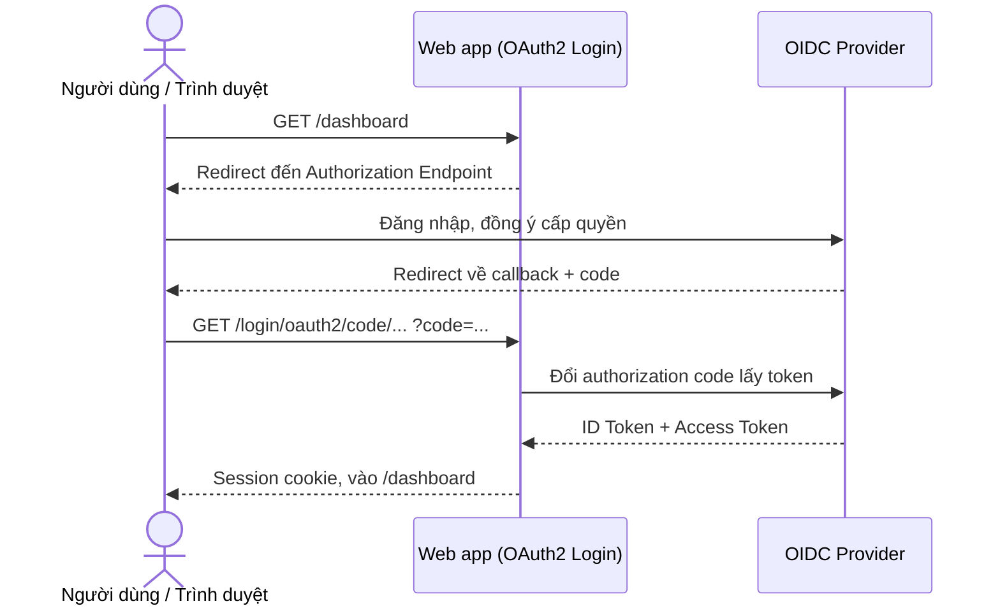
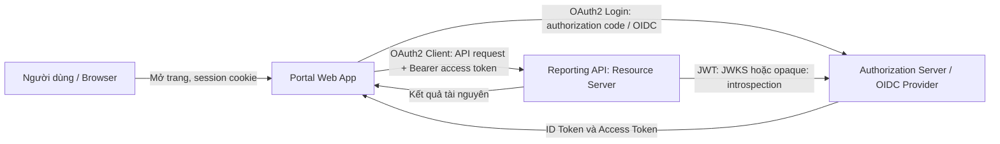

# 1.2. Phân biệt OAuth2 Login, OAuth2 Client và Resource Server

Trong Spring Security, **OAuth2 Login**, **OAuth2 Client** và **OAuth2 Resource Server** là ba nhóm chức năng giải quyết ba câu hỏi khác nhau:

- **OAuth2 Login:** Người dùng đăng nhập vào **ứng dụng của mình** bằng tài khoản của một nhà cung cấp danh tính như Google hoặc một hệ thống OpenID Connect (OIDC) như thế nào?
- **OAuth2 Client:** **Ứng dụng của mình** lấy, quản lý và sử dụng access token để gọi **API được bảo vệ của hệ thống khác** như thế nào?
- **Resource Server:** **API của mình** nhận một access token từ bên gọi và xác thực, phân quyền cho request đó như thế nào?

Điểm quan trọng nhất: **đây là ba vai trò/chức năng bảo mật, không phải ba OAuth 2.0 grant type**. Một ứng dụng Spring có thể đảm nhiệm một, hai hoặc cả ba chức năng, tùy kiến trúc.

## 1. Nhìn từ bốn thành phần của OAuth 2.0

| Thành phần | Trách nhiệm | Ví dụ |
| --- | --- | --- |
| **Resource Owner** | Chủ thể có quyền cho phép truy cập tài nguyên; thường là người dùng | Người dùng sở hữu hồ sơ và lịch cá nhân |
| **Client** | Ứng dụng yêu cầu quyền truy cập tài nguyên | Ứng dụng web quản lý công việc |
| **Authorization Server** | Xác thực, xử lý cấp quyền và phát hành token | Nhà cung cấp OIDC hoặc dịch vụ cấp token nội bộ |
| **Resource Server** | Cung cấp API/tài nguyên được bảo vệ và kiểm tra access token | API lịch hoặc API đơn hàng |

Ví dụ: người dùng mở ứng dụng web `portal.example.com`, đăng nhập qua OIDC Provider, rồi portal gọi `calendar-api.example.com`. Trong tình huống này:

1. **Portal dùng OAuth2 Login** để đăng nhập người dùng.
2. **Portal đóng vai OAuth2 Client** khi lấy/sử dụng access token để gọi Calendar API.
3. **Calendar API đóng vai Resource Server** khi xác thực access token và quyết định có cho phép truy cập hay không.
4. **OIDC Provider/Authorization Server** phát hành token. Nó là thành phần riêng; `oauth2Login()` hay `oauth2ResourceServer()` **không biến** ứng dụng thành Authorization Server.

OAuth 2.0 tập trung vào **ủy quyền truy cập** (*authorization*). **OIDC** xây trên OAuth 2.0 để bổ sung một cơ chế chuẩn cho **xác thực danh tính** (*authentication*), đặc biệt qua **ID Token**. Vì vậy phải phân biệt *đăng nhập người dùng* với *được phép gọi một API*.

## 2. Bảng so sánh trực tiếp

| Góc nhìn | OAuth2 Login | OAuth2 Client | OAuth2 Resource Server |
| --- | --- | --- | --- |
| **Câu hỏi chính** | *Ai đang đăng nhập vào ứng dụng?* | *Ứng dụng gọi API khác bằng token nào?* | *Request đến API có token hợp lệ và đủ quyền không?* |
| **Hướng HTTP quan trọng** | Trình duyệt ↔ ứng dụng ↔ nhà cung cấp đăng nhập | Ứng dụng → Authorization Server / API khác | Bên gọi → API của mình |
| **Đối tượng cần xác thực** | Người dùng đăng nhập | Client/người dùng khi xin quyền; token đại diện cho grant tương ứng | Access token đi kèm request đến |
| **Kết quả chính** | `Authentication` của người dùng tại ứng dụng; thường có phiên đăng nhập | `OAuth2AuthorizedClient` chứa access token và có thể có refresh token | `Authentication` tương ứng với bearer token được chấp nhận |
| **Grant thường gặp** | `authorization_code` (thường với OIDC) | `authorization_code`, `client_credentials`, `refresh_token` và các extension grant được hỗ trợ | **Không thực hiện grant** khi xử lý request thông thường |
| **Cơ chế Spring Security** | `http.oauth2Login(...)` | `http.oauth2Client(...)`, `OAuth2AuthorizedClientManager`, tích hợp HTTP client | `http.oauth2ResourceServer(...).jwt(...)` hoặc `opaqueToken(...)` |
| **Kiểu ứng dụng phổ biến** | Web app có người dùng và trình duyệt | Web app, BFF, backend gọi API, service-to-service | REST API, microservice, API gateway có kiểm tra bearer token |
| **Có tự tạo trang đăng nhập?** | Có thể cung cấp trang đăng nhập mặc định và bắt đầu redirect | Không đồng nghĩa với đăng nhập vào ứng dụng | Không có luồng đăng nhập trình duyệt mặc định |
| **Có tự xác thực token gửi đến API?** | Không phải chức năng chính | Không phải chức năng chính | Có |

**Phân biệt tinh tế:** OAuth2 Login thường **sử dụng năng lực OAuth2 Client ở bên trong**, vì quá trình đăng nhập cũng cần đưa trình duyệt đến Authorization Server và đổi authorization code lấy token. Tuy nhiên, cấu hình OAuth2 Client riêng không có nghĩa là đã bật đăng nhập người dùng; ngược lại, đăng nhập thành công không có nghĩa mọi outbound HTTP request tự động mang access token.

## 3. OAuth2 Login: đăng nhập người dùng vào ứng dụng

### 3.1. Luồng xử lý

Một ứng dụng web sử dụng `oauth2Login()` với nhà cung cấp OIDC thường xử lý như sau:

1. Người dùng yêu cầu trang cần xác thực, chẳng hạn `/dashboard`.
2. Ứng dụng chuyển trình duyệt đến Authorization Endpoint của nhà cung cấp, kèm các tham số như `client_id`, `redirect_uri`, `state`, `scope` và PKCE khi áp dụng.
3. Người dùng đăng nhập và chấp thuận quyền ở phía nhà cung cấp.
4. Nhà cung cấp điều hướng trình duyệt về callback của ứng dụng cùng **authorization code**.
5. Backend ứng dụng đổi code lấy token tại Token Endpoint; trong OIDC, phản hồi thường có **ID Token** và **access token**.
6. Spring Security kiểm tra thông tin thích hợp, xây dựng principal (`OidcUser` với OIDC, hoặc `OAuth2User` với nhà cung cấp OAuth2 không dùng OIDC), rồi lưu xác thực trong `SecurityContext`.
7. Trong ứng dụng web dựa vào session, request sau thường được nhận diện qua **session cookie**. Trình duyệt **không cần** tự gửi access token đến chính web app chỉ vì nó dùng OAuth2 Login.

Sơ đồ rút gọn:



> **ID Token khác access token.** ID Token của OIDC chứng minh thông tin về phiên xác thực cho **client** (có `aud` thường là client ID). Access token được thiết kế để **truy cập Resource Server**. Không gửi ID Token thay cho access token tới API chỉ vì cả hai có thể mang dạng JWT.

### 3.2. Ví dụ Spring Boot: đăng nhập bằng Google OIDC

Dependency thường dùng cho web app:

```gradle
dependencies {
    implementation 'org.springframework.boot:spring-boot-starter-security'
    implementation 'org.springframework.boot:spring-boot-starter-oauth2-client'
}
```

Khai báo client trong `application.yml`:

```yaml
spring:
  security:
    oauth2:
      client:
        registration:
          google:
            client-id: ${GOOGLE_CLIENT_ID}
            client-secret: ${GOOGLE_CLIENT_SECRET}
            scope: openid, profile, email
```

Ví dụ `SecurityFilterChain`:

```java
@Configuration
class WebLoginSecurity {
    @Bean
    SecurityFilterChain webSecurity(HttpSecurity http) throws Exception {
        http
            .authorizeHttpRequests(auth -> auth
                .requestMatchers("/", "/public/**").permitAll()
                .anyRequest().authenticated()
            )
            .oauth2Login(Customizer.withDefaults());
        return http.build();
    }
}
```

Ở đây `HttpSecurity`, `SecurityFilterChain`, `@Configuration`, `@Bean` và `Customizer` đến từ các package Spring Security/Spring Framework tương ứng; ví dụ lược bỏ `import` để tập trung vào cấu hình. Với cấu hình mặc định, có thể bắt đầu luồng bằng `/oauth2/authorization/google`; callback mặc định là `/login/oauth2/code/google`. URL callback phải được đăng ký tương ứng ở nhà cung cấp. Trong triển khai thực tế cần cấu hình HTTPS, reverse proxy và `redirect_uri` cho đúng địa chỉ công khai.

Khi nhà cung cấp hỗ trợ chuẩn OIDC và yêu cầu scope `openid`, principal có thể là `OidcUser`:

```java
@GetMapping("/whoami")
Map<String, Object> whoami(@AuthenticationPrincipal OidcUser user) {
    return Map.of(
        "subject", user.getSubject(),
        "displayName", user.getFullName() == null ? "" : user.getFullName()
    );
}
```

Ví dụ trên chỉ minh họa endpoint trong một `@RestController`; việc trả thông tin nhạy cảm phải được cân nhắc theo nhu cầu ứng dụng. Nếu đăng nhập qua một OAuth2 Provider không hỗ trợ OIDC như một số cấu hình GitHub, Spring Security có thể dùng `OAuth2User` và dữ liệu từ UserInfo/API của provider thay vì `OidcUser`.

### 3.3. Khi OAuth2 Login là lựa chọn đúng

- Trang web có chức năng **“Sign in with Google”**, “Login with Corporate SSO”.
- Backend for Frontend (BFF) quản lý phiên đăng nhập người dùng rồi thay mặt họ truy cập dịch vụ khác.
- Ứng dụng cần đọc thông tin định danh OIDC (`sub`, có thể có tên/email theo scope) để gắn với tài khoản nội bộ.

**Không chọn chỉ `oauth2Login()`** để bảo vệ một API thuần máy gọi bằng `Authorization: Bearer ...`: đó là bài toán Resource Server.

## 4. OAuth2 Client: lấy và sử dụng token để gọi API khác

### 4.1. Nhiệm vụ và các kiểu cấp quyền

Trong OAuth 2.0, **client** là ứng dụng yêu cầu được cấp quyền truy cập. Spring Security OAuth2 Client hỗ trợ quản lý `ClientRegistration`, xin token, gia hạn khi phù hợp và đưa token vào request ra ngoài.

| Tình huống | Grant / cơ chế | Chủ thể được đại diện bởi quyền truy cập |
| --- | --- | --- |
| Web app gọi API thay người dùng sau khi họ chấp thuận | `authorization_code`, có thể tiếp tục bằng `refresh_token` | Quyền được người dùng ủy quyền cho client |
| Service A gọi Service B không có người dùng tương tác | `client_credentials` | Chính ứng dụng/service A |
| Access token hết hạn và có refresh token hợp lệ | `refresh_token` | Gia hạn quyền đã được cấp trước đó; không phải bước đăng nhập mới |

`client_credentials` **không đăng nhập người dùng** và không tự tạo `OidcUser`. Một token của service không được mặc định xem là token của một người cụ thể. Grant được phép sử dụng phụ thuộc Authorization Server, kiểu client và cấu hình đăng ký.

Các đối tượng quan trọng trong Spring Security:

- `ClientRegistration`: mô tả client ID, client secret/kiểu xác thực client, grant type, scopes, các endpoint của provider.
- `ClientRegistrationRepository`: tra cứu các registration theo `registrationId`.
- `OAuth2AuthorizedClient`: gắn một registration với access token và (nếu có) refresh token đã nhận.
- `OAuth2AuthorizedClientService` / `OAuth2AuthorizedClientRepository`: lưu hoặc tải authorized client; lựa chọn phụ thuộc môi trường service hay web request.
- `OAuth2AuthorizedClientManager`: điều phối việc cấp/cấp lại token qua `OAuth2AuthorizedClientProvider`; thường phối hợp với `RestClient` hoặc `WebClient` khi gọi API.

### 4.2. Ví dụ service-to-service với `client_credentials`

Giả sử `orders-service` cần gọi `reporting-api`. `orders-service` là **OAuth2 Client**; `reporting-api` là **Resource Server**.

Dependency:

```gradle
dependencies {
    implementation 'org.springframework.boot:spring-boot-starter-oauth2-client'
    implementation 'org.springframework.boot:spring-boot-starter-web'
}
```

`application.yml` phía **orders-service**:

```yaml
spring:
  security:
    oauth2:
      client:
        registration:
          reporting:
            provider: company-idp
            client-id: ${REPORTING_CLIENT_ID}
            client-secret: ${REPORTING_CLIENT_SECRET}
            authorization-grant-type: client_credentials
            scope: report.read
        provider:
          company-idp:
            token-uri: https://idp.example.com/oauth2/token
```

Ví dụ dùng `OAuth2AuthorizedClientManager` ngoài ngữ cảnh một HTTP request của người dùng:

```java
@Configuration
class ReportingOAuth2ClientConfig {

    @Bean
    OAuth2AuthorizedClientManager authorizedClientManager(
            ClientRegistrationRepository registrations,
            OAuth2AuthorizedClientService authorizedClients) {

        OAuth2AuthorizedClientProvider provider =
            OAuth2AuthorizedClientProviderBuilder.builder()
                .clientCredentials()
                .build();

        var manager = new AuthorizedClientServiceOAuth2AuthorizedClientManager(
            registrations, authorizedClients);
        manager.setAuthorizedClientProvider(provider);
        return manager;
    }
}
```

Gọi API có bearer token:

```java
@Service
class ReportingClient {
    private final OAuth2AuthorizedClientManager tokenManager;
    private final RestClient restClient = RestClient.create();

    ReportingClient(OAuth2AuthorizedClientManager tokenManager) {
        this.tokenManager = tokenManager;
    }

    String getSummary() {
        var request = OAuth2AuthorizeRequest
            .withClientRegistrationId("reporting")
            .principal("orders-service")
            .build();

        OAuth2AuthorizedClient client = tokenManager.authorize(request);
        if (client == null) {
            throw new IllegalStateException("Cannot authorize reporting client");
        }

        return restClient.get()
            .uri("https://reporting-api.example.com/api/summary")
            .headers(headers -> headers.setBearerAuth(
                client.getAccessToken().getTokenValue()))
            .retrieve()
            .body(String.class);
    }
}
```

Trong ví dụ này, manager xin token từ Token Endpoint, lưu/reuse authorized client theo chính sách đã cấu hình và có thể xin token mới khi cần. `principal("orders-service")` chỉ là **định danh dùng trong ngữ cảnh quản lý authorized client** của tác vụ này; không có nghĩa service đang đăng nhập bằng tài khoản người dùng tên đó. Ví dụ trình bày các class cùng package với các `import` Spring thông dụng được lược bỏ, và dùng `RestClient` của Spring Framework 6.1+.

Ở ứng dụng thực tế, có thể cài `OAuth2ClientHttpRequestInterceptor` cho `RestClient` để tự thêm bearer token vào outbound request, thay vì đặt header thủ công. Cần chọn đúng client registration trên từng lời gọi để không gửi nhầm token đến API không liên quan.

### 4.3. Điểm dễ nhầm

- `oauth2Client()` **không đồng nghĩa** với việc người dùng đã được đăng nhập vào web app. Nó hỗ trợ vai trò OAuth client, bao gồm authorization code và các grant phù hợp.
- Khai báo `spring.security.oauth2.client.registration` chỉ mô tả cách lấy token; code gọi API vẫn phải dùng token qua `RestClient`, `WebClient` hoặc HTTP client đã tích hợp OAuth2.
- Client có thể là **confidential client** (backend giữ secret an toàn) hoặc **public client** (SPA/mobile không thể giữ secret). Các public client dùng authorization code với PKCE theo thiết kế phù hợp; **không nhúng client secret vào JavaScript/mobile app**.
- Access token có thể là JWT hoặc opaque string. OAuth2 Client không cần tự phân tích token mới dùng được nó; token là credential để gửi cho đúng Resource Server.

## 5. Resource Server: bảo vệ API nhận bearer token

### 5.1. Luồng xử lý

Một client đã có access token gọi API:

```http
GET /api/reports HTTP/1.1
Host: reporting-api.example.com
Authorization: Bearer eyJhbGciOi...
```

Ở phía `reporting-api`, Spring Security Resource Server:

1. Trích bearer token từ header `Authorization` (cơ chế mặc định).
2. **Xác thực token**: với JWT, kiểm tra chữ ký, hạn sử dụng và các claim theo cấu hình; với opaque token, có thể sử dụng introspection endpoint của Authorization Server.
3. Chuyển token hợp lệ thành `Authentication` và authorities trong Spring Security.
4. Áp dụng quy tắc phân quyền như scope `report.read` cho endpoint cần bảo vệ.
5. Chấp thuận request hoặc trả lỗi phù hợp: thường **401 Unauthorized** khi chưa được xác thực/token không hợp lệ; **403 Forbidden** khi đã xác thực nhưng không đủ quyền.

Resource Server **không** redirect trình duyệt đến trang SSO, **không** thực hiện authorization code exchange trong mỗi request, và **không** cần gọi Authorization Server cho mỗi JWT nếu có thể kiểm tra chữ ký bằng khóa công khai đã lấy từ JWKS và cache phù hợp. Với opaque token, cơ chế introspection có thể yêu cầu gọi tới Authorization Server.

### 5.2. Ví dụ JWT Resource Server

Dependency:

```gradle
dependencies {
    implementation 'org.springframework.boot:spring-boot-starter-web'
    implementation 'org.springframework.boot:spring-boot-starter-security'
    implementation 'org.springframework.boot:spring-boot-starter-oauth2-resource-server'
}
```

`application.yml` phía **reporting-api**:

```yaml
spring:
  security:
    oauth2:
      resourceserver:
        jwt:
          issuer-uri: https://idp.example.com/realms/enterprise
          audiences: reporting-api
```

Ví dụ Java:

```java
@Configuration
class ReportingApiSecurity {
    @Bean
    SecurityFilterChain apiSecurity(HttpSecurity http) throws Exception {
        http
            .authorizeHttpRequests(auth -> auth
                .requestMatchers("/api/reports/**")
                    .hasAuthority("SCOPE_report.read")
                .anyRequest().authenticated()
            )
            .oauth2ResourceServer(oauth2 ->
                oauth2.jwt(Customizer.withDefaults()));
        return http.build();
    }
}
```

Khi JWT có claim scope tương tự `"scope": "report.read"`, Spring Security mặc định ánh xạ scope thành authority `SCOPE_report.read`. Việc kiểm tra `aud` bảo đảm token được cấp cho đúng API; cấu hình `issuer-uri` chủ yếu giúp tìm metadata/JWKS và kiểm tra issuer, **không nên xem kiểm tra issuer là thay thế cho audience validation**. Thuộc tính `audiences` phụ thuộc phiên bản Spring Boot đang dùng; có thể cấu hình `JwtValidator` riêng khi cần.

Với JWT, `JwtDecoder` kiểm tra chữ ký và các claim được cấu hình, rồi `JwtAuthenticationConverter` có thể chuyển claim thành authorities. Với opaque token, dùng `oauth2ResourceServer(oauth2 -> oauth2.opaqueToken(...))` và cấu hình introspection tương ứng; API không được cố `Base64`/giải mã opaque token như một JWT.

### 5.3. Bearer token và session cookie khác nhau ở đâu?

| Trường hợp | Cơ chế thường dùng |
| --- | --- |
| Người dùng truy cập giao diện server-rendered sau OAuth2 Login | Session cookie liên kết với trạng thái đăng nhập tại web app |
| Một service gọi REST API có bảo vệ | `Authorization: Bearer <access_token>` trên mỗi request |
| SPA/mobile gọi API | Access token được truyền theo một thiết kế bảo vệ token phù hợp (thường qua bearer header) |

Không nên mặc định vô hiệu CSRF cho toàn ứng dụng chỉ vì có OAuth2: **các endpoint sử dụng session cookie** có mô hình rủi ro khác với API chỉ nhận bearer header và hoạt động stateless. Nếu một ứng dụng phục vụ cả browser và API, nên tách `SecurityFilterChain` theo vùng URL và thiết lập CSRF, session, entry point cho từng vùng.

## 6. Ba chức năng phối hợp trong kiến trúc thực tế

Sơ đồ sau là một cách tổ chức phổ biến, trong đó **một web app đảm nhiệm đồng thời OAuth2 Login và OAuth2 Client**:



Lưu ý sơ đồ mô tả trách nhiệm logic: với **JWT**, Resource Server thường truy xuất/cập nhật khóa xác minh từ JWKS khi cần, không liên lạc Authorization Server ở mỗi request. Web app có thể dùng access token gắn với người dùng hoặc một token service-to-service riêng; phải chọn theo nghiệp vụ và phạm vi quyền.

Một ứng dụng có thể vừa có giao diện web vừa công bố REST API. Khi đó cần **hai phương thức xác thực cho hai nhóm endpoint**, ví dụ:

```java
@Bean
@Order(1)
SecurityFilterChain apiChain(HttpSecurity http) throws Exception {
    http
        .securityMatcher("/api/**")
        .authorizeHttpRequests(auth -> auth.anyRequest().authenticated())
        .sessionManagement(session -> session
            .sessionCreationPolicy(SessionCreationPolicy.STATELESS))
        .oauth2ResourceServer(oauth2 ->
            oauth2.jwt(Customizer.withDefaults()));
    return http.build();
}

@Bean
@Order(2)
SecurityFilterChain browserChain(HttpSecurity http) throws Exception {
    http
        .authorizeHttpRequests(auth -> auth
            .requestMatchers("/", "/assets/**").permitAll()
            .anyRequest().authenticated())
        .oauth2Login(Customizer.withDefaults());
    return http.build();
}
```

Đây là **hai chain trong cùng một ứng dụng**, Spring Security chọn chain đầu tiên khớp request. Cấu hình thực tế còn phải quyết định chính sách CSRF/CORS, việc lưu session và cách xử lý lỗi cho từng vùng; nếu API stateless chỉ chấp nhận bearer token thì CSRF có thể được cấu hình phù hợp **trong chain API**. OAuth2 Client cho lời gọi outbound là một trách nhiệm độc lập và có thể tích hợp thêm vào ứng dụng này.

## 7. Chọn cấu hình bằng câu hỏi nghiệp vụ

| Nhu cầu | Chức năng phù hợp | Lý do |
| --- | --- | --- |
| “Người dùng bấm **Đăng nhập với Google** để vào website” | **OAuth2 Login** | Thiết lập danh tính/phiên đăng nhập cho website |
| “Backend gọi API đối tác **thay người dùng** đã cấp quyền” | **OAuth2 Client**, thường kết hợp **OAuth2 Login** nếu chính backend quản lý đăng nhập | Giữ và dùng access token cho API bên ngoài |
| “Service gửi báo cáo tự động vào mỗi đêm” | **OAuth2 Client** với `client_credentials` nếu Authorization Server hỗ trợ | Có token của ứng dụng, không cần trình duyệt/người dùng |
| “API `/api/orders` chỉ nhận request có access token hợp lệ và `orders.read`” | **Resource Server** | Kiểm tra bearer token cùng quyền truy cập |
| “Một BFF vừa đăng nhập nhân viên, vừa gọi API, đồng thời mở một endpoint bearer cho service khác” | **OAuth2 Login + OAuth2 Client + Resource Server** | Mỗi chức năng xử lý một luồng khác nhau |
| “Hệ thống phải **phát hành** access token cho các ứng dụng khác” | **Authorization Server**, một thành phần/bài toán khác | Ba chức năng đang so sánh không tự tạo OAuth2 Authorization Server |

## 8. Những nhầm lẫn thường gặp và cách sửa

1. **Nhầm OAuth2 Login với OAuth2 Client.** Login tạo xác thực cho người dùng trong ứng dụng; client quản lý việc xin/dùng token để gọi resource ở bên ngoài. Hai chức năng có thể dùng chung authorization code nhưng phục vụ mục tiêu khác nhau.
2. **Nhầm OAuth2 Client với Resource Server.** Client **gửi** bearer token khi gọi API; Resource Server **nhận và kiểm tra** bearer token. Một service có thể là client với API B và resource server đối với API A.
3. **Dùng `oauth2Login()` cho REST API thuần bearer.** API không cần trang login sẽ thường dùng Resource Server. Bật OAuth2 Login có thể dẫn đến hành vi redirect sang trang đăng nhập thay vì trả `401` theo kỳ vọng API.
4. **Dùng ID Token gọi API.** ID Token dành cho client xác thực danh tính người dùng; API cần access token có `aud`/scope phù hợp.
5. **Cho rằng JWT nào có chữ ký đúng cũng dùng được.** Resource Server cần kiểm tra issuer, thời hạn, thuật toán/khóa được tin cậy, audience và quyền theo yêu cầu. Không bỏ qua các validation chỉ vì đã đọc được payload JWT.
6. **Cho rằng `client_credentials` đại diện cho người dùng.** Grant này đại diện cho quyền của client. Nếu nghiệp vụ cần quyền của người dùng, hãy thiết kế luồng ủy quyền phù hợp thay vì gắn danh tính người dùng giả vào token service.
7. **Cho rằng login thành công nghĩa là API khác tự chấp nhận cookie.** Session cookie của portal và access token của API có mục đích, phạm vi và bên nhận khác nhau.
8. **Cho rằng Resource Server phải gọi IdP cho mọi request.** Điều này phụ thuộc loại token và cách kiểm tra: JWT thường xác minh tại chỗ bằng khóa được tin cậy; opaque token thường cần introspection.

## 9. Tự kiểm tra kiến thức

**Tình huống A.** Trang quản trị đăng nhập bằng công ty SSO, sau đó gọi API đơn hàng thay nhân viên. Cần những gì?

**Trả lời:** Trang quản trị dùng **OAuth2 Login** để xác thực nhân viên, và **OAuth2 Client** để lấy/gửi access token phù hợp khi gọi API. API đơn hàng cần **Resource Server** để xác thực và phân quyền access token.

**Tình huống B.** Scheduler không có giao diện, dùng `client_credentials` gọi API mỗi giờ. Có cần `oauth2Login()` không?

**Trả lời:** **Không.** Scheduler dùng **OAuth2 Client** để lấy và gửi token của ứng dụng; API đích dùng **Resource Server**.

**Tình huống C.** `GET /api/data` gửi bearer token có scope `data.read`, nhưng token được phát hành cho một API khác. Chỉ kiểm tra chữ ký và scope đã đủ chưa?

**Trả lời:** **Chưa.** Resource Server còn cần xác nhận token hợp lệ cho **đúng audience** (và issuer, thời hạn, các ràng buộc liên quan). Token có scope giống nhau không mặc nhiên được phép dùng liên API.

**Tình huống D.** Backend nhận token từ client và muốn bảo vệ `/api/data`. Dùng `oauth2Client()` vì cả hai đều chứa chữ “OAuth2” có đúng không?

**Trả lời:** **Không.** Đối với request **đi vào**, backend phải cấu hình **Resource Server**. Chỉ thêm OAuth2 Client khi backend còn cần **gọi API khác đi ra ngoài**.

## 10. Tài liệu tham khảo chính thức

- [Spring Security — OAuth 2.0 Login](https://docs.spring.io/spring-security/reference/servlet/oauth2/login/index.html)
- [Spring Security — OAuth 2.0 Client](https://docs.spring.io/spring-security/reference/servlet/oauth2/client/index.html)
- [Spring Security — OAuth2 Authorized Clients và RestClient](https://docs.spring.io/spring-security/reference/servlet/oauth2/client/authorized-clients.html)
- [Spring Security — OAuth 2.0 Resource Server](https://docs.spring.io/spring-security/reference/servlet/oauth2/resource-server/index.html)
- [Spring Security — JWT Resource Server](https://docs.spring.io/spring-security/reference/servlet/oauth2/resource-server/jwt.html)
- [OpenID Connect Core 1.0](https://openid.net/specs/openid-connect-core-1_0.html)

**Ghi nhớ:** **Login** xác thực *người dùng ở ứng dụng*; **Client** xin và dùng *token để gọi ra ngoài*; **Resource Server** xác thực và phân quyền *token được gửi vào API*. Hãy quyết định từ **luồng request và trách nhiệm của ứng dụng**, không từ tên token hay việc hệ thống có dùng OIDC hay không.
