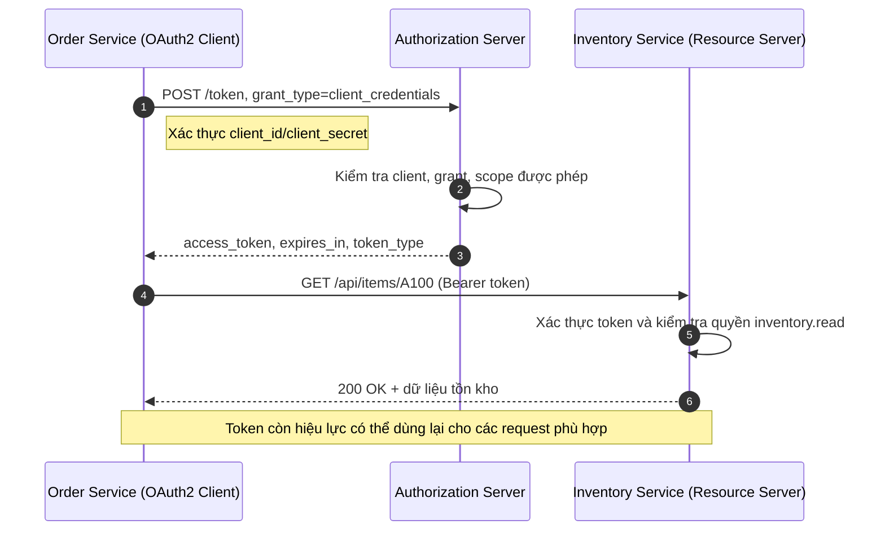

# 1.4. Use case giao tiếp giữa dịch vụ với Client Credentials

## 1. Bài toán: dịch vụ gọi API của dịch vụ khác

Trong kiến trúc microservices, không phải mọi lời gọi API đều bắt đầu từ một người dùng đang đăng nhập. Ví dụ:

- **Order Service** kiểm tra tồn kho tại **Inventory Service** trước khi xác nhận đơn hàng.
- Một **scheduled job** gọi Reporting API mỗi đêm để tổng hợp số liệu.
- Một **message consumer** nhận sự kiện từ hàng đợi rồi gọi API của một dịch vụ nội bộ.
- Một ứng dụng backend kết nối API của đối tác bằng danh tính ứng dụng đã được đăng ký.

Những trường hợp này cần xác thực **dịch vụ gọi API**. Chúng thường không có người dùng trực tiếp, trình duyệt, trang đăng nhập hay callback URL để thực hiện Authorization Code flow.

OAuth 2.0 cung cấp **Client Credentials Grant**: client xác thực bằng thông tin được cấp cho chính nó, nhận **access token** từ Authorization Server, rồi dùng token gọi API. Trong Spring, **Spring Security OAuth2 Client** cung cấp cơ chế cấu hình client, xin token và quản lý vòng đời token.

> **Nguyên tắc:** Với `client_credentials`, access token đại diện cho quyền truy cập của **client/service**, không mặc nhiên đại diện cho một người dùng cuối. Dịch vụ nhận token vẫn phải xác thực và phân quyền ở phía **Resource Server**.

## 2. Thành phần và luồng xử lý

Use case xuyên suốt bài học: `orders-service` cần đọc số lượng hàng tồn kho từ `inventory-service`.

| Thành phần | Trách nhiệm | Ví dụ |
| --- | --- | --- |
| **OAuth2 Client** | Xin access token và gọi API | `orders-service` |
| **Authorization Server** | Xác thực client, cấp token theo grant và quyền được phép | `https://id.example.com/realms/demo` |
| **Resource Server** | API được bảo vệ, kiểm tra token và quyền | `inventory-service` |
| **Client registration** | Khai báo client ID, cách xác thực, grant, scope và token endpoint | Registration tên `inventory` |
| **Access token** | Chứng cứ quyền truy cập được gửi bằng Bearer header | Token ngắn hạn |

### 2.1. Sơ đồ trình tự



Diễn giải:

1. Quản trị viên đăng ký `orders-service` là một **confidential client** tại Authorization Server và cho phép grant `client_credentials`.
2. Khi cần truy cập Inventory API, Order Service gửi yêu cầu đến **token endpoint**, xác thực danh tính ứng dụng và đề nghị scope `inventory.read`.
3. Authorization Server kiểm tra quyền client, phát hành access token có thời hạn.
4. Order Service đính kèm header `Authorization: Bearer <access_token>` khi gọi Inventory API.
5. Inventory Service kiểm tra token (chữ ký hoặc introspection, thời hạn, issuer, audience) và quyền cho endpoint tương ứng.
6. Nếu token hết hạn, OAuth2 Client xin token mới. Grant này thông thường **không cần refresh token**.

Access token có thể là **JWT** hoặc **opaque token**, tùy Authorization Server. Client không nên giải mã token rồi tự phụ thuộc vào claim nội bộ; việc xác thực token thuộc trách nhiệm của Resource Server.

### 2.2. Ví dụ yêu cầu token ở mức HTTP

Với client authentication theo `client_secret_basic`:

```http
POST /realms/demo/protocol/openid-connect/token HTTP/1.1
Host: id.example.com
Authorization: Basic <base64(client_id:client_secret)>
Content-Type: application/x-www-form-urlencoded

grant_type=client_credentials&scope=inventory.read
```

Ví dụ phản hồi:

```json
{
  "access_token": "<access-token>",
  "token_type": "Bearer",
  "expires_in": 300,
  "scope": "inventory.read"
}
```

| Trường | Ý nghĩa |
| --- | --- |
| `access_token` | Token dùng để truy cập API; phải được bảo vệ như bí mật |
| `token_type` | Thường là `Bearer`; bên giữ token có thể dùng nó trong phạm vi quyền đã cấp |
| `expires_in` | Số giây token có hiệu lực kể từ lúc được cấp |
| `scope` | Quyền Authorization Server thực sự cấp, có thể hẹp hơn quyền yêu cầu |

Địa chỉ `/realms/demo/protocol/openid-connect/token` chỉ là **ví dụ theo kiểu Keycloak**; nhà cung cấp khác có URL và chính sách khác. Ngoài secret, Authorization Server có thể hỗ trợ phương thức xác thực client như `private_key_jwt` hoặc mTLS.

## 3. Chọn đúng use case và phân biệt với OIDC

| Nhu cầu | Giải pháp phù hợp | Danh tính/ngữ cảnh |
| --- | --- | --- |
| Service A truy cập Service B theo quyền riêng của Service A | **Client Credentials** | Danh tính ứng dụng |
| Người dùng đăng nhập và cho ứng dụng truy cập dữ liệu của mình | **Authorization Code + PKCE** (tùy loại ứng dụng) | Người dùng cùng client |
| API tiếp nhận Bearer token và kiểm tra quyền | **OAuth2 Resource Server** | Danh tính/quyền trong token |
| Service A gọi B thay mặt người dùng, B cần danh tính người dùng | Token propagation/delegation hoặc token exchange nếu hệ thống hỗ trợ | Ngữ cảnh người dùng được ủy quyền |

**Khi nên dùng:** tác vụ server-to-server, background worker, scheduler, batch job, tích hợp backend có quyền truy cập ở cấp dịch vụ.

**Khi không đủ:** Order Service cần đọc dữ liệu riêng của từng người dùng đang đăng nhập và Inventory Service cần xác minh người dùng đó. Token `client_credentials` không tự mang quyền của người dùng; phải thiết kế luồng ủy quyền người dùng phù hợp.

### OAuth 2.0 và OIDC khác nhau ra sao trong bài này?

**Client Credentials là grant của OAuth 2.0**, không phải flow đăng nhập người dùng của OpenID Connect (OIDC). Authorization Server có thể hỗ trợ cả OAuth 2.0 lẫn OIDC và dùng cùng hạ tầng, nhưng đối với giao tiếp máy đến máy:

- Dịch vụ sử dụng **access token** để gọi API.
- Thông thường **không có ID token** dùng để xác thực người dùng.
- Không cần `openid` scope chỉ để chạy Client Credentials.
- Không có browser redirect, màn hình đăng nhập hoặc bước tương tác người dùng.

Vì vậy, tên module **Spring Security OAuth 2.0 OIDC Client** bao quát nhiều loại OAuth client; use case này tập trung vào OAuth 2.0 Client Credentials.

## 4. Triển khai Order Service bằng Spring Security OAuth2 Client

Giả sử có hai ứng dụng Spring Boot tách biệt:

- **Order Service:** gọi `GET https://inventory.internal.example/api/items/{sku}`, đóng vai trò OAuth2 Client.
- **Inventory Service:** xác thực token và yêu cầu scope `inventory.read`, đóng vai trò Resource Server.

Ví dụ dùng phong cách **Spring Boot 3.x / Spring Security 6.x**, ứng dụng Servlet và `RestClient`. Tên miền, URL, scope, payload và định danh client chỉ để minh họa; cần đồng bộ với Authorization Server và hợp đồng API thực tế.

### 4.1. Dependency

Trong `pom.xml` của Order Service:

```xml
<dependencies>
    <dependency>
        <groupId>org.springframework.boot</groupId>
        <artifactId>spring-boot-starter-web</artifactId>
    </dependency>
    <dependency>
        <groupId>org.springframework.boot</groupId>
        <artifactId>spring-boot-starter-oauth2-client</artifactId>
    </dependency>
</dependencies>
```

Starter OAuth2 Client cung cấp hạ tầng `ClientRegistrationRepository`, `OAuth2AuthorizedClientService` và các thành phần cấp/quản lý token.

### 4.2. Cấu hình Client Registration

Trong `application.yml` của Order Service:

```yaml
spring:
  security:
    oauth2:
      client:
        registration:
          inventory:
            provider: internal-idp
            client-id: ${INVENTORY_CLIENT_ID}
            client-secret: ${INVENTORY_CLIENT_SECRET}
            client-authentication-method: client_secret_basic
            authorization-grant-type: client_credentials
            scope:
              - inventory.read
        provider:
          internal-idp:
            token-uri: https://id.example.com/realms/demo/protocol/openid-connect/token

inventory:
  base-url: https://inventory.internal.example
```

| Cấu hình | Vai trò |
| --- | --- |
| `registration.inventory` | ID cục bộ được code dùng để chọn client |
| `client-id`, `client-secret` | Thông tin định danh/xác thực do Authorization Server cấp |
| `authorization-grant-type` | Grant `client_credentials` |
| `client-authentication-method` | Phương thức xác thực với token endpoint |
| `scope` | Quyền đề nghị, phải nằm trong quyền client được cấp |
| `provider.internal-idp.token-uri` | Endpoint phát hành access token |

`inventory` là **tên registration** trong Spring, không bắt buộc trùng với `client-id`. Không đặt secret thật trực tiếp trong repository; nên inject từ môi trường hoặc secret manager.

### 4.3. Cấu hình manager cho tác vụ máy đến máy

`AuthorizedClientServiceOAuth2AuthorizedClientManager` thích hợp cho các tác vụ không phụ thuộc vào một HTTP request của người dùng, chẳng hạn scheduler, consumer hay service nội bộ.

```java
import org.springframework.context.annotation.Bean;
import org.springframework.context.annotation.Configuration;
import org.springframework.security.oauth2.client.AuthorizedClientServiceOAuth2AuthorizedClientManager;
import org.springframework.security.oauth2.client.OAuth2AuthorizedClientManager;
import org.springframework.security.oauth2.client.OAuth2AuthorizedClientProvider;
import org.springframework.security.oauth2.client.OAuth2AuthorizedClientProviderBuilder;
import org.springframework.security.oauth2.client.OAuth2AuthorizedClientService;
import org.springframework.security.oauth2.client.registration.ClientRegistrationRepository;

@Configuration
public class OAuth2ClientConfiguration {

    @Bean
    OAuth2AuthorizedClientManager authorizedClientManager(
            ClientRegistrationRepository registrations,
            OAuth2AuthorizedClientService authorizedClients) {

        OAuth2AuthorizedClientProvider provider =
                OAuth2AuthorizedClientProviderBuilder.builder()
                        .clientCredentials()
                        .build();

        var manager = new AuthorizedClientServiceOAuth2AuthorizedClientManager(
                registrations, authorizedClients);
        manager.setAuthorizedClientProvider(provider);
        return manager;
    }
}
```

`OAuth2AuthorizedClientProvider` xử lý grant và quyết định khi nào cần token mới. `OAuth2AuthorizedClientManager` điều phối quá trình authorize; `OAuth2AuthorizedClientService` lưu và tra cứu trạng thái authorized client theo registration và principal.

### 4.4. Xin token và gọi Inventory API

```java
import org.springframework.beans.factory.annotation.Value;
import org.springframework.security.oauth2.client.OAuth2AuthorizeRequest;
import org.springframework.security.oauth2.client.OAuth2AuthorizedClient;
import org.springframework.security.oauth2.client.OAuth2AuthorizedClientManager;
import org.springframework.stereotype.Service;
import org.springframework.web.client.RestClient;

@Service
public class InventoryGateway {

    private static final String SERVICE_PRINCIPAL = "orders-service";

    private final OAuth2AuthorizedClientManager authorizedClientManager;
    private final RestClient inventoryApi;

    public InventoryGateway(
            OAuth2AuthorizedClientManager authorizedClientManager,
            @Value("${inventory.base-url}") String inventoryBaseUrl) {
        this.authorizedClientManager = authorizedClientManager;
        this.inventoryApi = RestClient.builder()
                .baseUrl(inventoryBaseUrl)
                .build();
    }

    public InventoryItem findItem(String sku) {
        OAuth2AuthorizeRequest request = OAuth2AuthorizeRequest
                .withClientRegistrationId("inventory")
                .principal(SERVICE_PRINCIPAL)
                .build();

        OAuth2AuthorizedClient client =
                authorizedClientManager.authorize(request);
        if (client == null) {
            throw new IllegalStateException(
                    "Không lấy được access token cho Inventory API");
        }

        return inventoryApi.get()
                .uri("/api/items/{sku}", sku)
                .headers(headers -> headers.setBearerAuth(
                        client.getAccessToken().getTokenValue()))
                .retrieve()
                .body(InventoryItem.class);
    }

    public record InventoryItem(String sku, int availableQuantity) {}
}
```

Giải thích từng điểm đáng chú ý:

1. `withClientRegistrationId("inventory")` dùng đúng client đã khai báo ở `application.yml`.
2. `principal("orders-service")` là **định danh kỹ thuật ổn định** để manager lưu/tra cứu authorized client, **không phải** tên người dùng cuối và không làm Authorization Server nhận token như thể người dùng đó đăng nhập.
3. `authorize(request)` lấy authorized client có token còn dùng được hoặc thực hiện Client Credentials Grant khi cần. Phải xử lý trường hợp kết quả `null`.
4. `headers(...setBearerAuth(...))` đưa access token vào `Authorization: Bearer ...`.
5. `RestClient` gửi lời gọi đến Inventory Service và ánh xạ JSON về kiểu dữ liệu ứng dụng.

Không tự POST đến token endpoint cho mọi request nếu đã dùng `OAuth2AuthorizedClientManager`. Cũng không nên lưu access token vào biến tĩnh rồi sử dụng mãi, vì token sẽ hết hạn.

> Nếu ứng dụng dùng **WebFlux/WebClient**, hãy dùng các thành phần **Reactive OAuth2 Client** tương ứng, ví dụ `ReactiveOAuth2AuthorizedClientManager`. Ví dụ trên dành cho ứng dụng Servlet.

## 5. Phía Inventory Service: Resource Server phải kiểm tra token

Order Service xin được token không có nghĩa API đã an toàn. **Inventory Service** phải xác thực access token và thực thi chính sách phân quyền.

### 5.1. Dependency và cấu hình JWT

Trong `pom.xml` của Inventory Service:

```xml
<dependency>
    <groupId>org.springframework.boot</groupId>
    <artifactId>spring-boot-starter-oauth2-resource-server</artifactId>
</dependency>
```

Ví dụ `application.yml` khi Authorization Server phát hành JWT:

```yaml
spring:
  security:
    oauth2:
      resourceserver:
        jwt:
          issuer-uri: https://id.example.com/realms/demo
```

`issuer-uri` là địa chỉ **issuer** mà JWT khai báo, thường là gốc realm/tenant. Nó **khác** `token-uri` dùng ở Order Service. Spring Security cần truy cập metadata/JWK tương ứng để xác thực JWT bằng chữ ký của Authorization Server.

Nếu Authorization Server phát hành **opaque token**, Inventory Service cần cấu hình **token introspection** thay vì JWT decoding; không thể mặc định xử lý chuỗi token opaque như JWT.

### 5.2. Phân quyền theo scope

```java
import org.springframework.context.annotation.Bean;
import org.springframework.context.annotation.Configuration;
import org.springframework.http.HttpMethod;
import org.springframework.security.config.Customizer;
import org.springframework.security.config.annotation.web.builders.HttpSecurity;
import org.springframework.security.web.SecurityFilterChain;

@Configuration
public class InventorySecurityConfiguration {

    @Bean
    SecurityFilterChain apiSecurity(HttpSecurity http) throws Exception {
        http.authorizeHttpRequests(authorize -> authorize
                .requestMatchers(HttpMethod.GET, "/api/items/**")
                .hasAuthority("SCOPE_inventory.read")
                .anyRequest().denyAll());

        http.oauth2ResourceServer(oauth2 -> oauth2
                .jwt(Customizer.withDefaults()));

        return http.build();
    }
}
```

Với JWT chứa claim `scope` hoặc `scp` theo định dạng được Spring Security hỗ trợ, scope thường được ánh xạ thành authority có tiền tố `SCOPE_`. Vì vậy scope `inventory.read` tương ứng authority `SCOPE_inventory.read`. Một số Authorization Server đưa quyền vào claim tùy biến như `roles` hoặc cấu trúc khác; khi ấy phải cấu hình converter cho đúng định dạng token thật.

**Kiểm tra audience (`aud`) là một ràng buộc quan trọng:** Inventory Service nên chỉ chấp nhận token được cấp cho chính Inventory API (chẳng hạn `inventory-api`). Chỉ kiểm tra chữ ký và issuer không bảo đảm token dành đúng tài nguyên. Cần cấu hình thêm **audience validator** phù hợp với phiên bản Spring Security và hợp đồng token của Authorization Server; đừng giả định chỉ khai báo `issuer-uri` là đã kiểm tra mọi audience mong muốn.

Ngoài xác thực token, Inventory Service vẫn phải kiểm tra quyền nghiệp vụ, giới hạn tenant hoặc phạm vi dữ liệu khi có yêu cầu. Scope không thay thế toàn bộ mô hình phân quyền ứng dụng.

### 5.3. Phân chia trách nhiệm bảo mật

| Quyết định | Thành phần chịu trách nhiệm |
| --- | --- |
| Client ID/secret có hợp lệ không? | Authorization Server |
| Client có được bật grant `client_credentials` không? | Authorization Server |
| Client có được xin `inventory.read` không? | Authorization Server |
| Access token có hợp lệ, còn hạn, đúng issuer và audience không? | Resource Server |
| Token có quyền gọi `GET /api/items/{sku}` không? | Resource Server |
| Dữ liệu hàng tồn nào được phép trả về theo nghiệp vụ? | Inventory Service |

Chỉ nên cấp quyền tối thiểu cần thiết cho từng dịch vụ. Không dùng chung một client ID có toàn bộ scope cho mọi microservice.

## 6. Vòng đời token và vận hành thực tế

### 6.1. Cách Spring Security sử dụng lại token

`OAuth2AuthorizedClientService` lưu authorized client theo cặp **registration ID / principal**. Khi các lời gọi cùng dùng `inventory` và `orders-service`, manager có thể dùng lại token còn hiệu lực. Khi token hết hạn hoặc cần cấp lại theo cơ chế của provider, manager thực hiện Client Credentials Grant mới.

Phần lớn triển khai Client Credentials cấp access token mới thay vì refresh token. Với nhiều instance của Order Service, mỗi instance có thể lưu token trong bộ nhớ riêng và đồng thời gửi yêu cầu cấp token; cần chú ý giới hạn và khả năng chịu tải của Authorization Server. Cơ chế lưu token mặc định có thể khác theo cấu hình ứng dụng; không được tự giả định token được chia sẻ giữa các instance.

### 6.2. Bí mật, quyền hạn và mạng

- Lưu `client_secret` trong secret manager hoặc cấu hình môi trường được bảo vệ; hỗ trợ xoay vòng secret.
- Chỉ gọi token endpoint và API qua **HTTPS/TLS**, kiểm tra chứng chỉ và hostname.
- Không log access token, secret, nguyên `Authorization` header hoặc response token endpoint.
- Mỗi dịch vụ nên có client riêng và scope tối thiểu, ví dụ `inventory.read` thay vì `inventory.write` nếu chỉ đọc.
- Với yêu cầu bảo mật cao, xem xét xác thực client bằng `private_key_jwt` hoặc mTLS nếu nhà cung cấp hỗ trợ.
- Tách issuer, registration và credentials giữa môi trường dev/staging/production.
- Áp dụng timeout, retry có giới hạn và xử lý lỗi tạm thời khi Authorization Server hoặc API đích gián đoạn. Tránh retry liên tục khi client credentials sai.
- Khi thiết kế hành động **thay mặt người dùng**, không dùng service token làm bằng chứng người dùng đã đồng ý; phải chọn cơ chế ủy quyền/ngữ cảnh người dùng tương ứng.

### 6.3. Theo dõi sự cố mà không làm lộ token

Nên thu thập mã trạng thái HTTP, thời gian lấy token, số lần token endpoint thất bại, thời gian phản hồi API, `clientRegistrationId` và correlation ID. Chỉ đưa vào log thông tin không nhạy cảm; tránh in token hay secret ra trace/exception và hệ thống giám sát.

## 7. Xử lý lỗi phổ biến

| Triệu chứng | Điều cần kiểm tra | Hướng khắc phục |
| --- | --- | --- |
| Token endpoint trả `invalid_client` | Sai client ID/secret, client bị khóa, phương thức xác thực không phù hợp | Kiểm tra registration và chính sách xác thực tại Authorization Server |
| Token endpoint trả `unauthorized_client` | Client chưa được phép dùng `client_credentials` | Cấp grant phù hợp cho client |
| Token endpoint trả `invalid_scope` | Scope không tồn tại hoặc client chưa được cấp | Đối chiếu phạm vi quyền với cấu hình Authorization Server |
| Inventory trả **401 Unauthorized** | Thiếu/sai Bearer token, token hết hạn, sai chữ ký/issuer/audience | Kiểm tra xác thực token và cấu hình Resource Server |
| Inventory trả **403 Forbidden** | Token hợp lệ nhưng không có `inventory.read` hoặc authority tương ứng | Đối chiếu scope, claims và `SCOPE_inventory.read` |
| Gọi API hoặc token endpoint bị timeout/5xx | Dịch vụ đích, mạng hoặc Authorization Server gặp sự cố | Xem log đã che thông tin nhạy cảm và điều chỉnh timeout/retry |
| Không lấy lại token sau khi token cũ hết hạn | Sai registration, principal, provider hoặc request grant mới thất bại | Kiểm tra `OAuth2AuthorizedClientManager` và lỗi từ token endpoint |

Trong cấu hình HTTP tiêu chuẩn, **401** thường là lỗi chưa được xác thực hợp lệ, còn **403** thường là đã xác thực nhưng không đủ quyền. Gateway và handler tùy chỉnh có thể làm thay đổi mã HTTP thực tế; cần đối chiếu toàn bộ đường đi request.

## 8. Minh họa kiểm chứng luồng

Trước khi tích hợp mã Java, có thể kiểm tra client registration trên môi trường thử nghiệm. Ví dụ với Bash và `curl`:

```bash
# Lấy giá trị thực từ môi trường/secret manager của hệ thống.
export INVENTORY_CLIENT_ID="orders-service"
export INVENTORY_CLIENT_SECRET="<secret-from-secret-manager>"

curl --fail-with-body \
  -u "$INVENTORY_CLIENT_ID:$INVENTORY_CLIENT_SECRET" \
  --data-urlencode "grant_type=client_credentials" \
  --data-urlencode "scope=inventory.read" \
  "https://id.example.com/realms/demo/protocol/openid-connect/token"
```

Đây là lệnh **minh họa**, chưa được chạy với máy chủ nào. Trong công việc thật, tránh ghi hoặc chia sẻ phản hồi chứa access token. Khi có token từ môi trường thử nghiệm, request đến Inventory API có dạng:

```http
GET /api/items/A100 HTTP/1.1
Host: inventory.internal.example
Authorization: Bearer <access-token-vua-nhan>
```

Những hành vi cần kiểm chứng:

1. Client được cấp `inventory.read` và token đúng audience → API đọc tồn kho phản hồi thành công.
2. Không gửi token → thông thường **401**.
3. Gửi token hợp lệ nhưng thiếu `inventory.read` → thông thường **403**.
4. Gửi token hết hạn, sai issuer hoặc sai audience → API từ chối.
5. Khi token hết hạn, gọi lại qua `InventoryGateway` → manager thực hiện cấp token mới nếu Authorization Server khả dụng và client vẫn còn quyền.

Nếu một request thất bại, hãy xác định lỗi xuất hiện **lúc xin token** hay **lúc API kiểm tra token** trước khi chỉnh cấu hình. Hai giai đoạn thuộc các thành phần khác nhau.

## 9. Tóm tắt use case Orders → Inventory

**Order Service** dùng OAuth2 Client và grant `client_credentials` để xin access token bằng danh tính ứng dụng. **Authorization Server** cấp token theo grant và scope đã cho phép. **Inventory Service** đóng vai trò Resource Server, xác thực token rồi kiểm tra `inventory.read` và chính sách nghiệp vụ.

Trong Spring Security, `ClientRegistration` mô tả cách kết nối Authorization Server, `OAuth2AuthorizedClientManager` quản lý việc lấy và dùng lại access token, còn HTTP client đặt token vào Bearer header. Để triển khai an toàn, phía gọi bảo vệ credentials và quản lý vòng đời token; phía nhận kiểm tra tính hợp lệ, audience, quyền và ranh giới dữ liệu của request.
