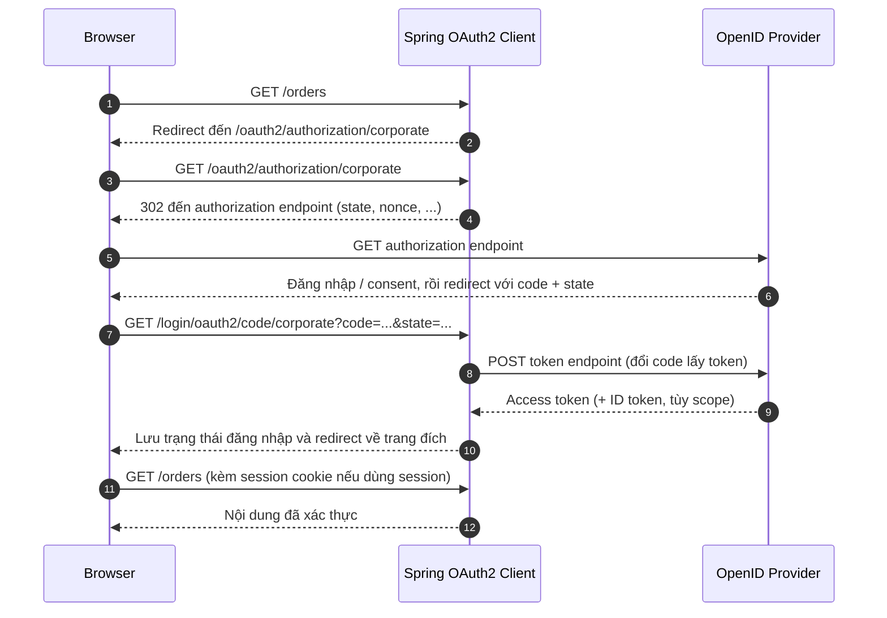
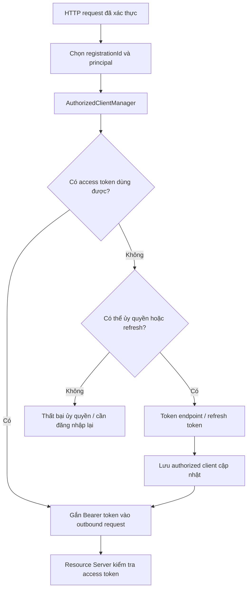

# 1.5. Kiến trúc Servlet và Reactive trong Spring Security

Trong một ứng dụng Spring, OAuth 2.0 Client chịu trách nhiệm đưa người dùng đến nhà cung cấp danh tính để đăng nhập, hoặc lấy và sử dụng access token khi ứng dụng gọi một API được bảo vệ. Spring Security hỗ trợ hai mô hình thực thi chính: **Servlet** (thường kết hợp Spring MVC) và **Reactive** (thường kết hợp Spring WebFlux). Hai mô hình dùng chung các khái niệm OAuth 2.0/OpenID Connect (OIDC), nhưng khác nhau ở cách tiếp nhận HTTP request, truyền ngữ cảnh bảo mật, lưu trạng thái và thực hiện các thao tác bất đồng bộ.

Mục tiêu của bài này là hiểu luồng xử lý của từng mô hình, nhận diện đúng các thành phần Spring Security tương ứng, cấu hình OAuth2 Login/OIDC và OAuth2 Client ở cả hai phía, đồng thời lựa chọn kiến trúc phù hợp với ứng dụng thực tế.

## 1. Hai mô hình thực thi HTTP

### 1.1. Servlet: chuỗi Filter trên nền Spring MVC

Trong ứng dụng Servlet truyền thống, servlet container (ví dụ Tomcat) nhận HTTP request và đưa request qua một chuỗi `jakarta.servlet.Filter`. Spring Security tham gia bằng `DelegatingFilterProxy` trỏ đến bean `springSecurityFilterChain`, thường là `FilterChainProxy`. Thành phần này chọn `SecurityFilterChain` phù hợp và áp dụng các filter như xác thực, phân quyền, quản lý session hay OAuth2 Login trước khi request đến `DispatcherServlet`/controller.

Một request đồng bộ thường được xử lý trên một thread trong suốt phần lớn vòng đời; thao tác I/O blocking như gọi HTTP bằng `RestClient` hoặc truy cập JDBC có thể giữ thread đó trong lúc chờ. Servlet cũng hỗ trợ xử lý bất đồng bộ, vì vậy không nên hiểu Servlet là hoàn toàn không thể async. Điểm khác biệt là mô hình lập trình và các API bảo mật mặc định của nó dựa trên Servlet request/response và các filter.

```text
Browser -> Servlet container
           -> DelegatingFilterProxy
           -> FilterChainProxy
           -> SecurityFilterChain (Servlet Filter)
           -> DispatcherServlet -> Spring MVC Controller
```

Các thành phần điển hình:

- `HttpSecurity`: DSL xây dựng cấu hình bảo mật.
- `SecurityFilterChain`: chuỗi filter áp dụng theo `RequestMatcher`.
- `SecurityContextHolder`: truy cập `SecurityContext` của luồng xử lý hiện tại; chiến lược phổ biến là `ThreadLocal`.
- `SecurityContextRepository`: tải/lưu ngữ cảnh bảo mật giữa các request khi cần, chẳng hạn thông qua HTTP session.
- `OAuth2AuthorizationRequestRedirectFilter` và `OAuth2LoginAuthenticationFilter`: tham gia luồng redirect/callback của OAuth2 Login.

### 1.2. Reactive: chuỗi WebFilter trên nền Spring WebFlux

Trong ứng dụng Reactive, Spring WebFlux biểu diễn request bằng `ServerWebExchange` và xử lý bảo mật thông qua `org.springframework.web.server.WebFilter`. Spring Security dùng `WebFilterChainProxy` để thực thi một hoặc nhiều `SecurityWebFilterChain`; request sau đó được chuyển đến handler/controller WebFlux.

Logic bất đồng bộ thường được mô tả bằng `Mono<T>` hoặc `Flux<T>` của Project Reactor. Khi I/O được thực hiện bằng các API không blocking, một số ít event-loop threads có thể phục vụ nhiều kết nối đang chờ I/O. Tuy nhiên, chỉ trả về `Mono` không tự động biến một thao tác JDBC, gọi HTTP blocking hoặc `Thread.sleep` thành non-blocking.

```text
Browser -> Reactive HTTP server
           -> WebFilterChainProxy
           -> SecurityWebFilterChain (WebFilter)
           -> WebFlux Handler/Controller
           -> Mono / Flux (Reactor pipeline)
```

Các thành phần điển hình:

- `ServerHttpSecurity`: DSL bảo mật dành cho WebFlux.
- `SecurityWebFilterChain`: chuỗi WebFilter bảo vệ request.
- `ReactiveSecurityContextHolder`: truy cập `SecurityContext` gắn với Reactor `Context`, thay vì giả định một thread cố định.
- `ServerSecurityContextRepository`: nạp/lưu ngữ cảnh bảo mật, có thể sử dụng WebSession.
- `OAuth2AuthorizationRequestRedirectWebFilter` và `OAuth2LoginAuthenticationWebFilter`: các thành phần thực hiện redirect/callback trong OAuth2 Login của WebFlux.

### 1.3. Bảng đối chiếu nhanh

| Khía cạnh | Servlet / Spring MVC | Reactive / Spring WebFlux |
|---|---|---|
| HTTP abstraction | `HttpServletRequest`, `HttpServletResponse` | `ServerWebExchange`, `ServerHttpRequest` |
| Chuỗi bảo mật | `SecurityFilterChain`, Servlet `Filter` | `SecurityWebFilterChain`, `WebFilter` |
| DSL cấu hình | `HttpSecurity` | `ServerHttpSecurity` |
| Context trong xử lý | `SecurityContextHolder`, thường là `ThreadLocal` | `ReactiveSecurityContextHolder`, Reactor `Context` |
| Kiểu xử lý controller | Giá trị trực tiếp, `Callable`, `DeferredResult`,... | `Mono<T>`, `Flux<T>` và các kiểu được WebFlux hỗ trợ |
| Client HTTP thường dùng | `RestClient` (blocking), hoặc `WebClient` | `WebClient` với chuỗi reactive |
| Repository client registration | `ClientRegistrationRepository` | `ReactiveClientRegistrationRepository` |
| Manager OAuth2 client | `OAuth2AuthorizedClientManager` | `ReactiveOAuth2AuthorizedClientManager` |
| Authorized client repository | `OAuth2AuthorizedClientRepository` | `ServerOAuth2AuthorizedClientRepository` |
| Trạng thái session phổ biến | `HttpSession` | `WebSession` |

**Hai stack không thể thay thế API cho nhau chỉ bằng đổi tên lớp.** Chẳng hạn, một bean `SecurityFilterChain` không cấu hình bảo mật WebFlux; tương tự, `SecurityWebFilterChain` không chạy trong Spring MVC. Khi đưa cả `spring-boot-starter-web` và `spring-boot-starter-webflux` lên classpath, Spring Boot thường ưu tiên loại ứng dụng Servlet; việc có thư viện `WebClient` không chứng minh rằng server đang chạy Reactive.

## 2. Các khái niệm OAuth 2.0/OIDC chung cho cả hai stack

Trước khi so sánh triển khai, cần phân biệt các đối tượng và vai trò:

| Thuật ngữ | Ý nghĩa |
|---|---|
| **OAuth2 Client** | Ứng dụng yêu cầu ủy quyền và dùng access token để truy cập tài nguyên thay mặt người dùng hoặc chính ứng dụng. |
| **Authorization Server / OpenID Provider (OP)** | Hệ thống xác thực người dùng, xử lý consent và cấp token; khi hỗ trợ OIDC, nó cung cấp ID Token và thông tin nhận dạng. |
| **Resource Server** | API nhận bearer access token và kiểm tra token để quyết định cho phép truy cập. Đây là vai trò khác OAuth2 Client, dù một ứng dụng có thể giữ cả hai vai trò. |
| **`ClientRegistration`** | Cấu hình một client: `registrationId`, `clientId`, grant type, scopes, redirect URI, endpoint/issuer của provider. |
| **`OAuth2AuthorizedClient`** | Kết quả một client đã được ủy quyền cho một principal: chứa `ClientRegistration` và access token, có thể có refresh token. |
| **`Authentication` / `SecurityContext`** | Trạng thái người dùng đã được xác thực đối với chính ứng dụng Spring. Không đồng nhất với `OAuth2AuthorizedClient`. |
| **ID Token** | Token OIDC mô tả kết quả xác thực người dùng, với các claim như `iss`, `sub`, `aud`, `exp`. |
| **Access Token** | Thông tin ủy quyền được gửi cho Resource Server; không dùng ID Token thay thế bearer access token cho API. |

Trong OIDC, ứng dụng thường đăng ký scope `openid` cùng các scope như `profile`, `email`. Với scope `openid` và provider hỗ trợ OIDC, `oauth2Login()` sử dụng cơ chế xác thực OIDC, trong đó principal thường là `OidcUser`. OAuth 2.0 authorization-code flow không có OIDC vẫn có thể đăng nhập theo mô hình OAuth2 Login, nhưng principal và dữ liệu nhận dạng khác với OIDC.

Hai cấu hình dễ nhầm:

- `oauth2Login()`: tích hợp **đăng nhập tương tác qua trình duyệt**, nhận authorization code tại callback và thiết lập trạng thái đăng nhập trong ứng dụng.
- `oauth2Client()`: hỗ trợ **quản lý một client đã được ủy quyền** để lấy, lưu, làm mới hoặc sử dụng access token khi ứng dụng gọi dịch vụ khác. Có thể cấu hình cùng `oauth2Login()`.

OAuth 2.0 Client không tự biến ứng dụng thành Resource Server. Nếu ứng dụng cần nhận và xác thực bearer JWT trên API đầu vào, cấu hình thêm vai trò `oauth2ResourceServer()` theo nhu cầu riêng.

## 3. Luồng đăng nhập OIDC trong hai kiến trúc

Giả sử trình duyệt vào `/orders`, ứng dụng sử dụng provider có `registrationId=corporate` và yêu cầu người dùng đăng nhập OIDC:



Giải thích từng điểm quan trọng:

1. Request cần xác thực bị chặn bởi chuỗi security filter hoặc web filter. Entry point thường khởi động quá trình đăng nhập.
2. Đường dẫn mặc định `/oauth2/authorization/{registrationId}` khởi tạo Authorization Request; Spring Security tạo các tham số liên quan, lưu trạng thái cần thiết để đối chiếu callback.
3. Browser đi tới Authorization Server; Spring không đọc trực tiếp mật khẩu người dùng của provider.
4. Provider redirect về đường dẫn mặc định `/login/oauth2/code/{registrationId}` kèm `code` và `state`. Redirect URI thực tế phải được đăng ký khớp ở provider.
5. Spring Security kiểm tra tương quan request/callback (đặc biệt là `state`), đổi code tại token endpoint, xử lý và xác minh thông tin OIDC theo cấu hình. Với OIDC, việc xác minh ID Token bao gồm các kiểm tra thích hợp đối với issuer, audience, chữ ký, thời hạn và các ràng buộc giao thức.
6. Sau khi xác thực thành công, ứng dụng tạo `Authentication` trong security context; các token được quản lý gắn với authorized client. Request sau sử dụng cơ chế lưu trạng thái được cấu hình, thường là session.

**Khác biệt nằm ở hạ tầng xử lý bước 1, 2, 5, 6:** Servlet thực hiện qua `Filter`, `HttpSession` và các API đồng bộ; Reactive thực hiện qua `WebFilter`, `WebSession` và chuỗi `Mono`. Giao thức OIDC với provider vẫn là authorization-code flow ở cả hai mô hình.

### 3.1. Trạng thái trong Servlet

Khi chuyển hướng đi, `HttpSessionOAuth2AuthorizationRequestRepository` là một lựa chọn mặc định để lưu Authorization Request, giúp đối chiếu `state` lúc callback. Khi xác thực thành công, `SecurityContext` được sử dụng trong request và có thể được lưu qua `SecurityContextRepository`. Thông tin `OAuth2AuthorizedClient` được lưu/tra cứu qua `OAuth2AuthorizedClientRepository` hoặc `OAuth2AuthorizedClientService`, tùy cấu hình.

### 3.2. Trạng thái trong Reactive

WebFlux có các thành phần tương đương, như `WebSessionServerOAuth2AuthorizationRequestRepository` để lưu Authorization Request trong WebSession. Trạng thái xác thực được biểu diễn trong Reactor context khi pipeline được thực thi; việc lưu qua request khác phụ thuộc `ServerSecurityContextRepository`. `ServerOAuth2AuthorizedClientRepository` và `ReactiveOAuth2AuthorizedClientService` quản lý authorized client theo các chiến lược tương ứng.

Việc Reactor có thể chuyển scheduler/thread khiến cách đọc `SecurityContextHolder.getContext()` trực tiếp trong một xử lý reactive dễ trả về kết quả không đúng mong đợi. Khi cần thao tác trên security context trong pipeline, sử dụng `ReactiveSecurityContextHolder.getContext()`:

```java
Mono<String> currentUserName() {
    return ReactiveSecurityContextHolder.getContext()
            .map(context -> context.getAuthentication().getName());
}
```

`Mono` này chỉ có giá trị khi được subscribe trong một ngữ cảnh đã có security context thích hợp, ví dụ chuỗi xử lý request WebFlux đã xác thực.

## 4. Cấu hình ứng dụng Servlet với OAuth2 Login/OIDC

Một ứng dụng Servlet sử dụng các dependency tương ứng với Spring MVC, Spring Security và OAuth2 Client:

```xml
<!-- Trích phần dependencies của pom.xml -->
<dependency>
    <groupId>org.springframework.boot</groupId>
    <artifactId>spring-boot-starter-web</artifactId>
</dependency>
<dependency>
    <groupId>org.springframework.boot</groupId>
    <artifactId>spring-boot-starter-security</artifactId>
</dependency>
<dependency>
    <groupId>org.springframework.boot</groupId>
    <artifactId>spring-boot-starter-oauth2-client</artifactId>
</dependency>
```

Ví dụ `application.yml` cho một OpenID Provider hỗ trợ discovery qua `issuer-uri`:

```yaml
spring:
  security:
    oauth2:
      client:
        registration:
          corporate:
            provider: corporate
            client-id: ${OIDC_CLIENT_ID}
            client-secret: ${OIDC_CLIENT_SECRET}
            authorization-grant-type: authorization_code
            scope:
              - openid
              - profile
              - email
        provider:
          corporate:
            issuer-uri: https://idp.example.org/realms/company
```

Ở đây `corporate` là tên đăng ký nội bộ, không phải giá trị cố định của Spring. URI `idp.example.org` chỉ là ví dụ; cần thay bằng issuer thực tế và thiết lập biến môi trường chứa client credentials. Thông qua OIDC discovery, Spring có thể tìm các endpoint/khóa công khai từ metadata của provider. Nếu provider không hỗ trợ discovery, phải khai báo các endpoint cần thiết theo khả năng của provider.

Ví dụ cấu hình Spring Security Servlet (đã lược bỏ `import`):

```java
@Configuration
@EnableWebSecurity
class ServletSecurityConfig {

    @Bean
    SecurityFilterChain webSecurity(HttpSecurity http) throws Exception {
        http
            .authorizeHttpRequests(auth -> auth
                .requestMatchers("/", "/error").permitAll()
                .anyRequest().authenticated()
            )
            .oauth2Login(Customizer.withDefaults())
            .oauth2Client(Customizer.withDefaults());

        return http.build();
    }
}
```

`http.build()` tạo ra `SecurityFilterChain`; `oauth2Login()` đăng ký những filter cần thiết cho redirect và callback. Với cấu hình mặc định, người dùng có thể bắt đầu đăng nhập qua `/oauth2/authorization/corporate`, còn callback là `/login/oauth2/code/corporate`. Provider cần chấp nhận redirect URI tương ứng với domain thực tế của ứng dụng.

Để gọi một API bên ngoài bằng access token, `RestClient` có thể sử dụng `OAuth2ClientHttpRequestInterceptor`. Interceptor phối hợp với `OAuth2AuthorizedClientManager` để lấy và cập nhật token, rồi gắn bearer token vào request:

```java
import static org.springframework.security.oauth2.client.web.client
        .RequestAttributeClientRegistrationIdResolver.clientRegistrationId;

@Configuration
class ServletHttpClientConfig {
    @Bean
    RestClient downstreamRestClient(OAuth2AuthorizedClientManager manager) {
        return RestClient.builder()
                .requestInterceptor(new OAuth2ClientHttpRequestInterceptor(manager))
                .build();
    }
}

@RestController
class ServletOrdersController {
    private final RestClient downstreamRestClient;

    ServletOrdersController(RestClient downstreamRestClient) {
        this.downstreamRestClient = downstreamRestClient;
    }

    @GetMapping("/orders")
    String orders() {
        return downstreamRestClient.get()
                .uri("https://api.example.org/orders")
                .attributes(clientRegistrationId("corporate"))
                .retrieve()
                .body(String.class);
    }
}
```

Ví dụ minh họa mô hình client gọi thay mặt người dùng đã đăng nhập bằng registration `corporate`. API `api.example.org` phải chấp nhận access token và scope tương ứng. `RestClient` là API đồng bộ của Spring Framework; không nên nhầm nó với một HTTP client không blocking.

Nếu cần service-to-service với grant `client_credentials`, cấu hình riêng một `ClientRegistration` có grant type này và chọn đúng `principal`/authorized-client manager để tránh gắn token dịch vụ vào danh tính người dùng. Với công việc chạy ngoài Servlet request (scheduler, message consumer), dùng `AuthorizedClientServiceOAuth2AuthorizedClientManager` cùng `OAuth2AuthorizedClientService` thay vì phụ thuộc ngầm vào `HttpServletRequest`.

## 5. Cấu hình ứng dụng Reactive với OAuth2 Login/OIDC

Với Spring WebFlux, ứng dụng sử dụng `spring-boot-starter-webflux` thay cho starter Web MVC, cùng security và OAuth2 Client:

```xml
<!-- Trích phần dependencies của pom.xml -->
<dependency>
    <groupId>org.springframework.boot</groupId>
    <artifactId>spring-boot-starter-webflux</artifactId>
</dependency>
<dependency>
    <groupId>org.springframework.boot</groupId>
    <artifactId>spring-boot-starter-security</artifactId>
</dependency>
<dependency>
    <groupId>org.springframework.boot</groupId>
    <artifactId>spring-boot-starter-oauth2-client</artifactId>
</dependency>
```

Có thể dùng cùng cấu trúc `spring.security.oauth2.client.registration.*` và `provider.*` như mục Servlet. Spring Boot sẽ tạo các thành phần registration thích hợp với loại ứng dụng, ví dụ `InMemoryReactiveClientRegistrationRepository` đối với Reactive.

Cấu hình bảo mật WebFlux tương ứng:

```java
@Configuration
@EnableWebFluxSecurity
class ReactiveSecurityConfig {

    @Bean
    SecurityWebFilterChain webSecurity(ServerHttpSecurity http) {
        return http
                .authorizeExchange(auth -> auth
                        .pathMatchers("/", "/error").permitAll()
                        .anyExchange().authenticated()
                )
                .oauth2Login(Customizer.withDefaults())
                .oauth2Client(Customizer.withDefaults())
                .build();
    }
}
```

Khác với `HttpSecurity`, `ServerHttpSecurity` không tạo Servlet Filter. Nó xây dựng `SecurityWebFilterChain` cho WebFlux, đồng thời áp dụng logic nhận diện request, xử lý đăng nhập và phân quyền bằng các publisher Reactor.

Để gọi API bên ngoài, kết hợp `WebClient` với `ServerOAuth2AuthorizedClientExchangeFilterFunction`. Cách này phối hợp với `ReactiveOAuth2AuthorizedClientManager` để lấy/làm mới token trong reactive pipeline, thay vì tự đọc token rồi gọi HTTP một cách thủ công:

```java
import static org.springframework.security.oauth2.client.web.reactive.function.client
        .ServerOAuth2AuthorizedClientExchangeFilterFunction.clientRegistrationId;

@Configuration
class ReactiveHttpClientConfig {
    @Bean
    WebClient downstreamWebClient(ReactiveOAuth2AuthorizedClientManager manager) {
        var oauth2 = new ServerOAuth2AuthorizedClientExchangeFilterFunction(manager);
        return WebClient.builder()
                .filter(oauth2)
                .build();
    }
}

@RestController
class ReactiveOrdersController {
    private final WebClient downstreamWebClient;

    ReactiveOrdersController(WebClient downstreamWebClient) {
        this.downstreamWebClient = downstreamWebClient;
    }

    @GetMapping("/orders")
    Mono<String> orders() {
        return downstreamWebClient.get()
                .uri("https://api.example.org/orders")
                .attributes(clientRegistrationId("corporate"))
                .retrieve()
                .bodyToMono(String.class);
    }
}
```

`Mono<String>` biểu diễn kết quả sẽ có khi downstream API phản hồi. Không gọi `block()` hoặc `subscribe()` trong controller WebFlux: framework tự subscribe publisher khi xử lý HTTP response. Những lời gọi blocking trên event-loop có thể làm suy giảm thông lượng và độ trễ của toàn ứng dụng.

`DefaultReactiveOAuth2AuthorizedClientManager` phù hợp với luồng web có `ServerWebExchange`. Nếu xử lý token trong một background job hoặc service không có request, `AuthorizedClientServiceReactiveOAuth2AuthorizedClientManager` dùng `ReactiveOAuth2AuthorizedClientService` là lựa chọn phù hợp hơn. Đừng chuyển trực tiếp `OAuth2AuthorizedClientManager` của Servlet sang WebFlux vì hợp đồng API và ngữ cảnh request khác nhau.

## 6. Luồng gọi downstream API và quản lý vòng đời token

Ở cả hai mô hình, việc login thành công chỉ là một phần. Khi ứng dụng gọi một Resource Server, Spring Security còn phải quản lý authorized client và thời hạn của token:



Các thành phần theo tầng trách nhiệm:

| Tầng | Servlet | Reactive |
|---|---|---|
| Đăng ký client | `ClientRegistrationRepository` | `ReactiveClientRegistrationRepository` |
| Tải/lưu authorized client trong web request | `OAuth2AuthorizedClientRepository` | `ServerOAuth2AuthorizedClientRepository` |
| Lưu authorized client qua service | `OAuth2AuthorizedClientService` | `ReactiveOAuth2AuthorizedClientService` |
| Điều phối ủy quyền/refresh | `OAuth2AuthorizedClientManager` | `ReactiveOAuth2AuthorizedClientManager` |
| Chiến lược grant type | `OAuth2AuthorizedClientProvider` | `ReactiveOAuth2AuthorizedClientProvider` |
| Gắn bearer token vào HTTP request | `OAuth2ClientHttpRequestInterceptor` cho `RestClient` hoặc tích hợp `WebClient` dành cho Servlet | `ServerOAuth2AuthorizedClientExchangeFilterFunction` cho `WebClient` |

**Chiến lược grant type là cấu hình có chủ đích.** Với `authorization_code`, người dùng cần tham gia bước redirect ban đầu; với `refresh_token`, hệ thống có thể yêu cầu access token mới khi refresh token còn hợp lệ; với `client_credentials`, client dùng thông tin của chính mình để nhận token và không đại diện cho người dùng cuối. Spring Security hỗ trợ thêm các grant/extension tùy phiên bản và cấu hình, nhưng không thể giả định mọi provider cho phép mọi grant.

Token của một người dùng không nên được mặc định gửi đến mọi host. Ví dụ, tùy chọn `setDefaultOAuth2AuthorizedClient(true)` có thể khiến nhiều request outbound được gắn token của người đăng nhập; chỉ bật khi phạm vi API đích đã được kiểm soát. Cách chọn rõ `registrationId` hoặc authorized client trên từng request thường dễ kiểm toán hơn. Khi API trả 401 do token bị thu hồi, cấu hình failure handling phù hợp để loại authorized client không còn hợp lệ và xử lý lại luồng ủy quyền khi cần.

## 7. SecurityContext, thread và tính non-blocking

### 7.1. Vì sao `ThreadLocal` không đủ trong WebFlux?

Giả sử pipeline có bước gọi API bất đồng bộ, sau đó tiếp tục trên thread khác. Nếu code đọc principal bằng `SecurityContextHolder.getContext()` ở một callback tự tạo, code có thể không thấy context mà request ban đầu đã dùng. Với Reactor, context bảo mật được truyền theo **chuỗi publisher**; dùng `ReactiveSecurityContextHolder` hoặc cơ chế inject principal mà Spring WebFlux cung cấp.

Ví dụ một handler trả thông tin người dùng đã xác thực, không cần truy cập trực tiếp thread:

```java
// Servlet controller
@GetMapping("/whoami")
String whoami(Authentication authentication) {
    return authentication.getName();
}

// Reactive controller (ở ứng dụng WebFlux riêng)
@GetMapping("/whoami")
Mono<String> whoami(Mono<Principal> principal) {
    return principal.map(Principal::getName);
}
```

Hai handler trên là **hai ví dụ riêng**, không đặt cùng chữ ký endpoint trong một controller. Việc truyền `Authentication`/`Principal` qua argument resolver phù hợp với từng stack giúp hạn chế phụ thuộc không cần thiết vào thread hiện tại.

### 7.2. Blocking I/O trong Reactive

Đường đi sau đây gây rủi ro:

```java
// Không dùng cách này trên event-loop WebFlux:
Mono<String> result = Mono.just(restClient.get()
        .uri("https://api.example.org/orders")
        .retrieve()
        .body(String.class));
```

Lời gọi `restClient.get()...body(...)` đã được thực hiện trước khi tạo `Mono`, nên vẫn blocking. Nếu phải tích hợp thư viện blocking trong WebFlux, cần cô lập tác vụ đó đúng cách (ví dụ `Mono.fromCallable(...)` kết hợp `Schedulers.boundedElastic()`), giới hạn tải và hiểu tác động tới thread pool; tốt nhất là dùng driver/client non-blocking khi ứng dụng theo kiến trúc Reactive từ đầu đến cuối.

### 7.3. Session và triển khai nhiều instance

Ở cả hai stack, ứng dụng đăng nhập tương tác thường duy trì một session phía server và gửi cookie session về browser. Nếu chạy nhiều instance, callback OAuth2 có thể đến một instance khác với request khởi tạo. Cần thiết kế lưu session/trạng thái và định tuyến phù hợp, chẳng hạn session store dùng chung. Dữ liệu authorized client chứa access/refresh token phải được bảo vệ khi lưu trữ; không ghi token hoặc client secret vào log.

`state` giúp liên kết authorization response với request ban đầu; với OIDC, `nonce` có vai trò ràng buộc ID Token với yêu cầu xác thực; PKCE tăng khả năng bảo vệ authorization code khi được dùng. Những biện pháp này phụ thuộc luồng, provider và cấu hình; không nên tắt các kiểm tra mặc định chỉ để khắc phục lỗi callback.

## 8. Chọn Servlet hay Reactive cho OAuth2/OIDC Client?

| Tình huống | Hướng phù hợp | Lý do |
|---|---|---|
Ứng dụng Spring MVC sẵn có, service dùng JPA/JDBC và thư viện blocking | Servlet | Khớp luồng thực thi và hệ sinh thái hiện tại, dễ vận hành, không phải bọc nhiều blocking calls. |
API gateway/BFF có nhiều downstream HTTP calls và dùng pipeline WebClient không blocking | Reactive | Có thể tận dụng I/O bất đồng bộ khi áp lực kết nối cao và toàn bộ đường đi được thiết kế tương ứng. |
Ứng dụng chỉ cần OIDC Login thông thường, lưu session và render trang | Cả hai | Bảo mật theo giao thức tương tự; quyết định dựa trên phần còn lại của ứng dụng. |
Batch hoặc scheduled task lấy token client credentials | Cả hai | Quan trọng là chọn manager dạng service, không phụ thuộc request web, và HTTP client phù hợp. |
Ứng dụng vừa có `spring-boot-starter-web` vừa dùng `WebClient` để gọi API | Thường vẫn là Servlet | Dùng `WebClient` không tự đổi runtime server hay security chain thành Reactive. |

Không có lựa chọn nào tự động an toàn hơn hay có throughput cao hơn trong mọi trường hợp. Reactive có thể giúp khi khối lượng I/O đồng thời lớn, nhưng mã blocking, xử lý CPU nặng hoặc sự phức tạp quản lý context có thể xóa lợi ích đó. Mức độ quen thuộc của đội phát triển, tích hợp thư viện và đặc tính vận hành là các yếu tố quan trọng.

## 9. Các lỗi kiến trúc thường gặp

1. **Dùng sai loại security chain.** Ứng dụng WebFlux cần `SecurityWebFilterChain` và `ServerHttpSecurity`; Spring MVC cần `SecurityFilterChain` và `HttpSecurity`. Nếu thấy filter không áp dụng, trước hết xác định loại web application thực sự được khởi chạy.
2. **Nhầm login với xác thực API vào.** `oauth2Login()` tạo phiên đăng nhập tương tác cho browser, còn API nhận bearer token thường cần `oauth2ResourceServer()`. Client gửi bearer token cho downstream lại là trách nhiệm của `oauth2Client()` và authorized-client integration.
3. **Redirect URI không khớp.** Kiểm tra scheme/host/port, path `/login/oauth2/code/{registrationId}`, reverse proxy và giá trị đăng ký tại provider. Sau reverse proxy, URL bên ngoài có thể khác URL nội bộ.
4. **Mất trạng thái sau redirect.** Kiểm tra cookie, session store, SameSite/Secure, cân bằng tải và sự tồn tại của Authorization Request đã lưu; không bỏ kiểm tra `state`.
5. **Nhầm ID Token với access token.** ID Token dành cho client xác nhận danh tính người dùng; API downstream thường yêu cầu access token đúng issuer, audience và scope.
6. **Lấy security context trong thread khác.** Với WebFlux, dùng Reactor context hoặc argument resolver; với Servlet, cân nhắc cơ chế propagation được Spring Security hỗ trợ khi tự tạo tác vụ async.
7. **Blocking event-loop bằng `block()` hoặc `RestClient`.** Chọn HTTP client phù hợp và giữ chuỗi reactive non-blocking khi có thể.
8. **Làm mới token theo cách thủ công ở nhiều nơi.** Sử dụng `OAuth2AuthorizedClientManager` hoặc `ReactiveOAuth2AuthorizedClientManager` để tập trung quản lý token và failure handling.
9. **Dùng manager gắn với web request trong background job.** Chọn service-based authorized-client manager và principal phù hợp cho tác vụ không có request.
10. **Vô tình chuyển token sang API khác.** Xác định rõ client registration và phạm vi host đích thay vì mặc định gửi token đến mọi outbound request.

## 10. Ví dụ kiến trúc: một BFF gọi API đơn hàng

Xét hệ thống gồm browser, ứng dụng Backend for Frontend (BFF), OpenID Provider và Orders API:

```text
                      +-------------------+
                      | OpenID Provider   |
                      | login, ID Token,  |
                      | access/refresh    |
                      +---------^---------+
                                |
                         Authorization Code
                                |
Browser -- session cookie -->  BFF  -- bearer access token --> Orders API
                              |
                  Spring Security OAuth2 Client
                  (Servlet hoặc Reactive)
```

1. Browser đăng nhập vào BFF qua OIDC; người dùng có phiên đăng nhập của BFF.
2. BFF sử dụng `OAuth2AuthorizedClient` tương ứng để gọi Orders API với access token; API xác minh access token theo vai trò Resource Server.
3. Nếu token hết hạn, authorized-client manager áp dụng chiến lược phù hợp để refresh hoặc yêu cầu đăng nhập lại.
4. BFF chỉ trả về dữ liệu nghiệp vụ cần thiết cho browser. Access/refresh token và client secret được quản lý ở server, không nhất thiết chuyển về JavaScript của browser.

Với BFF Spring MVC, chuỗi này chạy qua Servlet filters và thường gọi downstream bằng `RestClient`. Với BFF WebFlux, cùng giao thức chạy qua WebFilters và có thể gọi downstream không blocking bằng `WebClient`. Sự khác biệt là **execution model và API Spring Security**, không phải việc OAuth2/OIDC yêu cầu một giao thức đăng nhập khác.

## 11. Tự kiểm tra mức hiểu kiến trúc

- Khi cấu hình `SecurityFilterChain` nhưng ứng dụng chạy WebFlux, tại sao request có thể không chịu các rule mong đợi?
- Nếu dùng `WebClient` trong Spring MVC, security context và web application type có tự chuyển sang Reactive không?
- Sau khi người dùng đăng nhập OIDC, đối tượng nào biểu diễn danh tính trong ứng dụng, đối tượng nào chứa access token để gọi Orders API?
- Tại sao `SecurityContextHolder` có thể không phù hợp khi đọc principal trong một Reactor pipeline?
- Tại sao `DefaultReactiveOAuth2AuthorizedClientManager` có thể không phù hợp với scheduled task không có `ServerWebExchange`?
- Khi nhận lỗi `redirect_uri_mismatch` hoặc mất `state`, những tầng cấu hình nào cần kiểm tra?

## Tài liệu tham khảo

- [Spring Security — OAuth2 Client (Servlet)](https://docs.spring.io/spring-security/reference/servlet/oauth2/client/index.html)
- [Spring Security — OAuth2 Client (Reactive)](https://docs.spring.io/spring-security/reference/reactive/oauth2/client/index.html)
- [Spring Security — Authorized Client Features (Servlet)](https://docs.spring.io/spring-security/reference/servlet/oauth2/client/authorized-clients.html)
- [Spring Security — Authorized Client Features (Reactive)](https://docs.spring.io/spring-security/reference/reactive/oauth2/client/authorized-clients.html)
- [Spring Security — OAuth2 Login (Reactive)](https://docs.spring.io/spring-security/reference/reactive/oauth2/login/core.html)
