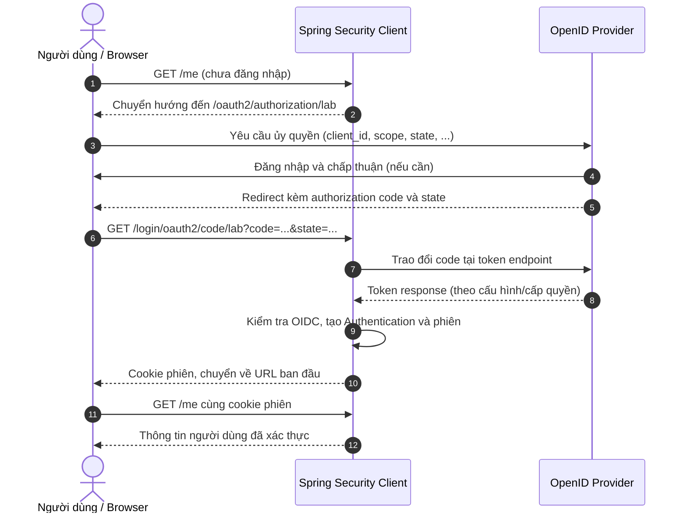

# 1.9. Cách tổ chức tài liệu và các kịch bản thực hành

> **Chủ đề:** Spring Security OAuth 2.0 OIDC Client  
> **Chương:** 1. Tổng quan  
> **Trọng tâm:** Biến các khái niệm OAuth 2.0 và OpenID Connect (OIDC) thành một bộ tài liệu có thể tra cứu, chạy thử, quan sát và mở rộng theo từng tình huống thực tế.

Một dự án tích hợp đăng nhập OIDC thường có nhiều phần nằm ở các hệ thống khác nhau: trình duyệt, ứng dụng Spring Boot, nhà cung cấp danh tính (Identity Provider — IdP) và API tài nguyên. Nếu chỉ lưu một đoạn `application.yml` cùng một nút “Login”, người học có thể đăng nhập thành công nhưng vẫn khó giải thích token đến từ đâu, ứng dụng giữ phiên như thế nào hoặc vì sao một lệnh gọi API bị từ chối.

Bài này hướng dẫn cách **tổ chức tài liệu theo hành trình học tập và theo luồng xử lý**, đồng thời thiết kế **những kịch bản thực hành có điều kiện đầu vào, thao tác và kết quả quan sát được**. Đây là bản đồ thực hành cho các bài chuyên sâu tiếp theo, không yêu cầu triển khai tất cả tính năng trong một lần.

## 1. Mục tiêu học tập và phạm vi

Sau bài học, bạn có thể:

1. Phân chia tài liệu thành các phần: nền tảng giao thức, cấu hình ứng dụng, luồng đăng nhập, gọi API, quản lý phiên/token, bảo mật và xử lý sự cố.
2. Nhận diện trách nhiệm của **OAuth 2.0 Client**, **OpenID Provider/Authorization Server**, **Resource Server** và **trình duyệt** trong một sơ đồ tích hợp.
3. Thiết kế mỗi bài thực hành với mục tiêu, môi trường, các bước tái hiện, kết quả mong đợi và dấu hiệu cần quan sát.
4. Xếp các kịch bản từ đăng nhập OIDC cơ bản đến sử dụng access token, hết hạn token, đăng xuất và lỗi cấu hình.
5. Ghi lại bằng chứng kỹ thuật hữu ích mà không đưa client secret, access token, refresh token hay cookie phiên vào tài liệu.

**Ranh giới của bài:** Spring Security đóng vai trò **Client** trong ứng dụng Spring Boot, thường là ứng dụng web có người dùng đăng nhập. Một Resource Server được dựng riêng để minh họa việc sử dụng access token. Việc xây dựng đầy đủ một Authorization Server hoặc triển khai giao thức OIDC từ đầu nằm ngoài phạm vi.

## 2. Bản đồ thành phần cần xuất hiện trong tài liệu

Trước khi sắp xếp thư mục, thống nhất vai trò của từng thành phần:

| Thành phần | Trách nhiệm chính | Vị trí trong kịch bản mẫu |
|---|---|---|
| Browser | Điều hướng đăng nhập, nhận cookie phiên của ứng dụng và gửi yêu cầu HTTP | Người dùng truy cập `http://localhost:8080` |
| OAuth 2.0/OIDC Client | Chuyển hướng đến IdP, xử lý callback, trao đổi authorization code lấy token, xác thực đăng nhập và quản lý authorized client | Ứng dụng Spring Boot `web-client` |
| Authorization Server / OpenID Provider | Xác thực người dùng, xin chấp thuận khi cần, phát hành token và công bố metadata/JWK | IdP ở `http://localhost:9000` (ví dụ minh họa) |
| Resource Server | Bảo vệ API, xác thực access token và kiểm tra quyền truy cập | API Spring Boot ở `http://localhost:8081` |

Ba khái niệm cần tách rõ ngay từ đầu:

- **OIDC ID token** cho Client biết thông tin về sự kiện xác thực người dùng, ví dụ `sub`, `iss`, `aud`; ID token **không phải** token để gọi API tùy ý.
- **OAuth 2.0 access token** được gửi đến Resource Server để xin quyền truy cập tài nguyên. API phải kiểm tra các điều kiện phù hợp, như chữ ký/issuer/audience nếu dùng JWT và quyền (scope/authority) cần thiết.
- **HTTP session** là trạng thái đăng nhập của ứng dụng web. Trình duyệt thường giữ cookie phiên; cookie của ứng dụng không đồng nghĩa với access token của API.

Sơ đồ luồng đăng nhập chuẩn với Authorization Code:



Trong tài liệu, nên đánh dấu **điểm chuyển giao trách nhiệm**: trình duyệt chuyển hướng, Client xử lý callback, IdP phát hành token, Resource Server đánh giá yêu cầu API. Những điểm này giúp khoanh vùng lỗi nhanh hơn việc chỉ ghi “đăng nhập thất bại”.

## 3. Nguyên tắc tổ chức một bộ tài liệu học tập

Một bộ tài liệu tốt phải trả lời được ba câu hỏi: *Tôi cần hiểu gì? Tôi chạy thử thế nào? Tôi kiểm tra hiện tượng ở đâu?*

### 3.1. Chia theo mục đích của người đọc

| Nhóm tài liệu | Câu hỏi cần trả lời | Nội dung tiêu biểu |
|---|---|---|
| Tổng quan | Hệ thống có những vai trò và luồng nào? | Sơ đồ kiến trúc, thuật ngữ, ranh giới tin cậy |
| Nền tảng | Tại sao ứng dụng cần code, state, scope, ID token? | Authorization Code, OAuth 2.0, OIDC, PKCE, discovery |
| Cấu hình | Cần thiết lập gì ở IdP và Spring? | Client registration, redirect URI, issuer, dependency |
| Luồng xử lý | Yêu cầu đi qua những endpoint nào? | Login, callback, token exchange, API request, logout |
| Thực hành | Tái hiện và quan sát hành vi cụ thể ra sao? | Lab có các bước và kết quả mong đợi |
| Vận hành/bảo mật | Lỗi xuất hiện ở đâu và cách chẩn đoán? | Log an toàn, 401/403, token expiry, CSRF, cấu hình sai |
| Tham chiếu | Xem chi tiết API hoặc đặc tả ở đâu? | Liên kết tài liệu chính thức và ghi chú phiên bản |

Nên đặt **khái niệm ổn định** ở phần nền tảng, **thông tin thay đổi theo nhà cung cấp** ở phần cấu hình, và **thao tác có thể lặp lại** ở phần lab. Ví dụ, không nên đưa giá trị `client-secret` thật vào giải thích về Authorization Code; không nên biến một màn hình cấu hình riêng của IdP thành định nghĩa chung của OIDC.

### 3.2. Cấu trúc thư mục gợi ý

Đây là một cách tổ chức dự án học tập; tên thư mục có thể thay đổi theo dự án:

```text
spring-security-oidc-client-lab/
├── README.md                         # Mục tiêu, sơ đồ, đường dẫn bắt đầu
├── docs/
│   ├── 00-overview.md                # Các vai trò và thuật ngữ
│   ├── 01-oauth2-oidc-basics.md      # OAuth 2.0, OIDC, grant, token, scope
│   ├── 02-environment.md             # Cổng, IdP, client registration, biến môi trường
│   ├── 03-oidc-login-flow.md         # Login, callback, state, session
│   ├── 04-api-access.md              # Authorized client, access token, resource API
│   ├── 05-session-token-lifecycle.md # Phiên, hết hạn, refresh, logout
│   ├── 06-security-notes.md          # HTTPS, PKCE, CSRF, bảo vệ bí mật
│   ├── troubleshooting.md            # Hiện tượng, nguyên nhân, cách kiểm tra
│   └── glossary.md                   # Thuật ngữ dùng thống nhất
├── labs/
│   ├── LAB-00-environment.md
│   ├── LAB-01-oidc-login.md
│   ├── LAB-02-user-claims.md
│   ├── LAB-03-call-resource-api.md
│   ├── LAB-04-token-expiry.md
│   ├── LAB-05-logout.md
│   ├── LAB-06-errors.md
│   └── LAB-07-multiple-clients.md
├── apps/
│   ├── web-client/                   # Ứng dụng Spring Security OAuth2/OIDC Client
│   └── resource-api/                 # API được bảo vệ bằng access token
├── infra/
│   └── identity-provider/            # Hướng dẫn/khai báo cấu hình IdP cho môi trường lab
├── scripts/                          # Lệnh khởi động và dữ liệu mẫu không chứa secret
└── .env.example                      # Tên biến môi trường, giá trị giả
```

`README.md` là trang điều hướng ngắn: mô tả bài toán, yêu cầu trước khi học, đường dẫn đến `docs/02-environment.md`, bảng lab theo thứ tự và cách quay lại trạng thái ban đầu. Tài liệu giải thích nguyên lý không cần sao chép toàn bộ mã nguồn; khi cần chỉ rõ tên lớp, endpoint hoặc tệp cấu hình tương ứng trong `apps/`.

### 3.3. Quy tắc giúp tài liệu dễ bảo trì

- **Một thuật ngữ, một cách gọi:** dùng “Client”, “OpenID Provider/IdP”, “Resource Server”, “ID token”, “access token” nhất quán; nếu dùng từ đồng nghĩa, giải thích tại `glossary.md`.
- **Gắn nhãn ví dụ:** domain, cổng và tên client ở bài này chỉ là cấu hình phòng lab; người đọc phải biết giá trị nào cần thay khi dùng IdP khác.
- **Ghi phiên bản môi trường:** ví dụ phần mã bên dưới minh họa cách cấu hình quen thuộc ở Spring Boot 3.x và Spring Security 6.x; khi dùng nhánh khác, đối chiếu API tương ứng trong tài liệu chính thức.
- **Liên kết hai chiều:** bài giải thích về refresh token trỏ đến lab hết hạn token; lab trỏ ngược về khái niệm để người học hiểu hiện tượng.
- **Mỗi lab có điểm khởi đầu rõ ràng:** ai cần đăng nhập, client nào được đăng ký, dữ liệu nào phải tồn tại trước khi chạy.
- **Không lưu bí mật trong repo:** chỉ ghi tên biến môi trường và giá trị giả; redaction ảnh chụp, URL và log trước khi chia sẻ.

## 4. Lộ trình các kịch bản thực hành

Các lab nên xây dựng trên nhau, với một hành vi chính cho mỗi bài. Có thể bắt đầu từ LAB-00 mà không cần hiểu tất cả nội dung nâng cao.

| Lab | Tình huống | Điều kiện đầu vào | Kết quả cần quan sát |
|---|---|---|---|
| **LAB-00** | Dựng môi trường | Có Java, ứng dụng và IdP cục bộ | Discovery endpoint truy cập được; Client khởi động với cấu hình hợp lệ |
| **LAB-01** | Đăng nhập OIDC bằng Authorization Code | Đăng ký Client và redirect URI | Trình duyệt đến IdP, callback về Client, `/me` trả về người dùng đã xác thực |
| **LAB-02** | Đọc danh tính và claim | LAB-01 thành công | Phân biệt `sub` ổn định với thuộc tính hồ sơ có thể thay đổi; biết nguồn claim |
| **LAB-03** | Gọi Resource Server | Có API kiểm tra access token | Client gửi access token đến API; API phản hồi theo scope/authority |
| **LAB-04** | Hết hạn và cấp lại token | Có thời hạn token ngắn ở lab | Phân biệt thời hạn access token với HTTP session; quan sát cấp lại hoặc yêu cầu đăng nhập lại tùy cấu hình |
| **LAB-05** | Đăng xuất | Có phiên đăng nhập | Xác định khác biệt giữa logout tại ứng dụng và logout tại IdP |
| **LAB-06** | Cố ý tạo lỗi | Có môi trường đã chạy ổn định | Nhận diện sai redirect URI, issuer, scope, `state`, chữ ký token, 401/403 |
| **LAB-07** | Nhiều client/nhà cung cấp | Có hai cấu hình registration hợp lệ | Chọn được registration phù hợp và tách cấu hình của từng provider |

**Phần mở rộng tùy chọn:** PKCE cho public client, mapping nhóm/role vào authorities, tách SecurityFilterChain cho web và API, kiểm tra audience của JWT, kiểm thử tự động khi tích hợp IdP, và `client_credentials` cho tác vụ máy–máy. Luồng `client_credentials` không có người dùng đăng nhập và không phải OIDC login; nên đặt thành bài so sánh sau khi người học đã thành thạo Client có người dùng.

## 5. Chuẩn bị môi trường thực hành chung

Mỗi lab kế thừa cùng một mô hình để dễ so sánh kết quả:

```text
Browser ── HTTP :8080 ──> Spring Boot web-client
                               │
                               ├── OIDC discovery / login / token ──> IdP :9000
                               │
                               └── access token ──> Resource API :8081
```

### 5.1. Chuẩn bị ở Identity Provider

Ví dụ dùng một IdP hỗ trợ OpenID Connect, có thể là Keycloak chạy cục bộ. Các giá trị `lab`, `web-client` và cổng `9000` là giả định cho bài thực hành, **không phải mặc định bắt buộc của sản phẩm**:

1. Khởi động IdP và tạo realm/tenant `lab` hoặc vùng cấu hình tương đương.
2. Tạo người dùng thử nghiệm, có thông tin hồ sơ để quan sát `sub`, `preferred_username`, `email` nếu nhà cung cấp trả về.
3. Đăng ký OAuth 2.0/OIDC Client tên `web-client`, sử dụng Authorization Code; với ứng dụng Spring MVC chạy ở máy chủ, có thể dùng confidential client và một client secret cấp riêng cho lab.
4. Khai báo redirect URI chính xác: `http://localhost:8080/login/oauth2/code/lab`.
5. Cho phép scope `openid` và, nếu IdP hỗ trợ, `profile`, `email`; thiết lập quyền gọi API ở các lab sau.
6. Xác định **issuer URI** do IdP công bố, ví dụ `http://localhost:9000/realms/lab`; truy cập tài liệu discovery tương ứng (`.../.well-known/openid-configuration`) để thấy authorization endpoint, token endpoint và `jwks_uri`.

**Lưu ý:** `redirect-uri` thuộc cấu hình Client và phải khớp giá trị đã đăng ký ở IdP. `issuer-uri` phải khớp issuer thực tế trong token và metadata; tự thay một hostname bằng địa chỉ nội bộ đôi khi khiến kiểm tra issuer hoặc truy cập endpoint bị lỗi. Trên môi trường thật cần HTTPS và quản lý secret phù hợp.

### 5.2. Dependency và cấu hình Spring Security Client

Với ứng dụng Spring MVC, cần starter web và OAuth 2.0 Client. Ví dụ Maven:

```xml
<dependency>
    <groupId>org.springframework.boot</groupId>
    <artifactId>spring-boot-starter-web</artifactId>
</dependency>
<dependency>
    <groupId>org.springframework.boot</groupId>
    <artifactId>spring-boot-starter-oauth2-client</artifactId>
</dependency>
```

Ví dụ `application.yml` cho registration `lab`:

```yaml
server:
  port: 8080

spring:
  security:
    oauth2:
      client:
        registration:
          lab:
            provider: lab
            client-id: web-client
            client-secret: ${OAUTH_CLIENT_SECRET}
            authorization-grant-type: authorization_code
            redirect-uri: "{baseUrl}/login/oauth2/code/{registrationId}"
            scope:
              - openid
              - profile
              - email
        provider:
          lab:
            issuer-uri: http://localhost:9000/realms/lab
```

Trước khi chạy, cung cấp `OAUTH_CLIENT_SECRET` từ biến môi trường hoặc secret store của môi trường lab; không commit giá trị thực. `lab` là **registrationId**, đồng thời xuất hiện trong URL `/oauth2/authorization/lab` và `/login/oauth2/code/lab`. `issuer-uri` giúp Spring Security khám phá metadata của nhà cung cấp khi có hỗ trợ discovery.

Ví dụ cấu hình bảo vệ endpoint và kích hoạt đăng nhập:

```java
import org.springframework.context.annotation.Bean;
import org.springframework.context.annotation.Configuration;
import org.springframework.security.config.Customizer;
import org.springframework.security.config.annotation.web.builders.HttpSecurity;
import org.springframework.security.web.SecurityFilterChain;

@Configuration
public class SecurityConfig {
    @Bean
    SecurityFilterChain securityFilterChain(HttpSecurity http) throws Exception {
        return http
            .authorizeHttpRequests(auth -> auth
                .requestMatchers("/", "/error").permitAll()
                .anyRequest().authenticated())
            .oauth2Login(Customizer.withDefaults())
            .oauth2Client(Customizer.withDefaults())
            .build();
    }
}
```

Và một endpoint để quan sát danh tính mà không xuất token:

```java
import java.util.Map;
import org.springframework.security.core.annotation.AuthenticationPrincipal;
import org.springframework.security.oauth2.core.oidc.user.OidcUser;
import org.springframework.web.bind.annotation.GetMapping;
import org.springframework.web.bind.annotation.RestController;

@RestController
public class ProfileController {
    @GetMapping("/me")
    public Map<String, String> me(@AuthenticationPrincipal OidcUser user) {
        return Map.of(
            "subject", user.getSubject(),
            "issuer", user.getIdToken().getIssuer().toString()
        );
    }
}
```

Ví dụ này dùng OIDC vì đăng ký có scope `openid`. Nếu dùng đăng nhập OAuth 2.0 thuần túy, kiểu principal và nguồn thông tin người dùng có thể khác. Mã ví dụ minh họa khái niệm; khi ghép vào dự án, bổ sung package, build configuration và thành phần hạ tầng phù hợp.

## 6. Mẫu chuẩn để viết một bài lab

Để người khác làm lại được cùng một kết quả, mỗi `LAB-XX-*.md` nên có bố cục cố định:

```markdown
# LAB-XX — Tên kịch bản

## Mục tiêu
- Sau lab, người học có thể giải thích/quan sát điều gì?

## Kiến thức liên quan
- Liên kết đến tài liệu nền tảng và sơ đồ luồng.

## Điều kiện đầu vào
- Phiên bản, ứng dụng, IdP, dữ liệu mẫu, biến môi trường.

## Các bước thực hiện
1. Thao tác cụ thể.
2. URL/endpoint hoặc file cần sửa.
3. Cách khôi phục nếu bài yêu cầu tạo lỗi có chủ đích.

## Kết quả mong đợi
- Hành vi HTTP, màn hình và trạng thái hệ thống cần thấy.

## Cách quan sát
- Browser Network, log đã che thông tin nhạy cảm, status code,
  principal/claim được phép hiển thị.

## Câu hỏi tự giải thích
- Vì sao kết quả xảy ra? Thành phần nào quyết định hành vi này?

## Dọn dẹp và bước tiếp theo
- Hoàn nguyên cấu hình thử lỗi; trỏ đến lab kế tiếp.
```

**Phân biệt “thao tác” với “kết luận”:** “Mở `/me`” là thao tác; “chưa đăng nhập thì bị điều hướng đến IdP, đăng nhập xong thấy `subject`” mới là kết quả mong đợi. Nên nói rõ điểm quan sát ở browser, Client hay Resource Server để không nhầm 302, 401 và 403.

## 7. Ba kịch bản mẫu triển khai chi tiết

### LAB-01 — Từ truy cập trang bảo vệ đến đăng nhập OIDC

**Mục tiêu:** thấy trọn luồng Authorization Code và giải thích vì sao ứng dụng tạo được phiên sau khi nhận callback.

**Điều kiện:** LAB-00 hoàn tất; IdP có người dùng thử nghiệm; Client đăng ký redirect URI và cấu hình `issuer-uri`, `client-id`, `client-secret` hợp lệ.

**Thực hiện:**

1. Mở cửa sổ trình duyệt riêng tư để loại trừ phiên cũ, rồi truy cập `http://localhost:8080/me`.
2. Quan sát yêu cầu chuyển hướng đến trang IdP. Nếu có trang chọn phương thức đăng nhập, chọn registration `lab` qua `/oauth2/authorization/lab`.
3. Đăng nhập bằng tài khoản lab. Theo dõi chuỗi điều hướng về đường dẫn callback đã đăng ký.
4. Sau khi ứng dụng xử lý callback, truy cập lại `/me`. Ghi lại `subject` và `issuer` (không ghi raw token, cookie hay authorization code).
5. Mở Developer Tools → Network, xác định các bước redirect nhìn thấy được từ trình duyệt. Đối chiếu chúng với sơ đồ sequence ở mục 2.

**Kết quả mong đợi:** trước khi đăng nhập, URL bảo vệ yêu cầu xác thực; sau khi callback được xử lý thành công, `/me` trả về thông tin danh tính và những yêu cầu sau sử dụng phiên của ứng dụng. Token endpoint thường được Client gọi từ phía máy chủ, vì vậy không nhất thiết xuất hiện như một request trực tiếp của trình duyệt.

**Tự giải thích:** tại sao Client phải kiểm tra `state` ở callback? Tại sao phải có `openid` để thực hiện OIDC login? Vì sao cookie phiên khác ID token?

### LAB-03 — Sử dụng access token để gọi API bảo vệ

**Mục tiêu:** phân biệt đăng nhập người dùng vào Client với quyền gọi một Resource Server.

**Điều kiện:** LAB-01 thành công; có `resource-api` chạy ở cổng `8081`, hỗ trợ xác thực bearer access token, và IdP đã cấp các scope/audience cần thiết cho API trong môi trường lab.

**Thiết lập API:** có thể dùng `spring-boot-starter-oauth2-resource-server` với cấu hình JWT dựa trên issuer phù hợp; ở đây Resource Server chịu trách nhiệm xác thực access token và kiểm tra quyền. Nếu nhà cung cấp phát hành opaque access token, cần cơ chế introspection thích hợp thay vì mặc định coi token là JWT.

**Thực hiện:**

1. Ở `resource-api`, tạo endpoint bảo vệ, ví dụ `GET /api/messages`, chỉ cho phép một quyền/scope rõ ràng như `messages.read`.
2. Trong `web-client`, dùng cơ chế **OAuth2AuthorizedClient** của Spring Security để lấy access token đã cấp cho người dùng và gắn vào header `Authorization: Bearer ...` khi gọi API. Không lấy ID token để thay thế.
3. Gọi endpoint thông qua chức năng của Client, ví dụ nút “Xem messages” trên trang sau đăng nhập.
4. Thử lại khi chưa có access token hợp lệ hoặc khi token thiếu scope; so sánh status code và kết quả của Resource Server.

**Kết quả mong đợi:** API trả dữ liệu khi access token hợp lệ và có quyền cần thiết; API thường trả **401 Unauthorized** khi thiếu/không xác thực được token và **403 Forbidden** khi đã xác thực nhưng thiếu quyền. Cách phản hồi cụ thể phụ thuộc cấu hình Resource Server và bộ lọc bảo mật.

**Tự giải thích:** tại sao Client đã có HTTP session mà API vẫn cần bearer access token? Thành phần nào quyết định việc cấp token, thành phần nào quyết định cho phép đọc `/api/messages`?

### LAB-06 — Chẩn đoán lỗi cấu hình có chủ đích

**Mục tiêu:** nối được một lỗi quan sát được với đúng lớp cấu hình hoặc thành phần chịu trách nhiệm.

**Điều kiện:** LAB-01 chạy ổn định; lưu lại cấu hình hợp lệ để khôi phục sau mỗi thử nghiệm.

| Biến thể | Thao tác gây lỗi | Dấu hiệu nên tìm | Hướng khoanh vùng |
|---|---|---|---|
| Sai redirect URI | Đổi URI đã đăng ký ở IdP hoặc trong Client để hai bên không khớp | IdP từ chối yêu cầu/redirect | So sánh URI **chính xác**, gồm scheme, host, port và path |
| Sai issuer | Đổi `issuer-uri` sang giá trị không đúng | Discovery thất bại hoặc kiểm tra issuer thất bại | Metadata IdP, khả năng truy cập và claim `iss` |
| Không cấp `openid` | Bỏ scope `openid` khỏi registration OIDC | Hành vi login/kiểu principal khác dự kiến | Phân biệt OAuth 2.0 login với OIDC login |
| Token thiếu scope | Không cấp quyền API cần thiết | API có thể trả 403 | Scope/authority mà Resource Server kiểm tra |
| Callback không hợp lệ | Thử một URL callback bị chỉnh sửa hoặc request thiếu ngữ cảnh hợp lệ | Client từ chối xác thực | Cơ chế bảo vệ correlation/state; không cố vô hiệu hóa kiểm tra |
| Token hết hạn | Chờ token hết hạn hoặc dùng môi trường lab có TTL ngắn | Client xin token mới khi được hỗ trợ, hoặc API từ chối | `expires_at`, khả năng refresh, phiên đăng nhập, cấu hình Client |

Sau mỗi biến thể, **hoàn nguyên cấu hình ban đầu** và chạy lại luồng đăng nhập hợp lệ trước khi chuyển sang lỗi tiếp theo. Việc tách từng biến thay đổi giúp tìm ra nguyên nhân thay vì thu thập nhiều lỗi chồng lấn.

## 8. Kịch bản bổ sung theo vòng đời đăng nhập

### 8.1. Claim, principal và ánh xạ quyền

Trong LAB-02, nên cho người học quan sát `OidcUser`, ID token và tùy chọn UserInfo mà nhà cung cấp hỗ trợ. `sub` là định danh do issuer cấp; không nên dùng email làm khóa định danh bất biến. Claim hồ sơ (`name`, `email`, `preferred_username`) có thể thiếu, thay đổi hoặc cần scope thích hợp. Nếu ứng dụng ánh xạ `groups`/`roles` sang `GrantedAuthority`, phải ghi rõ đó là **quy tắc của ứng dụng và IdP đang dùng**, không phải mọi token OIDC đều mặc định có trường `roles`.

### 8.2. Hết hạn token, refresh và phiên

LAB-04 nên cấu hình thời hạn access token ngắn ở môi trường thử nghiệm, sau đó quan sát ba thời điểm: ngay sau login, khi access token hết hạn, và sau khi Client thử gọi API lần nữa. Khi có refresh token và cấu hình phù hợp, Spring Security có thể cấp lại access token thông qua authorized client. Nếu không có refresh token, refresh không được phép hoặc phiên IdP hết hiệu lực, luồng tiếp theo có thể yêu cầu authorization lại. **Không suy luận rằng access token hết hạn thì HTTP session của ứng dụng cũng hết hạn**, hoặc ngược lại.

### 8.3. Logout tại Client và tại IdP

LAB-05 nên tách hai trường hợp. **Local logout** xóa trạng thái xác thực/phiên trong ứng dụng; **OIDC RP-Initiated Logout** (nếu nhà cung cấp hỗ trợ) còn điều hướng đến end-session endpoint của IdP để kết thúc phiên ở phía nhà cung cấp. Đăng xuất tại Client không tự đảm bảo người dùng đã đăng xuất khỏi mọi ứng dụng dùng cùng IdP. Ghi rõ yêu cầu CSRF đối với endpoint logout, cách điều hướng sau logout và việc kiểm tra phiên mới bằng cửa sổ riêng tư.

### 8.4. Nhiều Client registrations

LAB-07 minh họa hai IdP hoặc hai registrations với `registrationId` riêng, ví dụ `lab` và `partner`. Tài liệu cần chỉ ra URL đăng nhập tương ứng, cấu hình `issuer-uri`, `client-id`, `client-secret`, scope và redirect URI của từng registration. Không dùng một registrationId cho hai cấu hình để rồi khó xác định callback thuộc nhà cung cấp nào.

### 8.5. Ranh giới giữa ứng dụng web và API

Ứng dụng web thường dùng redirect đến IdP khi cần đăng nhập. Một API trả JSON thường cần phản hồi **401/403** thích hợp để client API xử lý, thay vì tự động chuyển trình gọi API tới trang đăng nhập HTML. Khi một dự án vừa phục vụ web vừa phục vụ API, nên có bài riêng giải thích quy tắc endpoint và cách tổ chức các `SecurityFilterChain` tương ứng.

## 9. Quan sát hệ thống mà không làm lộ thông tin nhạy cảm

Không phải dữ liệu nào thấy được trong tab Network hoặc log cũng nên chép nguyên văn vào tài liệu. Bảng dưới giúp chọn bằng chứng phù hợp:

| Được phép ghi trong tài liệu lab | Cần che hoặc tránh lưu |
|---|---|
| Tên endpoint, HTTP status, trình tự redirect, thời điểm xảy ra lỗi | `client_secret`, access token, refresh token, ID token nguyên văn |
| Tên claim và giá trị giả, ví dụ `sub: demo-user-123` | Authorization code, cookie phiên, CSRF token, giá trị `state` thực |
| Issuer URI công khai của môi trường demo | Credentials người dùng thử, URL chứa mã xác thực nhạy cảm |
| Thông báo lỗi đã được rút gọn và làm sạch | Ảnh chụp màn hình còn lộ token hoặc session cookie |

Khi chẩn đoán, hữu ích nhất là trả lời theo thứ tự: **yêu cầu đến endpoint nào → thành phần nào xử lý → nhận HTTP status nào → cấu hình/điều kiện nào liên quan**. Chỉ tăng mức log trong môi trường thử nghiệm có kiểm soát và không bật log giá trị token ở production.

## 10. Ma trận đối chiếu khái niệm, mã nguồn và kết quả

Để tài liệu không trở thành các mảnh ghi chú rời rạc, giữ một bảng điều hướng từ khái niệm tới bằng chứng thực hành:

| Khái niệm | Chỗ đọc | Chỗ chạy thử | Quan sát tối thiểu |
|---|---|---|---|
| Client registration | `docs/02-environment.md` | LAB-00, LAB-01 | `registrationId`, redirect URI, issuer metadata |
| Authorization Code + OIDC login | `docs/03-oidc-login-flow.md` | LAB-01 | Redirect → callback → principal/session |
| OIDC claims | `docs/03-oidc-login-flow.md` | LAB-02 | `sub`, `iss`, claim tùy chọn |
| Authorized client + access token | `docs/04-api-access.md` | LAB-03 | Gọi API thành công/không đủ quyền |
| Token/phiên hết hạn | `docs/05-session-token-lifecycle.md` | LAB-04 | Thời hạn token và trạng thái phiên khác nhau |
| Logout | `docs/05-session-token-lifecycle.md` | LAB-05 | Local session và IdP session |
| Lỗi cấu hình/bảo mật | `docs/troubleshooting.md` | LAB-06 | Dấu hiệu lỗi và nơi cần kiểm tra |
| Nhiều nhà cung cấp | `docs/02-environment.md` | LAB-07 | Phân biệt issuer và registrationId |

Ma trận này cũng giúp bổ sung lab mới: mỗi chủ đề nên có vị trí giải thích, nơi thao tác và một kết quả quan sát có ý nghĩa. Nếu thêm kịch bản “token có audience sai”, cần gắn nó với phần bảo vệ API và kiểm tra JWT ở Resource Server, thay vì đặt chung vào trang hướng dẫn đăng nhập.

## 11. Những nhầm lẫn nên giải quyết ngay trong tài liệu

| Nhầm lẫn thường gặp | Cách giải thích đúng |
|---|---|
| “OAuth 2.0 và OIDC là cùng một thứ.” | OAuth 2.0 tập trung vào ủy quyền; OIDC bổ sung lớp xác thực người dùng và ID token trên OAuth 2.0. |
| “Có ID token là gọi được API.” | API dùng access token được cấp cho tài nguyên/quyền phù hợp; ID token dành cho Client xác nhận đăng nhập. |
| “Đăng nhập thành công nghĩa là API sẽ cho phép mọi thao tác.” | Xác thực người dùng ở Client và phân quyền tài nguyên ở API là hai quyết định khác nhau. |
| “Bị redirect 302 cũng giống lỗi 401.” | 302 thường là hành vi trình duyệt bắt đầu login; 401 cho biết yêu cầu chưa được xác thực theo giao diện API. |
| “`client-secret` là mật khẩu đăng nhập người dùng.” | Client secret dùng để xác thực Client với Authorization Server theo kiểu client authentication thích hợp; không thay thế thông tin người dùng. |
| “Logout của Spring luôn kết thúc SSO.” | Local logout và logout tại IdP là các bước khác nhau; hỗ trợ và cấu hình tùy nhà cung cấp. |
| “Nếu có refresh token thì mọi lần gọi API sẽ tự động refresh.” | Cần dùng cơ chế authorized client/manager phù hợp, thỏa điều kiện cấp lại, và xử lý lỗi khi refresh không còn hợp lệ. |

## 12. Thứ tự tự học và điểm dừng hợp lý

Một hành trình thực hành hiệu quả là: **đọc kiến trúc → dựng IdP/Client → đăng nhập OIDC → quan sát principal → gọi API bằng access token → kiểm tra vòng đời token và logout → tái hiện lỗi → mở rộng nhiều nhà cung cấp**. Không cần học đồng thời cấu hình mọi grant type, mọi IdP và mọi kiểu ứng dụng.

Người học có thể coi phần tổng quan đã đạt mục tiêu khi tự phác họa được đường đi của một lần đăng nhập, biết file nào chứa cấu hình Client, xác định endpoint/luồng nào thuộc IdP và chỉ ra được bằng chứng của ba trạng thái: **chưa xác thực**, **đã đăng nhập vào ứng dụng**, **được phép truy cập API**. Khi một lỗi xuất hiện, trước tiên hãy xác định nó thuộc redirect, token exchange, xác minh OIDC, phiên ứng dụng hay phân quyền API, rồi mở tài liệu và lab tương ứng.

## 13. Tài liệu tham khảo để mở rộng

- [Spring Security — OAuth 2.0 Login](https://docs.spring.io/spring-security/reference/servlet/oauth2/login/index.html): cơ chế đăng nhập OAuth 2.0/OIDC cho ứng dụng Servlet.
- [Spring Security — OAuth 2.0 Client](https://docs.spring.io/spring-security/reference/servlet/oauth2/client/index.html): client registration, authorized client và gọi tài nguyên được bảo vệ.
- [Spring Security — OAuth 2.0 Resource Server](https://docs.spring.io/spring-security/reference/servlet/oauth2/resource-server/index.html): bảo vệ API bằng bearer token.
- [OpenID Connect Core 1.0](https://openid.net/specs/openid-connect-core-1_0.html): định nghĩa ID token, xác thực và các yêu cầu cơ bản của OIDC.
- [OAuth 2.0 — RFC 6749](https://www.rfc-editor.org/rfc/rfc6749): các vai trò, luồng ủy quyền và token trong OAuth 2.0.

Khi đối chiếu tài liệu chính thức, chọn nhánh tương ứng với phiên bản Spring Security của dự án và kiểm tra tài liệu riêng của IdP cho discovery, logout, claim mapping và chính sách refresh token.
