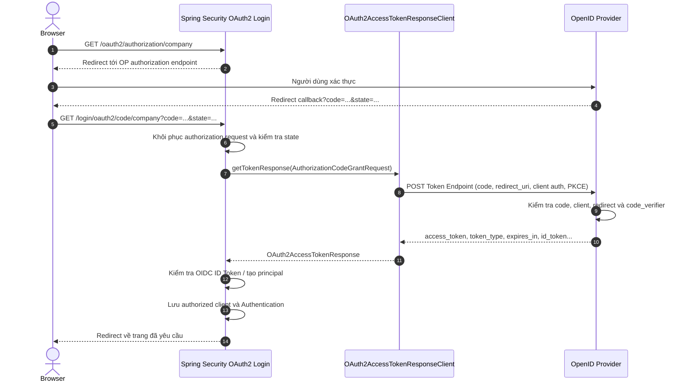

# 10.1. OAuth2AccessTokenResponseClient và vai trò trao đổi token

## 1. Từ authorization code đến token: bước nào thực sự gọi Token Endpoint?

Trong ứng dụng **Spring Security OAuth 2.0 / OIDC Client**, người dùng có thể đã đăng nhập thành công tại OpenID Provider (OP), và trình duyệt được chuyển về callback của ứng dụng:

```http
GET /login/oauth2/code/company?code=temporary-code&state=expected-state HTTP/1.1
Host: portal.example.com
```

Tại thời điểm đó, ứng dụng mới nhận được **authorization code**. Đây là mã tạm thời dùng để đổi lấy token, chưa phải access token hoặc ID Token. Spring Security phải gửi một yêu cầu HTTP **từ backend tới Token Endpoint** của Authorization Server. Bên nhận yêu cầu kiểm tra code, client authentication, redirect URI và PKCE (nếu dùng), rồi trả về phản hồi token.

**`OAuth2AccessTokenResponseClient`** là giao diện của Spring Security đại diện cho công việc **gửi yêu cầu lấy token và chuyển đổi phản hồi từ Token Endpoint thành `OAuth2AccessTokenResponse`**.

Ví dụ xuyên suốt bài học:

- **Employee Portal** là ứng dụng Spring Boot MVC/Servlet, đăng nhập qua OIDC bằng Authorization Code.
- Client registration tên `company` trỏ tới issuer `https://id.example.com/realms/company`.
- OP cấp code qua browser callback; backend dùng `OAuth2AccessTokenResponseClient<OAuth2AuthorizationCodeGrantRequest>` để đổi code lấy token.
- Kết quả bao gồm **access token** và, với OIDC Authorization Code flow, **ID Token** trong token response. Spring Security tiếp tục xác minh ID Token và tạo phiên đăng nhập.

> **Điểm quan trọng:** `OAuth2AccessTokenResponseClient` chịu trách nhiệm **trao đổi HTTP ở Token Endpoint** và phân tích response. Nó **không tự xác thực người dùng**, **không trực tiếp quyết định quyền truy cập API**, và **không thay thế** các bước correlation bằng `state`, PKCE hoặc kiểm tra ID Token.

## 2. Token Endpoint trong kiến trúc OAuth 2.0 và OIDC

### 2.1. Các thành phần tham gia

| Thành phần | Vai trò |
| --- | --- |
| **Browser** | Nhận redirect tới OP, sau đó đưa authorization code trở lại ứng dụng |
| **Spring Security OAuth2 Client** | Tạo authorization request, xử lý callback và điều phối việc đổi code lấy token |
| **`ClientRegistrationRepository`** | Tra cứu cấu hình registration: client ID, grant, token endpoint, cách xác thực client |
| **`OAuth2LoginAuthenticationFilter`** | Nhận callback Authorization Code trong ứng dụng Servlet |
| **`OAuth2AccessTokenResponseClient`** | Gửi token request tới Authorization Server và đọc token response |
| **Authorization Server / OpenID Provider** | Xác thực client, kiểm tra grant/code, cấp access token và ID Token nếu áp dụng |
| **`OAuth2AuthorizedClientRepository` / service** | Lưu thông tin authorized client gồm token đã nhận |
| **`Authentication` / `SecurityContext`** | Biểu diễn danh tính đã xác thực và duy trì session đăng nhập |

### 2.2. Sơ đồ luồng end-to-end



Điểm cần quan sát: **`OAuth2AccessTokenResponseClient` làm việc ở phía server**, bên trong quá trình xử lý callback. Browser không cần biết client secret hoặc nhận token từ token endpoint trực tiếp trong kiểu ứng dụng server-side này.

### 2.3. Authorization Endpoint và Token Endpoint khác nhau

| Nội dung | Authorization Endpoint | Token Endpoint |
| --- | --- | --- |
| Ai gọi thường gặp? | Trình duyệt qua redirect | Backend OAuth2 Client qua HTTP POST |
| Mục đích | Xác thực/ủy quyền và cấp authorization code | Đổi code, refresh token hoặc xin token theo grant khác |
| Dữ liệu chính | `client_id`, `redirect_uri`, `scope`, `state`, PKCE challenge | `grant_type`, `code` / `refresh_token`, `redirect_uri`, PKCE verifier, client authentication |
| Kết quả | Redirect về ứng dụng với `code` + `state` hoặc lỗi | Token response hoặc OAuth error |
| Thành phần Spring tùy chỉnh | `OAuth2AuthorizationRequestResolver` | **`OAuth2AccessTokenResponseClient`** |
| Có cần browser? | Với Authorization Code tương tác: có | Không cần browser cho request backend |

Một sai lầm thường gặp là thêm tham số của Token Endpoint vào `OAuth2AuthorizationRequestResolver`, rồi kỳ vọng tham số xuất hiện khi đổi code. Hai yêu cầu thuộc **hai pha khác nhau** và có điểm mở rộng riêng.

## 3. Giao diện `OAuth2AccessTokenResponseClient`

### 3.1. Contract cơ bản

Dạng rút gọn về ý nghĩa của giao diện trong Servlet stack:

```java
public interface OAuth2AccessTokenResponseClient<
        T extends AbstractOAuth2AuthorizationGrantRequest> {

    OAuth2AccessTokenResponse getTokenResponse(T authorizationGrantRequest);
}
```

Đoạn trên mô tả chữ ký cốt lõi để giải thích; import/interface đầy đủ do Spring Security cung cấp trong package `org.springframework.security.oauth2.client.endpoint`.

Có ba đối tượng cần phân biệt:

- **`T` — grant request**: dữ liệu đầu vào cần thiết cho **một loại OAuth grant**.
- **`getTokenResponse(...)`**: phương thức thực hiện trao đổi với Authorization Server (hoặc implementation tùy biến phù hợp).
- **`OAuth2AccessTokenResponse`**: kết quả đọc được từ token response sau khi trao đổi thành công.

Giao diện này có kiểu generic vì **Authorization Code, Client Credentials và Refresh Token có request khác nhau**, mặc dù đều nhận một token response theo giao thức OAuth 2.0.

### 3.2. Những grant request phổ biến

| Grant | Đầu vào generic `T` | Implementation theo hướng RestClient |
| --- | --- | --- |
| Authorization Code | `OAuth2AuthorizationCodeGrantRequest` | `RestClientAuthorizationCodeTokenResponseClient` |
| Client Credentials | `OAuth2ClientCredentialsGrantRequest` | `RestClientClientCredentialsTokenResponseClient` |
| Refresh Token | `OAuth2RefreshTokenGrantRequest` | `RestClientRefreshTokenTokenResponseClient` |

Các kiểu ở trên thuộc nhóm thành phần OAuth2 Client của Spring Security. Trong các phiên bản hỗ trợ những grant mở rộng như JWT Bearer hoặc Token Exchange, có thêm kiểu request và token response client tương ứng.

**Không dùng client của Client Credentials để đổi authorization code.** Mặc dù cùng giao tiếp với Token Endpoint, `grant_type`, tham số và cơ chế điều phối vòng đời của từng grant khác nhau.

### 3.3. Phân biệt đồng bộ và reactive

Bài này tập trung vào **Spring MVC/Servlet**:

| Servlet stack | Reactive/WebFlux stack |
| --- | --- |
| `OAuth2AccessTokenResponseClient<T>` | `ReactiveOAuth2AccessTokenResponseClient<T>` |
| `OAuth2AccessTokenResponse getTokenResponse(T)` | `Mono<OAuth2AccessTokenResponse> getTokenResponse(T)` |
| Implementation HTTP sử dụng `RestClient` hoặc `RestOperations` tùy phiên bản | Implementation HTTP thường dựa trên `WebClient` |
| Cấu hình qua `HttpSecurity` và `SecurityFilterChain` | Cấu hình qua `ServerHttpSecurity` và `SecurityWebFilterChain` |

Không đưa một `OAuth2AccessTokenResponseClient` kiểu Servlet vào API yêu cầu reactive client. Khác biệt về kiểu dữ liệu và cơ chế thực thi ảnh hưởng cả quá trình cấu hình.

## 4. Bên trong `OAuth2AuthorizationCodeGrantRequest` có gì?

Khi callback hợp lệ, Spring Security có sẵn bối cảnh đã được khởi tạo trước khi gọi Token Endpoint. Những dữ liệu này được gói trong một `OAuth2AuthorizationCodeGrantRequest`.

Về mặt khái niệm:

```text
OAuth2AuthorizationCodeGrantRequest
  ├─ ClientRegistration
  │    ├─ registrationId
  │    ├─ clientId
  │    ├─ clientAuthenticationMethod
  │    ├─ authorizationGrantType = authorization_code
  │    ├─ redirectUri
  │    └─ providerDetails.tokenUri
  │
  └─ OAuth2AuthorizationExchange
       ├─ OAuth2AuthorizationRequest
       │    ├─ state
       │    ├─ redirectUri
       │    ├─ scopes / attributes
       │    └─ code_verifier (khi dùng PKCE, được giữ ở client)
       └─ OAuth2AuthorizationResponse
            ├─ code
            ├─ state
            └─ redirectUri
```

Các trường quan trọng:

| Dữ liệu | Công dụng |
| --- | --- |
| `getClientRegistration()` | Xác định Token Endpoint, client ID và phương thức client authentication |
| `getAuthorizationExchange()` | Truy cập request gốc và response callback để lấy code, redirect URI và dữ liệu PKCE |
| `getAuthorizationResponse().getCode()` | Authorization code cần gửi trong token request |
| `getAuthorizationRequest().getRedirectUri()` | Redirect URI đã dùng trong Authorization Request |
| Attributes của authorization request | Có thể chứa `code_verifier` để hoàn tất PKCE |

Với Servlet OAuth2 Login mặc định, Spring Security dựng grant request sau khi xác minh callback/correlation. Client trao đổi token **không cần tự đọc query parameter `code` từ `HttpServletRequest`**.

**Không coi `OAuth2AuthorizationCodeGrantRequest` là đối tượng phải lưu lâu dài.** Authorization code và code verifier là dữ liệu tạm; xử lý xong cần tuân theo vòng đời bảo mật của thư viện.

## 5. HTTP request gửi tới Token Endpoint theo Authorization Code Grant

### 5.1. Ví dụ với `client_secret_basic`

Giả sử client registration:

```text
registrationId: company
clientId:       employee-portal
tokenUri:       https://id.example.com/realms/company/protocol/openid-connect/token
grant:          authorization_code
authentication: client_secret_basic
redirectUri:    https://portal.example.com/login/oauth2/code/company
```

Một yêu cầu minh họa:

```http
POST /realms/company/protocol/openid-connect/token HTTP/1.1
Host: id.example.com
Authorization: Basic <base64-encoded-client-id-and-secret>
Content-Type: application/x-www-form-urlencoded
Accept: application/json

grant_type=authorization_code&code=<authorization-code>&redirect_uri=https%3A%2F%2Fportal.example.com%2Flogin%2Foauth2%2Fcode%2Fcompany
```

Đây là ví dụ giao thức, không phải request được gửi tới server thật. Trong HTTP Basic, client ID/secret được mã hóa theo định dạng áp dụng; **Base64 không phải mã hóa bí mật**, nên kết nối tới Token Endpoint phải dùng **HTTPS/TLS**.

Nếu client authentication method là `client_secret_post`, secret có thể nằm trong form body theo quy định provider. Nếu là `private_key_jwt` hoặc mTLS, request có các yêu cầu riêng. **Method phải khớp cấu hình tại Authorization Server**, không thể tùy ý chuyển giữa các cách.

### 5.2. Khi dùng PKCE

PKCE liên kết authorization code với client đã khởi tạo authorization request. Ở giai đoạn authorization request, Spring gửi:

```text
code_challenge=<challenge-tu-verifier>
code_challenge_method=S256
```

Khi đổi code, Token Endpoint nhận thêm:

```text
code_verifier=<verifier-ban-dau>
```

Authorization Server kiểm tra verifier có phù hợp challenge ban đầu hay không. Kẻ tấn công chỉ lấy được code nhưng không có verifier sẽ không thể hoàn tất token exchange trong flow PKCE đúng chuẩn.

**Code verifier chỉ xuất hiện ở Token Endpoint**, không đặt vào authorization URL, callback query string hoặc log. Nếu code tự viết làm mất verifier giữa lúc bắt đầu login và callback, token endpoint có thể trả `invalid_grant`.

### 5.3. Phản hồi token thành công

Một phản hồi JSON minh họa:

```http
HTTP/1.1 200 OK
Content-Type: application/json
Cache-Control: no-store
Pragma: no-cache

{
  "access_token": "<access-token>",
  "token_type": "Bearer",
  "expires_in": 3600,
  "refresh_token": "<refresh-token-neu-duoc-cap>",
  "scope": "openid profile email",
  "id_token": "<id-token>"
}
```

Không phải nhà cung cấp hoặc grant nào cũng trả `refresh_token`; với OIDC Authorization Code flow có scope `openid`, token response hợp lệ phải có ID Token theo quy tắc áp dụng.

| Trường | Mục đích |
| --- | --- |
| `access_token` | Credential để client gọi API/Resource Server được cấp quyền |
| `token_type` | Loại token; thường là `Bearer` |
| `expires_in` | Số giây access token tồn tại kể từ lúc được cấp |
| `refresh_token` | Dùng để cấp mới access token khi nhà cung cấp cho phép |
| `scope` | Quyền thực tế được cấp, có thể khác phạm vi request |
| `id_token` | Thông tin xác thực OIDC của user; cần được **xác minh** bởi phần OIDC login |

**`OAuth2AccessTokenResponseClient` chuyển đổi response, còn xác minh ID Token thuộc phần xác thực OIDC.** Nhận được `id_token` trong JSON chưa có nghĩa claim `iss`, `aud`, `nonce` hoặc chữ ký đã hợp lệ.

## 6. `OAuth2AccessTokenResponse` lưu thông tin gì?

Một kết quả token response của Spring Security mang các phần thông tin chính:

```text
OAuth2AccessTokenResponse
  ├─ getAccessToken()
  │     ├─ tokenValue  (NHẠY CẢM)
  │     ├─ tokenType
  │     ├─ issuedAt
  │     ├─ expiresAt
  │     └─ scopes
  ├─ getRefreshToken()       (có thể null)
  └─ getAdditionalParameters()
        ├─ id_token         (OIDC, nếu token response có)
        └─ tham số bổ sung theo nhà cung cấp
```

Dữ liệu nhận được qua Token Endpoint có thể được chuyển sang đối tượng `OAuth2AuthorizedClient` bởi các thành phần phía trên. Riêng `OAuth2AccessTokenResponse` **không phải repository lưu trữ token** và không có trách nhiệm quyết định user có authority nào.

### 6.1. Đọc kết quả mà không làm lộ token

Ví dụ code minh họa cách truy cập metadata:

```java
OAuth2AccessTokenResponse response =
        accessTokenResponseClient.getTokenResponse(grantRequest);

OAuth2AccessToken accessToken = response.getAccessToken();

Instant expiresAt = accessToken.getExpiresAt();
Set<String> scopes = accessToken.getScopes();

boolean hasRefreshToken = response.getRefreshToken() != null;
boolean hasOidcIdToken = response.getAdditionalParameters()
        .containsKey("id_token");
```

Đây là **đoạn logic minh họa** trong vị trí đã có `accessTokenResponseClient` và `grantRequest`, không phải chương trình độc lập. Các import tương ứng thuộc `org.springframework.security.oauth2.core` và `java.time/java.util`.

Không đưa `getTokenValue()` hoặc `getRefreshToken().getTokenValue()` ra log, response HTTP công khai, metric label hoặc trace.

### 6.2. Token response không đồng nghĩa đã xác thực người dùng

Một OAuth 2.0 access token có thể đại diện cho client hoặc người dùng tùy grant. Token response client không biết mục đích nghiệp vụ của API nhận token, không tự xác minh access token tại Resource Server và không tự xây session.

Trong OIDC Login, các bước bổ sung thường bao gồm:

1. Xác minh ID Token theo issuer, audience, chữ ký/thuật toán, thời hạn và nonce khi áp dụng.
2. Tải/đối chiếu UserInfo nếu cần.
3. Tạo authenticated principal và authorities theo chính sách.
4. Lưu `OAuth2AuthorizedClient` thích hợp và `Authentication` vào ngữ cảnh đăng nhập.

Vì vậy, việc token endpoint trả `200 OK` **chưa bảo đảm login hoàn tất**.

## 7. Những implementation Spring Security thường dùng

Tên lớp và implementation mặc định thay đổi theo phiên bản Spring Security. Đối với dự án **Spring Security 6.4+**, các lớp dựa trên `RestClient` là lựa chọn hiện đại để trao đổi token. Trong nhiều dự án Spring Security 6.x cũ, có thể gặp lớp `DefaultAuthorizationCodeTokenResponseClient` dựa trên `RestOperations`. Ở Spring Security 7, các lớp `RestClient*TokenResponseClient` là hướng mặc định.

| Use case | Lớp Java | Ghi chú |
| --- | --- | --- |
| Authorization Code, RestClient | `RestClientAuthorizationCodeTokenResponseClient` | Dùng HTTP RestClient để đổi code lấy token |
| Authorization Code, implementation cũ | `DefaultAuthorizationCodeTokenResponseClient` | Xuất hiện trong các phiên bản 6.x; dựa trên `RestOperations` |
| Client Credentials | `RestClientClientCredentialsTokenResponseClient` | Lấy token cho client/service, không có callback người dùng |
| Refresh Token | `RestClientRefreshTokenTokenResponseClient` | Xin access token mới bằng refresh token |
| Reactive Authorization Code | `WebClientReactiveAuthorizationCodeTokenResponseClient` | Dành cho reactive WebFlux, trả `Mono` |

Hãy chọn API/implementation **phù hợp với phiên bản đang dùng** và tránh tạo hai token response client khác nhau cho cùng flow khi không cần. Tài liệu bên dưới dùng `RestClientAuthorizationCodeTokenResponseClient` để minh họa phần cấu hình tùy chỉnh.

## 8. Thiết lập Spring Boot Servlet cho Authorization Code / OIDC Login

### 8.1. Dependencies

Ví dụ Maven cho **Spring Boot 3.x / Spring Security 6.4+**:

```xml
<dependencies>
    <dependency>
        <groupId>org.springframework.boot</groupId>
        <artifactId>spring-boot-starter-web</artifactId>
    </dependency>
    <dependency>
        <groupId>org.springframework.boot</groupId>
        <artifactId>spring-boot-starter-security</artifactId>
    </dependency>
    <dependency>
        <groupId>org.springframework.boot</groupId>
        <artifactId>spring-boot-starter-oauth2-client</artifactId>
    </dependency>
</dependencies>
```

Thư viện `spring-boot-starter-oauth2-client` cung cấp các thành phần OAuth2 Client và OIDC Login. Khi ví dụ dùng `RestClient`, cần chọn phiên bản Spring Security có hỗ trợ `RestClientAuthorizationCodeTokenResponseClient`; class này được giới thiệu từ Spring Security 6.4.

### 8.2. Cấu hình client registration

```yaml
spring:
  security:
    oauth2:
      client:
        registration:
          company:
            provider: company-idp
            client-id: ${COMPANY_CLIENT_ID}
            client-secret: ${COMPANY_CLIENT_SECRET}
            client-authentication-method: client_secret_basic
            authorization-grant-type: authorization_code
            redirect-uri: "{baseUrl}/login/oauth2/code/{registrationId}"
            scope:
              - openid
              - profile
              - email
        provider:
          company-idp:
            issuer-uri: https://id.example.com/realms/company
```

`issuer-uri` chỉ đến issuer OIDC của nhà cung cấp. Trong môi trường có OIDC Discovery hợp lệ, Spring có thể lấy `authorization_endpoint`, `token_endpoint` và `jwks_uri` tương ứng.

Bảng diễn giải liên hệ với token exchange:

| Thuộc tính | Ảnh hưởng |
| --- | --- |
| `registration.company` | ID xác định client được sử dụng trong flow |
| `client-id` | Xác định ứng dụng khi gửi token request |
| `client-secret` | Bí mật xác thực confidential client nếu provider yêu cầu |
| `client-authentication-method` | Quyết định cách truyền client credentials tới Token Endpoint |
| `authorization-grant-type` | Chọn `authorization_code` |
| `redirect-uri` | Phải nhất quán giữa authorization request, token request và app registration |
| `provider.*.issuer-uri` | Định danh OP tin cậy, hỗ trợ khám phá Token Endpoint và xác thực ID Token |
| `scope: openid` | Cho biết đây là OIDC Login và yêu cầu có ID Token theo giao thức |

**Không hard-code client secret** vào source. Dùng biến môi trường/secret manager và chỉ gửi token request qua HTTPS.

### 8.3. Cấu hình mặc định: chưa cần tự tạo token response client

```java
import org.springframework.context.annotation.Bean;
import org.springframework.context.annotation.Configuration;
import org.springframework.security.config.Customizer;
import org.springframework.security.config.annotation.web.builders.HttpSecurity;
import org.springframework.security.web.SecurityFilterChain;

@Configuration
public class SecurityConfig {

    @Bean
    SecurityFilterChain securityFilterChain(HttpSecurity http) throws Exception {
        http.authorizeHttpRequests(authorize -> authorize
                .requestMatchers("/", "/css/**", "/error").permitAll()
                .anyRequest().authenticated()
            )
            .oauth2Login(Customizer.withDefaults());

        return http.build();
    }
}
```

Với `oauth2Login`, Spring Security tự thiết lập phần OAuth2 Login và lựa chọn token response client phù hợp với phiên bản/auto-configuration. Trình duyệt bắt đầu đăng nhập tại `/oauth2/authorization/company`, callback về `/login/oauth2/code/company` và framework gọi Token Endpoint.

**Không bắt buộc khai báo một `OAuth2AccessTokenResponseClient` bean riêng cho flow bình thường.** Chỉ tạo/cấu hình riêng khi có nhu cầu thực: thêm tham số provider yêu cầu, custom header, proxy/timeout hoặc chuyển đổi response từ một provider có hành vi đặc biệt.

## 9. Tùy chỉnh Token Endpoint bằng `RestClientAuthorizationCodeTokenResponseClient`

Một nhu cầu thường gặp là Authorization Server yêu cầu tham số bổ sung, chẳng hạn `audience` (tham số mở rộng của nhà cung cấp) trong token request cho **một registration cụ thể**.

Ta sẽ giữ nguyên các tham số mặc định `grant_type`, `code`, `redirect_uri`, client authentication và PKCE; chỉ thêm `audience` cho registration `company`.

### 9.1. Tạo `OAuth2AccessTokenResponseClient` bean

```java
package com.example.portal.security;

import org.springframework.context.annotation.Bean;
import org.springframework.context.annotation.Configuration;
import org.springframework.security.oauth2.client.endpoint.OAuth2AccessTokenResponseClient;
import org.springframework.security.oauth2.client.endpoint.OAuth2AuthorizationCodeGrantRequest;
import org.springframework.security.oauth2.client.endpoint.RestClientAuthorizationCodeTokenResponseClient;
import org.springframework.util.LinkedMultiValueMap;
import org.springframework.util.MultiValueMap;

@Configuration
public class TokenEndpointConfig {

    @Bean
    OAuth2AccessTokenResponseClient<OAuth2AuthorizationCodeGrantRequest>
            authorizationCodeTokenResponseClient() {

        var client = new RestClientAuthorizationCodeTokenResponseClient();

        client.addParametersConverter(grantRequest -> {
            MultiValueMap<String, String> params = new LinkedMultiValueMap<>();
            String registrationId = grantRequest
                    .getClientRegistration()
                    .getRegistrationId();

            if ("company".equals(registrationId)) {
                params.set("audience", "https://api.example.com");
            }

            return params;
        });

        return client;
    }
}
```

Điểm quan trọng:

1. Generic `OAuth2AuthorizationCodeGrantRequest` nói rõ bean phục vụ **Authorization Code Grant**.
2. `RestClientAuthorizationCodeTokenResponseClient` cung cấp việc gửi HTTP và xử lý token response.
3. `addParametersConverter(...)` nhận grant request và bổ sung tham số vào form body.
4. Chỉ registration `company` nhận `audience`; registration khác giữ tham số mặc định.
5. Giá trị `https://api.example.com` là ví dụ về audience do một provider có thể yêu cầu, **không phải tham số OAuth 2.0 bắt buộc**.
6. Nếu provider không hỗ trợ `audience`, không thêm tham số này.

Spring Security có sẵn các tham số chuẩn. Đừng tạo một bộ request thủ công chỉ có `audience` rồi làm mất `code`, `redirect_uri` hoặc `code_verifier`.

### 9.2. Gắn client vào `oauth2Login().tokenEndpoint()`

Có thể khai báo tường minh trong `SecurityFilterChain`:

```java
import org.springframework.context.annotation.Bean;
import org.springframework.context.annotation.Configuration;
import org.springframework.security.config.annotation.web.builders.HttpSecurity;
import org.springframework.security.oauth2.client.endpoint.OAuth2AccessTokenResponseClient;
import org.springframework.security.oauth2.client.endpoint.OAuth2AuthorizationCodeGrantRequest;
import org.springframework.security.web.SecurityFilterChain;

@Configuration
public class LoginSecurityConfig {

    @Bean
    SecurityFilterChain securityFilterChain(
            HttpSecurity http,
            OAuth2AccessTokenResponseClient<OAuth2AuthorizationCodeGrantRequest>
                    tokenResponseClient) throws Exception {

        http.authorizeHttpRequests(authorize -> authorize
                .requestMatchers("/", "/error").permitAll()
                .anyRequest().authenticated()
            )
            .oauth2Login(oauth2 -> oauth2
                .tokenEndpoint(token -> token
                    .accessTokenResponseClient(tokenResponseClient))
            );

        return http.build();
    }
}
```

Đoạn này là **lựa chọn thay thế** cho `SecurityFilterChain` tối thiểu ở mục 8.3. Trong một project minh họa, chỉ định nghĩa **một chain chính** nếu không có chủ đích dùng nhiều security matcher và `@Order`.

Từ Spring Security 6.2 trở lên, một bean có generic type `OAuth2AccessTokenResponseClient<OAuth2AuthorizationCodeGrantRequest>` cũng có thể được Spring Security nhận biết để cấu hình mặc định cho các thành phần OAuth2 Client tùy điều kiện và phiên bản. Cấu hình tường minh ở đây giúp người học thấy **đúng nơi** mà OAuth2 Login dùng custom token response client.

### 9.3. Kết quả HTTP trước và sau tùy chỉnh

**Trước khi thêm converter:**

```text
POST /token
Content-Type: application/x-www-form-urlencoded

grant_type=authorization_code
&code=<code>
&redirect_uri=<redirect-uri>
&code_verifier=<verifier-if-PKCE>
```

**Sau khi thêm converter cho `company`:**

```text
POST /token
Content-Type: application/x-www-form-urlencoded

grant_type=authorization_code
&code=<code>
&redirect_uri=<redirect-uri>
&code_verifier=<verifier-if-PKCE>
&audience=https%3A%2F%2Fapi.example.com
```

Các đoạn request được xuống dòng cho dễ xem, không phải định dạng form body gửi thật; client authentication headers/body còn phụ thuộc registration. Quan trọng nhất là converter **giữ các tham số chuẩn** và thêm một tham số theo yêu cầu provider.

## 10. Những điểm mở rộng khác của Token Response Client

`RestClientAuthorizationCodeTokenResponseClient` cung cấp các điểm tùy chỉnh cho **request headers**, **form parameters**, **RestClient HTTP transport**, **response mapping** và **OAuth error handling**. Nên chọn điểm mở rộng ít tác động nhất đủ đáp ứng yêu cầu.

### 10.1. Thêm hoặc thay thế HTTP headers

Khi cần thêm một header do nhà cung cấp yêu cầu, có thể dùng `addHeadersConverter(...)`:

```java
RestClientAuthorizationCodeTokenResponseClient tokenClient =
        new RestClientAuthorizationCodeTokenResponseClient();

tokenClient.addHeadersConverter(grantRequest -> {
    HttpHeaders headers = new HttpHeaders();

    if ("company".equals(
            grantRequest.getClientRegistration().getRegistrationId())) {
        headers.add("X-Integration-Name", "employee-portal");
    }

    return headers;
});
```

Đây là đoạn minh họa trong code cấu hình có import `HttpHeaders` và `RestClientAuthorizationCodeTokenResponseClient` phù hợp.

**`addHeadersConverter` bổ sung headers vào cấu hình chuẩn.** Nếu cần thay thế cách tạo tất cả headers, `setHeadersConverter(...)` cho phép cấu hình toàn diện hơn nhưng dễ làm mất `Authorization`, `Content-Type` hoặc chính sách xác thực client. Khi không có yêu cầu rõ ràng, nên giữ converter mặc định.

Đặc biệt, **không tự ghi log header `Authorization: Basic ...`** hoặc headers có client assertion/mTLS-related credentials. Việc truyền client credentials phải theo đúng `ClientAuthenticationMethod` trong registration và yêu cầu của Authorization Server.

### 10.2. Ba kiểu tùy chỉnh form parameters

| API | Hành vi | Trường hợp phù hợp |
| --- | --- | --- |
| `addParametersConverter(...)` | Thêm form parameters vào các tham số chuẩn | Thêm `audience`, `resource` hoặc tham số vendor |
| `setParametersConverter(...)` | Cung cấp converter thay thế để bổ sung/ghi đè các giá trị, còn các tham số mặc định vẫn được chuẩn bị theo cơ chế class | Provider cần ghi đè một tham số cụ thể |
| `setParametersCustomizer(...)` | Can thiệp trực tiếp vào tập parameters, có thể xóa hoặc thay đổi giá trị mặc định | Tương thích với provider có yêu cầu đặc biệt, cần hiểu rõ giao thức |

Ví dụ cần thêm `resource` cho một registration theo quy ước provider:

```java
tokenClient.addParametersConverter(grantRequest -> {
    MultiValueMap<String, String> params = new LinkedMultiValueMap<>();

    if ("partner".equals(
            grantRequest.getClientRegistration().getRegistrationId())) {
        params.set("resource", "https://partner.example.com/api");
    }

    return params;
});
```

`resource` có thể là **Resource Indicator** theo quy định hỗ trợ của Authorization Server. Không phải provider nào cũng chấp nhận tham số này ở cùng grant. Cần đọc hợp đồng OAuth/OIDC của provider trước khi cấu hình.

Khi dùng `setParametersCustomizer`, bạn có thể thay đổi những thông số mặc định như `grant_type`, `code`, `redirect_uri` hoặc `code_verifier`. Đó là khả năng rất mạnh nhưng cũng dễ làm Token Endpoint từ chối yêu cầu hoặc gây sai lệch bảo mật. Chỉ dùng nếu có lý do kỹ thuật chính xác và đã xác nhận hợp đồng giao thức.

### 10.3. Thay RestClient vì proxy, TLS hoặc timeout

Trong mạng doanh nghiệp, Token Endpoint có thể chỉ truy cập qua proxy, mTLS hoặc cần cấu hình timeout phù hợp. `RestClientAuthorizationCodeTokenResponseClient` có thể nhận một `RestClient` đã cấu hình bằng phương thức `setRestClient(...)`.

Ví dụ **cấu trúc RestClient tối thiểu có các thành phần cần thiết**:

```java
RestClient restClient = RestClient.builder()
        .messageConverters(converters -> {
            converters.clear();
            converters.add(new FormHttpMessageConverter());
            converters.add(
                    new OAuth2AccessTokenResponseHttpMessageConverter());
        })
        .defaultStatusHandler(new OAuth2ErrorResponseErrorHandler())
        .build();

RestClientAuthorizationCodeTokenResponseClient tokenClient =
        new RestClientAuthorizationCodeTokenResponseClient();

tokenClient.setRestClient(restClient);
```

Đây là ví dụ cấu hình transport, giả định class/import tương ứng từ Spring MVC và Spring Security đã sẵn có. `RestClient` được tạo có thể được mở rộng bằng `ClientHttpRequestFactory`, proxy, TLS và timeout theo yêu cầu deployment.

Tại sao các converter/error handler quan trọng?

- **`FormHttpMessageConverter`** chuyển form parameters thành HTTP body với `application/x-www-form-urlencoded`.
- **`OAuth2AccessTokenResponseHttpMessageConverter`** chuyển JSON token response sang đối tượng `OAuth2AccessTokenResponse`.
- **`OAuth2ErrorResponseErrorHandler`** nhận diện OAuth error response như `invalid_grant` hoặc `invalid_client` và chuyển thành cơ chế lỗi OAuth của Spring Security.

Nếu tự thay RestClient bằng một instance chỉ có JSON converter chung, token exchange có thể lỗi khi gửi form body hoặc phân tích phản hồi. Nếu thay error handler tùy tiện, ứng dụng có thể mất mã lỗi OAuth hữu ích.

**Không nên gửi lại authorization code một cách mù quáng khi timeout.** Đây là mã một lần dùng: Token Endpoint có thể đã đổi code thành công nhưng response bị mất trên đường truyền. Retry cùng code có thể trả `invalid_grant` và gây nhầm lẫn khi phân tích.

### 10.4. Phản hồi token từ nhà cung cấp không tuân theo định dạng chuẩn

OAuth 2.0 Token Endpoint phải trả về những trường cơ bản theo giao thức. Tuy nhiên, khi tích hợp hệ thống cũ, bạn có thể gặp:

- `expires_in` được trả dưới kiểu/định dạng không đúng như mong đợi.
- Field mở rộng không nằm trong danh sách chuẩn.
- Một số giá trị yêu cầu chuyển đổi đặc biệt trước khi Spring dùng.

`OAuth2AccessTokenResponseHttpMessageConverter` có điểm mở rộng cho **converter từ map parameters thành `OAuth2AccessTokenResponse`**. Đây là nơi xử lý chuẩn hóa có kiểm soát, thay vì viết một controller HTTP mới để tự lấy token.

Trình tự xử lý nên là:

```text
HTTP 200 từ Token Endpoint
        |
        v
HTTP message converter đọc response
        |
        v
Map/JSON token parameters được chuẩn hóa nếu cần
        |
        v
OAuth2AccessTokenResponse
        |
        v
Authentication Provider / Authorized Client Provider tiếp tục xử lý
```

Với các field đặc biệt chứa token, cần bảo đảm dữ liệu được giữ đầy đủ trong `additionalParameters` khi bước OIDC phía trên cần dùng. **Không tự tạo một ID Token giả hoặc bỏ qua việc xác minh ID Token** chỉ để làm OAuth2 Login tiếp tục.

Một implementation tự tạo của `OAuth2AccessTokenResponseClient` cũng có thể trả `OAuth2AccessTokenResponse`, nhưng khi làm vậy bạn chịu trách nhiệm đầy đủ cho HTTP, client authentication, PKCE, JSON, OAuth errors và bảo vệ bí mật. Ưu tiên customizer/converter được thư viện hỗ trợ nếu chúng giải quyết được yêu cầu.

## 11. Vai trò trong `oauth2Login`, `oauth2Client` và `OAuth2AuthorizedClientManager`

Tên giao diện chứa từ "AccessTokenResponse" nhưng không chỉ được dùng trong bước đăng nhập tương tác. Cùng contract có thể xuất hiện ở nhiều **OAuth2 authorization grant** và cấu hình.

### 11.1. `oauth2Login`: đổi code trong quá trình login

Với website dùng session:

```java
http.oauth2Login(oauth2 -> oauth2
        .tokenEndpoint(token -> token
                .accessTokenResponseClient(authorizationCodeClient))
);
```

Ở đây `authorizationCodeClient` có kiểu:

```java
OAuth2AccessTokenResponseClient<OAuth2AuthorizationCodeGrantRequest>
```

Sau khi lấy response, phần **OAuth2 Login Authentication Provider** còn thực hiện validation, xây dựng principal và lưu Authentication. `OAuth2AccessTokenResponseClient` chỉ là một mắt xích.

### 11.2. `oauth2Client`: Authorization Code cho nhu cầu gọi API

Khi ứng dụng là OAuth2 Client dùng Authorization Code Grant để lấy token gọi API, cấu hình tương ứng trong Servlet:

```java
http.oauth2Client(oauth2 -> oauth2
        .authorizationCodeGrant(codeGrant -> codeGrant
                .accessTokenResponseClient(authorizationCodeClient))
);
```

`oauth2Client` không tự đồng nghĩa với **OIDC login session**. Nó hỗ trợ authorization client để sử dụng quyền truy cập tài nguyên theo ngữ cảnh. Một website có thể dùng cả `oauth2Login` và `oauth2Client`, nhưng khi đó phải thiết kế rõ **flow nào sử dụng token client nào** và cách lưu authorized client.

### 11.3. Client Credentials: không có authorization code/callback

Giả sử một scheduled job dùng `client_credentials` để gọi Reports API. Token Endpoint nhận một yêu cầu như:

```http
POST /oauth2/token HTTP/1.1
Host: auth.example.com
Authorization: Basic <encoded-client-credentials>
Content-Type: application/x-www-form-urlencoded

grant_type=client_credentials&scope=reports.read
```

Spring Security sử dụng kiểu:

```java
OAuth2AccessTokenResponseClient<OAuth2ClientCredentialsGrantRequest>
```

và có implementation `RestClientClientCredentialsTokenResponseClient` trong những phiên bản hỗ trợ RestClient.

Ví dụ dựng provider tùy chỉnh:

```java
import org.springframework.security.oauth2.client.OAuth2AuthorizedClientProvider;
import org.springframework.security.oauth2.client.OAuth2AuthorizedClientProviderBuilder;
import org.springframework.security.oauth2.client.endpoint.RestClientClientCredentialsTokenResponseClient;

RestClientClientCredentialsTokenResponseClient clientCredentialsTokenClient =
        new RestClientClientCredentialsTokenResponseClient();

OAuth2AuthorizedClientProvider provider =
        OAuth2AuthorizedClientProviderBuilder.builder()
            .clientCredentials(configurer -> configurer
                    .accessTokenResponseClient(clientCredentialsTokenClient))
            .build();
```

Đây là **đoạn minh họa cấu hình provider**, không phải một class độc lập. Trong ứng dụng thật, provider cần được gắn vào `OAuth2AuthorizedClientManager` và kết hợp `ClientRegistrationRepository` / authorized client repository hoặc service thích hợp.

**Client Credentials không cần authorization callback của browser**, nên không truyền `OAuth2AuthorizationCodeGrantRequest` vào client của grant này.

### 11.4. Refresh Token: xin token mới theo phiên đã cấp quyền

Nếu provider cấp refresh token và chính sách cho phép, OAuth2 Client có thể dùng:

```java
OAuth2AccessTokenResponseClient<OAuth2RefreshTokenGrantRequest>
```

Với RestClient: `RestClientRefreshTokenTokenResponseClient`.

Request thường có `grant_type=refresh_token` và `refresh_token`, cùng phương thức client authentication thích hợp. Mục đích là lấy access token mới khi cần, theo cách `OAuth2AuthorizedClientManager`/provider điều phối.

**Refresh Token Grant không phải một authorization code callback mới**. Đừng nhầm token renewal với lần đăng nhập ban đầu.

### 11.5. So sánh trách nhiệm

| Thành phần | Khi nào được gọi | Kết quả chính |
| --- | --- | --- |
| `OAuth2AuthorizationRequestResolver` | Khi browser bắt đầu Authorization Code flow | `OAuth2AuthorizationRequest` và redirect URI |
| `OAuth2LoginAuthenticationFilter` | Khi browser quay về callback login | Khởi động authentication từ authorization response |
| **`OAuth2AccessTokenResponseClient`** | Khi một grant cần trao đổi với Token Endpoint | `OAuth2AccessTokenResponse` |
| `OAuth2AuthorizedClientProvider` | Khi cần cấp quyền/cấp lại token | `OAuth2AuthorizedClient` |
| `OAuth2AuthorizedClientManager` | Điều phối authorized client cho ứng dụng | Client có access token theo ngữ cảnh |
| `OAuth2AuthorizedClientRepository` / service | Sau khi có authorized client hoặc khi cần tra cứu | Trạng thái token đã lưu |
| `OAuth2UserService` / `OidcUserService` | Khi cần tạo user principal trong OAuth2/OIDC Login | `OAuth2User` / `OidcUser` |
| `SecurityContextRepository` | Duy trì authentication theo request/session | `SecurityContext` |

`OAuth2AccessTokenResponseClient` không lưu user session và không phải một nơi để quyết định role. **Mỗi lớp giải quyết một trách nhiệm** trong pipeline.

## 12. OIDC: `id_token` xuất hiện trong token response rồi được xử lý ra sao?

Với Authorization Code flow có scope `openid`, Token Endpoint của OP trả về **ID Token** theo đặc tả OIDC. Trong Spring Security, response client phân tích HTTP response, còn `OidcAuthorizationCodeAuthenticationProvider` và các thành phần liên quan xử lý xác minh danh tính.

Sơ đồ logic:

```text
OAuth2AccessTokenResponse
   ├─ OAuth2AccessToken (access token)
   ├─ OAuth2RefreshToken (nếu có)
   └─ Additional parameters
         └─ id_token
              |
              v
        OIDC authentication provider
              |
              +-- Kiểm tra chữ ký/issuer/audience/thời gian/nonce
              +-- UserInfo khi cần và đúng điều kiện
              |
              v
        OidcUser + Authentication
              |
              v
        SecurityContext và phiên người dùng
```

### 12.1. Tại sao token response client không giải mã rồi tự tin ID Token?

Một JWT có thể được Base64URL decode để đọc payload mà không cần biết khóa. Điều đó **không chứng minh tính xác thực**. OIDC Client phải xác minh:

- Chữ ký bằng khóa đáng tin cậy từ JWKS hoặc cơ chế phù hợp với thuật toán được đăng ký.
- `iss` khớp OP đã cấu hình.
- `aud` chứa client ID mong đợi.
- `exp`, `iat`, `nonce` và các claim khác phù hợp với flow.
- `azp`, `auth_time` hoặc claim liên quan theo điều kiện của OIDC.

Nếu validation thất bại, ứng dụng không được tạo phiên xác thực chỉ vì Token Endpoint từng trả HTTP 200.

### 12.2. Access token và ID Token phục vụ hai đối tượng nhận

| Token | Bên sử dụng | Mục đích |
| --- | --- | --- |
| **ID Token** | OIDC Client (Employee Portal) | Chứng minh thông tin xác thực user theo OIDC |
| **Access token** | Resource Server/API | Ủy quyền gọi API theo scope/audience và chính sách |
| **Refresh token** | OAuth2 Client tại token endpoint | Xin access token mới khi được phép |

Một API không nên chấp nhận ID Token như Bearer access token chỉ vì cả hai cùng là JWT. Ngược lại, website không nên đọc access token chưa xác minh như ID Token để nhận diện user.

## 13. Lỗi Token Endpoint: trả mã nào và xử lý ở đâu?

Khi Token Endpoint từ chối yêu cầu, phản hồi OAuth thường có mã lỗi trong JSON body cùng HTTP status phù hợp.

Ví dụ:

```http
HTTP/1.1 400 Bad Request
Content-Type: application/json
Cache-Control: no-store

{
  "error": "invalid_grant",
  "error_description": "Authorization code is invalid or expired"
}
```

`OAuth2AccessTokenResponseClient`/HTTP transport chịu trách nhiệm nhận diện lỗi và chuyển thành cơ chế exception của Spring Security, thường liên quan `OAuth2AuthorizationException`/`OAuth2Error`. Phần Login Authentication phía trên quyết định hành vi tiếp theo, chẳng hạn gọi failure handler và đưa người dùng về trang lỗi đăng nhập.

### 13.1. Bảng phân loại lỗi

| Lỗi/triệu chứng | Nguyên nhân có thể | Cần kiểm tra |
| --- | --- | --- |
| `invalid_client` | Sai client ID/secret, client bị khóa hoặc phương thức xác thực sai | `ClientRegistration`, secret manager, cấu hình Authorization Server |
| `invalid_grant` | Code hết hạn/đã dùng, redirect URI không khớp, PKCE verifier sai hoặc token request không hợp lệ | Authorization request, callback, redirect URI, PKCE |
| `unauthorized_client` | Client không được phép dùng grant hiện tại | Chính sách grant tại Authorization Server |
| `unsupported_grant_type` | Grant không được Token Endpoint hỗ trợ | `authorization-grant-type` và provider |
| `invalid_scope` | Scope bị yêu cầu sai hoặc chưa được cấp | Scope registration và chính sách provider |
| `invalid_request` | Thiếu/sai form parameter, field trùng lặp hoặc provider yêu cầu thêm thông tin | Converter tham số và hợp đồng token endpoint |
| HTTP 401 | Client authentication thất bại hoặc chính sách provider từ chối | Header Basic/client assertion/mTLS |
| HTTP 429 | Provider giới hạn tốc độ | Chiến lược retry có giới hạn và cache authorized client |
| HTTP 5xx | Token Endpoint lỗi máy chủ | Tình trạng provider, log, timeout/circuit breaker |
| Timeout/DNS/TLS | Backend không truy cập được Token Endpoint | Network, trust store, proxy, endpoint và TLS |
| Response không parse được | Content type/JSON/token fields sai hoặc converter bị thay không phù hợp | `RestClient`, message converters, provider response |

**Mã lỗi cụ thể tùy provider**, và một số lỗi HTTP có thể không có JSON OAuth error chuẩn. Vì vậy cần lưu cả loại lỗi, HTTP status và correlation ID, đồng thời che dữ liệu nhạy cảm.

### 13.2. Phân biệt lỗi trước và sau Token Endpoint

```text
Browser callback code + state
    |
    +-- state sai / thiếu request gốc
    |      → OAuth2 Login/correlation, chưa đến token client
    |
    v
OAuth2AccessTokenResponseClient gửi POST
    |
    +-- invalid_grant / invalid_client / timeout
    |      → token endpoint / client authentication / PKCE
    |
    v
HTTP token response thành công
    |
    +-- JSON không parse được
    |      → response converter / content type / provider
    |
    v
OIDC ID Token validation
    |
    +-- issuer / signature / audience / nonce sai
    |      → OIDC authentication, không phải HTTP token client
    |
    v
Authentication được tạo
    |
    +-- API trả 403 hoặc trang admin bị cấm
           → application authorization, role/scope mapping
```

Nếu phân biệt đúng nơi lỗi xảy ra, có thể xử lý sự cố mà không sửa nhầm các lớp bảo mật.

### 13.3. Retry cần hiểu bản chất từng grant

Không phải mọi token request đều có cùng khả năng retry:

- **Authorization Code:** code là giá trị một lần dùng. Nếu request đã xử lý tại OP nhưng response bị mất, retry có thể trả `invalid_grant`. Không retry vô hạn, tránh gửi cùng code nhiều lần một cách mù quáng.
- **Client Credentials:** có thể thực hiện grant mới khi token endpoint khôi phục, nhưng phải có timeout, giới hạn retry và backoff để không gây quá tải.
- **Refresh Token:** có thể có **refresh token rotation**. Retry cùng refresh token sau response bị mất có thể bị từ chối hoặc kích hoạt chính sách phát hiện reuse. Cần hiểu chính sách provider.
- **Lỗi client credentials/cấu hình sai:** retry liên tục sẽ không giải quyết `invalid_client` hoặc `unauthorized_client`.

Token response client làm việc ở điểm rất gần mạng và credentials, nên mọi retry/proxy/HTTP client customization cần được xem xét theo từng grant.

## 14. Bảo mật khi tùy chỉnh token exchange

### 14.1. Bảo vệ secrets và token

- Lưu `client_secret` hoặc private key trong secret manager/vault/KMS phù hợp; không hard-code trong code, YAML công khai hoặc frontend.
- Chỉ dùng Token Endpoint qua **HTTPS/TLS** và cấu hình xác thực chứng chỉ hợp lệ.
- Tránh log nguyên form body, Basic Authorization header, client assertion, `code_verifier`, authorization code, access token, refresh token hoặc ID Token.
- Áp dụng credential rotation và tách client registration giữa development/staging/production.
- Không chuyển token response nguyên xi về browser chỉ để hoàn tất session OIDC; session-based app có thể giữ token ở backend theo chính sách.

### 14.2. Giữ nguyên dữ liệu bảo mật do Spring cung cấp

Khi tùy chỉnh token request, tránh:

- Tự sửa `grant_type` sai với loại `OAuth2AuthorizationGrantRequest`.
- Ghi đè `code` bằng dữ liệu lấy từ query parameter không được đối chiếu.
- Thay `redirect_uri` khác authorization request gốc và giá trị đăng ký tại provider.
- Gửi `code_verifier` vào log hoặc đưa nó lên authorization URL.
- Tắt xác thực client để “sửa” lỗi `invalid_client`.
- Bỏ `state`/`nonce` validation ở lớp login để ép token exchange hoạt động.

Những ràng buộc này làm việc cùng nhau: state liên kết callback, PKCE ràng buộc code, client authentication ràng buộc ứng dụng và ID Token validation ràng buộc danh tính người dùng.

### 14.3. Bảo vệ môi trường đa nhà cung cấp

Nếu một ứng dụng có registrations `company` và `partner`:

- Mỗi registration có đúng issuer, token URI và client credentials riêng.
- Khi thêm provider-specific parameter, kiểm tra `grantRequest.getClientRegistration().getRegistrationId()` để chỉ áp dụng cho provider tương ứng.
- Không đọc token URI hoặc host trực tiếp từ input chưa xác minh của browser.
- Không gửi credentials của `company` tới Token Endpoint của `partner`.
- Nếu cần một token response client dùng chung, cấu hình phải giữ các chính sách tách biệt rõ ràng và không ghi đè mặc định của provider khác.

**Chọn token endpoint từ `ClientRegistration` đã được quản trị** thay vì theo tham số tùy ý của request giúp giảm nguy cơ SSRF và lộ credentials.

### 14.4. Quan sát hệ thống mà không lộ dữ liệu

Thông tin log/metrics có thể có giá trị:

```text
oauth.token.exchange
  registration_id=company
  grant_type=authorization_code
  result=success
  duration_ms=<duration>

oauth.token.exchange
  registration_id=partner
  grant_type=authorization_code
  result=failure
  oauth_error=invalid_client
```

Đây là ví dụ dữ liệu giám sát **đã loại bỏ bí mật**, không phải output thực tế. Tránh để token, secret, code hoặc toàn bộ response JSON vào trace span hoặc metric label. Khi cần correlation, tạo correlation ID riêng phục vụ observability thay vì dùng raw authorization code.

## 15. Hướng dẫn quan sát hành vi trong môi trường học tập

Các bước sau mô tả **kịch bản thực hành**, không khẳng định đã kết nối một Authorization Server thật.

### 15.1. Luồng thành công

1. Đăng ký confidential web client tại OP, bật Authorization Code Grant và khai báo callback chính xác.
2. Đặt `COMPANY_CLIENT_ID` và `COMPANY_CLIENT_SECRET` trong môi trường chạy Spring Boot.
3. Chạy ứng dụng có `oauth2Login` và client registration `company`.
4. Mở `http://localhost:8080/oauth2/authorization/company` trong browser.
5. Hoàn tất đăng nhập tại OP; browser được redirect về callback với `code` và `state`.
6. Spring Security khôi phục authorization request, xác thực correlation và dùng `OAuth2AccessTokenResponseClient` để gửi POST tới Token Endpoint.
7. Token Endpoint trả JSON hợp lệ; Spring tiếp tục xử lý OIDC ID Token và tạo Authentication.
8. Browser được chuyển tới trang đích. Các request sau dùng session/cookie để duy trì đăng nhập theo chính sách.

Với cấu hình có custom `audience`, kiểm tra **bằng cơ chế quan sát an toàn ở phía backend hoặc provider** xem tham số đã được gửi cho registration `company`. Không cần bật logging toàn bộ HTTP form body.

### 15.2. Vì sao Browser DevTools không thấy token request?

Token exchange ở kiểu ứng dụng Spring Boot server-side là **HTTP request backend → Authorization Server**, không phải browser → Token Endpoint. Browser DevTools thường chỉ thấy:

```text
GET /oauth2/authorization/company
  → 302 Redirect tới OP

Tương tác đăng nhập tại OP
  → 302 Callback với code và state

GET /login/oauth2/code/company?code=...&state=...
  → 302 sau khi backend xử lý

GET /dashboard
  → 200 OK sau khi session đã xác thực
```

Để quan sát token POST, dùng log kỹ thuật được masking, HTTP client metrics, distributed tracing hoặc audit của nhà cung cấp mà không lộ client secret/token.

### 15.3. Kịch bản phân biệt lỗi

| Tình huống chủ động tạo trong môi trường thử nghiệm | Kết quả cần hiểu |
| --- | --- |
| Callback thiếu state hoặc state không khớp | Không đến token exchange hợp lệ; bị chặn ở correlation |
| Client secret sai | Token Endpoint trả lỗi client authentication |
| Code đã dùng hoặc hết hạn | Token Endpoint từ chối `invalid_grant` |
| PKCE verifier sai | Token Endpoint từ chối grant |
| Provider yêu cầu `audience` nhưng converter chưa gửi | Token Endpoint có thể từ chối hoặc cấp token không có audience mong muốn, tùy policy |
| Response `access_token` thiếu/sai định dạng | Token response converter hoặc tầng trên không thể dùng response |
| ID Token có `iss`/`aud` sai | Token exchange có thể hoàn tất nhưng OIDC Login vẫn thất bại |
| Access token không đủ scope khi gọi API | Resource Server trả lỗi phân quyền, không phải lỗi token exchange |

Đây là các **kịch bản hành vi**, không phải checklist QA của STEP 4 và cũng không phải khẳng định đã chạy tự động.

## 16. Những nhầm lẫn thường gặp

### 16.1. "Có `OAuth2AccessTokenResponseClient` là đã đăng nhập được?"

**Chưa.** Nó chỉ là client HTTP lấy token. Ứng dụng còn cần `ClientRegistration` đúng, authorization request/callback, kiểm tra state, OIDC validation, tạo Authentication và lưu session nếu là website đăng nhập.

### 16.2. "Có thể dùng `OAuth2AccessTokenResponseClient` để gọi API nghiệp vụ không?"

Không phải công dụng chính. `OAuth2AccessTokenResponseClient` gọi **Token Endpoint** để lấy token. Khi gọi Resource Server/API nghiệp vụ, dùng `RestClient`/`WebClient` hoặc API client thích hợp và đính kèm Bearer access token do `OAuth2AuthorizedClientManager`/repository quản lý.

### 16.3. "Dùng chung một implementation cho mọi grant được không?"

Giao diện generic giống nhau, nhưng **grant request và form parameters khác nhau**. Với Authorization Code dùng client tương ứng; Client Credentials/Refresh Token có implementation riêng và policy token lifecycle khác. Có thể dùng cấu hình HTTP transport chung có kiểm soát nhưng không thay loại grant request một cách tùy tiện.

### 16.4. "Muốn thêm `prompt` hoặc `login_hint` thì chỉnh token client?"

Thông thường **không**. `prompt`, `login_hint`, `ui_locales` là tham số của **Authorization Request** gửi browser tới Authorization Endpoint. Cần dùng `OAuth2AuthorizationRequestResolver` để tùy chỉnh. Token Endpoint nhận grant-specific form parameters như `code`, `redirect_uri`, `code_verifier` hoặc tham số bổ sung mà provider yêu cầu.

### 16.5. "Có cần tự cấu hình `RestClientAuthorizationCodeTokenResponseClient` không?"

Không cho trường hợp tiêu chuẩn. Spring Security đã có implementation mặc định theo phiên bản. Chỉ cấu hình riêng khi có nhu cầu về provider-specific parameters, headers, proxy/timeout, chuyển đổi response hoặc error handling.

### 16.6. "Tại sao Token Endpoint trả 200 nhưng không có phiên đăng nhập?"

OIDC Client còn phải xác minh **ID Token** và các claim, tạo principal, lưu SecurityContext/session. Nếu ID Token không hợp lệ, thiếu nonce phù hợp, sai issuer/audience hoặc bị lỗi UserInfo, login vẫn có thể thất bại sau token exchange.

### 16.7. "Nên đặt retry ngay trong custom token client?"

Chỉ đặt retry khi hiểu chính xác loại grant và tính một lần dùng của credentials tạm thời. Authorization Code và refresh token rotation rất nhạy với retry sau timeout. Cần chọn chính sách retry/breaker theo provider và tuyệt đối tránh retry vô hạn.

### 16.8. "Tùy chỉnh `RestClient` có cần cấu hình JSON converter không?"

Có thể cần các converter **chuyên dụng** cho form request, OAuth2 token response và OAuth2 error. RestClient tự tạo theo cách tùy tiện có thể thiếu `FormHttpMessageConverter`, `OAuth2AccessTokenResponseHttpMessageConverter` hoặc `OAuth2ErrorResponseErrorHandler`. Nên bắt đầu với cấu hình mặc định hoặc xây dựng đầy đủ các thành phần cần thiết.

## 17. Tổng kết theo vai trò trao đổi token

Trong luồng **Authorization Code + OIDC Login**, Spring Security trải qua các bước:

1. Browser nhận authorization code từ Authorization Server và quay về callback.
2. Spring Security khôi phục authorization request, kiểm tra state và dữ liệu correlation.
3. OAuth2 Login tạo **`OAuth2AuthorizationCodeGrantRequest`** từ registration và authorization exchange.
4. **`OAuth2AccessTokenResponseClient`** gửi request tới Token Endpoint, thực hiện client authentication/PKCE theo cấu hình và chuyển HTTP response thành **`OAuth2AccessTokenResponse`**.
5. Các thành phần OIDC phía trên tiếp tục xác minh ID Token và tạo authenticated principal.
6. Spring lưu authorized client/Authentication và đưa người dùng về trang đích.

Lợi ích của việc hiểu đúng interface này là biết **chỉnh ở đâu khi Token Endpoint cần tham số hoặc transport đặc biệt**, đồng thời tránh tự viết lại toàn bộ callback, token exchange, OIDC validation và session management.

Khi **cấu hình bình thường**, chỉ cần `ClientRegistration` đúng và `oauth2Login(Customizer.withDefaults())`. Khi cần **tùy chỉnh Token Endpoint**, tạo `RestClientAuthorizationCodeTokenResponseClient`, dùng `addParametersConverter`/`addHeadersConverter` hoặc cấu hình `RestClient` phù hợp, rồi gắn nó tại `oauth2Login().tokenEndpoint().accessTokenResponseClient(...)`. Mỗi grant dùng kiểu response client phù hợp và mọi thay đổi phải giữ nguyên các yêu cầu bảo mật của OAuth 2.0/OIDC.

### Tài liệu tham khảo

- [Spring Security — Authorization Grant Support (Servlet)](https://docs.spring.io/spring-security/reference/servlet/oauth2/client/authorization-grants.html)
- [Spring Security — OAuth2 Client: token request customization](https://docs.spring.io/spring-security/reference/servlet/oauth2/index.html)
- [Spring Security — OAuth2 Login Advanced Configuration](https://docs.spring.io/spring-security/reference/servlet/oauth2/login/advanced.html)
- [Spring Security — OAuth2 Client Core Interfaces and Classes](https://docs.spring.io/spring-security/reference/servlet/oauth2/client/core.html)
- [OAuth 2.0, RFC 6749: Access Token Request and Response](https://www.rfc-editor.org/rfc/rfc6749#section-4.1.3)
- [PKCE, RFC 7636](https://www.rfc-editor.org/rfc/rfc7636)
- [OpenID Connect Core 1.0: Authorization Code Flow](https://openid.net/specs/openid-connect-core-1_0.html#CodeFlowAuth)
