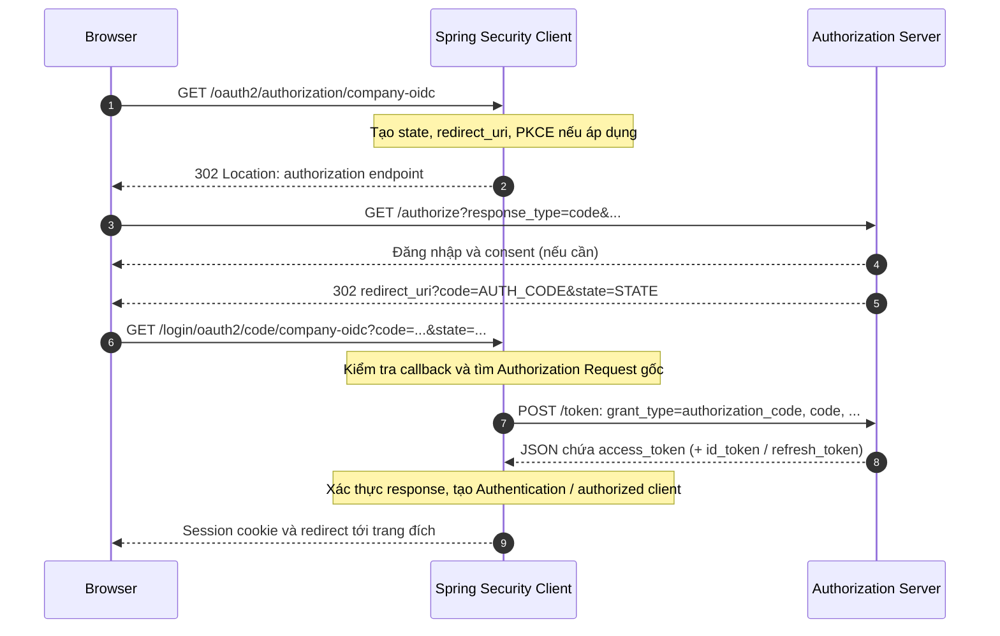
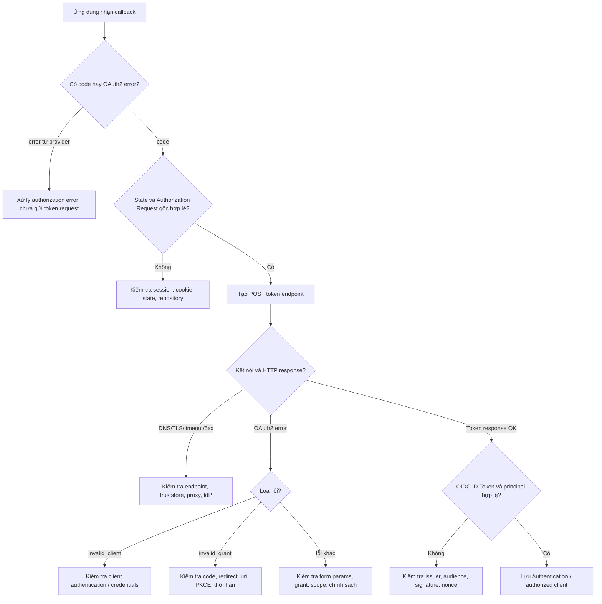

# 10.2. Yêu cầu đổi authorization code lấy token

Trong **Spring Security OAuth 2.0 / OpenID Connect (OIDC) Client**, sau khi người dùng xác thực với Authorization Server (hoặc OpenID Provider), trình duyệt được chuyển về ứng dụng kèm một **authorization code**. Mã này chưa phải access token. Ứng dụng Spring phải gửi một HTTP request tới **token endpoint** để đổi mã thành access token và, tùy giao thức, nhận thêm ID Token hoặc refresh token.

Đây là bước đặc trưng của **Authorization Code Grant**: trình duyệt chỉ mang mã ủy quyền ngắn hạn trong callback, còn ứng dụng server-side thực hiện token request qua kết nối trực tiếp với nhà cung cấp danh tính. Spring Security cung cấp sẵn các thành phần để kiểm tra callback, tạo request đúng định dạng, xác thực client, gửi `code_verifier` khi dùng PKCE, đọc token response và hoàn thành đăng nhập.

Mục tiêu bài học là hiểu chính xác **yêu cầu đổi authorization code lấy token**: khi nào request được gửi, những trường nào phải có, cách chúng liên quan đến Authorization Request trước đó, cách cấu hình trong Spring Security và cách xử lý các lỗi thường gặp.

## 1. Token request nằm ở đâu trong Authorization Code Flow?

Ba loại HTTP request rất dễ bị nhầm:

| Giai đoạn | Ai gửi? | Endpoint đích | Mục đích |
|---|---|---|---|
| Khởi tạo ủy quyền | Trình duyệt được ứng dụng redirect | Authorization endpoint của provider | Người dùng đăng nhập, đồng ý cấp quyền nếu cần. |
| Callback | Provider redirect **trình duyệt** về ứng dụng | `/login/oauth2/code/{registrationId}` (mặc định ở Servlet) | Gửi `code` và `state` về client. |
| **Đổi mã lấy token** | **Backend Spring OAuth2 Client** | **Token endpoint** của provider | Gửi `authorization_code`, `code` và các tham số ràng buộc để nhận token. |

Đường dẫn `/oauth2/authorization/{registrationId}` thuộc ứng dụng và dùng để **bắt đầu** đăng nhập. Đường dẫn `/login/oauth2/code/{registrationId}` cũng thuộc ứng dụng, nhưng dùng để **nhận callback**. Token endpoint, ví dụ `https://idp.example.org/realms/company/protocol/openid-connect/token`, thuộc provider và được Spring gọi từ backend bằng HTTP POST.



Ở bước gửi token request, **không cần browser gửi client secret hoặc access token**. Confidential client xác thực với provider ở kênh backend. Nếu ứng dụng dùng public client, chẳng hạn ứng dụng không giữ được bí mật, cơ chế client authentication có thể là `none` và PKCE đóng vai trò rất quan trọng.

## 2. Điều kiện để đổi được authorization code

Token exchange chỉ có ý nghĩa khi client đã nhận authorization code từ một authorization request hợp lệ. Trước khi Spring gửi HTTP POST, các điều kiện sau cần được thiết lập hoặc được giao thức kiểm tra:

1. **Authorization Server đã cấp code:** callback có tham số `code` và đáp ứng những điều kiện cần thiết, thay vì trả `error=access_denied` hoặc một OAuth2 authorization error khác.
2. **Client nhận diện được authorization request ban đầu:** thông tin `state` và dữ liệu liên quan cần khớp với yêu cầu đã lưu trong session/repository.
3. **ClientRegistration xác định đúng provider:** `token-uri`, `client-id`, client authentication method và grant type phải phù hợp với client đã đăng ký.
4. **Code còn hợp lệ:** code có thời hạn ngắn, thường chỉ dùng được một lần và được ràng buộc với client cũng như redirect URI theo chính sách provider.
5. **Redirect URI nhất quán:** nếu đã gửi `redirect_uri` trong Authorization Request, token request phải dùng cùng giá trị theo yêu cầu của OAuth 2.0.
6. **PKCE nhất quán nếu áp dụng:** token request phải mang `code_verifier` khớp với `code_challenge` đã gửi khi bắt đầu ủy quyền.
7. **Client authentication đúng:** confidential client phải sử dụng phương thức đã đăng ký, chẳng hạn `client_secret_basic`; public client không gửi client secret.

Không nên xem việc “callback có code” là bằng chứng người dùng đã đăng nhập thành công. Spring phải hoàn tất token exchange và các bước xác thực tương ứng trước khi thiết lập principal của ứng dụng.

## 3. Định dạng HTTP POST tới token endpoint

Theo Authorization Code Grant trong OAuth 2.0, request cơ bản dùng **HTTP POST** với body được mã hóa theo `application/x-www-form-urlencoded`. Ví dụ một confidential client dùng `client_secret_basic` và PKCE:

```http
POST /realms/company/protocol/openid-connect/token HTTP/1.1
Host: idp.example.org
Content-Type: application/x-www-form-urlencoded
Accept: application/json
Authorization: Basic <CLIENT_CREDENTIALS_REDACTED>

grant_type=authorization_code&
code=AUTHORIZATION_CODE&
redirect_uri=https%3A%2F%2Fapp.example.org%2Flogin%2Foauth2%2Fcode%2Fcompany-oidc&
code_verifier=ORIGINAL_PKCE_VERIFIER
```

Đây là HTTP minh họa. Trong request thật, body form được mã hóa thành chuỗi hợp lệ trên wire và thông tin xác thực phải do HTTP client tạo theo client authentication method đã cấu hình. Không sao chép ví dụ rồi ghi `Authorization` header chứa credential thật vào tài liệu hoặc log.

### 3.1. Các trường cần hiểu

| Trường | Bắt buộc/khi nào dùng | Giải thích |
|---|---|---|
| `grant_type` | Bắt buộc | Giá trị cố định `authorization_code` để provider biết loại grant đang được đổi token. |
| `code` | Bắt buộc | Mã từ authorization response; phải giữ nguyên giá trị, không đổi thành ID Token hoặc access token. |
| `redirect_uri` | Bắt buộc nếu đã được gửi trong authorization request; Spring thường gửi | Phải khớp redirect URI đã dùng khi xin code, gồm scheme/host/port/path theo quy tắc provider. |
| `client_id` | Cần để nhận diện client; cách gửi phụ thuộc client authentication | Với public client, thường gửi trong body. Với `client_secret_basic`, danh tính client đã được biểu đạt trong Authorization header. |
| `client_secret` | **Không** phải trường bắt buộc của mọi client | Nếu dùng `client_secret_post`, secret được gửi trong form body; nếu dùng `client_secret_basic`, gửi qua HTTP Basic. Public client `none` không có secret. |
| `code_verifier` | Bắt buộc khi authorization request đã dùng PKCE | Chuỗi ngẫu nhiên bí mật của lần authorization; provider đối chiếu với `code_challenge` đã nhận trước đó. |
| Tham số mở rộng như `resource`, `audience` | Chỉ khi provider/hợp đồng API yêu cầu | Có thể cần cho một số Authorization Server; không thuộc bộ tham số mặc định bắt buộc của mọi token request. |

**Không có `state` trong body token request thông thường.** `state` dùng để tương quan callback với Authorization Request và phải được kiểm tra trước khi thực hiện token exchange. Tương tự, `code_challenge` thuộc **authorization request**; token request gửi **`code_verifier`**. `nonce` của OIDC thuộc yêu cầu xác thực và được xác minh với ID Token, không phải một tham số mặc định của form đổi code.

### 3.2. Vì sao `redirect_uri` phải khớp?

Giả sử trình duyệt bắt đầu flow với:

```text
redirect_uri=https://app.example.org/login/oauth2/code/company-oidc
```

Token request lại gửi:

```text
redirect_uri=http://internal-app:8080/login/oauth2/code/company-oidc
```

Provider có thể trả `invalid_grant` vì giá trị không giống URI đã dùng khi cấp code. Nguyên nhân phổ biến là reverse proxy khiến ứng dụng xây dựng URL theo địa chỉ nội bộ. Cần kiểm tra request thực tế, cấu hình forwarded headers, context path và redirect URI đã đăng ký với provider.

Đừng tự viết lại redirect URI ở giai đoạn token exchange để “khớp” với domain mà code đang chạy. Hãy bảo đảm giá trị nhất quán ngay từ bước tạo Authorization Request.

### 3.3. Client authentication là một phần của token request

Một token endpoint thường hỗ trợ một hoặc nhiều phương thức client authentication:

- **`client_secret_basic`:** truyền client ID và client secret bằng HTTP Basic qua TLS. Đây là lựa chọn thông dụng cho confidential client.
- **`client_secret_post`:** truyền client ID và secret trong form body. Chỉ dùng khi provider và chính sách bảo mật cho phép.
- **`none`:** public client không chứng minh danh tính bằng secret; yêu cầu PKCE phù hợp với chuẩn/chính sách provider.
- **`private_key_jwt` hoặc phương thức dựa trên khóa/chứng thư:** client tạo assertion hoặc dùng cơ chế mật mã được provider chấp nhận; cần cấu hình riêng và không được thay bằng secret giả.

Một registration cần khai báo đúng `client-authentication-method`. Nếu provider yêu cầu `client_secret_basic` nhưng client gửi `client_secret_post` hoặc ngược lại, token endpoint có thể trả `invalid_client` dù `client-id` đúng.

### 3.4. Public client với PKCE

Ví dụ trường hợp client không có secret; form body cần nhận diện client và gửi verifier:

```http
POST /oauth2/token HTTP/1.1
Host: idp.example.org
Content-Type: application/x-www-form-urlencoded

grant_type=authorization_code&
client_id=public-client&
code=AUTHORIZATION_CODE&
redirect_uri=https%3A%2F%2Fapp.example.org%2Fcallback&
code_verifier=ORIGINAL_PKCE_VERIFIER
```

Đây là minh họa về HTTP, **không phải chỉ dẫn để sử dụng public client cho mọi ứng dụng Spring MVC**. Một BFF/server-side app giữ được secret có thể là confidential client và vẫn dùng PKCE để tăng khả năng bảo vệ authorization code. Cách client được phân loại phải phù hợp với hồ sơ đăng ký tại provider.

## 4. PKCE liên kết hai HTTP request ra sao?

PKCE (Proof Key for Code Exchange, RFC 7636) làm cho authorization code bị chặn bắt khó bị một bên thứ ba đổi lấy token.

Trong lúc bắt đầu Authorization Request, client tạo `code_verifier` có entropy cao rồi dẫn xuất `code_challenge`. Với phương thức `S256` phổ biến:

\[
\text{code\_challenge}
= \operatorname{BASE64URL\_NO\_PAD}\left(\operatorname{SHA256}(\text{ASCII(code\_verifier)})\right)
\]

Tham số ở hai bước:

| Authorization endpoint | Token endpoint |
|---|---|
| `code_challenge=<derived value>` | `code_verifier=<original random value>` |
| `code_challenge_method=S256` | Không cần gửi lại `code_challenge_method` trong form đổi code. |
| `state` để nhận diện phản hồi | Không thay thế `code_verifier` bằng `state`. |

Authorization Server ghi nhận challenge khi cấp code, rồi tính lại giá trị từ verifier trong token request. Nếu không khớp, provider từ chối. Code và verifier là dữ liệu của **cùng một lần** khởi tạo ủy quyền; không tái sử dụng verifier cố định giữa các phiên.

Trong Spring Security, khi PKCE được áp dụng theo cấu hình và phiên bản, dữ liệu liên quan được mang qua `OAuth2AuthorizationRequest` và kho lưu request để có thể gửi verifier lúc đổi code. Nếu tự cài resolver hoặc repository, phải giữ những thuộc tính này và không phá vỡ vòng đời lưu trạng thái. Không cần tự nối `code_verifier` vào URL của browser.

**PKCE không thay thế hoàn toàn việc kiểm tra `state`, issuer, redirect URI hoặc client authentication.** Mỗi biện pháp bảo vệ một phần khác nhau của giao thức.

## 5. Spring Security Servlet tự động thực hiện token request

Với ứng dụng Servlet/MVC dùng `spring-boot-starter-oauth2-client`, thông thường **không cần tạo controller `POST /token`**. Khi provider redirect về `/login/oauth2/code/{registrationId}`, chuỗi Spring Security đảm nhiệm bước token exchange.

Luồng thành phần chính:

```text
Browser callback /login/oauth2/code/company-oidc
       |
       v
OAuth2LoginAuthenticationFilter
       |
       +--> AuthorizationRequestRepository
       |    (tìm request gốc, đối chiếu state)
       |
       +--> ClientRegistrationRepository
       |    (tìm clientId, tokenUri, method, redirectUri)
       |
       v
OAuth2 login authentication provider
       |
       v
OAuth2AccessTokenResponseClient<OAuth2AuthorizationCodeGrantRequest>
       |
       +--> HTTP POST /token (authorization_code)
       |
       v
OAuth2AccessTokenResponse
       |
       +--> xử lý OAuth2 user / OIDC ID Token theo luồng
       |
       v
Authentication + OAuth2AuthorizedClient
```

Một số kiểu Java quan trọng:

| Kiểu/thành phần | Vai trò |
|---|---|
| `OAuth2AuthorizationRequest` | Thông tin authorization request gốc (scope, state, redirect URI, attributes liên quan). |
| `OAuth2AuthorizationResponse` | Thông tin phản hồi từ callback, có `code` hoặc OAuth2 error. |
| `OAuth2AuthorizationExchange` | Kết hợp request ban đầu và response callback để phục vụ token exchange. |
| `OAuth2AuthorizationCodeGrantRequest` | Đối tượng biểu diễn yêu cầu đổi authorization code trên client. |
| `OAuth2AccessTokenResponseClient<OAuth2AuthorizationCodeGrantRequest>` | Giao diện gửi token request và phân tích token response trong Servlet. |
| `OAuth2AccessTokenResponse` | Kết quả token endpoint: access token, scopes, refresh token (nếu có), additional parameters. |
| `OAuth2AuthorizedClient` | Dữ liệu access/refresh token đã cấp cho registration và principal, để ứng dụng dùng cho các lời gọi API sau này. |
| `OAuth2LoginAuthenticationFilter` | Filter Servlet tiếp nhận callback và khởi động quá trình authentication phía Spring Security. |

Spring Security có HTTP client triển khai giao diện token response client, chẳng hạn `RestClientAuthorizationCodeTokenResponseClient` ở các phiên bản Spring Security mới; các phiên bản cũ có thể dùng `DefaultAuthorizationCodeTokenResponseClient`. Hợp đồng API và cơ chế kết nối có thể khác nhau tùy phiên bản. Phần cốt lõi không đổi là Spring tạo một token request từ Authorization Code Grant, gửi qua HTTPS và xử lý response.

### 5.1. Cấu hình ClientRegistration với token endpoint qua OIDC discovery

Ví dụ `application.yml`:

```yaml
spring:
  security:
    oauth2:
      client:
        registration:
          company-oidc:
            provider: company
            client-id: "${OIDC_CLIENT_ID}"
            client-secret: "${OIDC_CLIENT_SECRET}"
            client-authentication-method: client_secret_basic
            authorization-grant-type: authorization_code
            redirect-uri: "{baseUrl}/login/oauth2/code/{registrationId}"
            scope:
              - openid
              - profile
              - email
        provider:
          company:
            issuer-uri: "https://idp.example.org/realms/company"
```

`issuer-uri` là định danh chính xác của OpenID Provider. Khi provider hỗ trợ OIDC discovery và metadata hợp lệ, Spring có thể tìm `authorization_endpoint`, `token_endpoint`, `jwks_uri` và thông tin cần thiết khác từ metadata của provider.

Ở ví dụ này, giá trị thực tế của `client-id`, `client-secret` phải đến từ environment/secret manager. URI và domain là dữ liệu minh họa. Provider phải được cấu hình để chấp nhận client authentication method, redirect URI và scope tương ứng.

### 5.2. Trường hợp phải khai báo token URI

Nếu provider không hỗ trợ discovery, hoặc ứng dụng có yêu cầu cấu hình thủ công, có thể khai báo endpoint trực tiếp:

```yaml
spring:
  security:
    oauth2:
      client:
        registration:
          my-provider:
            client-id: "${OAUTH_CLIENT_ID}"
            client-secret: "${OAUTH_CLIENT_SECRET}"
            authorization-grant-type: authorization_code
            client-authentication-method: client_secret_basic
            redirect-uri: "{baseUrl}/login/oauth2/code/{registrationId}"
            scope: [profile.read]
        provider:
          my-provider:
            authorization-uri: "https://auth.example.org/oauth2/authorize"
            token-uri: "https://auth.example.org/oauth2/token"
            user-info-uri: "https://auth.example.org/api/userinfo"
            user-name-attribute: "id"
```

Ví dụ thứ hai minh họa OAuth2 Login với provider không dùng OIDC, nên không có `openid` hoặc `issuer-uri`. Với OAuth2 Login dựa trên UserInfo, cách cấu hình user-info URI và thuộc tính định danh người dùng phụ thuộc provider. Khi chọn OIDC Login, cần cấu hình issuer và phần xác minh ID Token phù hợp thay vì cố xem một OAuth2 provider bất kỳ là OpenID Provider.

Không đổi `token-uri` thành authorization endpoint hoặc callback của ứng dụng: đó là ba địa chỉ phục vụ ba bước khác nhau.

### 5.3. Cấu hình Spring Security

```java
import org.springframework.context.annotation.Bean;
import org.springframework.context.annotation.Configuration;
import org.springframework.security.config.Customizer;
import org.springframework.security.config.annotation.web.builders.HttpSecurity;
import org.springframework.security.web.SecurityFilterChain;

@Configuration
class SecurityConfig {

    @Bean
    SecurityFilterChain filterChain(HttpSecurity http) throws Exception {
        http
            .authorizeHttpRequests(authorize -> authorize
                .requestMatchers("/", "/error").permitAll()
                .anyRequest().authenticated()
            )
            .oauth2Login(Customizer.withDefaults())
            .oauth2Client(Customizer.withDefaults());

        return http.build();
    }
}
```

Khi `oauth2Login()` được bật và ứng dụng có `ClientRegistration` hợp lệ, Spring Security tổ chức phần redirect/callback/token exchange. `oauth2Client()` giúp tích hợp các use case quản lý authorized client khi ứng dụng gọi API downstream. Không cần gọi token endpoint thủ công từ MVC controller sau khi người dùng đã đăng nhập bằng OAuth2 Login.

### 5.4. Kiểm tra kết quả đã có token

Sau khi xác thực, một controller Servlet có thể nhận authorized client tương ứng:

```java
import org.springframework.security.oauth2.client.OAuth2AuthorizedClient;
import org.springframework.security.oauth2.client.annotation.RegisteredOAuth2AuthorizedClient;
import org.springframework.web.bind.annotation.GetMapping;
import org.springframework.web.bind.annotation.RestController;

@RestController
class IdentityController {

    @GetMapping("/session/token-metadata")
    String tokenMetadata(
            @RegisteredOAuth2AuthorizedClient("company-oidc")
            OAuth2AuthorizedClient client) {

        // Chỉ minh họa metadata, không gửi access token về trình duyệt.
        return "registration=" + client.getClientRegistration().getRegistrationId()
                + ", expiresAt=" + client.getAccessToken().getExpiresAt();
    }
}
```

Ví dụ chỉ phù hợp khi registration đã được ủy quyền cho principal hiện tại. Việc lưu `OAuth2AuthorizedClient` phụ thuộc repository/service đang dùng. Không trả chuỗi `client.getAccessToken().getTokenValue()` hoặc refresh token về trình duyệt chỉ để kiểm tra rằng token exchange đã diễn ra.

## 6. Spring Security Reactive dùng thành phần tương ứng

Trong WebFlux, logic OAuth2/OIDC và các trường token request về mặt giao thức vẫn tương tự, nhưng pipeline và kiểu Java khác Servlet:

| Servlet | Reactive WebFlux |
|---|---|
| `HttpSecurity`, `SecurityFilterChain` | `ServerHttpSecurity`, `SecurityWebFilterChain` |
| `ClientRegistrationRepository` | `ReactiveClientRegistrationRepository` |
| `OAuth2AccessTokenResponseClient<OAuth2AuthorizationCodeGrantRequest>` | `ReactiveOAuth2AccessTokenResponseClient<OAuth2AuthorizationCodeGrantRequest>` |
| HTTP client mặc định theo phiên bản Servlet | `WebClientReactiveAuthorizationCodeTokenResponseClient` (ví dụ Reactive) |
| `OAuth2AuthorizedClientRepository` | `ServerOAuth2AuthorizedClientRepository` |

Ví dụ bật login trên WebFlux:

```java
@Bean
SecurityWebFilterChain webFluxSecurity(ServerHttpSecurity http) {
    return http
            .authorizeExchange(exchange -> exchange
                    .pathMatchers("/", "/error").permitAll()
                    .anyExchange().authenticated()
            )
            .oauth2Login(Customizer.withDefaults())
            .oauth2Client(Customizer.withDefaults())
            .build();
}
```

Không dùng Servlet `OAuth2AccessTokenResponseClient` trực tiếp làm Reactive client. Tương tự, không dùng `block()` trên event-loop WebFlux để thực hiện token exchange một cách thủ công. Spring Security WebFlux đã cung cấp luồng không blocking khi sử dụng đúng các reactive components.

## 7. Token response: provider trả về những gì?

Khi token request thành công, Authorization Server thường trả HTTP 200 cùng JSON chứa access token. Với OIDC Authorization Code Flow, phản hồi cũng chứa ID Token theo yêu cầu OIDC:

```http
HTTP/1.1 200 OK
Content-Type: application/json
Cache-Control: no-store
Pragma: no-cache

{
  "access_token": "<ACCESS_TOKEN_REDACTED>",
  "token_type": "Bearer",
  "expires_in": 3600,
  "refresh_token": "<OPTIONAL_REFRESH_TOKEN_REDACTED>",
  "id_token": "<OIDC_ID_TOKEN_REDACTED>",
  "scope": "openid profile email"
}
```

Đây là minh họa cho provider OIDC có phát refresh token. Mỗi provider có thể có các additional parameters riêng; `refresh_token` không bảo đảm xuất hiện trong mọi lần đổi code. Với Authorization Code Flow **không dùng OIDC**, không mặc định có `id_token`.

| Thuộc tính response | Ý nghĩa |
|---|---|
| `access_token` | Credential để gọi Resource Server theo quyền đã cấp; ứng dụng cần giữ bí mật và tránh ghi log. |
| `token_type` | Loại token, thường là `Bearer`. Cách sử dụng access token phải phù hợp loại token được cấp. |
| `expires_in` | Thời hạn sử dụng access token, tính bằng giây từ lúc phát hành hoặc theo semantics provider. |
| `refresh_token` | Có thể dùng để xin access token mới nếu provider cho phép; tùy chọn, chính sách lưu trữ rất quan trọng. |
| `scope` | Quyền thực tế được cấp, có thể khác tập scope đã yêu cầu; trong OAuth2, trường có thể bị lược bỏ khi không thay đổi so với yêu cầu. |
| `id_token` | Token OIDC mô tả sự kiện xác thực, chứa các claim như `iss`, `sub`, `aud`, `exp`; không dùng làm access token cho API. |

Spring Security xử lý token response thông qua client tương ứng, chuyển về mô hình `OAuth2AccessTokenResponse` và gắn access token vào authorized client. Khi dùng `oauth2Login()`, hệ thống còn xác thực danh tính người dùng, tải UserInfo nếu cần và xây dựng `Authentication`.

### 7.1. OIDC không dừng ở việc nhận JSON

Đối với OIDC Login, nhận `id_token` không có nghĩa ID Token đã an toàn để sử dụng. Cần xác minh các ràng buộc phù hợp với OIDC, bao gồm:

- Chữ ký theo khóa của provider, thuật toán được cho phép và metadata/JWK Set tương ứng.
- `iss` khớp issuer mong đợi.
- `aud` chứa client ID thích hợp; `azp` khi áp dụng.
- `exp`, `iat` và các điều kiện thời gian liên quan.
- `nonce` khi đã gửi trong authorization request.
- Các điều kiện giao thức khác tùy flow và provider.

Spring Security OIDC hỗ trợ các bước này thông qua các thành phần xác thực và validator. Không tắt kiểm tra issuer, audience hoặc chữ ký để vượt qua lỗi cấu hình.

### 7.2. Login principal khác OAuth2AuthorizedClient

Sau khi thành công có hai góc nhìn:

1. **`Authentication` / `SecurityContext`**: người dùng đã được xác thực với ứng dụng; principal có thể là `OidcUser` trong OIDC Login.
2. **`OAuth2AuthorizedClient`**: registration cùng access token và refresh token (nếu có), dùng để gọi downstream API.

Access token có thể hết hạn hoặc bị thu hồi trong khi session đăng nhập vẫn tồn tại. Ngược lại, việc có một access token hợp lệ cho client credentials không tạo ra phiên đăng nhập của một người dùng cuối. Hai loại trạng thái không nên bị nhập làm một.

## 8. Có nên tự gửi token request bằng curl?

Trong hệ thống Spring Security thực tế, nên để OAuth2 Client gửi token request. Khi học giao thức hoặc chẩn đoán một môi trường kiểm thử, có thể dựng một request thủ công để quan sát định dạng.

### 8.1. Confidential client dùng HTTP Basic

Ví dụ **minh họa**, sử dụng placeholder và authorization code thử nghiệm:

```bash
curl --request POST 'https://idp.example.org/oauth2/token' \
  --user 'my-client:LOCAL_TEST_SECRET' \
  --header 'Content-Type: application/x-www-form-urlencoded' \
  --data-urlencode 'grant_type=authorization_code' \
  --data-urlencode 'code=ONE_TIME_AUTH_CODE' \
  --data-urlencode 'redirect_uri=https://app.example.org/login/oauth2/code/company-oidc' \
  --data-urlencode 'code_verifier=ORIGINAL_PKCE_VERIFIER'
```

`curl --user` thường tạo HTTP Basic authentication. Lưu ý ví dụ trên **không thể chạy thành công với code/secret giả**. Với mã thật, authorization code chỉ dùng một lần, ngắn hạn và phải được đổi bởi đúng client cùng redirect URI/verifier. Khi thử thủ công, bạn cũng phải có khả năng giữ đúng trạng thái request ban đầu và chính sách PKCE.

Không đưa secret thật lên dòng lệnh trên môi trường dùng chung: command history, danh sách process và hệ thống ghi log có thể lưu chúng. Dùng phương pháp cấp credential an toàn của công cụ/vận hành trong hệ thống thực tế.

### 8.2. Public client dùng PKCE, không gửi secret

```bash
curl --request POST 'https://idp.example.org/oauth2/token' \
  --header 'Content-Type: application/x-www-form-urlencoded' \
  --data-urlencode 'grant_type=authorization_code' \
  --data-urlencode 'client_id=public-client' \
  --data-urlencode 'code=ONE_TIME_AUTH_CODE' \
  --data-urlencode 'redirect_uri=https://app.example.org/callback' \
  --data-urlencode 'code_verifier=ORIGINAL_PKCE_VERIFIER'
```

Provider phải đăng ký client là public và chấp nhận phương thức xác thực tương ứng. Chỉ xóa client secret khỏi một confidential client không tự biến registration đó thành public client hợp lệ.

### 8.3. Tại sao không gọi token endpoint từ browser của confidential client?

Nếu trình duyệt gọi trực tiếp token endpoint, bạn sẽ có nguy cơ lộ client secret hoặc token cho JavaScript và môi trường trình duyệt, đồng thời vướng CORS/chính sách provider. Với ứng dụng Spring MVC/BFF giữ credential ở server, token exchange nên chạy **server-to-server**, rồi ứng dụng duy trì session cho browser.

Một SPA public client thực hiện Authorization Code + PKCE là kiến trúc khác: không được cấp confidential client secret, và cách lưu token phải tính đến đặc thù của browser. Không sao chép mô hình đó vào BFF mà không xem xét lại vai trò OAuth2 Client.

## 9. Tùy chỉnh token request khi provider có yêu cầu riêng

Phần lớn trường hợp sử dụng luồng chuẩn có thể cấu hình qua `ClientRegistration` và để Spring Security làm phần còn lại. Khi provider yêu cầu thêm một tham số tại token endpoint, ví dụ `resource` hoặc tham số riêng theo hợp đồng, hãy tùy chỉnh **token response client** thay vì tự tạo một controller đổi code lấy token.

Ở các bản Spring Security có `RestClientAuthorizationCodeTokenResponseClient`, có thể cấu hình một converter thêm tham số:

```java
import org.springframework.context.annotation.Bean;
import org.springframework.context.annotation.Configuration;
import org.springframework.http.LinkedMultiValueMap;
import org.springframework.http.MultiValueMap;
import org.springframework.security.oauth2.client.endpoint.OAuth2AccessTokenResponseClient;
import org.springframework.security.oauth2.client.endpoint.OAuth2AuthorizationCodeGrantRequest;
import org.springframework.security.oauth2.client.endpoint.RestClientAuthorizationCodeTokenResponseClient;

@Configuration
class TokenEndpointConfig {

    @Bean
    OAuth2AccessTokenResponseClient<OAuth2AuthorizationCodeGrantRequest>
    authorizationCodeTokenResponseClient() {

        var client = new RestClientAuthorizationCodeTokenResponseClient();

        client.addParametersConverter(grantRequest -> {
            MultiValueMap<String, String> extras = new LinkedMultiValueMap<>();
            extras.add("resource", "https://api.example.org");
            return extras;
        });

        return client;
    }
}
```

Ví dụ chỉ phù hợp khi provider **thực sự hỗ trợ** tham số `resource` và ứng dụng cần token hướng tới tài nguyên đó. Đây không phải tham số bắt buộc của mọi OAuth2 token request. Không chấp nhận giá trị `resource`/`audience` tùy ý từ browser để mở rộng phạm vi token.

Có thể gắn client trên vào cấu hình OAuth2 Login một cách tường minh:

```java
@Bean
SecurityFilterChain securityFilterChain(
        HttpSecurity http,
        OAuth2AccessTokenResponseClient<OAuth2AuthorizationCodeGrantRequest>
                tokenResponseClient) throws Exception {

    http.authorizeHttpRequests(authorize -> authorize
            .anyRequest().authenticated()
        )
        .oauth2Login(oauth2 -> oauth2
            .tokenEndpoint(token -> token
                .accessTokenResponseClient(tokenResponseClient)
            )
        );

    return http.build();
}
```

Hai snippet trong mục này là một ví dụ độc lập; không khai báo hai bean `SecurityFilterChain` trùng phạm vi trong ứng dụng thật. Nếu đang dùng phiên bản Spring Security cũ hơn chưa có `RestClientAuthorizationCodeTokenResponseClient`, chọn triển khai token client và API cấu hình được phiên bản đó hỗ trợ. Với WebFlux cần reactive access-token-response client tương ứng.

**Nguyên tắc tùy biến:** thêm đúng tham số mà provider yêu cầu và giữ nguyên các thành phần giao thức mặc định như `grant_type`, `code`, `redirect_uri`, client authentication và `code_verifier`. Các tham số này có quan hệ với Authorization Request gốc; tự lược bỏ hoặc ghi đè chúng dễ làm hỏng tính toàn vẹn của flow.

### 9.1. Khi nào cần custom HTTP client/timeout?

Ở môi trường thực tế, token request là lời gọi HTTP trực tiếp tới provider; có thể cần cấu hình timeout, proxy, TLS truststore hoặc logging an toàn ở HTTP client. Lưu ý:

- Chọn timeout đủ để phát hiện sự cố mạng và cho phép ứng dụng phản hồi lỗi có kiểm soát.
- Chỉ tin các CA/chứng thư được phê duyệt; không tắt TLS certificate verification.
- Không ghi `Authorization` header, `client_secret`, `code`, `code_verifier`, token response hoặc các cookie vào log.
- Đối với HTTP POST đổi authorization code, **không tự động retry một cách mù quáng** sau lỗi timeout. Provider có thể đã tiêu thụ code ở request đầu, nên retry sẽ nhận `invalid_grant`. Cần phân biệt lỗi chưa gửi request với lỗi không rõ kết quả và xử lý đăng nhập lại theo luồng an toàn.

## 10. Lỗi token endpoint và cách phân loại

Token endpoint có thể trả lỗi OAuth2 theo JSON. Ví dụ:

```http
HTTP/1.1 400 Bad Request
Content-Type: application/json
Cache-Control: no-store

{
  "error": "invalid_grant",
  "error_description": "Authorization code is invalid or expired"
}
```

`error_description` do provider cung cấp và không phải lúc nào cũng ổn định hoặc an toàn để đưa nguyên văn cho người dùng cuối. Không dựa vào nội dung mô tả tự do để phân luồng bảo mật; ưu tiên mã lỗi chuẩn và ngữ cảnh xử lý.

| Mã lỗi/triệu chứng | Nguyên nhân có thể | Cách chẩn đoán |
|---|---|---|
| `invalid_client` | Client ID/secret sai, secret đã bị rotate, phương thức client authentication không khớp | Kiểm tra `client-id`, phương thức `basic/post/none`, credential ở provider và đúng tenant. |
| `invalid_grant` | Code hết hạn, đã dùng, không thuộc client, redirect URI sai, PKCE verifier sai hoặc refresh token không hợp lệ trong flow khác | Xem thời gian từ callback đến token request, code dùng một lần, redirect URI, `code_verifier` và client registration. |
| `invalid_request` | Thiếu `grant_type`/`code`/`redirect_uri` khi cần, body bị encode sai, tham số lặp/sai | Kiểm tra hợp đồng request theo grant type, Content-Type và converter tùy chỉnh. |
| `unsupported_grant_type` | Provider không bật `authorization_code` cho client hoặc token endpoint không nhận grant này | Kiểm tra cấu hình grant type tại provider và registration trong Spring. |
| `invalid_scope` | Scope không hợp lệ hoặc client chưa được cấp phép; đôi khi xảy ra sớm hơn tại authorization endpoint | Kiểm tra scope đã đăng ký và chính sách provider. |
| HTTP 401/403 | Client authentication thất bại hoặc chính sách chặn token endpoint | Kiểm tra mã OAuth2 trong body, phương thức xác thực, proxy/gateway và policy provider. |
| HTTP 404 | Token URI sai, nhầm authorization endpoint, sai realm/tenant hoặc base path | Đối chiếu metadata discovery/URL đã cấu hình. |
| HTTP 429 | Rate limit provider | Kiểm tra tải, số lượt login và hướng dẫn retry của provider; lưu ý code dùng một lần. |
| HTTP 5xx, timeout, TLS/DNS | Provider hoặc mạng gặp sự cố | Kiểm tra connectivity, TLS truststore, proxy, tình trạng IdP; tránh retry code mù quáng. |
| Token response không parse được | Content-Type/JSON không đúng, thiếu `access_token` hoặc `token_type`, provider dùng định dạng không chuẩn | Kiểm tra HTTP response đã lọc dữ liệu nhạy cảm và khả năng tương thích của token response client. |
| Token exchange thành công nhưng OIDC Login thất bại | ID Token thiếu/sai, issuer/audience/nonce/signature hoặc UserInfo không phù hợp | Điều tra bước xác minh OIDC sau token response, không đổ hết lỗi cho token request. |

### 10.1. Phân biệt `invalid_grant` và `invalid_client`

Hai lỗi có cách xử lý rất khác:

**`invalid_client`:** xác thực *ứng dụng client* với provider thất bại. Đừng yêu cầu người dùng đăng nhập lại liên tục nếu secret đã sai; phải sửa thông tin client, phương thức xác thực hoặc cấu hình provider.

**`invalid_grant`:** *authorization grant* không được chấp nhận. Với authorization code, cần kiểm tra code, tính một lần, thời hạn, redirect URI, PKCE và client binding. Một lỗi `invalid_grant` ngay sau callback thường không thể khắc phục bằng cách đổi secret mà không có bằng chứng.

### 10.2. Vì sao callback thành công nhưng token request thất bại?

Provider có thể redirect về callback kèm code hợp lệ ở thời điểm phát hành, nhưng sau đó việc đổi code vẫn thất bại nếu:

1. Ứng dụng mất quá nhiều thời gian hoặc code hết hạn.
2. Code bị gửi đổi hai lần vì hai request xử lý callback hoặc retry không được kiểm soát.
3. Token endpoint nhận redirect URI khác authorization request ban đầu.
4. PKCE verifier mất khỏi session/Authorization Request repository.
5. Phương thức xác thực client hoặc secret không khớp provider.
6. Endpoint đang trỏ tới realm/tenant khác nơi phát code.

Do đó phải theo dõi riêng các giai đoạn **authorization redirect → callback validation → token exchange → ID Token validation → session establishment**.

## 11. Bảo vệ thông tin trong quá trình đổi code

Token endpoint trao đổi dữ liệu nhạy cảm; các biện pháp cơ bản:

- **TLS:** dùng HTTPS tới token endpoint thật và xác minh chứng thư. Không tắt TLS để xử lý lỗi môi trường.
- **Giữ bí mật client credentials:** lưu secret ở backend/secret manager; không commit vào Git, đưa vào HTML hoặc chuyển đến JavaScript của browser.
- **Giữ code và verifier ngắn hạn:** authorization code sử dụng một lần; `code_verifier` là bí mật của giao dịch PKCE, phải đi cùng request tương ứng.
- **Giữ nguyên kiểm tra `state`:** token request chỉ nên xảy ra sau callback được liên kết hợp lệ với Authorization Request đã khởi tạo.
- **Tránh log token:** không log form body chứa code, HTTP Basic header, access token, refresh token hoặc ID Token. Nếu cần trace, chỉ ghi `registrationId`, endpoint dạng đã được làm sạch, phase và mã lỗi.
- **Kiểm soát cấu hình proxy:** có thể cần forward đúng scheme/host để `redirect_uri` không bị lệch.
- **Bảo vệ lưu trữ authorized client:** refresh token và access token đã lưu phải có kiểm soát truy cập, mã hóa/thời hạn phù hợp với chính sách.
- **Không tự diễn giải token thành quyền tuyệt đối:** Resource Server phải xác minh access token và chính sách quyền trên từng API.

Nếu phải hiển thị lỗi cho người dùng, thông báo ở mức “Không thể hoàn tất đăng nhập, vui lòng thử lại hoặc liên hệ hỗ trợ”; thông tin kỹ thuật chi tiết nên nằm trong log/trace có kiểm soát mà không chứa secret.

## 12. Ví dụ nghiệp vụ: đăng nhập BFF rồi gọi Reports API

Giả sử có cổng quản lý báo cáo:

```text
Browser
  |
  | 1. /oauth2/authorization/company-oidc
  v
Spring MVC BFF
  |                               OpenID Provider
  | 2. Authorization redirect ----------> |
  | <--------- 3. code qua browser ------- |
  |                                        |
  | 4. POST token endpoint --------------> |
  | <------ 5. access_token + id_token --- |
  |
  | 6. Lưu login session + authorized client
  |
  | 7. GET Reports API (Authorization: Bearer access_token)
  v
Reports Resource Server
```

Trình tự:

1. Người dùng đăng nhập bằng `company-oidc`, với scope `openid profile reports.read`.
2. Backend nhận callback code và state, tìm Authorization Request đã lưu.
3. Spring gửi token request với `grant_type=authorization_code`, `code`, `redirect_uri`, thông tin xác thực client và `code_verifier` khi dùng PKCE.
4. Provider trả access token, ID Token và có thể refresh token; Spring xác minh OIDC rồi thiết lập đăng nhập.
5. Khi người dùng yêu cầu danh sách báo cáo, backend sử dụng authorized client phù hợp để gọi Reports API bằng **access token**, không dùng ID Token.
6. Reports API kiểm tra token, issuer, audience, scope và quyền nghiệp vụ trước khi trả dữ liệu.

Nếu có lỗi `invalid_grant` ở bước 3, ta điều tra việc đổi authorization code. Nếu login thành công nhưng Reports API trả 403 ở bước 6, ta kiểm tra token được chọn và quyền đối với API. Hai lỗi này thuộc hai ranh giới khác nhau và có cách sửa khác nhau.

## 13. Quy trình chẩn đoán một token request thất bại



Khi chẩn đoán, nên bắt đầu từ các câu hỏi:

1. Callback có chứa `code` và `state` khớp với request đã lưu không?
2. Token URI có thuộc đúng issuer/tenant và sử dụng HTTPS hợp lệ không?
3. Registration đang dùng `authorization_code` và client authentication method nào?
4. Provider có chấp nhận `client_id`/credential đó ở token endpoint không?
5. `redirect_uri` gửi trong token request có **giống** URI được dùng khi xin code không?
6. Nếu có PKCE, `code_verifier` có được giữ đúng qua redirect/callback không?
7. Code có còn hạn, chưa dùng lần nào khác và không bị retry sau lỗi mạng không rõ kết quả không?
8. Nếu đã có token response, lỗi là parse token, OIDC validation hay bước gọi API downstream?

Không cần bật log toàn bộ request body hoặc in token để trả lời các câu hỏi trên. Dùng trace ID, timestamp, `registrationId` và mã lỗi đã lọc dữ liệu nhạy cảm.

## 14. Những ngộ nhận cần tránh

| Ngộ nhận | Cách hiểu đúng |
|---|---|
| “Callback có code nghĩa là đã login xong.” | Code chỉ là đầu vào của token exchange; xác thực còn cần hoàn tất. |
| “Browser cần gọi POST token endpoint.” | Với Spring MVC/BFF confidential client, backend Spring gọi token endpoint trực tiếp. |
| “Bất kỳ client nào cũng phải gửi `client_secret`.” | Public client dùng `none` không có secret; cơ chế xác thực tùy loại client. |
| “PKCE dùng `code_challenge` trong POST token.” | Token request gửi `code_verifier`; challenge được gửi ở authorization endpoint. |
| “`state` là tham số form bắt buộc của token request.” | State dùng liên kết callback với Authorization Request; không thuộc form token request chuẩn. |
| “Đổi code có thể retry thoải mái.” | Code thường dùng một lần; sau timeout có thể đã bị tiêu thụ. |
| “Scope yêu cầu ở Authorization Request chắc chắn được cấp.” | Quyền thực tế phụ thuộc provider và token response, sau đó API kiểm tra tiếp. |
| “Có access token là đã có OIDC Login hợp lệ.” | OIDC Login còn yêu cầu ID Token và các bước xác minh tương ứng. |
| “Client phải tự POST token trong mỗi controller.” | Spring Security có sẵn token response client và xử lý flow đăng nhập. |
| “Token trả về phải gửi ngay cho frontend.” | Với server-side BFF có thể giữ token ở backend, chỉ duy trì session với browser. |

## 15. Câu hỏi thực hành

1. Hãy liệt kê những trường bắt buộc của token request `authorization_code` và giải thích trường nào chỉ có khi dùng PKCE.
2. Vì sao `redirect_uri` trong token request cần khớp giá trị đã gửi tới authorization endpoint?
3. Hai client sử dụng `client_secret_basic` và `none` khác nhau thế nào ở HTTP request đổi code?
4. Tại sao không nên gửi `state` thay cho `code_verifier`?
5. Trong Spring Security Servlet, thành phần nào xử lý callback và thành phần nào có nhiệm vụ gửi token request?
6. Khi nhận `invalid_client`, bạn sẽ kiểm tra những cấu hình nào trước?
7. Khi nhận `invalid_grant`, vì sao cần xem lại thời hạn code, redirect URI và PKCE trước khi sửa secret?
8. Khi token exchange thành công nhưng OIDC Login vẫn thất bại, những claim/điều kiện nào của ID Token có thể cần kiểm tra?
9. Vì sao một timeout khi đổi code không nên dẫn tới retry mù quáng?
10. Vì sao Reports API cần access token và kiểm tra quyền riêng dù người dùng đã login thành công vào BFF?

## Tài liệu tham khảo

- [RFC 6749 — Authorization Code Grant, Access Token Request](https://datatracker.ietf.org/doc/html/rfc6749#section-4.1.3)
- [RFC 6749 — Access Token Response](https://datatracker.ietf.org/doc/html/rfc6749#section-4.1.4)
- [RFC 6749 — Token Endpoint](https://datatracker.ietf.org/doc/html/rfc6749#section-3.2)
- [RFC 7636 — Proof Key for Code Exchange (PKCE)](https://datatracker.ietf.org/doc/html/rfc7636)
- [OpenID Connect Core 1.0 — Token Endpoint](https://openid.net/specs/openid-connect-core-1_0.html#TokenEndpoint)
- [Spring Security Reference — OAuth2 Login, Core Configuration](https://docs.spring.io/spring-security/reference/servlet/oauth2/login/core.html)
- [Spring Security Reference — OAuth2 Login, Advanced Configuration](https://docs.spring.io/spring-security/reference/servlet/oauth2/login/advanced.html)
- [Spring Security Reference — OAuth2 Client (Servlet)](https://docs.spring.io/spring-security/reference/servlet/oauth2/client/index.html)
- [Spring Security Reference — OAuth2 Client (Reactive)](https://docs.spring.io/spring-security/reference/reactive/oauth2/client/index.html)
