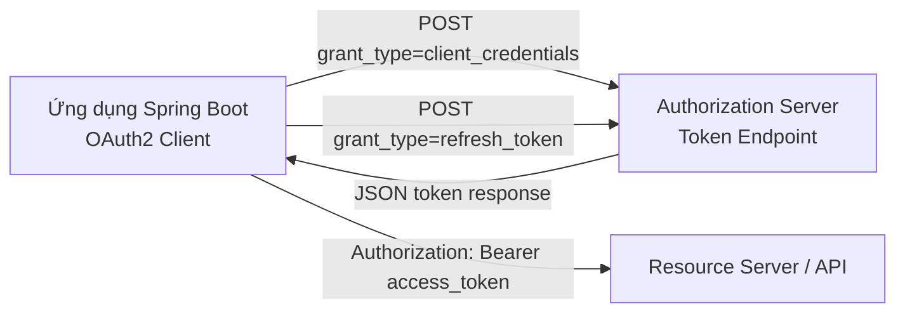
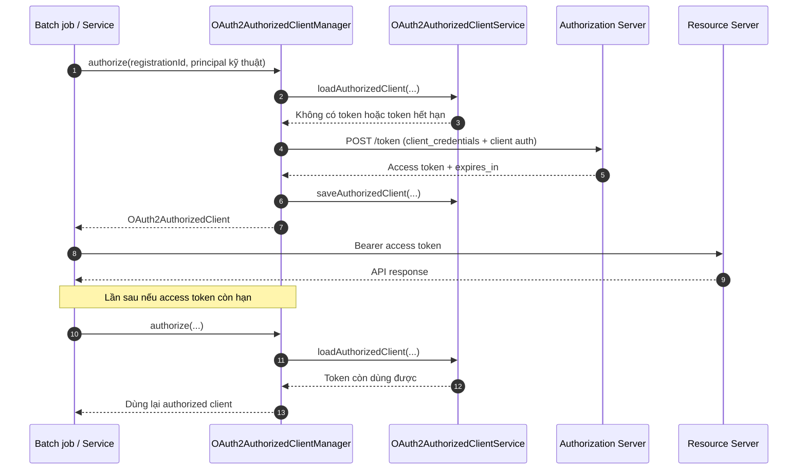
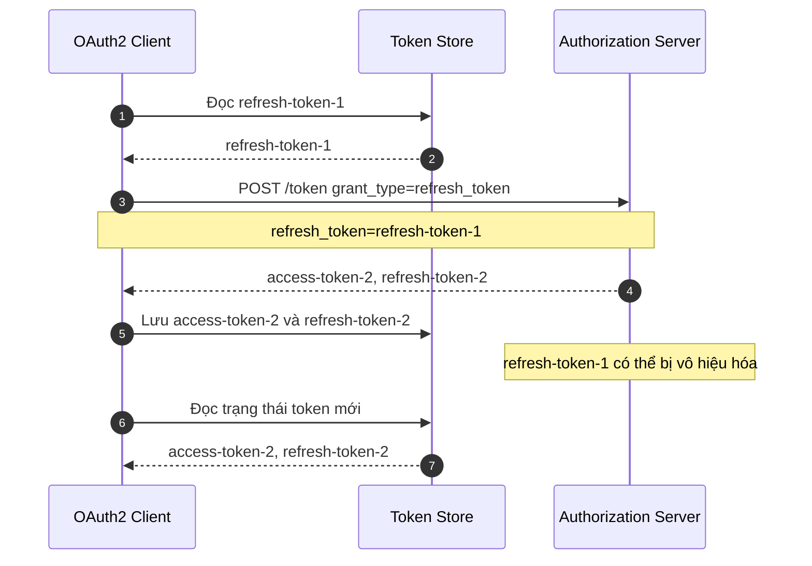
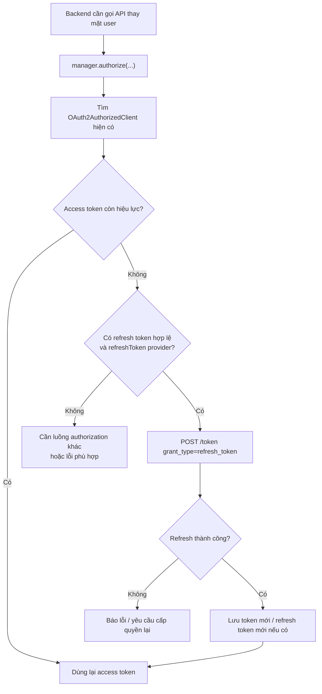

# 10.3. Yêu cầu client credentials và yêu cầu refresh token

Trong **Spring Security OAuth 2.0 / OIDC Client**, ứng dụng muốn nhận access token thường gửi một HTTP request đến **Token Endpoint** của Authorization Server. Hai yêu cầu rất dễ bị nhầm là:

1. **Client Credentials Grant**: ứng dụng dùng **danh tính của chính client** để xin access token, thường phục vụ giao tiếp máy–máy (machine-to-machine).
2. **Refresh Token Grant**: client dùng **refresh token đã được cấp trước đó** để xin access token mới khi access token cũ hết hạn hoặc sắp hết hạn.

Cả hai đều gọi token endpoint và có thể yêu cầu client xác thực, nhưng **căn cứ để cấp token** và **ngữ cảnh quyền** khác nhau. Bài này đi từ HTTP request và token response tới cách Spring Security quản lý các yêu cầu ấy trong ứng dụng thực tế.

> Lưu ý thuật ngữ: "client credentials" đôi khi còn được dùng theo nghĩa **thông tin xác thực của client** (client ID, client secret, private key, chứng chỉ). Việc xác thực client ở token endpoint có thể xuất hiện trong *nhiều grant*, bao gồm cả refresh token grant. Nó không đồng nghĩa với việc đang dùng **`grant_type=client_credentials`**.

## 1. Vai trò của Token Endpoint

Token Endpoint thuộc **Authorization Server**, nhận yêu cầu cấp token qua kết nối bảo vệ bằng TLS/HTTPS. Với các grant chuẩn đang xét, phương thức thường là **HTTP POST**, nội dung là **`application/x-www-form-urlencoded`**.



Ba loại dữ liệu cần phân biệt:

| Giá trị | Được gửi đến đâu? | Dùng để làm gì? |
| --- | --- | --- |
| **Client credential** | Token Endpoint, theo phương thức xác thực client đã đăng ký | Chứng minh danh tính ứng dụng client khi chính sách yêu cầu |
| **Access token** | Resource Server/API | Cấp quyền truy cập tài nguyên trong phạm vi, audience và thời hạn phù hợp |
| **Refresh token** | Token Endpoint | Xin access token mới mà không cần lặp lại toàn bộ bước ủy quyền ban đầu |

Không gửi **refresh token** trong header Bearer đến Resource Server và không dùng **access token** như mật khẩu để gọi refresh token grant.

Ví dụ địa chỉ token endpoint (minh họa):

```text
https://id.example.test/realms/company/protocol/openid-connect/token
```

Địa chỉ thực lấy từ metadata của Authorization Server/OpenID Provider hoặc cấu hình provider trong Spring Security. Nó **khác** authorization endpoint dành cho browser redirect và **khác** redirect/callback URI của client.

### 1.1. Token request có hai lớp thông tin

Trong một request có thể có đồng thời:

- **Client authentication**: cho biết *ứng dụng nào* đang gọi (ví dụ HTTP Basic với client ID và secret, hoặc phương thức khác).
- **Grant request**: cho biết *dựa vào điều kiện nào* ứng dụng xin token (ví dụ `client_credentials` hoặc `refresh_token`).

Sơ đồ:

```text
HTTP POST /token
├── Client authentication
│   └── Authorization: Basic <client-id-and-secret>
└── Form body
    ├── grant_type=...
    └── Tham số riêng cho từng grant
```

**Không đánh đồng tên grant và cách xác thực client.** Một confidential client có thể xác thực bằng Basic trong cả hai grant, còn một public client có thể được cấp refresh token theo chính sách mà không có client secret.

## 2. Client Credentials Grant: client tự xin quyền cho chính mình

### 2.1. Khi nào sử dụng?

**Client Credentials Grant** dành cho client truy cập tài nguyên bằng **danh tính và quyền của ứng dụng**, không dựa trên một người dùng đang thực hiện đăng nhập tương tác.

Ví dụ:

- Batch job đọc báo cáo từ API nội bộ.
- Backend thanh toán gọi API kế toán với quyền service-to-service.
- Microservice A gọi microservice B theo chính sách truy cập riêng của workload.
- Scheduled task lấy dữ liệu thống kê mỗi đêm.

Đây không phải cách thay thế cho "đăng nhập người dùng mà không có giao diện". Nếu thao tác cần quyền cụ thể của một người dùng, hãy dùng flow ủy quyền người dùng thích hợp, chẳng hạn Authorization Code, hoặc cơ chế delegation/token exchange được hệ thống hỗ trợ.

### 2.2. HTTP request chuẩn

Client gửi **`grant_type=client_credentials`** trong body của token request.

```http
POST /realms/company/protocol/openid-connect/token HTTP/1.1
Host: id.example.test
Content-Type: application/x-www-form-urlencoded
Authorization: Basic <base64-client-credentials>

grant_type=client_credentials&scope=reports.read
```

Các thành phần:

| Thành phần | Bắt buộc? | Ý nghĩa |
| --- | --- | --- |
| `grant_type=client_credentials` | Có | Chọn Client Credentials Grant |
| `scope` | Tùy chọn theo giao thức; phụ thuộc chính sách server | Những quyền client yêu cầu, chẳng hạn `reports.read` |
| Client authentication | Có đối với client dùng grant chuẩn này | Chứng minh danh tính ứng dụng bằng phương thức mà OP/AS chấp nhận |
| `redirect_uri` | Không | Grant này không chuyển hướng trình duyệt |
| `username` / `password` của người dùng | Không | Không có người dùng đăng nhập trong flow |
| `refresh_token` | Không | Không dùng refresh token để khởi đầu Client Credentials Grant |

Trong ví dụ, giá trị sau `Authorization: Basic` chỉ là placeholder. Với client secret basic, thư viện OAuth2 xử lý cách mã hóa client ID và secret theo yêu cầu giao thức. Không hardcode hay tự tạo credential rồi ghi ra log.

**Client Credentials Grant chỉ thích hợp khi client có thể bảo vệ credential của mình.** SPA chạy trong JavaScript hoặc ứng dụng mobile phát hành cho nhiều người dùng không thể giữ một client secret dùng chung như một bí mật thực sự, nên không nên dùng cấu hình confidential client kiểu này trực tiếp trên thiết bị người dùng.

### 2.3. Token response thành công

Authorization Server kiểm tra client authentication, grant đã được cho phép và scope phù hợp, sau đó trả response JSON.

```http
HTTP/1.1 200 OK
Content-Type: application/json
Cache-Control: no-store
Pragma: no-cache

{
  "access_token": "<access-token-value>",
  "token_type": "Bearer",
  "expires_in": 3600,
  "scope": "reports.read"
}
```

Các trường thường gặp:

- **`access_token`**: chuỗi token do server cấp; có thể là JWT hoặc opaque token tùy triển khai.
- **`token_type`**: thường là `Bearer`.
- **`expires_in`**: thời gian hiệu lực tính bằng giây kể từ khi response được tạo, theo dữ liệu server cấp.
- **`scope`**: scope được cấp; có thể khác scope yêu cầu khi chính sách cho phép.

Theo OAuth 2.0, đối với Client Credentials Grant, **refresh token thường không được phát hành và đặc tả nói không nên bao gồm refresh token trong response**. Khi access token hết hạn, client chỉ cần **dùng chính credential của mình để xin token mới**. Đừng thiết kế nghiệp vụ bắt buộc phải có refresh token cho grant này.

Không nên kỳ vọng **ID token OIDC** trong response của Client Credentials Grant: OIDC ID token nhằm diễn đạt kết quả xác thực người dùng cho một client, còn flow này là danh tính của ứng dụng.

### 2.4. Dùng access token để gọi Resource Server

Sau khi lấy token, backend gửi nó đến API theo cách Resource Server yêu cầu, thường là:

```http
GET /v1/reports HTTP/1.1
Host: api.example.test
Authorization: Bearer <access-token-value>
```

Resource Server cần kiểm tra chữ ký hoặc introspection tùy loại token, issuer, audience, hạn dùng, scope/authority và các chính sách ủy quyền của endpoint.

**Có access token không bảo đảm gọi được mọi API.** Token cấp cho `reports.read` có thể không đủ quyền cho `reports.write`; access token của API A không nên dùng tùy tiện cho API B nếu audience không phù hợp.

## 3. Vòng đời Client Credentials Grant



Lưu ý ba điểm:

1. **Cần có client registration và principal kỹ thuật** để Spring Security lưu, tìm và tái sử dụng authorized client theo cùng khóa. `principalName` trong trường hợp này là tên phục vụ lưu trữ, không chứng minh một người dùng thật đã đăng nhập.
2. **Mỗi lần cần token, ứng dụng nên đi qua `OAuth2AuthorizedClientManager`** hoặc integration HTTP client phù hợp, thay vì giữ một token string vĩnh viễn trong biến rồi tự đoán thời hạn.
3. **Grant này không cần browser, authorization code, redirect URI, OIDC nonce hay consent screen tương tác người dùng.** Chính sách cấp quyền được xác định qua thông tin đăng ký client và cấu hình Authorization Server.

Một ứng dụng có thể lưu token trong memory hoặc kho bền vững; nếu nhiều replica cùng dùng một đăng ký client, cần cân nhắc cache, cô lập principal và giới hạn tốc độ xin token tại server.

## 4. Refresh Token Grant: xin access token mới từ quyền đã được cấp

### 4.1. Refresh token xuất hiện từ đâu?

Trong một số flow có ủy quyền trước đó, như Authorization Code Grant, Authorization Server có thể cấp cả **access token** và **refresh token**. Ví dụ sau bước người dùng đăng nhập OIDC qua browser, backend của ứng dụng nhận:

```json
{
  "access_token": "<access-token-1>",
  "token_type": "Bearer",
  "expires_in": 900,
  "refresh_token": "<refresh-token-1>",
  "scope": "openid profile orders.read",
  "id_token": "<oidc-id-token>"
}
```

Đây là ví dụ response của **Authorization Code + OIDC** khi server **cho phép phát hành refresh token**; không phải mọi lần đăng nhập đều có refresh token.

Thông thường:

- Access token có vòng đời ngắn, được Resource Server chấp nhận trong thời hạn và phạm vi thích hợp.
- Refresh token có vòng đời riêng, thường dài hơn và được lưu/kiểm soát chặt hơn.
- Refresh token **chỉ gửi đến Authorization Server**, không dùng để gọi API.
- Khi cần access token mới, client có thể dùng refresh token theo cơ chế được provider hỗ trợ.
- Với ứng dụng web, refresh token được lưu tại backend/service hoặc kho token đáng tin cậy theo kiến trúc; không tự đưa về browser chỉ vì người dùng đã đăng nhập.

Refresh Token Grant **không yêu cầu browser chuyển hướng đến OP**, miễn là refresh token còn hợp lệ và các điều kiện chính sách được đáp ứng. Nó không có nghĩa tài khoản người dùng không cần xác thực lại mãi mãi.

### 4.2. HTTP request làm mới token

Request cơ bản:

```http
POST /realms/company/protocol/openid-connect/token HTTP/1.1
Host: id.example.test
Content-Type: application/x-www-form-urlencoded
Authorization: Basic <base64-client-credentials>

grant_type=refresh_token&refresh_token=<refresh-token-1>
```

Các tham số chuẩn:

| Thành phần | Bắt buộc? | Ý nghĩa |
| --- | --- | --- |
| `grant_type=refresh_token` | Có | Chọn Refresh Token Grant |
| `refresh_token` | Có | Token làm mới đã được cấp cho client/ngữ cảnh phù hợp |
| `scope` | Tùy chọn | Chỉ được yêu cầu scope nằm trong quyền đã được cấp; không mở rộng thêm quyền bằng refresh |
| Client authentication | Theo loại client và chính sách server | Confidential client thường phải xác thực; public client có cơ chế bảo vệ thích hợp |
| `code`, `code_verifier` | Không | Đây là tham số của authorization code exchange, không thuộc refresh grant thông thường |
| `username`, `password` | Không | Không gửi lại mật khẩu người dùng |

**Chi tiết rất dễ nhầm:** confidential client vẫn có thể gửi client ID/secret trong header Basic của refresh request, nhưng **grant type lúc này là `refresh_token`, không phải `client_credentials`**.

Với public client (ví dụ native/browser client), không được giả lập một client secret có khả năng giữ bí mật. Authorization Server cần áp dụng những biện pháp bảo vệ refresh token phù hợp, chẳng hạn rotation hoặc sender-constraining theo chính sách hiện đại. Hành vi thực tế phụ thuộc provider và phiên bản giao thức được hỗ trợ.

### 4.3. Token response khi refresh thành công

```http
HTTP/1.1 200 OK
Content-Type: application/json
Cache-Control: no-store
Pragma: no-cache

{
  "access_token": "<access-token-2>",
  "token_type": "Bearer",
  "expires_in": 900,
  "scope": "openid profile orders.read",
  "refresh_token": "<refresh-token-2>"
}
```

Phản hồi này minh họa trường hợp server **xoay vòng refresh token**: `refresh-token-2` thay thế `refresh-token-1`.

Cần hiểu:

- **Access token mới** được cấp khi refresh thành công; hạn dùng cần được cập nhật.
- **Refresh token mới có thể được cấp**. Nếu có, client phải lưu token mới theo hợp đồng của provider; server có thể thu hồi token cũ.
- **Không phải mọi refresh response đều chứa `refresh_token`**. Nếu server không gửi token mới, xử lý reuse refresh token hiện có theo chính sách server/framework.
- **Scope mới không được lớn hơn phạm vi ủy quyền ban đầu**; refresh không phải cách tự tăng quyền truy cập.
- **ID token không nhất thiết có trong refresh response**. Một số OP có thể phát hành ID token mới theo quy tắc OIDC, nhưng client không được mặc định rằng mỗi lần refresh đều xác thực lại người dùng hoặc luôn nhận ID token.

Việc Refresh Token Grant thành công **không tạo một đăng nhập tương tác mới**. Nó tiếp tục một quyền đã được cấp theo điều kiện Authorization Server áp dụng.

## 5. Refresh token rotation và nguy cơ dùng lại token cũ

Khi refresh token được **rotate**, server có thể phát hành refresh token mới và vô hiệu hóa refresh token trước đó. Điều này giúp phát hiện hoặc hạn chế tình huống một refresh token bị sao chép và sử dụng trái phép, nhưng cũng tạo yêu cầu cập nhật kho lưu trữ chính xác.



**Tình huống race condition:** hai instance cùng đọc `refresh-token-1` và đồng thời gọi refresh. Nếu token rotation áp dụng nghiêm ngặt, yêu cầu thứ hai có thể nhận `invalid_grant` vì token cũ đã được sử dụng. Một số provider còn có chính sách phát hiện reuse và thu hồi cả token family.

Ứng dụng có nhiều replica cần xem xét cơ chế quản lý refresh token nhất quán, ví dụ lưu trạng thái tập trung, đồng bộ việc refresh theo một authorized client, quản lý phiên bản token và chính sách retry thích hợp. Đừng tự retry mãi với cùng refresh token đã bị từ chối.

**Refresh token có thể hết hạn hoặc bị thu hồi** vì đổi mật khẩu, chính sách đăng nhập lại, người dùng revoke consent, logout tại OP nếu provider cấu hình như vậy, hoặc thay đổi client. Không suy diễn thời hạn chỉ từ thời hạn access token.

## 6. So sánh hai token request

| Tiêu chí | Client Credentials Grant | Refresh Token Grant |
| --- | --- | --- |
| Tham số `grant_type` | `client_credentials` | `refresh_token` |
| Bằng chứng dùng để xin quyền | Client được phép tự nhận access token | Refresh token gắn với quyền/client đã được cấp |
| Người dùng đang tương tác? | Không cần | Không cần tại thời điểm refresh |
| Có quyền của người dùng? | Thông thường không; quyền của ứng dụng | Có thể gắn với một ủy quyền của người dùng trước đó |
| Body tối thiểu | `grant_type=client_credentials` | `grant_type=refresh_token&refresh_token=...` |
| Client authentication | Có theo đặc tả của grant và cấu hình server | Phụ thuộc loại client/chính sách, confidential client thường phải xác thực |
| `scope` | Có thể xin trong quyền đã cấp cho client | Không được mở rộng ngoài scope đã được cấp |
| Refresh token trong response | Theo đặc tả OAuth 2.0 **không nên** được phát hành | Có thể trả token mới khi rotation |
| Cách lấy token khi access token hết hạn | Gửi lại client_credentials request | Gửi refresh_token request nếu refresh token hợp lệ |
| Liên hệ tới OIDC ID token | Không có đăng nhập người dùng OIDC thông thường | Có thể thuộc vòng đời của một OIDC login trước đó; ID token mới không luôn được cấp |

Một client registration có thể được cấu hình hỗ trợ những grant nhất định theo chính sách Authorization Server. Tuy nhiên, **không thể đổi từ `refresh_token` sang `client_credentials` mà vẫn kỳ vọng giữ danh tính và quyền của người dùng trước đó**.

## 7. Cách Spring Security biểu diễn và điều phối token

Trong Spring Security OAuth2 Client, các abstraction quan trọng là:

| Thành phần | Nhiệm vụ |
| --- | --- |
| **`ClientRegistration`** | Mô tả client ID, secret hoặc phương thức xác thực, grant type, token URI, scope và provider |
| **`ClientRegistrationRepository`** | Tìm registration theo `registrationId` |
| **`OAuth2AuthorizedClient`** | Giữ registration, principal name, access token và refresh token nếu có |
| **`OAuth2AuthorizedClientService`** | Lưu/tìm/xóa authorized client theo registration ID và principal, thích hợp tác vụ không phụ thuộc Servlet request |
| **`OAuth2AuthorizedClientRepository`** | Lưu/tìm authorized client trong ngữ cảnh HTTP Servlet request/response |
| **`OAuth2AuthorizedClientManager`** | Điều phối cấp, tải lại hoặc làm mới authorized client |
| **`OAuth2AuthorizedClientProvider`** | Xử lý cách cấp token cụ thể như `clientCredentials()` hay `refreshToken()` |

Nói gọn:

```text
ClientRegistration
   |
   v
OAuth2AuthorizedClientManager
   |-- load Authorized Client --> Service/Repository
   |
   +-- OAuth2AuthorizedClientProvider
         |-- clientCredentials() --> POST grant_type=client_credentials
         +-- refreshToken()       --> POST grant_type=refresh_token
   |
   +-- save Authorized Client --> Service/Repository
   |
   v
Access token để gọi API
```

**`OAuth2AuthorizedClient` không trực tiếp gọi mạng để refresh.** Nó là đối tượng chứa trạng thái. Việc nhận token mới do **manager/provider** cùng token response client thực hiện.

Nếu ứng dụng đọc một access token cũ từ repository rồi gửi thẳng đến Resource Server, nó không tự động được gia hạn chỉ vì có refresh token trong đối tượng.

## 8. Cấu hình Spring Boot cho cả hai tình huống

Giả sử hệ thống có hai registration:

1. `billing-service`: backend tự lấy token bằng Client Credentials Grant để gọi API billing.
2. `company-login`: người dùng đăng nhập OIDC bằng Authorization Code; nếu provider cấp refresh token, backend có thể refresh access token trong phiên.

```yaml
spring:
  security:
    oauth2:
      client:
        registration:
          billing-service:
            provider: company
            client-id: ${BILLING_CLIENT_ID}
            client-secret: ${BILLING_CLIENT_SECRET}
            authorization-grant-type: client_credentials
            scope:
              - billing.read

          company-login:
            provider: company
            client-id: ${LOGIN_CLIENT_ID}
            client-secret: ${LOGIN_CLIENT_SECRET}
            authorization-grant-type: authorization_code
            redirect-uri: "{baseUrl}/login/oauth2/code/{registrationId}"
            scope:
              - openid
              - profile
              - orders.read

        provider:
          company:
            issuer-uri: ${OIDC_ISSUER_URI}
```

Đây là ví dụ cho **confidential web/backend clients**. Giá trị `issuer-uri` phải trỏ đến provider có metadata discovery phù hợp. Nếu tổ chức dùng các provider/tenant khác nhau cho workload và login, khai báo provider riêng thay vì tái sử dụng issuer theo thói quen.

Đối với cấu hình này:

- `billing-service` **không dùng** `oauth2Login()@@ để lấy token. Service hoặc batch job sẽ yêu cầu token qua manager.
- `company-login` được khởi tạo từ browser login và có authorized client gắn với người dùng sau thành công.
- Mỗi registration có **client ID, secret, grant và scope riêng**, dù cùng một Authorization Server.
- Không đưa client secret, refresh token hoặc access token vào file Git, log hay HTTP response cho frontend.

### 8.1. Dependency thường dùng

Với Maven/Spring Boot:

```xml
<dependency>
    <groupId>org.springframework.boot</groupId>
    <artifactId>spring-boot-starter-security</artifactId>
</dependency>
<dependency>
    <groupId>org.springframework.boot</groupId>
    <artifactId>spring-boot-starter-oauth2-client</artifactId>
</dependency>
```

Spring Boot quản lý version của Spring Security theo dependency management phù hợp. Bạn không cần tự cài đặt OAuth2 token request bằng một HTTP client thuần nếu framework đã hỗ trợ grant cần dùng.

## 9. Spring Security: client_credentials cho service/batch

Với tác vụ không có request/response Servlet, lựa chọn phù hợp là **`AuthorizedClientServiceOAuth2AuthorizedClientManager`**.

### 9.1. Tạo manager và provider

```java
import org.springframework.beans.factory.annotation.Qualifier;
import org.springframework.context.annotation.Bean;
import org.springframework.context.annotation.Configuration;
import org.springframework.security.oauth2.client.AuthorizedClientServiceOAuth2AuthorizedClientManager;
import org.springframework.security.oauth2.client.OAuth2AuthorizedClientManager;
import org.springframework.security.oauth2.client.OAuth2AuthorizedClientProvider;
import org.springframework.security.oauth2.client.OAuth2AuthorizedClientProviderBuilder;
import org.springframework.security.oauth2.client.OAuth2AuthorizedClientService;
import org.springframework.security.oauth2.client.registration.ClientRegistrationRepository;

@Configuration
class ServiceOAuth2Config {

    @Bean("machineAuthorizedClientManager")
    OAuth2AuthorizedClientManager machineAuthorizedClientManager(
            ClientRegistrationRepository registrations,
            OAuth2AuthorizedClientService authorizedClients) {

        OAuth2AuthorizedClientProvider provider =
                OAuth2AuthorizedClientProviderBuilder.builder()
                    .clientCredentials()
                    .build();

        AuthorizedClientServiceOAuth2AuthorizedClientManager manager =
                new AuthorizedClientServiceOAuth2AuthorizedClientManager(
                    registrations, authorizedClients);

        manager.setAuthorizedClientProvider(provider);
        return manager;
    }
}
```

`clientCredentials()` là provider dành cho `grant_type=client_credentials`. Khi token chưa có hoặc hết hạn, nó có thể yêu cầu token mới với cấu hình registration. Khi token còn dùng được, manager thường có thể dùng lại authorized client đã lưu.

Không cần cài thêm `refreshToken()` chỉ để “refresh” access token của `client_credentials`. Grant này lấy token mới bằng chính client credentials.

### 9.2. Yêu cầu access token từ manager

```java
import org.springframework.beans.factory.annotation.Qualifier;
import org.springframework.security.oauth2.client.OAuth2AuthorizeRequest;
import org.springframework.security.oauth2.client.OAuth2AuthorizedClient;
import org.springframework.security.oauth2.client.OAuth2AuthorizedClientManager;
import org.springframework.stereotype.Service;

@Service
class BillingAccessTokenProvider {

    private final OAuth2AuthorizedClientManager manager;

    BillingAccessTokenProvider(
            @Qualifier("machineAuthorizedClientManager")
            OAuth2AuthorizedClientManager manager) {
        this.manager = manager;
    }

    String accessTokenForBilling() {
        OAuth2AuthorizeRequest request = OAuth2AuthorizeRequest
                .withClientRegistrationId("billing-service")
                .principal("billing-batch")
                .build();

        OAuth2AuthorizedClient authorizedClient = manager.authorize(request);

        if (authorizedClient == null) {
            throw new IllegalStateException(
                    "Cannot authorize billing-service");
        }

        return authorizedClient.getAccessToken().getTokenValue();
    }
}
```

Ở đây:

- `billing-service` là **registration ID**, được dùng để nạp client ID, secret và token endpoint.
- `billing-batch` là **principal name kỹ thuật**, giúp service lưu/tìm authorized client ổn định. Nó không phải username đăng nhập và không được đưa vào body như một mật khẩu.
- Khi service gọi `manager.authorize(request)`, manager/provider chịu trách nhiệm về token lifecycle, trong phạm vi các provider đã cấu hình.
- Token chỉ dùng nội bộ để tạo request tới API được cấp quyền; **không trả token về controller để frontend tùy ý sử dụng**.

Trong một ứng dụng production, có thể tích hợp manager với `RestClient` hoặc `WebClient` qua OAuth2 client integration phù hợp thay vì tự lấy string và tạo header. Điều đó giúp áp dụng một cơ chế thống nhất cho authorization, token caching, lỗi và HTTP request.

### 9.3. Vì sao không gắn một principal ngẫu nhiên mỗi lần?

Kho lưu authorized client thường được truy cập theo **`(registrationId, principalName)`**. Nếu mỗi lần gọi bạn dùng một principal khác nhau:

```text
billing-batch-001
billing-batch-002
billing-batch-003
...
```

manager có thể không tìm được bản token đã lưu ở lần trước, dẫn tới nhiều token và trạng thái lưu không cần thiết. Với một workload dùng chung token cấp cho ứng dụng, chọn một principal kỹ thuật ổn định theo thiết kế ủy quyền và cô lập tenancy.

Không dùng cùng principal cho các workload thực sự cần phạm vi hoặc chính sách tách biệt nếu điều đó làm chia sẻ token sai ngữ cảnh.

## 10. Spring Security: refresh token của người dùng đã đăng nhập

Sau khi user đăng nhập bằng `oauth2Login()`, Spring Security có thể lưu **`OAuth2AuthorizedClient`** gắn với user, chứa access token và refresh token nếu OP cấp. Khi backend cần gọi API thay mặt user, manager có thể refresh access token đã hết hạn.

### 10.1. Manager trong Servlet request

Với Servlet application, `DefaultOAuth2AuthorizedClientManager` phối hợp với `OAuth2AuthorizedClientRepository`. Ví dụ:

```java
import org.springframework.context.annotation.Bean;
import org.springframework.context.annotation.Configuration;
import org.springframework.security.oauth2.client.DefaultOAuth2AuthorizedClientManager;
import org.springframework.security.oauth2.client.OAuth2AuthorizedClientManager;
import org.springframework.security.oauth2.client.OAuth2AuthorizedClientProvider;
import org.springframework.security.oauth2.client.OAuth2AuthorizedClientProviderBuilder;
import org.springframework.security.oauth2.client.registration.ClientRegistrationRepository;
import org.springframework.security.oauth2.client.web.OAuth2AuthorizedClientRepository;

@Configuration
class WebOAuth2Config {

    @Bean
    OAuth2AuthorizedClientManager webAuthorizedClientManager(
            ClientRegistrationRepository registrations,
            OAuth2AuthorizedClientRepository authorizedClients) {

        OAuth2AuthorizedClientProvider provider =
                OAuth2AuthorizedClientProviderBuilder.builder()
                    .authorizationCode()
                    .refreshToken()
                    .build();

        DefaultOAuth2AuthorizedClientManager manager =
                new DefaultOAuth2AuthorizedClientManager(
                    registrations, authorizedClients);

        manager.setAuthorizedClientProvider(provider);
        return manager;
    }
}
```

Ở đây:

- `authorizationCode()` biểu diễn grant dùng trong login tương tác.
- `refreshToken()` cho phép provider xử lý authorized client có refresh token hợp lệ khi cần cấp access token mới.
- `DefaultOAuth2AuthorizedClientManager` dùng repository trong ngữ cảnh Servlet request, phù hợp request từ người dùng đang dùng web app.
- Đây là ví dụ **manager được chủ động cấu hình**; nhiều tích hợp Spring Boot/Spring Security đã tạo cơ chế manager mặc định hoặc hỗ trợ sẵn tùy phiên bản. Không cần tự khai báo nhiều manager trùng vai trò nếu ứng dụng đã có cấu hình phù hợp.

### 10.2. Yêu cầu token trong một request đã xác thực

Ví dụ service gọi manager khi đã có `Authentication` của người dùng:

```java
import org.springframework.beans.factory.annotation.Qualifier;
import org.springframework.security.core.Authentication;
import org.springframework.security.oauth2.client.OAuth2AuthorizeRequest;
import org.springframework.security.oauth2.client.OAuth2AuthorizedClient;
import org.springframework.security.oauth2.client.OAuth2AuthorizedClientManager;
import org.springframework.stereotype.Service;

@Service
class UserApiTokenProvider {

    private final OAuth2AuthorizedClientManager manager;

    UserApiTokenProvider(
            @Qualifier("webAuthorizedClientManager")
            OAuth2AuthorizedClientManager manager) {
        this.manager = manager;
    }

    String accessTokenForUser(Authentication userAuthentication) {
        OAuth2AuthorizeRequest request = OAuth2AuthorizeRequest
                .withClientRegistrationId("company-login")
                .principal(userAuthentication)
                .build();

        OAuth2AuthorizedClient authorizedClient = manager.authorize(request);

        if (authorizedClient == null) {
            throw new IllegalStateException(
                    "User client authorization is unavailable");
        }

        return authorizedClient.getAccessToken().getTokenValue();
    }
}
```

Gọi service này **trong một HTTP request đã xác thực** có Servlet request/response phù hợp với web manager. Sau đó token được sử dụng nội bộ để gọi đúng Resource Server; ví dụ chỉ trả string ở service layer cho dễ hiểu.

**Không dùng chính đoạn code trên làm background job tùy tiện**, vì `DefaultOAuth2AuthorizedClientManager` cần ngữ cảnh Servlet. Với tác vụ nền không có HTTP request, xem xét `AuthorizedClientServiceOAuth2AuthorizedClientManager` và cơ chế lấy principal/authorized client phù hợp với ủy quyền đã được lưu.

### 10.3. Refresh không bắt buộc mỗi khi manager được gọi

Một cách nghĩ sai là "mỗi lần `authorize()` sẽ gọi token endpoint". Thực tế, manager có thể nạp authorized client cũ và dùng lại access token nếu còn hiệu lực. Khi token sắp/hết hạn và có refresh token cùng provider phù hợp, nó mới thực hiện yêu cầu refresh.

Tình trạng thực tế còn phụ thuộc chính sách clock skew, token expiry, cấu hình provider và trạng thái được lưu.



**Nếu không có refresh token** hoặc server từ chối refresh, một ứng dụng dùng Authorization Code Login có thể cần khởi động một **authorization flow mới qua browser**. Không thể tạo authorization code mới bằng cách gửi mật khẩu người dùng vào token endpoint như một đường tắt.

## 11. Client authentication tại token endpoint

### 11.1. Client Secret Basic

Đây là cơ chế quen thuộc của confidential client: client ID và secret được đặt trong HTTP Basic header. Spring Security hỗ trợ cấu hình:

```yaml
spring:
  security:
    oauth2:
      client:
        registration:
          billing-service:
            client-authentication-method: client_secret_basic
```

Token request:

```http
Authorization: Basic <base64-encoded-client-credentials>
Content-Type: application/x-www-form-urlencoded
```

**Basic không tự mã hóa secret để chống nghe lén**; Base64 chỉ là biểu diễn văn bản. HTTPS/TLS bảo vệ request trên đường truyền. Credential cần được giữ bí mật, phân quyền và xoay vòng theo chính sách.

### 11.2. Client Secret Post

Một số Authorization Server dùng hoặc yêu cầu `client_secret_post`, tức là đưa client ID và secret trong form body:

```http
POST /oauth2/token HTTP/1.1
Host: id.example.test
Content-Type: application/x-www-form-urlencoded

grant_type=client_credentials&client_id=<client-id>&client_secret=<client-secret>
```

Có thể cấu hình tương ứng:

```yaml
client-authentication-method: client_secret_post
```

Đây là **phương thức client authentication**, không phải một grant khác. Dù cách truyền secret khác, request vẫn có `grant_type=client_credentials`.

Khi server hỗ trợ, phương thức xác thực trong HTTP Authorization header thường giúp giảm nguy cơ secret bị thu thập bởi các thành phần chuyên ghi request body; tuy nhiên cả header cũng cần được che khi logging. Tránh đưa client secret vào URL query string.

### 11.3. Các phương thức xác thực nâng cao

Tùy hệ thống, confidential client có thể dùng:

- **`private_key_jwt`**: client ký một assertion bằng private key.
- **Mutual TLS (mTLS)**: client xác thực bằng chứng chỉ.
- Các cơ chế xác thực và ràng buộc token khác do Authorization Server hỗ trợ.

Không phải mọi phương thức đều được bật mặc định trong mọi bản Spring Security. Cần xác minh cấu hình provider, loại client, key material và token response client được dùng.

### 11.4. Public client và refresh token

Public client không thể bảo vệ một shared client secret theo cách confidential backend có thể. Trong luồng Authorization Code + PKCE, public client có thể được cấp refresh token **chỉ khi provider cho phép**, đồng thời áp dụng biện pháp chống lộ/lạm dụng như rotation hoặc sender-constrained tokens. Không thêm secret cố định vào code SPA/mobile rồi xem đó là xác thực client đáng tin.

## 12. Tham số scope và ranh giới quyền

### 12.1. Scope ở Client Credentials Grant

Client có thể yêu cầu scope như:

```text
grant_type=client_credentials&scope=reports.read
```

Authorization Server chỉ cấp quyền đã cho phép đối với client. Một client không được cấp `reports.write` không thể tự tăng quyền chỉ bằng cách đổi scope trong request.

Nếu scope không được chấp nhận, server có thể trả `invalid_scope` hoặc một lỗi tương ứng.

### 12.2. Scope ở Refresh Token Grant

Khi refresh, client có thể không gửi `scope` và để server giữ phạm vi của quyền đã được cấp. Nếu gửi scope, theo OAuth 2.0, scope yêu cầu **không được có quyền ngoài phạm vi đã cấp ban đầu**.

Ví dụ ban đầu có:

```text
openid profile orders.read orders.write
```

Một refresh request có thể yêu cầu phạm vi hẹp hơn khi được server hỗ trợ:

```text
grant_type=refresh_token
refresh_token=<refresh-token>
scope=orders.read
```

Nhưng không được tự thêm:

```text
scope=admin.full_access
```

nếu quyền đó chưa từng được cấp.

**Scope không phải toàn bộ chính sách phân quyền.** Resource Server còn phải kiểm tra audience, subject/client identity và chính sách theo tài nguyên. Token từ Client Credentials Grant thường diễn đạt quyền workload, còn token từ authorization của user có thể diễn đạt quyền trong ngữ cảnh user.

## 13. Lỗi token endpoint: xử lý theo nguyên nhân

Token Endpoint thường trả JSON lỗi kèm HTTP status thích hợp:

```http
HTTP/1.1 400 Bad Request
Content-Type: application/json
Cache-Control: no-store
Pragma: no-cache

{
  "error": "invalid_grant",
  "error_description": "Refresh token is expired or revoked"
}
```

Những mã thường gặp:

| Mã lỗi | Hay gặp ở bước nào? | Diễn giải và cách xử lý |
| --- | --- | --- |
| **`invalid_client`** | Cả hai grant khi client authentication thất bại | Kiểm tra client ID, secret, phương thức xác thực, client bị khóa; không retry vô hạn |
| **`unauthorized_client`** | Client không được phép dùng grant | Kiểm tra grant được bật cho client tại AS |
| **`unsupported_grant_type`** | Server không hỗ trợ loại grant được yêu cầu | Xác minh `grant_type` và khả năng AS |
| **`invalid_request`** | Body thiếu/sai định dạng hoặc tham số không hợp lệ | Kiểm tra HTTP POST, content type, encode và tham số |
| **`invalid_scope`** | Scope yêu cầu không hợp lệ/không được phép | Kiểm tra danh sách scope và quyền được cấp |
| **`invalid_grant`** | Thường gặp ở refresh token hoặc authorization code exchange | Refresh token hết hạn/bị thu hồi/sai client; có thể cần ủy quyền lại |
| **`server_error`** / **`temporarily_unavailable`** | AS gặp vấn đề hệ thống | Phân biệt sự cố tạm thời với lỗi cấu hình/credential |

**HTTP 401 từ Resource Server** không phải luôn là lỗi token endpoint. Nó có thể xuất phát từ token hết hạn, bị revoke, sai audience, thiếu header hoặc quy tắc API. Không tự động coi mọi 401 là chỉ cần refresh token rồi retry lặp vô hạn.

### 13.1. `invalid_client` trong client_credentials

Ví dụ:

```text
grant_type=client_credentials
Authorization: Basic <wrong-client-secret>
```

Authorization Server từ chối client authentication. Các bước:

1. Xác nhận đang dùng đúng client ID/secret của môi trường.
2. Kiểm tra secret đã được rotate hoặc revoked chưa.
3. Kiểm tra server chấp nhận `client_secret_basic` hay `client_secret_post` / cơ chế khác.
4. Kiểm tra đồng hồ/chứng chỉ nếu dùng JWT assertion hoặc mTLS.
5. Sau khi sửa config, xin token mới theo luồng chuẩn.

Không đưa secret vào log hoặc trả về response body cho người dùng để “debug”.

### 13.2. `invalid_grant` khi refresh

Một số nguyên nhân:

- Refresh token hết hạn hoặc bị thu hồi.
- Refresh token thuộc client khác hoặc bị dùng sai ngữ cảnh.
- Client đang dùng refresh token cũ sau khi rotation.
- Hai instance đồng thời refresh một token cũ.
- Chính sách OP yêu cầu login/consent mới.
- Provider không cho refresh token này tiếp tục.

Hệ thống có thể cần xóa authorized client đã không còn hợp lệ và khởi động authorization lại với người dùng, hoặc hiển thị lỗi phù hợp nếu flow không tương tác. Không dùng lại một refresh token thất bại vô hạn và không chuyển sang password grant để bỏ qua chính sách OP.

### 13.3. Phân loại lỗi cho retry

| Tình huống | Hành động gợi ý |
| --- | --- |
| Lỗi mạng/transient hoặc OP tạm không sẵn sàng | Retry có giới hạn, backoff/jitter theo SLA |
| Client secret sai/đã thu hồi | Báo cấu hình sai; không retry liên tục |
| Grant không được cấp quyền | Sửa registration/policy; không retry tự động |
| Refresh token hết hạn/bị revoke | Xóa trạng thái không còn hiệu lực theo chính sách; yêu cầu authorization mới |
| API 401 do token hết hạn | Để manager/integration xem xét token mới; retry có giới hạn với request an toàn |
| API 403 do thiếu quyền | Kiểm tra scope, audience và chính sách; refresh thường không giải quyết nếu quyền chưa được cấp |

Với HTTP POST ghi dữ liệu, retry có thể tạo tác dụng phụ lặp lại. Nếu hệ thống cần retry sau refresh, phải cân nhắc idempotency, giới hạn số lần thử và cách xử lý business transaction.

## 14. Security và vận hành

### 14.1. Luôn dùng TLS và bảo vệ client secret

Token request có credential hoặc refresh token là dữ liệu nhạy cảm. Không gửi qua HTTP công khai, không ghi nguyên request body/header vào log, không đưa token vào URL query. Secret nên được cung cấp qua secret manager, biến môi trường được bảo vệ hoặc cơ chế tương đương; tách secret theo staging/production và xoay vòng định kỳ.

### 14.2. Cất refresh token như credential có giá trị cao

Refresh token thường sống lâu hơn access token. Nếu bị lấy cắp, kẻ tấn công có thể xin nhiều access token mới cho tới khi refresh token bị hết hạn/thu hồi hoặc cơ chế bảo vệ phát hiện bất thường.

- Lưu refresh token ở kho phù hợp với kiến trúc, hạn chế người có quyền đọc.
- Cân nhắc mã hóa ở trạng thái lưu và truyền qua TLS.
- Hỗ trợ rotation và cập nhật token mới một cách nhất quán.
- Xóa hoặc vô hiệu hóa trạng thái token không còn dùng được theo chính sách.
- Không trả refresh token về JavaScript/frontend từ backend chỉ để “dễ gọi API”.

### 14.3. Không lộ token qua log, metric và exception

Không ghi:

```text
Authorization: Basic ...
Authorization: Bearer ...
refresh_token=...
client_secret=...
access_token=...
id_token=...
```

Nếu cần quan sát, chỉ ghi metadata được kiểm soát: registration ID, grant type, provider, trạng thái HTTP, nhóm lỗi, thời gian phản hồi và request ID nội bộ không nhạy cảm. Error description từ server cũng có thể chứa dữ liệu nhạy cảm, nên lọc hoặc tránh lưu nguyên văn.

### 14.4. Giới hạn quyền và quản lý môi trường

- Dùng scope nhỏ nhất đủ cho nghiệp vụ.
- Không tái dùng cùng client secret production trên local/staging nếu có thể tách.
- Chỉ cho phép client sử dụng những grant cần thiết.
- Với machine-to-machine, ưu tiên workload identity và bảo vệ credential mạnh phù hợp hạ tầng.
- Với access token JWT, Resource Server phải xác minh chữ ký, issuer, audience và hạn dùng; với opaque token, cấu hình introspection phù hợp.
- Không xem việc token endpoint trả 200 là bằng chứng Resource Server sẽ chấp nhận mọi quyền.

## 15. Chẩn đoán trong Spring Security

Khi một API call thất bại, hãy lần theo đường đi thực tế của token:

```text
Ứng dụng cần gọi API
    |
    v
OAuth2AuthorizedClientManager.authorize(...)
    |
    +-- Có authorized client còn hạn?
    |     └── Có -> dùng lại token
    |
    +-- Hết hạn, có refresh token và provider?
    |     └── Có -> POST grant_type=refresh_token
    |
    +-- Registration dùng client_credentials?
          └── Có -> POST grant_type=client_credentials
    |
    v
Lưu token mới nếu cấp thành công
    |
    v
HTTP client gửi Bearer token đến Resource Server
```

Bảng kiểm tra theo triệu chứng:

| Triệu chứng | Cần kiểm tra |
| --- | --- |
| `manager.authorize(...)` trả `null` | Provider có hỗ trợ grant/registration trong ngữ cảnh hiện tại? Principal và client registration đúng không? |
| Batch job báo thiếu HTTP request | Có đang dùng `DefaultOAuth2AuthorizedClientManager` bên ngoài Servlet request không? Với batch xem service-based manager |
| `invalid_client` từ token endpoint | Secret, client authentication method, client ID, môi trường |
| `unauthorized_client` khi xin M2M token | Grant `client_credentials` đã được bật cho client chưa? |
| Token còn trong cache nhưng API báo hết hạn | Có đi qua manager trước khi gọi không? Clock skew, token expiry, token khác instance? |
| User login OIDC được nhưng không refresh | OP có cấp refresh token? Provider `refreshToken()` đã cấu hình? Kho authorized client còn dữ liệu không? |
| Refresh thành công nhưng lần tiếp theo báo `invalid_grant` | Có rotation mà không lưu token mới? Có nhiều instance refresh đồng thời? |
| API trả 403 | Scope/audience/authorization policy; không mặc định refresh giải quyết |
| Sau restart không còn token | Authorized-client service/repository dùng in-memory hay session, có kho bền vững/chia sẻ không? |
| Nhiều service tạo quá nhiều token | Principal kỹ thuật có thay đổi mỗi lần? Token cache dùng chung hợp lý? |

Nếu cần log kỹ thuật tạm thời, có thể xem xét:

```yaml
logging:
  level:
    org.springframework.security.oauth2.client: DEBUG
```

Chỉ bật trong môi trường kiểm soát và bảo đảm cấu hình HTTP client/logging không làm lộ token/secret hay nguyên token request.

## 16. Tình huống thực hành

### Tình huống 1 — Batch job tự động báo cáo

**Bài toán:** mỗi đêm ứng dụng xuất báo cáo từ API, không có người dùng đăng nhập.

**Lựa chọn:** Client Credentials Grant.

```text
registrationId: reporting-service
grant_type: client_credentials
scope: reports.read
principalName: reporting-batch
```

Dùng `AuthorizedClientServiceOAuth2AuthorizedClientManager` với provider `clientCredentials()`. Khi token cũ hết hạn, manager có thể xin token mới bằng credential ứng dụng. Không dùng tài khoản nhân viên và password grant để chạy batch.

### Tình huống 2 — Người dùng đăng nhập OIDC, API token hết hạn

**Bài toán:** user đã login, session vẫn còn nhưng access token dùng gọi API hết hạn.

**Lựa chọn:** nếu OP đã cấp refresh token, manager có provider `refreshToken()` và authorized client còn lưu, client có thể gửi:

```text
grant_type=refresh_token
refresh_token=<existing-refresh-token>
```

Sau thành công, lưu access token mới và refresh token mới nếu được cấp. Nếu không có hoặc refresh bị từ chối, ứng dụng cần flow ủy quyền lại phù hợp.

### Tình huống 3 — Client Credentials Grant nhưng backend tìm refresh token

**Bài toán:** service xin token bằng `client_credentials` rồi code:

```java
String refreshToken = authorizedClient
        .getRefreshToken()
        .getTokenValue();
```

**Vấn đề:** `getRefreshToken()` có thể là `null`. Client Credentials Grant thường không có refresh token; code này có nguy cơ `NullPointerException`.

**Cách làm:** dùng manager/provider `clientCredentials()` để xin access token mới khi cần; không truy cập refresh token như một thuộc tính bắt buộc.

### Tình huống 4 — Refresh token bị rotate nhưng kho không cập nhật

**Bài toán:** lần refresh đầu thành công; lần hai nhận `invalid_grant`.

**Khả năng:** server cấp refresh token mới nhưng ứng dụng tiếp tục gửi token cũ, hoặc nhiều instance đã dùng lại cùng token cũ.

**Cách xử lý:** dùng cơ chế authorized-client storage/manager phù hợp, lưu nguyên response mới, và quản lý đồng thời theo chính sách provider. Không vòng lặp retry với cùng refresh token đã bị từ chối.

### Tình huống 5 — Client Secret Basic và Client Credentials Grant bị hiểu là một

**Bài toán:** request refresh có header `Authorization: Basic ...`. Đồng nghiệp kết luận đó là Client Credentials Grant.

**Sửa cách hiểu:** header Basic chỉ cho biết **phương thức xác thực client**. Hãy nhìn body:

```text
grant_type=refresh_token
```

Nếu vậy đó là **Refresh Token Grant**, cho dù cùng xác thực bằng client ID và secret. Grant type quyết định loại yêu cầu, không phải vị trí client secret.

### Tình huống 6 — Resource Server báo 401 dù vừa lấy token mới

**Bài toán:** token endpoint trả 200 nhưng API từ chối token.

**Nguyên nhân cần kiểm tra:** token audience không dành cho API đó, issuer sai, scope/authority chưa phù hợp, chữ ký/JWKS, clock skew hoặc header Bearer không được đính kèm. Refresh liên tục không sửa được audience/scope đã cấp sai.

## 17. Tự kiểm tra kiến thức

**Câu 1:** Điểm khác biệt cơ bản giữa `client_credentials` và `refresh_token` là gì?

> Client Credentials Grant xin access token dựa trên danh tính/quyền của ứng dụng. Refresh Token Grant xin access token mới dựa trên refresh token của một ủy quyền đã được cấp trước đó, theo chính sách của Authorization Server.

**Câu 2:** Một request có `Authorization: Basic ...` và `grant_type=refresh_token` thuộc grant nào?

> Refresh Token Grant. Basic là cách xác thực client; giá trị `grant_type` quyết định grant.

**Câu 3:** Với `client_credentials`, khi access token hết hạn có bắt buộc cần refresh token không?

> Không. Client thường xin access token mới bằng cách gửi lại Client Credentials Grant. Theo đặc tả OAuth 2.0, refresh token không nên được cấp cho grant này.

**Câu 4:** Tại sao không thể dùng refresh request để thêm scope `admin` vào token đã được cấp scope `orders.read`?

> Refresh Token Grant không được mở rộng vượt quyền đã được cấp ban đầu. Để có thêm quyền cần quy trình ủy quyền/chính sách hợp lệ khác.

**Câu 5:** Một ứng dụng web OIDC vẫn còn session nhưng `OAuth2AuthorizedClient.getAccessToken()` đã hết hạn. Trạng thái nào cần có để refresh tự động?

> Phải có refresh token hợp lệ, cấu hình provider `refreshToken()` và đường đi qua manager/integration có thể xử lý token lifecycle. Chỉ đọc token từ đối tượng không tự gọi refresh.

**Câu 6:** Sau refresh, JSON trả `refresh_token` mới. Có nên tiếp tục dùng refresh token cũ không?

> Không nên. Cập nhật trạng thái theo token mới và chính sách rotation của provider; token cũ có thể đã bị vô hiệu hóa.

**Câu 7:** Batch job không có HTTP request nên dùng manager nào?

> `AuthorizedClientServiceOAuth2AuthorizedClientManager` cùng `OAuth2AuthorizedClientService` và provider `clientCredentials()` cho flow machine-to-machine thông thường.

**Câu 8:** Refresh token có được gửi tới Resource Server trong header `Authorization: Bearer` không?

> Không. Resource Server dùng access token. Refresh token chỉ dùng với Token Endpoint để xin token mới.

---

## Ghi nhớ

```text
CLIENT CREDENTIALS GRANT
POST /token
Authorization: <client-authentication>
grant_type=client_credentials
scope=<optional-scope>
    -> access_token
    -> Khi hết hạn: gọi lại grant_type=client_credentials


REFRESH TOKEN GRANT
POST /token
Authorization: <client-authentication-if-required>
grant_type=refresh_token
refresh_token=<existing-refresh-token>
scope=<optional-no-broader-scope>
    -> access_token mới
    -> Có thể có refresh_token mới (rotation)
    -> Nếu thất bại: xử lý lỗi / authorization lại theo policy
```

Trong Spring Security, **`OAuth2AuthorizedClientManager`** cùng **`OAuth2AuthorizedClientProvider`** là trung tâm điều phối vòng đời token:

- `clientCredentials()` phù hợp khi ứng dụng tự xin token để gọi API.
- `refreshToken()` phù hợp khi authorized client có refresh token và cần access token mới.
- **Client authentication** ở token endpoint là cơ chế khác với **grant type**, dù hai grant có thể cùng dùng một client ID/secret.
- Không suy luận token hợp lệ mãi mãi: hãy tôn trọng expiry, rotation, grant policy, scope/audience và cách lưu token.

### Tài liệu tham khảo

- [RFC 6749 §4.4 — Client Credentials Grant](https://www.rfc-editor.org/rfc/rfc6749#section-4.4)
- [RFC 6749 §6 — Refreshing an Access Token](https://www.rfc-editor.org/rfc/rfc6749#section-6)
- [RFC 6749 §5 — Issuing an Access Token](https://www.rfc-editor.org/rfc/rfc6749#section-5)
- [Spring Security — OAuth 2.0 Client (Servlet)](https://docs.spring.io/spring-security/reference/servlet/oauth2/client/index.html)
- [Spring Security API — OAuth2AuthorizedClientProviderBuilder](https://docs.spring.io/spring-security/reference/api/java/org/springframework/security/oauth2/client/OAuth2AuthorizedClientProviderBuilder.html)
