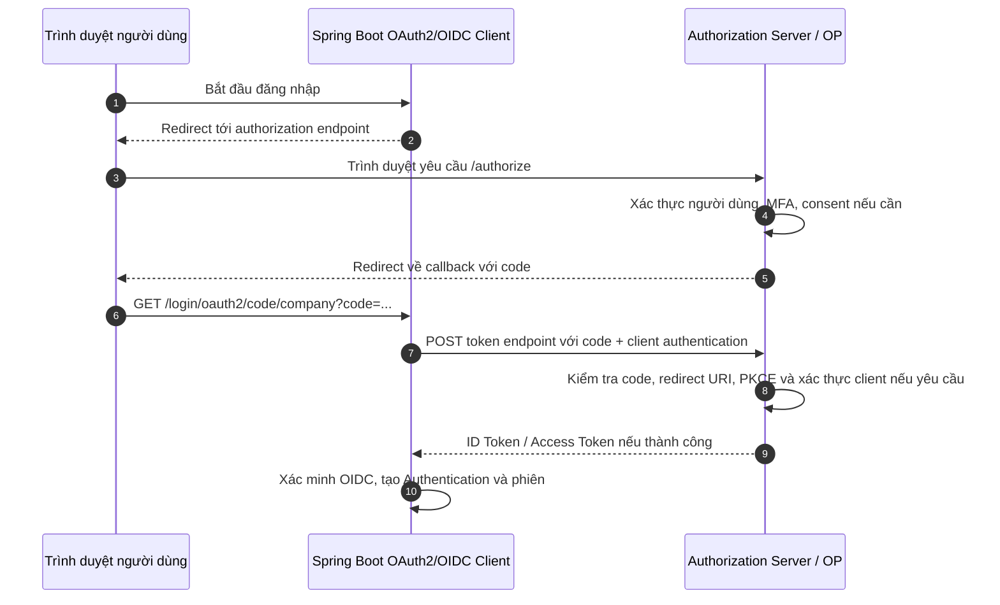
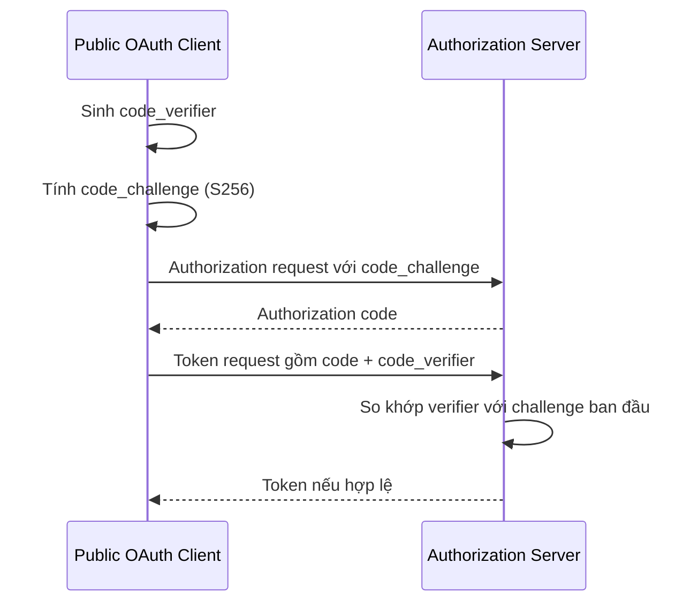
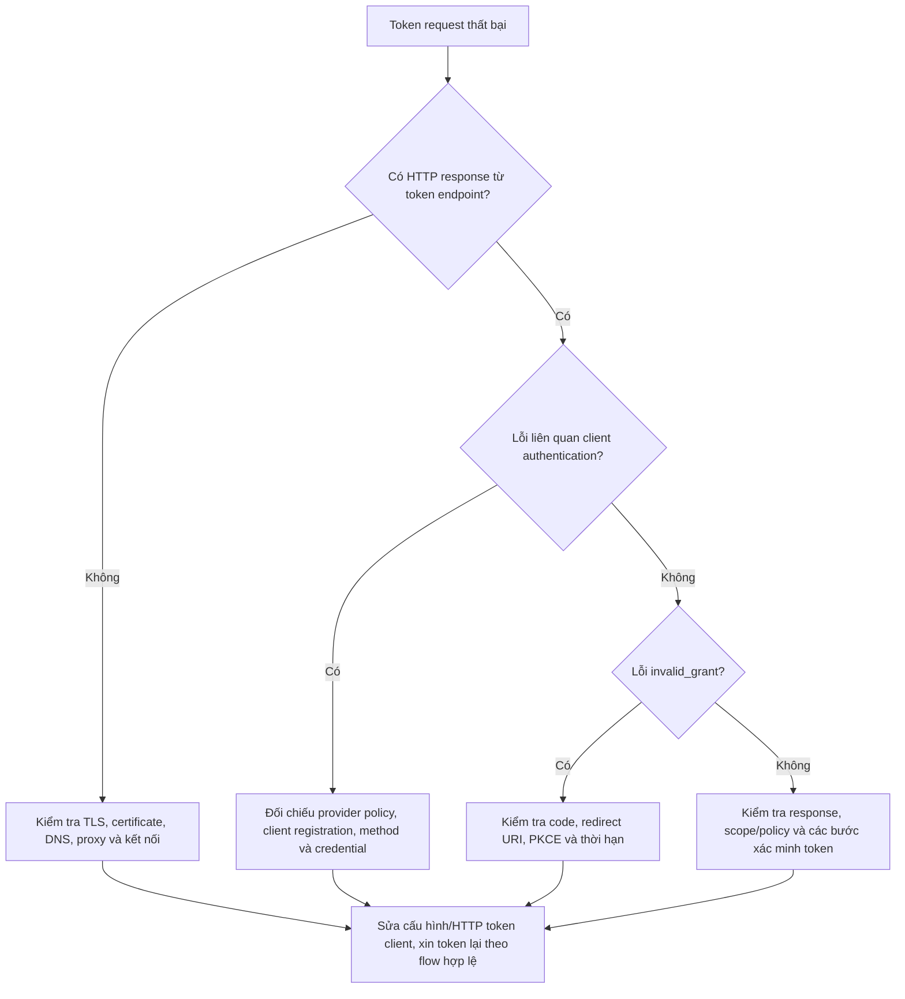

# 10.4. Chọn phương thức xác thực client phù hợp với provider

Trong Spring Security OAuth 2.0 / OpenID Connect (OIDC) Client, **token endpoint** là nơi ứng dụng trao đổi authorization code lấy token hoặc trực tiếp xin Access Token theo grant được hỗ trợ. Khi nhận request, Authorization Server (AS) hoặc OpenID Provider (OP) thường cần biết **client nào đang gọi** và, đối với *confidential client*, cần xác minh client đó bằng một phương thức được cho phép.

Phương thức xác thực client ở token endpoint phải tương thích ở **ba nơi**: chính sách của provider, thông tin client đã đăng ký tại provider và cách Spring Security thực sự gửi request. Ví dụ, provider chỉ chấp nhận `client_secret_post` nhưng client lại dùng HTTP Basic sẽ khiến token endpoint từ chối dù người dùng vừa đăng nhập thành công.

Các phương thức thường gặp gồm:

- `client_secret_basic`: xác thực client bằng HTTP Basic.
- `client_secret_post`: gửi định danh và secret trong body form POST.
- `none`: public client không dùng client secret; với Authorization Code Flow cần thiết kế PKCE.
- `private_key_jwt` hoặc `client_secret_jwt`: dùng JWT client assertion đã ký để xác thực client.
- `tls_client_auth` hoặc `self_signed_tls_client_auth`: dùng chứng chỉ client trong kết nối TLS theo cấu hình mTLS.

Bài học giải thích khi nào dùng từng phương thức, cách đọc metadata của provider, cấu hình Spring Boot và những giới hạn cần lưu ý khi tích hợp phương thức nâng cao.

## 1. Xác thực client ở token endpoint là gì?

Trong OAuth 2.0, có hai chủ thể cần tách bạch:

1. **Resource Owner / người dùng** có thể đăng nhập tại authorization endpoint của provider bằng mật khẩu, passkey, MFA hoặc cơ chế khác.
2. **OAuth 2.0 Client / ứng dụng** có thể phải chứng minh danh tính **của chính ứng dụng** khi gọi token endpoint.

Đây là hai quá trình khác nhau.

Trong **Authorization Code Flow** của một ứng dụng web backend:



**Client authentication** xảy ra ở bước backend gọi token endpoint. Nó không có nghĩa người dùng phải nhập thêm một mật khẩu ứng dụng tại trình duyệt. Client ID, secret, private key hoặc chứng chỉ phục vụ **danh tính của client**, còn tài khoản/MFA phục vụ **danh tính của người dùng**.

Một ứng dụng `client_credentials` cũng gọi token endpoint và thường phải xác thực client, nhưng **không có người dùng đăng nhập và không có redirect/callback**.

### 1.1. Xác thực client khác với cấp quyền và xác minh token

| Khái niệm | Câu hỏi cần trả lời | Ai kiểm tra chính? |
|---|---|---|
| **User authentication** | Người dùng này là ai? | OP/IdP khi đăng nhập. |
| **Client authentication** | Ứng dụng yêu cầu token có đúng là client đã đăng ký không? | Authorization Server tại token endpoint. |
| **Authorization grant validation** | Code/grant này hợp lệ cho client, redirect URI và yêu cầu gốc không? | Authorization Server. |
| **PKCE** | Bên đổi code có giữ đúng `code_verifier` liên kết với authorization request không? | Authorization Server tại token endpoint. |
| **OIDC ID Token validation** | ID Token có được OP tin cậy cấp cho đúng client và yêu cầu đăng nhập không? | OIDC Client. |
| **API access token validation** | Access Token có hợp lệ cho API và quyền cần thiết không? | Resource Server/API. |

Chọn được phương thức client authentication phù hợp **không** thay thế kiểm tra `state`, PKCE, ID Token, audience, scope hoặc phân quyền nghiệp vụ.

## 2. Phân biệt confidential client và public client trước khi chọn

Cách lựa chọn phụ thuộc vào khả năng giữ bí mật credential của ứng dụng.

| Loại client | Ví dụ | Có thể giữ secret/khóa riêng an toàn? | Định hướng xác thực tại token endpoint |
|---|---|---|---|
| **Confidential client** | Backend Spring Boot chạy trên máy chủ do tổ chức kiểm soát. | Có thể, nếu secret/khóa được giữ ở server và vận hành đúng. | `client_secret_basic`, `client_secret_post`, JWT assertion hoặc mTLS theo provider. |
| **Public client** | SPA chạy trong browser, ứng dụng desktop hoặc mobile phân phối tới thiết bị người dùng. | Không thể dựa vào secret cố định nhúng trong ứng dụng để giữ bí mật. | Thường dùng `none` và Authorization Code + PKCE; tuân thủ quy định riêng của nền tảng/provider. |

**Public client không có nghĩa là không cần bảo vệ luồng đăng nhập.** Với Authorization Code Flow, PKCE giúp ràng buộc code với client nắm verifier. Client cũng cần quản lý `state` và, nếu dùng OIDC, `nonce`, redirect URI và xác minh token theo yêu cầu.

**Confidential client không có nghĩa có thể bỏ PKCE.** Xác thực client bằng secret/chứng chỉ và PKCE bảo vệ những rủi ro khác nhau; nên dùng PKCE khi provider và loại client hỗ trợ, đặc biệt nếu chính sách hiện hành yêu cầu.

Cần đánh giá kiến trúc thật. Một ứng dụng có giao diện SPA nhưng **backend-for-frontend (BFF)** làm OAuth2 Client và giữ token/secret ở server có thể được đăng ký như confidential client ở phía BFF. Phần JavaScript trên browser không được coi là nơi giữ bí mật ấy.

## 3. Những nguồn thông tin quyết định phương thức phù hợp

Không chọn phương thức chỉ vì một mẫu YAML trên Internet sử dụng nó. Cần đối chiếu ba nguồn.

### 3.1. Metadata của Authorization Server / OpenID Provider

Với OIDC Provider hỗ trợ discovery, metadata thường được công bố tại URL well-known tương ứng với issuer, ví dụ:

```text
https://login.example.org/realms/company/.well-known/openid-configuration
```

Các mục có ích gồm:

| Trường metadata | Vai trò |
|---|---|
| `issuer` | Định danh provider mà ứng dụng tin cậy. |
| `token_endpoint` | URL backend gọi để xin token. |
| `token_endpoint_auth_methods_supported` | Những phương thức client authentication mà token endpoint công bố hỗ trợ. |
| `token_endpoint_auth_signing_alg_values_supported` | Những thuật toán ký JWT client authentication được công bố hỗ trợ khi dùng phương thức JWT. |
| `authorization_endpoint` | Endpoint cho phần authorization code/redirect. |
| `jwks_uri` | Khóa công khai của OP dùng cho các mục đích xác minh token tương ứng; không mặc nhiên là khóa của client. |

Ví dụ metadata **minh họa**, không phải một provider cụ thể:

```json
{
  "issuer": "https://login.example.org/realms/company",
  "authorization_endpoint": "https://login.example.org/realms/company/protocol/openid-connect/auth",
  "token_endpoint": "https://login.example.org/realms/company/protocol/openid-connect/token",
  "jwks_uri": "https://login.example.org/realms/company/protocol/openid-connect/certs",
  "token_endpoint_auth_methods_supported": [
    "client_secret_basic",
    "client_secret_post",
    "private_key_jwt"
  ],
  "token_endpoint_auth_signing_alg_values_supported": [
    "RS256",
    "PS256"
  ]
}
```

Nhìn vào `token_endpoint_auth_methods_supported` cho biết **khả năng do provider công bố**, chưa cho biết client cụ thể của bạn đã được cấp quyền sử dụng tất cả phương thức đó.

Trong OpenID Connect Discovery, nếu trường `token_endpoint_auth_methods_supported` không có, đặc tả có một quy tắc mặc định dành cho metadata OIDC (`client_secret_basic`). Tuy nhiên, khi làm việc với một hệ thống không tuân thủ đầy đủ discovery, endpoint OAuth2 riêng, hoặc nhà cung cấp có cấu hình đặc biệt, cần xác minh tài liệu và client registration thực tế; không suy ra toàn bộ chính sách từ một trường bị thiếu.

### 3.2. Cấu hình client tại provider

Khi tạo client trên bảng điều khiển quản trị của OP, bạn thường lựa chọn hoặc được cấp:

- `client_id`.
- Client type: public hoặc confidential.
- Các phương thức token endpoint authentication được cho phép.
- `client_secret`, public key/JWKS của client hoặc chứng chỉ mTLS tùy phương thức.
- Grant type được bật: `authorization_code`, `client_credentials`, v.v.
- Redirect URI được phép, scope, chính sách PKCE và các chính sách khác.

**Provider hỗ trợ `private_key_jwt` không có nghĩa client đã đăng ký bằng secret hiện tại sẽ dùng được `private_key_jwt`.** Cần đăng ký khóa công khai hoặc JWKS và kích hoạt đúng phương thức cho client đó.

Tương tự, provider có cả `client_secret_basic` và `client_secret_post` nhưng chỉ cho một client cụ thể dùng `client_secret_post` thì cấu hình Spring phải dùng phương thức của client ấy.

### 3.3. Khả năng thực tế của Spring Security và HTTP client

Một giá trị trong YAML mô tả **ý định cấu hình**. Spring Security còn phải có cơ chế tạo request đúng phương thức:

- HTTP Basic hoặc form-post secret là trường hợp thông dụng với OAuth2 Client.
- JWT client assertion đòi hỏi client có signer, khóa/secret phù hợp, thuật toán và cách tạo assertion; có thể cần tùy biến token request và các component liên quan tùy phiên bản Spring Security.
- mTLS đòi hỏi HTTP client thực sự thiết lập TLS bằng chứng chỉ client, trust material và cấu hình hạ tầng phù hợp; đặt tên method trong registration không tự làm TLS handshake bằng chứng chỉ.
- Public client cần hỗ trợ PKCE và không gửi secret dưới dạng credential.

Hãy kiểm tra **request thực tế được gửi** và phía provider chấp nhận phương thức nào, nhưng không ghi nguyên credential/token vào log.

## 4. Bảng lựa chọn nhanh theo ngữ cảnh

| Bối cảnh | Hướng lựa chọn | Điều kiện cần xác minh |
|---|---|---|
| Spring Boot web backend đăng nhập OIDC, provider cho phép Basic. | `client_secret_basic` thường là điểm xuất phát hợp lý. | Client confidential, secret còn hiệu lực, metadata/registration cho phép. |
| Provider legacy chỉ nhận credential trong body. | `client_secret_post` nếu provider yêu cầu. | Transport HTTPS, secret được bảo vệ, body không bị log. |
| SPA/mobile/native app là public client. | `none` với Authorization Code + PKCE. | Không nhúng secret, redirect URI và PKCE đúng, state/nonce hợp lệ. |
| Hệ thống doanh nghiệp cần dùng bất đối xứng và quản trị khóa tập trung. | `private_key_jwt` nếu được hỗ trợ. | Provider nhận JWT assertion, client đăng ký public key/JWKS, code ký và rotation. |
| Provider yêu cầu JWT assertion dùng shared secret. | `client_secret_jwt` nếu chính sách cho phép. | Thuật toán HMAC và secret đủ mạnh; bảo vệ/rotation; khả năng triển khai. |
| Kết nối máy chủ với máy chủ dùng chứng chỉ client. | `tls_client_auth` hoặc `self_signed_tls_client_auth` theo provider. | mTLS end-to-end qua HTTP client/proxy, đăng ký chứng chỉ, chính sách PKI. |
| Backend gọi API bằng `client_credentials`. | Một phương thức confidential do provider cho phép. | Token endpoint, client authentication, scope/audience cho API; không dùng OIDC login của người dùng. |

Bảng này là **cách suy luận**, không phải danh sách các phương thức thay thế tùy ý. Lựa chọn cuối cùng phải đúng với **cấu hình riêng của client tại Authorization Server**.

## 5. `client_secret_basic` — xác thực qua HTTP Basic

Đây là phương thức thông dụng của confidential OAuth2/OIDC Client. Backend gửi `client_id` và `client_secret` qua HTTP `Authorization: Basic ...` khi gọi token endpoint.

Ví dụ nguyên lý với Authorization Code Grant:

```http
POST /oauth2/token HTTP/1.1
Host: login.example.org
Authorization: Basic <base64-encoded-client-credentials>
Content-Type: application/x-www-form-urlencoded

grant_type=authorization_code&
code=<authorization-code>&
redirect_uri=https%3A%2F%2Forders.example.org%2Flogin%2Foauth2%2Fcode%2Fcompany
```

Giá trị trong header đã được che. Trong OAuth 2.0, `client_id` và `client_secret` được mã hóa theo quy tắc form-encoding trước khi tạo credential cho Basic; không tự ghép ký tự tùy tiện nếu credential chứa ký tự đặc biệt.

**Basic chỉ mã hóa credential bằng Base64, không mã hóa bí mật theo nghĩa mật mã.** Kết nối phải dùng HTTPS/TLS phù hợp để bảo vệ thông tin trên đường truyền.

### 5.1. Cấu hình Spring Boot

```yaml
spring:
  security:
    oauth2:
      client:
        registration:
          company:
            provider: company-oidc
            client-id: ${OIDC_CLIENT_ID}
            client-secret: ${OIDC_CLIENT_SECRET}
            client-authentication-method: client_secret_basic
            authorization-grant-type: authorization_code
            redirect-uri: "{baseUrl}/login/oauth2/code/{registrationId}"
            scope:
              - openid
              - profile
              - email
        provider:
          company-oidc:
            issuer-uri: https://login.example.org/realms/company
```

Điểm cần nhớ:

- `client-authentication-method` là property ở **registration**, vì nó mô tả cách **client cụ thể** xác thực.
- `issuer-uri` nằm dưới **provider** để tìm endpoint và metadata OIDC.
- `client-secret` giữ trong biến môi trường/secret manager phía server; không đưa vào JavaScript hoặc Git.
- `authorization-grant-type=authorization_code` điều khiển grant; không phải tên phương thức xác thực client.
- `scope: openid` xác định yêu cầu OIDC login.

Nếu Spring Security dùng mặc định cho một confidential client, kết quả có thể là Basic tùy cấu hình và phiên bản. Để giảm hiểu nhầm khi tích hợp, có thể đặt `client-authentication-method` tường minh theo yêu cầu của provider.

### 5.2. Ưu và hạn chế

**Ưu điểm:** phổ biến, dễ triển khai, được nhiều Authorization Server hỗ trợ, không cần thêm hạ tầng ký JWT/chứng chỉ.

**Hạn chế:** secret dùng chung giữa client và provider; cần quản lý luân chuyển, phân quyền truy cập và ngăn rò rỉ qua log. Vì HTTP Basic gửi secret ở mọi lần token request, HTTPS là điều kiện bắt buộc về thực tế an toàn.

Nếu provider không chấp nhận Basic cho client đã đăng ký, cố retry cùng header nhiều lần không giải quyết được. Cần kiểm tra phương thức cho phép và cấu hình lại cho khớp.

## 6. `client_secret_post` — gửi credential trong form body

Với `client_secret_post`, backend đặt `client_id` và `client_secret` vào body của POST đến token endpoint.

Ví dụ:

```http
POST /oauth2/token HTTP/1.1
Host: login.example.org
Content-Type: application/x-www-form-urlencoded

grant_type=authorization_code&
code=<authorization-code>&
redirect_uri=https%3A%2F%2Forders.example.org%2Flogin%2Foauth2%2Fcode%2Fcompany&
client_id=<client-id>&
client_secret=<client-secret>
```

Đoạn trên là sơ đồ request minh họa; trong tích hợp thật, giá trị phải được URL-encode đúng và truyền qua HTTPS.

Cấu hình:

```yaml
spring:
  security:
    oauth2:
      client:
        registration:
          company:
            provider: company-oidc
            client-id: ${OIDC_CLIENT_ID}
            client-secret: ${OIDC_CLIENT_SECRET}
            client-authentication-method: client_secret_post
            authorization-grant-type: authorization_code
            redirect-uri: "{baseUrl}/login/oauth2/code/{registrationId}"
            scope: [openid, profile]
        provider:
          company-oidc:
            issuer-uri: https://login.example.org/realms/company
```

### 6.1. Khi nào nên chọn?

`client_secret_post` hữu ích khi provider yêu cầu hoặc client registration đã được cấu hình theo cách này. Nó có thể cần cho một số hệ thống cũ hoặc tích hợp được thiết kế với credential trong body.

Tuy nhiên, đừng chọn `client_secret_post` vì nghĩ rằng «secret trong body an toàn hơn header». Cả hai đều là credential nhạy cảm và đều cần TLS. Form body có thể bị ghi trong debug log, reverse proxy, APM hoặc công cụ quan sát HTTP. Ngược lại, header `Authorization` cũng cần được che tương tự.

Không đưa `client_secret` vào **query parameter của URL**. URL có thể lưu trong browser history, access log, analytics và các hệ thống khác.

### 6.2. Mối khác biệt thực tế với Basic

| Tiêu chí | `client_secret_basic` | `client_secret_post` |
|---|---|---|
| Nơi chứa credential | Header `Authorization: Basic ...`. | Form body của token request. |
| Phương thức HTTP | Thường là POST form tới token endpoint. | POST form tới token endpoint. |
| Có dùng client secret không? | Có. | Có. |
| Có cần HTTPS không? | Có. | Có. |
| Có cần provider cho phép không? | Có. | Có. |
| Rủi ro vận hành | Log header/credential, lộ secret nếu không che. | Log request body, lộ secret nếu không che. |

Lựa chọn do **hợp đồng với provider và chính sách an toàn** quyết định; hai phương thức không tự tương đương nếu provider chỉ chấp nhận một cách.

## 7. `none` — public client và PKCE

Public client không được kỳ vọng bảo vệ một `client_secret` cố định. Đối với một SPA/mobile/native client, giá trị phương thức xác thực client thường là `none`.

Ví dụ registration mang tính minh họa:

```yaml
spring:
  security:
    oauth2:
      client:
        registration:
          public-example:
            provider: public-oidc
            client-id: public-web-client
            client-authentication-method: none
            authorization-grant-type: authorization_code
            redirect-uri: "{baseUrl}/login/oauth2/code/{registrationId}"
            scope: [openid, profile]
        provider:
          public-oidc:
            issuer-uri: https://login.example.org/realms/public
```

**Lưu ý:** đây chỉ là ví dụ về trường cấu hình. Một Spring Boot Servlet application có backend giữ session không tự trở thành SPA chỉ nhờ `none`; kiến trúc callback, lưu token và tương tác browser vẫn phải được thiết kế riêng. Nếu client thật sự là public SPA/mobile, không sao chép nguyên mô hình server-side confidential login rồi nhúng secret vào client.

### 7.1. PKCE tham gia thế nào?

PKCE (Proof Key for Code Exchange) dùng:

1. `code_verifier` được sinh ngẫu nhiên cho một authorization request.
2. `code_challenge`, thường sử dụng `S256`, được gửi tới authorization endpoint.
3. `code_verifier` được gửi tới token endpoint khi đổi authorization code.

Sơ đồ:



Với public client dùng Authorization Code Flow, PKCE là yêu cầu quan trọng để chống bên lấy được code rồi đổi token. Provider phải có hỗ trợ và chính sách PKCE đúng. Phía Spring Security, khả năng tự sinh PKCE phụ thuộc loại registration và phiên bản/cấu hình; cần bảo đảm **authorization request có `code_challenge` và token request có `code_verifier` thực tế** khi thiết kế dựa vào PKCE.

### 7.2. `none` không có nghĩa request không có client ID

Token request của public client vẫn cần định danh client, chẳng hạn `client_id` trong form body, cùng authorization code và PKCE verifier theo điều kiện của provider. `none` nghĩa là **không dùng client authentication dựa trên secret hoặc private key**; không có nghĩa Authorization Server không biết client nào đang xin token.

Nếu đặt `client-authentication-method: none` cho một confidential client mà provider yêu cầu secret, request sẽ bị từ chối. Ngược lại, thêm một secret cố định vào SPA không biến nó thành confidential client an toàn.

## 8. `private_key_jwt` — xác thực client bằng JWT ký khóa riêng

Với `private_key_jwt`, client dùng **khóa riêng của chính client** để ký một JWT ngắn hạn, rồi gửi JWT đó như **client assertion** tới token endpoint. Provider đã biết public key/JWKS của client để xác minh chữ ký.

Mô hình này phù hợp khi tổ chức muốn quản lý khóa bất đối xứng, tránh dùng shared secret trong mọi token request hoặc đáp ứng chính sách mạnh hơn.

### 8.1. Token request về mặt giao thức

```http
POST /oauth2/token HTTP/1.1
Host: login.example.org
Content-Type: application/x-www-form-urlencoded

grant_type=authorization_code&
code=<authorization-code>&
redirect_uri=https%3A%2F%2Forders.example.org%2Flogin%2Foauth2%2Fcode%2Fcompany&
client_id=<client-id>&
client_assertion_type=urn%3Aietf%3Aparams%3Aoauth%3Aclient-assertion-type%3Ajwt-bearer&
client_assertion=<signed-client-assertion-jwt>
```

JWT assertion thường có các claim như:

```json
{
  "iss": "orders-web",
  "sub": "orders-web",
  "aud": "https://login.example.org/oauth2/token",
  "iat": 1760000000,
  "exp": 1760000060,
  "jti": "unique-assertion-id"
}
```

Timestamp chỉ để minh họa cấu trúc, không đại diện một assertion hiện còn hiệu lực.

Ý nghĩa:

- `iss` / `sub` xác định client; trong cách dùng phổ biến của JWT client authentication, cả hai là client ID.
- `aud` xác định Authorization Server/token endpoint theo yêu cầu profile/provider; phải đúng giá trị mà provider chấp nhận.
- `exp` và `iat` giới hạn thời gian hợp lệ.
- `jti` giúp provider phát hiện assertion bị sử dụng lại nếu cơ chế replay prevention được áp dụng.
- Header JWT có `alg` và có thể có `kid` để hỗ trợ lựa chọn khóa, tùy profile và provider.

**Client assertion khác ID Token**: assertion do **client ký để xác thực với provider**, còn ID Token do **OP phát hành để client xác minh danh tính người dùng**.

### 8.2. Điều kiện triển khai

Để dùng `private_key_jwt` cần đồng bộ:

1. Provider công bố/hỗ trợ phương thức đó và cho phép client sử dụng.
2. Client đăng ký public key, certificate hoặc JWKS mà provider có thể xác minh.
3. Backend lưu private key an toàn, ví dụ keystore/HSM/secret manager, và triển khai cơ chế ký JWT phù hợp.
4. Thuật toán ký được provider chấp nhận; theo metadata có thể xem `token_endpoint_auth_signing_alg_values_supported`.
5. Assertion có audience, thời hạn, ID và cấu trúc đúng profile của provider.
6. Token HTTP client gửi assertion đúng tham số giao thức, có cơ chế xử lý lỗi và key rotation.

Ví dụ property khai báo ý định:

```yaml
spring:
  security:
    oauth2:
      client:
        registration:
          company:
            provider: company-oidc
            client-id: ${OIDC_CLIENT_ID}
            client-authentication-method: private_key_jwt
            authorization-grant-type: authorization_code
            redirect-uri: "{baseUrl}/login/oauth2/code/{registrationId}"
            scope: [openid, profile]
        provider:
          company-oidc:
            issuer-uri: https://login.example.org/realms/company
```

**Đặt `client-authentication-method: private_key_jwt` chưa bảo đảm Spring Security tự biết private key nào cần ký hoặc tự cấu hình một signer.** Tùy phiên bản, cần chọn hoặc tùy biến token response client, request converter, JWT client authentication support và cơ chế cung cấp khóa theo API Spring Security đang dùng. Không giả định ví dụ YAML riêng lẻ là một tích hợp chạy được.

### 8.3. So sánh với `client_secret_basic`

| Tiêu chí | Shared secret (`client_secret_basic`) | `private_key_jwt` |
|---|---|---|
| Credential | Secret chung giữa client và provider. | Private key nằm ở client; provider giữ public key. |
| Dữ liệu gửi mỗi lần | Secret qua Basic header bên trong TLS. | JWT assertion đã ký, thường có thời hạn ngắn. |
| Khả năng luân chuyển | Đổi secret đồng bộ giữa hai bên. | Quản lý cặp khóa/JWKS và chuyển tiếp khóa mới. |
| Độ phức tạp | Thấp hơn. | Cao hơn: signer, thuật toán, audience, hạn assertion, rotation. |
| Phụ thuộc provider | Provider phải cho phép Basic. | Provider phải hỗ trợ JWT assertion và thuật toán/khóa tương ứng. |

Bảo vệ private key và chống lộ assertion vẫn cần thiết; ký JWT không làm mất yêu cầu HTTPS hoặc xác minh grant.

## 9. `client_secret_jwt` — JWT assertion ký bằng shared secret

`client_secret_jwt` cũng dùng **client assertion** ở token endpoint, nhưng JWT được ký bằng **khóa đối xứng** dựa trên client secret thay vì private key bất đối xứng.

Luồng tổng quát giống `private_key_jwt` ở chỗ gửi `client_assertion_type` và `client_assertion`; khác ở loại khóa/thuật toán và quy tắc provider kiểm tra chữ ký.

Điều cần xác minh:

- Provider cho phép `client_secret_jwt` với chính client đó.
- Thuật toán ký đối xứng được phép; secret có độ mạnh phù hợp với thuật toán và tiêu chuẩn sử dụng.
- Client tạo assertion có `iss`, `sub`, `aud`, `exp` và những claim khác theo profile/provider.
- Thời hạn assertion ngắn, có cơ chế giảm replay nếu được yêu cầu.
- HTTP token client có hỗ trợ tạo JWT assertion đúng cách; có thể cần cấu hình thêm.

Ví dụ property **chỉ thể hiện phương thức dự kiến**:

```yaml
registration:
  company:
    client-id: ${OIDC_CLIENT_ID}
    client-secret: ${OIDC_CLIENT_SECRET}
    client-authentication-method: client_secret_jwt
    authorization-grant-type: authorization_code
```

Không coi đây là cấu hình đầy đủ nếu Spring Security chưa được cung cấp thành phần sinh assertion và provider chưa đăng ký phương thức tương ứng.

So với `private_key_jwt`, `client_secret_jwt` vẫn có **shared secret** cần đồng bộ và bảo vệ ở hai phía. Việc secret không xuất hiện trực tiếp trong form request không có nghĩa secret có thể quản lý lỏng lẻo.

## 10. Xác thực client bằng mTLS

**Mutual TLS (mTLS)** là cơ chế trong đó không chỉ client xác minh server TLS mà server cũng yêu cầu client trình chứng chỉ hợp lệ trong quá trình thiết lập kết nối TLS.

OAuth 2.0 có các phương thức client authentication dựa trên mTLS như:

| Phương thức | Ý tưởng |
|---|---|
| `tls_client_auth` | Provider xác thực chứng chỉ client theo hạ tầng PKI/trust anchor và ràng buộc đăng ký phù hợp. |
| `self_signed_tls_client_auth` | Provider dùng cơ chế đăng ký/so khớp chứng chỉ client tự ký phù hợp profile triển khai. |

Mô hình:

```text
Spring Boot backend
  ├── ClientRegistration: client_id / auth method
  ├── HTTP client: key material + client certificate
  └── HTTPS handshake tới token endpoint
            |
            v
Authorization Server
  ├── Xác minh chứng chỉ client theo chính sách
  ├── Xác định client đã đăng ký
  └── Xác minh grant và phát token nếu hợp lệ
```

### 10.1. Vì sao YAML chưa đủ?

Ví dụ chọn phương thức:

```yaml
registration:
  company:
    client-id: ${OIDC_CLIENT_ID}
    client-authentication-method: tls_client_auth
    authorization-grant-type: client_credentials
```

Giá trị `tls_client_auth` không tự tải keystore, mở kết nối mTLS hay cấu hình trust store cho HTTP client. Cần triển khai thêm:

- KeyStore/PKCS#12, private key và client certificate tại backend.
- SSL/TLS context của HTTP client thực sự gọi token endpoint.
- Trust store và kiểm tra chứng chỉ server hợp lệ.
- Quy tắc nhận diện client certificate mà provider đã đăng ký.
- Cách reverse proxy/service mesh xử lý TLS để chứng chỉ cần thiết đến đúng nơi kiểm tra.
- Key/certificate rotation, expiry monitoring và phân quyền truy cập private key.

Trong kiến trúc có proxy, cần xác định **điểm kết thúc TLS** và nơi provider thực sự xác minh chứng chỉ; không tự tin một header tùy ý chứa tên chứng chỉ do bên ngoài gửi.

### 10.2. mTLS client authentication và token binding khác nhau

OAuth 2.0 mTLS còn có cơ chế ràng buộc Access Token với chứng chỉ trong một số triển khai. Đây là **khả năng riêng**, không mặc định tự có chỉ vì token endpoint yêu cầu chứng chỉ client.

Phải kiểm tra chính sách provider và Resource Server nếu muốn certificate-bound access tokens. Client authentication tại token endpoint chỉ là một phần của thiết kế.

### 10.3. Khi nào mTLS phù hợp?

mTLS thường hữu ích cho hệ thống service-to-service hoặc môi trường tổ chức có hạ tầng PKI, mTLS gateway, yêu cầu bảo mật kết nối và vận hành chứng chỉ bài bản. Nó tăng chi phí cấu hình và vận hành, nên không phải lựa chọn mặc định cho mọi dự án Spring Boot nhỏ.

## 11. Spring Boot property và Spring Security `ClientRegistration`

Trong Spring Boot, phương thức được khai báo tại:

```properties
spring.security.oauth2.client.registration.<registrationId>.client-authentication-method
```

Ví dụ `application.properties`:

```properties
spring.security.oauth2.client.registration.company.client-id=orders-web
spring.security.oauth2.client.registration.company.client-secret=${OIDC_CLIENT_SECRET}
spring.security.oauth2.client.registration.company.client-authentication-method=client_secret_basic
spring.security.oauth2.client.registration.company.authorization-grant-type=authorization_code
spring.security.oauth2.client.registration.company.redirect-uri={baseUrl}/login/oauth2/code/{registrationId}
spring.security.oauth2.client.registration.company.scope=openid,profile,email
spring.security.oauth2.client.provider.company.issuer-uri=https://login.example.org/realms/company
```

Ở đây `company` là **registration ID**, không nhất thiết trùng `client_id`.

Spring Boot bind thông số từ cấu hình vào mô hình `ClientRegistration` của Spring Security. Một đối tượng registration có thông tin client, grant type, scope và provider endpoints được lấy từ cấu hình trực tiếp hoặc metadata discovery.

Có thể đọc phương thức đã được bind:

```java
import org.springframework.security.oauth2.client.registration.ClientRegistration;
import org.springframework.security.oauth2.client.registration.ClientRegistrationRepository;
import org.springframework.stereotype.Component;

@Component
public class ClientAuthConfigurationView {

    private final ClientRegistrationRepository registrations;

    public ClientAuthConfigurationView(ClientRegistrationRepository registrations) {
        this.registrations = registrations;
    }

    public String configuredMethod(String registrationId) {
        ClientRegistration registration =
                registrations.findByRegistrationId(registrationId);

        if (registration == null) {
            throw new IllegalArgumentException("Unknown client registration");
        }

        return registration.getClientAuthenticationMethod().getValue();
    }
}
```

Ví dụ trên chỉ minh họa cách đọc **tên phương thức** cho mục đích quan sát nội bộ. Không tạo public endpoint trả secret, private key, assertions, code hoặc Access Token. Nếu ứng dụng cho phép chọn registration ID từ request, cần giới hạn lựa chọn theo danh sách tin cậy.

### 11.1. `client-authentication-method` và `authorization-grant-type`

Hai thuộc tính này hay bị nhầm:

```yaml
registration:
  company:
    client-authentication-method: client_secret_basic
    authorization-grant-type: authorization_code
```

- **`client-authentication-method`** trả lời: khi gọi token endpoint, client chứng minh danh tính bằng cách nào?
- **`authorization-grant-type`** trả lời: client sử dụng loại grant nào để xin token?

Ví dụ:

| Grant | Client auth có thể gặp | Người dùng tham gia? |
|---|---|---|
| `authorization_code` | Basic, post, JWT, mTLS hoặc none theo loại client. | Có tương tác đăng nhập/authorization qua trình duyệt. |
| `client_credentials` | Thường cần confidential client authentication theo provider. | Không có user login. |

Chọn `authorization_code` không tự bật `client_secret_basic` cho mọi kiểu client. Chọn `client_secret_basic` không tự biến một request `client_credentials` thành OIDC login.

### 11.2. Mối quan hệ với `provider`

Thông tin client nằm dưới `registration`, còn issuer/token endpoint nằm dưới `provider`:

```yaml
spring:
  security:
    oauth2:
      client:
        registration:
          company:
            provider: company-oidc
            client-id: ${OIDC_CLIENT_ID}
            client-secret: ${OIDC_CLIENT_SECRET}
            client-authentication-method: client_secret_basic
            authorization-grant-type: authorization_code
            scope: [openid, profile]
        provider:
          company-oidc:
            issuer-uri: https://login.example.org/realms/company
```

`provider: company-oidc` là **alias nội bộ**, không phải giá trị `client-authentication-method` hay endpoint URL. Với OP hỗ trợ discovery, `issuer-uri` cho Spring Security biết cách lấy metadata phù hợp. Khi provider không hỗ trợ discovery, các endpoint có thể được khai báo thủ công theo hợp đồng OAuth 2.0 của provider.

## 12. Ba ví dụ chọn phương thức theo loại tích hợp

### 12.1. Ứng dụng web Spring Boot đăng nhập qua OIDC

**Yêu cầu:** người dùng đăng nhập SSO; backend giữ secret; OP cho phép `client_secret_basic`.

```yaml
spring:
  security:
    oauth2:
      client:
        registration:
          employee-login:
            provider: employee-idp
            client-id: ${EMPLOYEE_CLIENT_ID}
            client-secret: ${EMPLOYEE_CLIENT_SECRET}
            client-authentication-method: client_secret_basic
            authorization-grant-type: authorization_code
            redirect-uri: "{baseUrl}/login/oauth2/code/{registrationId}"
            scope: [openid, profile, email]
        provider:
          employee-idp:
            issuer-uri: https://login.example.org/realms/staff
```

Bật login trong Servlet:

```java
import org.springframework.context.annotation.Bean;
import org.springframework.context.annotation.Configuration;
import org.springframework.security.config.Customizer;
import org.springframework.security.config.annotation.web.builders.HttpSecurity;
import org.springframework.security.web.SecurityFilterChain;

@Configuration
public class SecurityConfiguration {

    @Bean
    SecurityFilterChain securityFilterChain(HttpSecurity http) throws Exception {
        http
            .authorizeHttpRequests(auth -> auth
                .requestMatchers("/", "/public/**").permitAll()
                .anyRequest().authenticated()
            )
            .oauth2Login(Customizer.withDefaults());

        return http.build();
    }
}
```

Luồng:

1. Browser mở `/oauth2/authorization/employee-login`.
2. Spring Security tạo request, `state` và PKCE nếu cấu hình áp dụng.
3. OP xác thực người dùng, trả code về `/login/oauth2/code/employee-login`.
4. Backend gọi token endpoint bằng code và **`client_secret_basic`**.
5. OIDC client xác minh ID Token rồi tạo `Authentication` và session.

Đăng nhập người dùng và xác thực backend client là **hai chặng** của flow, cần được cấu hình đúng ở cả hai đầu.

### 12.2. Backend gọi API bằng Client Credentials

**Yêu cầu:** dịch vụ thanh toán gọi API quản lý vận chuyển; token đại diện cho chính dịch vụ, không đại diện cho người dùng đang đăng nhập.

```yaml
spring:
  security:
    oauth2:
      client:
        registration:
          shipping:
            provider: internal-auth
            client-id: ${SHIPPING_CLIENT_ID}
            client-secret: ${SHIPPING_CLIENT_SECRET}
            client-authentication-method: client_secret_basic
            authorization-grant-type: client_credentials
            scope:
              - shipping.read
        provider:
          internal-auth:
            token-uri: https://auth.example.org/oauth2/token
```

Với grant này:

- Không có `redirect-uri`, authorization code, ID Token của user hay giao diện OAuth2 Login.
- Backend cần OAuth2 Client/authorized client manager phù hợp để lấy Access Token theo `client_credentials` và gắn token vào request tới API.
- API kiểm tra Access Token, audience/scope và quyền truy cập của client.
- Nếu provider yêu cầu `private_key_jwt` hoặc mTLS cho dịch vụ, phải tích hợp thêm cơ chế tương ứng thay cho Basic.

Chỉ khai báo registration không khiến mọi HTTP request tự có bearer token; cần cấu hình HTTP client sử dụng authorized client đúng registration.

### 12.3. Provider chỉ cho phép form-post secret

**Yêu cầu:** ứng dụng web backend đã có secret, nhưng token endpoint báo `invalid_client` khi client dùng Basic và tài liệu provider xác nhận đăng ký chỉ hỗ trợ `client_secret_post`.

Giữ các thông số còn lại, đổi method:

```yaml
spring:
  security:
    oauth2:
      client:
        registration:
          partner-login:
            provider: partner-idp
            client-id: ${PARTNER_CLIENT_ID}
            client-secret: ${PARTNER_CLIENT_SECRET}
            client-authentication-method: client_secret_post
            authorization-grant-type: authorization_code
            redirect-uri: "{baseUrl}/login/oauth2/code/{registrationId}"
            scope: [openid, profile]
        provider:
          partner-idp:
            issuer-uri: https://partner.example.org
```

Đồng thời phải xác minh provider cho phép client đang dùng `client_secret_post`, secret đúng, redirect URI được đăng ký và cấu hình che thông tin form body trong log. Việc đổi phương thức xác thực client không sửa được lỗi `state`, code đã hết hạn hoặc ID Token sai issuer.

## 13. Phương thức nâng cao cần cấu hình thêm ở HTTP token client

Một nhầm lẫn phổ biến là coi property `client-authentication-method` có tác dụng như «nút bật tính năng» cho tất cả phương thức.

| Phương thức | Chỉ khai báo property có thường đủ cho luồng phổ biến không? | Phần bổ sung có thể cần |
|---|---|---|
| `client_secret_basic` | Thường có, với Spring Security client được hỗ trợ và provider chấp nhận. | Secret trong môi trường, HTTPS, client registration đúng. |
| `client_secret_post` | Thường có, với Spring Security client được hỗ trợ và provider chấp nhận. | Secret/HTTPS; bảo vệ body log. |
| `none` | Chưa đủ để bảo vệ toàn bộ Authorization Code Flow. | Public client registration, PKCE, redirect URI và token storage đúng loại client. |
| `private_key_jwt` | Không nên giả định đủ. | JWT signer, key material, assertion converter, algorithms, client registration tại provider. |
| `client_secret_jwt` | Không nên giả định đủ. | Assertion signer dùng shared secret, thuật toán, audience và hỗ trợ token client. |
| `tls_client_auth` / `self_signed_tls_client_auth` | Không đủ. | SSLContext/HTTP client dùng client certificate, trust store, đăng ký chứng chỉ, network/proxy. |

Spring Security có các abstraction như `ClientRegistration`, `OAuth2AccessTokenResponseClient` và các HTTP client/token request customizer tùy phiên bản. Cách nối extension point thay đổi giữa một số thế hệ Spring Security; vì vậy, khi tích hợp JWT/mTLS, nên xác định phiên bản đang dùng và cấu hình đúng API được hỗ trợ của phiên bản đó.

**Không tự viết lại toàn bộ OAuth2/OIDC login callback** chỉ để đổi cách xác thực client. Cần tùy biến đúng thành phần token request, giữ lại xử lý `state`, PKCE, ID Token validation, authorized client và session của Spring Security.

### 13.1. Các kiểm soát vận hành đối với JWT assertion

Nếu dùng JWT assertion:

- Client phải ký bằng khóa/thuật toán đúng đã đăng ký.
- `aud` phải đúng quy tắc của provider.
- `exp` phải ngắn và đồng hồ hệ thống cần được đồng bộ phù hợp.
- `jti` nên hỗ trợ phát hiện replay khi profile/provider yêu cầu.
- Private key/secret cần được luân chuyển có kiểm soát.
- Không đưa assertion hoặc private key vào log. Assertion dù ngắn hạn vẫn là credential nhạy cảm.
- Không bật thuật toán không được phép hoặc lấy algorithm từ input không tin cậy.

Một token response báo `invalid_client` có thể bắt nguồn từ JWT audience/algorithm/clock skew, chứ không nhất thiết do client ID sai.

### 13.2. Các kiểm soát vận hành đối với mTLS

Nếu dùng mTLS:

- Client certificate hợp lệ, chưa hết hạn, có chain/trust đúng.
- Private key có mặt ở process/HTTP client làm TLS handshake.
- Provider kiểm tra chứng chỉ tại đúng điểm kết thúc TLS.
- Cấu hình môi trường dev/staging/prod phân biệt endpoint, keystore và chứng chỉ.
- Cơ chế luân chuyển chứng chỉ không làm tất cả instance mất khả năng xin token cùng lúc.
- Không truyền các header «tên chứng chỉ» chưa được xác thực thay cho mTLS thật.

## 14. Các lỗi thường gặp khi client authentication không khớp

Mã lỗi OAuth 2.0 tại token endpoint có thể là `invalid_client`, nhưng response chính xác còn tùy provider và cách nó trả lỗi. Cần phân biệt lỗi xác thực client với những lỗi khác của Authorization Code Flow.

| Triệu chứng | Nơi kiểm tra đầu tiên | Nguyên nhân có thể |
|---|---|---|
| `invalid_client` khi đổi code | `client-id`, secret, `client-authentication-method` và cấu hình client trên provider. | Sai credential hoặc token endpoint yêu cầu phương thức khác. |
| HTTP 401 kèm `WWW-Authenticate` | Kiểu client auth mà token endpoint yêu cầu. | Basic credential sai/thiếu hoặc provider chỉ cho phép method khác. |
| HTTP 400 `invalid_request` | Tham số form và số lượng cơ chế authentication. | Gửi đồng thời nhiều phương thức hoặc thiếu `client_assertion_type`. |
| `invalid_grant` sau khi client auth đã hợp lệ | Authorization code, redirect URI, PKCE verifier, trạng thái code. | Code hết hạn, đã dùng hoặc không khớp ràng buộc grant. |
| Basic thất bại nhưng post thành công | Registration và policy phía provider. | Provider chấp nhận body secret thay vì Basic. |
| JWT assertion bị từ chối | Public key/JWKS, `aud`, `iss`/`sub`, `exp`/`iat`, `jti`, `alg`. | Provider không xác minh được assertion hoặc claim sai. |
| mTLS thất bại trước khi nhận HTTP response | TLS client certificate, SSLContext, trust store, proxy. | Lỗi handshake/certificate trước tầng OAuth 2.0. |
| `none` trên confidential client gây lỗi | Client type và token endpoint auth policy. | Provider yêu cầu xác thực client; request không có credential hợp lệ. |
| Đăng nhập OP thành công nhưng callback ứng dụng báo lỗi | Thứ tự callback, token request, ID Token validation, session. | Người dùng xác thực thành công nhưng backend chưa hoàn tất token exchange/login. |
| API trả 401 dù token endpoint cấp Access Token | Audience, scope, token validation ở Resource Server. | Token không dành cho API hoặc quyền không đủ; không nhất thiết lỗi client authentication. |

### 14.1. `invalid_client` không phải `invalid_grant`

Ví dụ, OP chấp nhận authorization code và callback đã hợp lệ nhưng ở token endpoint trả `invalid_client`. Khi đó nên kiểm tra:

1. Client ID có đúng với registration của provider không?
2. Secret/chứng chỉ/assertion có hợp lệ không?
3. `client-authentication-method` có đúng phương thức được cho phép cho client đó không?
4. Credential có được token HTTP client gửi theo đúng vị trí và encoding không?
5. Có proxy hoặc chính sách TLS làm thay đổi request không?

Ngược lại, `invalid_grant` thường hướng về code, redirect URI, PKCE hoặc điều kiện grant. Không sửa lỗi grant bằng cách đổi ngẫu nhiên từ Basic sang post.

### 14.2. Dùng đồng thời Basic và body secret

Một request không nên cố xác thực client đồng thời bằng nhiều phương thức, ví dụ gửi `Authorization: Basic ...` **và** cả `client_secret` trong body để «tăng khả năng thành công». OAuth 2.0 không cho phép client dùng nhiều phương thức xác thực trong cùng request kiểu này.

Hãy chọn đúng **một phương thức đã đăng ký và được provider chấp nhận** cho token request.

### 14.3. Lỗi do metadata và client policy không giống nhau

Provider metadata có thể công bố nhiều phương thức hỗ trợ toàn cục, trong khi một client cụ thể chỉ được cấu hình dùng một phương thức. Vì vậy, thấy `private_key_jwt` trong discovery không chứng minh registration của bạn đã sẵn sàng sử dụng nó.

Khi lỗi xuất hiện, cần xem cả **metadata** và **cấu hình client registration tại provider**, rồi đối chiếu property Spring và request thực tế.

### 14.4. Lỗi reverse proxy hoặc TLS

Một provider dùng mTLS có thể kết thúc TLS ở gateway. Nếu gateway không chuyển cơ chế xác thực chứng chỉ được bảo vệ đến nơi ra quyết định, hoặc backend HTTP client không gửi certificate, request sẽ bị từ chối.

Tương tự, token endpoint URL sai scheme/host, chứng chỉ server không được trust hoặc TLS interception không đúng chính sách có thể khiến request thất bại trước khi provider đọc grant. Phải phân biệt lỗi kết nối/TLS với lỗi `invalid_client` của giao thức.

## 15. Cách điều tra mà không làm lộ credential

Khi triển khai ở môi trường thực tế, chỉ nên ghi thông tin đủ để xác định chặng và phương thức:

- Client registration ID (ví dụ `company`) và grant type, từ cấu hình tin cậy.
- Tên client authentication method đang cấu hình.
- Token endpoint host/issuer đã cấu hình, sau khi kiểm soát thông tin được công bố.
- Thời điểm request, HTTP status và mã lỗi chuẩn hóa từ provider.
- Trạng thái «token exchange bắt đầu/thành công/thất bại» và correlation ID nội bộ được sinh riêng.
- Với JWT, có thể log loại lỗi claim/algorithm ở mức đã làm sạch; với mTLS, log loại lỗi handshake/certificate expiry mà không in private key/credential.

**Không log:** `client-secret`, full HTTP Basic header, body chứa `client_secret`, JWT client assertion, private key, keystore password, authorization code, `code_verifier`, Access Token, ID Token, Refresh Token hoặc cookie session.

Khi kiểm tra HTTP request trong môi trường phát triển, dùng công cụ có tính năng redaction và phân quyền truy cập; không gửi bản ghi raw token request lên issue công khai.

### 15.1. Trình tự chẩn đoán khuyến nghị



Khi sửa cấu hình client authentication, **không tái sử dụng authorization code đã đổi hoặc hết hạn**. Với Authorization Code Flow, bắt đầu một yêu cầu đăng nhập mới để có code và state mới rồi xác minh luồng. Với Client Credentials, xin token mới theo cơ chế client phù hợp.

## 16. Nguyên tắc bảo vệ credential và vận hành dài hạn

Một phương thức được provider hỗ trợ vẫn có thể không an toàn nếu credential được vận hành không đúng.

### 16.1. Giữ credential ở nơi phù hợp

- Với backend confidential client, lưu secret/private key bằng secret manager hoặc keystore/HSM phù hợp. Giới hạn quyền đọc chỉ cho workload cần sử dụng.
- Không hardcode secret trong YAML được commit, tài liệu mẫu, container image hoặc frontend bundle.
- Không đưa credential vào URL query string.
- Bảo vệ kết nối tới token endpoint bằng HTTPS và kiểm tra chứng chỉ server.
- Thiết lập chính sách rotation, revoke và xử lý sự cố khi credential bị lộ.

### 16.2. Phân biệt credential của client và token đã cấp

`client_secret` hoặc private key dùng để **chứng minh danh tính client** với Authorization Server. Access Token được cấp dùng để truy cập Resource Server; Refresh Token dùng để xin token mới khi được cấp và được phép.

Chúng là các bí mật khác nhau, có vòng đời và chính sách bảo vệ riêng. Đổi client secret không mặc nhiên làm mọi Access Token hoặc phiên SSO đã cấp hết hiệu lực tức thì; chính sách thu hồi phụ thuộc Authorization Server, Resource Server và kiểu token.

### 16.3. Duy trì tính nhất quán khi nhiều registration

Một ứng dụng có thể đồng thời có:

- `employee-login`: `authorization_code` và `client_secret_basic` để đăng nhập nhân viên.
- `partner-login`: `authorization_code` và `client_secret_post` vì hợp đồng với provider đối tác.
- `reporting-service`: `client_credentials` và `private_key_jwt` khi có tích hợp signer.
- `legacy-api`: `client_credentials` và mTLS theo chính sách nội bộ.

Các registration cần có provider, client ID, credential và phương thức riêng. Đừng dùng chung secret hoặc phương thức của một registration cho registration khác chỉ vì chúng chạy trên cùng Spring Boot application.

### 16.4. Thay đổi phương thức cần sự phối hợp hai phía

Chuyển từ `client_secret_basic` sang `private_key_jwt` là một thay đổi giao thức và vận hành. Cần chuẩn bị public key/JWKS, cập nhật policy client tại provider, triển khai signer, theo dõi lỗi, xử lý rotation và có kế hoạch chuyển đổi.

Không nên đổi một property trong production trước khi provider sẵn sàng chấp nhận phương thức mới và tất cả instance backend đã có credential tương ứng.

## 17. Tài liệu tham khảo

- [Spring Security — OAuth2 Client Core (Servlet)](https://docs.spring.io/spring-security/reference/servlet/oauth2/client/core.html)
- [Spring Security — OAuth2 Login (Servlet)](https://docs.spring.io/spring-security/reference/servlet/oauth2/login/index.html)
- [Spring Boot — OAuth2 Client configuration](https://docs.spring.io/spring-boot/reference/web/spring-security.html)
- [OAuth 2.0 RFC 6749 — Client Authentication](https://www.rfc-editor.org/rfc/rfc6749#section-2.3)
- [OpenID Connect Core 1.0 — Client Authentication](https://openid.net/specs/openid-connect-core-1_0.html#ClientAuthentication)
- [OpenID Connect Discovery 1.0 — Provider Metadata](https://openid.net/specs/openid-connect-discovery-1_0.html)
- [RFC 7523 — JWT Assertion for OAuth 2.0 Client Authentication](https://www.rfc-editor.org/rfc/rfc7523)
- [RFC 7636 — PKCE](https://www.rfc-editor.org/rfc/rfc7636)
- [RFC 8705 — OAuth 2.0 Mutual-TLS Client Authentication](https://www.rfc-editor.org/rfc/rfc8705)
- [RFC 9700 — OAuth 2.0 Security Best Current Practice](https://www.rfc-editor.org/rfc/rfc9700)

Khi chọn phương thức xác thực client ở token endpoint, hãy đi từ **loại client và khả năng bảo vệ credential**, sang **metadata và chính sách của provider**, rồi tới **cách Spring Security thực tế tạo token request**. `client_secret_basic` hoặc `client_secret_post` thường đáp ứng confidential client thông dụng; `none` đi với public client và PKCE; JWT assertion/mTLS phục vụ chính sách nâng cao nhưng đòi hỏi triển khai credential và HTTP client tương ứng. Một cấu hình đúng chỉ hoàn tất khi provider chấp nhận phương thức **của chính client đã đăng ký**, request gửi theo đúng giao thức và các ràng buộc authorization code/OIDC vẫn được kiểm tra đầy đủ.

