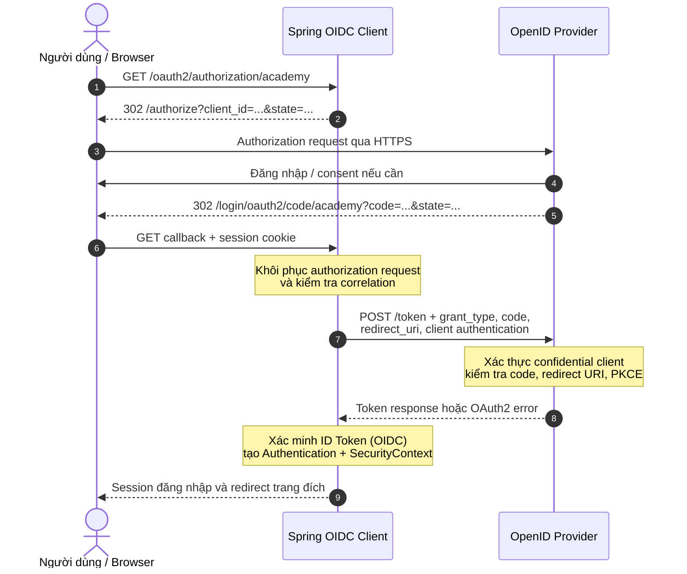

# 10.5. Client secret basic và client secret post

Trong **Spring Security OAuth 2.0 / OpenID Connect (OIDC) Client**, sau khi trình duyệt được chuyển hướng đến OpenID Provider (OP) và quay về ứng dụng với `authorization code`, backend Spring gửi một **HTTP POST tới Token Endpoint** để đổi code lấy token. Bên cạnh việc kiểm tra authorization code, Authorization Server còn cần xác định **client nào đang yêu cầu token**. Nếu ứng dụng được đăng ký là **confidential client** và được cấp `client_secret`, hai phương thức xác thực client phổ biến là:

- **`client_secret_basic`:** gửi `client_id` và `client_secret` qua HTTP `Authorization: Basic ...`.
- **`client_secret_post`:** gửi `client_id` và `client_secret` trong **form body** của chính token request.

Cả hai đều là **phương thức client authentication tại Token Endpoint**. Chúng không phải cách người dùng nhập mật khẩu, không phải grant type và không quyết định ID Token được ký bằng thuật toán nào. Trong đa số tích hợp tiêu chuẩn, nên ưu tiên **`client_secret_basic`** khi Authorization Server hỗ trợ; `client_secret_post` thường được dùng khi provider yêu cầu hoặc khả năng tương thích buộc phải dùng.

Bài học này áp dụng cho **Spring Boot 3.x, Spring Security 6.x, ứng dụng Servlet/Spring MVC sử dụng `oauth2Login()`**. Ví dụ dùng một OIDC provider giả lập, không chứa secret hoạt động thật.

## 1. Xác thực client diễn ra ở bước nào?

Xem luồng Authorization Code Flow từ browser đến Token Endpoint:



Có **hai lần xác thực khác nhau** trong hình:

1. **End-user authentication:** OP xác định người dùng là ai, ví dụ đăng nhập bằng mật khẩu, passkey hoặc phương thức tổ chức yêu cầu.
2. **Client authentication:** Token Endpoint xác định ứng dụng backend nào đang đổi code lấy token và ứng dụng đó có quyền dùng client registration được khai báo hay không.

Ví dụ người dùng là nhân viên A, còn OAuth2 client là ứng dụng `academy-web`. `client_secret` thuộc về ứng dụng `academy-web`, **không phải mật khẩu của nhân viên A**.

### 1.1. Authorization Code Flow và phương thức xác thực client là hai trục cấu hình

| Khái niệm | Thuộc tính Spring | Ví dụ | Điều khiển |
| --- | --- | --- | --- |
| **Authorization grant** | `authorization-grant-type` | `authorization_code` | Client nhận token bằng cách đổi authorization code. |
| **Client authentication** | `client-authentication-method` | `client_secret_basic` | Client trình bày credential cho Token Endpoint như thế nào. |
| **Client credential** | `client-id`, `client-secret` | Biến môi trường | Giá trị dùng nhận diện/xác thực client theo đăng ký tại OP. |
| **OIDC scope** | `scope` | `openid,profile` | Yêu cầu xác thực OIDC và claims/scope bổ sung. |
| **Callback** | `redirect-uri` | `{baseUrl}/login/oauth2/code/{registrationId}` | Nơi browser mang authorization response về ứng dụng. |

Đặt `client-authentication-method: client_secret_post` **không** biến `authorization_code` thành một grant khác; request đổi code vẫn là HTTP POST tới Token Endpoint.

## 2. Điều kiện tiên quyết: confidential client có client secret

OAuth 2.0 phân biệt loại client theo khả năng giữ bí mật credential:

- **Confidential client:** thành phần tin cậy có khả năng giữ secret an toàn, ví dụ Spring MVC backend chạy trên server được kiểm soát. OP có thể cấp client secret hoặc cho phép cơ chế xác thực mạnh hơn như khóa riêng.
- **Public client:** ứng dụng không thể giữ an toàn secret nhúng cố định, ví dụ single-page application chạy trong browser hoặc ứng dụng mobile được phân phối cho người dùng. Gắn client secret trong mã frontend **không biến nó thành confidential client**.

Cả `client_secret_basic` và `client_secret_post` chỉ phù hợp khi client **thực sự có thể giữ client secret** và OP đăng ký phương thức tương ứng. Nếu client là public, cần thiết kế theo **PKCE** và phương thức `none` theo chính sách OP, thay vì cố đưa secret vào JavaScript.

Với Spring server-side, thông tin giả định:

```text
Spring application: https://app.example.com
Registration ID:   academy
Client ID:         academy-web
Client secret:     được cấp và lưu ở môi trường backend
Issuer:            https://idp.example.com/realms/academy
Callback:          https://app.example.com/login/oauth2/code/academy
Token endpoint:    URL do metadata OP công bố
```

Ứng dụng cần đăng ký chính xác `redirect_uri` ở OP. Client secret, grant type, redirect URI cho phép, scopes và phương thức xác thực client phải cùng thuộc **một registration ở đúng issuer/tenant**.

## 3. `client_secret_basic` hoạt động như thế nào?

### 3.1. Cấu trúc HTTP Basic tại Token Endpoint

`client_secret_basic` sử dụng **HTTP Basic authentication** tại token endpoint. Client tạo một chuỗi từ client ID và secret, mã hóa thành Base64 và đặt trong header `Authorization`:

```http
POST /realms/academy/protocol/openid-connect/token HTTP/1.1
Host: idp.example.com
Content-Type: application/x-www-form-urlencoded
Authorization: Basic <base64-cua-client-id-va-secret>

grant_type=authorization_code&code=ONE_TIME_CODE&redirect_uri=https%3A%2F%2Fapp.example.com%2Flogin%2Foauth2%2Fcode%2Facademy
```

Đây là dạng minh họa. Tùy flow, body còn có `code_verifier` nếu đã dùng PKCE. Khi sử dụng `client_secret_basic`, **thông tin xác thực client nằm trong HTTP Basic header**, trong khi body chứa các tham số của grant.

Theo **RFC 6749, Section 2.3.1**, client ID và secret được **form-URL-encode từng giá trị trước** khi ghép thành chuỗi `client_id:client_secret` cho HTTP Basic. Diễn giải chuẩn:

```text
encodedId     = application/x-www-form-urlencoded(client_id)
encodedSecret = application/x-www-form-urlencoded(client_secret)
basicValue    = BASE64(ASCII(encodedId + ":" + encodedSecret))

Authorization: Basic <basicValue>
```

Ví dụ client ID là `web:portal`, secret minh họa là `s3cr+t &`:

```text
client_id     = web:portal
client_secret = s3cr+t &

form-encoded client_id     = web%3Aportal
form-encoded client_secret = s3cr%2Bt+%26

string trước khi Base64:
web%3Aportal:s3cr%2Bt+%26
```

Mã hóa riêng từng phần giúp dấu `:` trong client ID hoặc các ký tự đặc biệt trong secret không bị diễn giải nhầm là dấu ngăn hai trường của Basic authentication. **Đừng tự dùng Base64 của chuỗi ghép raw credential nếu hai giá trị có ký tự đặc biệt**; hãy để HTTP client/library tuân thủ định dạng OAuth 2.0.

### 3.2. Basic không đồng nghĩa với mã hóa bí mật

Base64 là **phép biểu diễn dữ liệu có thể giải mã**, không phải mã hóa bảo mật. Người thấy nguyên header `Authorization` có thể suy ra client ID và secret. Bảo vệ thực tế dựa trên:

- **HTTPS/TLS hợp lệ** khi gọi Token Endpoint.
- Không lưu/ghi log raw `Authorization` header.
- Không chuyển tiếp client credential đến host khác.
- Quản lý secret ở backend, giới hạn người/hệ thống có quyền đọc.
- Secret rotation và thu hồi credential theo quy trình của OP.

Không bao giờ thử “khắc phục lỗi chứng chỉ” bằng cách tắt TLS certificate validation ở HTTP client.

### 3.3. Vì sao thường ưu tiên Basic?

RFC 6749 yêu cầu Authorization Server hỗ trợ HTTP Basic đối với client được cấp client password và chỉ cho phép gửi credential trong body như một phương án thay thế có giới hạn. Với OAuth 2.0 Client hiện đại, Basic có lợi thế vận hành là **tách credential ra khỏi form body của grant**, giúp dễ xác định chặng xác thực client hơn.

Tuy nhiên, Basic **không tự động an toàn** nếu reverse proxy, gateway, tracing hoặc công cụ debug ghi log header. Bảo mật phải bao phủ tất cả nơi header có thể đi qua.

## 4. `client_secret_post` hoạt động như thế nào?

### 4.1. Đặt client ID và secret trong form body

Với `client_secret_post`, Token Endpoint nhận secret trong chính body của HTTP POST:

```http
POST /realms/academy/protocol/openid-connect/token HTTP/1.1
Host: idp.example.com
Content-Type: application/x-www-form-urlencoded

grant_type=authorization_code&code=ONE_TIME_CODE&redirect_uri=https%3A%2F%2Fapp.example.com%2Flogin%2Foauth2%2Fcode%2Facademy&client_id=academy-web&client_secret=REPLACE_WITH_SECRET
```

Các cặp khóa–giá trị được mã hóa theo `application/x-www-form-urlencoded`. Nếu dùng PKCE, form body còn có `code_verifier`. Trong request `client_secret_post`, **không cần `Authorization: Basic` cho cùng client**.

Đây vẫn là một **back-channel request do Spring backend gửi tới OP**. Browser không cần biết secret và không gửi secret tới callback.

### 4.2. Vì sao body authentication được xem là ít được khuyến nghị?

RFC 6749 Section 2.3.1 cho phép đặt client credential trong request body khi cần nhưng nêu rõ cách này **không được khuyến nghị** và nên giới hạn cho client không thể sử dụng HTTP Basic. Nguyên nhân thực tế là body của form thường đi qua:

- Request logger ghi toàn bộ form parameters.
- Công cụ APM/tracing thu request body.
- Reverse proxy hoặc gateway có tính năng body inspection.
- Hệ thống audit/debug vô tình lưu client secret cùng grant parameters.

Điều đó không có nghĩa Basic là “an toàn tuyệt đối” hoặc POST body không thể bảo vệ: **cả hai đều chứa secret có thể phục hồi** và đều cần TLS, kiểm soát log, storage và quyền truy cập nghiêm ngặt.

### 4.3. Những nhầm lẫn cần tránh

- **`client_secret_post` không phải HTTP POST khác với `client_secret_basic`.** Cả hai đều dùng `POST /token`; khác nhau là nơi đặt client credential.
- `client_secret_post` **không** có nghĩa là gửi secret qua query string hoặc URL. Không dùng `GET /token?client_secret=...`.
- Không gửi JSON body như `{"client_secret":"..."}` chỉ vì tên gọi có chữ `post`. Token request OAuth 2.0 tiêu chuẩn thường dùng `application/x-www-form-urlencoded`, trừ cơ chế provider riêng có tài liệu rõ ràng.
- Không gửi cùng secret trong cả header Basic và body. **Một token request không được sử dụng nhiều phương thức xác thực client cùng lúc**.

## 5. So sánh trực tiếp hai phương thức

| Tiêu chí | `client_secret_basic` | `client_secret_post` |
| --- | --- | --- |
| Nơi gửi client ID/secret | HTTP `Authorization: Basic ...` | Form body có `client_id` và `client_secret` |
| HTTP method | `POST` | `POST` |
| Content type của token request | Thường `application/x-www-form-urlencoded` | Thường `application/x-www-form-urlencoded` |
| `grant_type`, `code`, `redirect_uri` | Body | Body |
| `code_verifier` khi PKCE | Body | Body |
| Secret có thể phục hồi từ request? | Có, Base64 dễ giải mã | Có, secret xuất hiện trong form body |
| Nguy cơ lộ phổ biến | Header logging, proxy forwarding, trace | Body/form logging, APM, reverse proxy |
| Hướng dẫn theo RFC 6749 | **Phương thức nên ưu tiên** với client password | Được phép nhưng **không khuyến nghị**, dùng khi cần tương thích |
| Cấu hình Spring | `client-authentication-method: client_secret_basic` | `client-authentication-method: client_secret_post` |

Với OIDC provider có metadata, có thể có trường **`token_endpoint_auth_methods_supported`**:

```json
{
  "issuer": "https://idp.example.com/realms/academy",
  "token_endpoint": "https://idp.example.com/realms/academy/protocol/openid-connect/token",
  "token_endpoint_auth_methods_supported": [
    "client_secret_basic",
    "client_secret_post",
    "private_key_jwt"
  ]
}
```

Ví dụ metadata này **không phải dữ liệu thực của một provider cụ thể**. Danh sách thể hiện những phương thức OP công bố hỗ trợ tại Token Endpoint. Theo OIDC Discovery, khi trường tùy chọn này vắng mặt thì mặc định được hiểu là hỗ trợ `client_secret_basic`; tuy nhiên, **client registration và chính sách thực tế của OP vẫn quyết định phương thức được cho phép**.

Không suy ra rằng Spring Security tự chuyển qua lại hai phương thức chỉ vì metadata liệt kê cả hai. Với client registration đã chọn, Spring dùng `client-authentication-method` tương ứng; nếu OP hoặc tenant có ràng buộc riêng, cần cấu hình đúng từ phía client.

## 6. Cấu hình `client_secret_basic` trong Spring Boot

### 6.1. Dependency

Một ứng dụng Spring MVC có thể dùng starter:

```xml
<dependencies>
    <dependency>
        <groupId>org.springframework.boot</groupId>
        <artifactId>spring-boot-starter-web</artifactId>
    </dependency>
    <dependency>
        <groupId>org.springframework.boot</groupId>
        <artifactId>spring-boot-starter-oauth2-client</artifactId>
    </dependency>
</dependencies>
```

Với Gradle:

```groovy
dependencies {
    implementation 'org.springframework.boot:spring-boot-starter-web'
    implementation 'org.springframework.boot:spring-boot-starter-oauth2-client'
}
```

Starter OAuth2 Client tích hợp `ClientRegistration`, các filter và thành phần thực hiện token exchange trong OAuth2/OIDC Login. Không cần tự viết `POST /token` chỉ để dùng Basic.

### 6.2. `application.yml`

Ví dụ đầy đủ cho **confidential OIDC web client**:

```yaml
spring:
  security:
    oauth2:
      client:
        registration:
          academy:
            provider: academy-oidc
            client-id: ${OIDC_CLIENT_ID}
            client-secret: ${OIDC_CLIENT_SECRET}
            client-authentication-method: client_secret_basic
            authorization-grant-type: authorization_code
            scope:
              - openid
              - profile
              - email
            redirect-uri: "{baseUrl}/login/oauth2/code/{registrationId}"
        provider:
          academy-oidc:
            issuer-uri: ${OIDC_ISSUER_URI}
```

Giải thích từng trường:

| Trường | Vai trò |
| --- | --- |
| `registration.academy` | Client registration ID trong Spring, dùng cho URL bắt đầu login và callback. |
| `provider: academy-oidc` | Liên kết registration tới metadata của OP. |
| `client-id` | Public identifier của client, do OP cấp. |
| `client-secret` | Client password được giữ an toàn ở backend. |
| **`client-authentication-method`** | **Quyết định dùng HTTP Basic khi gọi Token Endpoint.** |
| `authorization-grant-type: authorization_code` | Dùng Authorization Code Flow, không phụ thuộc lựa chọn Basic/Post. |
| `scope: [openid, profile, email]` | Đặt `openid` để thực hiện OIDC Login. |
| `redirect-uri` | Callback về Spring app; phải khớp URL đăng ký tại OP. |
| `issuer-uri` | Issuer OIDC được OP công bố, dùng cho discovery/kiểm tra issuer. |

Ví dụ biến môi trường (các giá trị chỉ để minh họa):

```text
OIDC_CLIENT_ID=academy-web
OIDC_CLIENT_SECRET=<secret-do-op-cap>
OIDC_ISSUER_URI=https://idp.example.com/realms/academy
```

Biến `OIDC_CLIENT_SECRET` phải được cấp từ môi trường runtime/secret manager. **Không commit giá trị thực** vào `application.yml`, `application.properties` hoặc source code. Cũng không mặc định Spring Boot tự đọc file `.env` nếu không có cơ chế nạp biến tương ứng.

### 6.3. `application.properties` tương đương

```properties
spring.security.oauth2.client.registration.academy.provider=academy-oidc
spring.security.oauth2.client.registration.academy.client-id=${OIDC_CLIENT_ID}
spring.security.oauth2.client.registration.academy.client-secret=${OIDC_CLIENT_SECRET}
spring.security.oauth2.client.registration.academy.client-authentication-method=client_secret_basic
spring.security.oauth2.client.registration.academy.authorization-grant-type=authorization_code
spring.security.oauth2.client.registration.academy.scope=openid,profile,email
spring.security.oauth2.client.registration.academy.redirect-uri={baseUrl}/login/oauth2/code/{registrationId}
spring.security.oauth2.client.provider.academy-oidc.issuer-uri=${OIDC_ISSUER_URI}
```

Giữ cú pháp `client-authentication-method=client_secret_basic` chính xác. **Không đặt khóa dưới `spring.security.oauth2.client.provider.*`**: client authentication method là thuộc tính của **client registration**, không phải một thuộc tính endpoint của provider.

## 7. Đổi sang `client_secret_post` bằng đúng một thuộc tính

Nếu OP đã đăng ký client `academy-web` sử dụng `client_secret_post`, phần còn lại có thể giữ nguyên; thay khóa này:

**YAML:**

```yaml
spring:
  security:
    oauth2:
      client:
        registration:
          academy:
            client-authentication-method: client_secret_post
```

**Properties:**

```properties
spring.security.oauth2.client.registration.academy.client-authentication-method=client_secret_post
```

Hai đoạn này là **phần thay đổi của cấu hình hoàn chỉnh ở mục 6**, không đủ để chạy độc lập. Khi khởi động lại với cấu hình đầy đủ, Spring dùng phương thức POST form cho token request của registration `academy`.

Không cần thêm `client_secret` lần nữa vào Token Endpoint URI, không tự đặt header Basic và cũng không phải viết controller. Đảm bảo OP đã cho phép phương thức POST body cho client; đổi thuộc tính một phía khi OP chỉ chấp nhận Basic sẽ dẫn đến lỗi xác thực client.

### 7.1. Có thể cấu hình mỗi provider/registration khác nhau không?

Có. Ví dụ hai client registrations trong cùng ứng dụng, mỗi client dùng một phương thức theo đăng ký thực tế:

```yaml
spring:
  security:
    oauth2:
      client:
        registration:
          corporate:
            provider: corporate-op
            client-id: ${CORP_CLIENT_ID}
            client-secret: ${CORP_CLIENT_SECRET}
            client-authentication-method: client_secret_basic
            authorization-grant-type: authorization_code
            scope: [openid, profile]
          partner:
            provider: partner-op
            client-id: ${PARTNER_CLIENT_ID}
            client-secret: ${PARTNER_CLIENT_SECRET}
            client-authentication-method: client_secret_post
            authorization-grant-type: authorization_code
            scope: [openid, profile]
        provider:
          corporate-op:
            issuer-uri: ${CORP_ISSUER_URI}
          partner-op:
            issuer-uri: ${PARTNER_ISSUER_URI}
```

Khi browser bắt đầu login từ `/oauth2/authorization/corporate`, Spring sử dụng thông tin registration `corporate`. Khi bắt đầu từ `/oauth2/authorization/partner`, Spring sử dụng registration `partner`. Token Endpoint của mỗi OP nhận credential theo đúng phương thức đã cấu hình cho client đó.

Hai registration cũng có callback khác nhau theo mẫu mặc định, tương ứng `/login/oauth2/code/corporate` và `/login/oauth2/code/partner`. Đừng nhầm provider ID (`corporate-op`) với registration ID (`corporate`) khi đăng ký callback.

## 8. Spring Security thực hiện client authentication ở đâu?

### 8.1. Trách nhiệm của các thành phần

Trong Spring Security Servlet:

| Thành phần | Vai trò trong luồng |
| --- | --- |
| `OAuth2AuthorizationRequestRedirectFilter` | Bắt đầu flow và redirect browser sang Authorization Endpoint. |
| `OAuth2LoginAuthenticationFilter` | Nhận callback chứa authorization code và state. |
| `AuthenticationManager` và OAuth2/OIDC authentication providers | Xác thực kết quả authorization code, trao đổi code lấy token và xây principal. |
| `OAuth2AccessTokenResponseClient` | Chịu trách nhiệm thực hiện HTTP token request và đọc token response cho grant phù hợp. |
| `ClientRegistration` | Mang client ID, secret, authentication method, grant, scopes, endpoints và các thông tin liên quan. |
| `OidcUserService` / `OAuth2UserService` | Dựng principal sau khi nhận/xác minh token và thông tin người dùng cần thiết. |

Trong một cấu hình `oauth2Login()` chuẩn, Spring Security dùng các thông tin `ClientRegistration` để tạo token request và áp dụng đúng **`clientAuthenticationMethod`**. Các thành phần HTTP converter và access token response client cụ thể có thể thay đổi theo phiên bản Spring Security, nhưng về mặt giao thức:

```text
ClientRegistration
   clientId / clientSecret
   clientAuthenticationMethod
            |
            v
Authorization code callback
            |
            v
OAuth2AuthorizationCodeGrantRequest
            |
            v
OAuth2AccessTokenResponseClient
   - grant_type, code, redirect_uri, PKCE verifier
   - client_secret_basic: Authorization header
   - client_secret_post: form body
            |
            v
POST Token Endpoint (HTTPS)
            |
            v
Access token + ID Token (OIDC)
```

**Không nên tự lắp `Authorization` header từ browser request** hoặc viết controller gửi secret tới OP để thay thế flow chuẩn. Framework đã cung cấp cơ chế liên kết authorization request, callback, client registration và token exchange.

### 8.2. Đọc client-authentication-method bằng Java

Khi cần quan sát registration Spring Boot đã bind như mong đợi, có thể dùng một đoạn mã khởi tạo chỉ hiển thị **tên phương thức**, không đọc/ghi secret:

```java
import org.springframework.boot.ApplicationRunner;
import org.springframework.context.annotation.Bean;
import org.springframework.context.annotation.Configuration;
import org.springframework.security.oauth2.client.registration.ClientRegistration;
import org.springframework.security.oauth2.client.registration.ClientRegistrationRepository;

@Configuration
class OAuth2ConfigurationInspector {

    @Bean
    ApplicationRunner showClientAuthenticationMethod(
            ClientRegistrationRepository repository) {
        return args -> {
            ClientRegistration client =
                    repository.findByRegistrationId("academy");

            if (client == null) {
                throw new IllegalStateException(
                        "Missing client registration: academy");
            }

            System.out.println(
                    "academy client authentication method: "
                            + client.getClientAuthenticationMethod().getValue());
        };
    }
}
```

Với cấu hình Basic, giá trị mong đợi là `client_secret_basic`; đổi sang POST, giá trị mong đợi là `client_secret_post`. Đây là ví dụ quan sát cho môi trường phát triển, không cần giữ bean in cấu hình vào console trong ứng dụng production.

### 8.3. Cấu hình bằng Java API khi không dùng properties

Spring Security cũng biểu diễn phương thức bằng `ClientAuthenticationMethod`:

```java
import org.springframework.security.oauth2.core.ClientAuthenticationMethod;

ClientAuthenticationMethod method =
        ClientAuthenticationMethod.CLIENT_SECRET_BASIC;

// Hoặc khi OP yêu cầu:
ClientAuthenticationMethod alternative =
        ClientAuthenticationMethod.CLIENT_SECRET_POST;
```

Khi tạo `ClientRegistration` bằng builder, có thể sử dụng:

```java
// Trích đoạn builder minh họa; các thuộc tính bắt buộc khác
// (client ID/secret, grant, redirect URI, endpoints...) phải được cung cấp.
ClientRegistration.withRegistrationId("academy")
    .clientAuthenticationMethod(
        ClientAuthenticationMethod.CLIENT_SECRET_BASIC);
```

Đây là minh họa API, **không phải cấu hình hoàn chỉnh có thể build ngay**. Với Spring Boot, thường nên dùng properties/YAML để quản lý credential và môi trường triển khai.

## 9. Tham số token request: cái gì thay đổi và cái gì không?

Authorization Code Flow gửi một số tham số chuẩn bất kể client dùng Basic hay POST:

| Tham số | Mục đích | Có thay đổi khi đổi phương thức? |
| --- | --- | --- |
| `grant_type=authorization_code` | Cho OP biết đang đổi authorization code | Không |
| `code` | Authorization code nhận từ callback | Không |
| `redirect_uri` | Ràng buộc code với callback đã dùng trong authorization request | Không |
| `code_verifier` | Chứng minh PKCE khi authorization request có challenge | Không |
| `client_id` | Nhận diện client | Có thể nằm ở Basic credential hoặc form body theo phương thức |
| `client_secret` | Xác thực client | Basic header hoặc form body, tùy phương thức |

Nếu dùng `client_secret_basic`, ví dụ **body** chỉ có:

```text
grant_type=authorization_code
code=CODE
redirect_uri=https://app.example.com/login/oauth2/code/academy
code_verifier=VERIFIER_IF_PKCE
```

Còn **credential** nằm trong Basic header. Nếu dùng `client_secret_post`, body còn có:

```text
client_id=academy-web
client_secret=SECRET_VALUE
```

Nên để framework URL-encode tham số theo đúng chuẩn. `redirect_uri` gửi ở token request cần phù hợp với giá trị dùng khi xin code; khác scheme, host, port, path hoặc ký tự có thể làm OP trả `invalid_grant`.

### 9.1. PKCE có thay thế client secret không?

Với **confidential client**, PKCE và client authentication có hai chức năng:

- **PKCE:** ràng buộc authorization code với bên đã khởi tạo authorization request bằng `code_verifier`.
- **Client secret:** xác thực client được đăng ký với Token Endpoint.

Một confidential client có thể **đồng thời sử dụng `client_secret_basic` và PKCE**, hoặc `client_secret_post` và PKCE, nếu OP hỗ trợ. Điều này không vi phạm quy tắc một phương thức client authentication: **PKCE không phải một loại client password authentication**.

Với public client, dùng PKCE nhưng không giả định có secret được bảo mật; thường đăng ký `client-authentication-method: none` theo khả năng OP. Không chuyển sang `client_secret_post` để “làm PKCE hoạt động”.

### 9.2. OIDC ID Token không đổi cách xác minh

Client authentication thành công chỉ nói rằng Token Endpoint chấp nhận **client credential**. Sau đó Spring Security OIDC Client vẫn phải xác minh ID Token theo đúng quy tắc:

- Chữ ký và thuật toán được phép;
- `iss` là issuer được tin cậy;
- `aud` dành cho đúng client;
- Token còn hạn và các điều kiện thời gian thích hợp;
- `nonce` và các ràng buộc OIDC khác nếu authorization request dùng chúng.

Chọn Basic hay POST **không làm yếu hoặc thay thế** bước ID Token validation.

## 10. Kiểm tra bằng HTTP request minh họa

Đôi khi cần gửi token request thủ công trong môi trường thử nghiệm được OP cho phép để hiểu cách credential được biểu diễn. Đây là hoạt động debug **back-channel**, không phải luồng người dùng trên browser. Authorization code phải là code **mới, chưa dùng** và thuộc đúng client/redirect URI; một code đã được Spring đổi thành công không thể dùng lại để thử phương thức khác.

### 10.1. Ví dụ `curl` với Basic

```bash
curl --request POST   --url 'https://idp.example.com/realms/academy/protocol/openid-connect/token'   --user 'academy-web:REPLACE_WITH_SECRET'   --header 'Content-Type: application/x-www-form-urlencoded'   --data-urlencode 'grant_type=authorization_code'   --data-urlencode 'code=FRESH_ONE_TIME_CODE'   --data-urlencode 'redirect_uri=https://app.example.com/login/oauth2/code/academy'
```

`curl --user` minh họa HTTP Basic. Với credential có các ký tự đặc biệt, cần xem xét cách client HTTP thực hiện encoding đúng yêu cầu OAuth2 RFC 6749 trước khi ghép Basic; công cụ Basic thông thường không nhất thiết làm OAuth2 form-encoding từng phần như framework. Nếu provider yêu cầu PKCE, bổ sung `--data-urlencode 'code_verifier=...'`.

### 10.2. Ví dụ `curl` với client secret POST

```bash
curl --request POST   --url 'https://idp.example.com/realms/academy/protocol/openid-connect/token'   --header 'Content-Type: application/x-www-form-urlencoded'   --data-urlencode 'grant_type=authorization_code'   --data-urlencode 'code=FRESH_ONE_TIME_CODE'   --data-urlencode 'redirect_uri=https://app.example.com/login/oauth2/code/academy'   --data-urlencode 'client_id=academy-web'   --data-urlencode 'client_secret=REPLACE_WITH_SECRET'
```

Ví dụ này **không dùng HTTP Basic**. Tham số `client_secret` được form-encode vào request body; nếu OP cần PKCE, vẫn thêm `code_verifier`.

**Không đưa secret thật trực tiếp vào shell history, script được commit, CI logs hoặc terminal session được ghi lại.** Các lệnh minh họa trên dùng placeholder; khi debug thực tế, ưu tiên công cụ hỗ trợ nạp credential từ secret store, stdin hoặc cơ chế không làm lộ giá trị qua command line/process list. Không bật `curl -v` để chia sẻ nguyên header/body có secret.

### 10.3. Vì sao không nên dùng request thủ công làm luồng login chính?

Spring Security OAuth2 Login đã quản lý `state`, callback, PKCE, code, token response và ID Token validation. Gọi thủ công token endpoint có thể hữu ích khi xác định tương thích Basic/Post, nhưng nếu dùng để thay flow chính mà không giữ những ràng buộc trên, ứng dụng dễ phát sinh lỗi login CSRF, token mix-up hoặc rò rỉ credential.

## 11. Cách xác định OP hỗ trợ phương thức nào

Trước khi chọn phương thức:

1. Đọc tài liệu **client registration** của OP, xác định client được cấu hình `client_secret_basic`, `client_secret_post` hay phương thức khác.
2. Xác định **Token Endpoint** chính xác theo issuer discovery hoặc metadata đáng tin cậy.
3. Kiểm tra `token_endpoint_auth_methods_supported` nếu OP công bố; dữ liệu này nói về khả năng chung, không nhất thiết là quyền của từng client.
4. Đảm bảo client ID/secret thuộc đúng **issuer/realm/tenant** và đang còn hiệu lực.
5. Cấu hình `client-authentication-method` tại **registration** của Spring.
6. Quan sát token exchange với log an toàn hoặc HTTP mock trong môi trường test để biết credential được đặt đúng vị trí.

Nếu OP chỉ hỗ trợ `private_key_jwt` hoặc mTLS, cố đổi giữa Basic/Post không giải quyết lỗi. Khi đó phải dùng phương thức client authentication đúng theo khả năng của OP và hỗ trợ của phiên bản Spring Security.

### 11.1. Provider metadata và registration không phải một

Trong YAML:

```yaml
registration:
  academy:
    provider: academy-oidc
    client-authentication-method: client_secret_basic
provider:
  academy-oidc:
    issuer-uri: https://idp.example.com/realms/academy
```

`academy-oidc` là alias của OP; `academy` là registration ID. Cấu hình provider mô tả endpoint và issuer, còn **method nằm ở registration** vì các client khác nhau dùng cùng OP vẫn có thể được đăng ký cách xác thực khác nhau.

## 12. Cấu hình `SecurityFilterChain` để kích hoạt token exchange

Một `SecurityFilterChain` tối thiểu cho website sử dụng session và OIDC login:

```java
import org.springframework.context.annotation.Bean;
import org.springframework.context.annotation.Configuration;
import org.springframework.security.config.Customizer;
import org.springframework.security.config.annotation.web.builders.HttpSecurity;
import org.springframework.security.web.SecurityFilterChain;

@Configuration
public class SecurityConfig {

    @Bean
    SecurityFilterChain securityFilterChain(HttpSecurity http) throws Exception {
        http
            .authorizeHttpRequests(authorize -> authorize
                .requestMatchers("/", "/error", "/assets/**").permitAll()
                .anyRequest().authenticated()
            )
            .oauth2Login(Customizer.withDefaults());

        return http.build();
    }
}
```

Luồng khởi tạo:

```text
GET https://app.example.com/oauth2/authorization/academy
```

Callback mặc định:

```text
GET https://app.example.com/login/oauth2/code/academy?code=...&state=...
```

`OAuth2LoginAuthenticationFilter` nhận callback, `AuthenticationProvider` xử lý grant và `OAuth2AccessTokenResponseClient` thực hiện token request theo method từ registration.

Không cần tự tạo bean filter để chuyển Basic thành POST. Nếu ứng dụng có nhiều chain, callback phải thuộc chain bật `oauth2Login()`; nếu không, nó có thể bị xử lý như một URL thông thường và không có token exchange.

## 13. Lỗi phổ biến ở Token Endpoint

| Triệu chứng | Nguyên nhân có thể | Cách kiểm tra |
| --- | --- | --- |
| `invalid_client`, HTTP 400 hoặc 401 | Sai client ID/secret, method không được OP cho phép, sai tenant, credential đã bị rotate | Kiểm tra registration tại OP và method trong Spring; tránh in secret. |
| OP báo thiếu `client_id` | OP không chấp nhận Basic hoặc gateway làm mất `Authorization` header | Kiểm tra token endpoint hỗ trợ Basic và header có đi qua proxy đúng không. |
| OP báo thiếu `client_secret` | Spring dùng Basic trong khi OP chỉ đọc form body, hoặc dùng POST nhưng secret placeholder chưa được cấp | So phương thức giữa OP và client registration. |
| `invalid_request` liên quan duplicate authentication | Client gửi cả Basic header và form `client_secret` | Bỏ một phương thức; không ghép Basic/Post. |
| `invalid_grant` | Code hết hạn/đã dùng, sai redirect URI, PKCE verifier thiếu/sai, code thuộc client khác | Điều tra code exchange; **không mặc định** là sai `client_secret_basic`/`post`. |
| `unsupported_grant_type` | OP không chấp nhận grant trong token request | Kiểm tra `authorization_code` được bật và form body đúng. |
| `unauthorized_client` | Client không được cấp quyền sử dụng grant hoặc flow hiện tại | Kiểm tra cấu hình client tại OP. |
| Lỗi TLS handshake | Cert hết hạn/sai hostname, trust store thiếu CA | Sửa TLS/CA/hostname, không tắt xác minh chứng chỉ. |
| Login redirect thành công nhưng callback thất bại | Session/state/callback, không nhất thiết token method | Kiểm tra `state`, cookie và việc khôi phục authorization request trước token exchange. |
| OIDC ID Token bị từ chối | `iss`, `aud`, chữ ký, nonce hoặc hạn dùng sai | Xem OIDC validation độc lập với client authentication. |
| Chỉ production thất bại | Proxy loại `Authorization`, khác issuer/tenant, secret theo profile bị sai | So cấu hình runtime và kiểm tra proxy/redaction/secret injection. |

### 13.1. Phân biệt lỗi `invalid_client` và `invalid_grant`

**`invalid_client`** thường xảy ra khi Token Endpoint không xác thực được ứng dụng: sai secret, sai phương thức, client không tồn tại hoặc policy từ chối. Với client sử dụng HTTP `Authorization` header, OAuth 2.0 có yêu cầu phản hồi 401 và `WWW-Authenticate` phù hợp trong những trường hợp xác thực client thất bại bằng header, nhưng provider thực tế có thể có cách trình bày lỗi cụ thể.

**`invalid_grant`** nói về grant được trình bày: authorization code hết hạn, không hợp lệ, đã dùng, redirect URI không khớp hoặc PKCE thất bại. Đổi `client_secret_basic` sang `client_secret_post` không sửa được code đã bị dùng.

Khi debug, ghi lại mã lỗi đã được lọc thông tin nhạy cảm, status HTTP, provider/registration ID và thời điểm; không copy nguyên body request có secret.

### 13.2. Nhận biết gateway làm mất Basic header

Một số API gateway hoặc reverse proxy nhận `Authorization` header để xác thực người gọi rồi loại bỏ nó trước khi forward. Nếu Token Endpoint nằm sau gateway như vậy, OP có thể không nhận được Basic credential.

Cần xác định header có được forward tới **đúng token endpoint** theo thiết kế và gateway có chủ động dùng cùng header cho authentication khác không. Không giải quyết bằng cách mở log raw header cho toàn hệ thống. Nếu OP yêu cầu POST body thì dùng `client_secret_post` theo chính sách đã đăng ký; không tự ý chuyển chỉ vì gateway có lỗi cấu hình.

## 14. Bảo vệ client secret trong vận hành

### 14.1. Lưu và cung cấp secret

Có thể lấy `client-secret` từ:

- Biến môi trường của tiến trình ứng dụng;
- Secret manager của hạ tầng/Kubernetes;
- Nguồn externalized configuration được phân quyền phù hợp.

Không commit secret vào source, fixture, `application-prod.yml` hoặc tài liệu. Không gửi secret đến browser hay expose qua REST response/Actuator. Với client web server-side, **toàn bộ việc sử dụng secret phải nằm ở backend tin cậy**.

Ví dụ placeholder:

```yaml
spring:
  security:
    oauth2:
      client:
        registration:
          academy:
            client-secret: ${OIDC_CLIENT_SECRET}
```

Có thể bảo vệ thiếu secret bằng yêu cầu cung cấp biến môi trường. Tránh fallback `${OIDC_CLIENT_SECRET:password}` trong production, vì nó dễ che lỗi cấu hình và tạo credential dự đoán được.

### 14.2. Không ghi log secret trong Basic hoặc form body

Nguy cơ theo từng method:

| Vùng dữ liệu | Basic | POST |
| --- | --- | --- |
| HTTP `Authorization` header | **Chứa credential** Base64 | Thường không chứa client password authentication của request này |
| Form body | `grant_type`, `code`, `redirect_uri`, PKCE | Có thêm **`client_id` và `client_secret`** |
| URL/query string | Không nên chứa client secret | Không nên chứa client secret |
| Tracing/metrics | Phải che Authorization header | Phải che `client_secret` trong form body |
| Transport | Phải bảo vệ bằng TLS | Phải bảo vệ bằng TLS |

Secret có thể bị lộ từ các nơi như request dump, HTTP interceptor, exception trace, log debug, packet capture khi không có TLS, proxy body buffer hoặc system diagnostics. Đặt chính sách redaction ở tất cả lớp liên quan: ứng dụng, HTTP client, API gateway, proxy, APM, CI/CD và vận hành.

### 14.3. Secret rotation

Khi OP đổi client secret:

1. Cấp secret mới trong OP theo chính sách provider, xác định có giai đoạn song song hai secret hay không.
2. Cập nhật secret manager/environment của Spring application.
3. Khởi động lại hoặc làm mới cấu hình credential theo cách ứng dụng hỗ trợ.
4. Quan sát token request mới ở mức metadata an toàn, xác nhận không còn `invalid_client`.
5. Thu hồi secret cũ sau khi lưu lượng đã chuyển, theo chính sách OP.

Nếu provider hỗ trợ rotation có thời gian chồng lấp, có thể tránh gián đoạn khi thay secret. Nếu chỉ hỗ trợ một secret, cần kế hoạch triển khai tương ứng. **Đổi `client_secret_basic` sang `client_secret_post` không đồng nghĩa rotate secret.**

### 14.4. Khi nào cần cơ chế mạnh hơn shared secret?

Đối với môi trường đòi hỏi mức bảo vệ cao hoặc nhiều bên vận hành, client authentication bằng chữ ký khóa riêng (`private_key_jwt`) hoặc mutual TLS có thể phù hợp hơn, nếu OP và Spring stack hỗ trợ. Chúng thuộc nhóm **phương thức client authentication khác**, không phải biến thể của `client_secret_post`. Bài này chỉ so sánh hai cách dùng cùng loại shared secret.

## 15. Những nhầm lẫn dễ gặp trong mã nguồn Spring Security

### 15.1. “Cấu hình `client-authentication-method` trong provider”

Sai vị trí. Thuộc tính này thuộc:

```text
spring.security.oauth2.client.registration.<registrationId>.client-authentication-method
```

Không phải:

```text
spring.security.oauth2.client.provider.<providerId>.client-authentication-method
```

Nhóm provider chứa issuer URI và các endpoint; registration chứa cách client xác thực với OP.

### 15.2. “Basic là dùng GET, Post là dùng POST”

Sai. Token Endpoint của Authorization Code Flow nhận **POST** trong cả hai trường hợp. Basic là **HTTP authentication scheme**, còn Post ở đây mô tả cách đặt secret trong form body.

### 15.3. “Tôi cấu hình POST thì không cần HTTPS”

Sai. POST body không mã hóa secret. Nếu chạy HTTP công khai, credential có thể bị đọc trên đường truyền. **TLS bắt buộc đối với Token Endpoint có client password** theo yêu cầu OAuth 2.0.

### 15.4. “Base64 của Basic bảo vệ được secret”

Sai. Base64 đảo ngược dễ dàng. Chính sách bảo vệ phải tập trung vào TLS, logging, access control và secret management.

### 15.5. “PKCE làm secret không còn cần thiết”

Không đúng đối với **confidential client đã đăng ký client authentication**. PKCE và client authentication bảo vệ những khía cạnh khác nhau. Nếu OP yêu cầu cả hai, gửi đúng `code_verifier` cùng credential client theo method đã đăng ký.

### 15.6. “ID Token được cấp nghĩa là secret method đã an toàn”

Token được cấp thành công chỉ chứng minh OP chấp nhận request. Việc vận hành có thể vẫn rò rỉ secret qua log, tracing hoặc proxy. OIDC Client còn phải xác minh ID Token và bảo vệ phiên đăng nhập người dùng.

### 15.7. “Thay code lỗi bằng cách thử mọi phương thức”

Không nên tự động retry token request bằng Basic rồi POST khi code/secret bị từ chối, vì:

- Client authentication method nên được xác định trước theo registration.
- Authorization code thường dùng **một lần**; retry bừa bãi có thể làm mất cơ hội xử lý code.
- Việc fallback không kiểm soát có thể khiến credential được gửi theo phương thức yếu hoặc ngoài chính sách.
- Lỗi có thể là `invalid_grant`/PKCE/redirect URI, không liên quan method.

Chọn một phương thức đã được OP cấp phép, xử lý rõ lỗi và kiểm tra nguyên nhân.

## 16. Bài thực hành: đổi phương thức mà giữ nguyên flow

### Mục tiêu

Hiểu rằng chỉ thay đổi **vị trí credential** của Token Endpoint request, trong khi authorization request, callback và OIDC validation vẫn theo luồng chuẩn.

### Chuẩn bị

Giả sử OP thử nghiệm cấp một confidential client có `client_id=academy-web`, secret từ môi trường và redirect URI:

```text
http://localhost:8080/login/oauth2/code/academy
```

Cấu hình Spring Security `oauth2Login()`, issuer discovery và đúng client registration. Nếu OP hỗ trợ cả Basic và POST cho cùng client, có thể chạy hai lần đăng nhập riêng biệt; nếu chỉ hỗ trợ một cách, chỉ kiểm tra cách đã được cấp phép.

### Thực hiện

1. Cấu hình `client-authentication-method: client_secret_basic` và chạy ứng dụng.
2. Mở `http://localhost:8080/oauth2/authorization/academy`, hoàn thành đăng nhập.
3. Xác nhận backend thực hiện token exchange và tạo phiên OIDC; quan sát tên method từ `ClientRegistration` hoặc HTTP mock được thiết kế an toàn. Không chụp raw secret/header để đưa vào báo cáo.
4. Nếu OP cho phép POST, đổi sang `client_secret_post`, khởi động lại ứng dụng và bắt đầu **một lần Authorization Code Flow mới**.
5. So sánh đường đi: URL bắt đầu login, callback và `grant_type` giữ nguyên; nơi gửi `client_id`/`client_secret` thay đổi.
6. Kiểm tra tiếp một endpoint bảo vệ để xác nhận Spring tạo `Authentication` sau khi ID Token hợp lệ.

Không tái sử dụng authorization code từ lần chạy Basic cho lần POST. Mỗi code có thời hạn ngắn và thường chỉ đổi được một lần.

### Điều quan sát được

```text
Login bằng Basic:
  Browser -> /oauth2/authorization/academy
  OP -> Callback code_A + state_A
  Spring -> POST /token
       Authorization: Basic <credential>
       Body: grant_type, code_A, redirect_uri, ...
  OP -> token response
  Spring -> xác minh OIDC, tạo session

Login bằng POST:
  Browser -> /oauth2/authorization/academy
  OP -> Callback code_B + state_B
  Spring -> POST /token
       Body: grant_type, code_B, redirect_uri,
             client_id, client_secret, ...
  OP -> token response
  Spring -> xác minh OIDC, tạo session
```

Hai lần đăng nhập đều độc lập và cần xác minh state/PKCE/nonce theo cấu hình. Chúng không đơn thuần là hai cách biểu diễn cùng một code đã phát.

## 17. Câu hỏi tự kiểm tra

**Câu 1.** Ứng dụng gửi `POST /token` với `grant_type=authorization_code` và header `Authorization: Basic ...`. Client đang dùng phương thức nào?

> `client_secret_basic`, với điều kiện header Basic chứa đúng credential của client theo chuẩn OAuth2.

**Câu 2.** Một Token Endpoint yêu cầu `client_secret_post`. Có nên thêm `client_secret` vào callback URL `/login/oauth2/code/academy`?

> Không. Client secret phải ở **form body của request backend đến Token Endpoint**, không xuất hiện trong callback URL hoặc JavaScript.

**Câu 3.** Dùng Basic thì HTTP request vẫn là POST, đúng hay sai?

> Đúng. Cả hai phương thức đều được dùng trong `POST /token`; “Basic” nói về cách gửi credential, không phải HTTP method.

**Câu 4.** Nếu ứng dụng có PKCE, có thể bỏ client secret khỏi confidential client mà OP yêu cầu xác thực bằng secret không?

> Không. PKCE xác minh sở hữu verifier gắn với authorization code; confidential client vẫn phải xác thực theo method OP đã đăng ký khi OP yêu cầu.

**Câu 5.** Vì sao Token Endpoint trả `invalid_client` khi client ID và secret nhìn có vẻ đúng?

> Có thể method Basic/Post không khớp chính sách OP, credential thuộc tenant khác, secret đã rotate, header Basic bị proxy loại bỏ, hoặc cấu hình Spring dùng biến môi trường sai. Cần kiểm tra method và registration trước khi đổi luồng.

**Câu 6.** Có thể gửi cả `Authorization: Basic ...` và `client_secret` trong form body để “OP tự chọn” không?

> Không. OAuth2 Client không được sử dụng nhiều phương thức xác thực client trong cùng một request. Chọn đúng một cách được OP cho phép.

**Câu 7.** Một OAuth2 client trong browser chứa `client_secret` trong mã nguồn rồi cấu hình `client_secret_post` có an toàn không?

> Không. Secret đã được phân phối tới người dùng nên không còn bí mật. Thiết kế lại theo public client với PKCE hoặc đưa token exchange vào backend được kiểm soát, theo kiến trúc và khả năng của OP.

**Câu 8.** OP hỗ trợ `client_secret_basic` và `client_secret_post`. Nên chọn gì khi không có ràng buộc tương thích khác?

> Thường ưu tiên `client_secret_basic` theo định hướng RFC 6749; vẫn kiểm tra policy cụ thể của OP/client registration và bảo vệ header/log.

## 18. Ghi nhớ

- `client_secret_basic` và `client_secret_post` là **hai cách trình bày client ID/secret khi xác thực client với Token Endpoint**, đều trên request HTTP POST theo Authorization Code Flow.
- Với **Basic**, credential nằm ở `Authorization: Basic ...`; với **Post**, credential nằm trong body `application/x-www-form-urlencoded`.
- Với Spring Boot, cấu hình bằng **`spring.security.oauth2.client.registration.<registrationId>.client-authentication-method`**.
- Nên ưu tiên **`client_secret_basic`** khi OP hỗ trợ và chính sách client cho phép. Dùng `client_secret_post` khi provider/khả năng tương thích yêu cầu, bảo vệ form body khỏi logging.
- **Không dùng hai phương thức cùng một request**, không đưa secret vào URL, không để secret trong frontend và không tắt HTTPS/TLS.
- Client secret authentication, PKCE, kiểm tra `state` và OIDC ID Token validation **bảo vệ những vấn đề khác nhau**; cấu hình method không được thay các bước còn lại.
- Để Spring Security thực hiện token request qua `oauth2Login()` và các OAuth2 Client components, trừ khi có nhu cầu tùy biến cụ thể với đầy đủ kiểm soát bảo mật.

### Tài liệu tham khảo

- [RFC 6749 — OAuth 2.0, Section 2.3.1: Client Password](https://www.rfc-editor.org/rfc/rfc6749#section-2.3.1).
- [RFC 6749 — OAuth 2.0, Section 4.1.3: Access Token Request](https://www.rfc-editor.org/rfc/rfc6749#section-4.1.3).
- [RFC 9700 — Best Current Practice for OAuth 2.0 Security](https://www.rfc-editor.org/rfc/rfc9700).
- [OpenID Connect Discovery 1.0 — Provider Metadata](https://openid.net/specs/openid-connect-discovery-1_0.html).
- [OpenID Connect Core 1.0 — Client Authentication](https://openid.net/specs/openid-connect-core-1_0.html#ClientAuthentication).
- [Spring Security Reference — OAuth 2.0 Client](https://docs.spring.io/spring-security/reference/servlet/oauth2/client/index.html).
- [Spring Security Reference — OAuth 2.0 Login](https://docs.spring.io/spring-security/reference/servlet/oauth2/login/index.html).
- [Spring Security API — ClientAuthenticationMethod](https://docs.spring.io/spring-security/site/docs/current/api/org/springframework/security/oauth2/core/ClientAuthenticationMethod.html).
