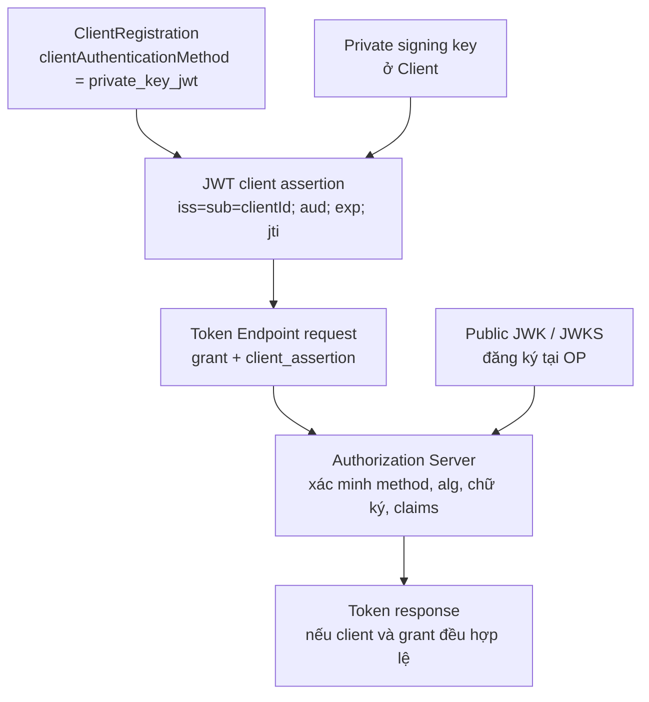

# 10.7. Private key JWT, client secret JWT và yêu cầu tích hợp tương ứng

## Mục tiêu bài học

Sau bài học, bạn có thể:

- Giải thích **xác thực OAuth 2.0 Client tại Token Endpoint** và phân biệt việc xác thực client với xác thực người dùng, trao đổi authorization code và xác minh access token.
- Phân biệt hai phương thức **`private_key_jwt`** và **`client_secret_jwt`** của OpenID Connect, bao gồm loại khóa ký, cách Authorization Server xác thực và mức độ phù hợp với từng kiến trúc.
- Đọc và tạo về mặt khái niệm **JWT Client Assertion** có các claim `iss`, `sub`, `aud`, `exp`, `iat`, `jti` cùng header `alg`, `kid`; truyền assertion qua `client_assertion_type` và `client_assertion`.
- Xác định các yêu cầu khi tích hợp: đăng ký phương thức client authentication, thuật toán ký, public JWK/JWKS hoặc client secret, thời gian hệ thống, HTTPS, quản lý khóa và bảo vệ replay.
- Cấu hình **Spring Security OAuth2/OIDC Client** để dùng `private_key_jwt` hoặc `client_secret_jwt` khi gọi Token Endpoint, kể cả khi cần refresh access token.
- Tìm nguyên nhân của các lỗi như `invalid_client`, sai `aud`, khóa không khớp, chữ ký sai, assertion hết hạn và dùng lại `jti`.

## 1. Bối cảnh: Token Endpoint phải biết client nào đang gọi

Giả sử **Learning Portal** là một ứng dụng Spring Boot chạy ở backend, sử dụng **Campus Identity** làm Authorization Server/OpenID Provider. Người dùng bắt đầu đăng nhập ở Learning Portal, được chuyển đến Campus Identity, hoàn tất xác thực và được trả về một **authorization code**.

Learning Portal tiếp tục gửi code đến Token Endpoint:

```http
POST /oauth2/token HTTP/1.1
Host: login.example.org
Content-Type: application/x-www-form-urlencoded

grant_type=authorization_code&code=<code>&redirect_uri=<registered-redirect-uri>
```

Với một **confidential client** đăng ký phải xác thực ở Token Endpoint, server cần xác minh rằng bên gửi request đúng là client được cấp code. Các phương thức thường gặp là:

- `client_secret_basic`: client gửi client ID và secret qua HTTP Basic.
- `client_secret_post`: client gửi ID và secret trong form body.
- `client_secret_jwt`: client tạo JWT assertion, ký bằng một **khóa đối xứng** dựa trên client secret đã chia sẻ với Authorization Server.
- `private_key_jwt`: client tạo JWT assertion, ký bằng **private key** của mình; Authorization Server dùng **public key** đã đăng ký để kiểm tra.

Bài này tập trung vào hai phương thức cuối, vốn đều dùng **JWT như bằng chứng xác thực client**.

**Điểm cốt lõi:** JWT Client Assertion dùng để xác thực **ứng dụng Client** tại Token Endpoint; nó **không phải ID Token**, **không phải Access Token** và **không phải Refresh Token**.

### 1.1. Ba câu hỏi tách biệt

Khi Learning Portal hoàn thành OIDC Authorization Code Flow, có ba câu hỏi:

| Câu hỏi | Cơ chế thường tham gia |
| --- | --- |
| “Client đang gọi Token Endpoint là ứng dụng nào?” | Client authentication, ví dụ `private_key_jwt` hoặc `client_secret_jwt` |
| “Authorization code này có thuộc giao dịch và client hợp lệ không?” | Kiểm tra code, redirect URI, PKCE khi áp dụng, trạng thái grant ở Authorization Server |
| “Người dùng nào đã xác thực?” | OIDC ID Token, được Relying Party xác thực theo quy tắc issuer, audience, chữ ký và các điều kiện liên quan |

Một client assertion có chữ ký đúng **không tự khiến authorization code hợp lệ**. Tương tự, ID Token đúng **không thay thế client authentication** tại Token Endpoint.

## 2. Hai phương thức nằm ở đâu trong luồng?

```mermaid
sequenceDiagram
    autonumber
    actor U as End-User
    participant B as Browser
    participant C as Learning Portal (OAuth2/OIDC Client)
    participant AS as Campus Identity (Authorization Server)

    U->>B: Chọn đăng nhập
    B->>C: GET /oauth2/authorization/campus
    C-->>B: Redirect đến authorization endpoint
    B->>AS: client_id, redirect_uri, scope, state, PKCE...
    AS->>U: Đăng nhập / consent khi cần
    U-->>AS: Hoàn thành
    AS-->>B: Redirect về client với code, state
    B->>C: GET /login/oauth2/code/campus?code=...
    C->>C: Tạo JWT Client Assertion mới, ký bằng khóa phù hợp
    C->>AS: POST token endpoint: code + client_assertion
    AS->>AS: Kiểm tra JWT assertion và authorization code
    AS-->>C: Access Token, ID Token nếu là OIDC, có thể Refresh Token
    C->>C: Xác thực ID Token; tạo phiên ứng dụng
```

Tại bước đổi code, cả hai phương thức đều thường dùng các form parameter:

```text
client_assertion_type = urn:ietf:params:oauth:client-assertion-type:jwt-bearer
client_assertion      = <signed-client-assertion-jwt>
```

Điểm khác nhau nằm ở **khóa ký** và **cách Authorization Server xác minh chữ ký**:

- Với `private_key_jwt`, client ký bằng private key và server kiểm tra bằng public key.
- Với `client_secret_jwt`, hai bên có cùng client secret; client tạo chữ ký HMAC và server tự tính lại chữ ký bằng secret tương ứng.

`client_assertion_type` trên chỉ định định dạng **JWT Bearer Assertion** theo RFC 7523. Nó **không** quyết định thay `grant_type`. Với Authorization Code Flow, `grant_type` vẫn là `authorization_code`; với refresh token flow, vẫn là `refresh_token`.

## 3. JWT Client Assertion gồm những gì?

Đây là một JWT được client tạo tại thời điểm cần xác thực. Một compact JWS thông thường có cấu trúc:

```text
BASE64URL(JWS Header).BASE64URL(Claims).BASE64URL(Signature)
```

Ví dụ header minh họa cho **`private_key_jwt`**:

```json
{
  "alg": "RS256",
  "kid": "portal-signing-key-2026-01",
  "typ": "JWT"
}
```

Payload minh họa:

```json
{
  "iss": "learning-portal-web",
  "sub": "learning-portal-web",
  "aud": "https://login.example.org/oauth2/token",
  "iat": 1893456000,
  "exp": 1893456060,
  "jti": "6a397bec-3b07-4cfa-94d3-1ec18d1b05f8"
}
```

Các số thời gian trên chỉ dùng để minh họa định dạng Unix timestamp, không đại diện cho một assertion còn hiệu lực tại thời điểm đọc. JWT hợp lệ phải được tạo mới và ký thật bằng khóa được đăng ký đúng; không sao chép chuỗi hay `jti` ví dụ.

### 3.1. Claim trong client assertion

| Claim | Ý nghĩa | Lưu ý tích hợp |
| --- | --- | --- |
| `iss` | Issuer của client assertion | Trong JWT client authentication, thường phải là **Client ID** |
| `sub` | Subject của assertion | Cũng thường phải là **Client ID**, không phải user ID |
| `aud` | Authorization Server/Token Endpoint nhận assertion | Giá trị phải đúng quy định của provider, thường là URL Token Endpoint |
| `exp` | Thời điểm assertion hết hiệu lực | Bắt buộc cho profile JWT Bearer; đặt ngắn hạn |
| `iat` | Thời điểm assertion được phát hành | Rất hữu ích để giới hạn tuổi assertion; server có thể áp dụng chính sách thời gian |
| `nbf` | Thời điểm trước đó assertion chưa có hiệu lực | Tùy chọn; cần tránh đồng hồ bị lệch |
| `jti` | Định danh duy nhất của assertion | Hỗ trợ phát hiện replay; nên tạo giá trị ngẫu nhiên mới cho mỗi lần dùng |

Với client authentication theo RFC 7523, **`iss` và `sub` xác định client**, không xác định End-User. Ví dụ sai:

```json
{
  "iss": "https://login.example.org",
  "sub": "student-123"
}
```

Đây không phải bộ claim phù hợp để xác thực Learning Portal nếu client ID được đăng ký là `learning-portal-web`. Đừng nhầm cấu trúc ID Token (issuer là OP, subject là user) với cấu trúc **Client Assertion** (issuer/subject là client theo profile).

### 3.2. `aud` phải chọn như thế nào?

Thông thường:

```text
aud = https://login.example.org/oauth2/token
```

Nó ràng buộc assertion với **Authorization Server/Token Endpoint** được chỉ định. Một số hệ thống dùng issuer identifier hoặc một audience cụ thể khác theo profile và quy định của nhà cung cấp. Vì vậy, client phải lấy yêu cầu chính thức của provider, không tự chọn giá trị theo cảm tính.

Ví dụ:

```text
Issuer OIDC:     https://login.example.org
Token Endpoint:  https://login.example.org/oauth2/token
```

Nếu provider yêu cầu **Token Endpoint URL** làm audience, việc đặt `aud = https://login.example.org` có thể bị từ chối dù domain trông giống nhau. Ngược lại, nếu provider xác định audience là issuer, phải tuân theo quy định đó.

Không dùng URL **authorization endpoint** hoặc callback của Learning Portal làm `aud`, trừ khi Authorization Server có quy tắc rất đặc biệt nêu rõ điều này.

### 3.3. Vì sao `exp` nên ngắn và `jti` nên duy nhất?

JWT client assertion là credential có thể bị dùng lại nếu bị đánh cắp trước khi hết hạn. Thường chọn thời hạn ngắn, ví dụ **60 giây** theo khả năng của provider, và tạo một `jti` mới cho mỗi assertion.

```text
Request A  -> jti=A, iat=t0, exp=t0+60
Request B  -> jti=B, iat=t1, exp=t1+60
Request C  -> jti=C, iat=t2, exp=t2+60
```

Không được tạo một JWT lúc ứng dụng khởi động rồi dùng nguyên chuỗi cho mọi lần đổi code và refresh token: assertion sẽ hết hạn, và reuse có thể bị từ chối. Nếu muốn chống replay có hiệu quả, Authorization Server phải thực thi cơ chế nhớ/kiểm tra các assertion đã dùng hoặc chính sách tương ứng.

**`jti` không phải PKCE verifier.** PKCE ràng buộc authorization code với client đã khởi tạo authorization request; `jti` giúp nhận diện một JWT assertion riêng biệt.

## 4. So sánh `private_key_jwt` và `client_secret_jwt`

| Khía cạnh | `private_key_jwt` | `client_secret_jwt` |
| --- | --- | --- |
| Khóa ký | Khóa **bất đối xứng riêng** của client | **Client secret đối xứng** được chia sẻ |
| Ví dụ thuật toán JWS | `RS256`, `PS256`, `ES256` nếu provider hỗ trợ | `HS256`, `HS384`, `HS512` nếu provider hỗ trợ |
| Authorization Server xác minh bằng | Public key tương ứng, qua JWK/JWKS hoặc khóa đăng ký | Client secret mà server đang giữ |
| Có phải chia sẻ private key? | **Không.** Chỉ công bố public key | Hai bên phải giữ cùng secret |
| Cách đăng ký | Client ID + authentication method + khóa công khai hoặc `jwks_uri` + thuật toán | Client ID + authentication method + secret đủ mạnh + thuật toán |
| Xoay khóa | Đăng ký public JWK mới, đổi `kid`, chuyển tiếp các khóa đang dùng | Phối hợp xoay secret ở cả client và server |
| Quản lý khóa | Private key trong keystore/KMS/HSM hoặc secret manager; public JWKS để xác minh | Secret manager bảo vệ bí mật chia sẻ |
| Rủi ro khi khóa bị lộ | Kẻ lấy private key có thể giả mạo client cho đến khi khóa bị vô hiệu | Kẻ lấy client secret có thể giả mạo client cho đến khi secret bị thay |
| Phù hợp | Backend confidential client cần kiểm soát khóa mạnh, dễ tích hợp KMS/JWKS | Backend confidential client đã có secret đủ mạnh và provider hỗ trợ HMAC assertions |

Cả hai là **client authentication bằng JWT**, không phải một loại grant mới. Cả hai yêu cầu HTTPS, kiểm tra chữ ký và các claim. `private_key_jwt` thường có lợi về phân phối khóa vì Authorization Server không cần giữ private key của client.

### 4.1. Có phải `private_key_jwt` luôn an toàn tuyệt đối?

Không. Nếu private key nằm trong file không mã hóa, được commit lên Git, có quyền đọc rộng hoặc bị trích xuất từ tiến trình, bên ngoài có thể giả mạo client. Chất lượng triển khai còn phụ thuộc:

- Khóa được tạo với thuật toán/kích thước phù hợp và lưu an toàn.
- Public key được đăng ký đúng với client ID.
- Authorization Server chỉ chấp nhận thuật toán đã cho phép.
- `aud`, `exp`, `iss`, `sub`, `jti` và các điều kiện chống replay được kiểm tra.
- Có quy trình xoay, vô hiệu hóa khóa và ứng phó sự cố.

### 4.2. Có thể dùng `client_secret_jwt` với secret ngắn, dễ đoán không?

Không nên. HMAC JWT signing phụ thuộc trực tiếp vào độ mạnh của secret. Theo yêu cầu JOSE/JWA, với HS256 cần key có ít nhất **256 bit** để đáp ứng yêu cầu độ dài khóa; các thuật toán HS384/HS512 có yêu cầu tương ứng. Một chuỗi password ngắn đặt tùy ý làm client secret có thể không phù hợp, dễ bị tấn công nếu assertion bị lộ.

`client_secret_jwt` không biến một secret yếu thành bí mật mạnh hơn chỉ nhờ bọc trong JWT. Nên sử dụng secret ngẫu nhiên đủ entropy được OP cấp theo đúng yêu cầu thuật toán và lưu trong secret manager.

## 5. Đăng ký phương thức xác thực với Authorization Server

Authorization Server phải biết **client này được phép dùng phương thức nào**. Tên phương thức cần khớp quy ước giao thức:

```text
private_key_jwt
client_secret_jwt
client_secret_basic
client_secret_post
none
```

Một nhà cung cấp OIDC/OAuth có thể công bố metadata:

```json
{
  "issuer": "https://login.example.org",
  "token_endpoint": "https://login.example.org/oauth2/token",
  "token_endpoint_auth_methods_supported": [
    "client_secret_basic",
    "private_key_jwt",
    "client_secret_jwt"
  ],
  "token_endpoint_auth_signing_alg_values_supported": [
    "RS256",
    "PS256",
    "ES256",
    "HS256"
  ]
}
```

Đây là **metadata giả định** để học. Không suy luận provider thực sự hỗ trợ tất cả các giá trị. Tài liệu OIDC Discovery hoặc Authorization Server Metadata mới là nguồn để xác định khả năng hỗ trợ.

Khi thiết lập registration, cần đối chiếu:

1. **Client authentication method:** ví dụ `private_key_jwt` cho riêng client `learning-portal-web`.
2. **Thuật toán ký:** phải thuộc tập provider hỗ trợ và được đăng ký/cho phép cho client.
3. **Public key hoặc secret:** server cần dữ liệu để xác minh chữ ký.
4. **Audience của assertion:** giá trị chính xác được server chấp nhận.
5. **Chính sách thời gian/replay:** giới hạn lifetime, clock skew, `jti`, ràng buộc client.
6. **Grant type được phép:** `authorization_code`, `refresh_token`, `client_credentials`... theo cấu hình; JWT client auth không tự cho phép một grant.
7. **Redirect URI và scope:** cần đăng ký đúng nếu dùng Authorization Code/OIDC Login; độc lập với phương thức JWT client auth.

### 5.1. Đăng ký public JWK hoặc JWKS cho `private_key_jwt`

Một public JWK RSA minh họa về mặt cấu trúc:

```json
{
  "kty": "RSA",
  "use": "sig",
  "kid": "portal-signing-key-2026-01",
  "alg": "RS256",
  "n": "<base64url-public-modulus>",
  "e": "AQAB"
}
```

Public JWKS có dạng:

```json
{
  "keys": [
    {
      "kty": "RSA",
      "use": "sig",
      "kid": "portal-signing-key-2026-01",
      "alg": "RS256",
      "n": "<base64url-public-modulus>",
      "e": "AQAB"
    }
  ]
}
```

Đây chỉ là JSON minh họa; placeholder không phải key hợp lệ. Có thể đăng ký **JWK Set** ngay trong cấu hình client của OP hoặc đăng ký **`jwks_uri`** mà OP sẽ truy vấn khi cần.

Ví dụ:

```text
https://portal.example.org/.well-known/client-jwks.json
```

Endpoint này phải chỉ công bố **public JWK**. Không bao giờ đưa trường khóa riêng RSA như `d`, `p`, `q`, `dp`, `dq`, `qi` hoặc private key PEM ra endpoint public.

**Phân biệt hai loại JWKS:**

- **JWKS của OP:** công bố khóa công khai để **client kiểm tra ID Token** và các token liên quan mà OP ký.
- **JWKS của Client:** công bố khóa công khai để **OP kiểm tra `private_key_jwt` client assertion** mà Client ký.

Đây là hai ranh giới tin cậy **ngược chiều nhau**. Việc cấu hình `issuer-uri` để Spring tự lấy JWKS của OP **không tự đăng ký public key của Client với OP**.

### 5.2. Khóa và `kid`

Header của assertion có thể chứa:

```json
{
  "alg": "RS256",
  "kid": "portal-signing-key-2026-01"
}
```

`kid` giúp Authorization Server chọn public key phù hợp trong JWKS. Nếu cùng JWKS có nhiều khóa trong giai đoạn rotation, `kid` giúp xác định khóa đã dùng để ký.

`kid` **không phải một bằng chứng xác thực**. Server vẫn phải kiểm tra public key đó thuộc client đăng ký, thuật toán được phép, chữ ký hợp lệ và các claims có giá trị.

Một lỗi phổ biến:

```text
Client ký bằng private key B
JWT header ghi kid = "key-A"
OP tra public key A rồi xác minh chữ ký
=> invalid_client
```

Sửa bằng cách đồng bộ private key, public JWK, thuật toán và `kid`; không xóa kiểm tra chữ ký.

### 5.3. Đăng ký secret cho `client_secret_jwt`

Với `client_secret_jwt`, OP cần giữ cùng secret mà Client sử dụng để ký. Ví dụ cấu hình logic:

```text
client_id              = learning-portal-web
token_endpoint_auth    = client_secret_jwt
signing_alg            = HS256
client_secret          = <strong-generated-secret>
```

Không cần công bố JWKS public của client cho HMAC vì đây là phương thức **đối xứng**. Secret phải được phân phối bằng kênh bảo mật, quản lý phiên bản và có quy trình thu hồi. Đừng đặt secret thực trong tài liệu, log, code mẫu hoặc repository.

Một provider có thể giới hạn `client_secret_jwt` hoặc thuật toán `HS256` cho những loại client nhất định. Nếu provider chỉ hỗ trợ `private_key_jwt`, client không thể đơn phương gửi HMAC assertion và mong server chấp nhận.

## 6. Tạo client assertion: các bước cơ bản

Dù dùng phương thức nào, quá trình tạo assertion thường có cùng các bước logic:

1. Lấy **Client ID** của `ClientRegistration` đang xử lý.
2. Xác định **Token Endpoint** hoặc audience mà OP yêu cầu.
3. Sinh các claims `iss`, `sub`, `aud`, `iat`, `exp`, `jti` với thời hạn ngắn.
4. Chọn thuật toán đã đăng ký/được OP hỗ trợ.
5. Chọn khóa ký phù hợp với **client authentication method**.
6. Tạo JWS compact và đưa vào `client_assertion`.
7. Gửi request qua HTTPS, chỉ dùng assertion cho Token Endpoint đã định.
8. Phát hành assertion **mới** cho mỗi lần token request; không cache nguyên chữ ký để dùng mãi.

Pseudo-code:

```text
clientId = registration.clientId
tokenEndpoint = registration.providerDetails.tokenUri

now = currentUnixTime()
claims = {
  iss: clientId,
  sub: clientId,
  aud: tokenEndpoint,
  iat: now,
  exp: now + 60,
  jti: secureRandomUniqueId()
}

if method == private_key_jwt:
    signedJwt = signJws(claims, clientPrivateKey, registeredAsymmetricAlg)
else if method == client_secret_jwt:
    signedJwt = signJws(claims, registeredClientSecret, allowedHmacAlg)

form.client_assertion_type =
    "urn:ietf:params:oauth:client-assertion-type:jwt-bearer"
form.client_assertion = signedJwt
```

Pseudo-code thể hiện ý nghĩa, **không thay thư viện JWS/JWT**. Ký JWT thực tế cần thực hiện đúng JOSE header, thuật toán, encoding, key handling và các giới hạn security provider.

## 7. HTTP request thực tế ở Token Endpoint

### 7.1. `private_key_jwt` trong Authorization Code exchange

```http
POST /oauth2/token HTTP/1.1
Host: login.example.org
Content-Type: application/x-www-form-urlencoded
Accept: application/json

grant_type=authorization_code
&code=<one-time-authorization-code>
&redirect_uri=https%3A%2F%2Fportal.example.org%2Flogin%2Foauth2%2Fcode%2Fcampus
&client_assertion_type=urn%3Aietf%3Aparams%3Aoauth%3Aclient-assertion-type%3Ajwt-bearer
&client_assertion=<compact-signed-jwt>
```

Các dòng được xuống dòng để dễ đọc; body HTTP thật phải được encode và gửi thành form hợp lệ. `client_id` có thể được provider yêu cầu thêm theo hợp đồng tích hợp; không nên coi một mẫu bất kỳ là bắt buộc cho mọi OP. Trong profile JWT client authentication, danh tính client đã nằm trong `iss` và `sub`.

Với `private_key_jwt`, assertion được ký bằng private key của Portal. Authorization Server lấy public key đã đăng ký của Portal để kiểm tra.

### 7.2. `client_secret_jwt` trong Authorization Code exchange

Body có cùng cấu trúc:

```http
POST /oauth2/token HTTP/1.1
Host: login.example.org
Content-Type: application/x-www-form-urlencoded

grant_type=authorization_code
&code=<one-time-authorization-code>
&redirect_uri=<registered-redirect-uri>
&client_assertion_type=urn%3Aietf%3Aparams%3Aoauth%3Aclient-assertion-type%3Ajwt-bearer
&client_assertion=<hs256-signed-jwt>
```

Sự khác biệt cốt lõi không nằm ở tên tham số mà ở **JWS signature**. Với `client_secret_jwt`, OP xác minh chữ ký bằng shared client secret mà nó lưu cho client tương ứng.

Không đồng thời gửi nhiều cơ chế xác thực client, ví dụ vừa Basic secret vừa JWT assertion, trừ khi profile và provider chỉ định rõ cách xử lý; OAuth 2.0 yêu cầu tránh sử dụng nhiều phương thức client authentication cho cùng một request.

### 7.3. Dùng cùng phương thức khi Refresh Token Grant

Khi access token hết hạn và client có refresh token hợp lệ, nó có thể gửi:

```http
POST /oauth2/token HTTP/1.1
Host: login.example.org
Content-Type: application/x-www-form-urlencoded

grant_type=refresh_token
&refresh_token=<current-refresh-token>
&client_assertion_type=urn%3Aietf%3Aparams%3Aoauth%3Aclient-assertion-type%3Ajwt-bearer
&client_assertion=<new-compact-signed-jwt>
```

Đây vẫn là **JWT client authentication** ở Token Endpoint. Assertion phải được tạo mới, có `jti` và thời gian mới, trong khi `grant_type` là `refresh_token`.

Nếu OP cho phép Client Credentials Grant và yêu cầu JWT auth, request có thể có:

```text
grant_type=client_credentials
client_assertion_type=urn:ietf:params:oauth:client-assertion-type:jwt-bearer
client_assertion=<new-signed-jwt>
```

Không nhầm với **JWT Bearer Authorization Grant** có `grant_type=urn:ietf:params:oauth:grant-type:jwt-bearer` và tham số `assertion`. Hai profile có thể cùng dùng JWT nhưng giải quyết **mục tiêu khác nhau**.

## 8. JWT client authentication khác JWT Bearer Grant và ID Token

Đây là ba khái niệm rất dễ bị nhầm khi đọc tài liệu về Token Endpoint.

| Khái niệm | Dùng để làm gì? | Tham số/đối tượng thường gặp |
| --- | --- | --- |
| **JWT Client Authentication** | Xác minh Client gọi Token Endpoint là ai | `client_assertion_type` và `client_assertion` |
| **JWT Bearer Authorization Grant** | Dùng JWT assertion làm authorization grant theo RFC 7523 | `grant_type=urn:ietf:params:oauth:grant-type:jwt-bearer` và `assertion` |
| **OIDC ID Token** | Chứng minh kết quả xác thực End-User đối với Relying Party | `id_token` trong token response |
| **Access Token** | Cho phép Client truy cập Resource Server | `access_token` và header Bearer khi gọi API |
| **Refresh Token** | Cho phép Client xin access token mới theo chính sách | `refresh_token` trong request/response phù hợp |

Trong JWT client authentication:

```text
iss = Client ID
sub = Client ID
aud = Token Endpoint (hoặc giá trị OP yêu cầu)
```

Trong OIDC ID Token thường có:

```text
iss = OpenID Provider issuer
sub = End-User subject
aud = Client ID
```

Cùng tên `iss`, `sub`, `aud` nhưng **ngữ nghĩa khác nhau** vì đối tượng được xác thực khác nhau.

Một access token JWT hợp lệ **không** thể tự thay `client_assertion`; tương tự, một JWT client assertion **không** được gửi cho Resource Server như access token.

## 9. Tích hợp Spring Security: `ClientRegistration` và phương thức xác thực

Trong Spring Security OAuth2 Client, phương thức xác thực được khai báo trong `ClientRegistration` thông qua `ClientAuthenticationMethod`.

Một cấu hình Spring Boot minh họa cho **`private_key_jwt`**:

```yaml
spring:
  security:
    oauth2:
      client:
        registration:
          campus:
            provider: campus
            client-id: ${CAMPUS_CLIENT_ID}
            client-authentication-method: private_key_jwt
            authorization-grant-type: authorization_code
            redirect-uri: "{baseUrl}/login/oauth2/code/{registrationId}"
            scope:
              - openid
              - profile
              - email
        provider:
          campus:
            issuer-uri: https://login.example.org
```

Với **`client_secret_jwt`**:

```yaml
spring:
  security:
    oauth2:
      client:
        registration:
          campus:
            provider: campus
            client-id: ${CAMPUS_CLIENT_ID}
            client-secret: ${CAMPUS_CLIENT_SECRET}
            client-authentication-method: client_secret_jwt
            authorization-grant-type: authorization_code
            redirect-uri: "{baseUrl}/login/oauth2/code/{registrationId}"
            scope:
              - openid
              - profile
              - email
        provider:
          campus:
            issuer-uri: https://login.example.org
```

Các cấu hình trên chỉ định **phương thức**. Với `private_key_jwt`, **không có khóa private tự xuất hiện từ `client-id` hoặc issuer discovery**. Ứng dụng còn phải cung cấp thành phần tạo assertion, khóa ký và cấu hình token response client tương ứng.

Với `client_secret_jwt`, secret đã được khai báo nhưng ứng dụng vẫn cần bảo đảm token request implementation thực sự hỗ trợ xây JWT assertion và ký bằng secret. Không phải mọi phiên bản/cấu hình Spring Security tự sinh đúng JWT assertion chỉ nhờ thay tên thuộc tính YAML.

### 9.1. Phân biệt authentication method với grant type

Ví dụ:

```yaml
client-authentication-method: private_key_jwt
authorization-grant-type: authorization_code
```

Hai dòng này **không trùng nghĩa**:

- `authorization_code` là **grant type** cho biết client đổi code lấy token.
- `private_key_jwt` là **client authentication method** dùng chứng minh danh tính client trong token request.

Có thể đổi grant type sang `client_credentials` ở registration dành cho dịch vụ, trong khi vẫn dùng `private_key_jwt` để xác thực client nếu Authorization Server cho phép.

### 9.2. `oauth2Login()` chỉ bật flow đăng nhập

Một security chain cơ bản:

```java
@Configuration
class SecurityConfiguration {

    @Bean
    SecurityFilterChain securityFilterChain(HttpSecurity http) throws Exception {
        http
            .authorizeHttpRequests(auth -> auth
                .requestMatchers("/", "/error").permitAll()
                .anyRequest().authenticated()
            )
            .oauth2Login(Customizer.withDefaults());

        return http.build();
    }
}
```

Đây là khung Servlet OIDC Login. Riêng `oauth2Login()` không thiết lập private key trong KMS hoặc đăng ký public JWKS tại OP. Tích hợp JWT client authentication cần được thực hiện tại **Token Endpoint client** và hệ thống quản lý khóa.

## 10. Spring Security hỗ trợ converter tạo JWT assertion

Trong các phiên bản Spring Security có hỗ trợ JWT Client Authentication, thư viện cung cấp lớp chuyên dụng:

```java
NimbusJwtClientAuthenticationParametersConverter<T>
```

Lớp này có thể tạo JWT client assertion cho token request dựa trên `ClientRegistration` và **JWK** do ứng dụng cung cấp. Kiểu `T` tương ứng với yêu cầu grant cần được xử lý, ví dụ:

```text
OAuth2AuthorizationCodeGrantRequest
OAuth2RefreshTokenGrantRequest
OAuth2ClientCredentialsGrantRequest
```

Với `private_key_jwt`, JWK resolver cần cung cấp private signing key phù hợp; với `client_secret_jwt`, JWK resolver cần cung cấp khóa đối xứng từ client secret phù hợp thuật toán và chính sách bảo mật.

**Lưu ý phiên bản:** tên Token Response Client và API cài converter có thể khác nhau theo dòng Spring Security. Ví dụ dưới đây mô tả cách tích hợp của nhánh Spring Security có `RestClientAuthorizationCodeTokenResponseClient`; nếu dự án dùng phiên bản cũ hơn, hãy đối chiếu API tương ứng của phiên bản đang sử dụng.

### 10.1. `private_key_jwt` với RSA JWK

Ví dụ giả định ứng dụng có một bean **`clientSigningKey`** nạp an toàn cặp khóa RSA của riêng OAuth client từ keystore/KMS hoặc nơi lưu bí mật được quản lý. Nội dung dưới đây cho thấy việc cung cấp JWK trong ứng dụng:

```java
@Bean
OAuth2AccessTokenResponseClient<OAuth2AuthorizationCodeGrantRequest>
        authorizationCodeTokenClient(KeyPair clientSigningKey) {

    RSAKey clientJwk = new RSAKey.Builder(
            (RSAPublicKey) clientSigningKey.getPublic())
        .privateKey((RSAPrivateKey) clientSigningKey.getPrivate())
        .keyID("portal-signing-key-2026-01")
        .algorithm(JWSAlgorithm.RS256)
        .build();

    NimbusJwtClientAuthenticationParametersConverter
            <OAuth2AuthorizationCodeGrantRequest> jwtParameters =
        new NimbusJwtClientAuthenticationParametersConverter<>(
            registration -> {
                if (ClientAuthenticationMethod.PRIVATE_KEY_JWT.equals(
                        registration.getClientAuthenticationMethod())) {
                    return clientJwk;
                }
                return null;
            }
        );

    RestClientAuthorizationCodeTokenResponseClient tokenClient =
        new RestClientAuthorizationCodeTokenResponseClient();

    tokenClient.addParametersConverter(jwtParameters);
    return tokenClient;
}
```

Sau đó nối Token Response Client vào OAuth2 Login:

```java
@Bean
SecurityFilterChain securityFilterChain(
        HttpSecurity http,
        OAuth2AccessTokenResponseClient<OAuth2AuthorizationCodeGrantRequest>
            authorizationCodeTokenClient) throws Exception {

    http
        .authorizeHttpRequests(auth -> auth
            .anyRequest().authenticated()
        )
        .oauth2Login(oauth2 -> oauth2
            .tokenEndpoint(tokenEndpoint -> tokenEndpoint
                .accessTokenResponseClient(authorizationCodeTokenClient)
            )
        );

    return http.build();
}
```

Đoạn mã tập trung vào cơ chế và giả định các dependency, import, bean nạp key tương ứng đã được cấu hình. **Không có đoạn code tạo bean `KeyPair` trực tiếp trong bài**, vì sản phẩm thật phải dùng khóa được cấp phát, lưu trữ và quản lý vòng đời an toàn.

Các điểm cần hiểu:

1. `ClientAuthenticationMethod.PRIVATE_KEY_JWT` được khai báo cho registration.
2. JWK private/public RSA được dùng để ký JWT client assertion.
3. `kid` phải trỏ đến public JWK tương ứng mà Authorization Server biết.
4. Thuật toán `RS256` chỉ là ví dụ; dùng thuật toán đã đăng ký và được OP chấp nhận.
5. Converter bổ sung `client_assertion_type` và `client_assertion` khi client thực hiện token request.
6. Token Response Client chịu trách nhiệm HTTP token exchange; OAuth2 Login tiếp tục kiểm tra code, xử lý OIDC ID Token và tạo phiên ứng dụng.

Trong hệ thống có **nhiều client registration**, không trả một JWK duy nhất cho tất cả nếu các client được đăng ký với cặp khóa khác nhau. Cần chọn khóa theo `registration.getRegistrationId()` hoặc `clientId` đáng tin cậy, áp dụng chính sách khóa/thuật toán tương ứng.

### 10.2. `client_secret_jwt` với symmetric JWK

Đối với `client_secret_jwt`, có thể biểu diễn secret dưới dạng một **octet sequence JWK** khi dùng Nimbus JOSE:

```java
@Bean
OAuth2AccessTokenResponseClient<OAuth2AuthorizationCodeGrantRequest>
        hmacAuthorizationCodeTokenClient() {

    NimbusJwtClientAuthenticationParametersConverter
            <OAuth2AuthorizationCodeGrantRequest> jwtParameters =
        new NimbusJwtClientAuthenticationParametersConverter<>(
            registration -> {
                if (!ClientAuthenticationMethod.CLIENT_SECRET_JWT.equals(
                        registration.getClientAuthenticationMethod())) {
                    return null;
                }

                byte[] secretBytes = registration.getClientSecret()
                    .getBytes(StandardCharsets.UTF_8);

                return new OctetSequenceKey.Builder(secretBytes)
                    .algorithm(JWSAlgorithm.HS256)
                    .build();
            }
        );

    RestClientAuthorizationCodeTokenResponseClient tokenClient =
        new RestClientAuthorizationCodeTokenResponseClient();

    tokenClient.addParametersConverter(jwtParameters);
    return tokenClient;
}
```

Ở đây `OctetSequenceKey` đại diện cho khóa đối xứng trong JOSE. **Chỉ dùng khi client secret đủ độ dài và entropy theo yêu cầu thuật toán**, có được qua cấu hình bảo mật và phía OP xác minh JWT HMAC theo cùng secret.

Điểm cần nhớ khi làm việc với Nimbus:

- `client_secret_jwt` và `private_key_jwt` đều sử dụng JWT assertion, nhưng kiểu JWK/thuật toán ký khác nhau.
- Không tạo mới một secret ngẫu nhiên ở mỗi request; OP phải biết cùng secret để xác thực.
- `clientSecret` là thông tin nhạy cảm; không serialise `OctetSequenceKey` chứa secret ra JSON hoặc log.
- Khi provider chỉ hỗ trợ HS512 hay có ràng buộc thuật toán khác, cần cấu hình JWK/alg tương ứng và bảo đảm độ dài secret.

### 10.3. Tích hợp với refresh token

Trong Spring Security, một `OAuth2AuthorizedClient` có thể giữ access token và refresh token. Khi token hết hạn và refresh được cho phép, thành phần `OAuth2AuthorizedClientProvider` có thể dùng **Refresh Token Grant** qua một Token Response Client riêng.

Ví dụ về mặt cấu hình:

```java
@Bean
OAuth2AuthorizedClientManager authorizedClientManager(
        ClientRegistrationRepository registrations,
        OAuth2AuthorizedClientRepository repository,
        OAuth2AccessTokenResponseClient<OAuth2RefreshTokenGrantRequest>
            refreshTokenClient) {

    RefreshTokenOAuth2AuthorizedClientProvider refreshProvider =
        new RefreshTokenOAuth2AuthorizedClientProvider();

    refreshProvider.setAccessTokenResponseClient(refreshTokenClient);

    OAuth2AuthorizedClientProvider provider =
        OAuth2AuthorizedClientProviderBuilder.builder()
            .authorizationCode()
            .provider(refreshProvider)
            .build();

    DefaultOAuth2AuthorizedClientManager manager =
        new DefaultOAuth2AuthorizedClientManager(
            registrations, repository
        );

    manager.setAuthorizedClientProvider(provider);
    return manager;
}
```

Ví dụ này cần một bean `refreshTokenClient` tương ứng, có thể là `RestClientRefreshTokenTokenResponseClient` được gắn **`NimbusJwtClientAuthenticationParametersConverter<OAuth2RefreshTokenGrantRequest>`** và dùng cùng phương pháp chọn khóa. Tên class/hàm builder có thể phụ thuộc phiên bản Spring Security, nên khi tích hợp phải đối chiếu API thực của version đang dùng.

**Rủi ro rất thường gặp:** Developer cấu hình JWT assertion cho **authorization code exchange** nhưng bỏ quên **refresh token exchange**. Lần đăng nhập đầu thành công, nhưng vài phút sau Token Endpoint trả `invalid_client` khi ứng dụng cố refresh vì request refresh dùng sai client authentication method. Cần bảo đảm mỗi grant flow được sử dụng đều có Token Response Client hỗ trợ JWT client authentication tương ứng.

### 10.4. Client Credentials cũng là một Token Endpoint request

Nếu ứng dụng gọi dịch vụ khác mà không có tương tác người dùng và registration dùng `client_credentials`, việc xác thực tại Token Endpoint vẫn có thể dùng `private_key_jwt` hoặc `client_secret_jwt`.

Khi đó, ứng dụng cần cấu hình Token Response Client dành cho `OAuth2ClientCredentialsGrantRequest`, thường thông qua manager/provider tương ứng. Không sử dụng trình xử lý OIDC Login của Servlet cho client credentials vì grant này không đăng nhập một End-User.

### 10.5. Về cách chọn thuật toán trong converter

Khi sử dụng thư viện ký, tránh đặt `alg` trong header mà không gắn nó với khóa và phương thức đã đăng ký. Ví dụ dùng RSA private key cho một assertion có `alg = HS256` là sai loại khóa.

Một cách phân loại:

```text
private_key_jwt:
    RSA private/public -> RS256 hoặc PS256 nếu hỗ trợ
    EC private/public  -> ES256 nếu hỗ trợ

client_secret_jwt:
    shared secret      -> HS256/HS384/HS512 nếu hỗ trợ
```

Thực tế có thể dùng thuật toán khác theo metadata và cấu hình provider. Không cho phép client tự ý gửi `alg=none`. Cần có danh sách thuật toán chấp nhận được theo registration.

## 11. Những yêu cầu tích hợp bắt buộc ở phía Authorization Server

Một tích hợp chỉ hoàn thành khi **cả client và server** thống nhất.

### 11.1. Authorization Server cần xác minh những gì?

Với mỗi token request có JWT client assertion, phía Authorization Server thường phải:

1. Nhận `client_assertion_type` chính xác và giải mã `client_assertion` theo định dạng được hỗ trợ.
2. Xác định client từ `iss`/`sub` và thông tin đăng ký.
3. Kiểm tra client được phép dùng phương thức `private_key_jwt` hoặc `client_secret_jwt`.
4. Chỉ chấp nhận thuật toán JWS đã đăng ký/cho phép với client.
5. Lấy **public key của client** (private key JWT) hoặc **shared secret của client** (client secret JWT) từ nguồn tin cậy.
6. Xác minh chữ ký và key identifier phù hợp, không tự tin khóa/URL tùy ý xuất hiện trong JWT header.
7. Kiểm tra `iss`, `sub`, `aud`, `exp`, `iat`/`nbf` nếu sử dụng, thời hạn tối đa và clock skew.
8. Áp dụng chính sách chống replay, chẳng hạn nhận diện `jti` đã dùng.
9. Chỉ sau khi client được xác thực, tiếp tục kiểm tra **grant**: code, PKCE, refresh token, scope, redirect URI... theo loại request.

Một assertion có chữ ký hợp lệ nhưng **`aud` sai** vẫn phải bị từ chối. Một JWT không hết hạn nhưng thuộc **client khác** cũng không được dùng cho client đang thực hiện grant.

### 11.2. Khóa công khai từ JWKS URI cần được tin như thế nào?

Nếu OP lấy JWKS từ URI đã đăng ký, OP cần đảm bảo đó là URI liên kết với client trong dữ liệu registration đáng tin cậy. Không được lấy khóa xác minh từ một URL `jku` hoặc `x5u` tùy ý do client assertion vừa gửi chỉ định rồi coi là bằng chứng xác thực.

Trong mô hình đúng:

```text
Authorization Server database
  client_id = learning-portal-web
  method    = private_key_jwt
  jwks_uri  = https://portal.example.org/.well-known/client-jwks.json

Client assertion
  iss = learning-portal-web
  sub = learning-portal-web
  kid = portal-signing-key-2026-01

Authorization Server
  lấy JWKS đã đăng ký cho learning-portal-web
  chọn key có kid tương ứng
  kiểm tra chữ ký và claims
```

Phải bảo vệ cơ chế tải/caching JWKS trước SSRF và nguồn không tin cậy khi cho phép đăng ký URI động. Việc JWKS có thể truy cập công khai không làm public key trở thành secret; private key phải được giữ kín.

## 12. Quản lý vòng đời khóa và secrets

### 12.1. Xoay khóa `private_key_jwt`

Một kế hoạch xoay khóa điển hình:

```text
Giai đoạn A:
  JWKS công bố key-2026-01
  Client ký bằng private key-2026-01

Giai đoạn B (chồng lấp):
  JWKS công bố key-2026-01 và key-2026-02
  Client bắt đầu ký bằng private key-2026-02
  OP vẫn chấp nhận assertion hợp lệ ký bằng khóa cũ trong khoảng chuyển tiếp

Giai đoạn C:
  Các assertion cũ đã hết hạn; ngừng ký bằng key-2026-01
  Loại key-2026-01 khỏi tập được OP chấp nhận
```

Nếu có nhiều instance của client, các instance phải đồng bộ giai đoạn chuyển khóa để không tạo assertion bằng private key đã bị gỡ khỏi JWKS. Cần tính tới cache JWKS tại Authorization Server, độ trễ công bố khóa và chính sách revoke khi xảy ra sự cố.

**Không thể dùng JWT header `kid` để thay đổi private key thực tế.** Header và thuật toán chỉ là metadata; chữ ký phải được tạo bằng đúng private key tương ứng với public key đã đăng ký.

### 12.2. Xoay secret `client_secret_jwt`

Khi đổi secret:

1. Cấp secret mới đủ entropy và bảo mật.
2. Phối hợp với provider xem có hỗ trợ song song secret cũ/mới trong giai đoạn chuyển đổi hay không.
3. Cập nhật secret manager và các instance client.
4. Xác thực token request với secret mới.
5. Thu hồi secret cũ theo kế hoạch.

Một số provider chỉ cho phép một secret hiệu lực tại một thời điểm; khi đó thay đổi có thể cần thời gian bảo trì hoặc phương án triển khai có kiểm soát. Không giả định có thể gửi cả secret cũ và mới trong một request.

### 12.3. Nơi lưu khóa

Đối với confidential client trong ứng dụng Spring Boot:

- Private key có thể được bảo vệ trong keystore, HSM, KMS hoặc secret manager phù hợp.
- Nếu sử dụng KMS với API ký từ xa, cần thiết kế signer/JWS integration tương thích; không bắt buộc kéo private key thô ra khỏi KMS.
- Hạn chế quyền đọc/chữ ký theo danh tính dịch vụ và môi trường.
- Tránh ghi khóa vào YAML committed lên Git, Docker image, startup command hoặc log.
- Có backup và quy trình ứng phó nếu khóa bị lộ hoặc bị mất.
- Không dùng cùng private key/secret cho quá nhiều client registration nếu không có lý do vận hành rõ ràng.

## 13. Lỗi tích hợp thường gặp

### 13.1. `invalid_client`

Đây là lỗi phổ biến khi JWT assertion không được Authorization Server chấp nhận. Nguyên nhân có thể gồm:

| Nguyên nhân | Ví dụ | Hướng xử lý |
| --- | --- | --- |
| Method không khớp | OP đăng ký `private_key_jwt` nhưng client gửi `client_secret_basic` | Đồng bộ client authentication method ở cả hai phía |
| Thuật toán không được phép | OP chỉ nhận `PS256` nhưng assertion dùng `RS256` | Xem signing algorithms được hỗ trợ/đăng ký |
| Sai `client_id` trong claims | `iss`/`sub` là registration ID nội bộ thay vì Client ID | Gửi đúng Client ID |
| Sai `aud` | OP yêu cầu token endpoint URL nhưng assertion dùng issuer URL | Xác nhận audience theo profile/provider |
| Sai public key | Client ký bằng khóa chưa có trong JWKS OP tin | Cập nhật registration/JWKS cache và kiểm tra `kid` |
| Không có private key | Client chỉ nạp public certificate nhưng cố ký | Cung cấp signer được cấp quyền dùng private key |
| Secret quá yếu/sai | `client_secret_jwt` dùng secret khác OP hoặc không đủ độ dài | Đồng bộ secret đủ mạnh, thuật toán và encoding |
| Assertion hết hạn | `exp` đã qua khi request đến server | Sinh mới assertion theo request; đồng bộ đồng hồ |
| Lệch đồng hồ | `iat`/`nbf` ở tương lai vượt clock skew cho phép | Đồng bộ thời gian NTP và chính sách clock skew |
| `jti` bị dùng lại | Client cache assertion hoặc retry cùng JWT | Sinh assertion mới, tránh retry mù; kiểm tra replay policy |
| Không cấu hình converter cho refresh | Login đầu thành công, refresh sau đó `invalid_client` | Gắn JWT assertion converter vào refresh token response client |
| Multiple authentication mechanisms | Request vừa gửi Basic vừa có client assertion | Chỉ dùng đúng phương thức đã đăng ký |
| Sai format JWT | JWS compact hoặc form-urlencoded không hợp lệ | Dùng thư viện JWT/JWS và form encoder chuẩn |

Không nên sửa lỗi bằng cách bỏ chữ ký, kéo dài vô hạn `exp`, cho phép mọi `aud` hoặc tắt kiểm tra `jti`.

### 13.2. Phân biệt `invalid_client` với `invalid_grant`

Hai lỗi đến từ các bước khác nhau:

- **`invalid_client`:** Authorization Server không chấp nhận việc xác thực client, thường do assertion, method, khóa hoặc registration.
- **`invalid_grant`:** Client authentication có thể đã thành công nhưng authorization code/refresh token/grant không hợp lệ, đã hết hạn, bị thu hồi, không khớp redirect URI hoặc PKCE.

Ví dụ:

```text
private_key_jwt đã ký đúng, claims đúng:
  -> client authentication thành công.

Nhưng authorization code đã dùng trước đó:
  -> token endpoint có thể trả invalid_grant.
```

Lúc này thay private key không giải quyết vấn đề authorization code. Cần dựa vào loại lỗi, sự kiện và log an toàn từ cả hai bên để khoanh vùng.

### 13.3. JWT bị từ chối dù chữ ký đúng

Một assertion có chữ ký đúng vẫn có thể bị từ chối:

```json
{
  "iss": "learning-portal-web",
  "sub": "learning-portal-web",
  "aud": "https://wrong.example.org/token",
  "iat": 1893456000,
  "exp": 1893456060
}
```

Nếu OP chờ `https://login.example.org/oauth2/token`, audience sai. Tương tự, `sub` hoặc client method không khớp cũng khiến assertion vô hiệu.

**Ký đúng là cần thiết nhưng chưa đủ**: chữ ký chứng minh người ký sở hữu khóa, còn claims và chính sách quyết định assertion có được chấp nhận ở endpoint này, lúc này, cho client này hay không.

## 14. Giám sát, retry và đồng thời

### 14.1. Không log JWT client assertion

JWT Client Assertion chứa dữ liệu định danh và một chữ ký dùng để xác thực client trong thời gian ngắn. Nếu ghi ra log, monitoring, URL hoặc exception, nó có thể bị phát lại trong thời gian hiệu lực khi chính sách chống replay không đủ chặt.

Khi cần chẩn đoán, nên log **metadata an toàn**:

```text
registrationId   = campus
clientAuthMethod = private_key_jwt
tokenEndpointHost = login.example.org
algorithm        = RS256
keyId            = portal-signing-key-2026-01
errorCode        = invalid_client
correlationId    = <non-sensitive-request-id>
```

Không log `client_assertion`, private key, client secret, authorization code, access token, refresh token, HTTP Authorization header hoặc toàn bộ form body.

### 14.2. Retry sau timeout

Một token request có thể đã đến Authorization Server, được xử lý thành công, nhưng client timeout trước khi đọc response. Client phải phân biệt:

- **JWT assertion:** có thể đã được server chấp nhận và đánh dấu `jti` là đã dùng.
- **Authorization code:** có thể đã được tiêu thụ và không thể dùng lại.
- **Refresh token:** có thể đã bị xoay vòng và token cũ không còn hợp lệ.

Vì thế không retry vô hạn **cùng nguyên token request**. Khi xây request mới sau lỗi có thể phục hồi, cần tạo assertion mới, nhưng grant còn có thể đã được tiêu thụ; mã ứng dụng phải xử lý tình huống bất định của code/refresh token, đọc lại trạng thái lưu trữ nếu phù hợp hoặc yêu cầu authorization mới.

### 14.3. Nhiều instance dùng cùng signing key

Một cụm Learning Portal có thể cùng dùng một private key được quản lý tập trung. Mỗi instance vẫn phải tạo `jti` riêng có tính duy nhất và đồng hồ tương đối đồng bộ. Public JWKS của client có thể công bố một hoặc nhiều key tùy chính sách.

Nếu từng instance tự sinh key khác nhau khi khởi động nhưng OP chỉ đăng ký một public key, các request từ instance chưa đăng ký khóa sẽ thất bại. Cần đồng bộ khóa hoặc đăng ký đầy đủ public keys phù hợp trước khi đưa instance vào phục vụ.

### 14.4. `kid` không nhất thiết là version của phần mềm

`kid` biểu diễn khóa ký. Có thể đặt theo phiên bản rotation để dễ vận hành, nhưng đổi version của ứng dụng không có nghĩa phải đổi khóa. Ngược lại, một sự cố làm lộ khóa có thể buộc rotation ngay cả khi version phần mềm không thay đổi.

## 15. Các kịch bản tích hợp thực tế

### Tình huống A — Đăng nhập OIDC bằng `private_key_jwt`

Một tổ chức yêu cầu backend Client ký JWT để xác thực tại Token Endpoint. Nó cung cấp:

```text
Issuer:            https://login.example.org
Token Endpoint:    https://login.example.org/oauth2/token
Client ID:         learning-portal-web
Auth method:       private_key_jwt
Signing alg:       PS256
Redirect URI:      https://portal.example.org/login/oauth2/code/campus
Public JWKS:       do Learning Portal công bố
```

Learning Portal cần:

1. Tạo/được cấp private key phù hợp `PS256`, đăng ký public JWK với `kid` rõ ràng.
2. Bật `authorization_code` và phương thức `private_key_jwt` trong `ClientRegistration`.
3. Tạo client assertion mới cho mỗi token request với `iss=sub=learning-portal-web`, `aud` theo quy định của OP, `exp` ngắn và `jti` mới.
4. Cấu hình Spring Token Response Client tạo assertion và gửi đúng form parameters.
5. Bảo đảm Spring vẫn thực hiện PKCE và xác minh ID Token theo quy tắc OIDC khi có login.

Nếu ứng dụng chọn `RS256` mặc định trong khi OP chỉ nhận `PS256`, Token Endpoint có thể trả `invalid_client`; cần sửa cấu hình thuật toán chứ không sửa callback URL.

### Tình huống B — Provider yêu cầu `client_secret_jwt`

Một OP cấp client ID và secret ngẫu nhiên đủ mạnh, yêu cầu thuật toán HS256 và audience là Token Endpoint URL.

Learning Portal cần giữ secret an toàn, tạo HMAC-signed JWT có `iss=sub=clientId`, `aud`, `exp`, `jti` đúng, và gửi `client_assertion` thay HTTP Basic secret. Nếu cấu hình Spring vẫn dùng `client_secret_basic`, OP sẽ từ chối dù secret thực tế đúng.

### Tình huống C — Login thành công nhưng refresh thất bại

Lúc đầu, Spring OAuth2 Login dùng authorization code token response client có JWT converter. Khi access token hết hạn, `OAuth2AuthorizedClientManager` bắt đầu refresh với một HTTP client khác chưa được cấu hình JWT assertion.

Kết quả:

```text
Authorization Code exchange:
  private_key_jwt -> OK

Refresh Token exchange:
  client_secret_basic / missing assertion -> invalid_client
```

Cần áp dụng phương thức JWT client authentication cho **refresh token response client** và lưu refresh token/authorized client đúng vòng đời. Không cần thay đổi ID Token hoặc cấu hình Resource Server để sửa lỗi client authentication này.

### Tình huống D — OP không biết khóa ký mới

Client xoay từ khóa `kid=old-key` sang `kid=new-key`, nhưng JWKS đã đăng ký hoặc cache của OP chưa chứa public key mới. Assertion dùng private key mới có chữ ký đúng nhưng server không có khóa tin cậy để kiểm tra.

Giải pháp là phối hợp thứ tự rotation: công bố/đăng ký public key mới trước, chờ cache cập nhật theo chính sách, rồi bắt đầu ký bằng private key mới; rút khóa cũ khi assertion cũ hết hiệu lực.

### Tình huống E — Dùng nhầm `client_id` làm `aud`

Client tạo payload:

```json
{
  "iss": "learning-portal-web",
  "sub": "learning-portal-web",
  "aud": "learning-portal-web"
}
```

Nếu OP yêu cầu audience là Token Endpoint URL, claim `aud` ở đây không đúng. `client_id` thuộc `iss` và `sub`; audience phải phản ánh **đối tượng nhận assertion** theo hợp đồng của Authorization Server.

### Tình huống F — Dùng JWT Bearer Grant thay JWT client authentication

Developer gửi:

```text
grant_type=urn:ietf:params:oauth:grant-type:jwt-bearer
assertion=<signed-jwt>
```

Trong khi hệ thống đang xử lý Authorization Code Flow và OP yêu cầu xác thực client bằng `private_key_jwt`.

Đây là một **grant type khác**. Request đúng cần giữ `grant_type=authorization_code`, có `code`, `redirect_uri`, và bổ sung `client_assertion_type`/`client_assertion` để xác thực client.

## 16. Lộ trình triển khai có kiểm soát

Khi nhận một tài liệu tích hợp từ nhà cung cấp, bạn có thể chuyển thành các quyết định kỹ thuật sau:

| Thông tin cần xác nhận | Câu hỏi kỹ thuật |
| --- | --- |
| Issuer và metadata | OP có discovery document nào? |
| Token Endpoint | URL chính xác là gì? |
| Phương thức client authentication | `private_key_jwt` hay `client_secret_jwt`? |
| Signing algorithm | RS256, PS256, ES256, HS256...? |
| Audience | Token Endpoint URL, issuer URL hay giá trị provider chỉ định? |
| Client ID | Chuỗi nào phải nằm ở `iss` và `sub`? |
| Khóa/secret | Public JWK/JWKS được đăng ký ở đâu, private key/secret lưu ở đâu? |
| Key ID | Có yêu cầu `kid` cụ thể không? |
| Claim constraints | `exp` tối đa bao lâu, có bắt buộc `jti`, `iat`, `nbf` không? |
| Grants | Authorization Code, Refresh Token, Client Credentials có được bật không? |
| Redirect URI | URI nào phải đăng ký cho Authorization Code? |
| Spring Security version | Dùng Token Response Client và converter nào cho từng grant? |
| Vận hành | Có kế hoạch xoay khóa, log an toàn và xử lý replay/race không? |

### 16.1. Một cấu hình `private_key_jwt` chỉ hoàn chỉnh khi hai bên đồng bộ



Sơ đồ cho thấy vì sao **chỉ đặt `client-authentication-method: private_key_jwt` trong YAML là chưa đủ**. Client cần khóa ký, assertion converter; OP cần public key và chính sách xác thực tương ứng.

## 17. Câu hỏi tự kiểm tra

**1. `private_key_jwt` và `client_secret_jwt` có phải grant type mới không?**

> Không. Chúng là **phương thức xác thực Client tại Token Endpoint**. Grant type vẫn có thể là `authorization_code`, `refresh_token` hoặc `client_credentials` khi được OP hỗ trợ.

**2. Khác biệt quan trọng nhất giữa hai phương thức là gì?**

> `private_key_jwt` dùng private key ký và public key để xác minh; `client_secret_jwt` dùng shared secret ký/xác minh theo HMAC.

**3. Trong JWT client assertion, `iss` và `sub` thường chứa gì?**

> Chứa **OAuth Client ID**, không phải issuer URL của OIDC ID Token hoặc subject của người dùng cuối.

**4. Vì sao JWT có chữ ký đúng vẫn có thể trả `invalid_client`?**

> Có thể sai `aud`, `iss`, `sub`, thuật toán chưa được cho phép, `exp`/`iat` không hợp lệ, `jti` bị replay hoặc phương thức auth không khớp registration.

**5. Khi dùng `private_key_jwt`, có phải công bố private key ở JWKS endpoint không?**

> Không. Chỉ công bố **public JWK**; private key phải được bảo vệ trong keystore/HSM/KMS hoặc cơ chế tương đương.

**6. `client_secret_jwt` với HS256 có thể dùng một mật khẩu 8 ký tự không?**

> Không nên và không đáp ứng yêu cầu độ dài khóa theo JOSE/JWA cho HS256. Phải dùng secret mạnh, đủ entropy và đúng chính sách provider.

**7. Tại sao lần đăng nhập đầu thành công nhưng refresh token request thất bại?**

> Có thể JWT converter mới được cấu hình cho Authorization Code Token Response Client, chưa được cấu hình cho Refresh Token Token Response Client; cần gắn đúng cơ chế xác thực cho từng grant được sử dụng.

**8. `client_assertion` có giống ID Token không?**

> Không. Client assertion là JWT do client ký để xác thực **client** với OP; ID Token do OP cấp để RP xác thực **End-User**.

**9. Nếu có cùng private key trên nhiều instance, có thể dùng lại một JWT assertion cố định không?**

> Không. Mỗi request nên tạo assertion mới với `iat`, `exp` và `jti` phù hợp; assertion cố định sẽ hết hạn và có thể bị chặn vì replay.

**10. Khi nào cần kiểm tra `redirect_uri`?**

> Với Authorization Code Flow, `redirect_uri` là ràng buộc của grant và callback; nó phải đúng trong authorization request, callback và token exchange theo quy tắc, độc lập với việc xác thực client bằng JWT.

---

## Ghi nhớ

**`private_key_jwt` và `client_secret_jwt` là hai phương thức xác thực OAuth2/OIDC Client tại Token Endpoint bằng JWT Client Assertion.** Cả hai gửi `client_assertion_type` và `client_assertion`, với `iss=sub=client_id`, audience theo Authorization Server, `exp` ngắn và `jti` mới. `private_key_jwt` dùng **private key của client** và **public JWK/JWKS đã đăng ký tại OP**; `client_secret_jwt` dùng **shared client secret** và HMAC. Khi tích hợp Spring Security, phải cấu hình đúng `ClientRegistration.clientAuthenticationMethod`, đăng ký khóa/secret và thuật toán tương ứng, cung cấp cơ chế ký JWT cho **mỗi loại token request đang sử dụng**, rồi bảo đảm quy trình xoay khóa, xử lý lỗi và bảo vệ credential trong vận hành.
