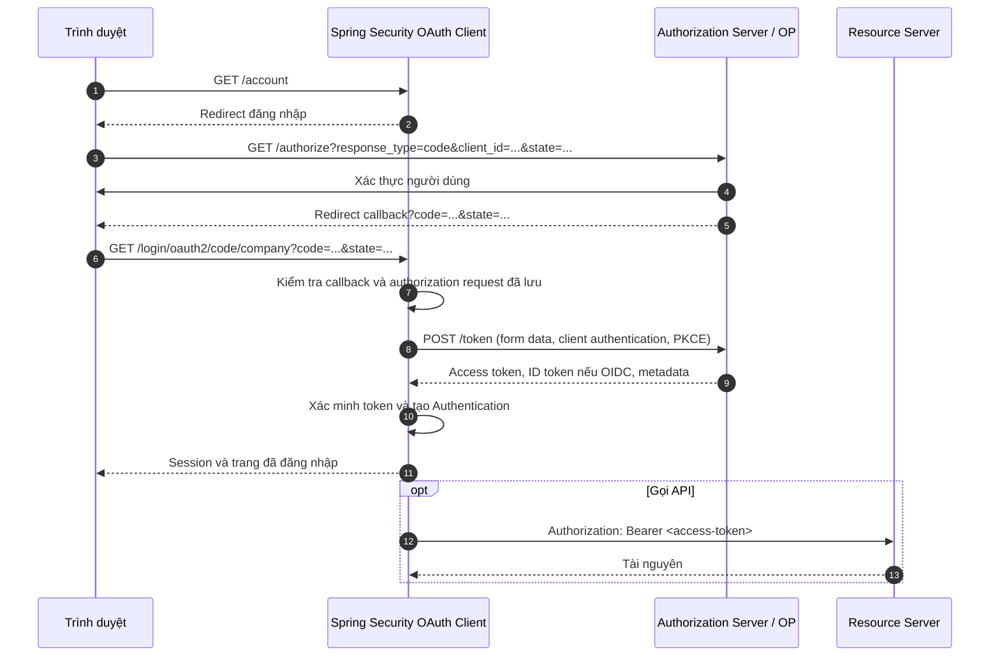
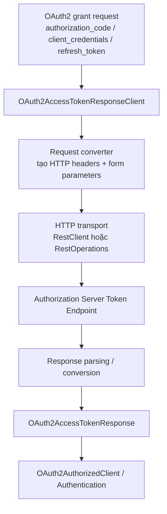

# 10.8. Tùy chỉnh headers, tham số và chuyển đổi request

Trong **Spring Security OAuth 2.0/OIDC Client**, sau khi trình duyệt được chuyển đến Authorization Server hoặc OpenID Provider (OP) và quay về cùng authorization code, ứng dụng thường phải thực hiện một **HTTP request tới Token Endpoint** để đổi code lấy token. Ở các grant khác, chẳng hạn `client_credentials` hoặc `refresh_token`, ứng dụng cũng gọi Token Endpoint nhưng với bộ tham số khác nhau.

Spring Security đã cung cấp cơ chế chuẩn để tạo HTTP request, xác thực client, gửi form data, nhận token response và xử lý lỗi. Tuy nhiên, một số Authorization Server yêu cầu thêm HTTP header hoặc parameter đặc thù; có hệ thống cần kết nối qua HTTP proxy, dùng chính sách TLS riêng, hoặc trả token response với một số trường mở rộng. Khi đó cần biết **tùy chỉnh đúng lớp** và giữ nguyên các điều kiện bảo mật của OAuth 2.0/OIDC.

Bài học này tập trung vào ba điểm mở rộng:

1. **Headers:** điều chỉnh HTTP headers mà client gửi tới Token Endpoint.
2. **Parameters:** bổ sung hoặc điều chỉnh các form parameter trong HTTP body của token request.
3. **Request conversion:** dùng converter/bộ dựng request để chuyển grant request của Spring thành HTTP request; khi cần, tùy biến HTTP client dùng để gửi hoặc cách giải mã token response.

Điểm nền tảng cần ghi nhớ: **Token Endpoint là điểm giao tiếp trực tiếp từ OAuth Client đến Authorization Server**. Nó khác Authorization Endpoint mà trình duyệt điều hướng tới, khác callback của RP và khác Resource Server API nơi ứng dụng dùng access token.

## 1. Token Endpoint nằm ở đâu trong luồng OAuth 2.0/OIDC?

### 1.1. Authorization Code Flow

Đối với Spring MVC dùng `oauth2Login()`, luồng cơ bản:



Trong sơ đồ, thao tác cần tùy biến là **`POST /token` từ Spring backend tới AS**. Nó thường không đi qua browser của người dùng.

Nếu ứng dụng yêu cầu scope `openid`, token response của OIDC Authorization Code Flow còn có **ID Token**; RP cần kiểm tra ID token phù hợp với `issuer`, `audience`, chữ ký, thời hạn và các điều kiện OIDC.

### 1.2. Những request khác cũng gọi Token Endpoint

| Grant / hoạt động | Nguồn yêu cầu | Nội dung token request thường có | Người dùng tương tác? |
|---|---|---|---|
| `authorization_code` | RP đổi authorization code | `grant_type`, `code`, `redirect_uri`, `code_verifier` khi dùng PKCE; client authentication | Có ở bước authorization trước đó |
| `client_credentials` | Backend service xin token cho workload | `grant_type=client_credentials`, client authentication, optional `scope` | Không |
| `refresh_token` | OAuth client xin access token mới | `grant_type=refresh_token`, `refresh_token`, client authentication nếu cần, optional `scope` | Không cần yêu cầu đăng nhập mới trong request này |
| Device Authorization Grant | Device/CLI sau bước cấp quyền | `grant_type=urn:ietf:params:oauth:grant-type:device_code`, `device_code` và các tham số tương ứng | Người dùng thường xác nhận ở thiết bị khác |

**Các grant khác nhau cần loại token response client và request converter phù hợp.** Một converter nhận `OAuth2AuthorizationCodeGrantRequest` không phải nơi xử lý mặc định của `client_credentials` hoặc `refresh_token`.

## 2. HTTP token request chuẩn có cấu trúc gì?

Một token request của confidential client trong Authorization Code Flow thường dùng `POST` qua HTTPS, với `Content-Type: application/x-www-form-urlencoded`.

Ví dụ minh họa khi AS yêu cầu `client_secret_basic`:

```http
POST /oauth2/token HTTP/1.1
Host: login.example.org
Content-Type: application/x-www-form-urlencoded
Accept: application/json
Authorization: Basic <base64url-not-used-here; standard-http-basic-credential>

grant_type=authorization_code&code=<one-time-code>&redirect_uri=https%3A%2F%2Fportal.example.org%2Flogin%2Foauth2%2Fcode%2Fcompany&code_verifier=<original-pkce-verifier>
```

Phần `Authorization: Basic ...` thể hiện **client authentication** tại Token Endpoint. Thực tế dùng Base64 theo cú pháp HTTP Basic; **không dùng Base64URL như PKCE**. Đây chỉ là biểu diễn của client ID và client secret, không phải cơ chế mã hóa bí mật. **HTTPS/TLS** là yêu cầu bảo vệ request.

Nếu client đăng ký `client_secret_post`, thông tin `client_id` và `client_secret` được gửi dưới dạng form parameters theo quy định của AS; nếu đăng ký `none` (public client) thì không có client secret cần gửi.

### 2.1. Phân loại header và parameter

| Thành phần | Ví dụ | Nguồn/quy tắc |
|---|---|---|
| HTTP method | `POST` | Token endpoint dùng POST theo OAuth 2.0 |
| `Content-Type` | `application/x-www-form-urlencoded` | Body được form encode |
| `Accept` | Thường `application/json` | Định dạng response client có thể xử lý |
| `Authorization` | `Basic ...` | Client authentication nếu dùng `client_secret_basic` |
| `grant_type` | `authorization_code` | Xác định grant |
| `code` | Authorization code nhận từ callback | Một lần, thời hạn ngắn |
| `redirect_uri` | Callback URI phù hợp authorization request | Cần khớp theo yêu cầu giao thức |
| `code_verifier` | PKCE verifier của yêu cầu ban đầu | Ràng buộc việc đổi code |
| `client_id` | ID client đã đăng ký | Có thể xuất hiện trong form hoặc ở authentication tùy loại client |
| Extension parameter | `resource`, `audience` hoặc trường riêng | Chỉ gửi khi AS hỗ trợ/yêu cầu |

Một token response chuẩn thường có:

```json
{
  "access_token": "<opaque-or-jwt-access-token>",
  "token_type": "Bearer",
  "expires_in": 3600,
  "scope": "orders.read"
}
```

Khi là OIDC Authorization Code Flow, phản hồi hợp lệ còn có thể có:

```json
{
  "access_token": "<access-token>",
  "token_type": "Bearer",
  "expires_in": 3600,
  "id_token": "<signed-id-token>",
  "scope": "openid profile"
}
```

`refresh_token` có thể được cấp hoặc không, tùy grant, client, OP và chính sách. Không được nhầm **access token** gửi Resource Server với **ID token** dành cho Relying Party.

## 3. Ba lớp tùy chỉnh trong Spring Security

Để chọn điểm mở rộng phù hợp, có thể hình dung pipeline:



Trong Spring Security, abstraction quan trọng:

```java
OAuth2AccessTokenResponseClient<T extends AbstractOAuth2AuthorizationGrantRequest>
```

Client nhận một **grant request kiểu mạnh**, thực hiện token request và trả `OAuth2AccessTokenResponse`. Mỗi grant có kiểu request riêng.

| Tầng | Công cụ mở rộng | Trường hợp nên dùng |
|---|---|---|
| Authorization request (trước callback) | `OAuth2AuthorizationRequestResolver` / customizer | Thêm `prompt`, `login_hint`, `resource` ở authorization endpoint |
| **Token request** | `OAuth2AccessTokenResponseClient` và parameter/header converters | Thêm form parameter, header, xử lý HTTP riêng cho token endpoint |
| HTTP transport | `RestClient` hoặc cơ chế `RestOperations` tương ứng phiên bản | Timeout, proxy, TLS, observability, response conversion |
| Token response | Access token response converter/HTTP message converter | Provider có response không chuẩn hoặc trường mở rộng |
| Authorized client lifecycle | `OAuth2AuthorizedClientManager` và provider | Chọn client_credentials, refresh_token, authorization_code cho từng luồng |

**Không tùy chỉnh nhầm tầng:** Nếu provider yêu cầu `prompt=login` trên Authorization Endpoint, thêm nó vào token request sẽ không đạt mục tiêu. Nếu provider yêu cầu một form field riêng tại Token Endpoint, chỉnh `OAuth2AuthorizationRequestResolver` là không đủ.

## 4. Khai báo Token Endpoint qua ClientRegistration

### 4.1. Cấu hình với OIDC Discovery

Với OP chuẩn có discovery metadata, Spring Boot có thể dùng `issuer-uri`:

```yaml
spring:
  security:
    oauth2:
      client:
        registration:
          company:
            provider: company
            client-id: ${OIDC_CLIENT_ID}
            client-secret: ${OIDC_CLIENT_SECRET}
            client-authentication-method: client_secret_basic
            authorization-grant-type: authorization_code
            redirect-uri: "{baseUrl}/login/oauth2/code/{registrationId}"
            scope:
              - openid
              - profile
              - email
        provider:
          company:
            issuer-uri: ${OIDC_ISSUER_URI}
```

Khi OP cung cấp discovery metadata hợp lệ, Spring có thể tìm `authorization_endpoint`, `token_endpoint`, `jwks_uri` và các metadata OIDC khác.

**`token-uri` là URL đích; converter quyết định cách xây request.** Chỉ khai báo `token-uri` không làm Spring gửi tự động một header hay form parameter đặc thù.

### 4.2. Cấu hình token-uri thủ công

Khi Authorization Server không hỗ trợ discovery hoặc sử dụng endpoint riêng:

```yaml
spring:
  security:
    oauth2:
      client:
        registration:
          partner:
            provider: partner
            client-id: ${PARTNER_CLIENT_ID}
            client-secret: ${PARTNER_CLIENT_SECRET}
            client-authentication-method: client_secret_basic
            authorization-grant-type: authorization_code
            redirect-uri: "{baseUrl}/login/oauth2/code/{registrationId}"
            scope:
              - profile.read
        provider:
          partner:
            authorization-uri: https://id.partner.example/authorize
            token-uri: https://id.partner.example/token
            user-info-uri: https://id.partner.example/profile
            user-name-attribute: id
```

Ở đây, ví dụ là **OAuth2 Login có UserInfo API riêng**, chưa giả định OIDC nếu không có `openid`/ID token. Nếu provider là OIDC, cần cấu hình các metadata và điều kiện xác minh OIDC phù hợp.

Khi custom token converter, vẫn lấy Token Endpoint từ `ClientRegistration.getProviderDetails().getTokenUri()` hoặc sử dụng mặc định của token response client. Không nên hard-code sang một host khác theo input từ browser.

## 5. Cách triển khai hiện đại: RestClientAuthorizationCodeTokenResponseClient

Các phiên bản Spring Security gần đây trong nhánh **6.4 trở lên** cung cấp `RestClientAuthorizationCodeTokenResponseClient` để thực hiện token exchange với `RestClient`. API này cho phép mở rộng headers và parameters bằng converter.

Các phiên bản cũ thường dùng `DefaultAuthorizationCodeTokenResponseClient` kết hợp `OAuth2AuthorizationCodeGrantRequestEntityConverter`. Cách lựa chọn phải khớp dependency thực tế của dự án.

### 5.1. Ví dụ thêm một form parameter được provider hỗ trợ

Giả sử AS đã công bố rằng Token Endpoint chấp nhận tham số **`resource`** theo OAuth 2.0 Resource Indicators (RFC 8707) để ràng buộc audience của access token.

```java
import org.springframework.context.annotation.Bean;
import org.springframework.security.oauth2.client.endpoint.RestClientAuthorizationCodeTokenResponseClient;
import org.springframework.util.LinkedMultiValueMap;
import org.springframework.util.MultiValueMap;

@Bean
RestClientAuthorizationCodeTokenResponseClient authorizationCodeTokenClient() {
    var client = new RestClientAuthorizationCodeTokenResponseClient();

    client.addParametersConverter(grantRequest -> {
        MultiValueMap<String, String> extras = new LinkedMultiValueMap<>();
        extras.add("resource", "https://orders-api.example.org");
        return extras;
    });

    return client;
}
```

`addParametersConverter(...)` dùng để thêm tham số vào bộ tham số mặc định. Các trường quan trọng `grant_type`, `code`, `redirect_uri`, `code_verifier` và client authentication vẫn được cơ chế mặc định của Spring xử lý.

**Cần có hợp đồng với AS:** không phải mọi Authorization Server đều hỗ trợ `resource` ở token endpoint; có hệ thống chỉ xử lý tham số này ở authorization endpoint, có hệ thống dùng tên `audience` riêng hoặc từ chối tham số không biết. Nếu AS không hỗ trợ, request có thể thất bại với `invalid_request` hoặc bỏ qua trường.

Khi cần thêm `audience` theo tài liệu riêng của provider, thay tên/giá trị trong converter. Không cho browser quyết định một audience tùy ý.

### 5.2. Gắn token client vào oauth2Login()

Spring Security chỉ sử dụng converter của một token client nếu **token client đó thực sự được gắn vào flow**.

Ví dụ tích hợp đầy đủ vào Servlet `SecurityFilterChain`:

```java
import org.springframework.context.annotation.Bean;
import org.springframework.context.annotation.Configuration;
import org.springframework.security.config.annotation.web.builders.HttpSecurity;
import org.springframework.security.oauth2.client.endpoint.RestClientAuthorizationCodeTokenResponseClient;
import org.springframework.security.web.SecurityFilterChain;
import org.springframework.util.LinkedMultiValueMap;

@Configuration
public class OidcLoginSecurityConfig {

    @Bean
    SecurityFilterChain securityFilterChain(HttpSecurity http) throws Exception {

        var tokenClient = new RestClientAuthorizationCodeTokenResponseClient();

        tokenClient.addParametersConverter(grantRequest -> {
            var parameters = new LinkedMultiValueMap<String, String>();
            parameters.add("resource", "https://orders-api.example.org");
            return parameters;
        });

        http
            .authorizeHttpRequests(authorize -> authorize
                .requestMatchers("/", "/error").permitAll()
                .anyRequest().authenticated())
            .oauth2Login(oauth2 -> oauth2
                .tokenEndpoint(token -> token
                    .accessTokenResponseClient(tokenClient)));

        return http.build();
    }
}
```

Ý nghĩa:

- `oauth2Login()` thực hiện Authorization Code Login ở Servlet web app.
- `tokenEndpoint()` chỉ định cách Spring đổi authorization code thành token.
- `accessTokenResponseClient(tokenClient)` sử dụng token client đã có converter.
- Request converter được gọi trong quá trình **backend** gửi HTTP request đến Token Endpoint.
- Những validation khác của OAuth2/OIDC Login vẫn do framework và các thành phần tương ứng xử lý.

Nếu ứng dụng có nhiều registration cùng dùng một filter chain, converter có thể được gọi cho tất cả authorization-code token requests qua client này. Phải xét chính sách từng AS để tránh gửi tham số riêng của một provider sang provider khác.

### 5.3. Chỉ thêm tham số cho một registration

`grantRequest` có `ClientRegistration`, nên có thể phân nhánh theo registration ID đáng tin cậy:

```java
tokenClient.addParametersConverter(grantRequest -> {
    var params = new LinkedMultiValueMap<String, String>();
    String id = grantRequest.getClientRegistration().getRegistrationId();

    if ("company".equals(id)) {
        params.add("resource", "https://orders-api.example.org");
    } else if ("partner".equals(id)) {
        params.add("audience", "partner-orders");
    }

    return params;
});
```

`company` và `partner` là **registration ID cục bộ**, không phải hostname hay giá trị `client_id` phải đưa vào URL. Cấu hình mỗi registration có thể có Token Endpoint và phương thức client authentication khác nhau, nên cần giữ hành vi theo hợp đồng với từng provider.

Không chọn tham số theo dữ liệu từ HTTP query của người dùng nếu mục tiêu là một API audience nội bộ cố định. Nếu nghiệp vụ phải hỗ trợ nhiều resource server, hãy ánh xạ yêu cầu sang một tập audience đã cho phép và kiểm tra quyền ở từng API.

## 6. Tùy chỉnh HTTP headers của token request

### 6.1. Thêm header phục vụ tích hợp

Một số AS hoặc gateway nội bộ yêu cầu header nhận diện phiên bản tích hợp, tenant cố định hoặc correlation ID. Dùng `addHeadersConverter(...)` để bổ sung header:

```java
import org.springframework.http.HttpHeaders;
import org.springframework.security.oauth2.client.endpoint.RestClientAuthorizationCodeTokenResponseClient;

var tokenClient = new RestClientAuthorizationCodeTokenResponseClient();

tokenClient.addHeadersConverter(grantRequest -> {
    HttpHeaders headers = new HttpHeaders();
    headers.add("X-Integration-Version", "portal-v2");
    return headers;
});
```

Trong ví dụ, `X-Integration-Version` là **header minh họa**. Chỉ thêm khi token endpoint hoặc gateway thực sự hiểu và chấp nhận nó; trường do hệ thống riêng định nghĩa không thuộc OAuth 2.0 cốt lõi.

Có thể kết hợp:

```java
tokenClient.addParametersConverter(grantRequest -> {
    var params = new LinkedMultiValueMap<String, String>();
    params.add("resource", "https://orders-api.example.org");
    return params;
});

tokenClient.addHeadersConverter(grantRequest -> {
    HttpHeaders headers = new HttpHeaders();
    headers.set("X-Integration-Version", "portal-v2");
    return headers;
});
```

**Ưu tiên bổ sung header bằng converter thay vì thay thế toàn bộ header mặc định**. Token response client cần giữ `Content-Type`, `Accept` và thông tin client authentication khi phù hợp.

### 6.2. Những header không nên can thiệp tùy tiện

| Header | Vai trò | Rủi ro khi tự sửa |
|---|---|---|
| `Content-Type` | Khai báo body token request form URL encoded | AS có thể từ chối khi đổi sang JSON |
| `Authorization` | Client authentication, thường HTTP Basic | Có thể làm lộ/sai credential hoặc thay Basic bằng Bearer không hợp lệ |
| `Accept` | Cho biết định dạng response có thể nhận | Bộ giải mã có thể không xử lý response thực tế |
| `Host` | Phụ thuộc URI và HTTP transport | Có thể vi phạm TLS/Host kiểm soát hoặc bị AS từ chối |
| `Origin` / `Referer` | Phổ biến trong browser, không bắt buộc cho token request server-to-server | Không nên thêm chỉ để giả lập browser |
| `Cookie` | Không phải cơ chế client authentication tiêu chuẩn của token endpoint | Dễ rò rỉ session nếu copy từ browser |

Đặc biệt, đừng lấy `Authorization` header **của request người dùng gửi đến RP** rồi chuyển tiếp tới token endpoint. Token endpoint cần xác thực **OAuth client**; bearer token của API hoặc session cookie của browser là ngữ cảnh khác.

### 6.3. Client authentication method phải khớp đăng ký

Trong `ClientRegistration`:

```yaml
client-authentication-method: client_secret_basic
```

thường dẫn đến HTTP Basic khi gọi token endpoint. Trong khi:

```yaml
client-authentication-method: client_secret_post
```

dẫn đến client credentials trong form body nếu AS hỗ trợ. Với public client:

```yaml
client-authentication-method: none
```

thì không có client secret để gửi.

Không tự thêm `Authorization: Basic` vào converter cho một registration đã khai báo `none`. Cũng không tự đưa `client_secret` vào custom header khi AS đang dùng `client_secret_basic`. Nếu provider đòi phương thức như `private_key_jwt` hoặc mTLS, cần tích hợp phương thức xác thực client đúng chuẩn, gồm khóa/cert và token request converter phù hợp; đổi tên header đơn giản không đủ.

## 7. Tùy chỉnh form parameters của token request

### 7.1. Standard parameters cần được giữ nguyên

Với Authorization Code Flow:

```text
grant_type=authorization_code
code=<authorization-code>
redirect_uri=<matching-redirect-uri>
code_verifier=<original-pkce-verifier>   # khi sử dụng PKCE
```

Tùy loại client còn có `client_id` và client authentication. Các giá trị `code`, `redirect_uri` và `code_verifier` có mối liên hệ với authorization request đã được khởi tạo và lưu trữ. Chúng không phải nơi chứa một giá trị tùy ý từ người dùng.

Các cơ chế như `state` được Spring kiểm tra trên **authorization response/callback**, và không phải form parameter mặc định của token request theo Authorization Code Grant. `nonce` là phần của yêu cầu OIDC/ID token validation, cũng không phải một replacement cho `code_verifier`.

### 7.2. Vì sao addParametersConverter thường an toàn hơn thay thế converter?

`addParametersConverter(...)` phục vụ tình huống **bổ sung** form fields cho request mà Spring đã dựng theo chuẩn:

```java
tokenClient.addParametersConverter(grantRequest -> {
    var extra = new LinkedMultiValueMap<String, String>();
    extra.add("resource", "https://reports-api.example.org");
    return extra;
});
```

Các API `setParametersConverter(...)` hoặc điểm mở rộng sâu hơn cho phép chỉ định converter chính; nếu converter thay thế bỏ sót các trường bắt buộc, request có thể sai hoặc làm mất thông tin bảo vệ giao thức.

Không viết một converter trả về *chỉ* `resource` rồi kỳ vọng Spring luôn tự thêm mọi trường nếu hợp đồng của API đang dùng là **thay thế** bộ converter mặc định. Cần hiểu chính xác semantics của method trong phiên bản Spring Security đang chạy. Khi mục tiêu chỉ là thêm field, hãy ưu tiên API `add...`.

### 7.3. MultiValueMap và parameter trùng

Token request được form encode; `MultiValueMap<String, String>` cho phép một khóa có nhiều giá trị. Điều đó hữu ích nếu protocol extension cho phép nhiều giá trị, nhưng cũng có thể gây lỗi nếu vô tình thêm hai tham số `grant_type` hoặc hai tham số `client_id`.

- Dùng `add` để bổ sung một giá trị theo yêu cầu của provider.
- Dùng `set` chỉ khi chắc chắn muốn thay giá trị hiện tại và API tùy biến cho phép.
- Không gửi nhiều giá trị cho tham số mà AS mong đợi duy nhất.
- Không ghi `refresh_token`, `code` hoặc `client_secret` vào log dù MultiValueMap có thể in ra dễ dàng.

Nếu cần loại bỏ một tham số mặc định vì provider không tuân thủ chuẩn, phải cân nhắc kỹ rủi ro và xác nhận AS thật sự yêu cầu. Cố gắng giữ lại semantics của chuẩn OAuth khi có thể.

### 7.4. Ví dụ với resource indicator

RFC 8707 định nghĩa **`resource`** để thể hiện resource server mục tiêu. Tuy nhiên, chi tiết request và phạm vi được hỗ trợ phụ thuộc AS.

Ví dụ provider hỗ trợ `resource` tại Token Endpoint:

```text
POST /token
grant_type=authorization_code
code=<code>
redirect_uri=https://portal.example.org/login/oauth2/code/company
code_verifier=<verifier>
resource=https://orders-api.example.org
```

Access token được phát có thể được ràng buộc với API tương ứng theo chính sách AS. Không tự suy ra rằng việc gửi `resource` bảo đảm token có `aud` nhất định: cần xem tài liệu và xác minh token/audience theo cơ chế của Resource Server.

Nếu provider chỉ hỗ trợ `resource` trong **authorization request**, phải thêm parameter tại authorization endpoint bằng `OAuth2AuthorizationRequestResolver`. Không cố sửa cả hai request một cách mù quáng.

## 8. Tùy biến request trong Spring Security phiên bản cũ

Trước mô hình `RestClient...TokenResponseClient`, một cách phổ biến với Servlet OAuth2 Login là dùng:

- `DefaultAuthorizationCodeTokenResponseClient`.
- `OAuth2AuthorizationCodeGrantRequestEntityConverter`.
- `setRequestEntityConverter(...)`.

Ví dụ với phiên bản có các API này:

```java
import org.springframework.security.oauth2.client.endpoint.DefaultAuthorizationCodeTokenResponseClient;
import org.springframework.security.oauth2.client.endpoint.OAuth2AuthorizationCodeGrantRequestEntityConverter;
import org.springframework.util.LinkedMultiValueMap;

var entityConverter = new OAuth2AuthorizationCodeGrantRequestEntityConverter();

entityConverter.addParametersConverter(grantRequest -> {
    var extras = new LinkedMultiValueMap<String, String>();
    extras.add("resource", "https://orders-api.example.org");
    return extras;
});

var tokenClient = new DefaultAuthorizationCodeTokenResponseClient();
tokenClient.setRequestEntityConverter(entityConverter);
```

Sau đó đưa `tokenClient` vào `oauth2Login().tokenEndpoint().accessTokenResponseClient(...)` như ví dụ ở phần trước.

Điểm khác biệt về thiết kế:

| Cách tiếp cận | Thành phần dựng HTTP request | Khi nào gặp? |
|---|---|---|
| RestClient token response client | Built-in converters cùng `addHeadersConverter`, `addParametersConverter` và API tùy biến tương ứng | Spring Security mới có hỗ trợ RestClient |
| Legacy default token response client | `Converter<GrantRequest, RequestEntity<?>>`, chẳng hạn `OAuth2AuthorizationCodeGrantRequestEntityConverter` | Codebase dùng API đời cũ |
| Token response client tự viết | Lớp triển khai `OAuth2AccessTokenResponseClient<...>` | Chỉ khi extension vượt khả năng cấu hình sẵn có |

Tránh sao chép code của một dòng Spring Security vào dự án phiên bản khác mà không kiểm tra API tồn tại. Không cần giữ cả hai token clients cùng hoạt động cho **một grant**; hãy chọn một implementation phù hợp.

## 9. Tùy chỉnh token request cho client_credentials

`client_credentials` thường dùng khi một backend job hoặc service xin token đại diện cho **chính ứng dụng/workload** mà không có trình duyệt và người dùng cuối.

Request tối thiểu:

```http
POST /oauth2/token HTTP/1.1
Host: auth.example.org
Content-Type: application/x-www-form-urlencoded
Authorization: Basic <client-credentials>

grant_type=client_credentials&scope=orders.read
```

Với AS hỗ trợ resource indicator:

```java
import org.springframework.security.oauth2.client.endpoint.RestClientClientCredentialsTokenResponseClient;
import org.springframework.util.LinkedMultiValueMap;

var tokenClient = new RestClientClientCredentialsTokenResponseClient();

tokenClient.addParametersConverter(grantRequest -> {
    var extras = new LinkedMultiValueMap<String, String>();
    extras.add("resource", "https://orders-api.example.org");
    return extras;
});
```

### 9.1. Tích hợp vào OAuth2AuthorizedClientManager cho background service

Ở backend không có `HttpServletRequest`/session người dùng, có thể sử dụng `AuthorizedClientServiceOAuth2AuthorizedClientManager` cùng service lưu authorized clients.

```java
import org.springframework.context.annotation.Bean;
import org.springframework.context.annotation.Configuration;
import org.springframework.security.oauth2.client.AuthorizedClientServiceOAuth2AuthorizedClientManager;
import org.springframework.security.oauth2.client.OAuth2AuthorizedClientManager;
import org.springframework.security.oauth2.client.OAuth2AuthorizedClientService;
import org.springframework.security.oauth2.client.endpoint.RestClientClientCredentialsTokenResponseClient;
import org.springframework.security.oauth2.client.registration.ClientRegistrationRepository;
import org.springframework.security.oauth2.client.OAuth2AuthorizedClientProviderBuilder;
import org.springframework.util.LinkedMultiValueMap;

@Configuration
public class WorkloadOAuthClientConfig {

    @Bean
    OAuth2AuthorizedClientManager workloadAuthorizedClientManager(
            ClientRegistrationRepository registrations,
            OAuth2AuthorizedClientService authorizedClients) {

        var tokenClient = new RestClientClientCredentialsTokenResponseClient();

        tokenClient.addParametersConverter(grantRequest -> {
            var extra = new LinkedMultiValueMap<String, String>();
            extra.add("resource", "https://orders-api.example.org");
            return extra;
        });

        var provider = OAuth2AuthorizedClientProviderBuilder.builder()
            .clientCredentials(config -> config
                .accessTokenResponseClient(tokenClient))
            .build();

        var manager = new AuthorizedClientServiceOAuth2AuthorizedClientManager(
            registrations, authorizedClients);
        manager.setAuthorizedClientProvider(provider);
        return manager;
    }
}
```

Cấu hình registration:

```yaml
spring:
  security:
    oauth2:
      client:
        registration:
          orders-worker:
            provider: internal-as
            client-id: ${WORKER_CLIENT_ID}
            client-secret: ${WORKER_CLIENT_SECRET}
            client-authentication-method: client_secret_basic
            authorization-grant-type: client_credentials
            scope:
              - orders.read
        provider:
          internal-as:
            token-uri: https://auth.example.org/oauth2/token
```

**Lưu ý:** Tạo `OAuth2AuthorizedClientManager` chưa tự gửi token request. Ứng dụng hoặc HTTP client integration phải gọi manager với đúng `clientRegistrationId` và principal kỹ thuật phù hợp. Không nhầm manager cho background service với manager quản lý authorized client dựa trên session của người dùng web.

Đặc biệt, OAuth2 Login token client đã custom ở phần 5 **không tự động được dùng cho `client_credentials`**. Grant này có provider/token response client độc lập.

## 10. Tùy chỉnh refresh_token request

Khi access token hết hạn và client có refresh token hợp lệ, một authorized client provider có thể gửi request:

```http
POST /oauth2/token HTTP/1.1
Host: auth.example.org
Content-Type: application/x-www-form-urlencoded
Authorization: Basic <client-credentials>

grant_type=refresh_token&refresh_token=<refresh-token-value>
```

Tham số có thể bao gồm `scope` nếu được phép và client muốn thu hẹp scope theo quy định; refresh token rotation phụ thuộc AS.

Nếu AS yêu cầu extension parameter khi refresh, với Spring Security có RestClient refresh token client:

```java
import org.springframework.security.oauth2.client.endpoint.RestClientRefreshTokenTokenResponseClient;
import org.springframework.util.LinkedMultiValueMap;

var refreshClient = new RestClientRefreshTokenTokenResponseClient();

refreshClient.addParametersConverter(grantRequest -> {
    var extra = new LinkedMultiValueMap<String, String>();
    extra.add("resource", "https://orders-api.example.org");
    return extra;
});
```

Có thể cấu hình client này cho authorized client provider hỗ trợ refresh:

```java
var provider = OAuth2AuthorizedClientProviderBuilder.builder()
    .refreshToken(config -> config
        .accessTokenResponseClient(refreshClient))
    .build();
```

Trong một manager phục vụ nhiều grant, cần xây provider gồm các grant cần thiết, ví dụ `authorizationCode()`, `refreshToken()`, `clientCredentials()` tùy vai trò của ứng dụng.

### 10.1. Không tùy tiện thay refresh token

`refresh_token` là credential nhạy cảm dùng để xin access token mới. Không đọc nó từ query parameter tùy ý của browser, không ghi giá trị vào log, và không đưa nó vào URL hoặc header không thuộc giao thức.

Nếu AS dùng refresh token rotation, token response có thể cấp refresh token mới. Token client và authorized client storage phải giữ giá trị mới theo thiết kế; không tự giữ refresh token cũ sau khi nó đã bị thay thế.

### 10.2. Refresh không đồng nghĩa đăng nhập mới

Refresh token request không thay thế quy trình xác thực End-User tại OP. Khi một phiên RP đã hết hiệu lực hoặc người dùng bị khóa, ứng dụng cần xác định chính sách phiên và authorization riêng. Không suy luận rằng còn refresh token thì luôn được bỏ qua mọi kiểm tra phiên hoặc nghiệp vụ.

## 11. Tùy biến HTTP transport, timeout và kết nối

Đôi khi yêu cầu không nằm ở header hoặc form parameter mà ở **cách gửi HTTP request**:

- Token Endpoint nằm sau outbound proxy của doanh nghiệp.
- Hạ tầng cần TLS truststore hoặc chứng thư client khi dùng mTLS.
- Cần thiết lập timeout kết nối/đọc.
- Cần observability, correlation và giới hạn log.
- Provider có quy tắc response content type khác thông thường.

Với RestClient token response client, Spring Security cho phép cung cấp `RestClient` được cấu hình phù hợp qua API `setRestClient(...)` của implementation tương ứng.

Một cấu hình minh họa cho phép quản lý transport tập trung:

```java
import org.springframework.http.MediaType;
import org.springframework.security.oauth2.client.endpoint.RestClientAuthorizationCodeTokenResponseClient;
import org.springframework.web.client.RestClient;

RestClient restClient = RestClient.builder()
    .defaultHeader("X-Integration-Version", "portal-v2")
    .build();

var tokenClient = new RestClientAuthorizationCodeTokenResponseClient();
tokenClient.setRestClient(restClient);
```

Đoạn này minh họa **điểm gắn custom RestClient**; với token exchange thực tế, RestClient được cung cấp phải có **message converters, error handling và HTTP transport tương thích** với token request/response của Spring Security. Một `RestClient` tự dựng chỉ có mặc định của Spring có thể không bảo toàn đầy đủ cách parse OAuth token error hoặc dạng response mà implementation token client mong đợi, tùy phiên bản. Vì vậy, khi yêu cầu chỉ là thêm header/parameter, sử dụng API converter của token client thường đơn giản hơn.

Nếu cần TLS/mTLS hoặc proxy, nên cấu hình `ClientHttpRequestFactory` và SSL context đúng yêu cầu AS rồi sử dụng trong RestClient. Không tắt certificate/hostname verification để khắc phục lỗi kết nối. Không đặt toàn bộ outbound HTTP logs ở mức ghi body khi body chứa `client_secret` hoặc `refresh_token`.

### 11.1. Timeout phải phù hợp với hành vi retry

Token Endpoint có thể trả lỗi tạm thời hoặc timeout. Request đổi **authorization code** thường là giao dịch một lần; retry mù quáng sau timeout có thể khiến code đã được sử dụng, trả `invalid_grant` hoặc tạo trạng thái khó dự đoán.

- Giới hạn timeout hợp lý theo SLA.
- Phân biệt lỗi kết nối, HTTP 429/5xx và lỗi OAuth như `invalid_client`.
- Cân nhắc chính sách retry riêng theo grant; không retry vô hạn.
- Không tự ghi lại toàn bộ request chứa secret trong thông báo lỗi.
- Có cơ chế báo lỗi đăng nhập thân thiện nếu trao đổi code thất bại.

Khi HTTP proxy hoặc load balancer thay đổi request, hãy xác định đúng đường đi từ **Spring backend** đến Token Endpoint. Browser có thể vào OP bình thường nhưng backend vẫn lỗi do DNS, firewall hoặc TLS.

## 12. Khi nào cần tùy biến token response?

Thông thường Token Endpoint trả **JSON** theo OAuth 2.0, và Spring Security đã có converter giải mã thành `OAuth2AccessTokenResponse`. Với OIDC, response có thêm `id_token` mà các thành phần đăng nhập xử lý tiếp.

Provider đôi khi có response mở rộng:

```json
{
  "access_token": "<access-token>",
  "token_type": "Bearer",
  "expires_in": 3600,
  "scope": "orders.read",
  "tenant_id": "tenant-a",
  "issued_token_type": "urn:ietf:params:oauth:token-type:access_token"
}
```

Các trường bổ sung không nhất thiết bắt buộc phải đưa vào domain model ứng dụng. `OAuth2AccessTokenResponse` có thể mang **additional parameters**, tùy converter và response. Nếu ứng dụng thật sự cần đọc extension fields, hãy xác định contract và cách chuyển đổi response tương ứng.

### 12.1. Không nhầm request converter với response converter

| Mục tiêu | Điểm mở rộng |
|---|---|
| Thêm `resource` vào form POST tới AS | **Request parameters converter** |
| Thêm `X-Integration-Version` tới AS | **Request headers converter** |
| Chọn request factory/proxy/TLS | **HTTP client transport** |
| Phân tích response JSON có trường lạ | **Response converter / message converter** |
| Kiểm tra issuer, audience, chữ ký ID token | **OIDC token validation**, không phải converter form |
| Giải mã/kiểm tra access token tại API | **Resource Server**, không phải token request của RP |

Spring Security có các HTTP message converters xử lý OAuth token response, chẳng hạn `OAuth2AccessTokenResponseHttpMessageConverter` trong những cấu hình dùng response entity converter phù hợp. Khi thay converter, phải giữ đúng `access_token`, `token_type`, `expires_in`, `scope`, refresh token và additional parameters theo contract của AS.

Không tự parse response thành `Map` rồi bỏ qua kiểm tra lỗi và validation của framework chỉ để lấy một field tùy chỉnh. Nếu OP trả ID token không hợp lệ, việc parse response JSON thành công **không đủ để xác thực người dùng**.

### 12.2. Token error response

OAuth 2.0 có mô hình lỗi tại Token Endpoint, chẳng hạn:

```json
{
  "error": "invalid_client",
  "error_description": "Client authentication failed"
}
```

Client cần bảo toàn cơ chế xử lý lỗi, tránh chuyển một HTTP 4xx thành token response “thành công” hoặc nuốt mất lỗi. Những thông điệp mô tả của AS có thể chứa thông tin vận hành và phải được lọc trước khi hiển thị cho người dùng cuối.

Không phản hồi nguyên xi `error_description` và stack trace vào một trang login công khai.

## 13. Tùy biến request bằng implementation riêng: khi nào cần?

Trong trường hợp đặc thù mà API converter sẵn có không đáp ứng, có thể viết implementation của:

```java
OAuth2AccessTokenResponseClient<OAuth2AuthorizationCodeGrantRequest>
```

hoặc loại grant tương ứng.

Một implementation đúng cần:

1. Nhận grant request từ Spring Security.
2. Tra đúng `ClientRegistration` và Token Endpoint được tin cậy.
3. Dựng form body theo OAuth 2.0, có client authentication và các tham số bắt buộc.
4. Gửi request qua HTTPS với TLS/timeout và logging an toàn.
5. Phân tích response hoặc OAuth error theo tiêu chuẩn.
6. Trả `OAuth2AccessTokenResponse` hợp lệ; các token và metadata không bị mất.
7. Bảo toàn semantics của PKCE, refresh token rotation và các điều kiện OIDC cần thiết ở lớp thích hợp.
8. Không làm suy giảm kiểm tra của authorization grant hoặc token validation.

Đây là hướng có chi phí bảo trì cao hơn, đặc biệt khi Spring Security hoặc OAuth provider thay đổi. Nếu chỉ cần một header và một tham số bổ sung, nên ưu tiên `addHeadersConverter` và `addParametersConverter`.

**Không tái triển khai toàn bộ Authorization Code Flow** chỉ vì muốn thay đổi request tại Token Endpoint. Spring Security đã quản lý `state`, authorization request repository, callback và token exchange; custom client nên tập trung vào phần thực sự cần mở rộng.

## 14. Tùy chỉnh request có điều kiện theo grant và provider

Một ứng dụng có thể đăng ký nhiều client với nhiều AS:

```yaml
spring:
  security:
    oauth2:
      client:
        registration:
          employee-login:
            provider: corporate
            client-id: ${EMPLOYEE_CLIENT_ID}
            client-secret: ${EMPLOYEE_CLIENT_SECRET}
            client-authentication-method: client_secret_basic
            authorization-grant-type: authorization_code
            redirect-uri: "{baseUrl}/login/oauth2/code/{registrationId}"
            scope: openid,profile
          reports-job:
            provider: reporting
            client-id: ${REPORTS_CLIENT_ID}
            client-secret: ${REPORTS_CLIENT_SECRET}
            client-authentication-method: client_secret_basic
            authorization-grant-type: client_credentials
            scope: reports.read
        provider:
          corporate:
            issuer-uri: ${CORPORATE_ISSUER}
          reporting:
            token-uri: https://reports-auth.example.org/token
```

Cần nhận thức:

- `employee-login` dùng Authorization Code Login; custom token client đặt tại `oauth2Login().tokenEndpoint()`.
- `reports-job` dùng Client Credentials; custom token client đặt vào `OAuth2AuthorizedClientProvider` phù hợp.
- Nếu cả hai provider yêu cầu parameter khác nhau, converter nên lựa chọn theo `registrationId`/contract đã đăng ký.
- Không ghép token endpoint host từ request user hoặc claim JWT chưa xác minh.
- Không dùng `client_credentials` để thay mặt một người dùng cuối đã đăng nhập.

### 14.1. Không gửi credential của provider A đến provider B

Nếu ứng dụng có hai AS, việc tái sử dụng converter hoặc transport có custom authorization header phải rất thận trọng.

Ví dụ nguy hiểm là dùng `RestClient.builder().defaultHeader("Authorization", ...)` với credential của AS A rồi sử dụng client đó gửi request tới token endpoint của AS B.

Tốt hơn, để Spring Security tạo client authentication dựa trên **`ClientRegistration` của từng request**. Nếu hạ tầng buộc custom auth header, phải ràng buộc nó với một registration/AS cụ thể và bảo đảm không chuyển credential qua domain khác.

### 14.2. Không tùy biến theo dữ liệu chưa xác thực

Token request thường xuất hiện **sau** callback Authorization Code, nhưng chưa chắc ứng dụng đã xác thực xong ID token hoặc tạo session cho người dùng. Không nên dùng một request parameter `tenant` chưa được xác thực để quyết định token endpoint hoặc client credential.

Nếu có nhiều tenant hoặc nhiều identity provider, hãy chọn trước một registration/issuer từ allowlist tin cậy, lưu ngữ cảnh authorization request theo `state` và kiểm tra issuer/response thích hợp. Các chính sách này thuộc thiết kế đa issuer, không được giải quyết bằng cách cho Token Endpoint converter trỏ đến URL bất kỳ.

## 15. Authorization endpoint parameters khác token endpoint parameters

Một nguồn nhầm lẫn điển hình là nhà cung cấp yêu cầu thêm `audience` hoặc `resource`, nhưng không nói rõ ở **bước nào**.

| Tham số | Gửi ở đâu theo mục đích | Extension point Spring |
|---|---|---|
| `prompt=login` | Authorization request để yêu cầu OP tương tác đăng nhập lại | `OAuth2AuthorizationRequestResolver` |
| `login_hint` | Authorization request để gợi ý tài khoản | Authorization request customizer |
| `max_age`, `acr_values` | OIDC Authorization request | Authorization request customizer |
| `state` | Authorization request và callback correlation | Cơ chế OAuth2 Login của Spring |
| `nonce` | OIDC authorization request/ID token correlation | Cơ chế OIDC của Spring |
| `code_challenge` | Authorization request cho PKCE | PKCE authorization request customizer |
| `code_verifier` | Token request khi đổi authorization code | Cơ chế PKCE/token client của Spring |
| `grant_type` | Token request | Token response client |
| `code`, `refresh_token` | Token request theo grant | Token response client |
| `resource` | Authorization request và/hoặc token request theo RFC 8707/AS support | Tùy bước: authorization resolver hoặc token parameter converter |
| `audience` riêng của provider | Theo hợp đồng tích hợp | Authorization resolver hoặc token converter, đúng nơi provider đòi |

Nếu thêm `prompt=login` vào `POST /token`, OP thường không dùng nó để quyết định có hỏi lại mật khẩu ở bước xác thực hay không. Tương tự, nếu thêm `code_verifier` vào authorization request thay vì token request, PKCE sẽ không được thực hiện đúng.

Đừng viết một custom converter trộn mọi tham số vào tất cả request; hãy đọc hợp đồng AS và phân biệt rõ bước giao thức.

## 16. Chẩn đoán lỗi liên quan đến token request customization

| Lỗi / biểu hiện | Nguyên nhân có thể | Nơi điều tra |
|---|---|---|
| `invalid_client` | Sai client ID/secret, authentication method, JWT assertion, mTLS hoặc credential bị rotate | `ClientRegistration`, client authentication, custom headers |
| `invalid_grant` khi đổi code | Authorization code hết hạn/đã dùng, `redirect_uri` lệch, PKCE verifier không khớp | Authorization request, callback, token parameters |
| `invalid_request` | Thiếu `grant_type`, gửi field không hợp lệ, parameter trùng hoặc extension không được AS hỗ trợ | Parameters converter |
| `unsupported_grant_type` | Grant type không được AS đăng ký hoặc converter gửi sai | Registration và token form |
| HTTP `415 Unsupported Media Type` | `Content-Type` bị đổi sang JSON hoặc body không form encoded | Headers converter/HTTP transport |
| HTTP `401` từ token endpoint | Credential client không được chấp nhận | Auth method, HTTP Basic, secret, mTLS |
| HTTP `429` / `5xx` | Rate limiting hoặc sự cố AS | Retry, timeout, operational policy |
| TLS handshake failed | Truststore, TLS version, mTLS certificate hoặc proxy | RestClient transport |
| Token response không parse được | Content type/dạng JSON khác contract hoặc response converter sai | Response conversion |
| Đổi code xong nhưng OIDC Login vẫn thất bại | ID token validation, issuer, audience, nonce, JWKS hoặc UserInfo | OIDC validation, không chỉ token request |
| Custom field không xuất hiện tại AS | Converter chưa được gắn vào flow đang chạy hoặc grant khác được dùng | `oauth2Login()`/AuthorizedClientManager wiring |
| Lỗi chỉ với một provider | Converter gửi field/header của provider khác | Branch theo `registrationId` |
| Lỗi ngẫu nhiên sau rotate secret | Một số instance vẫn dùng credential cũ | Config deployment/secret rotation |
| Một số token có audience sai | AS không xử lý `resource`/`audience` ở bước client đang gửi | Contract AS và audience validation tại API |

### 16.1. Xác định request thật sự được tạo ở đâu

Nếu người dùng đăng nhập bằng OAuth2 Login, cần xem **authorization code token response client**. Nếu background job lấy token qua client credentials, cần xem **authorized client provider** và `ClientCredentialsTokenResponseClient` tương ứng.

Thêm converter vào một bean không được Spring gọi sẽ không có tác dụng, dù mã compile thành công. Nếu có nhiều SecurityFilterChain, hãy chắc chắn request login được chain có cấu hình `oauth2Login()` tương ứng xử lý.

### 16.2. Phân biệt lỗi client authentication và grant

Client authentication xác minh **ứng dụng**; grant validation xác minh **điều kiện cấp token**.

- `invalid_client` thường liên quan ID/secret, method hoặc chứng cứ xác thực client.
- `invalid_grant` thường liên quan code, refresh token, PKCE, redirect URI hoặc thời hạn của grant.
- `invalid_request` có thể liên quan bộ form parameters hoặc cấu trúc request không hợp lệ.

Một AS có thể cố ý trả lỗi ít chi tiết nhằm tránh tiết lộ thông tin. Không cần log bí mật để chẩn đoán; đủ để biết grant type, registration ID, endpoint tin cậy, error code và correlation ID không nhạy cảm.

## 17. Bảo mật khi tùy biến headers, parameters và request

### 17.1. Giữ bí mật trong backend

Các giá trị sau có thể nhạy cảm:

- `client_secret` hoặc JWT client assertion.
- Authorization code.
- `code_verifier` của PKCE trong yêu cầu đổi code.
- Access token, refresh token và ID token.
- HTTP `Authorization` header.
- Những extension parameters có dữ liệu cá nhân/doanh nghiệp.

Không ghi trực tiếp toàn bộ `HttpHeaders`, `MultiValueMap` hay HTTP request body vào log. Chế độ DEBUG/TRACE của HTTP client, proxy và APM cũng cần masking phù hợp.

### 17.2. Không xóa tham số bảo vệ chuẩn

Khi custom request, tránh làm mất:

- `grant_type` đúng.
- `code` và `redirect_uri` phù hợp authorization transaction.
- `code_verifier` khi PKCE được dùng.
- Client authentication đúng registration.
- `refresh_token` hiện hành khi thực hiện refresh.

Converter chỉ là một điểm mở rộng của quá trình token exchange; nó không được làm suy yếu kiểm tra `state`, `nonce`, issuer, audience hoặc chữ ký ID token.

### 17.3. HTTPS và giới hạn endpoint

Không cho browser hoặc token response chưa xác minh điều khiển `tokenUri` đến một host bất kỳ. Một HTTP client giữ client secret mà gọi URL do attacker chọn có thể gây **credential exfiltration** hoặc SSRF.

Endpoint cần được xác định từ `ClientRegistration`/OIDC discovery đáng tin. Nếu có issuer/tenant động, chỉ chấp nhận tập issuer đã quản lý và đảm bảo cơ chế kiểm tra mix-up phù hợp.

Nếu cần mTLS, phải dùng TLS client certificate được bảo vệ và xác thực hostname/chuỗi chứng thư của AS. Không chuyển secret vào query string như giải pháp thay thế.

### 17.4. Hạn chế permission của extension

Nếu provider cho phép gửi `resource`/`audience` để xin token cho API cụ thể, đừng dùng input không xác thực để cho phép lấy token với quyền rộng hơn yêu cầu.

Resource Server vẫn phải kiểm tra audience/scope/authority. Một token được cấp thành công không có nghĩa mọi API phải chấp nhận nó.

### 17.5. Quan sát có kiểm soát

Thông tin quan sát thường hữu ích:

```text
event=oauth2_token_exchange
registrationId=company
grantType=authorization_code
result=error
oauthError=invalid_grant
durationMs=<duration>
correlationId=<non-secret-id>
```

Không nên ghi:

```text
clientSecret=<secret>
Authorization: Basic <credential>
code=<authorization-code>
code_verifier=<pkce-verifier>
refresh_token=<refresh-token>
access_token=<access-token>
```

Nếu có log HTTP tracing, đảm bảo header/body redaction ở **mọi tầng**: servlet filter, HTTP client, reverse proxy, service mesh và observability exporter.

## 18. Tình huống tích hợp thực tế

### Tình huống A — Provider yêu cầu một form field riêng

AS có tài liệu rõ ràng rằng token request phải có `resource=https://orders-api.example.org`.

**Cách tiếp cận:** Dùng `RestClientAuthorizationCodeTokenResponseClient.addParametersConverter(...)` khi là Authorization Code Login, hoặc `RestClientClientCredentialsTokenResponseClient.addParametersConverter(...)` với background service. Đảm bảo converter được gắn đúng flow.

**Không cần:** Tự xây lại callback controller hoặc thay toàn bộ HTTP request entity.

### Tình huống B — Gateway yêu cầu X-Integration-Version

Token Endpoint đi qua một gateway nội bộ yêu cầu `X-Integration-Version: portal-v2`.

**Cách tiếp cận:** Thêm `addHeadersConverter(...)` có điều kiện theo registration, giữ nguyên `Authorization` và `Content-Type` mặc định.

**Không nên:** Đổi header client authentication hoặc gửi session cookie của browser đến gateway.

### Tình huống C — Provider cần thông số trong Authorization Endpoint

Ứng dụng muốn OP yêu cầu nhập lại mật khẩu khi đăng nhập.

**Cách tiếp cận:** Thêm `prompt=login` (hoặc tham số OIDC phù hợp) vào **authorization request** và xử lý `auth_time`/`max_age` theo nhu cầu bảo mật.

**Không nên:** Thêm `prompt=login` vào token request và kỳ vọng OP đã xác thực lại người dùng.

### Tình huống D — OAuth2 Login thành công nhưng access token audience không phù hợp API

RP có access token hợp lệ nhưng API báo `401` vì audience/scope không đúng.

**Cách tiếp cận:** Kiểm tra chính sách AS, token audience và API registration. Nếu cần `resource`, xác định rõ nó phải ở authorization hay token endpoint. API vẫn phải xác minh đúng audience, issuer và quyền.

**Không nên:** Tắt kiểm tra audience tại Resource Server để token tùy ý được chấp nhận.

### Tình huống E — Cần HTTP proxy và timeout

Backend trong private network không truy cập Token Endpoint trực tiếp.

**Cách tiếp cận:** Cấu hình HTTP transport (`RestClient` và request factory/TLS) qua proxy tin cậy; giữ converters chuẩn và xử lý response OAuth errors.

**Không nên:** Vô hiệu hóa TLS validation hoặc dùng request từ browser để né giới hạn egress.

### Tình huống F — Legacy Authorization Server trả JSON không đúng chuẩn

Provider không trả `token_type` hoặc dùng tên trường khác.

**Cách tiếp cận:** Trước hết đối chiếu giao thức và yêu cầu provider sửa response. Nếu không thể, cân nhắc response converter được cấu hình rõ ràng cho provider riêng, giữ nguyên semantics token/errors, không áp dụng workaround toàn cục cho provider chuẩn.

**Không nên:** Chỉ parse `access_token` thành chuỗi rồi bỏ qua hạn token, token type, refresh token và OIDC validation.

### Tình huống G — Migration từ RestTemplate sang RestClient

Dự án trước dùng `DefaultAuthorizationCodeTokenResponseClient` và `OAuth2AuthorizationCodeGrantRequestEntityConverter`; phiên bản mới có `RestClientAuthorizationCodeTokenResponseClient`.

**Cách tiếp cận:** Chuyển logic thêm parameter/header sang API converter tương ứng, đặt đúng implementation cho authorization code grant, rồi xác định transport/response conversion phù hợp với phiên bản Spring Security.

**Không nên:** Giữ hai token clients xử lý cùng flow một cách không rõ ràng hoặc chuyển logic provider-specific sang một global RestClient không giới hạn host.

## 19. Quy trình lựa chọn điểm mở rộng

Khi gặp yêu cầu “cần chỉnh request gửi đến nhà cung cấp định danh”, nên tự trả lời theo thứ tự:

1. **Request nào cần thay đổi?** Authorization Endpoint (browser redirect), Token Endpoint (backend POST), UserInfo Endpoint hay API Resource Server?
2. **Grant nào đang dùng?** Authorization Code, Client Credentials hay Refresh Token? Chọn đúng `OAuth2AccessTokenResponseClient<GrantRequest>`.
3. **Provider cần header hay form parameter?** Nếu chỉ bổ sung, dùng `addHeadersConverter`/`addParametersConverter` khi phiên bản hỗ trợ.
4. **Đó là trường chuẩn hay extension?** Không thay `grant_type`, `code`, `redirect_uri`, `code_verifier` tùy tiện. Chỉ thêm extension khi AS có hợp đồng rõ.
5. **Có nhiều provider không?** Chọn logic theo `registrationId`, giữ client secret và endpoint riêng.
6. **Có cần đổi HTTP transport?** Chỉ custom `RestClient`/request factory khi thực sự cần proxy, TLS, timeout hoặc response handling.
7. **Đã giữ client authentication đúng chưa?** `client_secret_basic`, `client_secret_post`, `none` hoặc cơ chế JWT/mTLS theo registration.
8. **Có dữ liệu bí mật trong request không?** Áp dụng redaction/secret handling cho headers, body, logs và tracing.
9. **Token response có tuân thủ chuẩn không?** Nếu không, chỉ custom converter cho đúng provider, giữ xử lý lỗi và metadata token.
10. **Sau token exchange còn phải kiểm tra gì?** OIDC ID token validation tại RP; issuer/audience/permission của access token tại Resource Server.

**Ghi nhớ:** Spring Security đã dựng request chuẩn cho Token Endpoint theo từng grant. **Tùy chỉnh headers và parameters nên là phần mở rộng nhỏ, có phạm vi rõ, không làm mất điều kiện bắt buộc.** Khi thật sự cần chuyển đổi HTTP request hoặc response sâu hơn, hãy giữ nguyên ranh giới client authentication, PKCE, token validation và cách xử lý lỗi OAuth/OIDC.

## 20. Tài liệu tham khảo

- [RFC 6749 — The OAuth 2.0 Authorization Framework](https://www.rfc-editor.org/rfc/rfc6749): Token Endpoint, grant types, client authentication, token response và error response.
- [RFC 7636 — Proof Key for Code Exchange](https://www.rfc-editor.org/rfc/rfc7636): `code_verifier` khi đổi authorization code.
- [RFC 8707 — Resource Indicators for OAuth 2.0](https://www.rfc-editor.org/rfc/rfc8707): tham số `resource` và cách xác định Resource Server mục tiêu.
- [RFC 7523 — JWT Profile for OAuth 2.0 Client Authentication and Authorization Grants](https://www.rfc-editor.org/rfc/rfc7523): JWT assertion trong client authentication.
- [RFC 8705 — OAuth 2.0 Mutual-TLS Client Authentication](https://www.rfc-editor.org/rfc/rfc8705): mTLS và token ràng buộc với chứng thư.
- [RFC 9700 — Best Current Practice for OAuth 2.0 Security](https://www.rfc-editor.org/rfc/rfc9700): khuyến nghị bảo mật OAuth 2.0 hiện đại.
- [OpenID Connect Core 1.0](https://openid.net/specs/openid-connect-core-1_0.html): token response OIDC, ID token và xác thực client.
- [Spring Security — OAuth 2.0 Client](https://docs.spring.io/spring-security/reference/servlet/oauth2/client/index.html): `OAuth2AuthorizedClientManager`, client providers và token response clients.
- [Spring Security — OAuth 2.0 Login](https://docs.spring.io/spring-security/reference/servlet/oauth2/login/index.html): đăng nhập Servlet OAuth 2.0/OIDC.
- [Spring Security — OAuth 2.0 Login Advanced Configuration](https://docs.spring.io/spring-security/reference/servlet/oauth2/login/advanced.html): cấu hình Token Endpoint và extension points.
