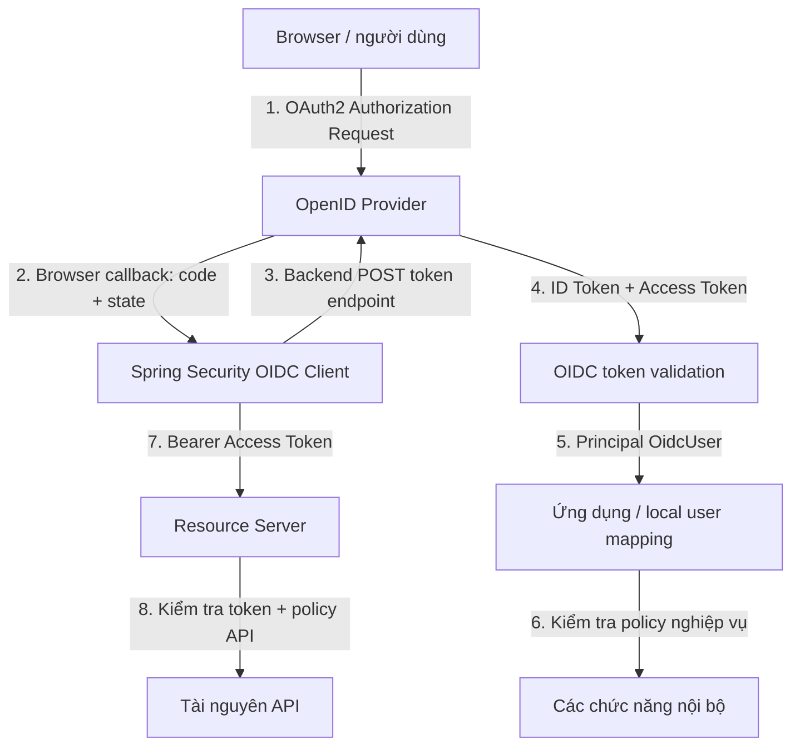
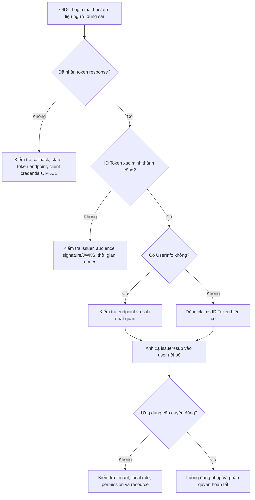

# 11.1. OidcIdToken, claims và các ranh giới tin cậy

Trong ứng dụng **Spring Security OAuth 2.0 / OpenID Connect (OIDC) Client**, sau khi hoàn tất Authorization Code Flow, OpenID Provider (OP) có thể trả về một **ID Token**. ID Token là thông điệp xác thực dành cho **client đã yêu cầu đăng nhập**: nó cho biết nhà cung cấp danh tính nào đã xác thực chủ thể nào, cho client nào và vào thời điểm nào. Spring Security biểu diễn thông tin này bằng `OidcIdToken`, giúp ứng dụng đọc các claim OIDC qua những API Java quen thuộc.

Tuy nhiên, việc thấy một chuỗi trông giống JWT, đọc được JSON chứa `sub` hoặc có đối tượng `OidcIdToken` trong code **chưa đủ để kết luận dữ liệu đáng tin cậy**. Độ tin cậy chỉ được hình thành khi token đi qua luồng xác thực phù hợp: nhận token từ provider dự kiến, kiểm tra chữ ký hoặc cơ chế bảo vệ đã thỏa thuận, các ràng buộc issuer/audience/thời gian/nonce và những điều kiện OIDC liên quan.

Bài học này giải thích cấu trúc `OidcIdToken`, nhóm claim quan trọng, cách Spring Security đưa chúng vào principal của người dùng, và đặc biệt là **ranh giới tin cậy** giữa trình duyệt, OpenID Provider, ứng dụng OAuth2 Client, UserInfo và Resource Server. Hiểu rõ các ranh giới này giúp tránh lỗi gán danh tính theo email, gửi nhầm ID Token cho API hoặc biến một claim tùy chỉnh thành quyền quản trị không được kiểm soát.

## 1. ID Token là gì và khác Access Token ở đâu?

OpenID Connect xây dựng lớp định danh trên OAuth 2.0. Khi client gửi authorization request có scope `openid`, token response của OIDC Authorization Code Flow thường bao gồm một `id_token`, bên cạnh `access_token` và có thể có `refresh_token`.

| Đối tượng | Mục đích chính | Ai là bên nhận hợp lệ? |
|---|---|---|
| **ID Token** | Truyền kết quả xác thực và các claim về người dùng cho OIDC Client | Ứng dụng OIDC Client có `client_id` phù hợp với audience của ID Token |
| **Access Token** | Cấp khả năng truy cập tài nguyên/API theo quyền đã được cấp | Resource Server mà access token được phát hành để sử dụng |
| **Refresh Token** | Xin access token mới theo grant và policy của provider | OAuth2 Client được phép sử dụng refresh token |
| **Session cookie** | Liên kết browser với phiên làm việc tại ứng dụng | Ứng dụng quản lý phiên; không phải token OIDC do OP cấp |

Ví dụ hệ thống gồm cổng nhân viên và API báo cáo:

```text
Browser ----(redirect/login)----> OpenID Provider
   |                                 |
   | callback code                   | ID Token + Access Token
   v                                 v
Spring MVC BFF  <---- token endpoint response
   |
   | ID Token -> xác thực danh tính cho BFF
   | Access Token -> gọi Reports API
   v
Reports Resource Server
```

ID Token thường là JWT có chữ ký, nhưng mục đích của nó không phải “JWT nào cũng dùng để gọi API”. Resource Server phải nhận token đúng loại, issuer, audience và chính sách API. **Không đưa ID Token vào header `Authorization: Bearer ...` để thay access token**, kể cả ID Token và access token đều có hình dạng JWT.

Trong một Backend for Frontend (BFF), backend có thể giữ ID Token và access token tại server, trong khi browser chỉ dùng session cookie. ID Token không bắt buộc phải được chuyển về JavaScript của browser chỉ để hiển thị tên người dùng.

## 2. OidcIdToken trong mô hình Spring Security

`OidcIdToken` là lớp của Spring Security mô tả ID Token đã được biểu diễn thành đối tượng Java. Nó mang:

- **`tokenValue`:** chuỗi ID Token nguyên bản; đây là credential/thông tin xác thực nhạy cảm, không dùng để ghi log hoặc hiển thị.
- **`issuedAt` và `expiresAt`:** thời điểm phát hành và hết hạn của token.
- **`claims`:** tập key/value, thường được parse từ JWT payload với các kiểu Java tương ứng.

Các lớp quan trọng trong luồng OIDC Login:

| Kiểu Spring Security | Vai trò |
|---|---|
| `OidcIdToken` | Biểu diễn ID Token và các claim được truy cập qua `IdTokenClaimAccessor`. |
| `OidcUser` | Principal OIDC được ứng dụng nhận diện sau khi đăng nhập; cung cấp ID Token, UserInfo (nếu có) và authorities. |
| `OidcUserInfo` | Thông tin người dùng từ UserInfo endpoint hoặc đối tượng thông tin tương ứng, có thể bổ sung claim ngoài ID Token. |
| `OidcUserRequest` | Ngữ cảnh dùng khi tải thông tin người dùng: client registration, access token và ID Token. |
| `OidcUserService` | Thành phần xử lý/tải thông tin người dùng OIDC sau bước xác thực ID Token trong luồng Spring Security. |
| `OidcIdTokenDecoderFactory` | Thành phần tạo decoder dùng để xác minh ID Token theo client registration trong các phiên bản Spring Security tương ứng. |
| `OAuth2AuthorizedClient` | Lưu client registration và các access/refresh token để client gọi API downstream. |

Đối tượng `OidcIdToken` hỗ trợ đọc claim qua API của `IdTokenClaimAccessor`, chẳng hạn `getIssuer()`, `getSubject()`, `getAudience()` hoặc `getClaims()`. Giá trị `getTokenValue()` là chuỗi token gốc và chỉ nên dùng khi một tích hợp được thiết kế rõ ràng yêu cầu nó; hầu hết controller và nghiệp vụ chỉ cần các claim đã được xác thực.

**Điểm ranh giới:** constructor hoặc phép parse dữ liệu thành `OidcIdToken` tự nó không phải bước xác minh chữ ký. Độ tin cậy của đối tượng phụ thuộc nguồn gốc và luồng tạo ra nó. Một đối tượng tự khởi tạo từ dữ liệu không đáng tin không có cùng bảo đảm với `OidcIdToken` trong một `OidcUser` do luồng `oauth2Login()` hợp lệ tạo ra.

### 2.1. Ví dụ đọc ID Token sau OIDC Login

Trong controller Servlet, Spring Security có thể inject principal đã xác thực:

```java
import java.net.URI;
import org.springframework.security.core.annotation.AuthenticationPrincipal;
import org.springframework.security.oauth2.core.oidc.OidcIdToken;
import org.springframework.security.oauth2.core.oidc.user.OidcUser;
import org.springframework.web.bind.annotation.GetMapping;
import org.springframework.web.bind.annotation.RestController;

@RestController
class AccountController {

    @GetMapping("/account/identity")
    IdentityView identity(@AuthenticationPrincipal OidcUser user) {
        OidcIdToken idToken = user.getIdToken();

        URI issuer = idToken.getIssuer();
        String subject = idToken.getSubject();

        return new IdentityView(
                issuer.toString(),
                subject,
                user.getFullName());
    }

    record IdentityView(String issuer, String subject, String displayName) {}
}
```

Đoạn code minh họa cách truy cập các claim từ principal **sau khi Spring Security đã hoàn tất OIDC Login**. Chỉ áp dụng endpoint cho authentication có principal kiểu `OidcUser`; ứng dụng cho phép form login hoặc authentication khác cần thiết kế đường đi phù hợp. Ở production, nên cân nhắc có thực sự cần trả issuer/subject ra client hay chỉ dùng để ánh xạ user phía server. Không trả `idToken.getTokenValue()`.

### 2.2. OidcIdToken và OidcUser không đồng nghĩa

`OidcIdToken` mang nội dung ID Token. `OidcUser` là principal của một phiên đăng nhập và có thể kết hợp ID Token với `OidcUserInfo`. Vì vậy:

```java
OidcIdToken token = user.getIdToken();
Map<String, Object> idTokenClaims = token.getClaims();
Map<String, Object> principalClaims = user.getClaims();
```

Hai tập claim **không nhất thiết giống nhau** khi UserInfo được dùng. Nếu một nghiệp vụ bắt buộc một claim phải xuất phát từ **ID Token đã được xác minh**, hãy lấy claim từ `user.getIdToken()`. Nếu nó được cung cấp từ UserInfo, cần hiểu độ tin cậy và hợp đồng của endpoint đó thay vì giả định mọi claim của principal đều nằm trong ID Token.

## 3. Cấu trúc một ID Token

Một ID Token thông dụng có định dạng **JWT** với ba phần JWS được phân cách bằng dấu chấm:

```text
BASE64URL(header).BASE64URL(payload).BASE64URL(signature)
```

Header chỉ ra thông tin ký như thuật toán `alg` và mã nhận diện khóa `kid`. Payload chứa các claim. Signature được xác minh bằng khóa và thuật toán thích hợp từ provider. Tùy OP, ID Token còn có thể được mã hóa theo JWE hoặc tuân theo hồ sơ bảo mật riêng; ví dụ này tập trung vào ID Token có chữ ký thường gặp trong Spring Security OAuth2 Login.

Một payload **minh họa, đã thay giá trị thật**:

```json
{
  "iss": "https://idp.example.org/realms/company",
  "sub": "user-01b7f2",
  "aud": "portal-bff",
  "exp": 1795000000,
  "iat": 1794996400,
  "auth_time": 1794996380,
  "nonce": "random-nonce-for-this-authorization",
  "name": "Nguyen Example",
  "preferred_username": "nguyen.example",
  "email": "nguyen@example.org",
  "email_verified": true,
  "acr": "urn:example:assurance:employee",
  "amr": ["pwd", "otp"]
}
```

Không nên coi ví dụ JSON là một ID Token hợp lệ: nó thiếu header/chữ ký, giá trị thời gian chỉ để minh họa, issuer/client ID là giả và không qua xác minh. Chỉ parse payload hoặc decode Base64URL không chứng minh token được provider phát hành.

Các kiểu dữ liệu thông thường:

| Claim | Dạng biểu diễn phổ biến |
|---|---|
| `iss`, `sub`, `nonce`, `preferred_username` | JSON string |
| `aud` | JSON string hoặc mảng string theo chuẩn JWT |
| `exp`, `iat`, `auth_time` | NumericDate: số giây kể từ Unix epoch |
| `email_verified`, `phone_number_verified` | JSON boolean |
| `amr` | Danh sách các chuỗi |
| `acr` | Chuỗi mô tả mức/ngữ cảnh xác thực |

Các accessor của Spring Security giúp làm việc với claim đã được parse. Tránh tự ép kiểu `Map` một cách mù quáng: một provider có thể trả dạng dữ liệu khác hợp đồng, claim tùy chọn có thể vắng mặt và `aud` không luôn là một chuỗi đơn.

## 4. Các claim lõi phải hiểu khi xác minh ID Token

### 4.1. `iss` — issuer

`iss` cho biết **bên phát hành ID Token**. Giá trị này phải khớp với issuer được mong đợi từ `ClientRegistration` và metadata của OP. Không đánh đồng các issuer chỉ vì chúng cùng hostname:

```text
https://idp.example.org/realms/employee
https://idp.example.org/realms/partner
```

Hai URI trên đại diện cho hai miền định danh có thể khác nhau. Ứng dụng phải dùng đúng issuer đã cấu hình cho từng registration. Trong hệ thống nhiều tenant, không tự động tin một `iss` bất kỳ do token tự khai báo.

### 4.2. `sub` — subject

`sub` định danh chủ thể người dùng tại issuer. Đây là claim quan trọng để ứng dụng xác định người dùng đã đăng nhập. `sub` có thể là giá trị opaque, không có ý nghĩa hiển thị và không nhất thiết là email hay username.

**Khóa định danh liên kết tài khoản thường nên dựa trên cặp (`iss`, `sub`)**. Một giá trị `sub` có thể xuất hiện ở hai issuer khác nhau mà đại diện cho hai người dùng khác nhau. Nếu OP dùng pairwise subject identifiers, cùng một người dùng có thể có `sub` khác nhau với các client/sector khác nhau; ứng dụng phải dựa trên chính sách liên kết tài khoản đáng tin của hệ thống.

Không tự suy luận rằng `sub` chỉ là tên người dùng và không nên dùng `preferred_username` hoặc `email` thay thế làm định danh lâu dài mặc định.

### 4.3. `aud` — audience

`aud` chứa client ID (hoặc các audience được giao thức cho phép) mà ID Token được phát hành cho. OIDC Client cần xác minh **client ID của chính mình** nằm trong audience. Đây là kiểm tra ngăn ứng dụng A chấp nhận ID Token phát hành cho ứng dụng B.

Ví dụ:

```json
{
  "iss": "https://idp.example.org/realms/company",
  "sub": "user-123",
  "aud": ["portal-bff", "reporting-ui"],
  "azp": "portal-bff"
}
```

`aud` có thể là một mảng; `azp` là authorized party có ý nghĩa trong trường hợp OIDC quy định, đặc biệt khi có nhiều audience. Việc chấp nhận ID Token cần tuân theo toàn bộ quy tắc audience/authorized party chứ không chỉ đọc phần tử đầu tiên của mảng.

Không nhầm `aud` của **ID Token** (nhằm tới client) với audience của **access token** (thường nhằm tới API/Resource Server).

### 4.4. `exp`, `iat` và các điều kiện thời gian

- `exp`: thời điểm ID Token hết hạn; token không còn hợp lệ khi đã quá hạn theo chính sách cho phép sai số đồng hồ.
- `iat`: thời điểm token được phát hành; hỗ trợ xác minh tính hợp lý của mốc thời gian và chính sách riêng.
- `nbf` (nếu có): token không được chấp nhận trước thời điểm quy định, tùy loại token và cơ chế validation.
- `auth_time` (nếu có/được yêu cầu): thời điểm người dùng thực sự xác thực tại OP; đặc biệt quan trọng khi client yêu cầu `max_age` hoặc cần bằng chứng xác thực mới.

Không coi `iat` là `auth_time`: token có thể mới được phát hành khi người dùng còn phiên SSO cũ tại provider. Trường hợp ứng dụng cần xác thực gần đây trước thao tác nhạy cảm, phải thiết kế dựa trên hợp đồng `auth_time`/`max_age` hoặc cơ chế step-up của OP.

### 4.5. `nonce` — ràng buộc ID Token với yêu cầu xác thực

Trong OIDC, client có thể tạo một `nonce` ngẫu nhiên cho một lần Authorization Request, gửi tới OP và yêu cầu ID Token trả về chứa giá trị phù hợp. `nonce` góp phần chống phát lại và giúp ràng buộc token với lần đăng nhập mà client đã khởi tạo. Nó **khác** `state` của OAuth 2.0:

| Giá trị | Nơi khởi tạo/sử dụng | Vai trò |
|---|---|---|
| `state` | Authorization Request và authorization response/callback | Tương quan callback với yêu cầu ban đầu, chống giả mạo luồng ủy quyền. |
| `nonce` | Authorization Request và ID Token | Ràng buộc ID Token với yêu cầu xác thực, hỗ trợ chống replay. |
| `code_verifier` | Lưu tại client và gửi tới token endpoint khi dùng PKCE | Chứng minh bên đổi code là bên đã khởi tạo yêu cầu PKCE. |

Không dùng cùng một hằng chuỗi cố định cho `state`/`nonce` và không bỏ đối chiếu nonce chỉ vì chữ ký token hợp lệ. Yêu cầu nonce tùy flow và thông số giao thức; với authorization-code flow, việc nonce được gửi hay không phụ thuộc lựa chọn và cấu hình, nhưng **nếu đã gửi nonce thì phải xác minh giá trị liên quan**.

## 5. Những claim bổ sung có ý nghĩa nghiệp vụ

ID Token còn có thể chứa các claim về hồ sơ hoặc mức xác thực. Chúng hữu ích nhưng không nên được nâng lên thành quyền nghiệp vụ mà không có chính sách rõ ràng.

| Claim | Mục đích phổ biến | Ranh giới cần lưu ý |
|---|---|---|
| `name`, `given_name`, `family_name` | Tên hiển thị | Có thể thay đổi hoặc vắng mặt; không dùng làm khóa định danh. |
| `preferred_username` | Tên đăng nhập thân thiện với con người | Có thể đổi theo chính sách của OP; không bảo đảm duy nhất toàn hệ thống. |
| `email` | Địa chỉ email liên hệ | Có thể thay đổi, tái sử dụng hoặc thiếu; không mặc định coi là tài khoản đáng tin chỉ vì xuất hiện. |
| `email_verified` | OP cho biết email đã được xác minh theo quy trình của OP | Không đồng nghĩa người dùng được phép tham gia mọi tổ chức hay có vai trò đặc quyền. |
| `phone_number`, `phone_number_verified` | Thông tin liên hệ | Phụ thuộc scope/consent; hạn chế lưu và tiết lộ theo nhu cầu. |
| `auth_time` | Thời điểm xác thực thực tế | Dùng khi có yêu cầu recent authentication, phải kiểm tra policy thời gian. |
| `acr` | Authentication Context Class Reference | Ý nghĩa phụ thuộc profile và thỏa thuận với OP; không tự suy luận “acr cao nghĩa là admin”. |
| `amr` | Authentication Methods References | Mô tả các phương thức đã dùng, chẳng hạn password/OTP; không có ngữ nghĩa quyền truy cập chung. |
| `at_hash` | Giá trị băm liên kết access token trong những luồng OIDC áp dụng | Cần validation theo flow/thuật toán khi quy định; không phải quyền API. |
| `c_hash` | Giá trị băm liên kết authorization code trong những luồng OIDC áp dụng | Không phải lúc nào cũng xuất hiện ở Authorization Code Flow thuần túy. |
| Claim tùy chỉnh như `groups`, `roles` | Thông tin tổ chức hoặc role do provider cấp | Chỉ dùng khi nguồn tin cậy, schema, audience, tenant và cách ánh xạ quyền được thống nhất rõ ràng. |

### 5.1. Vì sao email không phải khóa định danh mặc định?

Ví dụ hai OpenID Provider đều trả:

```json
{
  "email": "employee@example.org",
  "email_verified": true
}
```

Điều đó **không chứng minh hai lần đăng nhập thuộc cùng một tài khoản nội bộ**. Mỗi provider có quy trình xác minh riêng; email có thể được cấp lại hoặc thay đổi theo thời gian. Liên kết tài khoản giữa các issuer cần một quy trình được ủy quyền, được ghi nhận và chống chiếm đoạt tài khoản.

Đối với bảng user nội bộ, một mô hình liên kết dễ kiểm soát hơn:

```text
local_user
    id
    display_name
    ...

external_identity
    local_user_id
    issuer
    subject
    linked_at
    ...

UNIQUE (issuer, subject)
```

Cặp (`issuer`, `subject`) làm khóa cho danh tính bên ngoài. Quy trình gắn danh tính đó với `local_user_id` là một **quyết định nghiệp vụ có kiểm soát**, không phải tự động tìm user có cùng email rồi đăng nhập vào tài khoản đó.

### 5.2. Claim `roles`/`groups` không tự trở thành Spring authorities

Một OP có thể phát:

```json
{
  "groups": ["report-readers", "finance"],
  "roles": ["manager"]
}
```

Các claim này không có cấu trúc thống nhất giữa mọi provider. Spring Security không mặc định hiểu mọi chuỗi trong `roles` là `ROLE_*` đáng tin cho mọi hệ thống. Nếu cần ánh xạ thành `GrantedAuthority`, phải xác định:

1. Claim đến từ **issuer và client registration được phê duyệt**.
2. Claim có schema và ngữ nghĩa được thỏa thuận; không đọc dữ liệu do browser tự gửi.
3. Mỗi nhóm/role được ánh xạ qua danh sách quyền cho phép, giới hạn tenant và quyền trong ứng dụng.
4. Mỗi API vẫn kiểm tra quyền cụ thể, không dựa vào việc người dùng đã có ID Token là đủ.

Ví dụ `groups=finance` có thể cho phép xem menu tài chính, nhưng **không tự chứng minh** người dùng có quyền xuất báo cáo của mọi phòng ban.

## 6. Ranh giới tin cậy trong OIDC Login

Ranh giới tin cậy là điểm tại đó dữ liệu đi từ một hệ thống hoặc bên gửi sang một hệ thống có chính sách khác. Hãy xem luồng:



| Ranh giới | Dữ liệu đi qua | Điều phải được kiểm tra |
|---|---|---|
| Browser → ứng dụng | URL đăng nhập, callback `code`/`state`, session cookie | State, Authorization Request đã lưu, CSRF/session rules thích hợp; không tin query/cookie như danh tính. |
| Ứng dụng → OP | Token request gồm code, redirect URI, client authentication, PKCE verifier | Endpoint đúng issuer/tenant, TLS, grant/client method hợp lệ, bảo vệ bí mật. |
| OP → ứng dụng | ID Token, access token, metadata | Chữ ký/thuật toán, issuer, audience, thời gian, nonce và các điều kiện OIDC. |
| ID Token → principal | Claims được Spring đưa vào `OidcUser` | Token phải được xác minh trước khi tin; hiểu nguồn claim ID Token/UserInfo. |
| Principal → tài khoản nội bộ | `iss`, `sub`, các thuộc tính hồ sơ | Quy tắc liên kết tài khoản, tenant, trạng thái người dùng và chính sách nghiệp vụ. |
| Client → Resource Server | Access token | Resource Server tự kiểm tra issuer, audience, thời hạn, scope/authority; không tin ID Token thay bearer access token. |

**Ranh giới quan trọng nhất:** OpenID Provider khẳng định “chủ thể `sub` đã được xác thực theo điều kiện của OP”; nó **không tự khẳng định** “chủ thể này là quản trị viên của mọi dữ liệu trong ứng dụng của bạn”. Quyền truy cập nội bộ phải có chính sách riêng.

### 6.1. Browser không phải nguồn danh tính được tin cậy

Browser có thể chỉnh URL, query parameter, local storage và body request. Đừng nhận `sub`, `email` hay `roles` từ frontend rồi tự coi chúng là claim OIDC đã xác thực.

Ví dụ không an toàn về mô hình tư duy:

```java
// Không dùng parameter do browser gửi để gán danh tính!
@GetMapping("/admin")
String admin(@RequestParam String role) {
    if ("admin".equals(role)) {
        return "allowed";
    }
    return "denied";
}
```

Ứng dụng phải lấy `Authentication`/`OidcUser` từ Spring Security sau login và dựa vào policy của chính mình để phân quyền, không lấy role do client khai báo. Ngay cả khi claim `roles` đến từ ID Token đã xác minh, ứng dụng vẫn cần kiểm tra issuer/schema và ánh xạ quyền được phép.

### 6.2. Provider đã được tin cậy vẫn có phạm vi tin cậy

Provider A có thể được tin để xác thực nhân viên, còn provider B chỉ dùng cho đối tác. Việc cả hai đều trả ID Token có chữ ký hợp lệ không có nghĩa chúng được cấp quyền ngang nhau. Registration, issuer, tenant và đối tượng người dùng được phép sử dụng là những ràng buộc bổ sung.

Trong ứng dụng đa tenant, cần ràng buộc người dùng vào tổ chức đúng theo nguồn danh tính. Không chỉ dựa vào domain của `email` vì domain có thể được chia sẻ hoặc thay đổi.

### 6.3. UserInfo là một nguồn claims khác

OIDC cho phép client gọi UserInfo endpoint bằng access token để lấy thêm thông tin người dùng. Response UserInfo đi qua một ranh giới riêng:

```text
ID Token verified -> sub = user-123
UserInfo endpoint  -> sub = user-123, name, email, ...
```

Theo OIDC, `sub` của UserInfo Response phải khớp với `sub` trong ID Token; nếu khác, client **không được sử dụng** dữ liệu UserInfo đó. Dữ liệu UserInfo có thể bổ sung claim, nhưng không thay thế bước xác minh ID Token. Cần dùng UserInfo từ endpoint được cấu hình với provider tương ứng và tuân thủ điều kiện TLS/token.

Một số claim hiển thị có thể xuất hiện ở UserInfo nhưng vắng mặt trong ID Token. Đừng giả định `user.getClaims()` và `user.getIdToken().getClaims()` luôn giống nhau hoặc tất cả đều đã đến từ một JWT.

## 7. Spring Security xác minh ID Token ở đâu?

Trong luồng Servlet `oauth2Login()` với `openid`, Spring Security phối hợp thành phần OAuth2 Login, `OidcAuthorizationCodeAuthenticationProvider` và ID Token decoder/validator tương ứng để xác minh ID Token trước khi xây dựng principal OIDC. Ứng dụng thường **không phải tự parse và kiểm chữ ký trong controller**.

```text
GET /login/oauth2/code/{registrationId}
       |
       v
OAuth2LoginAuthenticationFilter
       |
       +--> Tìm và kiểm tra Authorization Request gốc
       |
       v
OAuth2 Authorization Code token exchange
       |
       v
ID Token được nhận từ token endpoint
       |
       v
OIDC ID Token verification/validation
       |  - chữ ký/thuật toán và khóa
       |  - issuer, audience/clientId, exp, iat
       |  - nonce và điều kiện giao thức khác khi áp dụng
       v
OidcUserService / OidcUser
       |
       v
Authentication -> SecurityContext
```

Các yêu cầu validation chính:

1. **Chấp nhận thuật toán ký phù hợp:** không tin thuật toán `alg` do token tự khai báo nếu nằm ngoài policy của client. Chỉ chấp nhận thuật toán/chữ ký được hỗ trợ và cấu hình.
2. **Xác thực chữ ký theo khóa đúng issuer:** có thể lấy khóa công khai từ JWK Set URI của provider; phải giới hạn nguồn khóa theo cấu hình tin cậy, không tải khóa từ một URL bất kỳ do token chỉ định.
3. **Kiểm tra `iss` chính xác:** token phải đến từ OP đã được cấu hình cho registration.
4. **Kiểm tra `aud` và `azp` khi áp dụng:** ID Token phải dành cho client hiện tại và tuân thủ ràng buộc authorized party.
5. **Kiểm tra thời hạn:** `exp`, `iat` và những ràng buộc thời gian khác theo giao thức/chính sách; đồng hồ hệ thống cần đồng bộ.
6. **Kiểm tra `nonce` nếu đã gửi:** token không được dùng thay cho token của một lần authorization request khác.
7. **Kiểm tra các điều kiện OIDC khác của flow:** ví dụ các hash claim khi xuất hiện hoặc được yêu cầu bởi loại response/flow.

Phần lớn kiểm tra bảo mật nên để Spring Security xử lý qua các cơ chế được hỗ trợ. Nếu ứng dụng viết decoder/validator tùy chỉnh, chính sách mới phải **bổ sung những điều kiện cần thiết**, không vô tình thay thế hoặc bỏ các kiểm tra chuẩn.

### 7.1. Chỉ đọc payload bằng Base64 không phải xác minh

JWT payload là dữ liệu có thể decode, kể cả khi chữ ký đã bị sửa. Ví dụ tư duy sai:

```java
// Sai về ranh giới tin cậy:
// 1) Nhận JWT bất kỳ từ browser
// 2) Base64URL-decode phần payload
// 3) Lấy "email" hoặc "roles"
// 4) Cho phép đăng nhập/admin
```

Bên gửi có thể tự tạo payload chứa `"roles":["admin"]`. Chỉ khi token được xác minh đúng issuer, audience, chữ ký, thời hạn và ngữ cảnh OIDC mới có thể dùng các claim như dữ liệu nhận dạng đã được OP khẳng định. Dù thế, quyền ứng dụng vẫn cần được kiểm tra riêng.

### 7.2. JWT từ một issuer khác vẫn có thể có chữ ký hợp lệ

Giả sử token của provider đối tác được ký hoàn toàn hợp lệ, nhưng client đang cấu hình đăng nhập qua issuer dành cho nhân viên. Nếu ứng dụng chỉ kiểm tra “chữ ký hợp lệ với một khóa công khai nào đó” mà không kiểm `iss`/`aud`, nó có thể chấp nhận token sai trust domain.

Trong OIDC Client, **issuer và audience là một phần của validation**, không phải hai thông tin để hiển thị sau khi đã tin token.

### 7.3. JWKS và xoay vòng khóa

Provider thường công bố JWK Set chứa các khóa công khai để client xác minh chữ ký. `kid` trong header giúp chọn khóa phù hợp, nhưng không tự chứng minh khóa đó đáng tin. Nguồn JWK Set phải gắn với OP được cấu hình và có TLS đáng tin cậy.

Khi provider rotate signing key, Spring Security/JWT decoder cần cơ chế cập nhật khóa theo hỗ trợ của phiên bản và cấu hình. Nếu token đột ngột không xác minh được sau key rotation, kiểm tra metadata/JWK Set URI, cache, kết nối mạng và thuật toán ký. Không giải quyết bằng cách tắt signature verification.

## 8. Cấu hình OIDC Login để dùng OidcIdToken

Ví dụ ứng dụng Servlet với Spring Boot, Spring MVC và OAuth2 Client:

```xml
<!-- Những dependency chính trong pom.xml -->
<dependency>
    <groupId>org.springframework.boot</groupId>
    <artifactId>spring-boot-starter-web</artifactId>
</dependency>
<dependency>
    <groupId>org.springframework.boot</groupId>
    <artifactId>spring-boot-starter-security</artifactId>
</dependency>
<dependency>
    <groupId>org.springframework.boot</groupId>
    <artifactId>spring-boot-starter-oauth2-client</artifactId>
</dependency>
```

```yaml
spring:
  security:
    oauth2:
      client:
        registration:
          company-login:
            provider: company
            client-id: "${OIDC_CLIENT_ID}"
            client-secret: "${OIDC_CLIENT_SECRET}"
            client-authentication-method: client_secret_basic
            authorization-grant-type: authorization_code
            redirect-uri: "{baseUrl}/login/oauth2/code/{registrationId}"
            scope:
              - openid
              - profile
              - email
        provider:
          company:
            issuer-uri: "https://idp.example.org/realms/company"
```

`issuer-uri` phải trùng với issuer thực tế mà OP công bố qua metadata. Nếu provider có OIDC discovery, Spring có thể lấy các endpoint và JWK Set URI cần thiết qua metadata. Trong môi trường production, giá trị client ID/secret lấy từ nguồn cấu hình được kiểm soát và callback URI phải được đăng ký chính xác tại OP.

Cấu hình Servlet:

```java
import org.springframework.context.annotation.Bean;
import org.springframework.context.annotation.Configuration;
import org.springframework.security.config.Customizer;
import org.springframework.security.config.annotation.web.builders.HttpSecurity;
import org.springframework.security.web.SecurityFilterChain;

@Configuration
class SecurityConfig {

    @Bean
    SecurityFilterChain securityFilterChain(HttpSecurity http) throws Exception {
        http
            .authorizeHttpRequests(authorize -> authorize
                .requestMatchers("/", "/error").permitAll()
                .anyRequest().authenticated()
            )
            .oauth2Login(Customizer.withDefaults());

        return http.build();
    }
}
```

Với scope `openid` và provider OIDC hợp lệ, Spring Security sử dụng luồng OIDC cho đăng nhập. Sau khi token exchange, kiểm tra ID Token và tạo principal, ứng dụng mới truy cập được `OidcUser` thông qua security context.

**Không tự tạo `OidcIdToken` từ request parameter hoặc token do frontend gửi để thay thế principal.** Nếu hệ thống của bạn nhận JWT từ browser/API đầu vào theo cơ chế bearer authentication, đó là một ranh giới và cấu hình xác thực khác (thường là Resource Server), không thể tùy tiện dùng quy trình `oauth2Login()` để bỏ qua token validation.

### 8.1. Khi không có ID Token

Nếu Authorization Server chỉ hỗ trợ OAuth 2.0 và không hỗ trợ OIDC, hoặc registration không yêu cầu `openid`, luồng có thể là OAuth2 Login không theo OIDC. Khi đó principal có thể là `OAuth2User` và dữ liệu nhận dạng dựa trên UserInfo/attributes của provider; không mặc định có `OidcIdToken`.

Trong một endpoint chỉ phục vụ OIDC, hãy nêu rõ điều kiện authentication. Nếu ứng dụng hỗ trợ nhiều loại đăng nhập, xử lý riêng từng loại principal thay vì cast `OAuth2User` sang `OidcUser` mà không kiểm tra.

## 9. Ánh xạ danh tính đã xác thực vào tài khoản nội bộ

Một hệ thống nghiệp vụ thường có bảng người dùng riêng, chứa trạng thái tài khoản, tổ chức, nhóm quyền và dữ liệu nghiệp vụ. ID Token không thay thế các thông tin đó.

Ví dụ service xây dựng khóa danh tính liên kết từ token đã được xác minh:

```java
import java.net.URI;
import org.springframework.security.oauth2.core.oidc.OidcIdToken;
import org.springframework.security.oauth2.core.oidc.user.OidcUser;

record ExternalIdentity(URI issuer, String subject) {}

class IdentityMapping {
    ExternalIdentity identityOf(OidcUser principal) {
        OidcIdToken token = principal.getIdToken();
        return new ExternalIdentity(token.getIssuer(), token.getSubject());
    }
}
```

Trong ứng dụng thực, service này phải được gọi với `OidcUser` đến từ Spring Security đã xác thực, và lookup theo (`issuer`, `subject`) trong cơ sở dữ liệu nội bộ. Nếu không có liên kết, quyết định tạo tài khoản mới, yêu cầu mời hoặc từ chối tùy chính sách.

Tránh thiết kế như:

```java
// Không tự động lấy email làm khóa đăng nhập nội bộ!
String accountKey = principal.getEmail();
```

`getEmail()` có thể hữu ích để hiển thị hoặc đề nghị liên kết tài khoản có kiểm soát, nhưng không phải chứng cứ phổ quát về quyền sở hữu tài khoản nội bộ. Khi cần khớp email, phải có quy trình xác minh và xử lý xung đột/tái sử dụng email.

### 9.1. Phân quyền cần được quyết định ở lớp ứng dụng

Ví dụ chức năng xem bảng lương:

```text
OIDC validation OK
  |
  v
issuer + subject -> internal user
  |
  v
user active? belongs to organization?
  |
  v
permission payroll.read for requested tenant?
  |
  v
allow or deny
```

Việc `OidcUser` đã được xác thực mới chứng minh danh tính tại OP, chưa chứng minh user có quyền xem dữ liệu bảng lương. Ứng dụng có thể dùng `@PreAuthorize`, service-level permission checks và chính sách trên từng tài nguyên để ra quyết định.

### 9.2. Tùy biến OidcUserService sau khi token đã được xác minh

Khi cần liên kết user nội bộ hoặc bổ sung authorities từ một nguồn đã được phê duyệt, Spring Security cho phép cấu hình `oidcUserService`:

```java
import org.springframework.context.annotation.Bean;
import org.springframework.security.oauth2.client.oidc.userinfo.OidcUserRequest;
import org.springframework.security.oauth2.client.oidc.userinfo.OidcUserService;
import org.springframework.security.oauth2.core.oidc.user.OidcUser;
import org.springframework.security.oauth2.client.userinfo.OAuth2UserService;

@Bean
OAuth2UserService<OidcUserRequest, OidcUser> mappedOidcUserService(
        LocalAccountLinker accountLinker) {

    OidcUserService delegate = new OidcUserService();

    return request -> {
        OidcUser user = delegate.loadUser(request);

        // Chỉ dùng token đã đi qua luồng OIDC Login của Spring.
        String issuer = user.getIdToken().getIssuer().toString();
        String subject = user.getIdToken().getSubject();

        accountLinker.checkAllowedExternalIdentity(issuer, subject);
        return user;
    };
}
```

Sau đó gắn service vào cấu hình `oauth2Login()`:

```java
http.oauth2Login(oauth2 -> oauth2
    .userInfoEndpoint(userInfo -> userInfo
        .oidcUserService(mappedOidcUserService)
    )
);
```

`LocalAccountLinker` là interface/service nghiệp vụ **giả định** trong ví dụ, cần được triển khai bởi ứng dụng; nó có thể kiểm tra user, tenant và trạng thái tài khoản hoặc từ chối đăng nhập. Hai snippet minh họa hướng tích hợp, không phải một ứng dụng có thể biên dịch nguyên xi khi chưa khai báo service và cấu hình bean.

Nếu cần bổ sung `GrantedAuthority`, có thể triển khai mapping được kiểm soát thay vì trả nguyên một claim như `groups` thành quyền. Việc tùy chỉnh user service không thay thế xác minh chữ ký và các claim ID Token do Spring Security thực hiện trước đó.

## 10. ID Token có hạn, nhưng session và access token có vòng đời khác

Một ID Token có `exp` không có nghĩa session Spring Security phải tự động biến mất đúng tại mốc `exp` trong mọi cấu hình. Session cookie, `SecurityContext`, authorized client, access token và refresh token có vòng đời riêng.

Ví dụ:

```text
09:00  OIDC Login hoàn tất; ID Token exp = 10:00
09:30  Access token được refresh theo cơ chế authorized client
10:00  ID Token ban đầu hết hạn
10:05  Session web có thể vẫn tồn tại theo session policy
```

Các mốc trên chỉ nhằm minh họa. Tính hợp lệ của ID Token phải được kiểm tra khi client chấp nhận token làm bằng chứng xác thực. Nhưng **yêu cầu reauthentication/step-up cho một thao tác mới** là một chính sách riêng: ví dụ ứng dụng cần người dùng xác thực trong vòng 5 phút trước khi đổi thông tin thanh toán.

Để thực thi recent authentication, ứng dụng có thể dùng chính sách dựa trên `auth_time`/`max_age` hoặc tính năng xác thực bổ sung của OP, kết hợp kiểm tra ở phía ứng dụng. Không dùng thời gian phát hành `iat` thay cho bằng chứng người dùng vừa nhập mật khẩu/MFA.

### 10.1. Khi access token hết hạn

Access token được dùng để gọi API downstream; khi hết hạn, `OAuth2AuthorizedClientManager` hoặc các thành phần tương ứng có thể dùng refresh token nếu được cấp và chính sách cho phép. Làm mới access token không đồng nghĩa người dùng vừa xác thực lại tại OP và cũng không mặc nhiên nhận ID Token mới.

Không suy luận từ việc ID Token còn hạn rằng access token đủ scope/audience để gọi một API. Ngược lại, refresh token còn khả dụng không tự nâng cấp mức xác thực của người dùng.

## 11. ID Token và Resource Server: hai phía kiểm tra khác nhau

Một ứng dụng Spring có thể vừa là OAuth2 Client vừa là Resource Server, nhưng đây là hai vai trò độc lập:

| Câu hỏi | OIDC Client (`oauth2Login`) | Resource Server (`oauth2ResourceServer`) |
|---|---|---|
| Token nhận từ đâu? | Token endpoint sau authorization-code exchange | HTTP request tới API, thường qua `Authorization: Bearer` |
| Loại token chính cần kiểm tra? | **ID Token** để xác thực người dùng với client | **Access Token** để quyết định request có được gọi API |
| Audience kỳ vọng? | Client ID của OIDC Client | Audience/resource mà API chấp nhận |
| Kết quả điển hình? | Principal `OidcUser` và session login | `Authentication` cho request API, thường dựa trên JWT/opaque token |
| Mục đích cuối? | Thiết lập danh tính đăng nhập | Bảo vệ tài nguyên/API và áp dụng authorization |

Đừng tự cấu hình API nhận ID Token của ứng dụng khác chỉ vì token đó có chữ ký hợp lệ. Thông tin `aud`, mục đích sử dụng và profile token khác nhau. API nên được cấu hình để xác minh access token dành cho nó, kể cả trong hệ thống mà cả hai token có cùng issuer.

## 12. Chẩn đoán các lỗi kiểm tra ID Token

| Triệu chứng | Nguyên nhân có thể | Hướng xử lý |
|---|---|---|
| `invalid_id_token` hoặc lỗi xác thực sau token response | Thiếu ID Token khi yêu cầu `openid`, ID Token sai định dạng/chữ ký/claims | Kiểm tra token response và metadata OP theo cách đã làm sạch dữ liệu nhạy cảm. |
| Issuer mismatch | Cấu hình sai `issuer-uri`, nhầm realm/tenant, metadata không khớp token | So sánh issuer trong cấu hình/metadata với `iss`; không bỏ kiểm tra. |
| Audience mismatch | Token được cấp cho client ID khác hoặc sai registration | Kiểm tra `client-id`, `aud` và `azp` khi áp dụng. |
| Signature/JWK verification failed | Sai JWK Set URI, OP rotate key, lỗi TLS/cache, thuật toán không được chấp nhận | Kiểm tra metadata, khóa ký và policy thuật toán, không cho phép `alg=none` chỉ để chạy. |
| Token expired | `exp` đã qua, clock skew lớn hoặc cấu hình thời gian sai | Đồng bộ đồng hồ, xem độ lệch được cho phép và thời gian giữa cấp token/xử lý. |
| Nonce mismatch | Request gốc bị mất hoặc nonce không được giữ đúng | Kiểm tra session, Authorization Request repository, resolver custom và luồng callback. |
| UserInfo subject mismatch | `sub` UserInfo khác `sub` ID Token | Từ chối dùng thông tin UserInfo không khớp; kiểm tra provider/endpoint/access token. |
| `OidcUser` có `email` rỗng | Scope/consent không cho email, provider chỉ cung cấp một số claim hoặc dữ liệu thiếu | Kiểm tra hợp đồng claims và xử lý thiếu dữ liệu, không biến email thành định danh bắt buộc nếu không cần. |
| Có claim `roles` nhưng `@PreAuthorize` từ chối | Claim chưa được ánh xạ thành authorities hoặc policy ứng dụng không cho phép | Xác định schema và mapping quyền có kiểm soát; giữ nguyên authorization phía API. |
| Đăng nhập thành công, gọi downstream API bị 401/403 | Gửi nhầm ID Token hoặc access token thiếu audience/scope | Sử dụng đúng authorized client/access token; kiểm tra Resource Server. |
| Một tài khoản nội bộ bị “đổi chủ” sau thay email | Liên kết danh tính theo email thay vì issuer+subject | Dùng external identity mapping và quy trình linking có kiểm soát. |

### 12.1. Phân loại theo giai đoạn



Quy trình này giúp phân biệt lỗi **token exchange**, **OIDC cryptographic validation**, **UserInfo**, **identity linking** và **business authorization**. Không nên sửa cùng lúc `client-secret`, issuer và role mapping khi chưa xác định giai đoạn lỗi.

### 12.2. Quan sát an toàn

Để điều tra lỗi trên môi trường thực tế, log/trace có thể chứa:

- `registrationId`, môi trường, tên bước xử lý và mã lỗi phân loại.
- Issuer **dự kiến** và tên provider/tenant đã cấu hình; hạn chế ghi issuer nhận được nếu có dữ liệu không tin cậy.
- ID giao dịch hoặc correlation ID được tạo phía server.
- Thông tin về lỗi key rotation/discovery, không gồm khóa riêng hoặc nội dung token.

Không ghi **ID Token gốc, Access Token, Refresh Token, authorization code, client secret, PKCE verifier, session cookie**. Tránh dump toàn bộ JWT claims vì có thể chứa email, tên, số điện thoại và thuộc tính nhạy cảm.

## 13. Tình huống thực tế: đăng nhập công ty và đối tác

Giả sử một ứng dụng quản lý hợp đồng hỗ trợ hai registration:

```yaml
spring:
  security:
    oauth2:
      client:
        registration:
          employee:
            provider: corporate
            client-id: "${EMPLOYEE_CLIENT_ID}"
            client-secret: "${EMPLOYEE_CLIENT_SECRET}"
            authorization-grant-type: authorization_code
            scope: [openid, profile, email]
          partner:
            provider: partners
            client-id: "${PARTNER_CLIENT_ID}"
            client-secret: "${PARTNER_CLIENT_SECRET}"
            authorization-grant-type: authorization_code
            scope: [openid, profile]
        provider:
          corporate:
            issuer-uri: "https://idp.example.org/realms/employees"
          partners:
            issuer-uri: "https://idp.partner.example.org/realms/partners"
```

Khi người dùng đăng nhập với `employee`, token có thể chứa:

```json
{
  "iss": "https://idp.example.org/realms/employees",
  "sub": "u-001",
  "aud": "employee-portal-client",
  "email": "person@example.org"
}
```

Một người dùng qua `partner` cũng có thể cung cấp cùng email hoặc cùng `sub` nhưng được cấp bởi issuer khác. Ứng dụng phải:

1. Xác minh ID Token đúng issuer, audience và chính sách của registration đã dùng.
2. Tạo external identity key từ **`(iss, sub)`**.
3. Ánh xạ external identity đến local user với chính sách riêng cho nhân viên và đối tác.
4. Kiểm tra nhóm quyền: nhân viên có thể xem hợp đồng nội bộ, đối tác chỉ xem những hợp đồng được chia sẻ.
5. Khi gọi API, sử dụng access token phù hợp với Resource Server và permission; không gửi ID Token thay thế.

Tình huống này cho thấy ba kiểm tra độc lập: **OP đã xác thực ai**, **ứng dụng nhận diện tài khoản nội bộ nào**, và **tài khoản đó được làm gì**. Một ID Token hợp lệ chỉ giải quyết phần thứ nhất, đồng thời cung cấp dữ liệu để thực hiện phần thứ hai.

## 14. Những sai lầm thường gặp

1. **Dùng email làm user ID lâu dài:** email có thể đổi hoặc được tái sử dụng; ưu tiên khóa (`iss`, `sub`).
2. **Tin JWT vì decode được payload:** decode không xác minh chữ ký, issuer, audience hoặc thời hạn.
3. **Tin bất cứ token ký bởi một provider trong danh sách:** mỗi registration phải giới hạn issuer, audience và tenant được chấp nhận.
4. **Gửi ID Token tới API như access token:** Resource Server cần access token được phát hành cho API.
5. **Bỏ qua `nonce` và `state`:** đây là các ràng buộc của những giai đoạn khác nhau trong OIDC flow.
6. **Coi `email_verified` là quyền nghiệp vụ:** xác minh email của OP không chứng minh quyền xem dữ liệu trong tổ chức.
7. **Chuyển `groups` thành quyền admin không có allowlist:** custom claims phụ thuộc issuer và schema; phải ánh xạ qua policy nội bộ.
8. **Nhầm ID Token `exp` với session expiration:** thời hạn token, login session và chính sách reauthentication là các khái niệm riêng.
9. **Giả định mọi claim của `OidcUser` nằm trong ID Token:** UserInfo có thể bổ sung dữ liệu.
10. **Tắt signature/issuer/audience validation khi gặp lỗi:** sửa metadata, thời gian, khóa hoặc cấu hình issuer thay vì bỏ rào chắn bảo mật.

## 15. Câu hỏi ôn tập

1. `OidcIdToken` chứa những loại thông tin nào, và tại sao tự khởi tạo đối tượng này không tự xác minh chữ ký?
2. ID Token và access token khác nhau ở đối tượng nhận, mục đích sử dụng và cách xác minh audience như thế nào?
3. Tại sao cặp (`iss`, `sub`) thường an toàn hơn `email` để liên kết tài khoản nội bộ?
4. Khi `aud` có nhiều giá trị, claim `azp` có ý nghĩa gì trong quá trình kiểm tra OIDC?
5. `iat` và `auth_time` khác nhau thế nào khi ứng dụng yêu cầu xác thực lại trước thao tác nhạy cảm?
6. `state`, `nonce` và `code_verifier` bảo vệ những giai đoạn nào của Authorization Code Flow?
7. Vì sao `user.getClaims()` có thể không giống `user.getIdToken().getClaims()`?
8. Một ID Token có chữ ký hợp lệ từ issuer đối tác có đủ để ứng dụng tin như danh tính nhân viên không? Vì sao?
9. Khi Spring Security OIDC Login đã tạo `OidcUser`, ứng dụng cần thực hiện thêm kiểm tra nào trước khi cho phép người dùng đọc báo cáo tài chính?
10. Khi OIDC Login thành công nhưng API trả 403, vì sao cần kiểm tra access token và chính sách Resource Server thay vì sửa ID Token?

## Tài liệu tham khảo

- [OpenID Connect Core 1.0 — ID Token](https://openid.net/specs/openid-connect-core-1_0.html#IDToken)
- [OpenID Connect Core 1.0 — ID Token Validation](https://openid.net/specs/openid-connect-core-1_0.html#IDTokenValidation)
- [OpenID Connect Core 1.0 — UserInfo Response Validation](https://openid.net/specs/openid-connect-core-1_0.html#UserInfoResponse)
- [RFC 7519 — JSON Web Token (JWT)](https://datatracker.ietf.org/doc/html/rfc7519)
- [RFC 7636 — Proof Key for Code Exchange (PKCE)](https://datatracker.ietf.org/doc/html/rfc7636)
- [Spring Security Reference — OAuth2 Login (Servlet)](https://docs.spring.io/spring-security/reference/servlet/oauth2/login/core.html)
- [Spring Security Reference — OAuth2 Login Advanced Configuration](https://docs.spring.io/spring-security/reference/servlet/oauth2/login/advanced.html)
- [Spring Security API — OidcIdToken](https://docs.spring.io/spring-security/reference/api/java/org/springframework/security/oauth2/core/oidc/OidcIdToken.html)
- [Spring Security API — OidcUser](https://docs.spring.io/spring-security/reference/api/java/org/springframework/security/oauth2/core/oidc/user/OidcUser.html)
