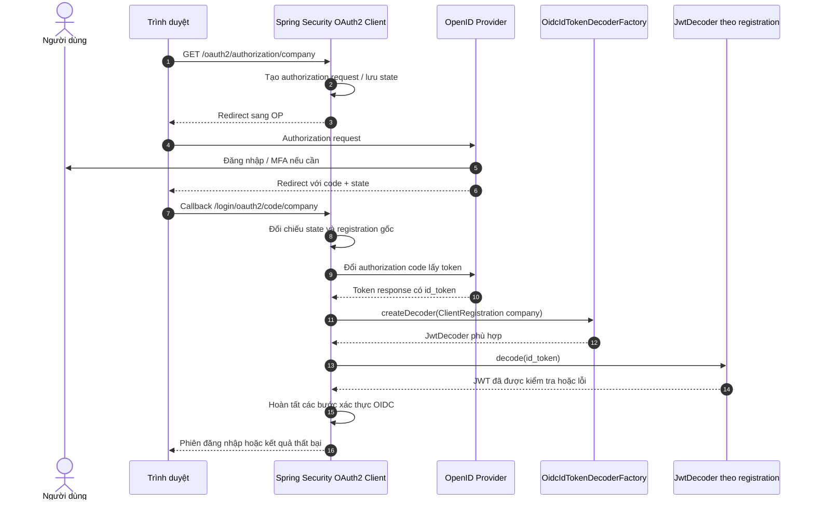
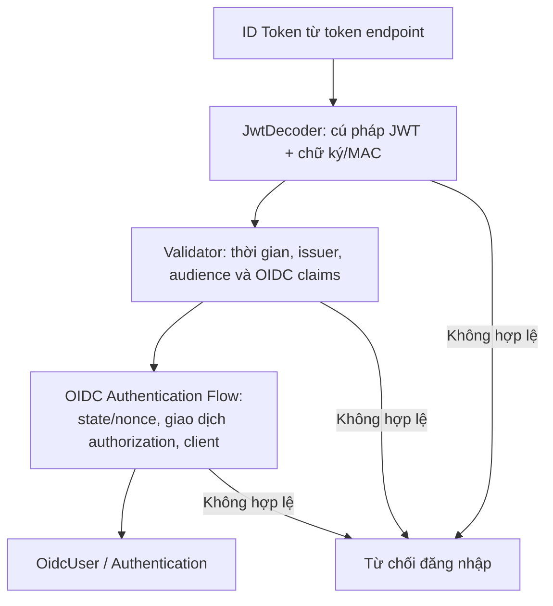
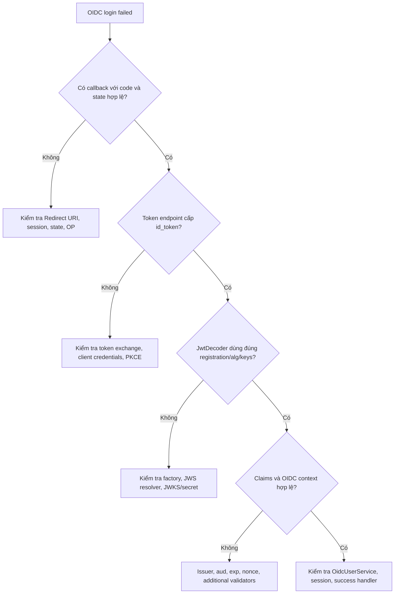

# 11.2. OidcIdTokenDecoderFactory và lựa chọn JwtDecoder theo registration

Một ứng dụng Spring Boot có thể cho người dùng đăng nhập qua nhiều **OpenID Provider (OP)**: hệ thống SSO nội bộ, một đối tác và một nhà cung cấp danh tính khác. Mỗi provider có thể dùng **issuer**, **tập khóa xác minh chữ ký**, **client ID** và **thuật toán ký ID Token** khác nhau. Vì vậy, khi nhận ID Token từ token endpoint, ứng dụng cần chọn bộ giải mã và xác thực JWT **phù hợp với đúng client registration đã khởi động giao dịch đăng nhập**.

Trong Spring Security OAuth 2.0 / OIDC Client (Servlet), thành phần trọng tâm để thực hiện lựa chọn này là **`OidcIdTokenDecoderFactory`**. Nó triển khai `JwtDecoderFactory<ClientRegistration>` và cung cấp một `JwtDecoder` tương ứng với cấu hình client. Factory giúp giữ logic kiểm tra ID Token ở đúng ngữ cảnh OIDC login, đặc biệt khi có nhiều registration.

Mục tiêu của bài học là hiểu chính xác vị trí của factory trong Authorization Code + OIDC Flow, biết cách Spring Security lựa chọn `JwtDecoder`, tùy chỉnh thuật toán JWS và validator theo registration, và tránh các lỗi cấu hình có thể khiến ID Token hợp lệ bị từ chối hoặc token sai nguồn được chấp nhận.

> Các ví dụ dùng API phổ biến của Spring Security 6.x/7.x trên **Servlet stack**. Đường dẫn, issuer, tên registration và khóa trong ví dụ chỉ là dữ liệu minh họa. Khi áp dụng vào dự án, kiểm tra tài liệu API đúng phiên bản Spring Security đang sử dụng.

## 1. ID Token, JwtDecoder và ClientRegistration có liên quan gì?

Trong **OpenID Connect (OIDC)**, **ID Token** là một JWT chứa các claim về sự kiện xác thực người dùng tại OP, được phát hành cho một client cụ thể. Trong Authorization Code Flow, backend của OAuth2 Client thường nhận ID Token từ **token endpoint** sau khi đổi authorization code.

Một ID Token đã ký có cấu trúc ba phần:

```text
BASE64URL(header).BASE64URL(payload).BASE64URL(signature)
```

Ví dụ rút gọn, chỉ để minh họa cấu trúc:

```json
// JOSE header (minh họa)
{
  "alg": "RS256",
  "typ": "JWT",
  "kid": "key-2026-11"
}

// Payload/claims (minh họa)
{
  "iss": "https://id.example.test/realms/company",
  "sub": "user-123",
  "aud": "company-web-client",
  "iat": 1790000000,
  "exp": 1790003600,
  "nonce": "nonce-from-authorization-request"
}
```

**Không thể xác thực ID Token chỉ bằng việc Base64URL-decode để đọc payload.** Ứng dụng phải xác minh chữ ký/MAC, kiểm tra claim và liên kết kết quả với yêu cầu đăng nhập đã bắt đầu.

Ba kiểu dữ liệu liên quan:

| Thành phần | Vai trò | Thời điểm sử dụng |
| --- | --- | --- |
| **`ClientRegistration`** | Cấu hình OAuth2/OIDC client: `registrationId`, `clientId`, client secret, issuer/JWK Set URI, token endpoint, scope... | Khi chuẩn bị authorization request và khi xử lý ID Token |
| **`JwtDecoder`** | Giải mã JWT và thực hiện kiểm tra chữ ký/MAC, claim theo cấu hình validator | Khi xử lý JWT nhận từ OP |
| **`JwtDecoderFactory<ClientRegistration>`** | Tạo/cung cấp `JwtDecoder` phù hợp với một registration cụ thể | Trong quy trình OIDC authentication |

**`OidcIdTokenDecoderFactory` là một triển khai có sẵn của `JwtDecoderFactory<ClientRegistration>`.** Factory không đại diện cho ID Token; nó tạo decoder mà lớp xác thực OIDC sẽ dùng.

## 2. Vị trí của factory trong luồng đăng nhập Servlet

Giả sử người dùng chọn đăng nhập bằng `company`:

```text
GET /oauth2/authorization/company
```

Spring Security tạo authorization request dựa trên `ClientRegistration(company)`, lưu `state` và các thông tin tương quan rồi chuyển trình duyệt sang OP. Sau xác thực, OP đưa browser về:

```text
GET /login/oauth2/code/company?code=...&state=...
```

Tại đây, `OAuth2LoginAuthenticationFilter` khôi phục authorization request gốc và điều phối việc xác thực. Khi đây là đăng nhập OIDC, `OidcAuthorizationCodeAuthenticationProvider` cùng các thành phần liên quan thực hiện token exchange và xử lý ID Token.



Sơ đồ trình bày **trách nhiệm logic**. Các lời gọi thực tế qua authentication manager/provider, decoder, converter và validator có thể được đóng gói trong framework; code ứng dụng thông thường không cần trực tiếp gọi `createDecoder(...)` khi login.

Điểm đáng nhớ: **registration được xác định từ giao dịch authorization ban đầu và cấu hình client**, chứ không phải chọn tùy ý theo nội dung chưa kiểm chứng của ID Token.

### 2.1. Factory không xử lý toàn bộ OIDC Flow

`OidcIdTokenDecoderFactory` tập trung vào việc cung cấp decoder cho ID Token. Những trách nhiệm khác thuộc các thành phần khác:

- **`OAuth2AuthorizationRequestRedirectFilter`**: khởi động authorization, chuyển hướng browser.
- **`AuthorizationRequestRepository`**: lưu yêu cầu ban đầu và ngữ cảnh correlation.
- **`OAuth2LoginAuthenticationFilter`**: tiếp nhận callback.
- **`OidcAuthorizationCodeAuthenticationProvider`**: điều phối xác thực OIDC sau token exchange và sử dụng decoder factory.
- **`OidcIdTokenValidator`**: kiểm tra các claim ID Token theo ngữ cảnh client.
- **`OidcUserService`**: tạo thông tin principal OIDC, có thể truy vấn UserInfo nếu cần.
- **`SecurityContext`**: giữ `Authentication` của người dùng sau khi đăng nhập thành công.

Không nên tự viết một controller callback để parse JWT rồi gọi `SecurityContextHolder` mà bỏ qua những bước xác thực này.

## 3. Vì sao cần lựa chọn JwtDecoder theo registration?

Một ứng dụng đa provider có thể nhận các ID Token nhìn giống nhau về định dạng JWT nhưng có **niềm tin và điều kiện hợp lệ khác nhau**.

Ví dụ:

| Registration | Client ID tại OP | Issuer | Thuật toán ID Token dự kiến | Nguồn khóa |
| --- | --- | --- | --- | --- |
| `company` | `company-web` | `https://id.example.test/realms/company` | `RS256` | JWKS của OP nội bộ |
| `partner` | `partner-web` | `https://login.partner.example.test/tenant` | `RS256` | JWKS của OP đối tác |
| `legacy-mac` | `legacy-web` | `https://legacy-id.example.test` | `HS256` theo thỏa thuận | Client secret tương ứng |

Một decoder cấu hình cho `company` không tự động phù hợp cho `partner`:

1. Khóa xác minh chữ ký có thể đến từ **JWK Set URI khác**.
2. Claim `iss` phải được kiểm tra trong **ngữ cảnh OP đã chọn**, không phải bất kỳ issuer tin cậy nào.
3. Claim `aud` phải liên quan đến **client ID nhận ID Token**.
4. Thuật toán JWS được phép có thể khác giữa các client.
5. Một số client có thêm yêu cầu về claim, ví dụ `acr` hoặc claim tenant do OP cung cấp.

Như vậy, **`ClientRegistration` là đầu vào ngữ cảnh** để tạo decoder có cấu hình phù hợp. Nếu dùng một decoder chung chỉ dựa vào việc JWT “có chữ ký hợp lệ ở đâu đó”, ứng dụng có nguy cơ nhầm issuer, nhầm audience hoặc chấp nhận token ngoài giao dịch mong đợi.

### 3.1. Đừng dùng header JWT làm nguồn quyết định registration

Header của JWT có thể chứa:

```json
{
  "alg": "HS256",
  "kid": "some-key"
}
```

Nhưng nội dung header chưa được xác thực tại thời điểm chọn decoder. Nếu ứng dụng tự động quyết định “token ghi thuật toán nào thì chấp nhận thuật toán ấy”, kẻ tấn công có thể khai thác lỗi **algorithm confusion** hoặc cố ép ứng dụng sử dụng cơ chế xác minh yếu hơn.

Trong Spring Security, **`setJwsAlgorithmResolver` nhận `ClientRegistration`**, không nhận raw token header để tin tưởng tùy ý. Ứng dụng nên trả về một thuật toán **được cho phép theo cấu hình client đã tin cậy**.

## 4. API cốt lõi của OidcIdTokenDecoderFactory

Kiểu đầy đủ:

```java
package org.springframework.security.oauth2.client.oidc.authentication;

public final class OidcIdTokenDecoderFactory
        implements JwtDecoderFactory<ClientRegistration> {
    // Các method công khai được minh họa bên dưới.
}
```

Phương thức của factory:

```java
JwtDecoder createDecoder(ClientRegistration clientRegistration)
```

Những extension point quan trọng:

| API | Tác dụng | Khi nào cần |
| --- | --- | --- |
| `createDecoder(ClientRegistration)` | Tạo/cung cấp decoder theo ngữ cảnh registration | Framework gọi trong quá trình đăng nhập OIDC |
| `setJwsAlgorithmResolver(Function<ClientRegistration, JwsAlgorithm>)` | Chọn thuật toán ký/MAC được kỳ vọng cho từng client | Provider dùng thuật toán khác mặc định |
| `setJwtValidatorFactory(Function<ClientRegistration, OAuth2TokenValidator<Jwt>>)` | Chọn validator claim theo client | Cần thêm/chỉnh quy tắc claim hợp lệ |
| `setClaimTypeConverterFactory(...)` | Chuyển kiểu dữ liệu claim đầu vào theo registration | Claim ở OP cần quy tắc chuyển kiểu bổ sung |
| `createDefaultClaimTypeConverter()` | Tạo converter kiểu claim mặc định, có ích khi viết decoder factory riêng | Tự xây decoder nhưng vẫn muốn giữ chuyển kiểu OIDC phù hợp |

**Hành vi mặc định cần nhớ:**

- Thuật toán JWS dự kiến là **`RS256`**.
- Validator mặc định phối hợp **`JwtTimestampValidator`** và **`OidcIdTokenValidator`**.
- Claim-type converter mặc định giúp các claim có kiểu biểu diễn phù hợp với cách Spring Security sử dụng.
- Factory xây decoder dựa trên **client registration** thay vì yêu cầu ứng dụng tự map một decoder cố định cho mọi OP.

Mỗi tùy biến đều có tác động bảo mật. Đặc biệt, khi thay `jwtValidatorFactory`, cần giữ các bước kiểm tra OIDC và thời gian thích hợp; không để một validator tùy chỉnh chỉ kiểm tra claim riêng mà vô tình bỏ các điều kiện bắt buộc.

## 5. Trường hợp đơn giản: một OIDC registration dùng RS256

Phần lớn hệ thống mới không cần khai báo bean `OidcIdTokenDecoderFactory` riêng. Nếu OP dùng chữ ký RSA như `RS256` và cấu hình OIDC hợp lệ, Spring Security có cơ chế decoder mặc định cho luồng OAuth2 Login.

Ví dụ `application.yml`:

```yaml
spring:
  security:
    oauth2:
      client:
        registration:
          company:
            provider: company
            client-id: ${COMPANY_CLIENT_ID}
            client-secret: ${COMPANY_CLIENT_SECRET}
            authorization-grant-type: authorization_code
            redirect-uri: "{baseUrl}/login/oauth2/code/{registrationId}"
            scope:
              - openid
              - profile
              - email

        provider:
          company:
            issuer-uri: https://id.example.test/realms/company
```

Khi OP cung cấp OIDC discovery hợp lệ, các metadata thường bao gồm `authorization_endpoint`, `token_endpoint`, `jwks_uri` và những khả năng thuật toán của nhà cung cấp.

Cấu hình một SecurityFilterChain cơ bản:

```java
import org.springframework.context.annotation.Bean;
import org.springframework.context.annotation.Configuration;
import org.springframework.security.config.Customizer;
import org.springframework.security.config.annotation.web.builders.HttpSecurity;
import org.springframework.security.web.SecurityFilterChain;

@Configuration
class LoginSecurityConfig {

    @Bean
    SecurityFilterChain securityFilterChain(HttpSecurity http) throws Exception {
        return http
            .authorizeHttpRequests(auth -> auth
                .requestMatchers("/", "/error").permitAll()
                .anyRequest().authenticated())
            .oauth2Login(Customizer.withDefaults())
            .build();
    }
}
```

Luồng đăng nhập bắt đầu tại:

```text
/oauth2/authorization/company
```

Khi callback thành công, Spring Security nhận ID Token tại token response và thực hiện xác minh theo registration. **Không cần tự đọc ID Token từ query callback hoặc tạo `JwtDecoder` trong controller**.

### Điều kiện để trường hợp mặc định hoạt động

- Registration có scope `openid` để kích hoạt OIDC login đúng ngữ cảnh.
- `client-id` và issuer cấu hình đúng.
- OP phát hành ID Token có chữ ký phù hợp và có nguồn khóa công khai/JWKS mà client truy cập được.
- URI callback được đăng ký chính xác ở OP; correlation `state` và session được giữ nguyên.
- Đồng hồ của hệ thống và thời gian token đủ nhất quán để vượt qua validation.

Nếu một trong các điều kiện này sai, chỉ đổi thuật toán JWS thường không giải quyết được lỗi.

## 6. Cấu hình nhiều registration với các thuật toán khác nhau

Giả sử cùng một ứng dụng hỗ trợ:

- `company`, OP nội bộ ký ID Token bằng `RS256`.
- `partner`, OP đối tác cũng dùng `RS256` nhưng issuer/JWKS/client ID khác.
- `legacy-mac`, OP cũ đã thỏa thuận sử dụng `HS256` và dùng client secret làm khóa MAC.

Cấu hình registration:

```yaml
spring:
  security:
    oauth2:
      client:
        registration:
          company:
            provider: company
            client-id: ${COMPANY_CLIENT_ID}
            client-secret: ${COMPANY_CLIENT_SECRET}
            authorization-grant-type: authorization_code
            redirect-uri: "{baseUrl}/login/oauth2/code/{registrationId}"
            scope: openid, profile

          partner:
            provider: partner
            client-id: ${PARTNER_CLIENT_ID}
            client-secret: ${PARTNER_CLIENT_SECRET}
            authorization-grant-type: authorization_code
            redirect-uri: "{baseUrl}/login/oauth2/code/{registrationId}"
            scope: openid, email

          legacy-mac:
            provider: legacy
            client-id: ${LEGACY_CLIENT_ID}
            client-secret: ${LEGACY_CLIENT_SECRET}
            authorization-grant-type: authorization_code
            redirect-uri: "{baseUrl}/login/oauth2/code/{registrationId}"
            scope: openid

        provider:
          company:
            issuer-uri: https://id.example.test/realms/company
          partner:
            issuer-uri: https://login.partner.example.test/tenant
          legacy:
            issuer-uri: https://legacy-id.example.test
```

Mỗi registration có `registrationId` khác nhau nhưng cùng dùng callback pattern. Chúng được chọn thông qua URL bắt đầu:

```text
/oauth2/authorization/company
/oauth2/authorization/partner
/oauth2/authorization/legacy-mac
```

**Không được coi `client-secret` là khóa chung cho mọi registration.** Với HS256, khóa MAC phải gắn với đúng client đã được OP đăng ký và phải đạt yêu cầu độ mạnh/độ dài của thuật toán. Đừng sao chép secret của company để xác minh token của legacy-mac.

## 7. Cách chọn thuật toán JWS theo registration

Spring Security cho phép đặt **`Function<ClientRegistration, JwsAlgorithm>`**. Factory gọi resolver với `ClientRegistration` đã xác định để biết thuật toán ID Token **được phép**.

Ví dụ bean:

```java
import org.springframework.context.annotation.Bean;
import org.springframework.context.annotation.Configuration;
import org.springframework.security.oauth2.client.oidc.authentication.OidcIdTokenDecoderFactory;
import org.springframework.security.oauth2.client.registration.ClientRegistration;
import org.springframework.security.oauth2.client.JwtDecoderFactory;
import org.springframework.security.oauth2.jose.jws.MacAlgorithm;
import org.springframework.security.oauth2.jose.jws.SignatureAlgorithm;

@Configuration
class IdTokenDecoderConfig {

    @Bean
    JwtDecoderFactory<ClientRegistration> idTokenDecoderFactory() {
        OidcIdTokenDecoderFactory factory = new OidcIdTokenDecoderFactory();

        factory.setJwsAlgorithmResolver(registration -> {
            String id = registration.getRegistrationId();

            if ("legacy-mac".equals(id)) {
                return MacAlgorithm.HS256;
            }

            if ("company".equals(id) || "partner".equals(id)) {
                return SignatureAlgorithm.RS256;
            }

            throw new IllegalArgumentException(
                "Unexpected OIDC registration: " + id);
        });

        return factory;
    }
}
```

Mỗi lần cần decoder, factory có đủ ngữ cảnh để áp dụng thuật toán tương ứng:

| `registrationId` | Resolver trả về | Cách xác minh |
| --- | --- | --- |
| `company` | `SignatureAlgorithm.RS256` | Chữ ký RSA, khóa công khai của OP nội bộ |
| `partner` | `SignatureAlgorithm.RS256` | Chữ ký RSA, khóa công khai của OP đối tác |
| `legacy-mac` | `MacAlgorithm.HS256` | MAC HMAC, client secret của registration tương ứng |

**Đây là một ví dụ minh họa tình huống thực sự cần HS256.** Nếu mọi OP đã ký ID Token bằng `RS256` đúng yêu cầu, không cần override resolver chỉ để lặp lại mặc định.

### 7.1. Giải thích các class và method

- **`JwtDecoderFactory<ClientRegistration>`**: interface cho phép Spring Security tạo `JwtDecoder` từ registration.
- **`OidcIdTokenDecoderFactory`**: implementation có sẵn.
- **`setJwsAlgorithmResolver(...)`**: hàm ánh xạ cấu hình client thành thuật toán dự kiến.
- **`SignatureAlgorithm.RS256`**: xác minh JWS với chữ ký RSA-SHA256.
- **`MacAlgorithm.HS256`**: xác minh JWS bằng HMAC-SHA256 với khóa đối xứng.
- **`getRegistrationId()`**: khóa logic được khai báo trong `spring.security.oauth2.client.registration.*`.

Sử dụng `switch` trên registration ID cũng được nếu phiên bản Java phù hợp. Điểm thiết kế là **không trả về thuật toán ngẫu nhiên dựa trên header JWT chưa xác thực**.

### 7.2. Những điều không nên làm với resolver

Không viết logic tương tự:

```java
// Ý tưởng nguy hiểm: không dùng token header để tự động quyết định tin cậy.
JwsAlgorithm selected = algorithmClaimedByUntrustedJwtHeader;
```

Header là dữ liệu do bên gửi token tạo ra. Decoder cần kiểm tra token dựa trên **thuật toán đã được cấu hình** cho client. Nếu thư viện được cấu hình cho phép chấp nhận mọi thuật toán từ header, ranh giới tin cậy bị suy yếu.

Không tự trả về `MacAlgorithm.HS256` chỉ vì chữ ký RSA thất bại. **Thất bại khi xác minh RS256 phải dẫn đến lỗi**, không phải tự thử một họ thuật toán khác để “cứu” login.

### 7.3. HS256 dùng secret như thế nào?

Với các thuật toán MAC (ví dụ `HS256`), Spring Security dùng **client secret tương ứng với `client-id`** làm khóa đối xứng để kiểm tra ID Token. Điều đó chỉ phù hợp khi OP đã cấu hình phát hành ID Token bằng thuật toán MAC dành cho client này.

Khác với RS256:

- **RS256**: OP giữ private key; client lấy public key tin cậy qua JWKS để xác minh.
- **HS256**: OP và client đều có khóa chung; client dùng secret để kiểm tra MAC.
- Không đưa client secret vào trình duyệt.
- Không dùng HS256 cho một public client không thể bảo vệ secret.
- Không tự tạo secret yếu hoặc tái sử dụng giữa nhiều client.

Nếu OP nói chỉ hỗ trợ `RS256` nhưng decoder báo token dùng `HS256`, cần điều tra sự không khớp cấu hình/nguồn token thay vì chấp nhận HS256 một cách vô điều kiện.

## 8. Cách decoder dùng khóa công khai và JWKS

Đối với thuật toán chữ ký bất đối xứng như `RS256`, OP thường công bố **JWK Set URI** trong metadata:

```json
{
  "issuer": "https://id.example.test/realms/company",
  "jwks_uri": "https://id.example.test/realms/company/protocol/openid-connect/certs"
}
```

JWK Set có thể gồm nhiều khóa công khai:

```json
{
  "keys": [
    {
      "kty": "RSA",
      "kid": "current-key",
      "use": "sig",
      "alg": "RS256",
      "n": "...",
      "e": "AQAB"
    }
  ]
}
```

Giá trị `n` ở đây chỉ là ký hiệu minh họa. Trong thực tế nó phải là thành phần khóa RSA hợp lệ.

Các bước cơ bản:

1. Spring Security biết issuer và thông tin provider từ **`ClientRegistration`**.
2. Decoder sử dụng nguồn khóa/JWKS được cấu hình hoặc lấy từ discovery phù hợp.
3. Khi kiểm tra JWT, decoder chọn khóa thích hợp, thường dựa trên `kid` và các thuộc tính khóa trong tập khóa tin cậy.
4. Decoder kiểm tra chữ ký theo thuật toán được phép.
5. Validator kiểm tra các claim theo client registration.

**`kid` không phải URL để decoder tự ý truy cập.** Nó là định danh khóa trong tập khóa đã được tin cậy. Không cho phép token chưa xác minh chỉ định một JWKS endpoint tùy ý để tải khóa mới.

### 8.1. Key rotation

OP có thể xoay vòng khóa: thêm public key mới, bắt đầu ký bằng private key mới và sau đó thu hồi khóa cũ theo lịch. JWT header có `kid` mới là một dấu hiệu bình thường trong quá trình này.

Ứng dụng nên:

- Sử dụng JWKS endpoint chính thức của issuer đã cấu hình.
- Cho phép thư viện quản lý cache/refresh khóa trong giới hạn hợp lý.
- Theo dõi lỗi tải JWKS, `kid` không tìm thấy và signature verification.
- Đồng bộ lịch rotation với OP khi thay đổi có ảnh hưởng lớn.
- Không bỏ kiểm tra chữ ký chỉ để “tạm thời đăng nhập được”.

Lỗi khi tải JWKS không giống lỗi audience: chúng cần cách chẩn đoán khác nhau.

## 9. Validation của ID Token không chỉ là kiểm tra chữ ký

Một token có chữ ký đúng nhưng claim sai vẫn không nên được chấp nhận làm chứng cứ đăng nhập cho client.

Những claim cốt lõi trong ID Token:

| Claim | Ý nghĩa | Cần ràng buộc ra sao? |
| --- | --- | --- |
| `iss` | Issuer phát hành ID Token | Phải tương ứng OP/issuer đã cấu hình cho registration |
| `sub` | Định danh chủ thể tại issuer | Phải có theo quy tắc OIDC; không tự coi là ID toàn cục xuyên OP |
| `aud` | Audience của ID Token | Phải chứa `client_id` của registration hiện tại |
| `exp` | Thời điểm hết hạn | Token phải còn hiệu lực theo clock skew phù hợp |
| `iat` | Thời điểm phát hành | Không được trái với quy tắc thời gian đã kiểm tra |
| `nonce` | Ràng buộc token với yêu cầu authentication khi được dùng | Phải kiểm tra theo authorization request ban đầu |
| `azp` | Authorized party trong những tình huống audience nhiều giá trị | Phải tuân theo điều kiện của OIDC và ngữ cảnh client |
| `acr`, `amr` | Thông tin mức độ/phương thức xác thực khi được trả | Chỉ áp dụng chính sách nghiệp vụ khi đã thống nhất với OP |

**`OidcIdTokenValidator`** là validator chuyên biệt của Spring Security cho những claim ID Token trong ngữ cảnh `ClientRegistration`. Theo API Spring Security, validator mặc định của factory được tạo từ **`JwtTimestampValidator` và `OidcIdTokenValidator`**.

Correlation `state` và kiểm tra nonce theo yêu cầu OIDC thuộc **toàn bộ quy trình đăng nhập**; không nên mặc định rằng chỉ gọi `JwtDecoder.decode(...)` bên ngoài authentication flow là đã có cùng ngữ cảnh để kiểm tra mọi quan hệ với authorization request.

### 9.1. Mức độ tin cậy theo tầng



Việc xác minh chữ ký chỉ trả lời “JWT này có được ký bằng khóa tin cậy theo thuật toán đã cho không?”. Câu hỏi “JWT này có dùng được để đăng nhập **client này, trong giao dịch này** không?” cần thêm kiểm tra issuer, audience, thời hạn và correlation.

### 9.2. Một ví dụ token bị từ chối dù chữ ký đúng

`partner` và `company` cùng tin một hệ thống công bố khóa công khai nào đó, nhưng ID Token có:

```json
{
  "iss": "https://id.example.test/realms/company",
  "aud": "company-web",
  "sub": "user-123",
  "exp": 1890000000
}
```

Không được dùng token này làm ID Token của `partner` chỉ vì chữ ký hợp lệ. `aud` và issuer không thuộc client đang đăng nhập. Decoder/validator theo registration giúp chặn nhầm lẫn này.

## 10. Tùy chỉnh validator theo registration

Có hệ thống yêu cầu thêm claim ngoài các điều kiện mặc định. Ví dụ OP nội bộ dùng claim `acr` để biểu diễn mức xác thực, và ứng dụng cần bảo đảm registration `company-high` nhận đúng mức quy định.

Factory cho phép đặt:

```java
factory.setJwtValidatorFactory(registration -> /* validator cho registration */);
```

**Rủi ro lớn nhất khi tùy chỉnh** là thay thế validator mặc định bằng một hàm chỉ kiểm tra claim riêng, làm mất kiểm tra thời gian hoặc các claim OIDC cơ bản.

### 10.1. Ví dụ thêm kiểm tra acr mà vẫn giữ validation chuẩn

```java
import org.springframework.context.annotation.Bean;
import org.springframework.context.annotation.Configuration;
import org.springframework.security.oauth2.client.JwtDecoderFactory;
import org.springframework.security.oauth2.client.oidc.authentication.OidcIdTokenDecoderFactory;
import org.springframework.security.oauth2.client.oidc.authentication.OidcIdTokenValidator;
import org.springframework.security.oauth2.client.registration.ClientRegistration;
import org.springframework.security.oauth2.core.OAuth2Error;
import org.springframework.security.oauth2.core.OAuth2TokenValidator;
import org.springframework.security.oauth2.core.OAuth2TokenValidatorResult;
import org.springframework.security.oauth2.core.DelegatingOAuth2TokenValidator;
import org.springframework.security.oauth2.jwt.Jwt;
import org.springframework.security.oauth2.jwt.JwtTimestampValidator;

@Configuration
class StrictIdTokenValidationConfig {

    @Bean
    JwtDecoderFactory<ClientRegistration> idTokenDecoderFactory() {
        OidcIdTokenDecoderFactory factory = new OidcIdTokenDecoderFactory();

        factory.setJwtValidatorFactory(registration -> {
            OAuth2TokenValidator<Jwt> timestamp = new JwtTimestampValidator();
            OAuth2TokenValidator<Jwt> oidc = new OidcIdTokenValidator(registration);

            if (!"company-high".equals(registration.getRegistrationId())) {
                return new DelegatingOAuth2TokenValidator<>(timestamp, oidc);
            }

            OAuth2TokenValidator<Jwt> requiredAcr = jwt -> {
                if ("urn:example:loa:high".equals(jwt.getClaimAsString("acr"))) {
                    return OAuth2TokenValidatorResult.success();
                }
                return OAuth2TokenValidatorResult.failure(
                    new OAuth2Error(
                        "invalid_acr",
                        "Required authentication level is missing",
                        null));
            };

            return new DelegatingOAuth2TokenValidator<>(
                timestamp, oidc, requiredAcr);
        });

        return factory;
    }
}
```

Giá trị `urn:example:loa:high` là ví dụ chính sách nội bộ. OP phải thật sự phát hành claim này và có thỏa thuận ý nghĩa rõ ràng.

Trong code:

1. **`JwtTimestampValidator`** giữ kiểm tra thời gian.
2. **`OidcIdTokenValidator(registration)`** giữ kiểm tra claim OIDC phụ thuộc client.
3. **`requiredAcr`** chỉ bổ sung điều kiện cho `company-high`.
4. **`DelegatingOAuth2TokenValidator`** kết hợp các validator, tránh bỏ bước kiểm tra nền tảng.

Nếu chỉ cần thuật toán đặc biệt và không cần claim tùy biến, nên sử dụng `setJwsAlgorithmResolver` và **giữ nguyên validator mặc định**, vì cấu hình đơn giản hơn và giảm nguy cơ sai sót.

### 10.2. Không viết validator chỉ trả success

Anti-pattern:

```java
// KHÔNG dùng: bỏ qua mọi yêu cầu xác thực claim.
factory.setJwtValidatorFactory(reg ->
    jwt -> OAuth2TokenValidatorResult.success());
```

Đoạn code này có thể khiến decoder bỏ các ràng buộc ID Token cần thiết. Một chữ ký hợp lệ **không đủ** để chứng minh token phù hợp với client và phiên xác thực.

### 10.3. Lưu ý về clock skew

Chênh lệch đồng hồ giữa client và OP có thể gây lỗi `exp`/`iat`. Spring Security có hỗ trợ clock skew trong validator liên quan (ví dụ `OidcIdTokenValidator`).

Không giải quyết lỗi đồng hồ bằng cách vô hiệu hóa kiểm tra expiration. Hãy đồng bộ NTP giữa hệ thống, xác minh thời gian phát hành thực tế và đặt một khoảng skew nhỏ có lý do vận hành.

## 11. Chuyển đổi kiểu claim: setClaimTypeConverterFactory

ID Token JWT biểu diễn các claim dưới dạng JSON. Những kiểu dữ liệu như số, danh sách hoặc thời gian cần được chuyển đúng trước khi các API Spring Security sử dụng.

`OidcIdTokenDecoderFactory` có extension point:

```java
setClaimTypeConverterFactory(
    Function<ClientRegistration, Converter<Map<String, Object>, Map<String, Object>>>
)
```

Mục đích là tạo converter kiểu claim tùy thuộc vào registration. Factory cũng cung cấp:

```java
OidcIdTokenDecoderFactory.createDefaultClaimTypeConverter()
```

và phương thức tạo map converter mặc định cho các claim.

Ví dụ lý do cần quan tâm:

- OP A trả `aud` dưới dạng một string.
- OP B trả `aud` dưới dạng mảng string.
- Các trường thời gian `iat`, `exp` phải chuyển theo kiểu mà validator và `Jwt` mong đợi.
- Một claim riêng có thể có cấu trúc JSON khác giữa hai OP.

**Chuyển kiểu không phải xác thực claim.** Nó chỉ làm dữ liệu có kiểu phù hợp để xử lý; validator vẫn cần quyết định giá trị có được chấp nhận không. Đừng dùng converter để tự “sửa” issuer/audience sai thành giá trị dự kiến, vì làm vậy sẽ che giấu token không hợp lệ.

Khi tùy biến converter, nên giữ converter mặc định cho các claim OIDC chuẩn và chỉ bổ sung quy tắc thực sự cần thiết cho claim mở rộng. Nếu OP phát hành dữ liệu sai chuẩn, ưu tiên điều chỉnh OP thay vì buộc client chấp nhận dữ liệu tùy ý.

## 12. Khi OidcIdTokenDecoderFactory chưa đủ: custom JwtDecoderFactory

`OidcIdTokenDecoderFactory` cố ý có API tùy biến gọn. Nếu cần can thiệp sâu vào cách tạo decoder — như **HTTP client lấy JWKS, proxy, timeout, RestOperations, chính sách network hoặc cache** — Spring Security cho phép cung cấp bean **`JwtDecoderFactory<ClientRegistration>` riêng**.

Điểm này khác với việc chỉ thêm một `@Bean JwtDecoder`: **OIDC Login dùng decoder factory theo registration**. Một `JwtDecoder` bean dành cho OAuth2 Resource Server thường phục vụ kiểm tra access token tới API, không thay thế factory của OIDC Login.

### 12.1. Ví dụ factory tự dựng NimbusJwtDecoder

Ví dụ sau nhận `RestOperations` được cấu hình sẵn (timeout, proxy, TLS phù hợp) và cache decoder theo registration ID.

```java
import java.util.Map;
import java.util.concurrent.ConcurrentHashMap;

import org.springframework.context.annotation.Bean;
import org.springframework.context.annotation.Configuration;
import org.springframework.security.oauth2.client.JwtDecoderFactory;
import org.springframework.security.oauth2.client.oidc.authentication.OidcIdTokenDecoderFactory;
import org.springframework.security.oauth2.client.oidc.authentication.OidcIdTokenValidator;
import org.springframework.security.oauth2.client.registration.ClientRegistration;
import org.springframework.security.oauth2.jwt.JwtDecoder;
import org.springframework.security.oauth2.jwt.JwtValidators;
import org.springframework.security.oauth2.jwt.NimbusJwtDecoder;
import org.springframework.web.client.RestOperations;

@Configuration
class CustomIdTokenDecoderConfig {

    @Bean
    JwtDecoderFactory<ClientRegistration> idTokenDecoderFactory(
            RestOperations restOperations) {

        Map<String, JwtDecoder> cache = new ConcurrentHashMap<>();

        return registration -> cache.computeIfAbsent(
            registration.getRegistrationId(),
            ignored -> {
                String issuer = registration.getProviderDetails().getIssuerUri();
                if (issuer == null || issuer.isBlank()) {
                    throw new IllegalArgumentException(
                        "Missing issuer URI for " + registration.getRegistrationId());
                }

                NimbusJwtDecoder decoder =
                    NimbusJwtDecoder.withIssuerLocation(issuer)
                        .restOperations(restOperations)
                        .build();

                decoder.setJwtValidator(
                    JwtValidators.createDefaultWithValidators(
                        new OidcIdTokenValidator(registration)));

                decoder.setClaimTypeConverter(
                    OidcIdTokenDecoderFactory.createDefaultClaimTypeConverter());

                return decoder;
            });
    }
}
```

**Giả định của ví dụ:**

- Mọi registration dùng factory này đều có issuer hỗ trợ discovery thích hợp.
- Mọi OP trong ví dụ ký ID Token bằng thuật toán chữ ký mặc định tương thích với decoder được dựng; nếu client có HS256 hoặc thuật toán khác, phải xây decoder đúng theo registration, không sao chép cấu hình RS256.
- `RestOperations` được ứng dụng tự cấu hình và cấp qua dependency injection.
- Cache sống trong một application instance; nếu cấu hình registration được cập nhật động, cần cơ chế làm mới/loại bỏ decoder cũ phù hợp.
- Việc sử dụng `JwtValidators.createDefaultWithValidators(new OidcIdTokenValidator(registration))` giữ bước validation OIDC bên cạnh các validator mặc định.
- Gọi `setClaimTypeConverter(...)` để giữ quy tắc chuyển kiểu claim của OIDC.

**Không lấy issuer từ trường `iss` của token chưa xác minh để quyết định truy cập một URL discovery bất kỳ.** Issuer phải đến từ `ClientRegistration` đã được cấu hình tin cậy.

### 12.2. Caching decoder theo registration

Nếu một factory tự tạo decoder mới cho mỗi lần đăng nhập, có thể gây chi phí khởi tạo hoặc truy vấn metadata/JWKS không cần thiết. Với ứng dụng có nhiều registration, cache theo:

```text
ClientRegistration.getRegistrationId()
```

thường dễ hiểu và giúp mỗi registration có validator/audience riêng.

**Không chỉ cache theo issuer** nếu có nhiều client ID dùng chung một OP. Hai client cùng issuer có thể phải kiểm tra `aud` khác nhau; nếu dùng chung decoder gồm validator cho client A, client B có thể bị từ chối sai hoặc dẫn đến rủi ro chấp nhận nhầm.

Cache decoder cũng khác với cache JWKS của thư viện: một decoder có thể tự quản lý bộ nhớ đệm khóa và cập nhật khi rotation. Đừng tự viết cache keys rồi vô hiệu hóa khả năng rotation của thư viện.

### 12.3. Tùy biến sâu phải giữ những điều gì?

Khi tự viết `JwtDecoderFactory`, đảm bảo:

1. Chỉ chấp nhận thuật toán theo cấu hình tin cậy.
2. Lấy khóa xác minh từ OP/JWKS đã được cấu hình, không từ URL trong token.
3. Kiểm tra signature/MAC, issuer, audience và thời gian.
4. Giữ OIDC claim validator theo **đúng registration**.
5. Chuyển đổi kiểu claim phù hợp nếu decoder cần.
6. Giữ correlation và các yêu cầu OIDC còn lại ở authentication flow.
7. Cấu hình HTTPS, TLS, timeout, retry và cache hợp lý cho việc tải metadata/JWKS.
8. Không ghi JWT gốc, client secret hoặc authorization code trong log.

## 13. Phân biệt ID Token JwtDecoder với Resource Server JwtDecoder

Một ứng dụng có thể đồng thời là:

- **OAuth2/OIDC Client**: đăng nhập người dùng bằng OP và kiểm tra **ID Token**.
- **OAuth2 Resource Server**: nhận API request chứa bearer **access token** và kiểm tra token để cho phép truy cập API.

Dù cả hai có thể dùng class `JwtDecoder`, ngữ cảnh và điều kiện xác minh **khác nhau**.

| Tiêu chí | ID Token decoder trong OIDC Client | Access token decoder trong Resource Server |
| --- | --- | --- |
| Mục đích | Xác thực ID Token về người dùng được OP xác thực | Kiểm tra access token dùng để truy cập API |
| Đầu vào tin cậy | `ClientRegistration` được chọn từ login flow | Chính sách issuer/audience/keys của API |
| Thành phần tạo/chọn | `JwtDecoderFactory<ClientRegistration>`; mặc định `OidcIdTokenDecoderFactory` | `JwtDecoder` và cấu hình resource server |
| Claim audience mong đợi | Client ID của OIDC client | API/resource audience được API chấp nhận |
| Dữ liệu được xác minh | `id_token` từ token response | Bearer access token trên incoming request |
| Ngữ cảnh sử dụng | `oauth2Login()` | `oauth2ResourceServer().jwt()` |

**Không gửi ID Token làm bearer access token để gọi API**, và không xem access token của Resource Server là ID Token. Kể cả khi cả hai đều là JWT, mục đích và quy tắc audience khác nhau.

### 13.1. Ví dụ cấu hình Resource Server không thay OIDC factory

```yaml
spring:
  security:
    oauth2:
      resourceserver:
        jwt:
          issuer-uri: https://api-issuer.example.test
```

Cấu hình này phục vụ việc xác minh token của API Resource Server. Nó **không tự tạo ánh xạ `company/partner` sang decoder ID Token** cho OAuth2 Login. Khi cần tùy chỉnh ID Token, hãy cung cấp `JwtDecoderFactory<ClientRegistration>`, như các ví dụ phía trên.

### 13.2. Multi-issuer không có nghĩa được chấp nhận mọi issuer

Một ứng dụng có ba registration không nên tạo một “super decoder” chấp nhận bất kỳ issuer nào xuất hiện trong JWT. Ngữ cảnh login xác định **một registration cụ thể** và ID Token phải hợp lệ đối với registration đó.

Nếu OP A và OP B cùng ký JWT hợp lệ nhưng bằng hai khóa khác nhau, điều đó không làm token của OP B trở thành token hợp lệ cho giao dịch `company` đã khởi động tại OP A.

## 14. Lỗi thường gặp khi chọn decoder sai

| Dấu hiệu | Nguyên nhân cần kiểm tra | Hướng xử lý |
| --- | --- | --- |
| `Signed JWT rejected: Another algorithm expected` | OP ký bằng thuật toán không khớp cấu hình resolver, hoặc đăng ký sai client | So sánh JWS `alg` với thuật toán được OP gán cho đúng client; chỉ thay resolver khi có căn cứ |
| Signature verification failed | Khóa JWKS sai, `kid` lạ, signature sai hoặc token từ OP khác | Kiểm tra issuer, JWKS metadata, key rotation và registration |
| Không tải được JWKS | URL không truy cập được, TLS/certificate, proxy, DNS, timeout | Kiểm tra network từ **backend**, không chỉ từ browser |
| `invalid_issuer` / issuer mismatch | Token đến từ issuer không đúng với registration | Đối chiếu issuer cấu hình, metadata và claim `iss` |
| Audience mismatch | `aud` không chứa client ID kỳ vọng | Kiểm tra `client-id` và cấu hình OP; không bỏ audience validation |
| ID Token expired | Clock skew, token cũ, đồng hồ sai | Đồng bộ thời gian, kiểm tra `exp`, hạn chế skew |
| Token thiếu hoặc claim type sai | OP trả dữ liệu không đúng format hoặc converter tùy biến làm sai | Kiểm tra metadata/claims test, giữ converter mặc định |
| HS256 bị từ chối | Chưa cấu hình đúng resolver hoặc client secret không phù hợp | Xác nhận chính sách ký ID Token và secret của registration |
| Login company được, partner thất bại | Registration partner có issuer/JWKS/client ID/algorithm khác | So sánh từng registration, không tái dùng decoder/validator của company |
| Có JwtDecoder bean mà OIDC login không dùng | Bean dành cho resource server, không phải factory ID Token | Khai báo `JwtDecoderFactory<ClientRegistration>` |
| Custom validator khiến ID Token sai audience vẫn được chấp nhận | Validator mới đã thay mất OIDC validator | Kết hợp `OidcIdTokenValidator` và validator thời gian |
| Token decode thành công nhưng login vẫn thất bại | Correlation/nonce/userinfo/authentication provider lỗi | Xem toàn bộ OIDC flow; decoder không phải bước xác thực duy nhất |

### 14.1. Tình huống: partner RS256 nhưng bean ép toàn bộ HS256

Đây là cấu hình sai:

```java
factory.setJwsAlgorithmResolver(reg -> MacAlgorithm.HS256);
```

nếu chỉ `legacy-mac` dùng HS256 còn `company` và `partner` dùng RS256. Kết quả là hai OP RS256 bị từ chối.

Sửa: chọn algorithm **theo từng registration** hoặc chỉ giữ mặc định RS256 nếu không có client MAC.

### 14.2. Tình huống: cùng issuer nhưng khác audience

Hai ứng dụng đăng ký cùng OP:

```text
Client A: client-id=admin-dashboard
Client B: client-id=customer-portal
Issuer:   https://id.example.test/realms/main
```

ID Token của `admin-dashboard` không tự động hợp lệ cho `customer-portal`. Trong custom factory, nếu cache decoder kèm validator theo **issuer duy nhất**, bạn có thể dùng nhầm quy tắc audience của client khác.

Sửa: tạo/khóa decoder cùng validator theo **registration**, kể cả khi dùng chung JWKS.

### 14.3. Tình huống: JWKS rotation

Hôm qua login thành công; hôm nay OP thay key và header có `kid` mới. Không nên thay validation thành “không cần signature”. Kiểm tra metadata, khả năng refresh JWKS/cache, kết nối HTTPS và trạng thái key rollout ở OP.

### 14.4. Tình huống: token endpoint trả ID Token nhưng đã hết hạn

Nếu token có `exp` trước thời điểm hiện tại, phải bị từ chối theo clock skew chấp nhận. Lý do có thể là đồng hồ sai hoặc token bị trễ/bị replay. Cấu hình skew cực lớn để cho qua làm giảm kiểm soát thời hạn token; ưu tiên sửa nguyên nhân.

## 15. Debug mà không lộ ID Token

Không cần ghi nguyên JWT để biết decoder được chọn đúng hay không. Các thông tin **có thể ghi có kiểm soát** gồm:

- `registrationId` từ ClientRegistration đã cấu hình.
- Issuer dự kiến của registration (không lấy tùy tiện từ token chưa kiểm chứng).
- Thuật toán JWS được resolver chọn.
- Nhóm lỗi: signature, key fetch, invalid issuer, invalid audience, expired token, claim validation...
- HTTP request trace ID nội bộ; môi trường local/staging/production.
- Thời điểm xảy ra lỗi, thời lượng gọi JWKS/token endpoint nếu có công cụ theo dõi.

**Không ghi:**

- Giá trị nguyên `id_token`, `access_token`, `refresh_token`.
- Authorization code, `code_verifier`, session cookie hoặc client secret.
- Toàn bộ token response/body hay Authorization header.
- Payload ID Token có dữ liệu cá nhân dưới dạng log tự do.
- URL gồm tham số nhạy cảm hoặc URL nội bộ trích từ dữ liệu chưa kiểm tra.

Có thể quan sát filter chain và OAuth client ở mức DEBUG trong môi trường được kiểm soát:

```yaml
logging:
  level:
    org.springframework.security.oauth2.client: DEBUG
    org.springframework.security.oauth2.jwt: DEBUG
```

Chỉ bật mức log phục vụ chẩn đoán và kiểm tra formatter/logging interceptor để tránh vô tình ghi token. Không nên bật TRACE toàn diện trong production.

### 15.1. Đường kiểm tra khi người dùng báo “OIDC login failed”



Sơ đồ giúp đặt lỗi vào đúng bước. Nếu callback thất bại vì `state` hoặc provider chưa trả token, sửa decoder factory thường không giải quyết được vấn đề.

## 16. Bảo mật và ranh giới tin cậy trong hệ thống nhiều provider

### 16.1. Không chọn decoder theo issuer chưa xác minh

Một pattern thiếu an toàn là parse token, đọc `iss` rồi truy vấn endpoint `{iss}/.well-known/openid-configuration` để tải JWKS tùy ý. Kẻ tấn công có thể khiến backend truy vấn địa chỉ do mình kiểm soát (rủi ro SSRF) hoặc tạo chuỗi tin cậy giả.

Hãy lấy issuer/JWKS **từ cấu hình registration được kiểm soát**. Trong ngữ cảnh login, cơ chế correlation cho biết client đã khởi động authorization với registration nào.

### 16.2. Không tắt signature verification

Một JWT đọc được payload không có nghĩa đã được xác minh. Các thuật toán không ký như `alg=none` không được chấp nhận thay cho thuật toán JWS đã đăng ký. Đừng dùng decoder không kiểm tra chữ ký trong môi trường production, kể cả “tạm thời”.

### 16.3. Không dùng chung client secret bừa bãi

Nếu HS256 được dùng cho một OP nhất định, secret cần đủ mạnh, được bảo vệ và gắn với đúng client ID. Tách secret giữa môi trường local, staging và production để giới hạn ảnh hưởng. Không gửi secret vào SPA/mobile client không giữ bí mật được.

### 16.4. Không hạ tiêu chuẩn khi provider cấu hình sai

Nếu OP phát hành token sai issuer/audience/alg, ưu tiên sửa cấu hình OP hoặc registration. Đừng bỏ audience validation hay thêm mọi thuật toán “cho nhanh”; điều đó biến lỗi tích hợp thành lỗ hổng xác thực.

### 16.5. Không nhầm OIDC ID Token với OAuth2 access token

ID Token trả lời **ai đã được OP xác thực cho client này**. Access token trả lời **API có nên chấp nhận quyền truy cập nào**. Dùng decoder của OIDC Login để xác minh bearer access token của Resource Server sẽ trộn lẫn hai mô hình audience và authorization.

### 16.6. Giữ correlation và bảo vệ session

Factory chỉ là một phần của login. Nếu authorization response không khớp `state`, thiếu session đã lưu hoặc không thỏa các kiểm tra OIDC khác, phải từ chối login dù chữ ký ID Token hợp lệ. Không bypass correlation để giải quyết lỗi proxy/session.

## 17. Câu hỏi thực hành

**Câu 1.** Một ứng dụng có `company` và `partner`; cả hai đều ký ID Token bằng RS256. Có bắt buộc phải tạo custom `OidcIdTokenDecoderFactory` không?

> Không. Khi hai registration và provider metadata hợp lệ, mặc định đã hỗ trợ chọn decoder theo từng ClientRegistration. Chỉ tùy biến khi có yêu cầu về thuật toán, validator hoặc cách dựng decoder.

**Câu 2.** Vì sao không dùng chung một decoder cache theo `issuer` cho hai registration có client ID khác nhau?

> Vì quy tắc audience và một số validator phụ thuộc client registration, không chỉ phụ thuộc issuer. Nếu cache gồm validator của client A mà áp dụng cho client B, kết quả có thể sai. Cache theo registration ID giúp giữ đúng ngữ cảnh.

**Câu 3.** Provider `legacy-mac` được cấu hình ký ID Token bằng HS256, còn các provider khác dùng RS256. Nên cấu hình ở đâu?

> Trong bean `JwtDecoderFactory<ClientRegistration>` sử dụng `OidcIdTokenDecoderFactory`, đặt `setJwsAlgorithmResolver(...)` để trả `MacAlgorithm.HS256` cho `legacy-mac` và `SignatureAlgorithm.RS256` cho các registration còn lại.

**Câu 4.** Có thể tin header `alg` của JWT để tự chọn decoder không?

> Không. Header là dữ liệu chưa được xác minh trước khi chọn decoder. Thuật toán được phép phải đến từ cấu hình tin cậy của client registration.

**Câu 5.** Vì sao chữ ký đúng nhưng login vẫn bị từ chối?

> Vì ID Token còn phải đáp ứng issuer, audience, expiration và các claim OIDC phù hợp. Ngoài decoder, giao dịch login còn có correlation/nonce và các bước xác thực riêng.

**Câu 6.** Bạn đã thêm custom validator chỉ kiểm tra `acr`, sau đó token sai audience lại được chấp nhận. Sai ở đâu?

> `setJwtValidatorFactory` có thể đã thay validator mặc định. Cần kết hợp `JwtTimestampValidator`, `OidcIdTokenValidator(registration)` với validator `acr` thay vì chỉ trả kết quả cho `acr`.

**Câu 7.** Bạn cần cấu hình HTTP proxy/timeout riêng để tải JWKS. Nên chỉ khai báo `@Bean JwtDecoder` không?

> Đối với OIDC Login cần tùy biến decoder theo registration, cách phù hợp là cung cấp `JwtDecoderFactory<ClientRegistration>` riêng. Resource Server `JwtDecoder` bean phục vụ mục đích khác.

**Câu 8.** Một ID Token từ provider B có chữ ký đúng, nhưng callback xuất phát từ yêu cầu với provider A. Có thể chọn decoder của B và đăng nhập thành công không?

> Không. Giao dịch authorization đã gắn với registration A và phải được xác minh theo niềm tin, issuer, audience và correlation của A. Việc “thử tất cả decoder tới khi token qua” phá vỡ ranh giới tin cậy.

**Câu 9.** Đổi `issuer-uri` sang issuer khác nhưng vẫn dùng client ID cũ có an toàn không?

> Không thể giả định. Client ID/secret, Redirect URI, scope và OP metadata phải tương ứng với issuer mới. Cần đăng ký/kiểm tra đúng nhà cung cấp; không tìm cách bỏ issuer validation.

**Câu 10.** JWKS trả lỗi mạng, ứng dụng có nên tạm bỏ bước kiểm tra chữ ký để người dùng đăng nhập không?

> Không. Nếu không thể xác minh khóa/chữ ký thì không có cơ sở chấp nhận ID Token. Cần xử lý sự cố network, timeout, cache hoặc key rotation, và cho người dùng thấy lỗi đăng nhập có kiểm soát.

## 18. Ghi nhớ cách lựa chọn decoder

```text
Browser bắt đầu OAuth2/OIDC Login
        |
        v
ClientRegistration được chọn theo registrationId
        |
        v
Authorization request / state được lưu
        |
        v
Callback hợp lệ + token response chứa id_token
        |
        v
JwtDecoderFactory<ClientRegistration>
        |
        +-- OidcIdTokenDecoderFactory (mặc định)
        |       |
        |       +-- JWS algorithm theo registration
        |       +-- Khóa xác minh từ JWKS hoặc client secret phù hợp
        |       +-- JwtTimestampValidator + OidcIdTokenValidator
        |
        +-- Custom factory nếu cần HTTP/JWKS/cache/decoder đặc thù
        |
        v
JwtDecoder xác minh JWT và claims
        |
        v
OIDC Authentication Flow hoàn tất các kiểm tra còn lại
        |
        v
OidcUser / SecurityContext / đăng nhập thành công
```

Những nguyên tắc quan trọng nhất:

- **`OidcIdTokenDecoderFactory` tạo `JwtDecoder` theo `ClientRegistration`**, giúp ứng dụng nhiều OP kiểm tra ID Token đúng ngữ cảnh.
- **`setJwsAlgorithmResolver`** cho phép chọn thuật toán JWS được phép theo registration; mặc định là `RS256`. `HS256` chỉ dùng khi OP/client đã thống nhất và secret đáp ứng yêu cầu.
- **`setJwtValidatorFactory`** phục vụ validation theo registration; phải giữ kiểm tra chuẩn về thời gian và các claim OIDC khi thêm quy tắc riêng.
- **Custom `JwtDecoderFactory<ClientRegistration>`** phù hợp khi cần kiểm soát sâu cách dựng decoder, tải khóa và cache. Nó khác `JwtDecoder` bean của Resource Server.
- **Không chọn decoder dựa trên header/issuer chưa xác thực**, không bỏ signature, issuer, audience hay state validation chỉ vì cần đăng nhập thành công.

### Tài liệu chính thức để đọc thêm

- [Spring Security API — OidcIdTokenDecoderFactory](https://docs.spring.io/spring-security/reference/api/java/org/springframework/security/oauth2/client/oidc/authentication/OidcIdTokenDecoderFactory.html)
- [Spring Security API — JwtDecoderFactory](https://docs.spring.io/spring-security/reference/api/java/org/springframework/security/oauth2/client/JwtDecoderFactory.html)
- [Spring Security API — OidcIdTokenValidator](https://docs.spring.io/spring-security/reference/api/java/org/springframework/security/oauth2/client/oidc/authentication/OidcIdTokenValidator.html)
- [Spring Security — OAuth 2.0 Login Advanced Configuration](https://docs.spring.io/spring-security/reference/servlet/oauth2/login/advanced.html)
- [OpenID Connect Core 1.0 — ID Token Validation](https://openid.net/specs/openid-connect-core-1_0.html#IDTokenValidation)
