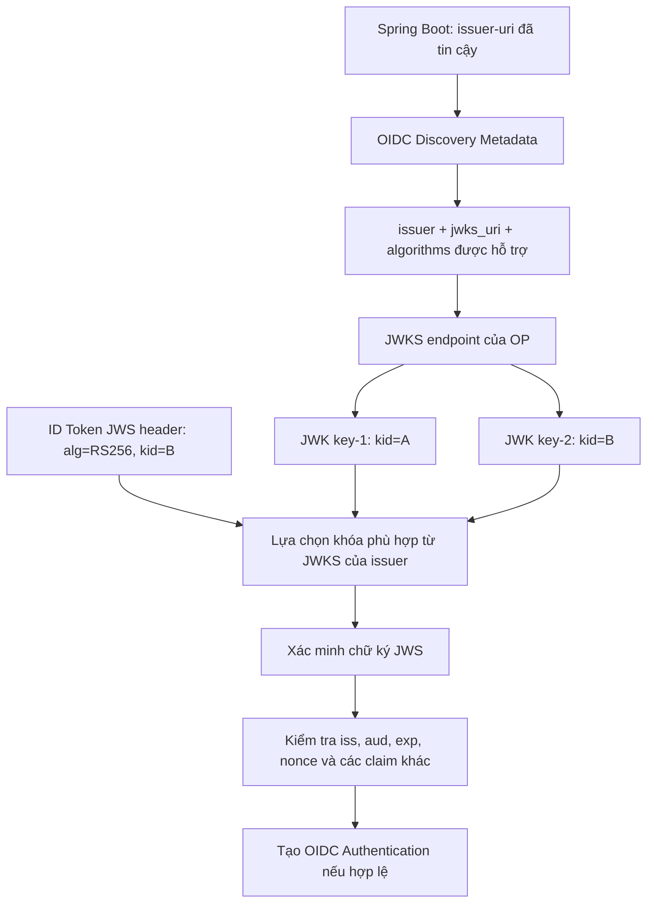

# 11.3. Lấy khóa qua JWKS và lựa chọn khóa bằng `kid`

Trong ứng dụng **Spring Security OAuth 2.0 / OpenID Connect (OIDC) Client**, sau khi backend đổi authorization code tại token endpoint, OpenID Provider (OP) thường trả về một **ID Token** có dạng JWT. Trước khi tạo `OidcUser`, `Authentication` và phiên đăng nhập, client phải xác minh rằng ID Token thực sự được phát hành bởi **OP đáng tin cậy**, dành cho đúng client và chưa vi phạm các điều kiện xác thực.

Một phần trung tâm của việc xác minh chữ ký ID Token là **lấy khóa xác minh công khai từ JWKS** và **chọn khóa phù hợp với trường `kid` trong JWT header**. Khi OP sử dụng nhiều khóa hoặc đang luân chuyển khóa ký, việc này giúp client tìm đúng public key mà không phải hardcode một khóa duy nhất trong ứng dụng.

Tuy nhiên, cần nắm vững một ranh giới bảo mật:

> **`kid` là chỉ dẫn lựa chọn khóa, không phải bằng chứng tin cậy.** Chỉ được chọn khóa từ JWKS của issuer đã cấu hình và phải xác minh chữ ký cũng như những claim OIDC cần thiết.

Bài học giải thích mối quan hệ giữa ID Token, JWS, JWK, JWKS, OIDC Discovery và Spring Security; mô tả thuật toán chọn khóa, cơ chế cache và key rotation, các tình huống `kid` không tìm thấy cùng cách điều tra an toàn.

## 1. ID Token được ký để client kiểm tra điều gì?

OIDC ID Token biểu diễn thông tin về một sự kiện xác thực, được OpenID Provider phát hành cho một **Relying Party / OIDC Client** cụ thể.

Trong trường hợp sử dụng JWS Compact Serialization, ID Token có ba phần phân tách bằng dấu chấm:

```text
BASE64URL(JWS Header).BASE64URL(JWT Claims).BASE64URL(Signature)
```

Ví dụ cấu trúc giả lập:

```text
eyJhbGciOiJSUzI1NiIsImtpZCI6ImtleS0yMDI2LTAxIn0
.
eyJpc3MiOiJodHRwczovL2lkLmV4YW1wbGUub3JnIiwiYXVkIjoib3JkZXJzLXdlYiJ9
.
<signature-base64url>
```

Ba phần thường nằm trên **một dòng** không có khoảng trắng; cách tách dòng trên chỉ để quan sát dễ hơn. Giá trị minh họa không phải ID Token hợp lệ dùng trong hệ thống thực tế.

Hai phần đầu là JSON được mã hóa Base64URL:

- **Header** chứa thông tin về cách ký như `alg` và, thường gặp, `kid`.
- **Payload/claims** chứa `iss`, `sub`, `aud`, `exp`, `iat`, `nonce` và các claim OIDC khác tùy trường hợp.
- **Signature** được tạo bằng khóa ký của issuer trên dữ liệu phù hợp với thuật toán JWS.

**Base64URL chỉ là mã hóa biểu diễn, không phải mã hóa bảo mật.** Bất kỳ ai giữ JWT có thể giải mã header/payload, nhưng chưa được phép **tin nội dung** trước khi xác minh chữ ký và các điều kiện OIDC.

### 1.1. Phân biệt những thuật ngữ thường gặp

| Thuật ngữ | Ý nghĩa | Liên hệ với ID Token |
|---|---|---|
| **JWT** (*JSON Web Token*) | Định dạng chứa claims, có thể được bảo vệ bằng JWS hoặc JWE tùy trường hợp. | ID Token thường là JWT ký theo JWS. |
| **JWS** (*JSON Web Signature*) | Cách bảo vệ tính toàn vẹn và nguồn phát hành bằng chữ ký/MAC. | Header `alg`, signature và quy trình xác minh thuộc JWS. |
| **JWK** (*JSON Web Key*) | Mô tả một khóa mật mã theo định dạng JSON. | Có thể biểu diễn public key dùng để kiểm tra chữ ký. |
| **JWKS / JWK Set** | Một JSON object chứa mảng `keys` gồm nhiều JWK. | OP công bố tập khóa để client lựa chọn khi xác minh token. |
| **`jwks_uri`** | URL được OP công bố trong metadata, trỏ đến JWKS. | Client lấy tập khóa từ nguồn đã tin cậy. |
| **`kid`** (*Key ID*) | Mã định danh khóa được đặt trong JWS header và thường có trong JWK. | Client lọc khóa ứng viên trong JWKS của đúng OP. |
| **`alg`** | Thuật toán JWS, ví dụ `RS256` hoặc `ES256`. | Phải phù hợp chính sách client và loại khóa. |
| **`kty`** | Loại khóa JWK, ví dụ `RSA`, `EC` hoặc `OKP`. | Giúp lọc loại khóa tương thích với thuật toán. |

Một JWKS có nhiều public key không làm mọi token đều hợp lệ. Token chỉ hợp lệ khi **khóa đúng**, **thuật toán được phép**, **chữ ký đúng** và **claims OIDC hợp lệ**.

## 2. JWKS được tìm thấy từ đâu?

Một OIDC Client thường được cấu hình với **issuer URI đáng tin cậy**. Ví dụ:

```text
https://id.example.org/realms/company
```

OpenID Connect Discovery cho phép ứng dụng lấy **provider metadata** tương ứng issuer. Metadata chứa endpoint authorization, token, UserInfo khi có và URL của JWK Set.

Ví dụ phần metadata minh họa:

```json
{
  "issuer": "https://id.example.org/realms/company",
  "authorization_endpoint": "https://id.example.org/realms/company/protocol/openid-connect/auth",
  "token_endpoint": "https://id.example.org/realms/company/protocol/openid-connect/token",
  "jwks_uri": "https://id.example.org/realms/company/protocol/openid-connect/certs",
  "id_token_signing_alg_values_supported": [
    "RS256",
    "PS256"
  ]
}
```

Giá trị metadata và đường dẫn thực tế **phụ thuộc provider**. Đây không phải cấu hình endpoint áp dụng cho mọi OP.

Điều quan trọng:

1. Client chọn và tin cậy **issuer từ cấu hình**, không nhận issuer ngẫu nhiên từ JWT.
2. Client tìm metadata của issuer theo OIDC Discovery hoặc cấu hình provider có kiểm soát.
3. Client kiểm tra metadata thuộc đúng issuer dự kiến.
4. Client lấy `jwks_uri` từ metadata/registration đã được tin cậy.
5. Client dùng JWKS đó để tìm **public key xác minh** ID Token của issuer ấy.

Không được lấy một URL `jwks_uri` tùy ý từ request của người dùng hoặc header không đáng tin cậy rồi sử dụng như nguồn khóa xác minh.

### 2.1. Sơ đồ mối quan hệ giữa issuer, JWKS và ID Token



Đường tin cậy bắt đầu từ **issuer được phép**, đi đến **JWKS của issuer** rồi mới dùng `kid` để chọn khóa. Đảo chiều — tin token/header trước, từ đó chọn issuer/URL tải khóa — là một thiết kế nguy hiểm.

### 2.2. JWKS có được phép công khai không?

JWKS dành cho **xác minh chữ ký bất đối xứng** thường chứa public key. Vì vậy, endpoint JWKS của OP thường có thể được truy cập công khai qua HTTPS; không cần coi public key là secret.

Ví dụ dữ liệu JWK công khai cho RSA thường gồm `n` (modulus) và `e` (exponent). Đó **không phải private key**. Một JWKS dùng để xác minh chữ ký của OP không được vô tình lộ các thành phần khóa riêng như `d` hoặc những tham số private-key khác.

Chữ ký được OP tạo bằng private key, còn client dùng public key tương ứng để xác minh. Nếu khóa ký bị lộ, cần quy trình rotation/revocation; việc endpoint JWKS công khai **không phải** lộ private key.

## 3. Một JWKS trông như thế nào?

Ví dụ phản hồi JSON **minh họa, không phải giá trị khóa RSA có thể dùng để xác minh thật**:

```json
{
  "keys": [
    {
      "kty": "RSA",
      "use": "sig",
      "kid": "company-2026-key-a",
      "alg": "RS256",
      "n": "<base64url-rsa-modulus-a>",
      "e": "AQAB"
    },
    {
      "kty": "RSA",
      "use": "sig",
      "kid": "company-2026-key-b",
      "alg": "RS256",
      "n": "<base64url-rsa-modulus-b>",
      "e": "AQAB"
    }
  ]
}
```

Đây là **JWK Set** vì có mảng `keys`. Mỗi phần tử là **một JWK**. Trong hệ thống thật, `n` chứa modulus được mã hóa Base64URL hợp lệ; chuỗi dấu ngoặc góc chỉ là placeholder giải thích.

| Thuộc tính trong JWK | Ý nghĩa |
|---|---|
| `kid` | Định danh khóa trong tập khóa của issuer; hỗ trợ chọn khóa. |
| `kty` | Loại khóa như `RSA`, `EC` hoặc `OKP`. |
| `use` | Mục đích sử dụng; `sig` thường chỉ khóa ký/xác minh chữ ký. |
| `key_ops` | Tập thao tác được phép, ví dụ `verify`, nếu được cung cấp. |
| `alg` | Thuật toán dự kiến của khóa, nếu provider công bố. |
| `n`, `e` | Các thành phần public key RSA. |
| `crv`, `x`, `y` | Các thành phần khóa đường cong elliptic cho JWK loại `EC`. |
| `x5c` / `x5t` / `x5t#S256` | Thông tin chứng chỉ/thumbprint có thể được công bố, tùy cơ chế provider. |

Không phải JWK nào cũng có đầy đủ `use`, `alg` hoặc `key_ops`. Khi thuộc tính tùy chọn không xuất hiện, validator phải áp dụng chính sách thuật toán/loại khóa đã cấu hình và các kiểm tra cần thiết; không mặc định rằng thiếu `alg` đồng nghĩa khóa được phép dùng với **mọi** thuật toán.

### 3.1. JWK dành cho RSA và EC khác nhau

Khóa RSA được mô tả bằng `kty=RSA`, `n` và `e`. Khóa EC thường được mô tả bằng `kty=EC`, `crv`, `x` và `y`. Chẳng hạn, thuật toán `RS256` cần khóa RSA phù hợp; `ES256` cần khóa EC với curve phù hợp.

Một ví dụ JWK EC rút gọn:

```json
{
  "kty": "EC",
  "kid": "company-ec-key-1",
  "use": "sig",
  "alg": "ES256",
  "crv": "P-256",
  "x": "<base64url-public-x>",
  "y": "<base64url-public-y>"
}
```

Không chọn khóa chỉ vì cùng `kid` trong khi `kty` hoặc curve không tương thích với thuật toán được phép. Loại khóa và chính sách thuật toán là các điều kiện **bổ sung** cho việc đối chiếu `kid`.

## 4. `kid` trong ID Token: biết khóa nào đã được dùng để ký

Một JWS header điển hình:

```json
{
  "typ": "JWT",
  "alg": "RS256",
  "kid": "company-2026-key-b"
}
```

Khi nhận ID Token, client cần hiểu:

- `alg=RS256`: token tuyên bố dùng thuật toán JWS RS256.
- `kid=company-2026-key-b`: token chỉ ra định danh khóa ký tương ứng.
- `typ=JWT`: thông tin về kiểu token nếu được công bố; không tự làm token đáng tin.

`kid` nằm trong **header của token chưa được xác minh**. Kẻ tấn công có thể tạo JWT tùy ý với `kid` bất kỳ. Vì thế `kid` chỉ được dùng làm **gợi ý tra cứu trong tập khóa có nguồn tin cậy**, không phải quyền cho phép lấy khóa từ một endpoint khác.

### 4.1. `kid` có toàn cục duy nhất không?

Không. `kid` là định danh khóa trong ngữ cảnh một JWK Set hoặc issuer/provider tương ứng. Hai OP khác nhau có thể dùng cùng một `kid`, ví dụ:

```text
Issuer A -> JWKS A -> kid=key-1
Issuer B -> JWKS B -> kid=key-1
```

Điều này **không làm khóa của A và B tương đương**. Khi ứng dụng có nhiều OIDC client registrations, phải giữ việc chọn khóa trong phạm vi **provider/issuer đã được lựa chọn và tin cậy cho authorization request**. Không xây một kho khóa toàn cục rồi tìm theo `kid` đơn lẻ.

Trong cùng JWKS, provider nên đặt `kid` đủ rõ để phân biệt các khóa có thể được dùng cùng lúc. Nếu nhiều khóa cùng `kid` và cùng đặc điểm chọn khóa khiến không thể xác định khóa nhất quán, client cần xử lý an toàn theo thư viện/chính sách, không chọn tùy tiện một khóa vì nó đứng đầu mảng.

### 4.2. `kid` có bắt buộc phải có trong mọi ID Token không?

Không nên giả định mọi JWS bắt buộc có `kid`. Trên thực tế, `kid` rất hữu ích khi issuer có nhiều khóa hoặc xoay vòng khóa, nên được sử dụng rộng rãi. Một số tình huống có thể xác minh bằng một khóa duy nhất phù hợp dù header không có `kid`, tùy profile, thuật toán và cách thư viện chọn khóa.

Với hệ thống thực tế, hành vi khi **không có `kid`** nên được xác định rõ:

- Có đúng một khóa phù hợp về issuer, thuật toán, loại khóa và mục đích sử dụng hay không?
- Thư viện Spring Security/JWT decoder có hỗ trợ lựa chọn trường hợp đó không?
- Chính sách bảo mật nội bộ có yêu cầu `kid` hay không?

Nếu không tìm được một khóa ứng viên hợp lệ theo chính sách, phải từ chối token. Không tự dùng «khóa đầu tiên» hoặc bỏ kiểm tra chữ ký.

## 5. Quy trình chọn khóa theo `kid` và xác minh chữ ký

Có thể mô tả thuật toán về mặt khái niệm như sau:

```text
trustedRegistration = registration được liên kết với OIDC login
expectedIssuer = trustedRegistration.provider.issuer
trustedJwksUri = trustedRegistration.provider.jwksUri

header = parseJwsHeader(idToken)            # chưa tin nội dung
alg = header.alg
kid = header.kid

require alg nằm trong danh sách thuật toán được cho phép
jwks = loadOrUseCachedJwks(trustedJwksUri)

candidates = jwks.keys
    .filter(k => kid phù hợp khi header có kid)
    .filter(k => kty và curve phù hợp với alg)
    .filter(k => use/key_ops/alg của JWK không mâu thuẫn)
    .filter(k => thỏa chính sách khóa của issuer)

require có ít nhất một ứng viên hợp lệ theo chính sách
require JWS signature verify thành công với khóa phù hợp

claims = parseVerifiedClaims(idToken)
require iss, aud, thời gian, nonce và các điều kiện OIDC hợp lệ

return verifiedOidcIdentity
```

Đây là **pseudo-code giải thích ranh giới kiểm tra**, không phải đoạn Java để tự triển khai xác minh ID Token. Trong sản phẩm, nên dùng thư viện chuẩn của Spring Security/Nimbus thay vì tự viết bộ chọn khóa và xử lý JWS.

### 5.1. Thứ tự kiểm tra có ý nghĩa bảo mật

1. **Xác định OP tin cậy** từ cấu hình client registration và luồng login đang xử lý.
2. **Chỉ lấy JWKS của OP đó** từ cấu hình/discovery đã được tin cậy.
3. Đọc `alg` và `kid` như **dữ liệu chưa tin cậy** để lọc khóa ứng viên.
4. Chỉ chấp nhận thuật toán ký mà ứng dụng/provider đã thỏa thuận.
5. Chọn JWK tương thích về `kid`, `kty`, curve và mục đích sử dụng.
6. **Xác minh chữ ký** bằng public key tương ứng.
7. Xác minh **claims OIDC** như `iss`, `aud`, `exp`, `nonce` và những yêu cầu bổ sung của flow.
8. Chỉ sau đó mới xây dựng principal và `Authentication` cho phiên ứng dụng.

Phải tránh hai kiểu sai lầm:

- **Chọn khóa đúng nhưng bỏ qua chữ ký:** token giả vẫn có thể được chấp nhận vì `kid` chỉ là chuỗi văn bản.
- **Chữ ký đúng nhưng bỏ qua claim:** một token được issuer ký có thể không dành cho client đang xử lý, đã hết hạn hoặc không liên kết với authorization request.

### 5.2. Vì sao không tin `alg` từ JWT một cách mù quáng?

Một JWT header có thể do kẻ tấn công tạo. Nếu validator cho phép header tự quyết định cách kiểm tra, ứng dụng có thể gặp lỗi **algorithm confusion**, ví dụ:

- Chấp nhận `alg=none` như token không cần chữ ký trong một flow yêu cầu signed ID Token.
- Chuyển từ xác minh RSA sang HMAC chỉ vì token khai báo `HS256` mà không có chính sách phù hợp.
- Dùng public key RSA như một shared secret cho HMAC do triển khai sai.
- Chấp nhận một thuật toán yếu hoặc không được OP/client registration cho phép.

Cách đúng: **ứng dụng có chính sách thuật toán được phép** dựa trên OIDC client/provider configuration, kiểm tra tính tương thích của header với chính sách, rồi mới xác minh bằng đúng loại khóa.

Spring Security có cơ chế giải mã/xác minh ID Token theo client registration. Với một số cấu hình chuẩn, thuật toán chữ ký được hỗ trợ mặc định có thể là `RS256`; nếu OP dùng thuật toán khác, phải cấu hình hỗ trợ theo API của **phiên bản Spring Security đang sử dụng**, không tùy ý mở cho mọi thuật toán dựa trên header token.

### 5.3. Tại sao phải kiểm tra `use`, `key_ops` và `kty`?

JWKS có thể chứa khóa phục vụ mục đích khác nhau. Một JWK có `use=enc` thường được dành cho mã hóa, không phải xác minh chữ ký. Nếu có `key_ops`, thao tác `verify` cần phù hợp. Một JWK loại RSA không thể được dùng như khóa EC.

`kid` giúp thu hẹp tập khóa nhưng **không bỏ qua các thuộc tính khác**. Nếu khóa cùng `kid` nhưng không tương thích thuật toán/chính sách, kết quả hợp lý là không có khóa phù hợp hoặc chữ ký không hợp lệ; không chuyển sang khóa không liên quan để cố làm token pass.

## 6. Lấy JWKS qua HTTP: nguồn tin cậy, TLS và cache

Ví dụ OP công bố:

```text
jwks_uri = https://id.example.org/realms/company/protocol/openid-connect/certs
```

Client có thể gửi request HTTP(S) qua thư viện giải mã:

```http
GET /realms/company/protocol/openid-connect/certs HTTP/1.1
Host: id.example.org
Accept: application/json
```

Phản hồi minh họa:

```http
HTTP/1.1 200 OK
Content-Type: application/json
Cache-Control: public, max-age=300

{"keys":[{"kty":"RSA","kid":"company-2026-key-b","use":"sig","n":"...","e":"AQAB"}]}
```

Những giá trị `n` rút gọn trong ví dụ không phải khóa thực. Thời gian `max-age=300` chỉ là ví dụ, không có nghĩa mọi JWKS endpoint đều có TTL 300 giây.

### 6.1. Vì sao cache JWKS là cần thiết?

Nếu mỗi lần nhận ID Token đều tải JWKS từ OP, ứng dụng:

- Tăng độ trễ đăng nhập.
- Phụ thuộc nhiều hơn vào mạng và tình trạng của JWKS endpoint.
- Tạo tải không cần thiết cho OP.
- Dễ gặp hiệu ứng dồn request khi nhiều người đăng nhập đồng thời.

Thư viện JWT/JWK client thường có cơ chế **cache khóa và nạp lại** theo chính sách. Cần hiểu chính sách này khi triển khai production, nhất là thời điểm OP xoay khóa.

Không nên tự đặt logic «mỗi token lại fetch URL mới» hoặc bỏ cache hoàn toàn chỉ vì muốn xử lý key rotation nhanh. Cũng không nên cache vĩnh viễn mà không có khả năng cập nhật.

### 6.2. Các yêu cầu với HTTP client truy cập JWKS

- Lấy khóa qua **HTTPS** với kiểm tra chứng chỉ server phù hợp.
- Chỉ truy cập `jwks_uri` lấy từ **issuer/configuration đáng tin cậy**.
- Đặt timeout, giới hạn kích thước response và chính sách retry phù hợp.
- Không theo các redirect không kiểm soát sang endpoint khác chỉ vì remote server yêu cầu.
- Bảo vệ DNS, proxy, egress và các chính sách mạng để giảm rủi ro SSRF.
- Kiểm soát cache, nạp lại khóa và khả năng phục hồi khi JWKS endpoint tạm thời lỗi.

Một JWT có thể chứa các header tham chiếu khóa như `jku` hoặc `x5u`. **Không tự theo URL trong token chưa xác minh** để tải JWKS hoặc certificate. Nếu ứng dụng tùy biến decoder, phải bảo đảm nguồn khóa vẫn bị ràng buộc với OP đã đăng ký; đây là một trong những cách phòng tránh token giả và SSRF.

### 6.3. Nếu JWKS endpoint tạm thời không truy cập được?

Ứng dụng có thể gặp một trong hai trạng thái:

- **Khóa cần thiết đã có trong cache còn được phép dùng:** việc xác minh token có thể tiếp tục tùy chính sách của thư viện và độ tươi của cache.
- **Chưa có khóa hoặc cần nạp khóa mới:** việc xác minh ID Token phải thất bại an toàn; không được bỏ xác minh chữ ký chỉ vì JWKS tạm thời lỗi.

Cần theo dõi lỗi mạng, TLS, timeout, HTTP 404/5xx và cache refresh riêng với lỗi `kid` không tìm thấy. Một lỗi «không thể lấy khóa» không chứng minh ID Token giả, nhưng **không có bằng chứng xác minh** thì cũng không thể coi token là hợp lệ.

## 7. Key rotation: vì sao một issuer có nhiều `kid`?

OP cần xoay vòng khóa ký để đáp ứng chính sách bảo mật, luân chuyển theo định kỳ hoặc thay thế khóa khi có sự cố. Trong giai đoạn chuyển tiếp, OP có thể công bố **cả khóa cũ và khóa mới** trong JWKS.

Ví dụ diễn biến:

```text
Ngày A:
  OP ký ID Token bằng key-old
  JWKS công bố: key-old

Ngày B (chuẩn bị xoay khóa):
  OP tiếp tục ký bằng key-old
  JWKS công bố: key-old, key-new

Ngày C (bắt đầu dùng khóa mới):
  OP ký ID Token mới bằng key-new
  JWKS công bố: key-old, key-new

Ngày D (sau thời gian chuyển tiếp phù hợp):
  OP ngừng dùng và có thể gỡ key-old
  JWKS công bố: key-new
```

Bước công bố khóa mới **trước khi bắt đầu ký** giúp các client đang cache JWKS có cơ hội nhận khóa mới. Giữ khóa cũ trong một thời gian thích hợp giúp xác minh những token cũ vẫn còn hiệu lực theo chính sách; thời gian giữ phụ thuộc thời hạn token, cache và yêu cầu vận hành.

### 7.1. Điều gì xảy ra khi gặp `kid` mới?

Giả sử ID Token mới có:

```json
{
  "alg": "RS256",
  "kid": "key-new"
}
```

Nhưng cache tại client chỉ có `key-old`. Một thư viện JWK/JWT decoder có thể **nạp lại JWKS** theo cơ chế cache/refresh để tìm khóa mới, sau đó thử xác minh chữ ký.

Hành vi cụ thể phụ thuộc thư viện, phiên bản và cấu hình. Điều nên thiết kế:

1. Kiểm tra JWKS cache hiện tại.
2. Nếu không có khóa phù hợp và chính sách cho phép, thử refresh từ **cùng JWKS URI đã tin cậy**, với giới hạn tần suất.
3. Chọn khóa tương thích từ tập mới.
4. Xác minh chữ ký; nếu vẫn không có khóa hợp lệ thì từ chối token.

**Không nên** fetch JWKS không giới hạn mỗi lần gặp `kid` ngẫu nhiên. Kẻ tấn công có thể gửi nhiều token giả với `kid` mới để tạo tải hoặc gây denial of service.

### 7.2. Chữ ký sai dù `kid` tồn tại

Một token có `kid=key-new` và JWKS đã chứa `key-new` nhưng chữ ký không hợp lệ **không tự động là lỗi rotation**. Có thể token bị sửa, provider xuất bản sai khóa, thuật toán không khớp hoặc có bug trong quá trình ký.

Không thử tất cả các public key từ mọi provider hoặc bỏ chữ ký khi khóa phù hợp đã tìm thấy nhưng xác minh thất bại. Cần kiểm tra chữ ký theo chính sách rồi **fail closed**.

### 7.3. Có nên pin một public key cố định không?

Pin khóa cố định có thể là một chính sách đặc biệt trong môi trường kiểm soát chặt, nhưng nếu OP thực hiện key rotation, việc hardcode một public key duy nhất trong source có thể làm login ngừng hoạt động khi OP đổi khóa.

Với OIDC Client thông thường, cấu hình **issuer đáng tin cậy + discovery/JWKS URI** và cơ chế refresh khóa của thư viện giúp thích nghi tốt hơn. Nếu tổ chức buộc phải pin khóa, cần vận hành chặt quy trình cập nhật, chuyển tiếp và sự cố; không coi pinning là thay thế cho issuer/audience/time/nonce validation.

## 8. Spring Boot cấu hình JWKS cho OIDC Login như thế nào?

### 8.1. Dependency

Ví dụ Gradle dùng Spring Boot Servlet:

```gradle
dependencies {
    implementation("org.springframework.boot:spring-boot-starter-web")
    implementation("org.springframework.boot:spring-boot-starter-security")
    implementation("org.springframework.boot:spring-boot-starter-oauth2-client")
}
```

Starter OAuth2 Client tích hợp các thành phần OAuth2/OIDC Client cần thiết cho login. Chỉ để xác minh ID Token trong flow `oauth2Login()`, không cần bật Resource Server nếu ứng dụng không có API nhận bearer token.

### 8.2. Ưu tiên cấu hình `issuer-uri`

```yaml
spring:
  security:
    oauth2:
      client:
        registration:
          company:
            provider: company-oidc
            client-id: ${OIDC_CLIENT_ID}
            client-secret: ${OIDC_CLIENT_SECRET}
            authorization-grant-type: authorization_code
            client-authentication-method: client_secret_basic
            redirect-uri: "{baseUrl}/login/oauth2/code/{registrationId}"
            scope:
              - openid
              - profile
              - email
        provider:
          company-oidc:
            issuer-uri: https://id.example.org/realms/company
```

Trong ví dụ:

- `company` là registration ID dùng ở `/oauth2/authorization/company`.
- `company-oidc` là alias cấu hình provider.
- `issuer-uri` là issuer OIDC được ứng dụng tin cậy; Spring Security/Boot có thể sử dụng OIDC Discovery để tìm metadata và `jwks_uri`.
- `client-id` tương ứng với audience dự kiến của ID Token.
- `scope` chứa `openid` để đây là OIDC login chứ không phải OAuth2 login thuần.
- `client-secret` chỉ tồn tại ở backend nếu dùng confidential client; không đưa vào frontend hoặc commit Git.

Với provider có discovery chính xác, thường **không cần tự lấy JWKS bằng `RestClient` hoặc tự cấu hình một public key** cho OIDC login. Spring Security xử lý ID Token validation qua các thành phần OIDC liên quan.

### 8.3. Các lớp liên quan bên trong Spring Security

Trong Servlet OAuth2 Login với scope `openid`, các thành phần liên quan gồm:

| Thành phần | Vai trò |
|---|---|
| `ClientRegistration` / `ClientRegistrationRepository` | Giữ thông tin client và provider, gồm issuer và JWK Set URI khi được cấu hình. |
| `OAuth2LoginAuthenticationFilter` | Nhận authorization code callback để hoàn tất login. |
| `OidcAuthorizationCodeAuthenticationProvider` | Xử lý xác thực OIDC Authorization Code, gồm xác minh ID Token qua decoder phù hợp. |
| `OidcIdTokenDecoderFactory` | Tạo/cấu hình decoder ID Token dựa theo client registration trong các cách triển khai Spring Security tương ứng. |
| `NimbusJwtDecoder` và các thành phần JOSE/JWK của thư viện | Thực hiện parse, chọn khóa/xác minh chữ ký và các thao tác JWT phù hợp với cấu hình. |
| `OidcUser` / `OidcIdToken` | Biểu diễn danh tính OIDC và ID Token đã được xử lý trong authentication. |

Tên lớp và cách kết nối có thể thay đổi theo phiên bản Spring Security; nên dựa vào API tương ứng phiên bản dự án khi cần tùy biến. **Ứng dụng nghiệp vụ không cần tự giải mã header, tải JWK và gọi thuật toán RSA thủ công chỉ để thực hiện OIDC login tiêu chuẩn.**

### 8.4. Cấu hình JWKS URI thủ công khi provider không có Discovery

Đối với provider mà metadata discovery không có sẵn hoặc cần khai báo endpoint tường minh theo hợp đồng tích hợp, Spring Boot có các property dưới `spring.security.oauth2.client.provider.<id>`, ví dụ:

```yaml
spring:
  security:
    oauth2:
      client:
        registration:
          company:
            provider: manual-oidc
            client-id: ${OIDC_CLIENT_ID}
            client-secret: ${OIDC_CLIENT_SECRET}
            authorization-grant-type: authorization_code
            redirect-uri: "{baseUrl}/login/oauth2/code/{registrationId}"
            scope: [openid, profile]
        provider:
          manual-oidc:
            issuer-uri: https://id.example.org
            authorization-uri: https://id.example.org/oauth2/authorize
            token-uri: https://id.example.org/oauth2/token
            jwk-set-uri: https://id.example.org/oauth2/keys
```

**Ví dụ này chỉ minh họa vị trí property.** Trong một số phiên bản/configuration, khi khai báo `issuer-uri` Spring Boot sẽ tiến hành discovery và có thể yêu cầu metadata hợp lệ. Nếu mục tiêu là **không sử dụng discovery**, cần cấu hình provider bằng các endpoint tường minh và các thông số OIDC cần thiết theo API/phiên bản Spring Security, bảo đảm vẫn kiểm tra issuer đúng cách. Không coi tổ hợp YAML giả định là thay thế trọn vẹn mọi metadata.

Điều cần ghi nhớ là:

- `spring.security.oauth2.client.provider.<id>.jwk-set-uri` là **thuộc tính provider**.
- Nó không thuộc `registration.<id>.jwk-set-uri`.
- JWKS URI phải là URL được xác minh/cho phép từ tài liệu và cấu hình OP đáng tin cậy.
- Chỉ chỉ định JWKS URI không thay các kiểm tra `iss`, `aud` và thời gian.
- Không lấy URI từ JWT header khi token chưa được xác minh.

Với OIDC provider hỗ trợ chuẩn discovery, cấu hình issuer là lựa chọn thông dụng, ít lỗi và dễ thích nghi với key rotation hơn.

### 8.5. Bật `oauth2Login()`

```java
import org.springframework.context.annotation.Bean;
import org.springframework.context.annotation.Configuration;
import org.springframework.security.config.Customizer;
import org.springframework.security.config.annotation.web.builders.HttpSecurity;
import org.springframework.security.web.SecurityFilterChain;

@Configuration
public class SecurityConfiguration {

    @Bean
    SecurityFilterChain securityFilterChain(HttpSecurity http)
            throws Exception {
        http
            .authorizeHttpRequests(authorize -> authorize
                .requestMatchers("/", "/public/**").permitAll()
                .anyRequest().authenticated()
            )
            .oauth2Login(Customizer.withDefaults());

        return http.build();
    }
}
```

Sau khi người dùng đăng nhập tại OP, Spring Security nhận callback, đổi code tại token endpoint và xác minh kết quả OIDC. Nếu ID Token có chữ ký không hợp lệ hoặc không thỏa điều kiện xác thực, login phải thất bại; framework không tạo `Authentication` thành công cho token ấy.

Để đọc principal đã được xác thực trong controller:

```java
import java.util.Map;

import org.springframework.security.core.annotation.AuthenticationPrincipal;
import org.springframework.security.oauth2.core.oidc.user.OidcUser;
import org.springframework.web.bind.annotation.GetMapping;
import org.springframework.web.bind.annotation.RestController;

@RestController
public class CurrentUserController {

    @GetMapping("/me")
    public Map<String, String> me(@AuthenticationPrincipal OidcUser user) {
        return Map.of(
            "issuer", user.getIdToken().getIssuer().toString(),
            "subject", user.getSubject()
        );
    }
}
```

Controller này không thực hiện key selection và không tự xác minh chữ ký. Nó dùng principal đã được bộ lọc/login provider xác thực trước đó. Đừng xử lý ID Token chưa xác minh trong controller rồi coi payload là dữ liệu người dùng tin cậy.

## 9. Vì sao kiểm tra JWKS và `kid` chưa đủ để chấp nhận ID Token?

Giả sử ID Token có chữ ký RS256 được xác minh bằng public key từ JWKS. Điều đó chứng minh token có **chữ ký phù hợp với khóa**. Client vẫn cần kiểm tra token đúng mục đích và đúng ngữ cảnh OIDC.

| Điều kiện | Ý nghĩa |
|---|---|
| **`iss`** | Phải bằng issuer được cấu hình tin cậy của client registration. |
| **`aud`** | Phải chứa `client_id` của OIDC Client nhận token; xét `azp` khi OIDC yêu cầu. |
| **`exp`** | Token chưa hết hạn tại thời điểm xác minh, với giới hạn clock skew hợp lý khi áp dụng. |
| **`iat`** | Thời điểm phát hành cần được xử lý theo quy tắc OIDC và chính sách ứng dụng. |
| **`nonce`** | Nếu authorization request đã gửi nonce, ID Token phải ràng buộc với giá trị ấy. |
| **`auth_time`, `acr`, `amr`** | Kiểm tra khi có yêu cầu xác thực lại hoặc chính sách mức xác thực. |
| **`sub`** | Định danh người dùng trong phạm vi issuer; thường dùng cặp `(iss, sub)` làm định danh liên kết nội bộ. |

Ví dụ:

```json
{
  "iss": "https://id.example.org/realms/company",
  "sub": "person-2841",
  "aud": "orders-web",
  "iat": 1760000000,
  "exp": 1760000300,
  "nonce": "nonce-from-original-request"
}
```

Các thời gian trong ví dụ chỉ minh họa cấu trúc, không phản ánh thời gian hiện tại.

Ngay cả khi chữ ký hợp lệ, một ID Token có `aud` là client khác hoặc `iss` là provider khác **không được dùng để đăng nhập** vào client hiện tại. Đây là lý do lựa chọn public key phải gắn với **đúng issuer/registration**, không dùng chung JWKS toàn hệ thống.

### 9.1. `nonce` khác `kid`

- `kid`: giúp xác định **khóa ký** nào có thể dùng để xác minh JWS.
- `nonce`: giúp xác định **ID Token** có liên kết với authorization request OIDC hiện tại không khi nonce được sử dụng.

Một ID Token có `kid` đúng và chữ ký hợp lệ nhưng `nonce` sai vẫn có thể bị từ chối. Tương tự, nonce đúng không cứu được chữ ký sai.

### 9.2. `state` và PKCE diễn ra ở giai đoạn khác

`state` ràng buộc authorization response/callback với yêu cầu mà browser đã khởi tạo. PKCE ràng buộc authorization code exchange với `code_verifier`. Chữ ký ID Token/JWKS xác minh tính xác thực token được OP phát hành.

Ba bước đó diễn ra ở những vị trí khác nhau trong flow và đều có thể cần thiết; không được bỏ một bước chỉ vì hai bước còn lại thành công.

## 10. Lựa chọn khóa trong ứng dụng có nhiều provider

Ví dụ ứng dụng cho nhân viên và đối tác đăng nhập qua hai issuer:

```yaml
spring:
  security:
    oauth2:
      client:
        registration:
          employee:
            provider: employee-idp
            client-id: ${EMPLOYEE_CLIENT_ID}
            client-secret: ${EMPLOYEE_CLIENT_SECRET}
            authorization-grant-type: authorization_code
            redirect-uri: "{baseUrl}/login/oauth2/code/{registrationId}"
            scope: [openid, profile]
          partner:
            provider: partner-idp
            client-id: ${PARTNER_CLIENT_ID}
            client-secret: ${PARTNER_CLIENT_SECRET}
            authorization-grant-type: authorization_code
            redirect-uri: "{baseUrl}/login/oauth2/code/{registrationId}"
            scope: [openid, profile]
        provider:
          employee-idp:
            issuer-uri: https://employees.example.org
          partner-idp:
            issuer-uri: https://partners.example.org
```

Nếu cả hai OP có một JWK mang `kid=active-key`, client vẫn phải chọn đúng khóa:

```text
Registration employee
  -> Issuer https://employees.example.org
  -> JWKS employees
  -> kid active-key ở JWKS employees

Registration partner
  -> Issuer https://partners.example.org
  -> JWKS partners
  -> kid active-key ở JWKS partners
```

Không làm:

```text
Bất kỳ ID Token -> lấy kid -> tìm trong mọi JWKS -> thử tới khi chữ ký pass
```

Cách đó có thể tạo lỗ hổng **issuer confusion/mix-up** nếu không giữ ranh giới provider. Đúng hơn, khi một authorization request bắt đầu, ứng dụng đã biết registration/provider được dùng. Token response được xử lý trong ngữ cảnh ấy; JWKS và các kiểm tra issuer/audience phải khớp với ngữ cảnh đó.

### 10.1. Khi hai client registration dùng cùng issuer

Một issuer có thể cấp token cho nhiều client IDs khác nhau. Khi đó chúng có thể dùng **chung JWKS** nhưng khác `aud`. Việc chữ ký hợp lệ với public key chung của issuer **không chứng minh token dành cho client A cũng hợp lệ với client B**. Vẫn phải kiểm tra audience/client ID của registration đang xử lý.

### 10.2. `kid` có thể thay đổi mà `sub` không đổi

Khóa ký có thể được xoay vòng, `kid` trong token mới sẽ thay đổi. Điều đó **không làm người dùng đổi danh tính**. Định danh OIDC thường dựa trên issuer và subject, không dựa trên `kid` hoặc public key của OP. Không lưu `kid` như ID người dùng.

## 11. Những tình huống lỗi JWKS và `kid` thường gặp

| Biểu hiện | Khả năng nguyên nhân | Hướng kiểm tra |
|---|---|---|
| Không tải được JWKS. | Sai `jwks_uri`, DNS/TLS/firewall, 404/5xx, proxy hoặc metadata không đúng. | Kiểm tra issuer/discovery, TLS, kết nối từ backend tới endpoint OP. |
| JWT header có `kid` nhưng JWKS không có khóa khớp. | OP mới rotation, cache cũ, client dùng sai issuer hoặc token giả. | Đối chiếu JWKS của **đúng issuer**, cache/refresh và key publication. |
| `kid` khớp nhưng chữ ký sai. | Token bị sửa, public key không đúng, provider ký bằng khóa khác hoặc thuật toán không phù hợp. | Xác minh khóa thực, `alg`, `kty` và cơ chế signing; không bỏ qua signature. |
| Header `alg=ES256` nhưng JWKS chỉ có RSA. | Thuật toán và loại khóa không tương thích hoặc cấu hình provider sai. | Xem signing algorithm được phép và JWK loại `EC` tương ứng. |
| Header không có `kid`. | OP không cung cấp ID khóa; cách lựa chọn phụ thuộc policy/thư viện. | Kiểm tra số khóa có thể dùng, policy của decoder và yêu cầu OP. |
| Cùng `kid` xuất hiện nhiều lần với khóa khác nhau. | JWKS được công bố không nhất quán hoặc key selection mơ hồ. | Kiểm tra provider/key rotation; không chọn ngẫu nhiên khóa đầu tiên. |
| Chỉ lỗi lúc OP xoay khóa. | Cache stale, JWKS mới chưa public, khóa cũ bị gỡ quá sớm. | Phối hợp kế hoạch rotation, TTL và refresh logic. |
| Chỉ một node production lỗi. | Node cache khóa cũ, egress khác nhau, TLS trust store khác nhau. | So sánh cấu hình provider, cache/reload, proxy và mạng theo node. |
| JWKS có khóa đúng nhưng ID Token bị từ chối. | `iss`, `aud`, `exp`, `nonce` hoặc claim OIDC khác sai. | Phân biệt signature validation với claims validation. |
| OAuth2 Login thành công nhưng API trả 401. | Access Token sai audience/scope hoặc API xác minh token khác. | Kiểm tra Resource Server, không nhầm ID Token/JWKS của login với bearer token API. |
| Đăng nhập lỗi vì thuật toán HMAC. | Provider dùng `HS256` nhưng client chỉ cấu hình giải mã bất đối xứng. | Kiểm tra OIDC provider metadata, client registration, secret và hỗ trợ thuật toán; không cố dùng RSA JWKS cho HMAC. |

### 11.1. Unknown `kid` sau key rotation

Tình huống:

```text
Cache ở Spring Boot: kid=old-key
ID Token mới:         kid=new-key
JWKS hiện tại ở OP:   old-key, new-key
```

Một decoder có cơ chế refresh phù hợp có thể cập nhật JWKS và xác minh token mới. Nếu refresh không xảy ra hoặc endpoint JWKS cũ, login bị từ chối.

Hướng xử lý đúng là kiểm tra cache/refresh và việc OP đã công bố khóa mới hay chưa. Không đổi cấu hình để bỏ qua `kid` hoặc chữ ký.

### 11.2. OP rút khóa cũ quá sớm

Nếu OP xóa public key cũ ngay khi chuyển sang ký bằng khóa mới, một ID Token còn hiệu lực được ký bằng khóa cũ có thể không còn xác minh được với JWKS vừa tải lại.

Vận hành rotation cần xem thời hạn ID Token, chính sách cache và khoảng chuyển tiếp phù hợp. Trong trường hợp khóa cũ bị lộ và phải loại ngay vì sự cố, việc token cũ không còn xác minh được có thể là hậu quả chấp nhận được của chính sách thu hồi; ứng dụng vẫn phải fail closed.

### 11.3. Khóa có `use=enc` bị dùng để xác minh chữ ký

Ví dụ JWKS có:

```json
{
  "kid": "encryption-only",
  "kty": "RSA",
  "use": "enc",
  "n": "<modulus>",
  "e": "AQAB"
}
```

Dù `kid` trùng với header token, mục đích khóa là **encryption**, không phải signature verification. Một bộ chọn khóa đúng không nên xem nó là khóa ký hợp lệ chỉ vì cùng `kid`.

### 11.4. Chữ ký được xác minh bằng khóa OP khác

Một ứng dụng hỗ trợ nhiều IdP có thể vô tình gom các public key vào cùng cache theo `kid`. Nếu token của OP B được xử lý như token của OP A chỉ vì hai bên đặt cùng `kid`, hệ thống có nguy cơ tin sai issuer.

Cần phân vùng cache/decoder theo **issuer và client registration**; sau khi xác minh chữ ký vẫn kiểm tra `iss` và `aud` đúng giá trị kỳ vọng.

### 11.5. Lỗi mạng không giống lỗi chữ ký

Không kết nối được đến `jwks_uri` là vấn đề **key retrieval**. Tải JWKS thành công nhưng không tìm thấy khóa là vấn đề **key selection**. Tìm thấy khóa nhưng verify thất bại là vấn đề **signature validation**. Chữ ký thành công nhưng `exp` hoặc `nonce` sai là vấn đề **claims validation**.

Bốn giai đoạn này cần có thông báo/metric khác nhau để hỗ trợ điều tra mà không tiết lộ token.

## 12. Trường hợp ID Token dùng thuật toán đối xứng

Không phải mọi ID Token đều sử dụng chữ ký bất đối xứng `RS256`. OIDC cũng có những trường hợp thuật toán dựa trên shared secret như `HS256`, tùy client registration và chính sách OP.

Khi ID Token dùng **HMAC**, client xác minh MAC bằng secret thích hợp theo quy tắc OIDC và cấu hình thư viện. **Không dùng public JWKS RSA để xác minh HMAC**. Điều này càng làm rõ rằng xác minh ID Token phải dựa vào **thuật toán đã thỏa thuận và cấu hình tin cậy**, không chỉ dựa vào `kid`.

Một số điểm cần nhớ:

- Khi dùng thuật toán bất đối xứng, OP ký bằng private key và công bố public key qua JWKS.
- Khi dùng thuật toán đối xứng, việc xác minh dựa vào shared secret phù hợp; public-key JWKS không phải nguồn khóa cho HMAC.
- Không cho JWT header tự quyết định chuyển giữa RSA và HMAC mà không có chính sách.
- Không đặt client secret trong browser hoặc log để «debug» chữ ký.
- Khi OP chuyển thuật toán ký, phải cấu hình hỗ trợ đúng ở cả provider và OIDC client, không chỉ thay một giá trị `kid`.

Trong Spring Security, việc tùy biến thuật toán ID Token cần dùng API được hỗ trợ ở phiên bản đang chạy và bảo đảm client registration/provider chấp nhận thuật toán đó.

## 13. Kiểm soát cache, giới hạn tài nguyên và phòng ngừa tấn công

Một JWKS endpoint có thể là mục tiêu gây gián đoạn nếu client liên tục nhận token với `kid` ngẫu nhiên. Thiết kế đúng cần vừa cho phép rotation, vừa không tải JWKS không giới hạn.

### 13.1. Không fetch theo mỗi `kid` lạ

Không thực hiện logic:

```text
for every received token:
    GET jwks_uri with no caching
    try any key
```

Thay vào đó, dùng cache JWK với TTL/refresh, giới hạn retry/backoff và chỉ thử nạp mới trong những điều kiện hợp lý. Khi unknown `kid` được lặp lại với tần suất cao, hệ thống nên tránh tạo bão HTTP tới OP.

Nếu một khóa chưa có, client có thể thử refresh từ URL tin cậy theo policy rồi **từ chối** token nếu vẫn không xác minh được. Không chấp nhận token để «giữ hệ thống hoạt động» nếu thiếu chữ ký hợp lệ.

### 13.2. Không tải URL do token chỉ định

Header JWS có thể chứa `jku` hoặc `x5u`. Nếu decoder tùy biến tin các URL đó từ token chưa xác minh, kẻ tấn công có thể trỏ tới endpoint mình kiểm soát hoặc tài nguyên mạng nội bộ.

Chỉ dùng JWKS URI của **issuer đáng tin cậy**. Việc hỗ trợ những header tham chiếu khóa khác phải dựa trên policy allowlist rõ ràng và không làm thay đổi trust anchor của issuer.

### 13.3. Giới hạn kích thước và loại dữ liệu

JWKS là dữ liệu JSON đến từ hệ thống ngoài ứng dụng. HTTP client/decoder nên có timeout, giới hạn kích thước phản hồi, số lượng khóa hợp lý và xử lý lỗi parse. Không biến mảng `keys` cực lớn hoặc các trường JWK bất thường thành tiêu thụ CPU/bộ nhớ không kiểm soát.

Một JWK không hợp lệ hoặc không tương thích không được làm validator rơi sang nhánh «accept without signature».

### 13.4. Logging an toàn

Có thể ghi các thông tin **đã giới hạn độ dài và làm sạch** như:

- Registration ID và expected issuer từ cấu hình đáng tin cậy.
- URL/hostname JWKS đã cấu hình nếu không chứa credential.
- Tên giai đoạn lỗi: discovery, fetch, cache, key selection, signature, claims validation.
- Số khóa ứng viên hoặc kết quả có/không có khóa phù hợp.
- Thuật toán được cấu hình và loại lỗi đã chuẩn hóa.
- `kid` được đọc từ token **chỉ khi đã giới hạn độ dài, loại bỏ ký tự điều khiển và coi là untrusted input**.
- Correlation ID nội bộ được sinh riêng cho mục đích quan sát.

**Không ghi** toàn bộ ID Token, Access Token, Refresh Token, authorization code, client secret, cookie phiên hoặc private key. Dù JWKS thường công khai, không cần log toàn bộ JWKS mỗi lần login; việc đó có thể tạo log quá lớn và lộ thông tin cấu hình không cần thiết.

## 14. Ví dụ diễn giải một token theo từng bước

Giả sử ứng dụng đã đăng ký:

```text
issuer-uri = https://id.example.org/realms/company
client-id  = orders-web
jwks_uri   = https://id.example.org/realms/company/keys
```

Trong lần đăng nhập, token endpoint trả ID Token với header:

```json
{
  "alg": "RS256",
  "kid": "rotated-key-02"
}
```

JWKS của issuer được phép chứa:

```json
{
  "keys": [
    {
      "kty": "RSA",
      "use": "sig",
      "alg": "RS256",
      "kid": "rotated-key-01",
      "n": "<n-old>",
      "e": "AQAB"
    },
    {
      "kty": "RSA",
      "use": "sig",
      "alg": "RS256",
      "kid": "rotated-key-02",
      "n": "<n-new>",
      "e": "AQAB"
    }
  ]
}
```

Sau đó client thực hiện logic:

1. Xác định issuer kỳ vọng từ registration `company`.
2. Đọc header ID Token (chưa tin), thấy `alg=RS256` và `kid=rotated-key-02`.
3. Đối chiếu RS256 với thuật toán được phép.
4. Tìm trong JWKS của **issuer company**, chọn JWK mang `rotated-key-02` có `kty=RSA`, `use=sig` và thuộc tính phù hợp.
5. Dựng public key RSA từ `n/e` bằng thư viện JOSE/JWK; xác minh chữ ký JWS.
6. Chỉ khi chữ ký hợp lệ, kiểm tra `iss=https://id.example.org/realms/company`, `aud` chứa `orders-web`, hạn token và nonce nếu có.
7. Nếu toàn bộ điều kiện OIDC hợp lệ, Spring Security tạo `OidcUser` / `Authentication` và áp dụng cơ chế phiên đăng nhập đã cấu hình.

Nếu bước 4 không tìm được khóa, có thể cần cache refresh **có giới hạn**. Nếu bước 5 thất bại, không coi `kid` trùng là đủ. Nếu bước 6 thất bại, không chấp nhận token chỉ vì public key đúng.

### 14.1. Cùng một token nhưng `kid` không tồn tại

Header:

```json
{"alg":"RS256","kid":"unknown-key"}
```

JWKS đã refresh vẫn chỉ có `rotated-key-01` và `rotated-key-02`. Kết quả đúng là **không thể xác minh token theo khóa được provider công bố**, nên login phải thất bại an toàn. Không chuyển qua jwks_uri do token chỉ ra, không thử URL tùy ý và không loại kiểm tra chữ ký.

### 14.2. Chữ ký hợp lệ nhưng `aud` sai

ID Token được ký bằng `rotated-key-02`, nhưng payload có:

```json
{
  "iss": "https://id.example.org/realms/company",
  "sub": "person-2841",
  "aud": "some-other-client",
  "exp": 1760000300,
  "iat": 1760000000
}
```

Ngay cả khi chữ ký hợp lệ, token **không dành cho `orders-web`**. Client phải từ chối. Đây là minh họa cho sự phân biệt giữa **xác minh chữ ký** và **xác minh danh tính/ngữ cảnh OIDC**.

## 15. Hướng kiểm tra khi triển khai thực tế

Khi gặp lỗi đăng nhập liên quan ID Token và JWKS, hãy xác định lỗi theo chặng:

| Chặng | Câu hỏi cần trả lời |
|---|---|
| **Client registration** | Có chọn đúng registration/issuer từ flow OIDC không? |
| **Discovery** | Provider metadata có issuer đúng và `jwks_uri` hợp lệ không? |
| **Network/JWKS** | Backend có tải được JWKS qua HTTPS, trong giới hạn thời gian và chính sách mạng không? |
| **Cache/rotation** | Cache có khóa cần thiết? OP có vừa bắt đầu ký bằng `kid` mới không? |
| **Key selection** | Header `kid` có khóa ứng viên phù hợp trong JWKS của issuer không? `kty/use/alg` có tương thích không? |
| **Signature** | Thư viện có xác minh JWS signature thành công không? |
| **Claims** | `iss`, `aud`, `exp`, `iat`, `nonce` và chính sách OIDC có hợp lệ không? |
| **Session/login** | Sau khi ID Token được chấp nhận, `Authentication`/`SecurityContext` có được lưu/khôi phục không? |

### 15.1. Dùng issuer đúng thay vì copy JWKS URL của môi trường khác

Một hệ thống thường có:

```text
https://id-dev.example.org/realms/company
https://id-staging.example.org/realms/company
https://id.example.org/realms/company
```

Mỗi môi trường có thể có issuer, khóa ký và client ID khác nhau. Không lấy token production rồi kiểm tra bằng JWKS của staging, cũng không chọn issuer theo biến do người dùng gửi vào callback.

Khi thay môi trường, phải cập nhật đúng bộ **issuer + client registration + endpoints/JWKS** và giữ chúng nhất quán trong tất cả instance ứng dụng.

### 15.2. Kiểm thử tình huống thay đổi khóa mà không hạ bảo mật

Trong môi trường kiểm thử có OP giả lập hoặc OP thử nghiệm, có thể mô phỏng:

- Token ký bằng khóa có `kid=A` khi JWKS chứa A.
- JWKS chứa A và B; token mới ký bằng B.
- Cache cũ chưa thấy B; quy trình refresh có giới hạn tìm được B.
- Token có `kid` không có trong JWKS.
- Token có `kid` đúng nhưng signature bị sửa.
- Token ký hợp lệ nhưng `iss` hoặc `aud` sai.
- Token hết hạn hoặc nonce không khớp.
- JWKS endpoint tạm lỗi/timeout.

Mục tiêu của các tình huống này là hiểu cách hệ thống phản ứng đúng theo chính sách: **đăng nhập chỉ thành công khi token được xác minh đầy đủ**. Không cần chèn bypass signature vào môi trường kiểm thử để làm token giả được chấp nhận.

## 16. Các sai lầm bảo mật cần tránh

| Sai lầm | Vì sao nguy hiểm? | Cách làm phù hợp |
|---|---|---|
| Chỉ đọc `kid` rồi tin rằng token là hợp lệ. | Header chưa xác minh có thể bị giả mạo. | Tìm khóa trong JWKS tin cậy, verify signature và claims. |
| Nhận `jwks_uri` từ header hoặc query parameter. | Kẻ tấn công kiểm soát nguồn khóa, có thể gây SSRF hoặc token forgery. | Dùng issuer/metadata/registration đã tin cậy. |
| Cho phép mọi `alg` do token yêu cầu. | Rủi ro algorithm confusion hoặc chấp nhận thuật toán không cho phép. | Dùng allowlist thuật toán theo provider/client config. |
| Lấy khóa theo `kid` trên mọi provider. | `kid` không duy nhất toàn cục, dễ trộn issuer. | Giữ khóa theo đúng issuer và client registration. |
| Dùng khóa `use=enc` để xác minh chữ ký. | Khóa không đúng mục đích. | Kiểm tra `use`, `key_ops`, `kty` và thuật toán. |
| Không tìm thấy `kid` thì chọn khóa đầu tiên. | Có thể chọn khóa sai hoặc che giấu lỗi/giảm bảo mật. | Xử lý theo decoder/policy; fail closed nếu không có ứng viên hợp lệ. |
| JWKS lỗi thì bỏ xác minh chữ ký. | Cho phép token giả đăng nhập. | Dùng cache phù hợp hoặc từ chối nếu không xác minh được. |
| Chữ ký hợp lệ thì bỏ `iss/aud/exp/nonce`. | Token hợp lệ về chữ ký nhưng sai người nhận/ngữ cảnh. | Kiểm tra claims OIDC đầy đủ. |
| Cứng hóa public key duy nhất mà không có quy trình rotation. | Đứt login khi OP thay khóa. | Dùng metadata/JWKS và refresh quản lý theo chính sách. |
| Log nguyên ID Token để xem header. | Lộ thông tin xác thực và dữ liệu nhạy cảm. | Chỉ log thông tin sự kiện đã làm sạch và giới hạn. |

### 16.1. Không nhầm JWKS của OP với khóa client dùng ký assertion

Trong một số hệ thống, **client** xác thực tại token endpoint bằng `private_key_jwt`. Khi đó client dùng private key của chính mình ký **client assertion**, còn OP xác minh assertion bằng public key/JWKS đã đăng ký cho client.

Đó là một luồng **khác** với việc **OP ký ID Token** và OIDC Client dùng JWKS của OP để xác minh. Không lấy JWKS dành cho client assertion thay cho JWKS issuer của ID Token.

Tương tự, một API Resource Server có thể có bộ cấu hình JWT decoder riêng để xác minh **Access Token**. Không suy luận rằng ID Token và Access Token luôn dùng cùng issuer/audience/khóa/chính sách; phải cấu hình đúng vai trò của từng bên.

### 16.2. Không tự giải mã JWT trong controller rồi bỏ phần xác minh

Một controller `/me` có thể nhận `OidcUser` từ Spring Security sau khi login. Điều đó khác hoàn toàn với việc frontend gửi một chuỗi JWT và backend tự `Base64.getUrlDecoder()` để đọc `sub` rồi tin nó.

Nếu phải xác minh token ngoài flow login mặc định, cần một decoder/validator được cấu hình với issuer, JWKS, thuật toán, audience và các claim thích hợp; không sử dụng việc giải mã Base64 như kiểm tra chữ ký.

## 17. Tóm tắt tư duy xác minh khóa

Khi nhận một ID Token ký bất đối xứng, OIDC Client phải đi theo ranh giới tin cậy:

```text
Client registration đáng tin cậy
        |
        v
Issuer dự kiến
        |
        v
OIDC Discovery / provider metadata
        |
        v
JWKS URI đáng tin cậy
        |
        v
JWKS public keys (có cache/rotation)
        |
        +---- JWS header: alg, kid (chưa tin)
        |
        v
Chọn JWK tương thích từ ĐÚNG issuer
        |
        v
Xác minh chữ ký
        |
        v
Kiểm tra iss / aud / exp / nonce / các điều kiện OIDC
        |
        v
Tạo Authentication nếu mọi bước thành công
```

Các điểm quan trọng nhất:

- **JWKS** là tập public key do OP công bố; **`jwks_uri`** là URL lấy tập khóa từ issuer tin cậy.
- **`kid`** xác định khóa ứng viên trong JWKS, nhưng không phải bằng chứng token hợp lệ.
- **`alg`, `kty`, `use`, `key_ops`** và chính sách thuật toán quyết định khóa có phù hợp để xác minh chữ ký hay không.
- **Key rotation** khiến JWKS có thể chứa nhiều khóa và thay đổi theo thời gian; cache cần refresh đúng cách nhưng không bị thao túng bởi `kid` ngẫu nhiên.
- **Chữ ký hợp lệ vẫn chưa đủ**; `iss`, `aud`, thời gian và nonce phải hợp lệ với OIDC client registration và authorization request tương ứng.
- Trong **Spring Security OAuth2/OIDC Client**, nên sử dụng cơ chế `oauth2Login()`, discovery/JWKS và ID Token decoder sẵn có thay vì tự viết bộ xác minh JWT.

### Tài liệu tham khảo

- [OpenID Connect Core 1.0 — ID Token](https://openid.net/specs/openid-connect-core-1_0.html#IDToken)
- [OpenID Connect Core 1.0 — ID Token Validation](https://openid.net/specs/openid-connect-core-1_0.html#IDTokenValidation)
- [OpenID Connect Discovery 1.0 — Provider Metadata](https://openid.net/specs/openid-connect-discovery-1_0.html)
- [RFC 7517 — JSON Web Key (JWK)](https://www.rfc-editor.org/rfc/rfc7517)
- [RFC 7515 — JSON Web Signature (JWS)](https://www.rfc-editor.org/rfc/rfc7515)
- [RFC 7519 — JSON Web Token (JWT)](https://www.rfc-editor.org/rfc/rfc7519)
- [Spring Security Reference — OAuth 2.0 Login (Servlet)](https://docs.spring.io/spring-security/reference/servlet/oauth2/login/index.html)
- [Spring Security Reference — OAuth 2.0 Client Core](https://docs.spring.io/spring-security/reference/servlet/oauth2/client/core.html)

Kết luận: **Lấy JWKS đúng nguồn và chọn khóa đúng `kid` là điều kiện cần trong xác minh nhiều ID Token ký bất đối xứng, nhưng chỉ có ý nghĩa khi đi cùng chính sách thuật toán, kiểm tra chữ ký và xác minh claims OIDC.** Trong một hệ thống Spring Boot, cấu hình issuer đáng tin cậy và để Spring Security quản lý decoder/JWKS giúp giảm rủi ro tự triển khai sai, đồng thời hỗ trợ provider xoay khóa mà không phải sửa code cho từng `kid` mới.
