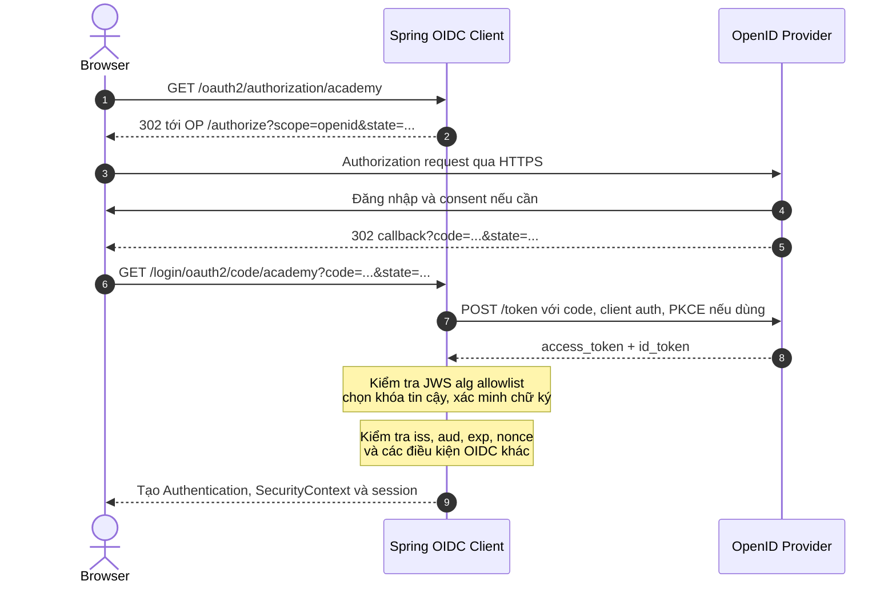

# 11.4. Cấu hình và giới hạn thuật toán chữ ký được chấp nhận

Trong **Spring Security OAuth 2.0 / OpenID Connect (OIDC) Client**, ID Token là bằng chứng về sự kiện xác thực người dùng do OpenID Provider (OP) phát hành cho một client cụ thể. ID Token thường là **JWT được ký bằng JSON Web Signature (JWS)**. Việc xác minh chữ ký không chỉ là “dùng khóa nào để kiểm tra”, mà còn là **quyết định thuật toán nào được phép dùng cho đúng client registration**.

Một ID Token có thể tự khai báo header `alg=RS256`, `alg=ES256`, `alg=HS256` hoặc một giá trị khác. **Không được tin thuật toán chỉ vì token tự ghi như vậy.** Ứng dụng phải dựa vào cấu hình và thỏa thuận với nhà cung cấp danh tính để chọn tập thuật toán được phép, sau đó dùng đúng loại khóa, xác minh chữ ký và kiểm tra toàn bộ claims OIDC.

Bài học tập trung vào cách làm trong **Spring Boot 3.x / Spring Security 6.x, ứng dụng Servlet sử dụng `oauth2Login()`**:

- Hiểu thuật toán JWS và ý nghĩa của `alg`, `kid`, JWKS.
- Phân biệt thuật toán OP **có hỗ trợ** với thuật toán client **đã đăng ký sử dụng**.
- Sử dụng mặc định `RS256` của Spring Security khi phù hợp.
- Cấu hình `OidcIdTokenDecoderFactory` để chỉ chấp nhận thuật toán đã xác định cho từng `ClientRegistration`.
- Tránh `alg=none`, thuật toán confusion, nhận khóa từ nguồn không tin cậy và mở quá rộng allowlist.
- Phân biệt **ID Token decoder của OAuth2 Login** với **JwtDecoder của Resource Server**.
- Giữ nguyên kiểm tra issuer, audience, thời hạn và nonce khi tùy biến decoder.

Các domain, client ID và secret trong ví dụ chỉ dùng để minh họa. Nội dung này không thay thế quy trình xác định chính sách bảo mật, đăng ký client và kiểm thử với OP thật.

## 1. Bối cảnh: ID Token xuất hiện ở đâu?

Khi browser mở trang cần xác thực, Spring Security thực hiện Authorization Code Flow:



Bước “kiểm tra `alg`” nằm ở **khâu xác thực ID Token của OIDC Client**, sau khi backend nhận token từ Token Endpoint. Nó **không phải** là lựa chọn thuật toán khi gửi authorization request, cũng không phải HTTP `client_secret_basic`/`client_secret_post`.

Ba câu hỏi riêng cần được trả lời:

1. **Có được dùng thuật toán này không?** Ví dụ chính sách chỉ cho phép `RS256`.
2. **Chữ ký/MAC có thực sự hợp lệ bằng khóa được tin cậy không?** Ví dụ khóa công khai RSA của đúng OP hoặc secret được phép dùng cho HMAC.
3. **Các claims trong token có đúng không?** `iss`, `aud`, `exp`, `nonce` và những ràng buộc khác.

Chỉ khi cả ba nhóm kiểm tra phù hợp mới có thể chấp nhận ID Token để đăng nhập.

## 2. Cấu trúc JWT/JWS và vai trò của `alg`

Một ID Token là compact JWT ba phần khi được biểu diễn bằng JWS:

```text
BASE64URL(protected_header)
.
BASE64URL(claims_payload)
.
BASE64URL(signature)
```

Ví dụ **JOSE protected header** sau khi giải mã Base64URL:

```json
{
  "alg": "RS256",
  "kid": "signing-key-2026",
  "typ": "JWT"
}
```

Payload ID Token minh họa:

```json
{
  "iss": "https://idp.example.com/realms/academy",
  "sub": "user-413",
  "aud": "academy-web",
  "iat": 1794800000,
  "exp": 1794803600,
  "nonce": "random-nonce-value"
}
```

**Header và payload đều đọc được trước khi xác minh chữ ký.** Việc decode Base64URL không chứng minh token do OP phát hành. Kẻ tấn công có thể tạo chuỗi JWT tự khai báo `alg` và `kid` bất kỳ. Vì vậy các trường trong header phải được xem là **dữ liệu chưa tin cậy** cho đến khi thuật toán và khóa được đối chiếu với chính sách của ứng dụng và chữ ký được xác minh.

| Trường | Nằm ở đâu? | Vai trò | Quy tắc tin cậy |
| --- | --- | --- | --- |
| `alg` | JOSE header | Tên thuật toán chữ ký/MAC của JWS | Chỉ chấp nhận nếu nằm trong allowlist định trước cho client; không để token chọn chính sách. |
| `kid` | JOSE header | Gợi ý định danh khóa ký trong JWK Set | Chỉ tìm khóa trong nguồn tin cậy đã định cấu hình; không xem `kid` là bằng chứng. |
| `kty` | JWK | Loại khóa, ví dụ `RSA`, `EC` hoặc `oct` | Phải phù hợp thuật toán và chức năng khóa. |
| `use` / `key_ops` | JWK | Mục đích sử dụng khóa (ví dụ signature/verify) | Không dùng khóa sai mục đích. |
| `iss` | Claims | Issuer phát hành token | Phải khớp issuer dự kiến của registration. |
| `aud` | Claims | Client được token nhắm tới | Phải chứa `client_id` của ứng dụng. |
| `nonce` | Claims | Liên kết ID Token với authorization request | Nếu request đã gửi nonce, phải kiểm tra theo ngữ cảnh đã lưu. |

**`alg` trong JWS header không phải `alg` của JWE encryption.** Với ID Token được mã hóa (JWE), việc xác minh có thể cần giải mã lớp ngoài và xác minh chữ ký lớp trong theo cấu hình riêng. Bài này tập trung vào ID Token **JWS được ký**, dạng phổ biến ở Authorization Code Flow.

## 3. Phân loại các thuật toán thường gặp

Tên JWS algorithm là tên cụ thể, không chỉ là “RSA” hay “SHA-256”. Một số lựa chọn trong hệ sinh thái OIDC:

| Thuật toán JWS | Họ mật mã | Khóa xác minh ở OIDC Client | Lưu ý |
| --- | --- | --- | --- |
| **`RS256`** | RSA PKCS#1 v1.5 + SHA-256 | RSA public key từ JWKS của OP | Mặc định phổ biến cho ID Token, cũng là mặc định Spring Security `OidcIdTokenDecoderFactory`. |
| `RS384` / `RS512` | RSA + SHA-384/512 | RSA public key thích hợp | Chỉ bật nếu được thỏa thuận và hỗ trợ đúng. |
| **`PS256`** | RSA-PSS + SHA-256 | RSA public key phù hợp | Khác `RS256` về sơ đồ signature; không xem là tương đương. |
| **`ES256`** | ECDSA P-256 + SHA-256 | EC public key thuộc curve phù hợp, lấy từ JWKS đáng tin cậy | Yêu cầu đúng curve/key và hỗ trợ JWS của decoder/OP. |
| `ES384` / `ES512` | ECDSA với curve/hàm băm tương ứng | EC public key phù hợp | Không bật chỉ vì OP công bố một EC key bất kỳ. |
| **`HS256`** | HMAC + SHA-256 | Shared secret đủ mạnh, với Spring OIDC thường là client secret | Symmetric MAC: cả bên tạo và bên kiểm tra cùng biết khóa. |
| `HS384` / `HS512` | HMAC + SHA-384/512 | Shared secret đủ mạnh | Chỉ chọn khi client được đăng ký và secret đáp ứng yêu cầu. |
| `none` | Không có chữ ký | Không có khóa xác minh chữ ký | Không nên chấp nhận trong ứng dụng OIDC login yêu cầu ID Token được ký. |

`RS256`, `PS256` và `ES256` đều là **thuật toán bất đối xứng**: OP giữ private signing key; ứng dụng chỉ cần public key để xác minh. `HS256` là **đối xứng**, hai phía cùng sở hữu secret có thể tạo MAC.

Với các thuật toán HMAC, cần secret có độ dài và entropy đáp ứng tiêu chuẩn: ví dụ **HS256 yêu cầu khóa ít nhất 256 bit** theo JWA. Nếu client secret được cấp chỉ là một chuỗi quá ngắn/yếu, không nên chuyển sang HS256 để “khắc phục” lỗi tương thích; cần làm việc với OP để dùng phương thức/secret phù hợp.

### 3.1. Vì sao không chỉ chấp nhận mọi thuật toán “mạnh”?

Một OP có thể công bố `RS256`, `PS256` và `ES256` là các thuật toán **nó hỗ trợ**. Nhưng **client cụ thể** có thể đã đăng ký dùng `RS256`. Nếu decoder chấp nhận bất kỳ thuật toán nào có trong metadata, nó mở thêm hành vi mà ứng dụng không thực sự cần.

**Chính sách tốt là allowlist hẹp theo từng client registration**, thường chỉ một thuật toán đã thỏa thuận. Điều này cũng giúp phát hiện provider tự ý đổi cấu hình ký hoặc sự cố metadata/JWKS, thay vì âm thầm thay đổi khả năng xác minh của ứng dụng.

### 3.2. `alg=none` có được phép theo OIDC Core không?

OIDC Core có một ngoại lệ rất hẹp liên quan **Authorization Code Flow và client đã yêu cầu `none` rõ ràng khi đăng ký**. Điều đó không có nghĩa client Spring Security thông thường nên chấp nhận `none`.

Trong thiết kế thực tế của bài này, hãy **yêu cầu ID Token có chữ ký hợp lệ và loại `none` khỏi chính sách chấp nhận**. Nếu một provider đòi unsigned ID Token vì tương thích đặc biệt, cần đánh giá thiết kế và mô hình tin cậy riêng; không đổi decoder thành “không kiểm tra chữ ký” hoặc nhận mọi token để login.

## 4. Nguồn chính sách thuật toán: registration, metadata và header

Ba nguồn sau rất dễ bị nhầm:

1. **Client registration / hợp đồng với OP:** thuật toán ID Token đã được chọn cho **client cụ thể**.
2. **OpenID Provider discovery metadata:** các thuật toán OP **có khả năng hỗ trợ**.
3. **JOSE header `alg` trong ID Token:** thuật toán token **tự công bố đã được dùng**.

Thứ tự tin cậy đúng là: **chính sách client registration quyết định điều được phép**, metadata giúp xác minh khả năng OP, rồi header của token chỉ được đối chiếu với chính sách, không được nâng quyền.

### 4.1. OP discovery metadata

Ví dụ response metadata:

```json
{
  "issuer": "https://idp.example.com/realms/academy",
  "jwks_uri": "https://idp.example.com/realms/academy/protocol/openid-connect/certs",
  "id_token_signing_alg_values_supported": [
    "RS256",
    "PS256",
    "ES256"
  ]
}
```

Trường **`id_token_signing_alg_values_supported`** biểu thị những JWS algorithms OP hỗ trợ để ký ID Token. Nó **không khẳng định rằng ID Token phát cho client `academy-web` sẽ luân phiên dùng cả ba**, cũng không phải lệnh buộc client chấp nhận cả ba.

Thông tin thực tế về client thường gắn với **`id_token_signed_response_alg`** trong OIDC client registration metadata. Khi không đặt thuật toán khác, giá trị mặc định trong OIDC Dynamic Client Registration là **`RS256`**. Cần đối chiếu tài liệu hoặc giao diện cấu hình client của OP, vì không phải mọi OP đều hỗ trợ dynamic registration hoặc bộc lộ cấu hình này qua API.

### 4.2. `token_endpoint_auth_signing_alg` là chuyện khác

Một số provider cung cấp thông số về **thuật toán dùng để client ký JWT xác thực với Token Endpoint**, ví dụ khi chọn `private_key_jwt`:

```text
token_endpoint_auth_method
token_endpoint_auth_signing_alg
token_endpoint_auth_signing_alg_values_supported
```

Các trường đó thuộc **client authentication tại Token Endpoint**, không quyết định JWS algorithm của ID Token.

Đừng lấy `token_endpoint_auth_signing_alg` để cấu hình `OidcIdTokenDecoderFactory`. Cũng không nhầm `client_secret_basic`/`client_secret_post` với `HS256`: hai giá trị đầu nói về cách client đưa secret tới token endpoint; `HS256` nói về cách OP ký/MAC ID Token.

### 4.3. `kid` không phải chính sách thuật toán

`kid` chỉ giúp chọn khóa trong JWKS:

```json
{
  "keys": [
    {
      "kid": "key-2026",
      "kty": "RSA",
      "use": "sig",
      "alg": "RS256",
      "n": "<rsa-modulus>",
      "e": "AQAB"
    }
  ]
}
```

Với một token header `alg=HS256` và `kid=key-2026`, không được lấy một RSA public key từ JWKS rồi dùng những byte public key ấy như HMAC secret. Đây là dạng **algorithm confusion** cần phòng tránh bằng kiểm tra algorithm allowlist và key type/usage matching của thư viện mật mã tin cậy.

## 5. Mặc định của Spring Security khi đăng nhập OIDC

Với ứng dụng Servlet sử dụng Spring Security OAuth2 Login, **`OidcIdTokenDecoderFactory`** cung cấp `JwtDecoder` phù hợp để xác minh chữ ký ID Token. Tài liệu Spring Security nêu:

- Thuật toán JWS mặc định là **`RS256`**.
- Có thể cấu hình **`setJwsAlgorithmResolver(Function<ClientRegistration, JwsAlgorithm>)`** để chọn thuật toán dự kiến cho mỗi client registration.
- Với họ HMAC như `HS256`, `HS384` và `HS512`, factory dùng **`client-secret` của registration** làm khóa đối xứng theo chức năng tương ứng.
- Khi có nhiều registration, resolver có thể trả những thuật toán khác nhau theo registration.

Quan trọng: mặc định `RS256` không có nghĩa Spring Security chỉ kiểm tra ký tự `alg`. Decoder phải thực sự xác minh chữ ký bằng khóa được phép và các bộ validator OIDC phải xác minh claims.

### 5.1. Các thành phần tham gia trong flow

| Thành phần | Vai trò |
| --- | --- |
| `ClientRegistrationRepository` | Lưu các đăng ký OAuth2/OIDC client, gồm client ID, issuer, provider và secret nếu có. |
| `OAuth2LoginAuthenticationFilter` | Nhận callback có `code`/`state`, khôi phục authorization request. |
| `OidcAuthorizationCodeAuthenticationProvider` | Phối hợp token exchange, ID Token validation và xây dựng OIDC Authentication. |
| **`OidcIdTokenDecoderFactory`** | Xây `JwtDecoder` cho ID Token theo từng `ClientRegistration`, gồm chính sách JWS algorithm. |
| `JwtDecoder` | Xác minh JWT signature/MAC và chuyển claims sang dạng phù hợp. |
| `OidcIdTokenValidator` | Kiểm tra các điều kiện OIDC như issuer, audience, thông tin client/nonce theo phiên bản và ngữ cảnh. |
| `JwtTimestampValidator` | Kiểm tra ràng buộc thời gian của JWT. |
| `OidcUser` / `OAuth2AuthenticationToken` | Kết quả đăng nhập sau khi quá trình xác thực thành công. |

Khi cần chọn thuật toán khác `RS256`, **không cần tự viết callback controller** và không cần bỏ `oauth2Login()`. Hãy cấu hình decoder factory cho OIDC login và giữ cách framework xử lý phần còn lại.

## 6. Cấu hình OIDC Client ban đầu bằng YAML

Trước khi tùy chỉnh thuật toán, ứng dụng phải có một registration đúng:

```yaml
spring:
  security:
    oauth2:
      client:
        registration:
          academy:
            provider: academy-oidc
            client-id: ${OIDC_CLIENT_ID}
            client-secret: ${OIDC_CLIENT_SECRET}
            authorization-grant-type: authorization_code
            scope:
              - openid
              - profile
            redirect-uri: "{baseUrl}/login/oauth2/code/{registrationId}"
        provider:
          academy-oidc:
            issuer-uri: ${OIDC_ISSUER_URI}
```

Giả sử:

```text
OIDC_CLIENT_ID=academy-web
OIDC_CLIENT_SECRET=<client-secret-thuc>
OIDC_ISSUER_URI=https://idp.example.com/realms/academy
```

`academy` là **registration ID** dùng trong URL `/oauth2/authorization/academy` và `/login/oauth2/code/academy`. `academy-oidc` là alias metadata của OP. `issuer-uri` phải khớp issuer thật do OP công bố.

Nếu OP ký ID Token bằng `RS256`, **thường không phải cấu hình bean thuật toán bổ sung**. Spring Security dùng mặc định, tìm khóa phù hợp trong JWKS của issuer và kiểm tra token.

### 6.1. Cấu hình tương đương bằng properties

```properties
spring.security.oauth2.client.registration.academy.provider=academy-oidc
spring.security.oauth2.client.registration.academy.client-id=${OIDC_CLIENT_ID}
spring.security.oauth2.client.registration.academy.client-secret=${OIDC_CLIENT_SECRET}
spring.security.oauth2.client.registration.academy.authorization-grant-type=authorization_code
spring.security.oauth2.client.registration.academy.scope=openid,profile
spring.security.oauth2.client.registration.academy.redirect-uri={baseUrl}/login/oauth2/code/{registrationId}
spring.security.oauth2.client.provider.academy-oidc.issuer-uri=${OIDC_ISSUER_URI}
```

Đây là **cấu hình client và provider**, không phải nơi được tài liệu Spring Security OAuth2 Login dùng để khai báo một property riêng kiểu `id-token-accepted-algorithms`. Muốn đổi JWS algorithm dự kiến cho ID Token trong hướng dẫn này, bạn thêm bean decoder factory ở phần tiếp theo.

## 7. Cấu hình `OidcIdTokenDecoderFactory` để chấp nhận HS256

Giả sử OP đã đăng ký ID Token của `academy` với `HS256` và cung cấp **client secret đủ mạnh** cho HMAC. Lúc này mặc định `RS256` sẽ không phù hợp; cần chọn đúng `MacAlgorithm.HS256`.

Một bean Java:

```java
import org.springframework.context.annotation.Bean;
import org.springframework.context.annotation.Configuration;
import org.springframework.security.oauth2.client.oidc.authentication.OidcIdTokenDecoderFactory;
import org.springframework.security.oauth2.client.registration.ClientRegistration;
import org.springframework.security.oauth2.jwt.JwtDecoderFactory;
import org.springframework.security.oauth2.jose.jws.MacAlgorithm;

@Configuration
public class OidcIdTokenAlgorithmConfig {

    @Bean
    JwtDecoderFactory<ClientRegistration> idTokenDecoderFactory() {
        OidcIdTokenDecoderFactory factory =
                new OidcIdTokenDecoderFactory();

        // Chỉ dùng khi OP đã đăng ký ID Token ký bằng HS256.
        factory.setJwsAlgorithmResolver(
                clientRegistration -> MacAlgorithm.HS256);

        return factory;
    }
}
```

Khi dùng `MacAlgorithm.HS256`, Spring Security OIDC decoder sử dụng `client-secret` tương ứng với `client-id` của registration làm **symmetric key** để xác minh MAC ID Token, theo hỗ trợ của factory.

**Không áp dụng cấu hình HS256 cho mọi client nếu bạn còn provider ký RS256 hoặc ES256.** Bean trên cố tình viết cho tình huống chỉ có client dùng HS256, nhằm minh họa API. Với nhiều provider, cần resolver theo từng registration và không để fallback không rõ chính sách.

### 7.1. Vì sao không dùng RSA public key với HS256?

- `HS256` đòi **shared secret** đủ mạnh.
- `RS256` đòi **RSA public key** để xác minh chữ ký do private key tương ứng của OP tạo ra.
- Chúng **không thể hoán đổi** cùng một tập byte mà không tạo ra rủi ro nghiêm trọng.

Nếu ID Token chuyển từ `RS256` sang `HS256` mà client không đăng ký/cho phép HS256, hành vi đúng là **từ chối ID Token**. Không thử kiểu “nếu RSA không khớp thì dùng secret” một cách tự động theo yêu cầu của token.

### 7.2. Khi OP sử dụng ES256

Nếu OP đã đăng ký `ES256` cho client, có thể cấu hình thuật toán kỳ vọng bằng `SignatureAlgorithm.ES256` thay cho `MacAlgorithm.HS256`:

```java
import org.springframework.security.oauth2.jose.jws.SignatureAlgorithm;

factory.setJwsAlgorithmResolver(
        clientRegistration -> SignatureAlgorithm.ES256);
```

Đây là đoạn **thay thế câu lệnh resolver** trong ví dụ bean đầy đủ, không phải cấu hình cần chồng thêm. OP phải công bố EC public key với curve tương ứng trong JWKS mà Spring Security tin cậy. Không cố sử dụng khóa RSA để kiểm tra chữ ký ECDSA.

## 8. Nhiều provider: chọn thuật toán theo `ClientRegistration`

Một ứng dụng có thể đồng thời hỗ trợ:

- `enterprise`: OP ký bằng `RS256`.
- `partner`: OP ký bằng `ES256`.
- `legacy`: OP ký bằng `HS256`, chỉ khi client đã được đăng ký như vậy và secret đáp ứng yêu cầu.

Mỗi registration phải có chính sách thuật toán riêng. Ví dụ:

```java
import org.springframework.context.annotation.Bean;
import org.springframework.context.annotation.Configuration;
import org.springframework.security.oauth2.client.oidc.authentication.OidcIdTokenDecoderFactory;
import org.springframework.security.oauth2.client.registration.ClientRegistration;
import org.springframework.security.oauth2.jwt.JwtDecoderFactory;
import org.springframework.security.oauth2.jose.jws.JwsAlgorithm;
import org.springframework.security.oauth2.jose.jws.MacAlgorithm;
import org.springframework.security.oauth2.jose.jws.SignatureAlgorithm;

@Configuration
public class MultiProviderIdTokenAlgorithms {

    @Bean
    JwtDecoderFactory<ClientRegistration> idTokenDecoderFactory() {
        OidcIdTokenDecoderFactory factory =
                new OidcIdTokenDecoderFactory();

        factory.setJwsAlgorithmResolver(registration -> {
            String id = registration.getRegistrationId();

            return switch (id) {
                case "enterprise" -> SignatureAlgorithm.RS256;
                case "partner" -> SignatureAlgorithm.ES256;
                case "legacy" -> MacAlgorithm.HS256;
                default -> throw new IllegalArgumentException(
                        "No approved ID Token JWS algorithm for: " + id);
            };
        });

        return factory;
    }
}
```

Một resolver như trên có ba thuộc tính quan trọng:

1. **Thuật toán đến từ cấu hình nội bộ tin cậy**, không đến từ `alg` của token đang được xác minh.
2. **Chọn theo registration ID** đã được Spring liên kết với authorization request, thay vì nhận provider tùy ý từ query string.
3. **Fail closed**: registration chưa có chính sách thì từ chối cấu hình thay vì chấp nhận mọi thuật toán.

Đây là ví dụ Java 17+ (do dùng `switch` expression), phù hợp với nhiều dự án Spring Boot 3.x. Các registration tên `enterprise`, `partner`, `legacy` cần tồn tại và được khai báo issuer/credential tương ứng trong cấu hình ứng dụng.

### 8.1. Không hardcode thuật toán vào ứng dụng bằng cách nào cũng được?

Hardcode trong resolver là cách minh họa dễ hiểu. Trong hệ thống lớn, có thể đặt bảng chính sách vào **application configuration đã được quản lý và kiểm soát thay đổi**, sau đó resolver đọc theo registration. Dù cấu hình nằm ở đâu, yêu cầu vẫn là:

- Chỉ người quản trị ứng dụng được thay đổi policy.
- Không lấy algorithm tùy ý từ header JWT hay input người dùng.
- Mọi giá trị phải thuộc nhóm hỗ trợ thực sự của thư viện và OP.
- Không cho phép giá trị `none` hoặc thuật toán ngoài chính sách bằng fallback mở.
- Có hồ sơ/thông tin xác nhận thuật toán đã đăng ký với từng OP.

Chính sách có thể thay đổi khi OP chuyển thuật toán ký, nhưng phải là thay đổi **có chủ đích** và kiểm thử trước, không phải phản ứng tự động theo token vừa nhận.

## 9. Muốn chấp nhận nhiều thuật toán cho một provider thì sao?

`setJwsAlgorithmResolver` của `OidcIdTokenDecoderFactory` trả về **một `JwsAlgorithm` dự kiến cho mỗi `ClientRegistration`**. Với phần lớn tích hợp, một giá trị cho mỗi client là điều mong muốn.

Nếu tổ chức phải hỗ trợ khoảng chuyển đổi từ `RS256` sang `ES256`, cần quyết định rõ:

- Trong khoảng thời gian nào có thể nhận cả hai?
- Có kiểm soát được thời điểm OP chuyển signing key/algorithm?
- Có bắt buộc đồng thời chấp nhận hai thuật toán hay có thể chuyển phiên bản cấu hình đồng bộ?
- Làm sao phân biệt token từ issuer khác hoặc token không thuộc client đang đăng nhập?
- Khi nào phải xóa thuật toán cũ khỏi policy?

**Không mở rộng allowlist chỉ vì token bị lỗi chữ ký.** Nếu có thể, triển khai đổi thuật toán theo giai đoạn có giám sát và **duy trì policy mỗi client càng hẹp càng tốt**.

### 9.1. Trường hợp cần `JwtDecoderFactory<ClientRegistration>` tùy biến

Tài liệu Spring Security giải thích rằng `OidcIdTokenDecoderFactory` cố ý có bề mặt tùy biến hẹp; nếu phải điều khiển sâu hơn cách tạo decoder, có thể cung cấp bean **`JwtDecoderFactory<ClientRegistration>`** riêng cho OIDC Login. Việc này khác với cấu hình `JwtDecoder` của OAuth2 Resource Server.

Ví dụ một factory tự tạo decoder cho **một registration dùng RS256** và giữ validator OIDC mặc định:

```java
import org.springframework.context.annotation.Bean;
import org.springframework.context.annotation.Configuration;
import org.springframework.security.oauth2.client.oidc.authentication.OidcIdTokenDecoderFactory;
import org.springframework.security.oauth2.client.registration.ClientRegistration;
import org.springframework.security.oauth2.client.oidc.authentication.OidcIdTokenValidator;
import org.springframework.security.oauth2.jwt.JwtDecoderFactory;
import org.springframework.security.oauth2.jwt.JwtValidators;
import org.springframework.security.oauth2.jwt.NimbusJwtDecoder;
import org.springframework.security.oauth2.jose.jws.SignatureAlgorithm;

@Configuration
public class AdvancedIdTokenDecoderConfig {

    @Bean
    JwtDecoderFactory<ClientRegistration> idTokenDecoderFactory() {
        return registration -> {
            String issuer = registration.getProviderDetails()
                    .getIssuerUri();

            NimbusJwtDecoder decoder = NimbusJwtDecoder
                    .withIssuerLocation(issuer)
                    .jwsAlgorithm(SignatureAlgorithm.RS256)
                    .build();

            decoder.setJwtValidator(
                    JwtValidators.createDefaultWithValidators(
                            new OidcIdTokenValidator(registration)));

            decoder.setClaimTypeConverter(
                    OidcIdTokenDecoderFactory
                            .createDefaultClaimTypeConverter());

            return decoder;
        };
    }
}
```

**Đây là phương án tùy biến nâng cao**, thay cho bean `OidcIdTokenDecoderFactory` ở các mục trước. Khi xây decoder thủ công, cần giữ đầy đủ **`OidcIdTokenValidator`** và kiểm tra thời gian JWT, claim converter phù hợp; không chỉ kiểm tra signature rồi cho login. Các builder options và API có thể khác nhau theo phiên bản Spring Security; hãy xem API của bản đang dùng.

Mã ví dụ chỉ đặt **`RS256`**. Nó không bật nhiều thuật toán và không phải ví dụ có thể dùng cho mọi provider. Một factory nhận nhiều registration cũng nên **cache decoder theo registration** khi phù hợp để tránh tạo decoder/lấy metadata lặp lại không cần thiết, đồng thời đảm bảo cache thay đổi khi issuer hoặc policy thay đổi.

### 9.2. Vì sao không tạo một `JwtDecoder` toàn cục với mọi thuật toán?

Nếu bạn tự tạo một bean `JwtDecoder` được dùng cho **Resource Server**, nó không nhất thiết được `oauth2Login()` sử dụng để xác minh **ID Token**. Spring Security phân biệt:

```text
Servlet OAuth2/OIDC Login:
    OidcIdTokenDecoderFactory / JwtDecoderFactory<ClientRegistration>
            |
            v
    Xác minh ID Token để tạo OidcUser

Servlet OAuth2 Resource Server:
    JwtDecoder bean / resource-server JWT configuration
            |
            v
    Xác minh Bearer JWT ở HTTP API request
```

Không cấu hình thuật toán ID Token bằng cách thêm thuộc tính `spring.security.oauth2.resourceserver.jwt.*` rồi nghĩ rằng `OAuth2LoginAuthenticationFilter` sẽ dùng nó.

Ngược lại, khi API nhận **access token**, nó cần resource-server JWT validation phù hợp với issuer/audience riêng, không dùng ID Token decoder chỉ vì cả hai đều là JWT.

## 10. Khóa ký và JWKS phải phù hợp với thuật toán

### 10.1. Với RS256, PS256, ES256

Spring OIDC decoder thường dựa vào **JWKS URI** do OP công bố qua discovery hoặc provider configuration. Một JWK Set có thể chứa nhiều khóa để hỗ trợ key rotation.

Ví dụ JWKS rút gọn:

```json
{
  "keys": [
    {
      "kty": "RSA",
      "kid": "rsa-2026-01",
      "use": "sig",
      "alg": "RS256",
      "n": "<base64url-rsa-modulus>",
      "e": "AQAB"
    },
    {
      "kty": "EC",
      "kid": "ec-2026-02",
      "use": "sig",
      "alg": "ES256",
      "crv": "P-256",
      "x": "<base64url-x>",
      "y": "<base64url-y>"
    }
  ]
}
```

Dữ liệu trong ví dụ là placeholder, không dùng để xác minh token thật. Nó cho thấy **một JWKS có thể công bố khóa thuộc nhiều thuật toán**, nhưng chính sách của client vẫn phải xác định cụ thể thuật toán được phép.

Kiểm tra thích hợp phải ràng buộc:

- Issuer/OP tin cậy với JWKS URI đã cấu hình.
- `alg` với thuật toán cho phép và chức năng của khóa.
- `kid` nếu có với khóa phù hợp trong chính JWKS đó.
- Key type, key curve, key usage và kích thước khóa theo yêu cầu mật mã.
- Chữ ký phải khớp key đã chọn.

Không lấy private key của OP về ứng dụng client; client xác minh bất đối xứng chỉ cần public key.

### 10.2. Với HS256/HS384/HS512

HMAC không dùng RSA/EC public JWKS để xác minh. Theo cách hỗ trợ của `OidcIdTokenDecoderFactory`, Spring sử dụng **client secret** của registration tương ứng làm khóa MAC.

Hệ quả:

- Client secret phải đủ mạnh và chỉ được giữ ở backend tin cậy.
- Cùng secret có thể dùng để tạo MAC; tránh chia sẻ nó ngoài phạm vi OP và client.
- Nếu OP thay secret, cần phối hợp quy trình rotation và cập nhật cấu hình phía client.
- Không dùng client secret ngắn cho HS256 chỉ vì thao tác mã chạy được.
- `HS256` không tự liên quan đến `client_secret_basic` hay `client_secret_post` ở token endpoint.

### 10.3. Key rotation khác với algorithm migration

**Key rotation**: OP thay khóa ký, nhưng **giữ cùng thuật toán**, ví dụ từ RSA key A sang RSA key B đều dùng `RS256`. Decoder có thể tiếp tục dùng allowlist `RS256`, cập nhật JWKS/cache theo cơ chế hỗ trợ.

**Algorithm migration**: OP đổi từ `RS256` sang `ES256`. Điều này thay đổi **chính sách chấp nhận thuật toán**, thường cần cập nhật resolver/decoder cùng dữ liệu key type phù hợp.

Không nhầm một lỗi `kid` mới chưa có trong cache với nhu cầu bật toàn bộ thuật toán để “chữa” login.

## 11. Các kiểu tấn công chính sách thuật toán phải ngăn

### 11.1. `alg=none` / thiếu chữ ký

Kẻ tấn công tạo token header:

```json
{
  "alg": "none",
  "typ": "JWT"
}
```

Nếu ứng dụng chấp nhận payload này như ID Token đã xác thực mà không có chữ ký, người tấn công có thể tự đặt `sub`, `aud` hoặc roles để mạo danh.

**Hành vi cần có trong hệ thống này:** từ chối ID Token `alg=none`. Không bật unsigned-token compatibility chỉ vì OP trả lỗi hoặc test fixture chưa có chữ ký.

### 11.2. HS256/RS256 algorithm confusion

Một lỗi thiết kế nguy hiểm là cùng một verifier nhận `RS256` (RSA public key) lẫn `HS256` (HMAC) dựa vào header do JWT tự khai báo, rồi dùng nhầm public key RSA như HMAC secret. Bên tấn công biết public key có thể lợi dụng logic nhầm loại khóa trong verifier yếu.

Phòng vệ:

1. Thuật toán kỳ vọng được chọn từ cấu hình client, **không từ header tự khai báo**.
2. Key type/usage phải khớp thuật toán.
3. Không dùng RSA public key làm symmetric secret.
4. Sử dụng thư viện JWT/JWS được bảo trì và API giới hạn algorithm rõ ràng.
5. Bổ sung test token `alg` khác chính sách phải thất bại.

### 11.3. Lấy khóa từ URL do token chỉ định

Một token có thể tự mang header như `jku`, `x5u`, `jwk` hoặc giá trị `kid` trông như đường dẫn. Ứng dụng không được tự động tải URL tùy ý từ những header này để lấy khóa xác minh.

Làm vậy có thể gây:

- **SSRF**: backend tải metadata/khóa từ địa chỉ do bên ngoài kiểm soát.
- **Key substitution**: kẻ tấn công tạo JWT, trỏ verifier đến khóa của họ rồi tự ký token.
- **Cross-issuer confusion**: dùng khóa của OP khác để chấp nhận token.

OIDC hướng tới **key material được công bố sẵn qua Discovery/Registration** của OP tin cậy. Hãy định cấu hình issuer/JWKS URI đúng nguồn và hạn chế truy cập mạng nếu cần.

### 11.4. Chấp nhận thuật toán chỉ vì “thư viện hỗ trợ”

Một JWT library có thể hỗ trợ rất nhiều thuật toán. Điều đó không có nghĩa mọi thuật toán đều phù hợp với client, OP hoặc policy của hệ thống.

**Không sử dụng “accept anything supported by Nimbus”** hay code tự động fallback đến thuật toán khác sau khi một lần xác minh thất bại. Thuật toán được chấp nhận phải thuộc danh sách đã đánh giá và thỏa thuận, thường là một giá trị duy nhất cho từng registration.

### 11.5. Chỉ xác minh chữ ký, bỏ qua claims

Một ID Token do Corporate OP ký đúng nhưng có `aud` của ứng dụng khác vẫn **không được chấp nhận** cho client hiện tại. Tương tự token có `nonce` của flow khác hoặc `iss` khác phải bị từ chối theo quy tắc OIDC.

Do đó, **giới hạn `alg` là điều kiện cần chứ không đủ**. Khi tự thay decoder, luôn duy trì OIDC validator và correlation với authorization request.

## 12. Cấu hình nào thuộc Authorization Server và cấu hình nào thuộc Client?

Đôi khi cùng một cụm “JWT signing algorithm” được dùng cho nhiều loại token và nhiều hệ thống:

| Vị trí | Ai cấu hình? | Ví dụ | Ảnh hưởng |
| --- | --- | --- | --- |
| OP / Authorization Server | Đội vận hành OP | Client `academy-web` nhận ID Token ký `RS256` | Thuật toán OP thực sự dùng để ký ID Token. |
| Spring OAuth2/OIDC Client | Đội vận hành ứng dụng | Resolver chọn `SignatureAlgorithm.RS256` | Thuật toán ID Token mà client **cho phép xác minh**. |
| Spring OAuth2 Resource Server | Đội vận hành API | JWT decoder cho Bearer access token | Thuật toán JWT API chấp nhận, **không tự thay ID Token policy**. |
| Token Endpoint client authentication | OP + OAuth2 Client | `client_secret_basic`, `private_key_jwt` | Xác thực **ứng dụng** khi đổi code/refresh token. |
| TLS server authentication | HTTP client/PKI | Chứng chỉ HTTPS của OP | Xác minh đầu bên kia của kết nối mạng, **không tự thay JWS validation**. |

**Client không thể buộc OP ký ES256 chỉ bằng cách đổi `OidcIdTokenDecoderFactory` sang ES256.** Nếu OP vẫn ký RS256, kết quả là đăng nhập bị từ chối. Muốn chuyển thuật toán cần cập nhật cấu hình **đăng ký client tại OP** và bảo đảm Spring decoder được đồng bộ.

## 13. Quan sát ID Token algorithm mà không làm lộ token

Trong môi trường phát triển, khi xác thực thành công, một `OidcUser` chứa `OidcIdToken`. Có thể đọc **header algorithm của ID Token sau khi Spring đã xác minh**, nhưng không cần trả raw token cho browser.

Ví dụ một controller minh họa:

```java
import java.util.Map;
import java.text.ParseException;

import com.nimbusds.jwt.SignedJWT;

import org.springframework.security.core.annotation.AuthenticationPrincipal;
import org.springframework.security.oauth2.core.oidc.user.OidcUser;
import org.springframework.web.bind.annotation.GetMapping;
import org.springframework.web.bind.annotation.RestController;

@RestController
public class LoginDiagnosticController {

    @GetMapping("/diagnostics/oidc")
    public Map<String, String> oidcDiagnostics(
            @AuthenticationPrincipal OidcUser user) throws ParseException {

        // Chỉ đọc header của ID Token SAU khi Spring đã xác thực login.
        // Ví dụ dành cho dạng JWS compact, không áp dụng cho JWE.
        SignedJWT signedJwt = SignedJWT.parse(
                user.getIdToken().getTokenValue());
        String algorithm = signedJwt.getHeader()
                .getAlgorithm().getName();

        return Map.of(
                "issuer", user.getIssuer().toString(),
                "algorithm", algorithm,
                "subject", user.getSubject());
    }
}
```

Đoạn này chỉ phục vụ **học tập/test trong môi trường có kiểm soát**. Nó giả định endpoint chỉ dành cho người dùng OIDC đã xác thực; nếu có loại Authentication khác, cần xử lý principal phù hợp. **Không nên xuất thông tin định danh/issuer và các thuộc tính token này qua endpoint public trong production** nếu không có nhu cầu và kiểm soát truy cập rõ.

Quan trọng: **`alg` được đọc sau khi login thành công chỉ là dữ liệu quan sát**, không phải cách quyết định policy. Policy thuật toán đã phải được áp dụng trước và trong quá trình verify token. Một controller trả `alg` không thể thay validator.

### 13.1. Quan sát lỗi trong log

Khi ID Token verification thất bại, exception có thể được Spring OAuth2 Login chuyển thành lỗi xác thực. Hãy ghi log ở mức vừa đủ:

```yaml
logging:
  level:
    org.springframework.security: INFO
```

Khi cần debug có thể tăng lên `DEBUG` trong môi trường test rồi hạ lại. Không ghi nguyên **ID Token**, access token, refresh token, client secret, session cookie, authorization code hoặc PKCE verifier. Nếu cần tìm nguyên nhân, nên ghi request ID, registration ID, thuật toán **dự kiến**, mã lỗi đã chuẩn hóa và thông tin provider không nhạy cảm.

## 14. Tình huống lỗi và hướng xử lý

| Triệu chứng | Nguyên nhân khả dĩ | Cách khoanh vùng |
| --- | --- | --- |
| Đăng nhập OIDC thất bại khi OP đổi từ RS256 sang ES256 | Decoder vẫn chỉ chấp nhận RS256 | Kiểm tra client registration tại OP; chỉ cập nhật allowlist theo thay đổi đã phê duyệt. |
| `alg` không nằm trong policy | Token khác cấu hình hoặc token độc hại | Từ chối token, đối chiếu provider/issuer và thuật toán đã đăng ký. |
| `kid` không tồn tại trong JWKS cache | OP rotate key, JWKS cache chưa cập nhật, sai issuer | Kiểm tra JWKS của đúng OP, cơ chế làm mới cache, network/TLS. |
| `alg=RS256` nhưng key có `kty=EC` | Lẫn key/algorithm | Chọn khóa RSA tin cậy phù hợp hoặc sửa cấu hình OP; không đổi verifier nhận mọi loại. |
| `alg=HS256` nhưng client secret quá ngắn | Shared secret không đáp ứng yêu cầu MAC | Yêu cầu OP cấp secret mạnh/đổi phương án ký; không bỏ kiểm tra độ mạnh. |
| Decode được payload nhưng signature verification thất bại | Sai khóa/issuer/alg hoặc token bị sửa | Đừng tin payload; kiểm tra nguồn token, JWKS và policy. |
| Signature đúng nhưng `iss` hoặc `aud` sai | Token không thuộc OP/client hiện tại | Sửa issuer/client registration và giữ OIDC claim validators. |
| Signature đúng nhưng nonce không khớp | Token thuộc flow khác hoặc mất correlation | Kiểm tra authorization request repository, session và custom resolver. |
| Chỉ một provider lỗi trong hệ thống nhiều OP | Resolver trả sai algorithm theo registration | Kiểm tra mapping registration ID và policy riêng. |
| Thêm bean `JwtDecoder` mà ID Token vẫn dùng RS256 | Bean dành cho Resource Server, không phải OAuth2 Login | Dùng `JwtDecoderFactory<ClientRegistration>` của OIDC login. |
| OP metadata công bố nhiều thuật toán nhưng Spring chỉ chấp nhận một | Chính sách client giới hạn hẹp, không nhất thiết lỗi | Xác nhận thuật toán OP cấp riêng cho client; không tự mở rộng policy. |
| Lỗi bắt đầu sau khi copy code custom JwtDecoder | Validators/claim converter bị thiếu | Đảm bảo OIDC validators và claim conversion theo cơ chế Spring. |
| Token Endpoint trả `invalid_client` | Client authentication chứ chưa tới ID Token validation | Kiểm tra client ID/secret/method; không đổi ID Token JWS algorithm để sửa. |
| API trả `401` với access token, web login vẫn hoạt động | Resource Server validation | Điều tra cấu hình JWT decoder của API riêng với OIDC login. |

### 14.1. Thứ tự chẩn đoán thực tế

Khi gặp lỗi ID Token signature, nên phân tích theo thứ tự:

1. **Đúng issuer/tenant chưa?** Đảm bảo registration trỏ đến OP đã được tin cậy.
2. **Client được OP đăng ký nhận ID Token ký thuật toán nào?** Không chỉ nhìn metadata toàn OP.
3. **Resolver Spring trả thuật toán gì cho đúng registration ID?**
4. **JWT header có khớp chính sách?** Nếu không, dừng và điều tra phía OP; không fallback.
5. **JWKS/secret có đúng loại và nguồn?** RSA/EC public key theo issuer, HMAC dùng secret đủ mạnh.
6. **Key rotation hoặc cache JWKS có liên quan?**
7. **Các claims OIDC được xác minh đầy đủ chưa?** `iss`, `aud`, `exp`, `nonce`, v.v.
8. **Có thay custom factory hoặc mã kiểm tra JWT không?** Xác nhận các validators vẫn được giữ.

Với production, dùng log đã che credential và công cụ theo dõi được phân quyền; tuyệt đối không gửi token thật vào website decode JWT công khai.

## 15. Ma trận kiểm thử nên có khi giới hạn thuật toán

Khi triển khai hoặc thay đổi cấu hình, hãy dùng OP thử nghiệm hoặc fixture ID Token được **ký bằng khóa test**. Các bài test mong đợi:

| Test case | Cấu hình client | Token thử nghiệm | Kết quả mong đợi |
| --- | --- | --- | --- |
| T1 | Chỉ `RS256` | ID Token RS256, khóa OP đúng, claims hợp lệ | Chấp nhận |
| T2 | Chỉ `RS256` | ID Token ES256 hợp lệ về chữ ký bằng khóa khác | **Từ chối do algorithm không được phép** |
| T3 | Chỉ `RS256` | Token khai `alg=none` | **Từ chối** |
| T4 | Chỉ `RS256` | Token HS256 tự ký bằng public key bytes hoặc secret khác | **Từ chối** |
| T5 | Chỉ `RS256` | Token RS256 nhưng `iss` khác | **Từ chối** |
| T6 | Chỉ `RS256` | Token RS256, `aud` của client khác | **Từ chối** |
| T7 | Chỉ `RS256` | Token RS256 hết hạn | **Từ chối** |
| T8 | Chỉ `RS256` | Token RS256 với nonce sai | **Từ chối** |
| T9 | `partner` chỉ `ES256` | ID Token ES256 từ Partner OP, claims hợp lệ | Chấp nhận |
| T10 | `enterprise` chỉ `RS256` | ID Token ES256 từ Partner OP đưa sang flow Enterprise | **Từ chối** |
| T11 | Chỉ `RS256` | RSA key rotate trong JWKS, algorithm vẫn RS256 | Chấp nhận khi JWKS/caching được cập nhật đúng, claims hợp lệ |
| T12 | `legacy` chỉ `HS256` | MAC với secret không khớp | **Từ chối** |

Các test phải có **token thật được ký bởi khóa test phù hợp** nếu muốn kiểm tra cryptographic verification. Tự tạo JSON có `alg` rồi encode Base64URL không phải test chữ ký đáng tin cậy.

### 15.1. Ví dụ kiểm thử resolver ở mức cấu hình

Với resolver phân theo registration, có thể tách logic chọn algorithm ra một hàm thuần, rồi viết unit test cho bảng chính sách:

```java
import org.springframework.security.oauth2.jose.jws.JwsAlgorithm;
import org.springframework.security.oauth2.jose.jws.SignatureAlgorithm;

final class ExpectedIdTokenAlgorithm {

    private ExpectedIdTokenAlgorithm() {}

    static JwsAlgorithm forRegistrationId(String id) {
        return switch (id) {
            case "enterprise" -> SignatureAlgorithm.RS256;
            case "partner" -> SignatureAlgorithm.ES256;
            default -> throw new IllegalArgumentException(
                    "Unapproved OIDC client: " + id);
        };
    }
}
```

Sau đó cấu hình decoder factory:

```java
factory.setJwsAlgorithmResolver(
        registration -> ExpectedIdTokenAlgorithm
                .forRegistrationId(registration.getRegistrationId()));
```

Một unit test cần xác nhận:

- `enterprise` trả đúng `RS256`;
- `partner` trả đúng `ES256`;
- registration lạ bị từ chối.

**Unit test resolver chưa đủ:** nó không chứng minh decoder thực sự từ chối token giả, nên vẫn cần integration tests với signed JWT fixtures, JWKS test và các trường hợp claims sai. Tránh sử dụng secret production trong test.

## 16. Phân biệt JWS algorithm và các trường OIDC liên quan

Các khóa/metadata thường bị nhầm có thể đặt cạnh nhau:

| Trường cấu hình/metadata | Tương tác với | Không được nhầm với |
| --- | --- | --- |
| `id_token_signed_response_alg` | Thuật toán OP ký ID Token cho một client | Thuật toán ký client assertion ở Token Endpoint |
| `id_token_signing_alg_values_supported` | Danh sách thuật toán OP có khả năng hỗ trợ | Allowlist mặc nhiên của client |
| `token_endpoint_auth_method` | Cách client xác thực với Token Endpoint | JWS `alg` của ID Token |
| `token_endpoint_auth_signing_alg` | Thuật toán ký client assertion (nếu dùng JWT client authentication) | Thuật toán ID Token |
| `jwks_uri` | Nguồn public signing keys từ OP | Tham số cho phép lấy key từ URL do JWT tự đề xuất |
| `client-secret` | Credential backend, cũng có thể là symmetric MAC key khi dùng HS256 | Access token hoặc khóa public RSA |
| `spring.security.oauth2.resourceserver.jwt.*` | Xác minh JWT của Bearer API request | Decoder factory của OIDC login |
| `nonce` | Ràng buộc ID Token với authorization request | Thuật toán chữ ký hoặc identifier của signing key |

### 16.1. Có nên tin `alg` sau khi verify chữ ký thành công?

Sau khi token được verifier đáng tin cậy chấp nhận, header là thông tin có thể dùng cho quan sát/diagnostic. Tuy nhiên **chính sách algorithm phải được thiết lập từ trước**, vì verifier không được có khả năng dùng algorithm không nằm trong chính sách ngay từ đầu. Một chữ ký hợp lệ bằng thuật toán ngoài chính sách vẫn phải bị coi là không hợp lệ cho ứng dụng.

### 16.2. Khi nào cần thay đổi thuật toán?

Các lý do hợp lý:

- OP thông báo sẽ chuyển sang thuật toán chữ ký khác và cập nhật client registration.
- Tổ chức có chính sách mật mã yêu cầu thuật toán/khóa nhất định.
- Nhiều OP khác nhau có chính sách đã xác nhận khác nhau.
- Giai đoạn migration được thiết kế, kiểm thử và giám sát.

Các lý do **không đủ**:

- “JWT đã tự ghi `alg=HS256` nên cứ thử HS256.”
- “Đăng nhập đang lỗi, bật tất cả thuật toán cho chắc.”
- “Vì JWKS có khóa EC nên cho mọi ECDSA.”
- “Chữ ký sai, bỏ validation tạm để user vẫn login.”

## 17. Một ví dụ end-to-end cho website OIDC hai provider

Giả sử ứng dụng cho phép:

- `enterprise`: issuer `https://sso.example.com/realms/staff`, ID Token dùng RS256.
- `partner`: issuer `https://login.partner.example.com/oidc`, ID Token dùng ES256.

**`application.yml`**:

```yaml
spring:
  security:
    oauth2:
      client:
        registration:
          enterprise:
            provider: enterprise-op
            client-id: ${ENTERPRISE_CLIENT_ID}
            client-secret: ${ENTERPRISE_CLIENT_SECRET}
            authorization-grant-type: authorization_code
            scope: [openid, profile]
            redirect-uri: "{baseUrl}/login/oauth2/code/{registrationId}"
          partner:
            provider: partner-op
            client-id: ${PARTNER_CLIENT_ID}
            client-secret: ${PARTNER_CLIENT_SECRET}
            authorization-grant-type: authorization_code
            scope: [openid, profile]
            redirect-uri: "{baseUrl}/login/oauth2/code/{registrationId}"
        provider:
          enterprise-op:
            issuer-uri: https://sso.example.com/realms/staff
          partner-op:
            issuer-uri: https://login.partner.example.com/oidc
```

**`SecurityFilterChain`**:

```java
import org.springframework.context.annotation.Bean;
import org.springframework.context.annotation.Configuration;
import org.springframework.security.config.Customizer;
import org.springframework.security.config.annotation.web.builders.HttpSecurity;
import org.springframework.security.web.SecurityFilterChain;

@Configuration
class SecurityConfig {

    @Bean
    SecurityFilterChain securityFilterChain(HttpSecurity http) throws Exception {
        http
            .authorizeHttpRequests(authorize -> authorize
                .requestMatchers("/", "/error", "/assets/**").permitAll()
                .anyRequest().authenticated()
            )
            .oauth2Login(Customizer.withDefaults());

        return http.build();
    }
}
```

**Bean decoder factory**: dùng mẫu `MultiProviderIdTokenAlgorithms` ở mục 8 nhưng chỉ khai báo hai case `enterprise` và `partner`, không thêm `legacy` khi không có provider tương ứng.

URL login:

```text
GET /oauth2/authorization/enterprise
GET /oauth2/authorization/partner
```

Callback:

```text
GET /login/oauth2/code/enterprise?code=...&state=...
GET /login/oauth2/code/partner?code=...&state=...
```

Luồng xác minh đúng phải:

1. Khôi phục authorization request đúng với `state`, xác định `ClientRegistration` ban đầu.
2. Đổi code tại Token Endpoint của **đúng OP**, với client authentication và PKCE nếu được áp dụng.
3. Chọn JWS algorithm mong đợi theo registration `enterprise` hoặc `partner`.
4. Dùng khóa tin cậy của **issuer tương ứng**, không dùng khóa provider khác.
5. Xác minh chữ ký/MAC, claims OIDC và nonce.
6. Chỉ sau đó tạo `OidcUser`, `OAuth2AuthenticationToken` và lưu phiên đăng nhập.

Nếu ID Token của Partner OP được đưa vào flow Enterprise, ngay cả khi chữ ký ES256 của token đó hợp lệ theo khóa Partner, nó **không thỏa điều kiện issuer, audience và algorithm policy của Enterprise**.

## 18. Câu hỏi và bài tập

**Câu 1 — Spring Security mặc định.** OP của một client mới phát ID Token ký bằng `RS256`. Có cần thêm bean `OidcIdTokenDecoderFactory` chỉ để chọn RS256 không?

> Thường không. `RS256` là thuật toán mặc định của decoder factory cho OAuth2/OIDC login theo tài liệu Spring Security; vẫn cần cấu hình đúng issuer, registration, JWKS và các điều kiện OIDC.

**Câu 2 — Provider metadata.** OP công bố `id_token_signing_alg_values_supported=[RS256,ES256]`. Có phải client phải chấp nhận cả hai?

> Không. Đó là năng lực của OP. Client cần biết thuật toán **được đăng ký/chỉ định cho chính client** và đặt policy phù hợp.

**Câu 3 — Token header tự khai báo.** Token có `alg=HS256`, trong khi client chỉ cho `RS256`. Có được tự động thử client secret để kiểm tra HMAC không?

> Không. Thuật toán phải lấy từ chính sách tin cậy, không phải giá trị do token tự khai báo. Từ chối token và điều tra cấu hình OP.

**Câu 4 — Khác biệt giữa RS256 và HS256.** Cả hai có SHA-256. Tại sao không thay thế nhau?

> `RS256` là chữ ký RSA bất đối xứng; `HS256` là MAC đối xứng dựa trên shared secret. Cùng tên SHA-256 không làm chúng có cùng loại khóa hay mô hình tin cậy.

**Câu 5 — Algorithm được đổi ở đâu?** OP chuyển ID Token từ RS256 sang ES256. Chỉ đổi resolver phía Spring là đủ không?

> Không. Cần xác nhận OP thực sự ký ES256 cho client, có EC public key/metadata phù hợp và chính sách ứng dụng cho phép. Hai phía phải được phối hợp.

**Câu 6 — Resource Server.** Ứng dụng có bean `NimbusJwtDecoder` cho API Bearer token, đã bật ES256. OIDC login tự chuyển sang ES256 theo bean này không?

> Không thể mặc định như vậy. OAuth2 Login có decoder factory dành cho ID Token; Resource Server JwtDecoder là cơ chế khác.

**Câu 7 — Chữ ký hợp lệ, audience sai.** ID Token do OP ký đúng RS256 nhưng `aud` không chứa `client_id` của ứng dụng. Có thể đăng nhập không?

> Không. Xác minh chữ ký chỉ là một phần; token phải dành cho đúng client và thỏa OIDC claim validators.

**Câu 8 — JWKS rotation.** OP bổ sung RSA key mới, ID Token vẫn ký `RS256`. Có phải bật thuật toán mới không?

> Không. Đây là **thay khóa ký**, không phải thay JWS algorithm. Cần đảm bảo JWKS/cache cập nhật và chọn đúng key.

**Câu 9 — Header `jku` lạ.** JWT gợi ý tải key từ `https://unknown.example.com/keyset`. Ứng dụng có nên làm theo không?

> Không. Nguồn khóa tin cậy phải được cấu hình/discovery từ issuer đã phê duyệt, không đi theo URL tùy ý của token.

**Câu 10 — HMAC secret ngắn.** OP muốn HS256 nhưng client secret chỉ là chuỗi vài ký tự. Có thể dùng để test rồi đưa production không?

> Không. Với HS256 phải sử dụng shared secret đủ độ dài và độ khó đoán. Yêu cầu OP cấp secret mạnh hoặc thống nhất phương án ký phù hợp hơn.

## 19. Tóm tắt kiến thức trọng tâm

```text
Authorization Code Flow thành công
               |
               v
Nhận ID Token
               |
               v
Xác định ClientRegistration đã khởi tạo flow
               |
               v
Lấy JWS algorithm policy từ cấu hình tin cậy
               |
               v
Kiểm tra JWT header alg có đúng policy?
               |
          +----+----+
          |         |
        Không       Có
          |         |
          v         v
       Từ chối   Chọn đúng khóa từ issuer/JWKS
                    |
                    v
                Xác minh chữ ký/MAC
                    |
                    v
                Kiểm tra iss, aud, exp,
                nonce và các điều kiện OIDC
                    |
            +-------+-------+
            |               |
           Sai             Đúng
            |               |
            v               v
         Từ chối      Tạo Authentication
                      và phiên ứng dụng
```

Các nguyên tắc quan trọng:

- Với **Spring Security Servlet OAuth2 Login**, `OidcIdTokenDecoderFactory` là thành phần chính để quy định JWS algorithm khi xác minh ID Token; **mặc định `RS256`**.
- Để thay đổi, dùng **`setJwsAlgorithmResolver`** với thuật toán kỳ vọng theo từng `ClientRegistration`, ví dụ `SignatureAlgorithm.ES256` hoặc `MacAlgorithm.HS256` khi đã được OP cho phép.
- **Không tin thuật toán do token tự chọn**; chỉ chấp nhận thuật toán được xác định từ policy của ứng dụng/registration.
- Metadata `id_token_signing_alg_values_supported` biểu thị năng lực provider, không phải allowlist tự động cho mọi client.
- RSA/EC public keys và HMAC shared secret **không hoán đổi**. Phải kiểm tra key type, key use và nguồn JWKS/issuer tin cậy.
- **Không bật `none` hay fallback “thử mọi thuật toán”** trong một OIDC login yêu cầu token được ký.
- Khi tự xây `JwtDecoderFactory`, phải giữ **OIDC claims validation** và timestamp validation; signature verification riêng lẻ không đủ.
- **ID Token decoder của OAuth2 Login khác JwtDecoder của Resource Server**; chọn đúng điểm cấu hình cho đúng loại token.

### Tài liệu tham khảo

- [Spring Security Reference — Advanced OAuth2 Login, ID Token Signature Verification](https://docs.spring.io/spring-security/reference/servlet/oauth2/login/advanced.html#oauth2login-advanced-oidc-id-token-signature-verification).
- [Spring Security API — OidcIdTokenDecoderFactory](https://docs.spring.io/spring-security/site/docs/6.5.11/api/org/springframework/security/oauth2/client/oidc/authentication/OidcIdTokenDecoderFactory.html).
- [Spring Security Reference — OAuth2 Login](https://docs.spring.io/spring-security/reference/servlet/oauth2/login/index.html).
- [OpenID Connect Core 1.0 — ID Token](https://openid.net/specs/openid-connect-core-1_0.html#IDToken).
- [OpenID Connect Core 1.0 — ID Token Validation](https://openid.net/specs/openid-connect-core-1_0.html#IDTokenValidation).
- [OpenID Connect Discovery 1.0](https://openid.net/specs/openid-connect-discovery-1_0.html).
- [OpenID Connect Dynamic Client Registration 1.0](https://openid.net/specs/openid-connect-registration-1_0.html).
- [RFC 7515 — JSON Web Signature (JWS)](https://www.rfc-editor.org/rfc/rfc7515).
- [RFC 7517 — JSON Web Key (JWK)](https://www.rfc-editor.org/rfc/rfc7517).
- [RFC 7518 — JSON Web Algorithms (JWA)](https://www.rfc-editor.org/rfc/rfc7518).
- [RFC 8725 — JSON Web Token Best Current Practices](https://www.rfc-editor.org/rfc/rfc8725).
