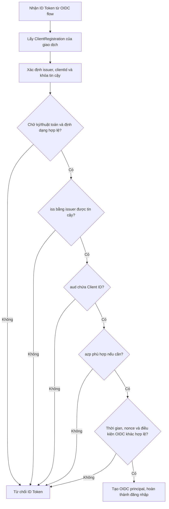

# 11.5. Xác minh issuer và audience của ID Token

## Mục tiêu bài học

Sau bài học này, bạn có thể:

- Giải thích chính xác hai claim **`iss` (issuer)** và **`aud` (audience)** trong OpenID Connect (OIDC) ID Token.
- Xác định **issuer được tin cậy** và **Client ID mong đợi** từ `ClientRegistration` của Spring Security.
- Hiểu quy tắc so khớp issuer **chính xác**, kiểm tra audience chứa Client ID và xử lý trường hợp `aud` là một chuỗi hoặc mảng nhiều chuỗi.
- Giải thích claim **`azp` (authorized party)** và điều kiện cần chú ý khi ID Token có nhiều audience.
- Phân biệt xác thực **ID Token của OIDC Client** với xác thực **Access Token của Resource Server**.
- Sử dụng cấu hình Spring Security Servlet `oauth2Login()` và OIDC Discovery để bảo vệ luồng đăng nhập, đồng thời chẩn đoán lỗi issuer/audience.
- Tránh các lỗi bảo mật như tin payload JWT chưa xác minh, chấp nhận token của nhà cung cấp khác hoặc bỏ qua audience.

## 1. Bối cảnh: vì sao một ID Token phải có đúng người phát hành và người nhận?

Giả sử **Learning Portal** là ứng dụng web Spring Boot. Người dùng đăng nhập bằng **Campus Identity**, một OpenID Provider (OP). Portal là **OIDC Client/Relying Party (RP)**.

Dữ liệu đăng ký giả định:

```text
Client registration ID (ở Spring): campus
OAuth Client ID (ở OP):            learning-portal-web
OIDC issuer:                       https://login.example.org/realms/campus
```

Sau khi người dùng hoàn thành Authorization Code Flow, Portal đổi code tại Token Endpoint và nhận một ID Token. Payload JSON minh họa:

```json
{
  "iss": "https://login.example.org/realms/campus",
  "sub": "student-9b71",
  "aud": "learning-portal-web",
  "exp": 1893456600,
  "iat": 1893456300,
  "nonce": "example-nonce"
}
```

Các giá trị chỉ dùng để học, không phải token sử dụng được.

Ba claim quan trọng ở đây:

| Claim | Câu hỏi được trả lời | Ý nghĩa |
| --- | --- | --- |
| `iss` | **Ai đã phát hành?** | Issuer Identifier của OpenID Provider |
| `aud` | **Phát hành cho ai?** | Một hoặc nhiều đối tượng nhận; với ID Token phải bao gồm Client ID của RP |
| `sub` | **Người dùng nào được xác thực?** | Subject Identifier do OP cấp cho End-User |

Portal chỉ được tin ID Token khi:

1. Token được bảo vệ/xác thực bằng chữ ký hoặc cơ chế mật mã thích hợp của OP đáng tin cậy.
2. **`iss` trùng issuer đã cấu hình**.
3. **`aud` bao gồm Client ID của Portal** và `azp` thỏa quy tắc áp dụng.
4. Các kiểm tra OIDC khác như thời hạn, nonce và ngữ cảnh giao dịch đều hợp lệ.

**ID Token không phải một tài liệu JSON mà client chỉ cần giải mã là tin được.** Kẻ tấn công có thể tự tạo JSON chứa đúng `iss` và `aud`. Việc xác thực mật mã và ràng buộc với provider tin cậy là điều kiện cần thiết.

### 1.1. Những URL và định danh dễ gây nhầm lẫn

| Thành phần | Ví dụ | Có dùng trực tiếp làm `iss` hay `aud` không? |
| --- | --- | --- |
| Registration ID | `campus` | Là khóa nội bộ của Spring, **không** phải audience |
| Client ID | `learning-portal-web` | **Có:** phải thuộc `aud` của ID Token |
| Issuer | `https://login.example.org/realms/campus` | **Có:** phải bằng `iss` |
| Authorization Endpoint | `https://login.example.org/realms/campus/protocol/openid-connect/auth` | Endpoint xin ủy quyền, **không phải issuer** |
| Token Endpoint | `https://login.example.org/realms/campus/protocol/openid-connect/token` | Endpoint đổi code lấy token, **không phải `aud` của ID Token** |
| Redirect URI | `https://portal.example.org/login/oauth2/code/campus` | Callback của Portal, **không phải `iss` hoặc `aud`** |
| Tên hiển thị client | `Campus SSO` | Phục vụ UI, **không phải audience** |
| `jwks_uri` | Địa chỉ OP công bố khóa công khai | Nơi lấy khóa xác minh, **không phải issuer** |

Endpoint trong bảng chỉ là ví dụ có thể có. Các đường dẫn thực phải được lấy từ metadata của OP tương ứng.

## 2. `iss`: xác minh Issuer Identifier chính xác

Claim `iss` của OIDC ID Token biểu thị định danh OpenID Provider đã phát hành token. Theo OIDC Core, issuer phải là một Issuer Identifier phù hợp quy tắc URI của OIDC; giá trị bên trong ID Token phải khớp với issuer của OP mà Client đã tin cậy.

Đối với ví dụ:

```text
Expected issuer:
https://login.example.org/realms/campus

ID Token "iss":
https://login.example.org/realms/campus
```

Trường hợp này **đạt phép kiểm tra issuer**.

Nhưng nếu ID Token trả:

```json
{
  "iss": "https://login.example.org/realms/partners"
}
```

thì dù cùng hostname `login.example.org`, nó là **issuer khác**. Portal đã khởi tạo flow cho realm `campus`, vì vậy token của realm `partners` phải bị từ chối.

### 2.1. So sánh issuer là so sánh định danh đầy đủ

Không sử dụng:

```text
actualIssuer.contains("login.example.org")
actualIssuer.startsWith("https://login.example.org")
actualIssuer.endsWith("campus")
```

Các phép kiểm tra này có thể nhầm realm, tenant, path hoặc giá trị khác có cùng tiền tố.

Các ví dụ thường **không được coi là cùng Issuer Identifier**:

```text
https://login.example.org/realms/campus
https://login.example.org/realms/campus/
http://login.example.org/realms/campus
https://login.example.org
https://login.example.org/realms/staff
```

Không tự động bỏ dấu `/` cuối, bỏ path hoặc chuyển `http` thành `https` trong token rồi coi là hợp lệ. Nếu có khác biệt, phải kiểm tra cấu hình issuer công khai và metadata của OP.

### 2.2. Issuer không nhất thiết bằng URL Token Endpoint

Trong một OP giả định:

```text
Issuer:
https://login.example.org/realms/campus

Authorization Endpoint:
https://login.example.org/realms/campus/protocol/openid-connect/auth

Token Endpoint:
https://login.example.org/realms/campus/protocol/openid-connect/token

JWKS URI:
https://login.example.org/realms/campus/protocol/openid-connect/certs
```

Issuer định danh hệ thống phát hành; các URL còn lại là endpoint có nhiệm vụ cụ thể.

Vì vậy, đưa đường dẫn `/token` vào `issuer-uri` chỉ vì đó là địa chỉ nhận token request thường là sai. Client phải dùng **Issuer Identifier** mà OP công bố.

### 2.3. Nguồn tin cậy của issuer

Khi tích hợp OIDC, ứng dụng thường biết trước issuer do quản trị viên cấu hình. OpenID Connect Discovery cung cấp metadata như:

```json
{
  "issuer": "https://login.example.org/realms/campus",
  "authorization_endpoint": "https://login.example.org/realms/campus/protocol/openid-connect/auth",
  "token_endpoint": "https://login.example.org/realms/campus/protocol/openid-connect/token",
  "jwks_uri": "https://login.example.org/realms/campus/protocol/openid-connect/certs"
}
```

Metadata này giúp Client biết endpoint và khóa của **OP đã được chọn**. Ứng dụng phải bắt đầu từ issuer được phép trong cấu hình và kiểm tra metadata thuộc đúng issuer đó.

Đừng xây thuật toán:

```text
1. Nhận JWT chưa xác minh
2. Đọc iss tùy ý từ payload
3. Tải metadata/JWKS của iss đó
4. Nếu chữ ký khớp khóa mới tải thì chấp nhận
```

Kẻ tấn công có thể tạo issuer và JWKS của chính mình. Nếu client tự động tin mọi issuer mới thấy, xác minh chữ ký không còn chứng minh token đến từ OP được phép.

## 3. `aud`: xác minh ID Token được phát hành cho đúng Client

`aud` là **Audience**. Trong OIDC ID Token, giá trị này phải bao gồm OAuth 2.0 `client_id` của Relying Party đang xác minh token.

Giả sử Spring lưu:

```text
registrationId = campus
clientId       = learning-portal-web
```

Giá trị mong đợi là:

```text
expectedAudience = learning-portal-web
```

ID Token:

```json
{
  "aud": "learning-portal-web"
}
```

đạt phép kiểm tra audience.

ID Token:

```json
{
  "aud": "teacher-console-web"
}
```

phải bị từ chối bởi Learning Portal, dù nó được Campus Identity ký hợp lệ. Token đó dành cho **ứng dụng khác**.

### 3.1. `aud` có hai kiểu biểu diễn hợp lệ

Theo quy tắc JWT, claim `aud` có thể là một **chuỗi**:

```json
{
  "aud": "learning-portal-web"
}
```

hoặc một **mảng chuỗi**:

```json
{
  "aud": ["learning-portal-web", "shared-audience"]
}
```

Với client hiện tại, điều kiện cơ bản:

```text
aud phải chứa chuỗi "learning-portal-web" dưới dạng một giá trị hoàn chỉnh
```

Không được chấp nhận chuỗi chỉ giống một phần:

```text
"learning-portal-web" != "learning-portal-web-v2"
"learning-portal-web" != "dev-learning-portal-web"
```

Nếu tự viết code kiểm tra mà ép toàn bộ claim `aud` về `String`, ứng dụng có thể lỗi khi OP trả array. Tốt nhất dùng OIDC ID Token validator của framework, vốn được thiết kế để xử lý cấu trúc JWT.

### 3.2. `registrationId` không phải `clientId`

Cấu hình:

```yaml
spring:
  security:
    oauth2:
      client:
        registration:
          campus:
            client-id: learning-portal-web
            client-name: "Campus SSO"
```

- `campus` là **registration ID** dùng chọn cấu hình ở Spring.
- `learning-portal-web` là **OAuth Client ID** dùng làm audience mong đợi.
- `Campus SSO` là **tên hiển thị**, không tham gia kiểm tra audience.

Nếu ID Token có `aud = "campus"` nhưng Client ID thật là `learning-portal-web`, ID Token **không đạt** audience validation.

### 3.3. Audience của ID Token khác Access Token

| Token | Mục tiêu | Ai xác minh `aud`? |
| --- | --- | --- |
| **OIDC ID Token** | Xác thực End-User cho Relying Party | OIDC Client, kiểm tra Client ID của chính mình |
| **OAuth Access Token** | Cho phép gọi một Resource Server | Resource Server, kiểm tra audience dành cho API đó nếu profile/chính sách yêu cầu |
| **JWT client assertion** | Xác thực Client tại Token Endpoint | Authorization Server, kiểm tra audience dành cho chính mình |

Ví dụ:

```text
ID Token aud    = learning-portal-web
Access Token aud = course-api
```

Một JWT có audience `course-api` có thể là access token hợp lệ đối với Course API, nhưng **không vì thế trở thành ID Token hợp lệ cho Learning Portal**. Không gửi ID Token thay Bearer access token tới API nghiệp vụ.

## 4. `azp`: trường hợp một ID Token có nhiều audience

OIDC định nghĩa claim `azp` (*authorized party*), giúp nhận diện bên được ủy quyền mà ID Token được phát hành cho.

Ví dụ ID Token:

```json
{
  "iss": "https://login.example.org/realms/campus",
  "sub": "student-9b71",
  "aud": ["learning-portal-web", "another-audience"],
  "azp": "learning-portal-web"
}
```

Learning Portal kiểm tra:

```text
Client ID có trong aud?  Có.
azp có bằng Client ID?   Có.
```

Theo thủ tục xác minh của **OpenID Connect Core**:

1. **MUST:** `aud` phải bao gồm Client ID của Relying Party.
2. **SHOULD:** Nếu `aud` có nhiều giá trị, Client nên xác minh rằng `azp` có mặt.
3. **SHOULD:** Nếu `azp` có mặt, Client nên xác minh `azp` chính là Client ID của mình.

“MUST” và “SHOULD” là hai mức yêu cầu chuẩn tắc khác nhau. Trong chính sách bảo mật chặt chẽ, có thể yêu cầu `azp` hiện diện khi có nhiều audience và từ chối một `azp` không khớp. Không coi `aud` chứa Client ID là đủ để bỏ qua claim `azp` khác Client ID.

| `aud` | `azp` | Đánh giá khi Client ID là `learning-portal-web` |
| --- | --- | --- |
| `"learning-portal-web"` | Vắng mặt | Audience phù hợp |
| `"teacher-console-web"` | Vắng mặt | **Từ chối:** thiếu audience của Client |
| `["learning-portal-web", "another-audience"]` | `"learning-portal-web"` | Audience và authorized party phù hợp |
| `["learning-portal-web", "another-audience"]` | `"teacher-console-web"` | **Từ chối theo chính sách kiểm tra `azp`** |
| `["learning-portal-web", "another-audience"]` | Vắng mặt | Cần xem xét nghiêm ngặt; OIDC khuyến nghị kiểm tra sự hiện diện của `azp` |
| `["course-api", "teacher-console-web"]` | `"learning-portal-web"` | **Từ chối:** `aud` vẫn thiếu Client ID |

`azp` **không phải** `sub`. `sub` xác định End-User; `azp` xác định bên được ủy quyền trong ngữ cảnh phát hành token.

## 5. Issuer và audience nằm trong quy trình xác minh ID Token tổng thể

Spring Security chỉ nên tạo OIDC principal khi tất cả những điều kiện cần thiết đều thành công.



Sơ đồ thể hiện cách tư duy, không buộc mọi thư viện phải kiểm tra theo đúng thứ tự này.

Các điều kiện khác gồm:

| Yêu cầu | Ý nghĩa |
| --- | --- |
| Chữ ký JWS và thuật toán | Chứng minh token được ký bởi khóa OP phù hợp, chống chỉnh sửa; xử lý JWE nếu dùng mã hóa |
| `exp` | Token chưa hết hạn |
| `iat` | Thời điểm phát hành phù hợp các ràng buộc của giao thức/chính sách |
| `nonce` | Khi request đã gửi nonce, token phải chứa nonce khớp giao dịch |
| `auth_time` | Cần kiểm tra khi yêu cầu `max_age` hoặc chính sách xác thực mới |
| `acr` / `amr` | Mức bảo đảm/phương thức xác thực nếu nghiệp vụ có yêu cầu cụ thể |
| OAuth `state` | Liên kết callback với authorization request đã khởi tạo; không phải claim bắt buộc của ID Token |

Một token đúng `iss` và `aud` nhưng **chữ ký sai** vẫn phải bị từ chối. Một token có chữ ký đúng nhưng `exp` đã qua hoặc nonce không khớp cũng không hợp lệ.

### 5.1. Tại sao không tự Base64URL-decode rồi đăng nhập?

Bất kỳ ai cũng có thể tạo một payload:

```json
{
  "iss": "https://login.example.org/realms/campus",
  "sub": "administrator",
  "aud": "learning-portal-web"
}
```

Nếu ứng dụng chỉ giải mã JSON rồi lấy `sub` tạo session, kẻ tấn công có thể tự nhận danh tính tùy ý. Vì vậy **không được dùng code giải mã JWT chưa xác minh để tạo `Authentication`**. Hãy dùng cơ chế OIDC Login của thư viện đã được cấu hình issuer, audience và khóa tin cậy đúng.

## 6. Cấu hình trong Spring Security OAuth2/OIDC Client

Một ứng dụng Spring Boot Servlet sử dụng OIDC Discovery có thể cấu hình:

```yaml
spring:
  security:
    oauth2:
      client:
        registration:
          campus:
            provider: campus
            client-id: ${CAMPUS_CLIENT_ID}
            client-secret: ${CAMPUS_CLIENT_SECRET}
            client-authentication-method: client_secret_basic
            authorization-grant-type: authorization_code
            redirect-uri: "{baseUrl}/login/oauth2/code/{registrationId}"
            scope:
              - openid
              - profile
              - email

        provider:
          campus:
            issuer-uri: https://login.example.org/realms/campus
```

Ví dụ này giả định **confidential client** ở backend. Domain, issuer và ID đều là minh họa; nhà cung cấp thực phải đăng ký client và redirect URI tương ứng. Client secret thực được lưu qua cơ chế bảo mật, không đưa vào Git.

Phân tích giá trị mong đợi:

```text
ClientRegistration.registrationId = campus
ClientRegistration.clientId       = ${CAMPUS_CLIENT_ID}
ClientRegistration.providerDetails.issuerUri
       = https://login.example.org/realms/campus
```

Nếu giá trị môi trường là:

```text
CAMPUS_CLIENT_ID = learning-portal-web
```

thì:

```text
Expected iss = https://login.example.org/realms/campus
Expected aud = learning-portal-web
```

**`issuer-uri` không phải URL callback**. `{registrationId}` trong redirect URI cũng không phải audience của ID Token.

### 6.1. SecurityFilterChain trong ứng dụng Servlet

```java
@Configuration
class WebSecurityConfiguration {

    @Bean
    SecurityFilterChain webSecurity(HttpSecurity http) throws Exception {
        http
            .authorizeHttpRequests(auth -> auth
                .requestMatchers("/", "/error", "/assets/**").permitAll()
                .anyRequest().authenticated()
            )
            .oauth2Login(Customizer.withDefaults());

        return http.build();
    }
}
```

Trong một ứng dụng có cấu hình và dependency phù hợp, Spring Security xử lý Authorization Code Flow, OIDC ID Token validation và thiết lập principal sau đăng nhập. Các import/dependencies được lược bỏ để ví dụ tập trung vào vấn đề.

Trang bắt đầu đăng nhập thường tại:

```text
/oauth2/authorization/campus
```

Callback mặc định theo URI template:

```text
/login/oauth2/code/campus
```

Sau khi đổi code và nhận ID Token, framework xác minh token theo registration/provider tương ứng. **Không cần viết bộ kiểm tra issuer và audience thủ công trong controller đăng nhập**.

### 6.2. Lấy issuer/client ID dự kiến từ `ClientRegistration`

Trong code Java:

```java
@Component
class OidcRegistrationInspector {

    private final ClientRegistrationRepository registrations;

    OidcRegistrationInspector(ClientRegistrationRepository registrations) {
        this.registrations = registrations;
    }

    void inspect() {
        ClientRegistration registration =
            registrations.findByRegistrationId("campus");

        if (registration == null) {
            throw new IllegalStateException("Unknown registration");
        }

        String expectedIssuer =
            registration.getProviderDetails().getIssuerUri();

        String expectedAudience = registration.getClientId();

        // Hai giá trị này xác định issuer và Client ID mong đợi.
        // Không cần tự parse ID Token để thay OIDC validator.
    }
}
```

`ClientRegistrationRepository` tìm theo **registration ID**, trong khi `getClientId()` trả về **OAuth Client ID** của đăng ký đó.

### 6.3. Quan sát ID Token sau khi Spring xác thực

Đối với principal `OidcUser` đã hình thành sau login:

```java
@RestController
class OidcMetadataController {

    @GetMapping("/me/oidc")
    Map<String, Object> oidcMetadata(
            @AuthenticationPrincipal OidcUser user) {

        Map<String, Object> claims = user.getIdToken().getClaims();

        return Map.of(
            "issuer", claims.get("iss"),
            "audience", claims.get("aud")
        );
    }
}
```

Ví dụ chỉ nhằm minh họa cách lấy hai claim đã được Spring xử lý. Endpoint phải được bảo vệ và chỉ trả metadata cần thiết theo chính sách; không tạo endpoint công khai trả raw ID Token, access token, refresh token hoặc toàn bộ claims chứa dữ liệu cá nhân.

`OidcUser` đến từ đăng nhập đã xác thực khác hoàn toàn với một JWT chưa kiểm tra nhận trực tiếp trong HTTP request.

### 6.4. Tùy biến decoder/validator

Spring Security có các thành phần OIDC token decoder/validator, ví dụ `OidcIdTokenDecoderFactory` trong những phiên bản phù hợp. Khi nghiệp vụ cần thêm chính sách như `acr` hoặc issuer đã đăng ký đặc biệt, hãy sử dụng hook chính thức của phiên bản đang triển khai và **bảo toàn** những bước xác minh có sẵn.

Không thay decoder mặc định bằng logic chỉ đọc `sub` và `email`. Nếu một ID Token bị từ chối do `iss` hoặc `aud` khác cấu hình, nên kiểm tra **ClientRegistration và provider metadata** trước khi nghĩ đến thay validator.

## 7. Nhiều provider, nhiều client: không trộn trust boundary

Learning Portal có thể hỗ trợ:

```text
Registration "campus":
  issuer   = https://login.example.org/realms/campus
  clientId = learning-portal-web

Registration "partner":
  issuer   = https://accounts.partner.example.org
  clientId = partner-learning-web
```

Một cấu hình rút gọn:

```yaml
spring:
  security:
    oauth2:
      client:
        registration:
          campus:
            provider: campus
            client-id: ${CAMPUS_CLIENT_ID}
            client-secret: ${CAMPUS_CLIENT_SECRET}
            authorization-grant-type: authorization_code
            scope: [openid, profile]
            redirect-uri: "{baseUrl}/login/oauth2/code/{registrationId}"

          partner:
            provider: partner
            client-id: ${PARTNER_CLIENT_ID}
            client-secret: ${PARTNER_CLIENT_SECRET}
            authorization-grant-type: authorization_code
            scope: [openid, profile]
            redirect-uri: "{baseUrl}/login/oauth2/code/{registrationId}"

        provider:
          campus:
            issuer-uri: https://login.example.org/realms/campus
          partner:
            issuer-uri: https://accounts.partner.example.org
```

| URL bắt đầu | Registration được chọn | Issuer/audience mong đợi |
| --- | --- | --- |
| `/oauth2/authorization/campus` | `campus` | Campus issuer và Campus Client ID |
| `/oauth2/authorization/partner` | `partner` | Partner issuer và Partner Client ID |

Khi callback trở lại, framework liên kết authorization response với request đã khởi tạo qua `state`/request repository và dùng **registration đúng giao dịch**. Không cho token tự khai issuer để thay đổi danh sách OP mà ứng dụng tin cậy.

### 7.1. Cùng Client ID string ở hai OP không có nghĩa cùng client

Hai provider khác nhau có thể tình cờ cấp cùng chuỗi:

```text
clientId = portal-web
```

Nhưng:

```text
Issuer A = https://login-a.example.org
Issuer B = https://login-b.example.org
```

Chỉ kiểm tra audience mà không kiểm tra issuer sẽ gây nhầm nguồn phát hành. Chỉ kiểm tra chữ ký từ một tập khóa không gắn với issuer cũng có nguy cơ dùng sai trust boundary.

**Issuer, client ID, khóa xác minh và authorization request phải thuộc cùng một registration được tin cậy.**

### 7.2. Liên kết tài khoản bằng `(iss, sub)`

Sau khi ID Token hợp lệ, cặp:

```text
(issuer, subject)
```

có thể được dùng để liên kết danh tính OIDC với tài khoản nội bộ.

Hai tuple:

```text
(https://login.example.org/realms/campus, student-123)
(https://accounts.partner.example.org, student-123)
```

**không mặc nhiên cùng một người dùng**, dù `sub` giống nhau. `sub` có ý nghĩa trong phạm vi issuer đã xác thực. Không tự gộp theo email hoặc `sub` một cách không kiểm soát.

## 8. Các ví dụ phân loại ID Token

Giả sử:

```text
Expected issuer:   https://login.example.org/realms/campus
Expected clientId: learning-portal-web
```

Các ví dụ chỉ xét `iss`, `aud`, `azp` và không kết luận chữ ký/thời gian.

### 8.1. Issuer và audience phù hợp

```json
{
  "iss": "https://login.example.org/realms/campus",
  "sub": "student-123",
  "aud": "learning-portal-web"
}
```

**Kết quả:** đạt hai phép kiểm; tiếp tục xác minh các phần khác.

### 8.2. Issuer là realm khác

```json
{
  "iss": "https://login.example.org/realms/partners",
  "sub": "student-123",
  "aud": "learning-portal-web"
}
```

**Kết quả:** từ chối. Cùng host nhưng khác Issuer Identifier.

### 8.3. Issuer đúng, audience của ứng dụng khác

```json
{
  "iss": "https://login.example.org/realms/campus",
  "sub": "student-123",
  "aud": "teacher-console-web"
}
```

**Kết quả:** từ chối. Token không cấp cho Learning Portal.

### 8.4. Audience nhiều giá trị với `azp` phù hợp

```json
{
  "iss": "https://login.example.org/realms/campus",
  "sub": "student-123",
  "aud": ["learning-portal-web", "secondary-audience"],
  "azp": "learning-portal-web"
}
```

**Kết quả:** đạt điều kiện issuer, audience và authorized party.

### 8.5. Audience có Client ID nhưng `azp` sai

```json
{
  "iss": "https://login.example.org/realms/campus",
  "sub": "student-123",
  "aud": ["learning-portal-web", "secondary-audience"],
  "azp": "other-client"
}
```

**Kết quả:** từ chối theo chính sách xác minh authorized party. Đây không phải token có thể coi là được phát hành cho RP hiện tại một cách không điều kiện.

### 8.6. Claim đúng nhưng chữ ký sai

Payload có `iss` và `aud` giống ví dụ 8.1, nhưng JWT được ký bằng khóa của kẻ tấn công thay vì khóa OP đã đăng ký.

**Kết quả:** từ chối. Claims đúng không thay thế xác minh mật mã.

## 9. Chẩn đoán lỗi issuer/audience khi tích hợp

| Hiện tượng | Nguyên nhân có thể | Hướng kiểm tra |
| --- | --- | --- |
| ID Token bị từ chối vì issuer | `issuer-uri` cấu hình thiếu path realm hoặc OP phát hành issuer khác | So `provider.<alias>.issuer-uri`, metadata `issuer` và claim `iss` |
| Issuer khác scheme/host trên production | OP đứng sau reverse proxy nhưng dùng URL nội bộ | Sửa public issuer/proxy configuration phía OP |
| Issuer chỉ khác dấu `/` cuối | Cấu hình và metadata/token chưa thống nhất chính xác | Đồng bộ Issuer Identifier chính xác |
| Audience không chứa Client ID | Dùng sai `client-id`, nhầm môi trường hoặc nhận token cho app khác | Kiểm tra client registration ở OP và biến môi trường |
| Audience bị so với registration ID | Nhầm `campus` và `learning-portal-web` | Dùng `ClientRegistration.getClientId()` |
| Audience là mảng nhưng code tự viết chỉ xử lý chuỗi | Parser/validator không theo chuẩn JWT | Dùng OIDC validator của thư viện |
| Nhiều audience nhưng `azp` sai | Token được cấp cho authorized party khác | Kiểm tra Client ID/`azp`, đăng ký và chính sách OP |
| JWT không xác minh được chữ ký | Sai issuer/JWKS, key rotation hoặc thuật toán | Kiểm tra metadata, public key tin cậy, `kid`, signing alg |
| Callback sai hoặc `state` mất | Sai redirect URI, session hoặc proxy | Xử lý ở bước OAuth callback, không bỏ issuer check |
| Token Endpoint trả `invalid_client` | Client authentication sai trước khi phát ID Token | Kiểm tra client secret/private key và method |
| Token Endpoint trả `invalid_grant` | Code hết hạn/đã dùng, redirect URI hoặc PKCE không khớp | Kiểm tra authorization request và token exchange |
| Login hợp lệ nhưng API trả 403 | Người dùng thiếu quyền API/role nghiệp vụ | Kiểm tra access token/scope/authorization tại Resource Server |

### 9.1. Phân biệt lỗi trước và sau khi phát hành ID Token

Một lỗi `redirect_uri_mismatch` tại Authorization Server xảy ra **trước** khi client nhận ID Token; nó không trực tiếp chứng minh `iss` hoặc `aud` sai.

Một lỗi `invalid_client` ở Token Endpoint cũng có thể khiến token response không được cấp. Trong khi đó, **issuer mismatch** và **audience mismatch** ở OIDC Client xảy ra khi đã có token cần xác minh.

Cần dựa trên **bước giao dịch** và thông báo thực tế để chẩn đoán đúng, tránh sửa nhầm cơ chế không liên quan.

### 9.2. Lỗi issuer do OP sau reverse proxy

Giả sử public issuer dự kiến:

```text
https://login.example.org/realms/campus
```

Nhưng token nhận có:

```text
http://identity-service:8080/realms/campus
```

Nếu OP sử dụng địa chỉ nội bộ để phát hành `iss`, hãy cấu hình OP nhận diện external/public issuer và reverse proxy phù hợp. Không đơn giản cho Spring tin issuer HTTP nội bộ cùng lúc với issuer HTTPS công khai để tránh lỗi.

### 9.3. Lỗi audience giữa dev và production

```text
Dev Client ID:  learning-portal-dev
Prod Client ID: learning-portal-prod
```

Nếu production dùng nhầm cấu hình dev, OP có thể cấp ID Token mang audience không mong đợi hoặc redirect URI không khớp. Cần tách client registration theo môi trường và cập nhật secrets, callback, issuer đúng. Không đặt một audience allowlist rộng để âm thầm chấp nhận token dành cho môi trường khác.

### 9.4. Cách ghi log an toàn

Để điều tra, chỉ ghi metadata không nhạy cảm và phù hợp chính sách:

```text
registrationId=campus
expectedIssuer=https://login.example.org/realms/campus
expectedClientId=learning-portal-web
failureClass=audience_mismatch
correlationId=<non-sensitive-id>
```

Tránh ghi raw `id_token`, access token, authorization code, refresh token, client secret, cookie phiên hoặc toàn bộ claims cá nhân. Mọi thông tin đã decode trước khi xác minh phải được xem là dữ liệu **không đáng tin cậy**.

## 10. Những nhầm lẫn phổ biến cần tránh

### 10.1. “JWT có chữ ký hợp lệ thì đăng nhập được”

Sai. Chữ ký phải được xác minh bằng **khóa của đúng OP tin cậy**, và `iss`, `aud`, `azp` cùng các điều kiện OIDC còn lại phải hợp lệ. Token do OP thật ký nhưng cấp cho client khác cũng phải bị từ chối.

### 10.2. “Cùng một domain là cùng issuer”

Sai. Với OP đa realm/tenant, issuer có thể khác ở path. Phải so sánh định danh đầy đủ.

### 10.3. “`registrationId` chính là audience”

Sai. `registrationId` là khóa cấu hình cục bộ Spring. Audience của ID Token phải chứa **OAuth Client ID** đã được OP cấp.

### 10.4. “`aud` của ID Token phải là URL API”

Sai. Audience của **ID Token** dành cho OIDC Client, trong khi audience của **Access Token** có thể dành cho Resource Server.

### 10.5. “`aud` có nhiều giá trị thì chỉ cần tìm thấy client ID”

Chưa đầy đủ. Phải xét quy tắc OIDC liên quan **`azp`**, và vẫn phải xác minh chữ ký, issuer, thời gian, nonce.

### 10.6. “Đọc `iss` từ JWT rồi tin provider đó”

Sai. Issuer phải nằm trong cấu hình tin cậy và gắn đúng với authorization request; đọc claim chưa xác minh để tự bổ sung nguồn tin cậy tạo ra rủi ro chấp nhận token từ issuer do kẻ tấn công điều khiển.

### 10.7. “Đăng nhập đúng issuer và audience tức là có quyền admin”

Sai. OIDC xác thực danh tính. Quyền nghiệp vụ của ứng dụng vẫn phải được kiểm tra độc lập. Access token dùng gọi API cần được Resource Server kiểm tra theo những quy tắc phù hợp cho API.

## 11. Bài tập thực hành

### Bài tập 1 — Tìm expected issuer/audience từ YAML

Cho:

```yaml
spring:
  security:
    oauth2:
      client:
        registration:
          university:
            provider: university-op
            client-id: student-portal-prod
            client-name: "SSO Đại học"
            authorization-grant-type: authorization_code
            scope: [openid, profile]
        provider:
          university-op:
            issuer-uri: https://identity.example.edu/realms/students
```

**Hỏi:** `iss` và `aud` phải đáp ứng điều kiện nào?

**Đáp án:**

```text
iss = https://identity.example.edu/realms/students
aud chứa student-portal-prod
```

`university` là registration ID, `university-op` là provider alias, và `SSO Đại học` là client name; cả ba không thay Client ID.

### Bài tập 2 — Cùng host, khác path

```text
Expected issuer = https://identity.example.edu/realms/students
Actual issuer   = https://identity.example.edu/realms/staff
```

**Hỏi:** Có chấp nhận vì cùng hostname không?

**Đáp án:** Không. So khớp issuer phải chính xác.

### Bài tập 3 — `aud` và `azp`

Client ID là `student-portal-prod`.

```json
{
  "aud": ["student-portal-prod", "other"],
  "azp": "student-portal-prod"
}
```

**Hỏi:** Hai claim này có phù hợp không?

**Đáp án:** Có, xét riêng audience/authorized party. Vẫn cần kiểm tra issuer, chữ ký, thời hạn và các ràng buộc OIDC khác.

### Bài tập 4 — `azp` không khớp

```json
{
  "aud": ["student-portal-prod", "other"],
  "azp": "other"
}
```

**Hỏi:** Nên xử lý thế nào?

**Đáp án:** Từ chối theo chính sách xác minh authorized party; không bỏ qua `azp` khác Client ID.

### Bài tập 5 — Nhận Access Token thay ID Token

Một JWT có:

```json
{
  "iss": "https://identity.example.edu/realms/students",
  "aud": "course-api",
  "scope": "courses.read"
}
```

**Hỏi:** Có thể dùng làm bằng chứng OIDC login cho `student-portal-prod` không?

**Đáp án:** Không. Audience hướng tới API và JWT có thể là access token. Client cần xác thực **ID Token do OP phát hành cho RP** theo đúng luồng OIDC.

### Bài tập 6 — OP tự phát hành sai issuer

OP có metadata:

```text
issuer = https://identity.example.edu/realms/students
```

Nhưng ID Token trả:

```text
iss = http://identity-internal:8080/realms/students
```

**Hỏi:** Nên sửa ở đâu?

**Đáp án:** Kiểm tra cấu hình public issuer/hostname/proxy tại OP, đồng bộ metadata và token. Không bỏ qua issuer validation trong Spring để chấp nhận URL nội bộ khác.

## 12. Câu hỏi tự kiểm tra

**1. `iss` nói điều gì về ID Token?**

> Nó định danh OP phát hành token; Client phải xác minh bằng Issuer Identifier đã tin cậy và ràng buộc token với khóa/metadata của OP đó.

**2. `aud` phải chứa giá trị nào?**

> OAuth Client ID của Relying Party hiện tại, tức `ClientRegistration.getClientId()`, không phải registration ID.

**3. ID Token từ OP đáng tin nhưng cấp cho client khác có dùng được không?**

> Không. Audience không chứa Client ID thì phải bị từ chối dù chữ ký và issuer hợp lệ.

**4. ID Token có nhiều audience thì có cần xem `azp` không?**

> Có. OIDC khuyến nghị xác minh `azp` hiện diện khi có nhiều audience và khớp Client ID nếu claim xuất hiện.

**5. Có thể dùng một phép kiểm tra prefix của issuer không?**

> Không. Issuer Identifier phải được so khớp chính xác; cùng hostname không đủ phân biệt tenant hoặc realm.

**6. `iss` đúng và `aud` đúng đã chứng minh người dùng đăng nhập hợp lệ chưa?**

> Chưa. Còn phải kiểm tra chữ ký, thời hạn, nonce, ngữ cảnh authorization request và các điều kiện OIDC áp dụng.

**7. Trong Spring Security, `issuer-uri` có phải URL Token Endpoint không?**

> Không. Nó là định danh OP; các endpoint khác được cấu hình hoặc khám phá từ provider metadata.

**8. Tại sao không lấy issuer từ JWT chưa xác minh để tự thêm provider?**

> Vì kẻ tấn công có thể tự tạo issuer và khóa ký. Ứng dụng chỉ được tin các issuer/registration đã được cấu hình và ràng buộc với giao dịch đăng nhập.

**9. ID Token audience hợp lệ có cấp quyền gọi Course API không?**

> Không. API cần access token phù hợp và phải thực thi authorization nghiệp vụ. ID Token dùng cho xác thực End-User tại Relying Party.

---

## Ghi nhớ

Đối với **OpenID Connect ID Token**, Spring Security Client phải xác minh **`iss` bằng chính xác issuer đáng tin cậy** và **`aud` chứa OAuth Client ID của Relying Party**. Khi `aud` có nhiều giá trị, xét thêm **`azp`** theo quy tắc OIDC. Hai điều kiện này phải đi cùng xác minh chữ ký, thuật toán, thời gian, nonce và những ràng buộc giao dịch cần thiết. Trong Spring Security Servlet, **`ClientRegistration.getProviderDetails().getIssuerUri()`** và **`ClientRegistration.getClientId()`** là hai nguồn cấu hình mong đợi; hãy sửa đúng issuer/client registration khi có mismatch thay vì bỏ qua ID Token validation.
