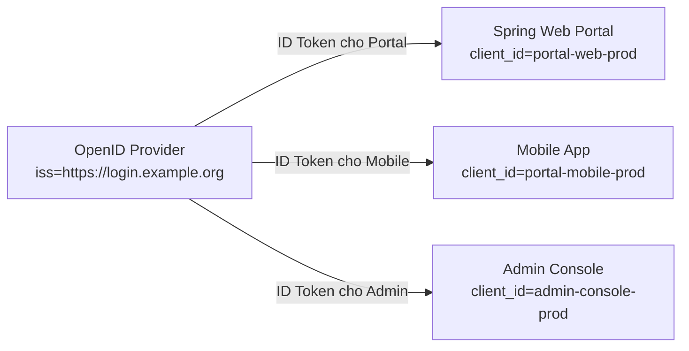

# 11.6. Kiểm tra authorized party khi có claim azp

Trong **OpenID Connect (OIDC)**, một **ID Token** là chứng cứ xác thực mà OpenID Provider (OP) phát hành cho một **Relying Party (RP)**. Khi ứng dụng Spring Security nhận ID Token trong quá trình `oauth2Login()`, việc kiểm tra chữ ký và thời hạn là cần thiết nhưng chưa đủ: ứng dụng còn phải biết token được phát cho **đúng OAuth client** đang hoàn tất đăng nhập.

Hai claim quan trọng nhất ở bước này là:

- **`aud` (audience)**: cho biết ID Token được dự định sử dụng bởi những đối tượng nhận nào. ID Token OIDC phải chứa **`client_id` của RP** trong audience.
- **`azp` (authorized party)**: khi xuất hiện, cho biết **bên được ủy quyền sử dụng ID Token**. Với RP đang xử lý token, giá trị `azp` phải tương ứng với chính **`client_id` của RP** theo quy tắc kiểm tra OIDC.

Claim `azp` đặc biệt có ý nghĩa khi ID Token liệt kê **nhiều audience**. Nếu chỉ kiểm tra rằng `aud` có chứa client ID của mình rồi bỏ qua `azp`, một RP có thể chấp nhận token không phù hợp với ngữ cảnh client mà nó đang xử lý.

Bài học trình bày cách hiểu `azp`, quan hệ giữa `aud` và `client_id`, quy tắc của OIDC Core, tình huống đa audience, cách áp dụng trong Spring Security OAuth 2.0/OIDC Client và những lỗi bảo mật thường gặp.

> **Nguyên tắc ngắn gọn:** `aud` phải chứa client ID hiện tại; nếu `azp` xuất hiện, RP cần đối chiếu **`azp == client_id` của registration đang xử lý**. Khi ID Token có nhiều audience, OIDC Core khuyến nghị kiểm tra sự hiện diện của `azp`; ứng dụng có thể áp dụng chính sách chặt hơn để từ chối token đa audience thiếu `azp`.

## 1. Đặt azp vào đúng ngữ cảnh OIDC

### 1.1. RP, OP và ClientRegistration

Giả sử một hệ thống có:

- **OpenID Provider:** `https://login.example.org`.
- **Spring Boot Portal:** ứng dụng web đóng vai RP, được cấp OAuth client ID `portal-web-prod`.
- **Mobile App:** ứng dụng khác được cấp client ID `portal-mobile-prod`.
- **Đăng ký Spring tại backend:** `registrationId=company`.

`ClientRegistration` của Spring có thể trông như sau:

```yaml
spring:
  security:
    oauth2:
      client:
        registration:
          company:
            provider: company
            client-id: portal-web-prod
            client-secret: ${OIDC_CLIENT_SECRET}
            client-authentication-method: client_secret_basic
            authorization-grant-type: authorization_code
            redirect-uri: "{baseUrl}/login/oauth2/code/{registrationId}"
            scope:
              - openid
              - profile
              - email
        provider:
          company:
            issuer-uri: https://login.example.org
```

Trong cấu hình này:

| Thành phần | Giá trị | Ý nghĩa |
|---|---|---|
| `registrationId` | `company` | Tên cục bộ để Spring tìm registration |
| `client_id` | `portal-web-prod` | ID mà OP đã cấp cho RP, **giá trị dùng để so `aud`/`azp`** |
| `issuer` | `https://login.example.org` | OP đáng tin cậy, dùng đối chiếu `iss` |
| `client_secret` | Biến môi trường backend | Credential dùng cho token endpoint; **không phải `azp`** |
| `sub` | Ví dụ `user-782` | Định danh người dùng tại OP; **không phải `azp`** |

Điểm rất hay nhầm: **`registrationId` không nhất thiết bằng `clientId`**. Vì thế, kiểm tra `azp` phải dùng `ClientRegistration.getClientId()`, không dùng tên registration `company`.

### 1.2. Vì sao phải xác minh token sau callback?

Luồng OIDC Authorization Code trên Spring Servlet:

```mermaid
sequenceDiagram
    autonumber
    participant Browser as Trình duyệt
    participant RP as Spring Security RP
    participant OP as OpenID Provider

    Browser->>RP: GET /account
    RP-->>Browser: Bắt đầu OAuth2/OIDC Login
    Browser->>OP: /authorize?client_id=portal-web-prod&scope=openid...
    OP->>Browser: Xác thực End-User
    OP-->>Browser: Callback ?code=...&state=...
    Browser->>RP: GET /login/oauth2/code/company?code=...&state=...
    RP->>RP: Đối chiếu state với authorization request
    RP->>OP: POST /token: authorization_code + client authentication (+ PKCE)
    OP-->>RP: ID Token + Access Token
    RP->>RP: Xác minh chữ ký, iss, aud, azp, exp, nonce...
    RP->>RP: Tạo OidcUser và SecurityContext
    RP-->>Browser: Session cookie; đăng nhập thành công
```

`azp` thuộc **ID Token validation**, tức sau khi RP nhận token response và **trước khi** chấp nhận token làm bằng chứng xác thực. Không chờ đến controller nghiệp vụ mới kiểm tra `azp`, vì lúc đó principal có thể đã được tạo.

OP phát ID Token với những claim nhận diện **issuer**, **subject**, **audience**, **thời gian** và các điều kiện giao thức khác. `azp` bổ sung một khẳng định về **bên được ủy quyền sử dụng token**, không phải quyền nghiệp vụ của End-User.

## 2. Ý nghĩa chính xác của aud và azp

### 2.1. aud: token hướng đến những người nhận nào?

Trong OIDC Core, `aud` là claim **bắt buộc** của ID Token. Nó chứa audience của token và **phải chứa OAuth 2.0 client ID của RP** đang nhận ID Token.

Ví dụ ID Token dành cho Portal:

```json
{
  "iss": "https://login.example.org",
  "sub": "user-782",
  "aud": "portal-web-prod",
  "exp": 1924999999,
  "iat": 1924996399
}
```

`aud` có thể xuất hiện dưới hai dạng JSON theo JWT/OIDC:

**Một audience dưới dạng chuỗi:**

```json
"aud": "portal-web-prod"
```

**Nhiều audience dưới dạng mảng:**

```json
"aud": ["portal-web-prod", "trusted-companion-audience"]
```

Một số thư viện JWT chuẩn hóa hai dạng thành `List<String>` để ứng dụng dễ xử lý. Khi tự đọc JWT, không được giả định `aud` luôn là một chuỗi rồi dùng so sánh chuỗi thô.

### 2.2. azp: bên nào được ủy quyền sử dụng ID Token?

`azp` là claim **tùy chọn** của OIDC, viết tắt của **Authorized Party**. Khi có mặt, giá trị claim này là một **chuỗi định danh client**, thường dùng cùng `aud` khi token có nhiều audience.

Ví dụ:

```json
{
  "iss": "https://login.example.org",
  "sub": "user-782",
  "aud": [
    "portal-web-prod",
    "trusted-companion-audience"
  ],
  "azp": "portal-web-prod",
  "exp": 1924999999,
  "iat": 1924996399
}
```

Cách đọc:

- `aud` nói rằng `portal-web-prod` nằm trong các audience được liệt kê.
- `azp` nói rằng `portal-web-prod` là bên được ủy quyền sử dụng ID Token.
- RP đang xử lý token phải là client có ID `portal-web-prod`.
- RP **vẫn cần** xác minh chữ ký, issuer, thời hạn, nonce và các điều kiện OIDC khác.

`azp` không phải tên người dùng, không phải mã tenant, không phải quyền `ROLE_ADMIN` và không phải URL Resource Server.

### 2.3. Khác biệt với các claim hay bị nhầm

| Claim / giá trị | Câu hỏi trả lời | Dùng để làm gì? |
|---|---|---|
| `iss` | OP nào phát hành token? | Khớp issuer tin cậy |
| `sub` | End-User nào được xác thực? | Ánh xạ định danh người dùng, thường theo cặp `(iss, sub)` |
| `aud` | Token dành cho audience nào? | Bảo đảm client ID của RP được liệt kê |
| `azp` | Bên nào được ủy quyền sử dụng token? | Khi có, phải đối chiếu với client ID hiện tại |
| `exp` | Token hết hạn lúc nào? | Từ chối token quá hạn |
| `iat` | Token được phát lúc nào? | Kiểm tra thời gian và chính sách |
| `nonce` | ID Token thuộc yêu cầu xác thực nào? | Đối chiếu nonce khi RP đã gửi |
| `client_id` trong cấu hình | RP đăng ký với OP bằng ID nào? | Giá trị kỳ vọng cho `aud` và `azp` |
| `registrationId` trong Spring | Tên local cho registration nào? | Tra cấu hình, không phải giá trị so `azp` |

Khi nói `azp == client_id`, ý muốn so với **client ID của RP thực sự thực hiện yêu cầu token**, không phải client ID của một ứng dụng cùng công ty hoặc một OAuth client khác có chung issuer.

## 3. Quy tắc kiểm tra azp theo OpenID Connect Core

OIDC Core 1.0 quy định việc xác minh ID Token trong các flow khác nhau, trong đó Authorization Code Flow là trọng tâm của Spring Security `oauth2Login()`.

Với audience và authorized party, cần chú ý ba quy tắc:

1. **Kiểm tra audience bắt buộc:** ID Token phải liệt kê `client_id` hiện tại là audience. Nếu không có, RP phải từ chối. Nếu token có thêm audience mà RP không tin cậy, RP cũng phải từ chối.
2. **Khi có nhiều audience:** client **SHOULD** kiểm tra sự hiện diện của `azp`. Đây là khuyến nghị trong OIDC Core; những hệ thống cần chính sách chặt có thể coi thiếu `azp` ở token đa audience là lỗi.
3. **Khi `azp` hiện diện:** client **SHOULD** kiểm tra claim bằng `client_id` của mình. Trong triển khai bảo mật thực tế, nên từ chối nếu giá trị không khớp, thay vì chỉ ghi cảnh báo rồi đăng nhập tiếp.

**Mức độ quy định quan trọng:** OIDC Core dùng **MUST** cho việc client xuất hiện trong `aud` và dùng **SHOULD** cho các bước kiểm tra `azp` nêu trên. Bài này đề xuất một **chính sách nghiêm ngặt** (strict policy) dùng cho RP: multi-audience phải có `azp` và `azp` nếu tồn tại phải đúng client ID. Đó là lựa chọn phòng vệ chặt hơn, không phải diễn đạt lại mọi SHOULD thành MUST của chuẩn.

### 3.1. Bộ quy tắc strict policy nên áp dụng

Với RP có client ID `portal-web-prod`:

| Điều kiện | Hành động |
|---|---|
| `aud` không chứa `portal-web-prod` | **Từ chối** |
| `aud` có thêm audience mà RP không tin cậy | **Từ chối** |
| `aud` chỉ chứa `portal-web-prod`, không có `azp` | **Có thể chấp nhận**, nếu các kiểm tra khác hợp lệ |
| `aud` chỉ chứa `portal-web-prod`, `azp=portal-web-prod` | **Có thể chấp nhận**, nếu các kiểm tra khác hợp lệ |
| `aud` chứa nhiều audience, không có `azp` | **Từ chối theo strict policy** |
| `aud` chứa nhiều audience, `azp=portal-web-prod` | **Có thể chấp nhận**, nếu additional audiences được tin cậy và các kiểm tra khác hợp lệ |
| `azp` hiện diện nhưng bằng client ID khác | **Từ chối**, bất kể `aud` có chứa client ID hiện tại |
| `azp` rỗng hoặc sai kiểu dữ liệu | **Từ chối** |

Cụm “có thể chấp nhận” ở đây chỉ nói riêng về **`aud`/`azp`**. Nó **không** đồng nghĩa ID Token đã hợp lệ toàn bộ. Token vẫn cần chữ ký, issuer, thời gian, nonce và những kiểm tra giao thức liên quan.

### 3.2. azp không được dùng thay aud

Một lỗi tư duy thường gặp:

> “Token có `azp=portal-web-prod`, vậy cho qua dù `aud` không chứa Portal.”

Đây là cách hiểu sai. `azp` không thay thế `aud`. ID Token phải có `aud` đúng; nếu `aud` không chứa client ID của RP, **token không dành cho RP**, dù `azp` trông có vẻ phù hợp.

Ví dụ token cần bị từ chối:

```json
{
  "iss": "https://login.example.org",
  "sub": "user-782",
  "aud": ["some-other-client"],
  "azp": "portal-web-prod",
  "exp": 1924999999,
  "iat": 1924996399
}
```

Trong tình huống này, `azp` không “cứu” một token có audience sai.

## 4. Các ví dụ cụ thể về ID Token và quyết định xác minh

Giả sử RP đã đăng ký:

```text
issuer = https://login.example.org
client_id = portal-web-prod
registrationId = company
trusted extra audience = trusted-companion-audience
```

Các giá trị `exp` và `iat` trong ví dụ là minh họa. Kết quả dưới đây giả định chữ ký, issuer, thời gian và những điều kiện khác đều đã được xác minh hợp lệ.

### 4.1. Trường hợp A: một audience, không có azp

```json
{
  "iss": "https://login.example.org",
  "sub": "user-782",
  "aud": "portal-web-prod",
  "exp": 1924999999,
  "iat": 1924996399
}
```

**Kết luận riêng về `aud`/`azp`:** hợp lệ. `aud` chứa đúng client ID; `azp` là claim tùy chọn và không bắt buộc phải có trong ID Token chỉ có một audience.

Không nên tự đặt chính sách “mọi ID Token phải có `azp`” nếu OP hợp chuẩn thường không phát claim này cho single-audience token; làm vậy có thể từ chối các token hoàn toàn hợp lệ.

### 4.2. Trường hợp B: một audience, azp đúng

```json
{
  "iss": "https://login.example.org",
  "sub": "user-782",
  "aud": ["portal-web-prod"],
  "azp": "portal-web-prod",
  "exp": 1924999999,
  "iat": 1924996399
}
```

**Kết luận:** hợp lệ về phần `aud`/`azp`. Dù chỉ một audience, OP vẫn có thể đưa `azp` vào token. Nếu claim xuất hiện, ứng dụng cần kiểm tra khớp client ID.

### 4.3. Trường hợp C: một audience, azp sai

```json
{
  "iss": "https://login.example.org",
  "sub": "user-782",
  "aud": "portal-web-prod",
  "azp": "portal-mobile-prod",
  "exp": 1924999999,
  "iat": 1924996399
}
```

**Kết luận:** từ chối theo strict policy. `aud` chứa Portal nhưng `azp` cho biết bên được ủy quyền là Mobile. Không bỏ qua mismatch chỉ vì audience đúng.

### 4.4. Trường hợp D: nhiều audience, azp đúng

```json
{
  "iss": "https://login.example.org",
  "sub": "user-782",
  "aud": [
    "portal-web-prod",
    "trusted-companion-audience"
  ],
  "azp": "portal-web-prod",
  "exp": 1924999999,
  "iat": 1924996399
}
```

**Kết luận:** có thể chấp nhận về phần `aud`/`azp` nếu RP thực sự tin cậy `trusted-companion-audience` và token thỏa mãn những kiểm tra khác.

Không nên hiểu có `azp` đúng thì mọi additional audiences đều được phép. Theo OIDC, additional audiences cũng cần được RP đánh giá mức độ tin cậy.

### 4.5. Trường hợp E: nhiều audience, thiếu azp

```json
{
  "iss": "https://login.example.org",
  "sub": "user-782",
  "aud": [
    "portal-web-prod",
    "trusted-companion-audience"
  ],
  "exp": 1924999999,
  "iat": 1924996399
}
```

**Kết luận:** từ chối theo strict policy. OIDC Core khuyến nghị kiểm tra `azp` khi có nhiều audience. Nếu OP không phát claim này, cần trao đổi với nhà cung cấp hoặc xác nhận chính sách rõ ràng thay vì âm thầm bỏ qua.

### 4.6. Trường hợp F: nhiều audience, azp của client khác

```json
{
  "iss": "https://login.example.org",
  "sub": "user-782",
  "aud": [
    "portal-web-prod",
    "trusted-companion-audience"
  ],
  "azp": "portal-mobile-prod",
  "exp": 1924999999,
  "iat": 1924996399
}
```

**Kết luận:** từ chối. Portal không phải authorized party được chỉ định, dù client ID của Portal nằm trong audience.

### 4.7. Trường hợp G: azp đúng nhưng extra audience không đáng tin

```json
{
  "iss": "https://login.example.org",
  "sub": "user-782",
  "aud": [
    "portal-web-prod",
    "unknown-third-party-client"
  ],
  "azp": "portal-web-prod",
  "exp": 1924999999,
  "iat": 1924996399
}
```

**Kết luận:** từ chối nếu `unknown-third-party-client` không nằm trong tập audience RP tin cậy. Một giá trị `azp` đúng không làm mất yêu cầu đánh giá additional audiences.

## 5. Tại sao azp quan trọng khi một issuer phục vụ nhiều client?

### 5.1. Một OP, nhiều ứng dụng

Hệ thống công ty thường dùng một OP chung:



Cùng một người dùng có thể đăng nhập cả ba ứng dụng. Các ID Token có thể cùng `iss` và `sub`, nhưng **audience và authorized party khác nhau theo client registration**.

Nếu Portal chỉ xác minh “chữ ký hợp lệ do OP phát” rồi bỏ qua audience, nó có thể nhận nhầm ID Token đã cấp cho Mobile. Đây là một dạng **token substitution / cross-client confusion**. Việc kiểm tra `aud` và `azp` giúp giữ đúng ranh giới client.

### 5.2. Tại sao token ký hợp lệ vẫn có thể bị từ chối?

Chữ ký chứng minh token đến từ OP (sau khi xác minh bằng khóa tin cậy), nhưng OP có thể phục vụ hàng chục client. Một ID Token dành cho client A **không tự nhiên trở thành** bằng chứng xác thực phù hợp cho client B.

Cũng tương tự:

- `iss` đúng chỉ cho biết nguồn phát hành đúng.
- `sub` đúng chỉ cho biết người dùng được nhắc đến.
- `exp` còn hạn chỉ cho biết token chưa hết hạn.
- **`aud` và `azp`** mới giúp ràng buộc token với OAuth client mà RP đang xử lý.

### 5.3. azp không tự tạo quyền gọi API

Một ID Token có:

```json
{
  "aud": ["portal-web-prod"],
  "azp": "portal-web-prod"
}
```

không chứng minh Portal được gọi API quản trị hay thay mặt người dùng truy cập bất kỳ dữ liệu nào. **ID Token dành cho đăng nhập ở RP**, còn **access token** và chính sách Resource Server quyết định quyền truy cập API.

Đừng gửi ID Token làm Bearer access token đến API chỉ vì ID Token có `azp` phù hợp với client ID.

## 6. Phân biệt azp trong ID Token với azp trong access token

Tên `azp` có thể xuất hiện trong các token JWT của một số nhà cung cấp, nhưng cần xác định **loại token và profile giao thức** trước khi áp dụng quy tắc.

| Ngữ cảnh | Token chính | Điều cần kiểm tra |
|---|---|---|
| Spring OIDC Login | **ID Token** | Chữ ký, issuer, `aud` chứa RP client ID, `azp` nếu có, thời gian, nonce và các điều kiện OIDC |
| Spring Resource Server | **Access Token** | Issuer, chữ ký/introspection, audience của API, scope/authority và chính sách API |
| Authorization Server riêng của sản phẩm | Token có thể có claim `azp` theo profile riêng | Đọc contract của AS; không suy ra semantics OIDC ID Token cho mọi loại JWT |

Trong một số sản phẩm, access token có `azp` để mô tả client gọi API. Đây không phải lý do để Resource Server lấy `azp` làm bằng chứng duy nhất cho quyền truy cập.

Ví dụ **access token** dành cho API:

```json
{
  "iss": "https://login.example.org",
  "sub": "user-782",
  "aud": ["orders-api"],
  "azp": "portal-web-prod",
  "scope": "orders.read",
  "exp": 1924999999
}
```

Nếu API được cấu hình nhận audience `orders-api`, nó phải kiểm tra audience API và những quyền liên quan. Đừng áp dụng sai quy tắc “access token `aud` phải chứa `portal-web-prod`” chỉ vì đó là client gọi API. **OIDC `aud`/`azp` validation trong bài này áp dụng cho ID Token của RP**.

## 7. Spring Security xử lý ID Token ở đâu?

### 7.1. Luồng đăng nhập chuẩn

Với Spring Security Servlet:

```java
import org.springframework.context.annotation.Bean;
import org.springframework.context.annotation.Configuration;
import org.springframework.security.config.Customizer;
import org.springframework.security.config.annotation.web.builders.HttpSecurity;
import org.springframework.security.web.SecurityFilterChain;

@Configuration
public class SecurityConfig {

    @Bean
    SecurityFilterChain securityFilterChain(HttpSecurity http) throws Exception {
        http
            .authorizeHttpRequests(auth -> auth
                .requestMatchers("/", "/error").permitAll()
                .anyRequest().authenticated())
            .oauth2Login(Customizer.withDefaults());

        return http.build();
    }
}
```

Khi registration yêu cầu `openid` và OP trả ID Token, Spring Security sử dụng thành phần OIDC để **giải mã và xác minh ID Token** trước khi tạo principal dạng `OidcUser`.

Những thành phần cần biết:

| Thành phần / khái niệm | Vai trò |
|---|---|
| `ClientRegistration` | Cung cấp `clientId`, issuer và thông tin provider đáng tin |
| `OAuth2LoginAuthenticationFilter` | Xử lý callback đăng nhập trên Servlet |
| `OidcAuthorizationCodeAuthenticationProvider` | Xử lý phần đăng nhập OIDC trong authorization code flow |
| `OidcIdTokenDecoderFactory` | Tạo decoder cho ID Token theo client registration trong các phiên bản Spring Security phù hợp |
| `OidcUserRequest` | Mang client registration, token response/ID Token cho quá trình nạp OIDC user |
| `OidcUserService` | Tạo/nạp principal OIDC, có thể lấy thêm UserInfo theo cấu hình |
| `SecurityContext` | Giữ kết quả xác thực đã được chấp nhận |

Spring Security cung cấp các phép kiểm tra mặc định của OIDC. Tuy nhiên, nếu hệ thống có yêu cầu **strict policy riêng** — ví dụ bắt buộc `azp` khi ID Token có nhiều audience và chỉ cho phép một tập additional audiences — cần đối chiếu hành vi thật của **phiên bản Spring Security đang sử dụng** và bổ sung validator ở điểm mở rộng phù hợp.

Không tự đọc ID Token bằng `Base64.getDecoder()` rồi quyết định login success. Cần giữ nguyên cơ chế xác minh chữ ký, issuer, audience và các điều kiện bắt buộc khác của thư viện.

### 7.2. Lấy client ID kỳ vọng từ đúng registration

Trong callback OAuth2 Login, thông tin quan trọng là **registration đã khởi tạo yêu cầu đó**, không phải một client ID hard-code toàn cục.

Ví dụ:

```java
String expectedClientId =
    oidcUserRequest.getClientRegistration().getClientId();
```

Nếu cùng ứng dụng có hai registration:

```yaml
spring:
  security:
    oauth2:
      client:
        registration:
          company:
            client-id: portal-web-prod
          partner:
            client-id: portal-partner-prod
```

thì ID Token cho `company` phải được so với `portal-web-prod`; ID Token cho `partner` phải được so với `portal-partner-prod`.

**Không dùng `registrationId` để so `azp`**, trừ trường hợp ngẫu nhiên hai giá trị bằng nhau. `registrationId` phục vụ tra cứu trong Spring, còn `client_id` là định danh giao thức của RP tại OP.

## 8. Viết hàm kiểm tra aud và azp theo strict policy

Để làm rõ logic, có thể viết một hàm độc lập chỉ xử lý **hai claim `aud` và `azp`**. Hàm dưới đây không thay thế bộ xác minh chữ ký/JWT/OIDC. Nó là **lớp kiểm tra bổ sung** sau khi ID Token đã được giải mã và xác minh bởi thành phần tin cậy, trước khi hệ thống chấp nhận principal.

### 8.1. Chuẩn hóa aud theo dạng String hoặc List

ID Token JSON có thể chứa một audience dạng chuỗi hoặc nhiều audience dạng mảng. Một cách xử lý minh họa:

```java
import java.util.List;

public final class IdTokenAudienceClaims {

    private IdTokenAudienceClaims() {}

    public static List<String> readAudiences(Object audClaim) {
        if (audClaim instanceof String audience && !audience.isBlank()) {
            return List.of(audience);
        }

        if (audClaim instanceof List<?> rawList && !rawList.isEmpty()) {
            if (!rawList.stream().allMatch(value ->
                    value instanceof String s && !s.isBlank())) {
                throw new IllegalArgumentException(
                    "Invalid aud claim: expected non-empty strings");
            }

            return rawList.stream()
                .map(value -> (String) value)
                .toList();
        }

        throw new IllegalArgumentException(
            "Missing or invalid aud claim");
    }
}
```

Hàm này không tự xác minh token; nó chỉ chuẩn hóa cấu trúc claim. Trong một triển khai dùng `OidcIdToken` đã được Spring parse, accessor chuẩn có thể đã cung cấp audience dưới dạng collection. Tuy vậy, nhận diện cả hai dạng JSON giúp hiểu rõ quy tắc JWT/OIDC.

**Không chuyển kiểu sai thành chuỗi bằng `String.valueOf(...)`** rồi tiếp tục: một claim `aud` sai kiểu không nên được chấp nhận như audience hợp lệ.

### 8.2. Hàm kiểm tra có client ID và danh sách audience tin cậy

Ví dụ chính sách nghiêm ngặt:

```java
import java.util.List;
import java.util.Set;

public final class StrictAzpPolicy {

    private StrictAzpPolicy() {}

    public static void validate(
            String expectedClientId,
            Object rawAud,
            Object rawAzp,
            Set<String> trustedExtraAudiences) {

        if (expectedClientId == null || expectedClientId.isBlank()) {
            throw new IllegalArgumentException("Missing client ID");
        }

        List<String> audiences =
            IdTokenAudienceClaims.readAudiences(rawAud);

        // 1. RP hiện tại bắt buộc phải nằm trong audience.
        if (!audiences.contains(expectedClientId)) {
            throw new IllegalArgumentException("ID Token audience mismatch");
        }

        // 2. Additional audiences phải thuộc danh sách được tin cậy.
        for (String audience : audiences) {
            if (!audience.equals(expectedClientId)
                    && !trustedExtraAudiences.contains(audience)) {
                throw new IllegalArgumentException(
                    "Untrusted additional ID Token audience");
            }
        }

        // 3. azp nếu có phải là một chuỗi không rỗng.
        if (rawAzp != null) {
            if (!(rawAzp instanceof String authorizedParty)
                    || authorizedParty.isBlank()) {
                throw new IllegalArgumentException("Invalid azp claim");
            }

            // 4. azp hiện diện phải khớp client_id của RP.
            if (!expectedClientId.equals(authorizedParty)) {
                throw new IllegalArgumentException(
                    "ID Token authorized party mismatch");
            }
        }

        // 5. Strict policy: nhiều audience thì phải có azp.
        if (audiences.size() > 1 && rawAzp == null) {
            throw new IllegalArgumentException(
                "Missing azp for multiple audiences");
        }
    }
}
```

Trong ví dụ, `trustedExtraAudiences` là **tập giá trị đã được quản trị cấu hình tin cậy**, không phải danh sách được lấy từ `aud` của token rồi lập tức coi là đáng tin.

Ví dụ gọi:

```java
StrictAzpPolicy.validate(
    "portal-web-prod",
    List.of("portal-web-prod", "trusted-companion-audience"),
    "portal-web-prod",
    Set.of("trusted-companion-audience")
);
```

Hàm trên chỉ kiểm tra **`aud`/`azp`**. Nó **không kiểm tra** chữ ký, `iss`, `exp`, `iat`, `nonce`, `auth_time` hoặc các điều kiện OIDC khác. Trong ứng dụng thực tế, dùng hàm này **bổ sung** cho xác minh OIDC của thư viện, không thay thế nó.

Nếu hệ thống không có lý do nghiệp vụ/giao thức để tin bất kỳ audience bổ sung nào, có thể cung cấp `Set.of()` làm allowlist; khi đó mọi token có extra audience sẽ bị từ chối.

### 8.3. Vì sao dùng equals thay vì contains hoặc startsWith?

`client_id` là **identifier**, phải so khớp chính xác:

```java
expectedClientId.equals(authorizedParty)
```

Không dùng:

```java
// Ví dụ không an toàn: không sử dụng
authorizedParty.contains(expectedClientId)
authorizedParty.startsWith(expectedClientId)
```

Vì một identifier như `portal-web-prod-malicious` vẫn có thể chứa prefix `portal-web-prod` mà không phải cùng một client.

Không lowercase/uppercase client ID tùy tiện, không cắt khoảng trắng để sửa token sai; client identifiers là dữ liệu của giao thức, và việc so sánh phải phù hợp quy tắc nhận diện chính xác đã đăng ký.

## 9. Bổ sung chính sách azp vào quá trình nạp OIDC user

Trong Spring Security Servlet OAuth2 Login, ứng dụng có thể cung cấp một `OAuth2UserService<OidcUserRequest, OidcUser>` cho phần `oidcUserService`. Đây là một điểm mở rộng để **áp dụng chính sách bổ sung trước khi trả về principal OIDC**.

Ví dụ dưới đây **không thay** decoder hay token validator của Spring. Nó lấy ID Token đã được luồng đăng nhập OIDC xử lý, kiểm tra thêm `aud`/`azp` theo chính sách của ứng dụng, rồi ủy quyền cho `OidcUserService` mặc định để xây `OidcUser`.

### 9.1. OidcUserService có lớp kiểm tra bổ sung

```java
import java.util.Set;

import org.springframework.security.oauth2.client.oidc.userinfo.OidcUserRequest;
import org.springframework.security.oauth2.client.oidc.userinfo.OidcUserService;
import org.springframework.security.oauth2.client.userinfo.OAuth2UserService;
import org.springframework.security.oauth2.core.OAuth2AuthenticationException;
import org.springframework.security.oauth2.core.OAuth2Error;
import org.springframework.security.oauth2.core.oidc.user.OidcUser;

public final class StrictAzpOidcUserService
        implements OAuth2UserService<OidcUserRequest, OidcUser> {

    private final OidcUserService delegate = new OidcUserService();

    @Override
    public OidcUser loadUser(OidcUserRequest request)
            throws OAuth2AuthenticationException {

        String expectedClientId =
            request.getClientRegistration().getClientId();

        var claims = request.getIdToken().getClaims();

        try {
            StrictAzpPolicy.validate(
                expectedClientId,
                claims.get("aud"),
                claims.get("azp"),
                Set.of("trusted-companion-audience")
            );
        } catch (IllegalArgumentException ex) {
            throw new OAuth2AuthenticationException(
                new OAuth2Error(
                    "invalid_id_token",
                    "ID Token audience/authorized party validation failed",
                    null
                ),
                ex
            );
        }

        return delegate.loadUser(request);
    }
}
```

Giải thích:

- `request.getClientRegistration().getClientId()` lấy **client ID đúng với flow**, không phải hằng số toàn cục.
- `request.getIdToken().getClaims()` lấy claims từ ID Token đã đi qua phần xử lý token của Spring.
- `StrictAzpPolicy.validate(...)` áp dụng policy của ứng dụng: audience hiện tại, trusted extras và authorized party.
- Nếu policy không đạt, ném `OAuth2AuthenticationException` để quá trình đăng nhập thất bại.
- Nếu đạt, `delegate.loadUser(request)` tiếp tục tạo OIDC principal theo cách thông thường.

Trong sản phẩm thật, tập `trustedExtraAudiences` cần được cấu hình **theo issuer và registration**, không hard-code một audience dùng chung cho mọi OP nếu ứng dụng hỗ trợ nhiều provider. Giá trị minh họa `trusted-companion-audience` chỉ là ví dụ.

### 9.2. Gắn service vào SecurityFilterChain

```java
import org.springframework.context.annotation.Bean;
import org.springframework.context.annotation.Configuration;
import org.springframework.security.config.annotation.web.builders.HttpSecurity;
import org.springframework.security.web.SecurityFilterChain;

@Configuration
public class LoginSecurityConfig {

    @Bean
    SecurityFilterChain securityFilterChain(HttpSecurity http)
            throws Exception {

        http
            .authorizeHttpRequests(auth -> auth
                .requestMatchers("/", "/login", "/error").permitAll()
                .anyRequest().authenticated())
            .oauth2Login(oauth2 -> oauth2
                .userInfoEndpoint(userInfo -> userInfo
                    .oidcUserService(new StrictAzpOidcUserService())));

        return http.build();
    }
}
```

Khi thực hiện OIDC Login, Spring Security sử dụng service được cấu hình để nạp principal. Điều đó cho phép ứng dụng từ chối đăng nhập nếu policy bổ sung không được đáp ứng.

**Giới hạn quan trọng:** lớp `OidcUserService` là phần **xử lý sau khi ID Token đã được xác minh bởi decoder**. Nếu cần thay đổi hành vi kiểm tra JWT ở **lớp decoder/token validator**, hãy dùng extension point được Spring Security hỗ trợ cho phiên bản đang chạy; không thay token decoder mặc định bằng một implementation chỉ giải mã JSON mà bỏ chữ ký, issuer, audience hoặc thời gian.

### 9.3. Dùng API của thư viện thay vì tự parse JWT trên controller

Không nên tạo endpoint:

```java
@GetMapping("/callback")
public String callback(@RequestParam String idToken) {
    // decode payload, đọc azp rồi tạo session...
}
```

vì cách này bỏ qua authorization-code exchange, `state`, PKCE và nhiều kiểm tra OIDC của Spring. Callback OIDC chuẩn nên để Spring Security xử lý; logic riêng chỉ nên bổ sung ở extension point đã thiết kế.

## 10. Kiểm tra azp ở lớp decoder và policy ở lớp user service khác nhau thế nào?

Có hai cấp độ kiểm tra:

| Cấp độ | Trách nhiệm | Thời điểm |
|---|---|---|
| **Protocol token validation** | Chữ ký, thuật toán, issuer, audience, expiration, nonce, quy tắc OIDC gồm azp theo implementation | Trước khi chấp nhận ID Token làm bằng chứng xác thực |
| **Application policy** | Ràng buộc nghiêm ngặt hơn như bắt buộc azp cho multi-audience, trusted audiences theo tenant | Trước khi tạo/cho phép principal phiên ứng dụng |

Spring Security có thể thực hiện nhiều quy tắc OIDC mặc định; không nên tự viết lại toàn bộ chúng chỉ để bổ sung một điều kiện. Những kiểm tra bổ sung cần **không làm yếu đi** các kiểm tra protocol mặc định.

Ví dụ chính sách có thể khác nhau:

- **RP A:** chỉ chấp nhận ID Token với một audience duy nhất bằng chính client ID. Đây là chính sách nghiêm ngặt, đơn giản.
- **RP B:** chấp nhận additional audience được OP cam kết là `trusted-companion-audience`, nhưng yêu cầu `azp` hiện diện và đúng client ID.
- **RP C:** có nhiều provider; mỗi registration có client ID và allowlist extra audiences riêng.

Không có lý do mặc định phải nới policy để chấp nhận mọi extra audience. Khi OP gửi multi-audience ID Token, RP nên hiểu rõ vì sao token được thiết kế như vậy.

## 11. Tình huống nhiều ClientRegistration trong Spring Security

Giả sử một backend có hai cấu hình:

```yaml
spring:
  security:
    oauth2:
      client:
        registration:
          company:
            provider: company
            client-id: portal-company-prod
            client-secret: ${COMPANY_CLIENT_SECRET}
            authorization-grant-type: authorization_code
            redirect-uri: "{baseUrl}/login/oauth2/code/{registrationId}"
            scope: openid,profile
          partner:
            provider: partner
            client-id: portal-partner-prod
            client-secret: ${PARTNER_CLIENT_SECRET}
            authorization-grant-type: authorization_code
            redirect-uri: "{baseUrl}/login/oauth2/code/{registrationId}"
            scope: openid,profile
        provider:
          company:
            issuer-uri: https://login.company.example
          partner:
            issuer-uri: https://login.partner.example
```

Với người dùng chọn `/oauth2/authorization/company`:

- Client ID kỳ vọng là `portal-company-prod`.
- Issuer kỳ vọng là `https://login.company.example`.
- Nếu ID Token có `azp` thì nó phải khớp `portal-company-prod`.

Với người dùng chọn `/oauth2/authorization/partner`:

- Client ID kỳ vọng là `portal-partner-prod`.
- Issuer kỳ vọng là `https://login.partner.example`.
- Nếu có `azp` thì nó phải khớp `portal-partner-prod`.

Không được dùng cùng một `expectedClientId` hard-code cho cả hai flow. Nếu chọn sai registration để đối chiếu token, ứng dụng có thể từ chối người dùng hợp lệ hoặc làm yếu ranh giới chống mix-up.

### 11.1. azp không giải quyết mọi rủi ro multi-issuer

Ngay cả khi `azp` khớp một client ID, RP vẫn cần kiểm tra `iss` từ OP đáng tin. Hai issuer khác nhau có thể phát token có `client_id` hoặc `sub` giống nhau.

Kiểm tra đầy đủ phải dựa trên **ngữ cảnh đăng nhập đã khởi tạo**, gồm registration, issuer, authorization request/callback và các điều kiện token.

Không lấy `iss` từ một ID Token chưa xác minh rồi tự động kết nối tới một JWKS URL bất kỳ. Điều này có thể tạo rủi ro chọn sai trust anchor hoặc SSRF.

### 11.2. azp và ánh xạ tài khoản nội bộ

Sau khi RP xác minh ID Token, ứng dụng có thể ánh xạ người dùng nội bộ bằng:

```text
identity_key = (iss, sub)
```

Ví dụ:

```text
iss = https://login.company.example
sub = user-782
local_user_id = 3152
```

Không dùng `azp` làm user ID. `azp` mô tả OAuth client/RP, không mô tả cá nhân đăng nhập. Nó cũng không phải role hoặc permission để quyết định người dùng có được truy cập `/admin`.

Nếu ứng dụng có nhiều tenant, cần kết hợp identity mapping với dữ liệu tenant/authorization riêng. Claim `azp` đúng chỉ là một điều kiện để tin token trong ngữ cảnh client, không đồng nghĩa quyền nghiệp vụ đã được cấp.

## 12. Các lỗi triển khai phổ biến

### 12.1. Bỏ qua azp vì aud đã chứa client ID

Ví dụ:

```java
if (audiences.contains(expectedClientId)) {
    acceptLogin();
}
```

Logic này chưa xét `azp` khi token chứa claim đó, và chưa đánh giá additional audiences. Trong ID Token đa audience, việc thiếu kiểm tra có thể khiến RP chấp nhận token được phát theo ngữ cảnh client khác.

Cách tiếp cận phù hợp: giữ các kiểm tra OIDC mặc định và áp dụng policy `aud`/`azp` theo chuẩn/hợp đồng OP.

### 12.2. So azp với registrationId

Một Spring registration:

```text
registrationId = company
clientId        = portal-web-prod
ID Token azp    = portal-web-prod
```

Nếu code kiểm tra:

```java
"company".equals(azp)
```

thì có thể từ chối một token hợp lệ vì so với tên cục bộ thay vì client ID thực tế. Dùng `request.getClientRegistration().getClientId()`.

### 12.3. Coi azp vắng mặt luôn là lỗi

ID Token chỉ có một audience, không có `azp`, có thể hợp chuẩn. Nếu ứng dụng yêu cầu `azp` trong mọi token mà OP không phát, login sẽ thất bại không cần thiết.

Hãy phân biệt:

- **Single audience:** `azp` có thể vắng; nếu hiện diện cần kiểm tra.
- **Multiple audiences:** OIDC khuyến nghị kiểm tra `azp` có mặt; strict policy có thể bắt buộc.

### 12.4. Dùng azp thay thế kiểm tra chữ ký và issuer

Một payload JWT chưa được xác minh có thể chứa bất kỳ giá trị `azp` nào do kẻ tấn công tự gõ. Vì vậy:

```text
azp == client_id
```

chỉ có giá trị khi token đã được kiểm tra đầy đủ trong ngữ cảnh issuer và khóa ký đáng tin. Không đọc một token bất kỳ, thấy `azp` đúng rồi tạo `SecurityContext`.

### 12.5. Chấp nhận azp không đúng kiểu

Ví dụ payload sai kiểu:

```json
{
  "aud": "portal-web-prod",
  "azp": ["portal-web-prod"]
}
```

OIDC `azp` phải là **chuỗi**, không phải mảng. Không ép một mảng thành chuỗi rồi coi là hợp lệ. Tương tự, `azp=""` hoặc `azp=null` không được xem là một client ID hợp lệ nếu claim hiện diện.

### 12.6. Dùng so sánh gần đúng

Không kiểm tra:

```java
azp.startsWith("portal-web")
```

vì có thể chấp nhận client ID khác chỉ cùng prefix. So sánh phải dựa trên identifier chính xác mà OP đã cấp cho registration.

### 12.7. Trộn ID Token và access token

Một access token có `azp=portal-web-prod` không tự chứng minh người dùng đã hoàn tất OIDC Login với Portal. Access token được cấp cho Resource Server và mang semantics/validation của AS/API.

Không dùng access token thay ID Token tại RP; không dùng ID Token thay access token tại API.

### 12.8. Nới audience validation để tránh login lỗi

Nếu RP nhận ID Token có `aud` không chứa client ID, không nên khắc phục bằng cách cho phép mọi audience hoặc chỉ dựa vào `sub`/`email`. Cần kiểm tra client registration, OP config và flow thực sự sử dụng.

Một lỗi khớp audience/azp có thể chỉ ra cấu hình client nhầm môi trường (staging/prod), nhầm registration hoặc OP phát token không theo contract.

## 13. Khi azp không khớp: chẩn đoán theo trình tự nào?

Một thông báo như “ID token invalid” không nhất thiết đã nói rõ claim sai. Hãy phân biệt tầng lỗi:

| Hiện tượng | Nguyên nhân có thể | Cách điều tra |
|---|---|---|
| `invalid_client` tại Token Endpoint | Sai client secret, client auth method, client không được đăng ký | `ClientRegistration`, OP client settings |
| `invalid_grant` khi đổi code | Code hết hạn, redirect URI khác, PKCE verifier sai | Authorization request, callback, Token Endpoint |
| ID Token signature verification failed | Sai issuer/JWKS/kid/algorithm | OP metadata và token decoder |
| ID Token `aud` không chứa client ID | OP phát token cho client khác hoặc cấu hình sai | Client ID thực tế của registration |
| `azp` present but different | Token chỉ định authorized party là client khác | Claim `azp`, registration và issuer đáng tin |
| Multi-audience thiếu `azp` | OP không phát claim, policy ứng dụng yêu cầu | Contract OP và chính sách strict |
| Extra audience không đáng tin | OP phát nhiều audience hơn RP được phép chấp nhận | Audience allowlist theo issuer/client |
| `iss` sai | Token từ OP khác hoặc cấu hình metadata sai | `issuer-uri` và trust configuration |
| `exp`/`iat`/`nonce` sai | Token quá hạn, lệch đồng hồ hoặc callback không thuộc request gốc | Token time và state/nonce correlation |
| Login thành công nhưng không có quyền nghiệp vụ | Role/permission/tài khoản nội bộ | Authorization của ứng dụng, không phải `azp` |

### 13.1. Ghi log an toàn

Có thể log **metadata không nhạy cảm** sau khi xác minh ngữ cảnh thích hợp:

```text
event=oidc_id_token_validation
registrationId=company
expectedClientId=portal-web-prod
issuer=https://login.example.org
audienceCount=2
authorizedPartyMatchesClient=false
result=rejected
reason=azp_mismatch
```

Không in toàn bộ ID Token, authorization code, access token, refresh token hoặc client secret vào log. Các claim trong ID Token có thể chứa dữ liệu cá nhân. Trong hệ thống đa tenant, kể cả các identifier như client ID/issuer cũng cần được xử lý theo chính sách logging của tổ chức.

**Phân biệt:** Log `azp` sai có thể giúp vận hành nhận ra client ID bị cấu hình nhầm; nhưng không để thông báo lỗi hiển thị token đầy đủ trên trang login cho người dùng cuối.

### 13.2. Không “sửa” ID Token ở phía RP

Nếu token có `azp` sai, không được clone payload JWT rồi ghi đè `azp` cho đúng client ID. Chữ ký sẽ không còn hợp lệ, và quan trọng hơn, RP không có quyền sửa khẳng định của OP.

Giải pháp là sửa **client registration, yêu cầu ủy quyền hoặc cấu hình phát hành ID Token tại OP**, đồng thời chỉ chấp nhận token đáp ứng quy tắc xác minh.

## 14. Multi-audience và danh sách audience tin cậy

OIDC Core nêu rằng nếu token chứa additional audiences mà RP không tin cậy, RP phải từ chối. Vì vậy, ngoài kiểm tra `azp` cần có tư duy **trust policy** đối với toàn bộ audience.

Giả sử:

```json
"aud": [
  "portal-web-prod",
  "analytics-client",
  "unknown-client"
]
```

Dù:

```json
"azp": "portal-web-prod"
```

thì RP chưa thể chấp nhận một cách an toàn nếu `unknown-client` không nằm trong tập đối tượng được OP/RP thỏa thuận tin cậy.

Một chính sách chặt có thể:

- Chỉ cho phép `aud=[client_id]`; khi có thêm audience thì từ chối.
- Hoặc cho phép một số audience bổ sung theo **cấu hình server** ứng với issuer/registration.
- Bắt buộc `azp=client_id` nếu `azp` hiện diện.
- Bắt buộc có `azp` khi có nhiều audience theo strict policy.

Không nên triển khai chính sách như sau:

```java
// Ví dụ sai: tự tin mọi audience do token khai báo
Set<String> trusted = new HashSet<>(audiences);
```

Vì làm vậy biến **dữ liệu phải kiểm tra** thành **chính sách cho phép**. Trust policy phải được cấu hình trước bởi RP hoặc lấy từ cấu hình đã được xác thực và quản trị, không hình thành từ chính token đang được xác minh.

### 14.1. Không giả định mọi OP phát multi-audience token

Nhiều OP phát ID Token với duy nhất client ID của RP trong `aud`. Khi đó `azp` có thể vắng. Một số OP hoặc profile đặc thù có thể thêm audience khác. Không tự tạo multi-audience ID Token để giải quyết nhu cầu API: **ID Token không phải access token**.

Nếu OP phát token có nhiều audience, cần hiểu lý do giao thức cụ thể, ràng buộc tin cậy và giới hạn sử dụng token trước khi cấu hình RP chấp nhận.

## 15. Bảng tình huống để tự áp dụng quy tắc

Giả sử:

```text
expected client_id = web-client
trusted extra audiences = {trusted-audience}
```

| `aud` | `azp` | Kết quả theo strict policy | Lý do |
|---|---|---|---|
| `"web-client"` | Không có | Cho qua phần aud/azp | Single audience hợp lệ |
| `["web-client"]` | `"web-client"` | Cho qua phần aud/azp | Authorized party đúng |
| `["web-client"]` | `"other-client"` | Từ chối | azp mismatch |
| `["other-client"]` | `"web-client"` | Từ chối | aud không chứa web-client |
| `["web-client","trusted-audience"]` | Không có | Từ chối | Multi-audience thiếu azp theo strict policy |
| `["web-client","trusted-audience"]` | `"web-client"` | Cho qua phần aud/azp | Có azp đúng và extra audience tin cậy |
| `["web-client","trusted-audience"]` | `"trusted-audience"` | Từ chối | azp không phải current client ID |
| `["web-client","unknown-client"]` | `"web-client"` | Từ chối | Additional audience không tin cậy |
| `[]` | `"web-client"` | Từ chối | aud thiếu audience hợp lệ |
| `"web-client"` | `""` | Từ chối | azp hiện diện nhưng rỗng |
| `"web-client"` | `["web-client"]` | Từ chối | azp sai kiểu |

Bảng này kiểm tra **logic `aud`/`azp`**, không thể dùng thay chữ ký và các kiểm tra giao thức. Một token khớp toàn bộ `aud`/`azp` vẫn bị từ chối nếu hết hạn, sai issuer hoặc chữ ký không hợp lệ.

## 16. Những điểm cần nhớ khi áp dụng Spring Security

Trước khi quyết định nhận hoặc từ chối một ID Token trong ứng dụng Spring Security OAuth 2.0/OIDC Client:

1. **Xác định đúng registration của flow.** Dùng `ClientRegistration.getClientId()`, không dùng `registrationId` hay một client ID mặc định cho mọi OP.
2. **Duy trì validation chuẩn của Spring/OIDC.** Kiểm tra chữ ký, issuer, audience, thời hạn và các claim cần thiết trước khi thiết lập Authentication.
3. **Kiểm tra `aud` chứa client ID hiện tại.** Không dùng `azp` thay thế điều kiện này.
4. **Xét những additional audiences.** Chỉ chấp nhận khi nằm trong tập tin cậy đã xác định; nếu không có lý do cần multiple audience, có thể dùng policy chỉ cho phép single audience.
5. **Kiểm tra `azp` nếu xuất hiện.** Nó phải là chuỗi không rỗng và bằng client ID của RP hiện tại.
6. **Với multi-audience, xác định chính sách thiếu `azp`.** OIDC khuyến nghị kiểm tra claim này; ứng dụng nghiêm ngặt nên từ chối nếu thiếu.
7. **Không lấy client ID từ token đang được xác minh để làm giá trị kỳ vọng.** Giá trị kỳ vọng phải xuất phát từ registration đáng tin, đã gắn với authorization request.
8. **Không dùng `azp` làm user ID hoặc role.** Ánh xạ danh tính theo `(iss, sub)` và kiểm tra authorization nghiệp vụ riêng.
9. **Phân biệt ID Token và access token.** Resource Server phải dùng chính sách kiểm tra access token đúng audience API; không tái sử dụng rập khuôn quy tắc của ID Token.
10. **Bảo vệ dữ liệu khi chẩn đoán.** Không log token/secret đầy đủ, không bỏ qua validation chỉ để login “chạy được”.

**Kết luận:** `azp` là một phần của **ràng buộc ID Token với OAuth client đã được OP chỉ định**, đặc biệt hữu ích khi token có nhiều audience. Trong Spring Security, so sánh `azp` với **`clientId` của đúng ClientRegistration**, kiểm tra audience bổ sung và giữ nguyên toàn bộ phép xác minh OIDC là cách tránh nhầm lẫn token giữa các client dùng chung một OpenID Provider.

## 17. Tài liệu tham khảo

- [OpenID Connect Core 1.0 — ID Token](https://openid.net/specs/openid-connect-core-1_0.html#IDToken): định nghĩa `aud`, `azp` và các claim của ID Token.
- [OpenID Connect Core 1.0 — ID Token Validation](https://openid.net/specs/openid-connect-core-1_0.html#IDTokenValidation): các điều kiện xác minh ID Token, gồm audience và authorized party.
- [RFC 7519 — JSON Web Token (JWT)](https://www.rfc-editor.org/rfc/rfc7519): cách biểu diễn audience dạng chuỗi hoặc mảng và các registered claims.
- [RFC 9700 — Best Current Practice for OAuth 2.0 Security](https://www.rfc-editor.org/rfc/rfc9700): phân biệt token, chống nhầm lẫn client và các khuyến nghị OAuth hiện đại.
- [Spring Security — OAuth 2.0 Login](https://docs.spring.io/spring-security/reference/servlet/oauth2/login/index.html): xử lý đăng nhập OAuth2/OIDC trên Servlet stack.
- [Spring Security — OAuth 2.0 Login Advanced Configuration](https://docs.spring.io/spring-security/reference/servlet/oauth2/login/advanced.html): các extension point của OAuth2/OIDC Login.
- [Spring Security — OAuth 2.0 Client](https://docs.spring.io/spring-security/reference/servlet/oauth2/client/index.html): `ClientRegistration` và quản lý authorized clients.
