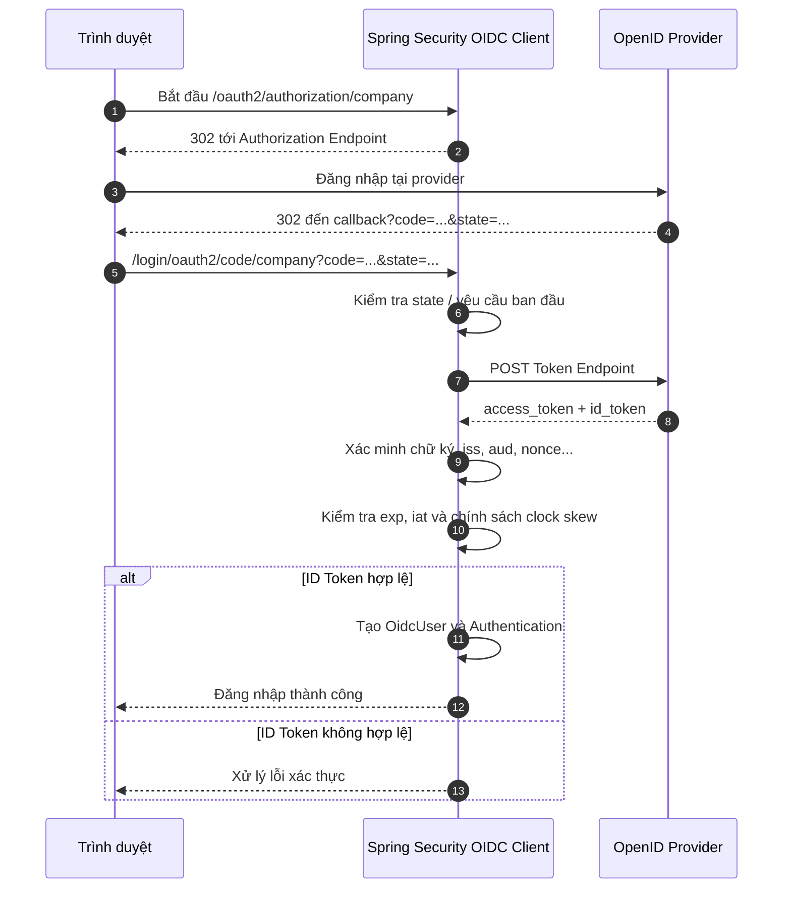

# 11.7. Kiểm tra `exp`, `iat`, clock skew và thời gian hệ thống

Trong **Spring Security OAuth 2.0/OIDC Client**, sau khi nhận authorization code và đổi code tại Token Endpoint, ứng dụng có thể nhận **ID Token** từ OpenID Provider. ID Token là JWT chứa các claim mô tả sự kiện xác thực và danh tính người dùng. Ngoài việc kiểm tra chữ ký, `iss` (issuer), `aud` (audience) và `nonce` khi áp dụng, Client phải xem xét các **claim thời gian** để biết token còn hợp lệ hay không.

Hai claim rất quan trọng là **`exp`** (*expiration time*, thời điểm token hết hạn) và **`iat`** (*issued at*, thời điểm token được phát hành). Chúng liên quan trực tiếp đến **thời gian hệ thống** của máy phát hành token và máy xác minh token. Nếu đồng hồ hai máy lệch nhau, một ID Token hợp lệ có thể bị từ chối hoặc một token vừa hết hạn có thể được chấp nhận thêm một khoảng nhỏ theo chính sách **clock skew**.

Bài học đi từ ý nghĩa các claim, phép so sánh thời gian, cách xử lý độ lệch đồng hồ, tới cấu hình và chẩn đoán trong ứng dụng Spring Security OIDC Client chạy trên Servlet stack.

## 1. ID Token nằm ở đâu trong OAuth 2.0/OIDC Login?

Khi người dùng đăng nhập qua OIDC Authorization Code Flow:

1. Trình duyệt được Spring Security chuyển tới Authorization Endpoint của OpenID Provider.
2. Người dùng đăng nhập và chấp thuận quyền nếu cần.
3. Provider đưa trình duyệt về Redirect URI của ứng dụng cùng authorization code và `state`.
4. Spring Security gửi authorization code tới Token Endpoint qua HTTPS.
5. Token Endpoint trả về `access_token` và **`id_token`** cho OIDC; có thể kèm `refresh_token` tùy trường hợp.
6. Client xác minh ID Token và tạo `OidcUser`/`Authentication` khi các điều kiện thành công.

Ví dụ token response (giá trị chỉ là minh họa):

```json
{
  "access_token": "EXAMPLE_ACCESS_TOKEN",
  "token_type": "Bearer",
  "expires_in": 3600,
  "scope": "openid profile email",
  "id_token": "EXAMPLE_SIGNED_ID_TOKEN"
}
```

ID Token là **JWT**, có cấu trúc header.payload.signature; sau khi giải mã payload, có thể thấy những claim sau:

```json
{
  "iss": "https://id.example.test/realms/company",
  "sub": "user-782",
  "aud": "spring-web-client",
  "exp": 1794794700,
  "iat": 1794791100,
  "auth_time": 1794791000,
  "nonce": "EXAMPLE_NONCE"
}
```

Những số nguyên dùng để minh họa **NumericDate**; không phải token thật hay bằng chứng đã được xác minh. `auth_time` và `nonce` xuất hiện tùy ngữ cảnh yêu cầu OIDC. Các claim giao thức bắt buộc trong ID Token bao gồm `iss`, `sub`, `aud`, `exp` và `iat`.

**Chỉ đọc được JSON không có nghĩa JWT đáng tin.** Trước khi ứng dụng đưa claim vào quyết định đăng nhập, ID Token phải được xác minh chữ ký, issuer, audience và các điều kiện giao thức. Việc kiểm tra thời gian là một phần của quá trình xác minh đầy đủ ấy.



## 2. `exp` và `iat`: ý nghĩa chính xác

| Claim | Tên đầy đủ | Kiểu theo JWT | Ý nghĩa |
|---|---|---|---|
| `exp` | Expiration Time | NumericDate | Thời điểm **sau hoặc bằng đó JWT không được chấp nhận** nếu không xét một độ lệch đồng hồ nhỏ được cho phép |
| `iat` | Issued At | NumericDate | Thời điểm **token được phát hành**; giúp mô tả tuổi của token, phát hiện giá trị thời gian bất thường theo chính sách |
| `nbf` | Not Before | NumericDate | Nếu có, token chưa được phép dùng trước thời điểm này |
| `auth_time` | Authentication Time | NumericDate | Thời điểm **người dùng thực sự được xác thực**; không nhất thiết trùng lúc ID Token được phát hành |

`exp` và `iat` là claim bắt buộc trong **OIDC ID Token**. Trong JWT nói chung, RFC 7519 định nghĩa các claim thời gian nhưng không tự bắt buộc mọi JWT phải có chúng; yêu cầu bắt buộc cụ thể đến từ OIDC hoặc profile token đang dùng.

### 2.1. `exp` là một thời điểm tuyệt đối

Ví dụ:

```json
{ "exp": 1794794700 }
```

Nó mô tả một mốc thời gian trên trục thời gian Unix, không phải “số giây còn lại”. Khi Client nhận ID Token, điều quan trọng là so sánh **thời gian hiện tại** với mốc `exp`.

Theo nguyên tắc JWT, khi không áp dụng clock skew, token được chấp nhận về mặt hết hạn chỉ khi:

```text
now < exp
```

Nếu:

```text
now >= exp
```

thì token đã hết hạn. Ở đúng thời điểm `exp`, token đã hết hiệu lực; không nên dùng điều kiện `now <= exp` để chấp nhận thêm một đơn vị thời gian.

### 2.2. `iat` nói thời điểm phát hành, không trực tiếp nói thời điểm hết hạn

Ví dụ:

```json
{ "iat": 1794791100 }
```

`iat` giúp xác định token được phát hành khi nào. Nó **không thay thế `exp`**. Một token có `iat` hợp lý nhưng `exp` đã qua vẫn phải bị từ chối.

OIDC mô tả `iat` là thời điểm phát hành trong quá khứ. Client có thể áp dụng chính sách về tuổi token tối đa hoặc phát hiện `iat` ở tương lai bất thường, có tính đến sai lệch đồng hồ nhỏ. Tuy nhiên, **không nên giả định mọi validator của mọi phiên bản thư viện tự động áp dụng cùng một ngưỡng “iat không được ở tương lai quá X giây”**. Cần đọc chính xác tài liệu và cách cấu hình validator đang dùng.

### 2.3. `exp - iat` nói điều gì?

Nếu cả hai claim hợp lệ, hiệu:

```text
lifetime = exp - iat
```

cho biết khoảng thời gian hiệu lực được biểu diễn trên token. Ví dụ:

```text
iat = 10:00:00 UTC
exp = 11:00:00 UTC

exp - iat = 3600 giây
```

Khoảng này **không phải** thời gian còn lại tại thời điểm Client đọc token. Nếu Client nhận token lúc 10:20 thì khoảng còn lại xấp xỉ 40 phút trước khi tính clock skew.

Một ID Token có lifetime dài bất thường có thể bị chính sách bảo mật nội bộ đánh giá thêm, nhưng **thời hạn dài không thể được sửa bằng cách chỉ thay `iat` phía Client**. Token đã ký do provider quyết định. Không tự sửa payload/`exp` để kéo dài phiên.

## 3. NumericDate: giây Unix, không phải milliseconds

JWT sử dụng **NumericDate**, là số giây tính từ mốc 1970-01-01T00:00:00Z theo quy tắc của RFC 7519. Giá trị có thể là số nguyên hoặc có phần thập phân nếu độ chính xác cần thiết.

Ví dụ minh họa cách chuyển đổi:

```java
import java.time.Instant;

long expirationSeconds = 1794794700L;
Instant expiresAt = Instant.ofEpochSecond(expirationSeconds);

System.out.println(expiresAt);
```

Để lấy một mốc Unix timestamp từ `Instant`:

```java
long numericDate = Instant.parse("2026-11-16T03:00:00Z").getEpochSecond();
```

### 3.1. Lỗi giây và mili giây

Đây là nguyên nhân rất thường gặp của lỗi thời gian:

```text
JWT exp (giây):         1794794700
Java currentTimeMillis: 1794794700000 (mili giây, minh họa)
```

Nếu so sánh trực tiếp hai giá trị khác đơn vị, ứng dụng có thể kết luận sai hàng nghìn lần về thời hạn token.

**Đúng:** dùng `Instant.ofEpochSecond(exp)` và `Clock.instant()`, hoặc chuẩn hóa tất cả về cùng đơn vị trước khi so sánh. Với lập trình Java hiện đại, `java.time.Instant` an toàn, dễ đọc hơn số epoch rời rạc.

### 3.2. UTC không phải múi giờ hiển thị của máy

Một thời điểm có thể được trình bày theo nhiều múi giờ:

```text
2026-11-16T03:00:00Z
2026-11-16T10:00:00+07:00
```

Hai chuỗi trên diễn tả **cùng một thời điểm**, chỉ khác cách hiển thị. Một máy chủ dùng múi giờ `Asia/Ho_Chi_Minh` không làm `exp` trong JWT đổi ý nghĩa. NumericDate mô tả thời điểm tuyệt đối.

Do đó:

- Không dùng `LocalDateTime.now()` rồi so với UTC string mà không quy đổi rõ múi giờ.
- Không cộng/trừ `7 giờ` trực tiếp vào `exp` để “sửa giờ Việt Nam”.
- Không coi giá trị hiển thị UTC là lỗi vì khác đồng hồ địa phương.
- Không trộn lẫn thay đổi timezone với vấn đề **clock drift** thật sự.

Múi giờ quyết định **cách trình bày** thời gian; còn clock skew là **sai lệch về thời điểm tuyệt đối** giữa các hệ thống.

### 3.3. Những dữ liệu thời gian bất thường

Một ID Token cần được xử lý thận trọng khi:

- `exp` hoặc `iat` vắng mặt trong OIDC ID Token.
- Claim có kiểu dữ liệu không đúng, ví dụ chuỗi `"tomorrow"` thay cho NumericDate.
- Giá trị vượt phạm vi mà decoder hoặc `Instant` có thể xử lý.
- `iat` nằm xa ở tương lai so với thời gian Client.
- `exp` đã hết hạn theo phép so sánh thời gian hợp lệ.
- `exp` sớm hơn `iat` hoặc lifetime bất thường theo chính sách vận hành.

Đây có thể là lỗi cấu hình provider, bug serialization, đồng hồ máy phát hành sai, hoặc dữ liệu bị thay đổi. Không sửa claim không hợp lệ ở phía Client rồi tiếp tục tin token.

## 4. Kiểm tra `exp` với clock skew

### 4.1. Điều kiện chuẩn khi hai đồng hồ chính xác

Giả sử thời điểm hiện tại phía Client là `10:00:00 UTC`:

| `exp` trong ID Token | Kết luận nếu không có clock skew |
|---|---|
| 10:05:00 UTC | Chưa hết hạn |
| 10:00:01 UTC | Chưa hết hạn |
| 10:00:00 UTC | Đã hết hạn |
| 09:59:59 UTC | Đã hết hạn |
| 09:55:00 UTC | Đã hết hạn |

Khái niệm **clock skew** xuất hiện vì đồng hồ Authorization Server và Client có thể lệch nhẹ nhau hoặc request bị trễ trên mạng.

### 4.2. Clock skew là gì?

Clock skew là **độ chênh lệch giữa các đồng hồ**. Ví dụ:

```text
Thời gian thực tế:       10:00:00 UTC
Clock của OP:           10:00:00 UTC
Clock của Client:       10:00:35 UTC
Sai lệch Client nhanh:  +35 giây
```

Nếu OP vừa phát hành ID Token với `exp=10:00:20 UTC`, phía Client đang xem thời gian là 10:00:35 và có thể từ chối token ngay dù theo thời gian thực nó còn 20 giây.

RFC 7519 cho phép bên xác minh áp dụng **một khoảng dung sai nhỏ** để bù sai lệch đồng hồ. Khoảng đó gọi là **clock skew allowance**, **clock tolerance** hoặc **leeway** tùy thư viện.

### 4.3. Công thức với độ dung sai cho `exp`

Gọi:

- `now`: thời điểm hiện tại trên đồng hồ Client.
- `exp`: thời điểm hết hạn trong token.
- `δ`: dung sai clock skew không âm, có giới hạn, ví dụ 30 giây.

Một phép kiểm tra chấp nhận thời gian minh họa:

```text
ID Token không bị loại bởi exp nếu:
now < exp + δ

Tương đương:
exp > now - δ
```

Ví dụ:

```text
Client now = 10:00:00 UTC
exp = 09:59:45 UTC
δ = 30 giây

exp + δ = 10:00:15 UTC
now < exp + δ  => chấp nhận về mặt exp trong thời gian dung sai
```

Nếu `exp=09:59:20`:

```text
exp + δ = 09:59:50
now = 10:00:00
now >= exp + δ => từ chối vì hết hạn
```

**Dung sai chỉ bù sai lệch đồng hồ nhỏ.** Nó không gia hạn token bằng một cơ chế cấp quyền mới và không biến token hết hạn nhiều phút/giờ thành token hợp lệ.

### 4.4. Không có một giá trị clock skew đúng cho mọi hệ thống

Một hệ thống có thể chọn dung sai 30, 60 hoặc 120 giây tùy chính sách, khả năng đồng bộ đồng hồ và yêu cầu provider. Các giá trị này là **ví dụ thực hành**, không phải tuyên bố Spring Security luôn mặc định dùng một giá trị cụ thể trong mọi loại token, flow hoặc phiên bản.

Nguyên tắc:

1. **Sửa đồng hồ hệ thống** nếu thực tế bị lệch.
2. Dùng dung sai **nhỏ và có lý do**, phù hợp tài liệu và chính sách bảo mật.
3. Không tăng clock skew quá mức chỉ để che một lỗi đồng bộ thời gian.
4. Không cho phép tắt kiểm tra `exp` ở production.
5. Theo dõi lỗi hết hạn bất thường sau khi nâng version, thay đổi proxy, container hoặc IdP.

Ví dụ “cho phép skew 24 giờ” làm suy yếu đáng kể ý nghĩa thời hạn của ID Token, ngay cả khi nó khiến một bài thử đăng nhập tạm thời hoạt động.

## 5. Kiểm tra `iat` và thời điểm phát hành trong tương lai

### 5.1. Tại sao `iat` ở tương lai đáng quan tâm?

Giả sử Client đang là `10:00 UTC` nhưng nhận ID Token:

```json
{
  "iat": 1794794700,
  "exp": 1794798300
}
```

Nếu `iat` giải mã ra thời điểm **xa hơn nhiều so với thời gian hiện tại** của Client, có thể máy phát hành token đang chạy nhanh, máy Client chạy chậm hoặc token không phù hợp với điều kiện mong đợi.

Một chính sách kiểm tra `iat` phổ biến ở cấp ứng dụng là:

```text
iat <= now + δ
```

trong đó `δ` là dung sai sai lệch đồng hồ được cho phép. Nếu `iat > now + δ`, Client có thể coi token bất thường và từ chối theo chính sách.

Cần nắm rõ ranh giới: **`iat` là thông tin về thời điểm phát hành**, không phải khóa bảo mật độc lập; một số thư viện kiểm tra `iat` theo cách riêng hoặc không tự động áp dụng một ngưỡng future-iat bổ sung. Đừng tự tuyên bố có “kiểm tra đầy đủ iat” nếu mới chỉ nhìn thấy claim.

### 5.2. Không nhầm `iat` với `nbf`

Giả sử token:

```json
{
  "iat": 1794791100,
  "nbf": 1794792000,
  "exp": 1794794700
}
```

- `iat`: token được phát hành tại một thời điểm.
- `nbf`: token không được sử dụng trước mốc này.
- `exp`: token hết hiệu lực sau mốc này.

Khi `nbf` có mặt, quy tắc kiểm tra tương ứng là `now >= nbf`, hoặc với dung sai nhỏ:

```text
now + δ >= nbf
```

Không coi `iat` là `nbf`. Một token có `iat` trong quá khứ không tự đảm bảo nó đã tới thời điểm được phép sử dụng nếu còn `nbf` ở tương lai.

### 5.3. `iat` và chính sách tuổi token tối đa

Một ứng dụng có thể đặt điều kiện **không chấp nhận ID Token được phát hành quá lâu trước đó**:

```text
now - iat <= maximumTokenAge
```

Đây là **chính sách bổ sung của ứng dụng**, không phải định nghĩa thay thế cho `exp`. Nếu token có `exp` hợp lệ nhưng `iat` quá cũ theo quy định nội bộ, ứng dụng có thể từ chối theo chính sách chặt hơn.

Cần thiết kế chính sách tuổi tối đa theo ý nghĩa thật sự:

- **`iat`** cho biết lúc ID Token được phát hành.
- **`auth_time`** cho biết lúc người dùng được xác thực.
- Muốn yêu cầu người dùng mới xác thực lại gần đây, **`auth_time` và tham số `max_age`** của OIDC thường có ý nghĩa hơn `iat`.

Một provider có thể phát hành ID Token mới trong khi người dùng đã đăng nhập tại IdP từ lâu. Lúc đó `iat` mới nhưng `auth_time` cũ. Nếu chức năng cần “xác thực lại trong 5 phút gần đây”, chỉ kiểm tra `iat` sẽ không đủ.

## 6. `auth_time` và `max_age`: khi nào cần xác thực gần đây?

OIDC có tham số `max_age` để Client yêu cầu giới hạn thời gian kể từ lần xác thực người dùng. Ví dụ authorization request có:

```text
max_age=300
```

với ý nghĩa muốn thời gian kể từ sự kiện xác thực không vượt quá 300 giây theo quy tắc OIDC. Khi dùng `max_age`, phản hồi ID Token cần chứa `auth_time` để Client có thể kiểm tra.

Ví dụ các mốc:

```text
auth_time = 09:00 UTC
iat       = 10:00 UTC
now       = 10:01 UTC
```

ID Token mới được phát hành lúc 10:00, nhưng sự kiện xác thực của người dùng xảy ra lúc 09:00. Với một yêu cầu “xác thực trong vòng 5 phút”, `iat` mới **không giải quyết** điều kiện; phải dựa vào `auth_time` và quy tắc liên quan.

### 6.1. Các trường hợp cần `max_age`

- Người dùng chuyển từ xem dữ liệu thông thường sang thực hiện thao tác nhạy cảm.
- Ứng dụng yêu cầu xác thực lại trước khi đổi thông tin bảo mật.
- Một hành động có rủi ro cao cần bằng chứng người dùng mới xác thực.
- Chính sách bảo mật hoặc yêu cầu tuân thủ của doanh nghiệp định nghĩa “recent authentication”.

Lưu ý `max_age` và `auth_time` không tự đồng nghĩa với MFA. Nếu cần biết phương thức/mức xác thực, phải xét các claim như `amr`, `acr` khi có, cùng hợp đồng của provider.

### 6.2. Quan hệ giữa các mốc thời gian

| Mốc | Đang nói về điều gì? |
|---|---|
| `auth_time` | Người dùng xác thực tại OpenID Provider vào lúc nào |
| `iat` | ID Token được phát hành vào lúc nào |
| `exp` | ID Token hết hiệu lực vào lúc nào |
| `expires_in` trong token response | Thời gian sống của **access token**, nếu được trả |
| Expiry của HTTP session | Phiên đăng nhập ở ứng dụng còn tồn tại đến khi nào |
| Expiry của refresh token | Khả năng tiếp tục lấy access token mới còn đến khi nào |

Việc ID Token hết hạn **không đồng nghĩa** HTTP session của ứng dụng phải tự động hết hạn đúng thời điểm đó. ID Token được dùng để xác minh sự kiện đăng nhập, sau đó ứng dụng có chính sách session riêng. Tương tự, access token hết hạn khi gọi API là chuyện khác với lúc Client đã xác thực danh tính thành công.

## 7. Ví dụ so sánh thời gian có và không có skew

Giả định Client đang có thời gian chính xác `12:00:00 UTC` và cho phép clock skew 60 giây đối với kiểm tra `exp`. Các tình huống:

| `exp` | `iat` | Xét `exp` với 60 giây dung sai | Nhận xét |
|---|---|---|---|
| 12:05:00 | 11:50:00 | Chưa hết hạn | Các mốc nhìn hợp lý |
| 12:00:01 | 11:50:00 | Chưa hết hạn | Chỉ còn 1 giây theo thời gian thật |
| 12:00:00 | 11:50:00 | Được chấp nhận trong dung sai | Không có skew thì đã hết hạn |
| 11:59:30 | 11:40:00 | Được chấp nhận trong dung sai | Quá `exp` 30 giây |
| 11:59:00 | 11:40:00 | **Không** chấp nhận ở ranh giới nếu `now >= exp + skew` | Đã chạm hết thời gian dung sai |
| 11:55:00 | 11:40:00 | Không chấp nhận | Hết hạn quá lâu |
| 12:05:00 | 12:03:00 | `exp` còn hạn | Nhưng `iat` tương lai 3 phút: cần đánh giá theo chính sách future-iat |

Bảng cho thấy **không thể chỉ xem `exp`** để khẳng định token hợp lệ hoàn toàn. Token còn phải vượt qua các kiểm tra khác: chữ ký, issuer, audience, nonce và các chính sách về thời gian/phát hành.

### 7.1. Minh họa clock skew bằng biểu đồ

```text
Thời gian UTC thực tế
11:59:00 -------- 12:00:00 -------- 12:01:00
                       |
                       +-- Client đang đọc thời gian này

Ví dụ exp 11:59:30, skew 60s:
exp = 11:59:30
exp + skew = 12:00:30
Client now 12:00:00 -> nằm trong cửa sổ dung sai

Ví dụ exp 11:58:30:
exp + skew = 11:59:30
Client now 12:00:00 -> quá cửa sổ dung sai, từ chối
```

Giới hạn này phải đủ nhỏ để chỉ bù lỗi đồng hồ thông thường, không trở thành cơ chế chấp nhận token hết hạn dài.

## 8. Trong Spring Security OIDC Client, ai xác minh ID Token?

Với ứng dụng Servlet dùng `oauth2Login` và một OIDC Provider hợp lệ, Spring Security có sẵn hạ tầng:

- Xử lý callback authorization code qua `OAuth2LoginAuthenticationFilter`.
- Trao đổi code tại Token Endpoint.
- Giải mã và xác minh ID Token bằng OIDC JWT decoder/validator.
- Kiểm tra các claim giao thức cần thiết và thông tin liên kết với ClientRegistration.
- Tạo `OidcUser` sau khi xác thực thành công.

Một cấu hình cơ bản:

```java
import org.springframework.context.annotation.Bean;
import org.springframework.context.annotation.Configuration;
import org.springframework.security.config.Customizer;
import org.springframework.security.config.annotation.web.builders.HttpSecurity;
import org.springframework.security.web.SecurityFilterChain;

@Configuration
public class SecurityConfig {

    @Bean
    SecurityFilterChain securityFilterChain(HttpSecurity http) throws Exception {
        http
            .authorizeHttpRequests(authorize -> authorize
                .requestMatchers("/", "/error").permitAll()
                .anyRequest().authenticated()
            )
            .oauth2Login(Customizer.withDefaults());

        return http.build();
    }
}
```

Cấu hình Client với OIDC discovery:

```yaml
spring:
  security:
    oauth2:
      client:
        registration:
          company:
            provider: company
            client-id: ${OIDC_CLIENT_ID}
            client-secret: ${OIDC_CLIENT_SECRET}
            authorization-grant-type: authorization_code
            scope:
              - openid
              - profile
              - email
            redirect-uri: "{baseUrl}/login/oauth2/code/{registrationId}"
        provider:
          company:
            issuer-uri: https://id.example.test/realms/company
```

`id.example.test` và biến môi trường là giá trị minh họa. Ứng dụng thực tế cần endpoint/issuer được provider công bố và Client ID/secret hợp lệ.

**Không cần tự viết controller đọc ID Token rồi `Base64.decode(...)` để thực hiện xác thực.** Cơ chế `oauth2Login` đã tích hợp quá trình kiểm tra JWT/OIDC; việc tự decode mà không xác minh chữ ký và các claim có thể tạo lỗ hổng.

### 8.1. Các API cần nhận biết

| Thành phần | Vai trò |
|---|---|
| `OidcIdTokenDecoderFactory` | Tạo JwtDecoder dành cho ID Token theo ClientRegistration |
| `OidcIdTokenValidator` | Validator áp dụng các điều kiện OIDC cho ID Token |
| `JwtDecoderFactory<ClientRegistration>` | Abstraction dùng tạo decoder theo ClientRegistration |
| `OidcIdToken` | ID Token đã được Spring biểu diễn dưới dạng object |
| `OidcUser` | Principal của người dùng đăng nhập OIDC |
| `JwtTimestampValidator` | Validator thời gian trong hệ sinh thái JWT của Spring Security; cần phân biệt bối cảnh sử dụng |
| `OAuth2TokenValidator<Jwt>` | Giao diện xác minh các điều kiện JWT tùy cấu hình |

Tên API và khả năng cấu hình có thể thay đổi giữa Spring Security 6 và 7. Khi cần thay đổi chính sách timestamp của **ID Token**, hãy kiểm tra phiên bản cụ thể và integration point của **OIDC ID Token decoder factory**; không mặc định cấu hình JWT decoder cho Resource Server sẽ tác động tới OAuth2 Login.

### 8.2. OIDC ID Token validation khác Resource Server JWT validation

Spring Security hỗ trợ nhiều trường hợp dùng JWT:

**A. OAuth2/OIDC Client**

```java
http.oauth2Login(Customizer.withDefaults());
```

ID Token từ Token Endpoint được Client xác minh để đăng nhập người dùng.

**B. OAuth2 Resource Server**

```java
http.oauth2ResourceServer(oauth2 -> oauth2.jwt(Customizer.withDefaults()));
```

Resource Server kiểm tra **access token JWT** mà một HTTP Client gửi tới API.

Hai luồng dùng các decoder, issuer, audience và chính sách token theo mục đích tương ứng. Một bean `JwtDecoder` cấu hình cho Resource Server **không nên được coi là nơi duy nhất điều khiển ID Token validation của OIDC Client**.

Khi đọc bài hướng dẫn cấu hình clock skew, cần xem tác giả đang nói về **ID Token** hay **JWT access token**. Thay cấu hình không đúng tầng có thể khiến lỗi OIDC login vẫn còn dù API validation đã thay đổi.

### 8.3. Chỉ tùy biến validator khi có yêu cầu rõ ràng

Nếu tổ chức cần chính sách timestamp riêng, hướng kỹ thuật là sử dụng điểm mở rộng **JwtDecoderFactory theo ClientRegistration / OidcIdTokenDecoderFactory** được Spring Security phiên bản hiện hành hỗ trợ và **duy trì toàn bộ kiểm tra OIDC khác**.

Không thay validator mặc định bằng một validator chỉ trả về thành công:

```java
// MẪU SAI - KHÔNG TRIỂN KHAI:
jwt -> OAuth2TokenValidatorResult.success()
```

Cách làm này có thể vô hiệu hóa những kiểm tra cốt lõi. Không sửa ID Token, tự bỏ `exp`, hoặc thay khóa ký chỉ để đăng nhập thành công trên môi trường lỗi thời gian.

## 9. Đọc thời gian từ `OidcUser` sau khi Spring xác thực

Sau khi `oauth2Login` thành công, controller có thể lấy ID Token từ principal **đã được Spring xác thực**:

```java
import java.time.Instant;
import java.util.LinkedHashMap;
import java.util.Map;

import org.springframework.security.core.annotation.AuthenticationPrincipal;
import org.springframework.security.oauth2.core.oidc.OidcIdToken;
import org.springframework.security.oauth2.core.oidc.user.OidcUser;
import org.springframework.web.bind.annotation.GetMapping;
import org.springframework.web.bind.annotation.RestController;

@RestController
public class SessionInfoController {

    @GetMapping("/me/id-token-time")
    public Map<String, Object> idTokenTime(
            @AuthenticationPrincipal OidcUser user) {

        OidcIdToken token = user.getIdToken();
        Instant issuedAt = token.getIssuedAt();
        Instant expiresAt = token.getExpiresAt();

        Map<String, Object> result = new LinkedHashMap<>();
        result.put("issuedAt", issuedAt == null ? null : issuedAt.toString());
        result.put("expiresAt", expiresAt == null ? null : expiresAt.toString());
        result.put("subject", user.getSubject());

        return result;
    }
}
```

Phản hồi minh họa:

```json
{
  "issuedAt": "2026-11-16T03:00:00Z",
  "expiresAt": "2026-11-16T04:00:00Z",
  "subject": "user-782"
}
```

Đoạn code này **không thay thế token validator**, mà chỉ đọc dữ liệu từ principal sau khi xác thực thành công. Endpoint phải được bảo vệ và chỉ công bố thông tin người dùng thật sự cần; trong production không nên tạo endpoint debug không kiểm soát.

### 9.1. Không lấy metadata access token thay cho ID Token

`OAuth2AuthorizedClient#getAccessToken().getExpiresAt()` mô tả hạn của **access token** dùng gọi tài nguyên. `OidcUser#getIdToken().getExpiresAt()` mô tả hạn **ID Token**.

Hai giá trị có thể khác nhau; chúng được cấp cho những mục đích khác nhau. Không dùng hạn access token để suy ra ID Token có được xác minh hợp lệ lúc đăng nhập hay không.

### 9.2. Không đưa JWT thô vào response/log

Khi debug, chỉ cần thời điểm phát hành/hết hạn, issuer đã được allowlist, registration ID và phân loại lỗi. Không in:

```java
// KHÔNG NÊN:
System.out.println(user.getIdToken().getTokenValue());
```

Raw ID Token có thể chứa dữ liệu danh tính và các claim nhạy cảm. Không đưa nó vào query string, URL redirect, log hoặc ticket hỗ trợ.

## 10. Minh họa phép kiểm tra thời gian bằng `java.time`

Để hiểu phép tính, dưới đây là **một ví dụ thuần Java** về kiểm tra `exp` và một chính sách bổ sung đối với `iat`. Nó **không phải** mã thay thế bộ xác minh chữ ký/issuer/audience/nonce của Spring Security.

```java
import java.time.Clock;
import java.time.Duration;
import java.time.Instant;
import java.util.Objects;

public final class IdTokenTimePolicy {

    private IdTokenTimePolicy() {}

    /**
     * Kiểm tra logic minh họa sau khi JWT đã được xác minh đầy đủ.
     * expiredAt và issuedAt được parse từ NumericDate đúng đơn vị giây.
     */
    public static void requireAcceptableTimes(
            Instant expiresAt,
            Instant issuedAt,
            Clock clock,
            Duration allowedSkew) {

        Objects.requireNonNull(expiresAt, "expiresAt");
        Objects.requireNonNull(issuedAt, "issuedAt");
        Objects.requireNonNull(clock, "clock");
        Objects.requireNonNull(allowedSkew, "allowedSkew");

        if (allowedSkew.isNegative()) {
            throw new IllegalArgumentException("allowedSkew must be nonnegative");
        }

        Instant now = clock.instant();

        // Trên hoặc sau exp + skew: đã hết hạn theo chính sách dung sai.
        if (!now.isBefore(expiresAt.plus(allowedSkew))) {
            throw new IllegalArgumentException("ID Token has expired");
        }

        // Quy tắc future-iat bổ sung để phát hiện đồng hồ/claim bất thường.
        if (issuedAt.isAfter(now.plus(allowedSkew))) {
            throw new IllegalArgumentException("ID Token iat is too far in future");
        }
    }
}
```

Ví dụ sử dụng một clock cố định để giải thích:

```java
import java.time.Clock;
import java.time.Duration;
import java.time.Instant;
import java.time.ZoneOffset;

Clock fixedClock = Clock.fixed(
    Instant.parse("2026-11-16T03:00:00Z"),
    ZoneOffset.UTC
);

Instant issuedAt = Instant.parse("2026-11-16T02:50:00Z");
Instant expiresAt = Instant.parse("2026-11-16T03:00:30Z");

IdTokenTimePolicy.requireAcceptableTimes(
    expiresAt,
    issuedAt,
    fixedClock,
    Duration.ofSeconds(60)
);
```

Trong ví dụ, `now=03:00:00Z`, `exp=03:00:30Z` nên token chưa hết hạn, còn `iat` nằm trước `now`. Dùng `Clock.fixed(...)` giúp biểu diễn ranh giới thời gian rõ ràng mà không phụ thuộc thời điểm chạy code.

**Giới hạn của ví dụ:**

- Không xác minh chữ ký, `iss`, `aud`, `nonce` hoặc `auth_time`.
- Không parse JWT, không xử lý token JSON đầu vào và không phải bean của Spring Security.
- Độ dung sai trong ví dụ là policy minh họa; cần khớp với validator và yêu cầu vận hành thực tế.
- Với thời điểm cực đoan, các phép `Instant.plus(...)` có thể vượt phạm vi biểu diễn; thư viện validator của Spring cần được ưu tiên.
- Không sử dụng hai bộ kiểm tra mâu thuẫn nhau; hãy để decoder/validator OIDC là nguồn quyết định cuối cùng về token được chấp nhận.

### 10.1. Vì sao dùng `Clock` thay vì gọi `Instant.now()` rải rác?

`Clock` là abstraction của Java cho phép đọc thời gian từ một nguồn xác định. Lợi ích:

- Dễ kiểm tra những trường hợp sát ranh giới `exp`.
- Tránh nhiều lần gọi đồng hồ tạo sai số giữa các phép so sánh trong cùng một quyết định.
- Cho phép mô phỏng clock nhanh/chậm để hiểu skew.
- Phân biệt phép tính thời gian thuần Java với cấu hình validator Spring.

Trong production, đồng hồ dùng cho xác minh token cần phản ánh thời gian hệ thống chính xác. `Clock.systemUTC()` sử dụng clock hệ thống theo UTC để xây các đối tượng `Instant`.

### 10.2. Không tự parse JWT trước khi xác minh

Không viết flow:

```text
1. Tách chuỗi JWT bằng dấu chấm
2. Base64-decode payload
3. Lấy exp, iat
4. Nếu chưa hết hạn thì đăng nhập
```

Cách này **thiếu** xác minh chữ ký, issuer, audience, nonce và các điều kiện OIDC. Người dùng có thể tự tạo một chuỗi JSON giả với `exp` ở tương lai và vượt qua kiểm tra sơ sài.

Đúng hơn, ứng dụng dùng Spring Security OIDC Login để xác minh toàn bộ ID Token, sau đó mới đọc dữ liệu đã được tin cậy qua `OidcUser`.

## 11. Thời gian hệ thống: nguyên nhân gốc của nhiều lỗi token

### 11.1. Bốn hệ thống thời gian thường liên quan

Trong một hệ thống phân tán, có thể có:

1. **OpenID Provider/Authorization Server** phát hành ID Token.
2. **Spring Security Client** kiểm tra ID Token.
3. **Resource Server/API** kiểm tra access token khi được gọi.
4. **Máy chủ reverse proxy, container host hoặc node Kubernetes** ảnh hưởng thời gian hệ thống và log.

Nếu OP nhanh 90 giây và Client chậm 60 giây, chênh lệch giữa hai phía lên tới **150 giây**. Một dung sai 60 giây có thể không đủ.

Ví dụ:

```text
Thời gian thực:           12:00:00
OP clock:                 12:01:30   (+90s)
Spring Client clock:      11:59:00   (-60s)

ID Token iat từ OP:       12:01:30
Client now:               11:59:00
iat - Client now:         +150s
```

Nếu policy future-iat chỉ cho phép 60 giây, token sẽ bị từ chối; vấn đề thực tế là **đồng hồ hai máy lệch**, không phải cần tắt kiểm tra thời gian.

### 11.2. Timezone sai và đồng hồ sai khác nhau

Một server có timezone `Asia/Ho_Chi_Minh` và server khác dùng `UTC` vẫn có thể đồng bộ **đúng cùng một thời điểm tuyệt đối**. Không có lỗi token chỉ vì log được hiển thị ở hai múi giờ khác nhau.

Nếu đồng hồ thực sự lệch, dù cả hai đều đặt timezone UTC, token vẫn có thể lỗi. Vì vậy cần so sánh **epoch time/UTC instant** của các máy hoặc quan sát độ lệch với nguồn thời gian tin cậy.

### 11.3. Đồng bộ qua NTP

Các hệ thống thường dùng **NTP hoặc dịch vụ đồng bộ thời gian tương đương** để giữ clock chính xác.

Trên Linux dùng systemd, có thể xem trạng thái theo môi trường:

```bash
date -u
timedatectl status
```

Nếu hệ thống dùng chrony:

```bash
chronyc tracking
chronyc sources -v
```

Trên Windows Server/Windows:

```powershell
Get-Date
w32tm /query /status
w32tm /query /source
```

Lệnh chỉ giúp quan sát. Cách **cấu hình** NTP phụ thuộc quyền quản trị và dịch vụ thời gian của hạ tầng; không nên tự chạy các lệnh thay đổi đồng hồ production khi chưa hiểu ảnh hưởng tới cơ sở dữ liệu, TLS, job scheduler hoặc giao dịch.

### 11.4. Container và Kubernetes không tự giải quyết clock skew

Trong Docker/Kubernetes, container thường dựa vào đồng hồ của **host/node**. Một ứng dụng có timezone UTC trong container vẫn có thể nhận thời gian tuyệt đối sai nếu node bị lệch.

Khi lỗi chỉ xảy ra trên một pod/instance:

- Xác định pod chạy trên node nào.
- Đối chiếu thời gian UTC và trạng thái NTP của node với các node khỏe mạnh.
- Kiểm tra log thời điểm nhận token, nhưng không log raw ID Token.
- Kiểm tra sự khác biệt giữa máy phát hành IdP và node xác minh.
- Không tự chỉnh timezone container như cách chữa lệch NTP.

Khi triển khai nhiều vùng địa lý, thời gian mạng và đồng hồ node vẫn cần được đồng bộ; phân tán địa lý không tự có nghĩa clock lệch nhiều giờ.

### 11.5. Những nguyên nhân khác khiến thời gian sai

- Máy ảo hoặc laptop sleep/resume lâu, đồng bộ thời gian chưa kịp cập nhật.
- Snapshot hoặc migration VM làm clock nhảy bất thường.
- NTP/chrony/Windows Time bị vô hiệu hóa hoặc mất kết nối.
- Firewall chặn nguồn thời gian hoặc máy trỏ tới time server không đáng tin.
- Môi trường test cố định clock không được khôi phục đúng.
- Thư viện xử lý seconds như milliseconds hoặc ngược lại.
- Code chuyển `Instant` qua `LocalDateTime` rồi áp múi giờ sai.
- Token từ IdP cũ dùng cấu hình thời hạn không phù hợp.
- Đường truyền hoặc hàng đợi có độ trễ lớn khiến token được dùng quá sát hạn.

## 12. Clock skew và các loại token khác nhau

### 12.1. Không dùng một chính sách chung vô điều kiện

Một dự án có thể có:

- ID Token để xác thực người dùng tại Client.
- Access token để gọi API.
- Refresh token để lấy access token mới.
- HTTP session cookie để duy trì đăng nhập.

Mỗi loại có **quy tắc thời gian khác nhau**. Ví dụ:

| Loại | Thông tin thời gian thường gặp | Ý nghĩa |
|---|---|---|
| ID Token | `exp`, `iat`, có thể `auth_time` / `nbf` | Kiểm tra thời gian phát hành/xác thực và hết hạn trong OIDC |
| Access token JWT | Có thể có `exp`, `iat`, `nbf` | Resource Server xác minh theo token profile |
| Opaque access token | Metadata của Authorization Server hoặc introspection | Không tự đọc `exp` từ JWT |
| OAuth2 token response | `expires_in` | Thời gian sống tương đối của access token |
| Refresh token | Thời hạn/chính sách do provider quyết định | Có thể xoay vòng hoặc bị thu hồi |
| HTTP session | Timeout/session policy của ứng dụng | Thời gian đăng nhập tại ứng dụng, độc lập với lần xác minh ID Token |

Không nên dùng `expires_in` của access token để suy ra hạn `exp` của ID Token. Cũng không nên đặt clock skew quá lớn ở Resource Server với lý do “OIDC login đang lỗi” khi hai cơ chế dùng validator khác nhau.

### 12.2. Hết hạn ID Token không có nghĩa phải gọi lại Token Endpoint liên tục

ID Token được xác minh ở thời điểm xác thực OIDC. Sau đó Spring Security Servlet thường quản lý `SecurityContext` và phiên đăng nhập qua session. ID Token hết hạn sau một giờ không tự động có nghĩa mỗi request phải xác minh lại ID Token như một bearer token.

Nếu ứng dụng cần điều kiện **xác thực gần đây**, dùng chính sách session, reauthentication và `max_age`/`auth_time` phù hợp. Nếu ứng dụng cần gọi API bằng access token, sử dụng cơ chế quản lý authorized client/refresh token. Các nhu cầu này khác với việc chỉ tăng `exp` của ID Token.

### 12.3. Thời gian hết hạn ở Resource Server

Một API nhận JWT access token cũng có thể cho phép clock skew nhỏ để bù sai lệch clock, nhưng nó vẫn phải kiểm tra issuer, audience, chữ ký và scope. Với Spring Security Resource Server, các API như `JwtTimestampValidator` thường liên quan kiểm tra `exp`/`nbf` của JWT.

**Đừng tự suy ra** rằng thay `JwtTimestampValidator` ở Resource Server sẽ thay đổi OIDC ID Token validator của `oauth2Login`. Cần xác định token loại nào đang bị từ chối và thành phần nào đang xác minh.

## 13. Chẩn đoán lỗi hết hạn và thời gian phát hành trong OIDC Login

| Triệu chứng | Nguyên nhân thường gặp | Cách khoanh vùng |
|---|---|---|
| ID Token vừa được cấp nhưng báo hết hạn | Clock Client chạy nhanh, provider phát token có TTL quá ngắn hoặc `exp` sai | So sánh `exp`/UTC với giờ hệ thống và clock OP |
| ID Token báo `iat` ở tương lai | Clock OP chạy nhanh, Client chạy chậm, dữ liệu `iat` sai đơn vị | So sánh `iat` với `Instant.now()` ở Client và time source của OP |
| Chỉ một pod gặp lỗi token | Clock của Kubernetes node lệch, hoặc cấu hình khác giữa pod | Kiểm tra node và đồng bộ thời gian |
| Chỉ môi trường staging lỗi | VM/NTP/staging IdP khác production | So sánh nguồn thời gian, issuer và chính sách token |
| Có lỗi “expired” khi token vừa hết hạn một vài giây | Trễ mạng hoặc clock skew nhỏ | Kiểm tra hạn, latency, policy skew; đồng bộ clock |
| ID Token có `exp` ở quá khứ nhiều giờ | Token cũ, provider sai, timestamp xử lý nhầm đơn vị | Không tăng skew; tìm nguyên nhân thực |
| `iat` hoặc `exp` thành năm rất xa | Epoch milliseconds bị xử lý như seconds hoặc ngược lại | Đọc NumericDate, parser và dữ liệu provider |
| Token có `exp` tương lai nhưng login thất bại | Chữ ký, issuer, audience, nonce hoặc claim khác không hợp lệ | Xác định mã lỗi thực tế; không chỉ nhìn `exp` |
| `exp` hợp lệ nhưng API trả 401 | Access token dùng cho API đã hết hạn/thu hồi hoặc sai audience | Phân biệt ID Token với access token |
| Người dùng vẫn có session dù ID Token đã hết hạn | Session và ID Token có vòng đời khác nhau | Kiểm tra session/reauthentication policy |
| Đăng nhập thất bại sau khi tăng skew ở Resource Server | Đã chỉnh validator của access token, không phải OIDC ID Token | Kiểm tra nơi Spring xác minh ID Token |
| Thêm `max_age` làm login thất bại | Thiếu `auth_time`, authentication quá cũ hoặc provider không đáp ứng | Kiểm tra yêu cầu OIDC và claim `auth_time` |
| Token bị từ chối sát ranh giới `exp` | Clock gần hạn, skew nhỏ hoặc hành vi so sánh `<`/`<=` khác | Đối chiếu quy tắc validator/version; tránh tự sửa token |

### 13.1. Quy trình kiểm tra từng bước

1. **Xác định token nào lỗi.** ID Token trong `oauth2Login`, access token của API hay refresh token?
2. **Xem lỗi xuất hiện ở đâu.** Sau token exchange ở OIDC Client, hay sau request `Authorization: Bearer` tại Resource Server?
3. **Kiểm tra token đã được xác minh và nguồn tin cậy.** Với ID Token, cần issuer/keys đúng; không dùng token tự giải mã để kết luận hợp lệ.
4. **Đối chiếu thời gian tuyệt đối.** Ghi nhận `now` của Client ở UTC, `exp` và `iat` của token test đã xử lý an toàn; tránh log raw token.
5. **Kiểm tra đồng hồ các hệ thống.** NTP, node/container, thời gian OP, network latency.
6. **Xem chính sách skew của đúng validator.** Không chỉ thay một bean JWT không liên quan.
7. **Sửa nguyên nhân gốc.** Đồng bộ clock, sửa `seconds vs milliseconds`, issuer/TTL, hoặc cấu hình hợp lệ của provider.
8. **Xác nhận các kiểm tra khác vẫn còn hiệu lực.** Chữ ký, issuer, audience, nonce, expiration và các chính sách OIDC.

### 13.2. Logging hữu ích nhưng phải bảo vệ dữ liệu

Để chẩn đoán, có thể tạm cấu hình log Spring Security trong môi trường phát triển:

```yaml
logging:
  level:
    org.springframework.security: DEBUG
```

Khi ghi log tự viết, chỉ dùng dữ liệu đủ để nhận biết:

```text
registrationId=company
tokenKind=ID_TOKEN
validationStage=TIMESTAMP
clientTimeUtc=2026-11-16T03:00:00Z
result=EXPIRED
```

Tránh ghi vào log:

- Raw ID Token/access token/refresh token.
- Authorization code, `state`, `nonce` hoặc client secret.
- Dữ liệu nhận dạng cá nhân từ claim `email`, `phone_number` hay `address`.
- Toàn bộ HTTP token response hoặc session cookie.

Nếu cần đưa một trường thời gian của token test vào báo cáo lỗi, dùng dữ liệu đã được làm sạch và bảo đảm log không chứa token có thể sử dụng được.

## 14. Thực hành: xác định thời điểm và ranh giới

### Bài tập 1: Hết hạn đúng tại `exp`

Client có thời gian:

```text
now = 2026-11-16T04:00:00Z
exp = 2026-11-16T04:00:00Z
```

Nếu không cho phép skew, token còn hạn không?

**Đáp án:** Không. Điều kiện chuẩn là `now < exp`; tại `now == exp`, token đã hết hạn.

### Bài tập 2: Clock skew 45 giây

Cho:

```text
now = 10:00:00
exp = 09:59:30
skew = 45 giây
```

**Đáp án:** `exp + skew = 10:00:15`; xét riêng điều kiện `exp` và allowance, thời gian vẫn nằm trong khoảng được chấp nhận. Điều đó không bảo đảm các claim khác hợp lệ.

### Bài tập 3: Token ở tương lai

Cho:

```text
now = 10:00:00
iat = 10:02:00
exp = 11:00:00
future-iat skew = 60 giây
```

**Đáp án:** `iat > now + 60s`, nên vi phạm chính sách future-iat minh họa dù `exp` chưa hết hạn. Kiểm tra đồng hồ OP/Client và cách parse timestamp; không chỉ tăng skew cho tới khi đăng nhập được.

### Bài tập 4: UTC và giờ Việt Nam

Nhật ký IdP ghi:

```text
iat = 2026-11-16T03:00:00Z
```

Nhật ký ứng dụng hiển thị:

```text
2026-11-16 10:00:00 Asia/Ho_Chi_Minh
```

Hai máy có lệch 7 giờ không?

**Đáp án:** Không. Hai giá trị thể hiện cùng một thời điểm. Để đánh giá clock skew phải quy đổi về cùng `Instant`/epoch, không so sánh số giờ hiển thị khác múi giờ.

### Bài tập 5: `iat` mới nhưng `auth_time` cũ

Cho:

```text
iat       = 12:00
auth_time = 10:00
now       = 12:01
max_age   = 300 giây
```

**Đáp án:** Token vừa phát hành không chứng minh người dùng mới xác thực. `auth_time` cũ hơn 2 giờ, không đáp ứng yêu cầu xác thực gần đây 5 phút nếu không có một sự kiện xác thực mới thỏa mãn chính sách.

### Bài tập 6: Chọn đúng nơi sửa

Ứng dụng gọi API bằng access token và nhận 401 `invalid_token`. Developer đề nghị đổi thời hạn `exp` ở ID Token decoder.

**Đáp án:** Cần chẩn đoán **access token/API validation** trước. ID Token decoder của `oauth2Login` xác minh danh tính lúc đăng nhập, không phải chính sách hết hạn access token tại Resource Server. Xem audience, expiry, revocation, refresh và đồng hồ API.

### Bài tập 7: Spring hoạt động một instance, lỗi ở instance khác

Hai instance cùng chạy một artifact. Instance A đăng nhập OIDC thành công, instance B thường báo ID Token ở tương lai vài phút.

**Đáp án:** Kiểm tra đồng hồ node/VM, NTP, container host, thời gian từ IdP và cấu hình validator ở hai instance. Không coi việc hai instance dùng cùng JAR là bằng chứng clock giống nhau.

## 15. Các nguyên tắc vận hành nên áp dụng

### 15.1. Với OpenID Provider

- Phát hành `exp` và `iat` đúng NumericDate, đúng mốc Unix time.
- Đồng bộ clock của Authorization Server và các thành phần phát hành token.
- Cấp ID Token có thời hạn phù hợp chính sách của Client.
- Cung cấp metadata issuer/JWKS hợp lệ để Client xác minh chữ ký.
- Nếu dùng `max_age`, cung cấp `auth_time` đúng sự kiện xác thực theo OIDC.

### 15.2. Với Spring Security Client

- Sử dụng `oauth2Login` và hạ tầng xác minh ID Token của Spring Security.
- Đảm bảo ClientRegistration dùng đúng issuer, client ID và provider.
- Đồng bộ clock của máy chủ hoặc container node.
- Giữ clock skew nhỏ, có lý do, theo khả năng và chính sách validator cụ thể.
- Không tắt xác minh `exp` hoặc các claim bắt buộc vì lỗi môi trường.
- Không lấy `iat` làm thay thế `auth_time` khi cần yêu cầu xác thực gần đây.
- Không trộn hạn ID Token với hạn access token hoặc HTTP session.
- Không đưa raw token vào log, frontend hoặc URL.

### 15.3. Với kiểm thử và giám sát

- Dùng `Clock.fixed(...)` hoặc thời gian mô phỏng khi minh họa/kiểm thử logic ứng dụng có phụ thuộc thời gian.
- Quan sát clock drift/NTP status ở toàn bộ node quan trọng.
- Phân loại rõ lỗi hết hạn, token chưa tới thời điểm hợp lệ, iat ở tương lai và các lỗi chữ ký/issuer/audience.
- Chú ý các lỗi xảy ra sau resume VM, deploy, scale out hoặc failover IdP.
- Khi đổi phiên bản Spring Security, đọc lại tài liệu validator phù hợp để hiểu default skew và các hook tùy biến.
- Dùng dữ liệu thử hoặc claim đã che; không đính kèm token thật vào báo cáo lỗi.

## 16. Tài liệu tham khảo chính thức

1. [OpenID Connect Core 1.0 — ID Token](https://openid.net/specs/openid-connect-core-1_0.html#IDToken): định nghĩa `exp`, `iat`, `auth_time`, `iss`, `sub` và các claim ID Token.
2. [OpenID Connect Core 1.0 — ID Token Validation](https://openid.net/specs/openid-connect-core-1_0.html#IDTokenValidation): yêu cầu xác minh ID Token trong OIDC.
3. [OpenID Connect Core 1.0 — `max_age`](https://openid.net/specs/openid-connect-core-1_0.html#AuthRequest): yêu cầu xác thực gần đây và quan hệ với `auth_time`.
4. [RFC 7519 — JSON Web Token](https://www.rfc-editor.org/rfc/rfc7519): NumericDate và các claim thời gian `exp`, `nbf`, `iat`.
5. [Spring Security Reference — OAuth2 Login (Servlet)](https://docs.spring.io/spring-security/reference/servlet/oauth2/login/core.html): OIDC login, ClientRegistration và xử lý ID Token.
6. [Spring Security API — OidcIdToken](https://docs.spring.io/spring-security/reference/api/java/org/springframework/security/oauth2/core/oidc/OidcIdToken.html): cách đọc issuedAt và expiresAt từ ID Token.
7. [Spring Security API — OidcIdTokenDecoderFactory](https://docs.spring.io/spring-security/reference/api/java/org/springframework/security/oauth2/client/oidc/OidcIdTokenDecoderFactory.html): factory decoder cho ID Token của OIDC Client.
8. [Spring Security API — OidcIdTokenValidator](https://docs.spring.io/spring-security/reference/api/java/org/springframework/security/oauth2/client/oidc/OidcIdTokenValidator.html): các kiểm tra OIDC ID Token.
9. [Spring Security API — JwtTimestampValidator](https://docs.spring.io/spring-security/reference/api/java/org/springframework/security/oauth2/jwt/JwtTimestampValidator.html): kiểm tra claim thời gian trong JWT.
10. [Java SE — `Instant`](https://docs.oracle.com/en/java/javase/21/docs/api/java.base/java/time/Instant.html) và [`Clock`](https://docs.oracle.com/en/java/javase/21/docs/api/java.base/java/time/Clock.html): biểu diễn và kiểm tra thời gian trong Java.

**`exp` xác định thời điểm ID Token hết hạn; `iat` xác định thời điểm token được phát hành.** Chúng là **thời điểm tuyệt đối** theo NumericDate, không phụ thuộc timezone hiển thị. Một clock skew nhỏ có thể bù sai lệch đồng hồ thực tế, nhưng không thể thay cho việc đồng bộ thời gian hệ thống hoặc xác minh đúng toàn bộ ID Token. Trong Spring Security OAuth2/OIDC Client, hãy để cơ chế OIDC validation kiểm tra token, dùng `Instant` khi xử lý thời gian và tách biệt chính sách **ID Token**, **access token**, **reauthentication** và **HTTP session**.
