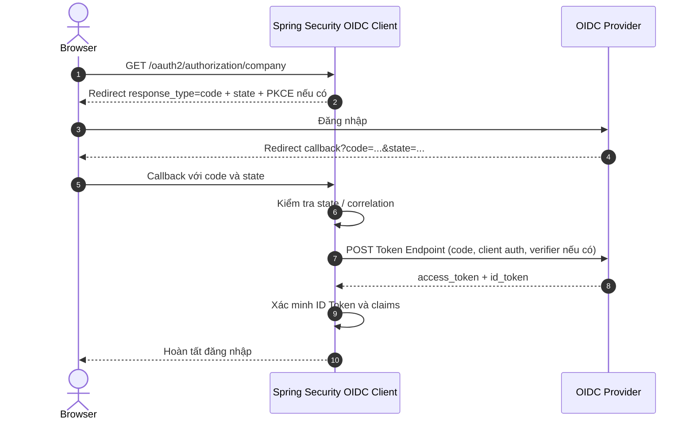

# 11.10. Các hash claim at_hash, c_hash và phạm vi áp dụng theo flow

## 1. Vì sao ID Token có `at_hash` và `c_hash`?

Trong **OpenID Connect (OIDC)**, ứng dụng (Relying Party/OIDC Client) nhận **ID Token** để xác thực thông tin đăng nhập của người dùng. ID Token thường là JWT có chữ ký số do OpenID Provider (OP) phát hành.

Ở một số flow, **authorization code** hoặc **access token** được trả về cùng với ID Token trong **authorization response**. Hai giá trị đó có thể đi qua kênh trình duyệt (*front channel*), nhưng không nhất thiết nằm bên trong phần payload đã ký của ID Token. Nếu chỉ xác minh chữ ký ID Token, client chưa tự động chứng minh được rằng **code/token nhận kèm** là đúng giá trị liên quan đến ID Token ấy.

OIDC định nghĩa hai claim để ràng buộc bằng hàm băm:

- **`at_hash`** (*Access Token hash value*): giúp liên kết **access token** với **ID Token**.
- **`c_hash`** (*Code hash value*): giúp liên kết **authorization code** với **ID Token**.

Khi cần kiểm tra, client lấy giá trị code/token **thực sự nhận được**, tính một giá trị băm rút gọn theo thuật toán ký của ID Token rồi so sánh với claim tương ứng.

Ví dụ: một ứng dụng dùng **Hybrid Flow** nhận `code` và `id_token` cùng lúc từ Authorization Endpoint. Chữ ký ID Token xác nhận thông tin trong ID Token do OP phát hành; `c_hash` giúp client phát hiện việc thay thế `code` bằng giá trị khác trong response.

> **Ý quan trọng:** `at_hash` và `c_hash` là **claim ràng buộc dữ liệu với ID Token đã xác thực**, không phải chữ ký số độc lập của access token/code, không phải một loại token mới và cũng không thay thế kiểm tra `iss`, `aud`, `exp`, `nonce` hay `state`.

Bài học thuộc chương **Kiểm tra ID Token** của module **Spring Security OAuth 2.0 OIDC Client**, tập trung vào ý nghĩa các claim, cách tính toán, **phạm vi bắt buộc theo flow** và cách hiểu chúng trong ứng dụng Spring Security.

## 2. Phân biệt `at_hash`, `c_hash`, `state` và PKCE

Các cơ chế này thường xuất hiện cùng một lần đăng nhập nhưng giải quyết những vấn đề khác nhau.

| Thành phần | Xuất hiện ở đâu? | Dữ liệu được liên kết / kiểm tra | Mục đích chính |
| --- | --- | --- | --- |
| **`at_hash`** | Claim trong ID Token | Giá trị access token | Phát hiện access token không khớp với ID Token khi cần kiểm tra |
| **`c_hash`** | Claim trong ID Token | Giá trị authorization code | Phát hiện authorization code không khớp với ID Token khi cần kiểm tra |
| **`state`** | Authorization request và authorization response | Phản hồi với yêu cầu bắt đầu đăng nhập đã lưu | Chống login CSRF, ghép callback với phiên/request phù hợp |
| **`nonce`** | Authorization request OIDC và ID Token | ID Token với yêu cầu xác thực ban đầu | Chống phát lại/nhầm phiên theo quy tắc OIDC |
| **PKCE `code_challenge`** | Authorization request | Liên kết challenge với verifier bí mật của client | Hạn chế nguy cơ code bị đánh cắp và đổi token |
| **PKCE `code_verifier`** | Token request | Chứng minh bên đổi code có verifier ban đầu | Bảo vệ bước đổi authorization code lấy token |
| **JWS signature** | ID Token đã ký | Header/payload của ID Token | Xác nhận nguồn gốc và tính toàn vẹn của ID Token |
| **`iss` / `aud` / `exp`** | Claim trong ID Token | Issuer, đối tượng nhận, thời gian | Quyết định token có hợp lệ cho client và thời điểm hiện tại không |

Một ứng dụng không được suy luận:

- Có `state` khớp thì `at_hash` không cần kiểm tra khi OIDC yêu cầu.
- Có PKCE thì `c_hash` tự động hợp lệ.
- Có `at_hash` thì access token chắc chắn được API chấp nhận.
- Có `c_hash` thì authorization code có thể dùng lại hoặc bỏ qua token exchange.
- Chữ ký ID Token hợp lệ là đủ, không cần kiểm tra issuer, audience hay thời hạn.

**Mỗi cơ chế có một ranh giới tin cậy riêng.** Khi chuẩn OIDC yêu cầu kiểm tra nhiều điều kiện, tất cả đều phải được đáp ứng.

## 3. Định nghĩa chính xác của hai hash claim

### 3.1. `at_hash` — Access Token hash

`at_hash` là **chuỗi Base64URL không padding của nửa bên trái kết quả băm giá trị access token**. Hàm băm được xác định từ **`alg` của JWS header trên ID Token**.

Ví dụ ID Token payload:

```json
{
  "iss": "https://id.example.com/realms/company",
  "sub": "employee-4821",
  "aud": "employee-portal",
  "exp": 1794800000,
  "iat": 1794799400,
  "at_hash": "hash-rut-gon-duoc-tinh-tu-access-token"
}
```

Chuỗi `at_hash` trên chỉ là placeholder để minh họa cấu trúc, **không phải hash hợp lệ của một token thật**.

Khi client được yêu cầu xác minh `at_hash`, nó phải có:

1. **ID Token đã được xác minh** bằng khóa và thuật toán đáng tin cậy.
2. **Access token chính xác** liên quan đến response đang kiểm tra.
3. **`alg` của ID Token JWS header**, ví dụ `RS256`.
4. Giá trị `at_hash` đã được OP đặt trong ID Token.

### 3.2. `c_hash` — Authorization Code hash

`c_hash` cũng là **Base64URL không padding của nửa bên trái kết quả băm**, nhưng dữ liệu đầu vào là **authorization code**, không phải access token.

ID Token payload minh họa:

```json
{
  "iss": "https://id.example.com/realms/company",
  "sub": "employee-4821",
  "aud": "employee-portal",
  "exp": 1794800000,
  "iat": 1794799400,
  "nonce": "nonce-cua-authorization-request",
  "c_hash": "hash-rut-gon-duoc-tinh-tu-authorization-code"
}
```

Khi client nhận một **authorization response chứa đồng thời `code` và `id_token`**, hash claim này giúp xác nhận code đi kèm đúng với ID Token do OP ký.

### 3.3. So sánh trực tiếp

| Tiêu chí | `at_hash` | `c_hash` |
| --- | --- | --- |
| Tên đầy đủ | Access Token hash value | Code hash value |
| Input để tính hash | **Giá trị chuỗi access token** | **Giá trị chuỗi authorization code** |
| Thuật toán | Hash tương ứng `alg` của ID Token | Hash tương ứng `alg` của ID Token |
| Cách rút gọn | Lấy nửa bên trái digest | Lấy nửa bên trái digest |
| Encoding claim | Base64URL, không thêm `=` padding | Base64URL, không thêm `=` padding |
| Claim nằm ở đâu? | Payload ID Token | Payload ID Token |
| Bắt buộc khi nào? | ID Token được phát hành từ Authorization Endpoint **cùng access token** | ID Token được phát hành từ Authorization Endpoint **cùng authorization code** |
| Ví dụ flow bắt buộc | `id_token token`; `code id_token token` | `code id_token`; `code id_token token` |

**Không lấy `at_hash` từ phần payload của access token JWT.** Input là **nguyên văn access token nhận được**, dù access token ở dạng opaque string hay JWT. Tương tự, `c_hash` không được tính từ toàn bộ callback URL, `state` hoặc code verifier.

## 4. Cách tính `at_hash` và `c_hash`

OIDC dùng cùng một công thức cho cả hai claim:

1. Chọn hàm băm theo **thuật toán chữ ký JWS** của **ID Token**.
2. Mã hóa **giá trị ASCII nguyên bản** của access token/code thành byte.
3. Tính digest của chuỗi byte đó.
4. Lấy **nửa trái** của digest, tính theo số bit.
5. Mã hóa phần byte này bằng **Base64URL không padding**.
6. So sánh kết quả với claim nằm trong **ID Token đã được xác minh**.

Công thức khái niệm:

```text
D = HASH(ASCII(raw_value))
H = LEFT_HALF(D)
claim_value = BASE64URL_NO_PADDING(H)

at_hash = claim_value khi raw_value là access_token
c_hash  = claim_value khi raw_value là authorization_code
```

Ở đây `HASH` là SHA-256/SHA-384/SHA-512... theo `alg` của ID Token, **không phải tùy chọn ngẫu nhiên** của ứng dụng.

### 4.1. Minh họa với `RS256`

Giả sử ID Token được ký bằng `RS256`:

```json
{
  "alg": "RS256",
  "kid": "company-signing-key-2",
  "typ": "JWT"
}
```

Thuật toán ký `RS256` sử dụng SHA-256 cho phần hash. Do đó:

- Digest SHA-256 có **256 bit = 32 byte**.
- Nửa bên trái là **128 bit = 16 byte đầu tiên**.
- Base64URL không padding của 16 byte thường có **22 ký tự**.

Ví dụ với access token `A` và authorization code `C`:

```text
at_hash = BASE64URL_NOPAD(LEFT_128_BITS(SHA256(ASCII(A))))
c_hash  = BASE64URL_NOPAD(LEFT_128_BITS(SHA256(ASCII(C))))
```

Ở đây `A` và `C` là **giá trị nguyên văn** nhận được, không phải tên biến được truyền qua JSON, không kèm tiền tố `Bearer `.

### 4.2. Bảng thuật toán thông dụng

| `alg` của ID Token JWS | Hàm băm | Digest đầy đủ | Nửa bên trái | Độ dài Base64URL không padding |
| --- | --- | --- | --- | --- |
| `RS256`, `PS256`, `ES256`, `HS256` | SHA-256 | 32 byte | 16 byte | 22 ký tự |
| `RS384`, `PS384`, `ES384`, `HS384` | SHA-384 | 48 byte | 24 byte | 32 ký tự |
| `RS512`, `PS512`, `ES512`, `HS512` | SHA-512 | 64 byte | 32 byte | 43 ký tự |

Bảng minh họa các họ thuật toán có hậu tố chỉ độ mạnh hash. Với thuật toán ký khác như `EdDSA` hoặc các profile OIDC/JWT đặc thù, **không tự đoán hàm băm chỉ từ tên chuỗi**; phải theo đặc tả/thuật toán được hỗ trợ bởi OP và thư viện đang dùng.

**Không nhầm `alg` với `enc` của JWE.** Nếu ID Token được ký rồi mã hóa, quy tắc hash claim dựa trên **thuật toán của chữ ký JWS bên trong**, không dựa trên thuật toán mã hóa ngoài như `A256GCM`.

### 4.3. Những sai sót tính hash dễ gặp

| Sai sót | Vì sao sai? |
| --- | --- |
| Base64URL toàn bộ SHA-256 | Chuẩn yêu cầu **nửa trái**, không phải toàn bộ digest |
| Lấy nửa của chuỗi hex thay vì digest byte mà không xử lý đúng | Dễ lấy sai số byte/bit hoặc encoding |
| Dùng `SHA-256` cho mọi ID Token | Hash phải khớp `alg` của ID Token |
| Dùng thuật toán ký của **access token JWT** | Hash dựa vào `alg` của **ID Token** |
| Thêm `Bearer ` trước access token | Token type prefix không thuộc giá trị raw access token |
| Decode access token JWT trước khi băm | Input phải là **chuỗi token nguyên bản**, không phải JSON payload |
| Băm `code_challenge` thay cho authorization code | `c_hash` sử dụng authorization **code**, không phải PKCE challenge |
| Dùng Base64 chuẩn `+`, `/`, `=` | OIDC dùng **Base64URL không padding** |
| Thêm dấu cách hoặc newline vào raw value | Mọi byte thay đổi sẽ khiến hash khác |
| Tính hash khi chưa kiểm tra ID Token | Claim trong ID Token chưa xác minh chưa phải thông tin tin cậy |

## 5. Phạm vi theo flow: lúc nào claim bắt buộc?

Đây là điểm quan trọng nhất: **không phải mọi ID Token đều phải có cả `at_hash` và `c_hash`**. Điều kiện bắt buộc phụ thuộc vào **ID Token có được trả từ Authorization Endpoint cùng code/access token hay không**, chứ không đơn thuần phụ thuộc câu nói “đang dùng OAuth2/OIDC”.

OIDC Core có ba nhóm flow lịch sử chính:

- **Authorization Code Flow**: `response_type=code`.
- **Implicit Flow**: `response_type=id_token` hoặc `id_token token`.
- **Hybrid Flow**: `response_type=code id_token`, `code token` hoặc `code id_token token`.

### 5.1. Ma trận tóm tắt

| Flow | `response_type` | Authorization Endpoint trả về | ID Token được nhận từ đâu? | `at_hash` | `c_hash` |
| --- | --- | --- | --- | --- | --- |
| **Authorization Code** | `code` | `code` | **Token Endpoint** | **Tùy chọn** | **Tùy chọn** |
| **Implicit** | `id_token` | `id_token` | **Authorization Endpoint** | Không bắt buộc, vì không có access token trả kèm | Không bắt buộc, vì không có code trả kèm |
| **Implicit** | `id_token token` | `id_token` + `access_token` | **Authorization Endpoint** | **Bắt buộc** | Không bắt buộc |
| **Hybrid** | `code id_token` | `code` + `id_token` | **Authorization Endpoint** (và có thể thêm ID Token từ Token Endpoint khi đổi code) | Không bắt buộc trong ID Token front channel nếu không có access token trả kèm | **Bắt buộc trong ID Token từ Authorization Endpoint** |
| **Hybrid** | `code token` | `code` + `access_token` | **Token Endpoint** khi đổi code | Tùy chọn trong ID Token ở Token Endpoint | Tùy chọn trong ID Token ở Token Endpoint |
| **Hybrid** | `code id_token token` | `code` + `id_token` + `access_token` | **Authorization Endpoint** (và có thể thêm ID Token từ Token Endpoint) | **Bắt buộc trong ID Token từ Authorization Endpoint** | **Bắt buộc trong ID Token từ Authorization Endpoint** |

**Quy tắc đọc bảng:** "Bắt buộc" ở đây nghĩa là **OP phải đặt claim và client phải kiểm tra theo yêu cầu flow** đối với ID Token trong response tương ứng. Nếu ID Token được trả từ Token Endpoint ở một bước khác, đừng tự động áp cùng điều kiện chỉ vì một token khác từng được trả ở front channel; hãy xác định **ID Token nào đang được kiểm tra**.

Trong các flow mà claim **không bắt buộc**, OP **có thể vẫn đưa claim vào** ID Token. Khi claim hiện diện và có giá trị tương ứng để đối chiếu, client có thể xác minh nó để tăng bảo đảm; không xem claim tùy chọn là luôn không tồn tại.

### 5.2. Quy tắc nhớ nhanh

```text
ID Token từ Authorization Endpoint + Access Token cùng response
    → at_hash BẮT BUỘC trong ID Token đó

ID Token từ Authorization Endpoint + Authorization Code cùng response
    → c_hash BẮT BUỘC trong ID Token đó

ID Token chỉ từ Token Endpoint trong Authorization Code Flow
    → at_hash/c_hash không mặc nhiên bắt buộc

Không có access_token hoặc code tương ứng ở response cần kiểm tra
    → không thể yêu cầu kiểm tra hash dựa trên giá trị không hiện diện
```

Đây là cách suy luận dựa trên **đối tượng được hash và vị trí phát hành ID Token**. Với các profile bảo mật riêng (ví dụ profile tài chính/yêu cầu của OP), có thể tồn tại ràng buộc chặt hơn. Không thay thế quy tắc OIDC bằng giả định mọi OP đều phải trả đủ hai claim.

## 6. Authorization Code Flow: trường hợp phổ biến của Spring Security

### 6.1. Diễn tiến flow

Ở Authorization Code Flow:

1. Browser được redirect tới OP với `response_type=code`.
2. OP xác thực user và trả **`code`** về callback.
3. Spring Security kiểm tra `state` và authorization request đã lưu.
4. Backend đổi code lấy **access token + ID Token** tại Token Endpoint.
5. Spring Security xác minh ID Token, tạo `OidcUser` và phiên.



Ở **flow này**, ID Token nhận từ **Token Endpoint**, không được gửi cùng access token từ Authorization Endpoint. Do đó **`at_hash` là claim tùy chọn**, không phải claim bắt buộc trong mọi ID Token Authorization Code Flow. `c_hash` cũng không mặc nhiên bắt buộc.

Một ID Token hợp lệ trong Code Flow có thể không chứa hai claim:

```json
{
  "iss": "https://id.example.com/realms/company",
  "sub": "employee-4821",
  "aud": "employee-portal",
  "iat": 1794799400,
  "exp": 1794800000
}
```

Đây chỉ là payload minh họa; các claim bắt buộc khác và giá trị thực phải đáp ứng yêu cầu OIDC. Khi `nonce` đã được gửi trong authorization request, ID Token cần xử lý nonce theo yêu cầu flow.

### 6.2. Nếu ID Token từ Token Endpoint có `at_hash` thì sao?

Một số OP vẫn đưa `at_hash` vào ID Token trong Authorization Code Flow. Khi đó client **có thể** dùng nó để xác minh access token được trả cùng token response theo thuật toán hash của ID Token.

```text
Token response:
  access_token = ACCESS_TOKEN_X
  id_token.at_hash = HASH_HALF(ACCESS_TOKEN_X, ID_TOKEN_ALG)

Client:
  tính hash từ ACCESS_TOKEN_X
  so sánh với id_token.at_hash
```

Với flow này, **sự vắng mặt của `at_hash` không phải mặc định là lỗi OIDC**. Ngược lại, nếu ứng dụng đã quyết định xác minh một claim hiện diện thì giá trị không khớp phải được xử lý như lỗi xác thực/toàn vẹn, không tiếp tục dùng token như thể mọi thứ hợp lệ.

### 6.3. Có nên yêu cầu `c_hash` trong Code Flow?

Trong Code Flow thuần, code đến qua callback còn ID Token đến từ Token Endpoint, nên điều kiện **có ID Token cùng code tại Authorization Endpoint** không xảy ra. `c_hash` vì vậy không tự động bắt buộc.

Trong Spring Security `oauth2Login` với `authorization_code`, ưu tiên chính xác các bước:

- `state`/session correlation.
- PKCE nếu flow cấu hình dùng PKCE.
- Client authentication tại Token Endpoint khi áp dụng.
- Xác minh chữ ký và các claim của ID Token.
- Áp dụng validators/chính sách OIDC cho flow thực tế.

Không tự kết luận nhà cung cấp sai chuẩn chỉ vì ID Token Code Flow không có `at_hash` hoặc `c_hash`.

## 7. Implicit Flow: ID Token và access token đi qua front channel

**Implicit Flow** là nhóm flow lịch sử của OIDC, nơi token có thể được phát hành trực tiếp từ Authorization Endpoint. Đối với ứng dụng mới, **Authorization Code Flow với PKCE** là lựa chọn được ưu tiên; Implicit Flow làm tăng rủi ro do token đi qua môi trường trình duyệt và không nên là flow mặc định cho kiến trúc mới.

### 7.1. `response_type=id_token`

Authorization Endpoint trả **ID Token**, nhưng không trả access token hoặc authorization code cùng response.

```text
response_type=id_token

Authorization response:
    id_token = ...
    state    = ...
```

Theo điều kiện của các hash claim:

- **`at_hash` không bắt buộc** vì không có access token được trả cùng ID Token.
- **`c_hash` không bắt buộc** vì không có authorization code.

Client vẫn phải kiểm tra chữ ký, issuer, audience, nonce khi yêu cầu, thời hạn, state và các quy tắc OIDC còn lại. Không có hash claim không có nghĩa có thể bỏ qua validation khác.

### 7.2. `response_type=id_token token`

Authorization Endpoint trả **cả ID Token và access token** trong cùng response:

```text
response_type=id_token token

Authorization response:
    id_token     = ...
    access_token = ACCESS_TOKEN_Y
    state        = ...
```

**`at_hash` bắt buộc** trong ID Token vì OP phát hành ID Token cùng access token tại Authorization Endpoint.

Quy trình:

1. Xác minh chữ ký và các claim bắt buộc của ID Token.
2. Lấy `at_hash` từ payload đã xác minh.
3. Tính hash rút gọn của **ACCESS_TOKEN_Y** theo `alg` của ID Token.
4. So sánh giá trị, từ chối nếu thiếu hoặc không khớp.
5. Tiếp tục các yêu cầu bảo mật khác của flow.

**`c_hash` không bắt buộc** ở response này vì không có authorization code được trả cùng ID Token.

Nếu client chỉ xác minh chữ ký ID Token rồi bỏ qua `at_hash` trong trường hợp này, nó có thể bỏ sót phép kiểm tra liên kết giữa access token front channel và ID Token theo yêu cầu OIDC.

## 8. Hybrid Flow: một phần dữ liệu ở Authorization Endpoint, phần khác ở Token Endpoint

Hybrid Flow kết hợp việc trả **authorization code** và **một số token** từ Authorization Endpoint, sau đó client còn dùng Token Endpoint để hoàn tất quá trình trao đổi.

### 8.1. `response_type=code id_token`

Authorization Endpoint trả:

```text
response_type=code id_token

Authorization response:
    code     = AUTH_CODE_A
    id_token = ID_TOKEN_A
    state    = ...
```

Ở đây **`c_hash` bắt buộc** trong ID Token từ Authorization Endpoint.

```text
ID_TOKEN_A.payload.c_hash
    phải bằng
BASE64URL_NOPAD(LEFT_HALF(HASH(ASCII(AUTH_CODE_A))))
```

`at_hash` **không bắt buộc trong ID Token đó**, vì authorization response không trả access token cùng ID Token. Sau đó client có thể đổi code lấy access token (và tùy flow/provider, có thể nhận ID Token bổ sung từ Token Endpoint). Nếu ID Token khác được trả từ Token Endpoint, áp dụng điều kiện cho chính ID Token ấy, không lấy nguyên kết luận về `c_hash` bắt buộc ở front channel để áp lên token response sau đó.

### 8.2. `response_type=code token`

Authorization Endpoint trả:

```text
response_type=code token

Authorization response:
    code         = AUTH_CODE_B
    access_token = ACCESS_TOKEN_B
    state        = ...
```

Đáng chú ý: **không có ID Token trong authorization response này**. Với OIDC Hybrid Flow, ID Token được nhận ở **Token Endpoint khi đổi code**.

Vì không có ID Token đi kèm code/access token ở Authorization Endpoint, không thể áp điều kiện “ID Token phát hành cùng code/access token tại Authorization Endpoint” cho response đầu tiên. `at_hash` và `c_hash` vì thế **không mặc nhiên bắt buộc trong ID Token nhận ở Token Endpoint** theo các điều kiện này.

Điều đó **không có nghĩa** client có thể sử dụng access token front channel mà bỏ qua những kiểm tra khác của Hybrid Flow, bao gồm xác minh token, correlation và cơ chế bảo vệ được quy định cho response type.

### 8.3. `response_type=code id_token token`

Authorization Endpoint trả đủ ba giá trị:

```text
response_type=code id_token token

Authorization response:
    code         = AUTH_CODE_C
    id_token     = ID_TOKEN_C
    access_token = ACCESS_TOKEN_C
    state        = ...
```

Vì ID Token được phát hành từ Authorization Endpoint **cùng cả code và access token**, nên:

- **`c_hash` bắt buộc**, được tính từ `AUTH_CODE_C`.
- **`at_hash` bắt buộc**, được tính từ `ACCESS_TOKEN_C`.

```text
          ID_TOKEN_C (JWS đã xác minh)
             /                  \
            /                    \
          c_hash               at_hash
            |                     |
            v                     v
       HASH(AUTH_CODE_C)    HASH(ACCESS_TOKEN_C)
            |                     |
            +--------+------------+
                     |
          Cả hai phép kiểm tra phải đạt
```

Nếu một claim bắt buộc bị thiếu hoặc không khớp, client phải từ chối response phù hợp với chính sách OIDC. **Không đánh đồng hash check với token exchange**: code sau đó vẫn phải được đổi tại Token Endpoint đúng quy tắc và access token vẫn phải được dùng đúng audience/scope.

### 8.4. Hybrid có thể có nhiều ID Token

Trong một số biến thể Hybrid, client có thể nhận một ID Token từ Authorization Endpoint rồi sau đó nhận ID Token khác từ Token Endpoint. Các token đó có thể có **các claim khác nhau**, vì được phát hành tại các giai đoạn khác nhau.

Nguyên tắc là **đánh giá từng ID Token theo vị trí phát hành và dữ liệu kèm theo**, thay vì khăng khăng rằng mọi ID Token trong cùng lần login phải có chính xác cùng tập `at_hash`/`c_hash`.

## 9. Vì sao chữ ký ID Token phải được xác minh trước khi tin hash claim?

Giả sử một attacker thay thế access token trong authorization response và đồng thời tự tạo trường `at_hash` chứa hash của access token giả. Nếu client **không xác minh chữ ký ID Token**, attacker có thể sửa payload token để làm hash check “đúng”.

Do đó thứ tự tin cậy nên là:

```text
Nhận ID Token + code/access token liên quan
       |
       v
Xác minh ID Token bằng issuer và khóa/thuật toán tin cậy
       |
       +-- Chữ ký/claim sai → TỪ CHỐI
       |
       v
Xác thực iss, aud, exp, iat, nonce và yêu cầu khác của flow
       |
       +-- Không hợp lệ → TỪ CHỐI
       |
       v
Kiểm tra sự hiện diện của at_hash/c_hash theo flow
       |
       +-- Claim bắt buộc nhưng thiếu → TỪ CHỐI
       |
       v
Tính hash từ raw access_token/code tương ứng
       |
       +-- Không khớp → TỪ CHỐI
       |
       v
Tiếp tục token exchange / authenticated session theo flow
```

Trong thực tế, một số bước có thể được thư viện tổ chức theo thứ tự nội bộ khác miễn là **không sử dụng dữ liệu chưa xác thực để cấp quyền**. Điểm cốt lõi là **không được tin hash claim chưa được bảo vệ bằng ID Token validation**.

`at_hash` và `c_hash` không tự chứng minh rằng access token có audience API đúng, scope đủ quyền hoặc chưa bị thu hồi. Các điều kiện đó vẫn do Resource Server/API và chính sách token tương ứng xác thực.

## 10. Ví dụ Java tính và kiểm tra hash claim

Để nhìn rõ thuật toán, ta có thể viết một utility Java độc lập chỉ thực hiện **phép tính toán hash**. Nó **không thay thế** OIDC ID Token validator, JWS signature validation hoặc flow handling của Spring Security.

Ví dụ dành cho **Java 17+** với các họ thuật toán JWS thường gặp:

```java
package com.example.oidc.security;

import java.nio.charset.StandardCharsets;
import java.security.MessageDigest;
import java.security.NoSuchAlgorithmException;
import java.util.Arrays;
import java.util.Base64;
import java.util.Objects;

public final class OidcTokenHash {

    private OidcTokenHash() {
    }

    /**
     * Tính at_hash/c_hash từ raw access token hoặc authorization code.
     *
     * @param rawValue      giá trị ASCII nguyên bản, không có "Bearer "
     * @param verifiedAlg   JWS alg của ID Token đã được xác minh
     */
    public static String calculate(String rawValue, String verifiedAlg) {
        Objects.requireNonNull(rawValue, "rawValue");
        Objects.requireNonNull(verifiedAlg, "verifiedAlg");

        if (rawValue.isEmpty()) {
            throw new IllegalArgumentException("Token/code must not be empty");
        }
        if (rawValue.chars().anyMatch(value -> value > 0x7F)) {
            throw new IllegalArgumentException("Expected ASCII token/code");
        }

        String digestName = switch (verifiedAlg) {
            case "RS256", "PS256", "ES256", "HS256" -> "SHA-256";
            case "RS384", "PS384", "ES384", "HS384" -> "SHA-384";
            case "RS512", "PS512", "ES512", "HS512" -> "SHA-512";
            default -> throw new IllegalArgumentException(
                    "Unsupported ID Token JWS algorithm");
        };

        try {
            byte[] valueBytes =
                    rawValue.getBytes(StandardCharsets.US_ASCII);

            byte[] fullDigest =
                    MessageDigest.getInstance(digestName).digest(valueBytes);

            // Lấy nửa bên trái tính theo byte, không phải chuỗi hex.
            byte[] leftHalf =
                    Arrays.copyOf(fullDigest, fullDigest.length / 2);

            return Base64.getUrlEncoder()
                    .withoutPadding()
                    .encodeToString(leftHalf);

        } catch (NoSuchAlgorithmException ex) {
            throw new IllegalStateException(
                    "Required SHA digest is unavailable", ex);
        }
    }

    /**
     * So sánh claim từ ID Token với raw value thực sự nhận được.
     * Yêu cầu ID Token đã được kiểm tra chữ ký và claims tin cậy.
     */
    public static boolean matches(
            String rawValue,
            String verifiedAlg,
            String claimValue) {

        if (claimValue == null || claimValue.isBlank()) {
            return false;
        }

        String calculated = calculate(rawValue, verifiedAlg);

        return MessageDigest.isEqual(
                calculated.getBytes(StandardCharsets.US_ASCII),
                claimValue.getBytes(StandardCharsets.US_ASCII));
    }
}
```

Một số điểm cần ghi nhớ khi đọc utility:

- `rawValue` nhận **chuỗi access token hoặc authorization code**, không nhận đối tượng JWT đã parse hoặc toàn bộ HTTP header.
- `verifiedAlg` được gọi là *verified* để nhấn mạnh việc **chữ ký và chính sách thuật toán của ID Token phải được xác minh trước**. Không lấy một chuỗi `alg` tùy ý từ browser rồi dùng nó để quyết định token được tin cậy.
- `Arrays.copyOf(fullDigest, fullDigest.length / 2)` giữ **nửa đầu của digest tính bằng byte**.
- `Base64.getUrlEncoder().withoutPadding()` tạo biểu diễn Base64URL theo kiểu OIDC yêu cầu.
- `MessageDigest.isEqual(...)` giúp tránh phép so sánh chuỗi ngây thơ. Khi thiết kế hệ thống thực, có thể chuẩn hóa/kiểm tra độ dài và định dạng Base64URL trước khi so sánh.
- Utility **cố ý từ chối thuật toán ngoài danh sách hỗ trợ**, không tự suy ra hash cho những `alg` chưa xác định.
- `HS256` cũng dùng SHA-256 cho hash claim, nhưng **xác minh chữ ký ID Token HMAC** vẫn có quy tắc an toàn riêng và không được thay bằng cách tính `at_hash`.

### 10.1. Minh họa cách gọi cho `at_hash`

Giả sử ứng dụng **đã xác minh ID Token**, lấy được `alg=RS256` và có access token tương ứng:

```java
String rawAccessToken = tokenResponse.getAccessToken().getTokenValue();
String atHashClaim = verifiedIdToken.getClaimAsString("at_hash");

// "RS256" ở đây phải lấy từ JWS header đã được xử lý trong
// ngữ cảnh ID Token hợp lệ, không phải input tùy ý của request.
boolean valid = OidcTokenHash.matches(
        rawAccessToken,
        "RS256",
        atHashClaim);

if (!valid) {
    throw new SecurityException("OIDC at_hash mismatch");
}
```

Đây là **đoạn minh họa thuật toán** trong nơi đã có `tokenResponse` và `verifiedIdToken`, không phải một lớp Spring độc lập. Trong ứng dụng thật, nên lấy `alg` từ chính ID Token đã được xác minh thay vì gán cứng `"RS256"` như ví dụ.

Nếu flow yêu cầu `at_hash` và claim thiếu, hàm `matches` trả `false`. Trong Authorization Code Flow, claim có thể tùy chọn; logic thực thi cần xác định **sự vắng mặt có được phép hay không theo flow**, rồi mới gọi verifier.

### 10.2. Minh họa cách gọi cho `c_hash`

Khi dùng Hybrid Flow có **ID Token và code cùng authorization response**:

```java
String rawAuthorizationCode =
        authorizationResponse.getCode();

String cHashClaim =
        verifiedFrontChannelIdToken.getClaimAsString("c_hash");

boolean valid = OidcTokenHash.matches(
        rawAuthorizationCode,
        verifiedIdTokenAlg,
        cHashClaim);

if (!valid) {
    throw new SecurityException("OIDC c_hash mismatch");
}
```

Đoạn này giả định đã có `authorizationResponse`, `verifiedFrontChannelIdToken` và `verifiedIdTokenAlg` từ pipeline OIDC Hybrid được triển khai an toàn. Nó không phải lời khuyên tự viết callback controller để thay `OAuth2LoginAuthenticationFilter`.

Khi response type là `code id_token` hay `code id_token token`, **`c_hash` thiếu cũng phải được coi là lỗi** với ID Token trả từ Authorization Endpoint.

### 10.3. Kiểm tra hai claim cùng lúc

Trong Hybrid `code id_token token`:

```java
boolean codeMatches = OidcTokenHash.matches(
        rawAuthorizationCode,
        verifiedIdTokenAlg,
        verifiedIdToken.getClaimAsString("c_hash"));

boolean accessTokenMatches = OidcTokenHash.matches(
        rawAccessToken,
        verifiedIdTokenAlg,
        verifiedIdToken.getClaimAsString("at_hash"));

if (!codeMatches || !accessTokenMatches) {
    throw new SecurityException(
            "OIDC response is not bound to the verified ID Token");
}
```

Cần sử dụng **đúng code và access token trong cùng authorization response** với ID Token đang kiểm tra. Không thay bằng access token mới được cấp ở một thời điểm khác rồi kỳ vọng `at_hash` vẫn khớp.

## 11. Tích hợp với Spring Security OAuth2/OIDC Client

### 11.1. Luồng mặc định của `oauth2Login`

Ví dụ Spring Boot MVC/Servlet:

```yaml
spring:
  security:
    oauth2:
      client:
        registration:
          company:
            provider: company-oidc
            client-id: ${OIDC_CLIENT_ID}
            client-secret: ${OIDC_CLIENT_SECRET}
            authorization-grant-type: authorization_code
            redirect-uri: "{baseUrl}/login/oauth2/code/{registrationId}"
            scope:
              - openid
              - profile
        provider:
          company-oidc:
            issuer-uri: https://id.example.com/realms/company
```

Và:

```java
import org.springframework.context.annotation.Bean;
import org.springframework.context.annotation.Configuration;
import org.springframework.security.config.Customizer;
import org.springframework.security.config.annotation.web.builders.HttpSecurity;
import org.springframework.security.web.SecurityFilterChain;

@Configuration
public class SecurityConfig {

    @Bean
    SecurityFilterChain webSecurity(HttpSecurity http) throws Exception {
        http.authorizeHttpRequests(authorize -> authorize
                    .requestMatchers("/", "/error").permitAll()
                    .anyRequest().authenticated())
            .oauth2Login(Customizer.withDefaults());

        return http.build();
    }
}
```

Trong luồng thông dụng này:

1. `OAuth2AuthorizationRequestRedirectFilter` bắt đầu Authorization Code flow.
2. Browser đăng nhập và về callback với `code`/`state`.
3. `OAuth2LoginAuthenticationFilter` phối hợp correlation và token exchange.
4. OIDC authentication provider xác minh ID Token, issuer, audience, nonce và các yêu cầu tương ứng.
5. Spring xây `OidcUser`, `Authentication` rồi duy trì session theo cấu hình.

Vì **ID Token đến từ Token Endpoint trong Authorization Code Flow**, ứng dụng **không được mặc định từ chối mọi ID Token thiếu `at_hash` hoặc `c_hash`**.

### 11.2. Spring Security có mặc định xác minh `at_hash` / `c_hash` không?

Đây là một câu hỏi triển khai **phụ thuộc flow và phiên bản thư viện**. Cần phân biệt:

- Spring Security `oauth2Login` chủ yếu cung cấp **Authorization Code Flow** cho đăng nhập người dùng.
- Các validator OIDC mặc định xử lý những điều kiện thiết yếu như chữ ký/issuer/audience/thời gian/nonce tùy cấu hình.
- **Không nên khẳng định mọi phiên bản đều xác minh mọi claim tùy chọn, hoặc hỗ trợ đầy đủ các response type Implicit/Hybrid**, chỉ vì chúng đều thuộc chuẩn OIDC.
- Với các profile yêu cầu kiểm tra `at_hash`/`c_hash` bổ sung, cần xác nhận behavior của **phiên bản Spring Security cụ thể** và bổ sung validator tại điểm thích hợp.
- Nếu sử dụng **Hybrid Flow**, cần xác nhận toàn bộ pipeline hỗ trợ response type đó và kiểm tra front-channel ID Token, `c_hash`, `at_hash` theo quy định. **Không thể biến `oauth2Login` mặc định thành Hybrid Flow chỉ bằng cách đổi `response_type` trong URL**.

Điều quan trọng hơn việc nhớ một implementation version là **không áp dụng sai quy tắc bắt buộc**: Code Flow thuần khác với Implicit/Hybrid có ID Token ở Authorization Endpoint.

### 11.3. Đưa verifier bổ sung vào `OidcUserService` cho Code Flow

Với ứng dụng có **yêu cầu chính sách riêng về `at_hash` khi claim hiện diện** trong ID Token nhận tại Token Endpoint, có thể minh họa một lớp user service kiểm tra bổ sung **sau khi provider đã xác minh ID Token**.

Ví dụ dưới đây áp dụng cho **ID Token dạng signed compact JWS** và sử dụng Nimbus JOSE/JWT để đọc thuật toán ký từ header của **ID Token đã qua validation**:

```java
package com.example.portal.security;

import com.nimbusds.jwt.SignedJWT;
import java.text.ParseException;

import org.springframework.security.oauth2.client.oidc.userinfo.OidcUserRequest;
import org.springframework.security.oauth2.client.oidc.userinfo.OidcUserService;
import org.springframework.security.oauth2.client.userinfo.OAuth2UserService;
import org.springframework.security.oauth2.core.OAuth2AuthenticationException;
import org.springframework.security.oauth2.core.OAuth2Error;
import org.springframework.security.oauth2.core.oidc.user.OidcUser;

public final class AdditionalAtHashOidcUserService
        implements OAuth2UserService<OidcUserRequest, OidcUser> {

    private final OidcUserService delegate = new OidcUserService();

    @Override
    public OidcUser loadUser(OidcUserRequest request)
            throws OAuth2AuthenticationException {

        // Gọi user service mặc định; không tự thay thế ID Token validation.
        OidcUser user = delegate.loadUser(request);

        String atHash =
                request.getIdToken().getClaimAsString("at_hash");

        // Authorization Code Flow: at_hash có thể không xuất hiện.
        if (atHash == null) {
            return user;
        }

        try {
            String rawIdToken = request.getIdToken().getTokenValue();

            // Đọc alg của ID Token đã được xác minh ở tầng OIDC.
            String alg = SignedJWT.parse(rawIdToken)
                    .getHeader()
                    .getAlgorithm()
                    .getName();

            boolean matches = OidcTokenHash.matches(
                    request.getAccessToken().getTokenValue(),
                    alg,
                    atHash);

            if (!matches) {
                throw new OAuth2AuthenticationException(
                        new OAuth2Error(
                                "invalid_token",
                                "ID Token at_hash does not match access token",
                                null));
            }

            return user;

        } catch (ParseException | IllegalArgumentException ex) {
            throw new OAuth2AuthenticationException(
                    new OAuth2Error(
                            "invalid_token",
                            "Unable to validate ID Token at_hash",
                            null),
                    ex);
        }
    }
}
```

Lưu ý về ranh giới bảo mật của ví dụ:

- `OidcUserRequest` được nhận **trong pipeline OIDC Login sau khi ID Token đã được xử lý/kiểm tra** bởi authentication provider. Việc tự parse JWS header ở đây **không phải bước xác minh chữ ký**; nó chỉ lấy `alg` để tính hash tương ứng.
- **Không tin vào một `alg` chưa được xác thực** để quyết định có chấp nhận token hay không. Thuật toán được cho phép vẫn phải do OIDC decoder/validator tin cậy kiểm soát.
- Ví dụ giả định **signed compact JWT**; nếu ứng dụng hỗ trợ encrypted/nested ID Token (JWE), phải lấy thuật toán của **JWS bên trong** theo cơ chế giải mã/xác minh phù hợp, không dùng trực tiếp `SignedJWT.parse` trên JWE.
- Đối với **Authorization Code Flow**, nếu `at_hash` không có, service trên **không từ chối**, vì claim không bắt buộc theo flow.
- Nếu ứng dụng có profile bảo mật yêu cầu **`at_hash` luôn hiện diện**, policy tùy biến phải thay nhánh xử lý `null` bằng lỗi, nhưng đó là **yêu cầu riêng**, không phải điều kiện chung của OIDC Code Flow.
- Không dùng ví dụ này để xử lý `c_hash` trong front-channel Hybrid Flow: tại user service của Code Flow, authorization code và ID Token được nhận/kiểm tra theo mô hình khác.

Cấu hình dùng custom user service trong `SecurityFilterChain`:

```java
import org.springframework.context.annotation.Bean;
import org.springframework.context.annotation.Configuration;
import org.springframework.security.config.annotation.web.builders.HttpSecurity;
import org.springframework.security.web.SecurityFilterChain;

@Configuration
public class AdditionalHashValidationConfig {

    @Bean
    SecurityFilterChain webSecurity(HttpSecurity http) throws Exception {

        http.authorizeHttpRequests(authorize -> authorize
                .requestMatchers("/", "/error").permitAll()
                .anyRequest().authenticated())
            .oauth2Login(oauth2 -> oauth2
                .userInfoEndpoint(userInfo -> userInfo
                    .oidcUserService(
                            new AdditionalAtHashOidcUserService())));

        return http.build();
    }
}
```

Đây là **một cấu hình thay thế** cho `SecurityConfig` ở mục 11.1, không phải lời khuyên khai báo hai `SecurityFilterChain` với cùng matcher mặc định trong một ứng dụng demo.

**Phạm vi của lớp custom:** minh họa kiểm tra `at_hash` tùy chọn trong OIDC Authorization Code Flow. Nếu yêu cầu production bao gồm các tình huống mà `OidcUserService` không được gọi, ID Token có JWE hoặc flow được tùy biến sâu, cần đặt validator ở tầng OIDC token processing phù hợp thay vì dựa vào một callback user-info duy nhất.

### 11.4. Không tự viết controller để xử lý các hash claim

Một lỗi kiến trúc là tự tạo:

```java
// Không phải cách phù hợp khi đã sử dụng oauth2Login mặc định.
@GetMapping("/login/oauth2/code/company")
public String callback(@RequestParam("code") String code) {
    // Tự lấy token rồi bỏ qua state, nonce và phần xác minh ID Token.
    return "redirect:/dashboard";
}
```

Với Servlet OAuth2 Login, Spring Security đã có `OAuth2LoginAuthenticationFilter` xử lý callback. Việc tự viết controller chỉ để "thêm `at_hash`" có thể bỏ qua những yêu cầu bảo vệ nghiêm trọng hơn. Nếu cần validator bổ sung, hãy mở rộng đúng điểm trong pipeline OIDC đã được xác thực.

## 12. Các trường hợp kiểm tra logic hash trong môi trường học tập

Giả sử hàm `OidcTokenHash.calculate(...)` được dùng với ID Token hợp lệ có `alg=RS256`. Bảng sau là **kịch bản kỳ vọng**, không phải kết quả thực thi:

| Tình huống | Điều kiện | Hành vi cần có |
| --- | --- | --- |
| Access token nguyên vẹn, claim đúng | `at_hash` = hash của raw access token | Kiểm tra đạt |
| Thay một ký tự trong access token | Hash tính lại không khớp `at_hash` | Từ chối khi kiểm tra hash được yêu cầu |
| Authorization code nguyên vẹn trong Hybrid | `c_hash` khớp code front channel | Kiểm tra đạt |
| Thay code trong Hybrid | Hash tính lại khác `c_hash` | Từ chối |
| `code id_token` thiếu `c_hash` | Claim bắt buộc cho ID Token từ Authorization Endpoint | Từ chối |
| `id_token token` thiếu `at_hash` | Claim bắt buộc cho ID Token từ Authorization Endpoint | Từ chối |
| `code id_token token` chỉ có `at_hash` | Thiếu `c_hash` bắt buộc | Từ chối |
| `code id_token token` chỉ có `c_hash` | Thiếu `at_hash` bắt buộc | Từ chối |
| Code Flow có ID Token từ Token Endpoint nhưng thiếu cả hai claim | Không có yêu cầu chung bắt buộc | Không từ chối *chỉ vì* thiếu hai claim |
| Code Flow có `at_hash` nhưng không khớp | Claim hiện diện và được kiểm tra | Từ chối |
| Thay `alg=RS256` thành `RS512` mà không ký lại | Chữ ký ID Token không còn hợp lệ | Từ chối ở bước ID Token signature validation |
| Dùng access token JWT payload thay raw token | Hash khác | Từ chối |
| Dùng `SHA-256` khi ID Token ký `RS384` | Chọn sai hàm băm | Từ chối |
| Dùng Base64 có padding | Sai encoding claim | So sánh/canonical validation thất bại |

Các tình huống trên giúp phân biệt **sai hash**, **thiếu claim bắt buộc**, **khác biệt flow** và **sai chữ ký token**. Không nên lấy token thật của người dùng, secret hoặc code từ môi trường production để đưa vào log hoặc ví dụ học tập.

### 12.1. Cách diễn giải một giá trị khác nhau

Nếu ID Token có `at_hash` nhưng kết quả tính được khác, trước khi quy kết OP sai chuẩn cần xác định:

1. Đang băm **đúng access token** đi cùng ID Token đó hay không.
2. Có vô tình thêm `Bearer `, dấu cách, newline hoặc sử dụng một access token được refresh sau đó không.
3. Hàm hash có đúng **`alg` của ID Token JWS** không.
4. Có cắt **nửa trái digest byte**, không phải nửa của chuỗi hex sai quy tắc không.
5. Có dùng **Base64URL không padding** không.
6. ID Token có được phát hành từ đúng issuer và signature có được xác minh không.
7. Flow có đòi hash claim đó hay claim chỉ mang tính tùy chọn.

Các bước này là kiến thức dùng để lý giải sự cố; việc chạy content QA hoặc đối chiếu một hệ thống cụ thể thuộc quy trình triển khai riêng.

## 13. Các lỗi và hiểu lầm thường gặp

| Hiện tượng / câu hỏi | Cách hiểu đúng |
| --- | --- |
| ID Token Code Flow không có `at_hash` | Có thể vẫn hợp lệ; `at_hash` không mặc nhiên bắt buộc khi ID Token từ Token Endpoint |
| ID Token Code Flow không có `c_hash` | Có thể vẫn hợp lệ; khác với Hybrid nhận code + ID Token cùng authorization response |
| Implicit `id_token token` thiếu `at_hash` | Không đáp ứng điều kiện claim bắt buộc cho response type đó |
| Hybrid `code id_token` thiếu `c_hash` | Không đáp ứng điều kiện claim bắt buộc trong front-channel ID Token |
| Hybrid `code id_token token` thiếu một trong hai | Không hợp lệ về các claim bắt buộc |
| Có `at_hash` nhưng API trả 401 | `at_hash` không thay xác thực access token tại API/Resource Server |
| Có `c_hash` nhưng Token Endpoint trả `invalid_grant` | `c_hash` không bảo đảm code chưa hết hạn/đã dùng hoặc PKCE/client authentication hợp lệ |
| Tính hash access token bằng `alg` của chính access token | Sai; phải dùng JWS `alg` của **ID Token** |
| Lấy Base64 toàn SHA-256 | Sai; chỉ lấy **nửa trái** |
| Dùng `SHA-256` cho ID Token `RS512` | Sai; thuật toán hash phải phù hợp với thuật toán ký |
| ID Token có `at_hash` nên không cần kiểm tra chữ ký | Sai; hash claim chưa xác thực có thể bị giả mạo |
| Đã có PKCE nên không cần `c_hash` trong Hybrid | Sai; hai cơ chế khác nhau |
| Không có access token ở front channel thì `at_hash` bị cấm | Không; claim có thể xuất hiện tùy chọn ở flow khác |
| Thấy `at_hash` trong payload giải mã là đủ | Không; cần chữ ký, issuer/audience/claims và phép đối chiếu với token thực tế |
| Spring Security `oauth2Login` hỗ trợ Implicit/Hybrid chỉ bằng YAML | Không nên giả định; mặc định tập trung Authorization Code Flow |
| Có ID Token từ cả Authorization và Token Endpoint thì hash claim phải giống nhau | Không; phải đánh giá từng ID Token và response tương ứng |

## 14. Ý nghĩa bảo mật: hash binding không phải quyền API

### 14.1. `at_hash` không xác thực access token thay Resource Server

Giả sử `at_hash` khớp access token `T`, kết quả chỉ nói rằng `T` khớp với hash claim trong **ID Token đã xác minh** theo quy tắc áp dụng. Nó **không tự nói**:

- Access token có audience dành cho API đang gọi không.
- Scope hoặc role có đủ quyền thực hiện thao tác không.
- Token đã bị thu hồi chưa.
- Token có còn thời hạn sử dụng theo API không.
- API có chấp nhận thuật toán, issuer, token type và các policy tương ứng không.

Resource Server phải xác minh access token theo hợp đồng của API. ID Token thuộc về **OIDC Client**, access token thuộc luồng **ủy quyền truy cập tài nguyên**.

### 14.2. `c_hash` không thay thế PKCE

`c_hash` liên kết **code và ID Token** trong các flow có chúng cùng authorization response. PKCE đảm bảo bên trao đổi code có **code verifier** đúng với challenge được gửi trước đó.

Một code có thể khớp `c_hash` nhưng vẫn bị Token Endpoint từ chối nếu:

- Đã hết hạn.
- Đã được dùng.
- Gắn với client/redirect URI khác.
- Code verifier không phù hợp.
- Client authentication thất bại.

Do đó, nếu dùng Hybrid Flow, không xem `c_hash` là lý do để bỏ PKCE khi PKCE được yêu cầu.

### 14.3. Hash claim không giải quyết toàn bộ mix-up/replay

Trong kiến trúc đa nhà cung cấp, client còn phải ràng buộc authorization response với đúng issuer và client registration, bảo vệ `state`/`nonce`, callback và token exchange. Một hash claim đúng không được dùng để suy ra mọi tham số khác của flow đều tin cậy.

Tương tự, ở một ID Token đã hết hạn hoặc sai audience, dù `at_hash` và `c_hash` đúng, **ứng dụng vẫn phải từ chối ID Token**.

## 15. Khi nào nên chủ động kiểm tra thêm trong dự án Spring?

Với website Spring Security hiện đại sử dụng `oauth2Login` theo **Authorization Code + PKCE**, phần lớn nghiệp vụ không cần tự viết lại việc tính hash ở tầng ứng dụng. Cách triển khai phù hợp là:

1. Cấu hình OIDC issuer, client registration và redirect URI đúng.
2. Sử dụng OAuth2 Login/OIDC authentication provider và các validator của Spring Security.
3. Giữ nguyên `state`, `nonce`, PKCE và kiểm tra chữ ký/claim.
4. Xác nhận phiên bản thư viện đang dùng và profile bảo mật thực tế khi cần khẳng định việc kiểm tra **`at_hash` tùy chọn**.
5. Chỉ thêm verifier nếu có yêu cầu security profile hoặc OP tích hợp đặc biệt, và đặt nó tại **đúng điểm sau khi ID Token được xác thực**.
6. Nếu dự án thật sự dùng **Implicit/Hybrid Flow** của OIDC, lựa chọn thư viện/pipeline hỗ trợ chính xác response type và các hash claim bắt buộc; không chỉ sửa query `response_type` trong ứng dụng đang thiết kế cho Authorization Code.

### Bảng quyết định ngắn gọn

| Câu hỏi | Quyết định |
| --- | --- |
| ID Token có đến từ **Authorization Endpoint** không? | Nếu không, đừng tự mặc định `at_hash`/`c_hash` bắt buộc |
| Có **access token đi cùng ID Token** từ Authorization Endpoint? | **`at_hash` bắt buộc** |
| Có **authorization code đi cùng ID Token** từ Authorization Endpoint? | **`c_hash` bắt buộc** |
| Cả code và access token đi cùng ID Token từ Authorization Endpoint? | **Cả hai đều bắt buộc** |
| Claim tùy chọn vẫn xuất hiện? | Khi xác minh, dùng đúng raw value và JWS `alg` của ID Token |
| Claim bắt buộc bị thiếu/không khớp? | Từ chối response/token theo yêu cầu OIDC |
| Claim khớp rồi? | Vẫn tiếp tục các kiểm tra chữ ký/issuer/audience/nonce/PKCE/quyền liên quan |

## 16. Tổng kết

**`at_hash`** và **`c_hash`** là hai claim của ID Token dùng để **ràng buộc các giá trị bên ngoài ID Token vào payload đã được OP ký**:

- `at_hash` dùng **access token** làm input.
- `c_hash` dùng **authorization code** làm input.
- Cả hai sử dụng **hàm băm tương ứng thuật toán chữ ký của ID Token**, giữ **nửa trái digest** rồi mã hóa **Base64URL không padding**.
- **Authorization Code Flow** thông thường nhận ID Token từ Token Endpoint: hai claim **không mặc nhiên bắt buộc**.
- **Implicit `id_token token`**: `at_hash` bắt buộc.
- **Hybrid `code id_token`**: `c_hash` bắt buộc.
- **Hybrid `code id_token token`**: **cả `at_hash` và `c_hash` đều bắt buộc** đối với ID Token từ Authorization Endpoint.
- **Hybrid `code token`**: không có ID Token cùng code/access token từ Authorization Endpoint; đánh giá ID Token từ Token Endpoint theo điều kiện riêng.
- Một hash claim khớp **không thay thế** chữ ký ID Token, state, nonce, PKCE, issuer/audience validation hoặc quyền API.

Trong Spring Security OAuth 2.0/OIDC Client, hãy **bắt đầu từ flow thực tế**, xác minh ID Token bằng cơ chế chuẩn của thư viện và chỉ bổ sung kiểm tra hash claim ở nơi phù hợp. Nắm được sự khác biệt giữa **Code, Implicit và Hybrid Flow** giúp tránh hai lỗi đối nghịch: từ chối ID Token hợp lệ vì thiếu claim tùy chọn, hoặc chấp nhận front-channel response không đáp ứng những claim bắt buộc của OIDC.

### Tài liệu tham khảo

- [OpenID Connect Core 1.0 — ID Token (at_hash, c_hash)](https://openid.net/specs/openid-connect-core-1_0.html#IDToken)
- [OpenID Connect Core 1.0 — Authorization Code Flow](https://openid.net/specs/openid-connect-core-1_0.html#CodeFlowAuth)
- [OpenID Connect Core 1.0 — Implicit Flow](https://openid.net/specs/openid-connect-core-1_0.html#ImplicitFlowAuth)
- [OpenID Connect Core 1.0 — Hybrid Flow](https://openid.net/specs/openid-connect-core-1_0.html#HybridFlowAuth)
- [OpenID Connect Core 1.0 — ID Token Validation](https://openid.net/specs/openid-connect-core-1_0.html#IDTokenValidation)
- [Spring Security — OAuth2 Login, Servlet](https://docs.spring.io/spring-security/reference/servlet/oauth2/login/index.html)
- [Spring Security — OAuth2 Login Advanced Configuration](https://docs.spring.io/spring-security/reference/servlet/oauth2/login/advanced.html)
- [RFC 7636 — PKCE](https://www.rfc-editor.org/rfc/rfc7636)
