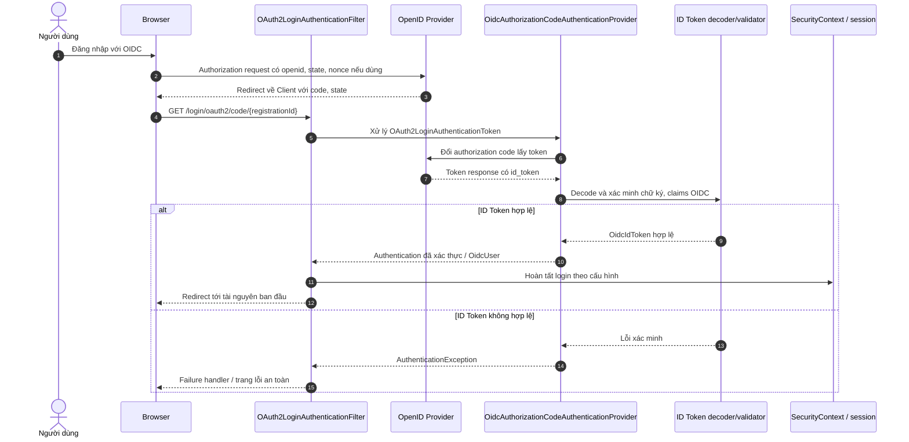
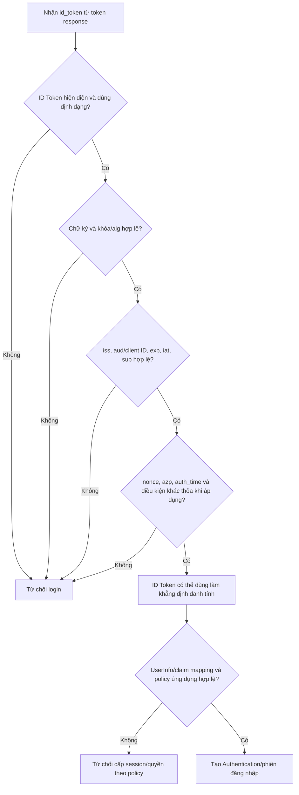

# 11.11. Xử lý ID Token sai chữ ký, thiếu claims hoặc không đúng client

> **Module:** Spring Security OAuth 2.0 OIDC Client  
> **Chương:** 11. Kiểm tra ID Token  
> **Phạm vi:** OpenID Connect (OIDC) Authorization Code Login trên Spring Security Servlet; xử lý một **ID Token không vượt qua xác minh** vì chữ ký/JWK không hợp lệ, thiếu hoặc sai claim bắt buộc, hoặc token không được phát hành cho Client đang đăng nhập.

Một ứng dụng Spring Boot có thể hoàn tất chuyển hướng tới OpenID Provider (OP), nhận authorization code và đổi code thành công tại Token Endpoint, nhưng **vẫn phải từ chối đăng nhập** nếu ID Token nhận được không hợp lệ. HTTP 200 từ Token Endpoint không phải kết luận cuối cùng về danh tính người dùng.

Ba nhóm lỗi quan trọng là:

- **Sai chữ ký hoặc không xác minh được chữ ký:** Client không chứng minh được ID Token thực sự được phát hành bởi OP tin cậy và chưa bị thay đổi.
- **Thiếu/sai claims bắt buộc:** ID Token không chứa hoặc không thỏa các thuộc tính cần có để mô tả và giới hạn một sự kiện xác thực.
- **Không đúng Client:** ID Token có `aud`/`azp` không phù hợp với `client_id` của ứng dụng nhận token, hoặc đến từ issuer khác với issuer đã cấu hình.

Xử lý đúng là **fail closed**: không tạo `OidcUser` hoặc phiên xác thực mới từ dữ liệu chưa được xác minh; không hạ cấp sang OAuth 2.0 Login thường; chỉ thông báo lỗi an toàn cho người dùng, ghi nhận thông tin chẩn đoán đã làm sạch và cho phép bắt đầu lại một giao dịch hợp lệ khi phù hợp.

## 1. Mục tiêu học tập

Sau bài học, bạn có thể:

1. Phân biệt **giải mã JWT**, **xác minh chữ ký**, **kiểm tra claims** và **đăng nhập thành công**.
2. Nêu những claim ID Token bắt buộc theo OIDC Core: `iss`, `sub`, `aud`, `exp`, `iat`.
3. Giải thích vai trò của `nonce`, `azp`, `auth_time` và các claim có điều kiện.
4. Xác định lý do ID Token có chữ ký hợp lệ vẫn phải bị từ chối nếu sai issuer hoặc audience.
5. Mô tả quan hệ giữa `ClientRegistration`, `client_id`, metadata OP và khóa JWK khi kiểm tra ID Token.
6. Hiểu đường xử lý OIDC của Spring Security và vị trí phát sinh `OAuth2AuthenticationException`/authentication failure.
7. Viết cấu hình `oauth2Login()` cùng failure handler không để lộ token hoặc thông tin nhạy cảm.
8. Phân biệt trường hợp khóa ký bị xoay vòng hợp lệ với trường hợp không thể chứng minh token hợp lệ.
9. Xây dựng kịch bản thử nghiệm âm tính có kiểm soát: giả chữ ký, thiếu `sub`/`aud`, sai Client ID, hết hạn và sai nonce.
10. Thiết kế cách khôi phục an toàn, không “bỏ qua kiểm tra” để giữ trải nghiệm đăng nhập.

## 2. ID Token là gì và dùng ở đâu?

ID Token là thông điệp xác thực danh tính do OP cấp cho **Relying Party (RP)**, tức Client ứng dụng. Trong OpenID Connect, ID Token thường là một JWT đã ký, chứa claims cho biết issuer, subject, audience, thời điểm phát hành/hết hạn và các dữ liệu xác thực bổ sung theo yêu cầu.

Trong Authorization Code Flow:

1. Browser được chuyển đến OP với authorization request có scope `openid`.
2. OP xác thực người dùng và đưa browser về Client bằng authorization code.
3. Spring Security đổi code lấy token tại Token Endpoint.
4. Token response OIDC chứa **`id_token`**.
5. **Client xác minh ID Token** trước khi coi thông tin người dùng là đáng tin cậy.
6. Spring Security tạo principal `OidcUser` và phiên đăng nhập nếu toàn bộ quy trình thành công.

Điểm cần nhớ: ID Token **không phải access token**.

| Đối tượng | Bên nhận chính | Mục đích |
|---|---|---|
| ID Token | Client/Relying Party | Xác minh khẳng định danh tính từ OP |
| Access token | Resource Server/API | Xin quyền truy cập tài nguyên được bảo vệ |
| Authorization code | Token Endpoint thông qua Client | Đổi code thành token sau luồng ủy quyền |
| Session cookie của ứng dụng | Browser và web app | Duy trì trạng thái đăng nhập của ứng dụng |

Một access token dạng JWT có thể chứa `sub` và `iss`, nhưng điều đó **không biến nó thành ID Token**. Kiểm tra ID Token phải sử dụng đúng loại token, đúng issuer và đúng client ID.

## 3. Đường đi của một ID Token trong Spring Security Servlet

Với cấu hình `oauth2Login()`, các thành phần Spring Security đảm nhiệm từng đoạn:



Sơ đồ giản lược một số lớp trung gian. Trong triển khai thực tế, Spring Security còn kiểm tra giao dịch authorization request/response, thực hiện code exchange, có thể gọi UserInfo sau bước ID Token, quản lý authorized client và áp dụng session strategy. Quan trọng nhất là **ID Token không hợp lệ phải làm luồng authentication thất bại**, không đi vào nhánh tạo một principal đáng tin.

### 3.1. Những thành phần dễ gặp

| Thành phần | Trách nhiệm |
|---|---|
| `ClientRegistration` | Xác định `client-id`, `registrationId`, issuer/provider details, scopes và cấu hình Client |
| `OAuth2LoginAuthenticationFilter` | Nhận callback và đưa request vào `AuthenticationManager` |
| `OidcAuthorizationCodeAuthenticationProvider` | Xử lý OIDC Authorization Code, yêu cầu ID Token, gọi decoder và user service |
| `OidcIdTokenDecoderFactory` | Tạo decoder phù hợp với ClientRegistration để xử lý ID Token theo cơ chế của Spring Security |
| `OidcUserService` | Tạo `OidcUser` từ ID Token đã được xác minh và UserInfo khi phù hợp |
| `OAuth2AuthenticationToken` | Authentication thường xuất hiện trong SecurityContext sau khi login thành công |
| Authentication failure handler | Xử lý lỗi đăng nhập và phản hồi an toàn về browser |

Tên class và chi tiết wiring có thể thay đổi theo phiên bản; trong Spring Security 6.x Servlet, đây là mô hình tư duy hữu ích để tìm đúng nơi xử lý.

## 4. Hai tầng xác minh: chữ ký và claims

Đối với JWT ID Token ký bằng JWS, chuỗi thường có dạng:

```text
BASE64URL(header).BASE64URL(payload).BASE64URL(signature)
```

Ví dụ payload để **đọc hiểu**, không phải một JWT đã được ký:

```json
{
  "iss": "https://login.example.test/realms/employees",
  "sub": "user-834",
  "aud": "employee-web",
  "exp": 1893459000,
  "iat": 1893455400
}
```

Có thể dễ dàng Base64url-decode header/payload của một JWT ngay cả khi chữ ký sai. **Giải mã thành công không có nghĩa dữ liệu đáng tin.**

Luồng xác minh có hai nhóm trách nhiệm:

**Nhóm 1 — Tính xác thực/toàn vẹn mật mã:** kiểm tra thuật toán chữ ký được chấp nhận, khóa đúng nguồn, chữ ký hợp lệ, cách xử lý `kid` và JWK đúng hợp đồng.

**Nhóm 2 — Ngữ nghĩa và đối tượng nhận:** kiểm tra `iss`, `sub`, `aud`, `exp`, `iat` cùng các điều kiện `nonce`, `azp`, `auth_time` và yêu cầu khác khi áp dụng.

Một token được ký đúng **vẫn có thể bị từ chối** vì `aud` trỏ đến Client khác. Một token có `aud` đúng **vẫn không được chấp nhận** nếu không xác minh được chữ ký. Cần thỏa **cả hai nhóm** trước khi thiết lập danh tính.

## 5. Xử lý ID Token sai chữ ký

### 5.1. Vì sao chữ ký quan trọng?

Chữ ký cho phép Client kiểm chứng token được phát hành bằng khóa hợp lệ của OP mà nó tin cậy, và dữ liệu header/payload không bị thay đổi sau khi ký.

Nếu một bên thay:

```json
{
  "sub": "ordinary-user",
  "aud": "employee-web"
}
```

thành:

```json
{
  "sub": "administrator",
  "aud": "employee-web"
}
```

mà không sở hữu khóa ký hợp lệ thì chữ ký JWS sẽ không còn xác minh được. Client phải từ chối token thay vì dùng `sub=administrator` để tạo phiên đăng nhập.

**Không bao giờ** sửa lỗi xác minh chữ ký bằng cách bỏ bước verify và chỉ decode payload.

### 5.2. JWK Set URI và nguồn khóa tin cậy

Với OP sử dụng chữ ký bất đối xứng như RS256, RP thường lấy khóa công khai từ **JWKS (JSON Web Key Set)** do OP công bố qua metadata đáng tin cậy.

Dòng tin cậy đúng:

```text
ClientRegistration
  └── issuer-uri đã cấu hình / provider metadata đáng tin cậy
       └── jwks_uri của OP
            └── khóa công khai được chọn theo alg/kid phù hợp
                 └── verify chữ ký ID Token
```

Không lấy `jku`/`x5u` hoặc URL khóa do JWT header không đáng tin tự chỉ định rồi tải từ Internet như một nguồn khóa mới nếu chưa có cơ chế kiểm soát trust rõ ràng. Điều đó có thể biến một token giả thành token “hợp lệ” khi kẻ tấn công khiến Client xác minh bằng khóa do chính họ cung cấp.

Các điểm cần chú ý:

- `iss` trong ID Token phải thuộc issuer được Client dự kiến.
- Khóa phải thuộc nguồn được gắn với issuer/provider đã cấu hình, không lấy từ issuer bất kỳ.
- Thuật toán ký được phép phải phù hợp metadata và chính sách Client.
- Header `alg` do token cung cấp không được tự quyết định một cơ chế kiểm tra yếu hơn.
- `kid` thường giúp chọn khóa; không được coi `kid` đơn thuần là bằng chứng khóa đáng tin.

### 5.3. Các tình huống gây lỗi chữ ký

| Tình huống | Triệu chứng | Cách hiểu |
|---|---|---|
| Payload bị sửa sau khi token được ký | Signature verification fail | Token không còn toàn vẹn |
| Client dùng JWKS của realm/tenant khác | Không tìm được khóa phù hợp hoặc chữ ký sai | Cấu hình issuer/provider nhầm |
| OP xoay khóa nhưng Client cache JWKS cũ | Không tìm thấy `kid` mới, verify có thể thất bại | Cần chính sách refresh JWKS an toàn |
| Token dùng thuật toán ký không được cho phép | Decoder từ chối | Phải giữ allowlist và chính sách thuật toán |
| `alg=none` không nằm trong hợp đồng được chấp nhận | Không có chữ ký phù hợp | Không được tự cho qua vì token “vẫn đọc được” |
| Header chứa `kid` không có trong JWKS tin cậy | Không xác minh được token | Không chọn khóa không tin cậy để thay thế |

**Đối với lỗi không thể xác minh chữ ký:** dừng login, không tạo session xác thực từ token đó, ghi lỗi có kiểm soát và cho phép thử lại luồng đúng nếu phù hợp.

### 5.4. Phân biệt xoay khóa bình thường với token giả

OP có thể luân phiên ký bằng khóa mới. Khi thấy `kid` lạ, decoder hoặc thư viện JWKS client có thể thực hiện cơ chế làm mới khóa theo cấu hình. Cần phân biệt:

- **Trường hợp hợp lệ:** OP công bố khóa mới trên JWKS URI đã được tin cậy; token xác minh thành công sau khi cập nhật cache.
- **Trường hợp không hợp lệ:** khóa vẫn không có trong JWKS tin cậy, thuật toán bất thường hoặc chữ ký không khớp; token phải bị từ chối.

Không thiết kế “thử tất cả JWKS trên Internet” để cứu một lần login. Cũng không nên vô hiệu hóa kiểm tra chữ ký khi OP đang xoay khóa. Vận hành nên theo dõi lịch rotate key, cache TTL và khả năng truy cập metadata/JWKS, nhưng **fail closed nếu không xác minh được**.

## 6. Claims nào là bắt buộc trong ID Token?

Theo OIDC Core, ID Token có các claims bắt buộc:

| Claim | Bắt buộc? | Ý nghĩa | Ví dụ |
|---|---|---|---|
| `iss` | Có | Issuer đã phát hành ID Token | `https://login.example.test/realms/employees` |
| `sub` | Có | Subject identifier của người dùng tại issuer | `user-834` |
| `aud` | Có | Một hoặc nhiều audience; phải chứa client ID của RP | `employee-web` |
| `exp` | Có | Thời điểm ID Token hết hạn, NumericDate | `1893459000` |
| `iat` | Có | Thời điểm ID Token được phát hành, NumericDate | `1893455400` |

Các claim khác có thể **bắt buộc theo điều kiện**:

| Claim | Khi nào cần quan tâm? | Nguyên tắc xử lý |
|---|---|---|
| `nonce` | Khi authorization request có gửi nonce | ID Token phải có nonce phù hợp yêu cầu đã lưu |
| `auth_time` | Khi Client gửi `max_age` hoặc yêu cầu thời gian xác thực theo OIDC | OP phải cung cấp; Client đánh giá độ mới theo policy |
| `azp` | Khi ID Token có nhiều audiences hoặc có authorized party riêng | Kiểm tra theo quy tắc OIDC và chính sách Client |
| `acr` | Khi yêu cầu mức authentication context nhất định | Đối chiếu giá trị được OP xác nhận với chính sách |
| `at_hash` | Khi xuất hiện/được yêu cầu ở dạng response tương ứng | Kiểm tra theo quy tắc OIDC của flow cụ thể |

Không có yêu cầu OIDC chung rằng mọi ID Token phải có `email`, `name`, `picture`, `groups` hay `roles`. Đây là claims hồ sơ/tùy biến; việc thiếu chúng có thể ảnh hưởng logic ứng dụng, nhưng **không đồng nghĩa thiếu một claim bắt buộc của mọi ID Token**.

### 6.1. iss — issuer phải đúng

Issuer là định danh của OP, thường được khai báo qua `issuer-uri` trong Spring Boot:

```yaml
spring:
  security:
    oauth2:
      client:
        provider:
          corporate:
            issuer-uri: https://login.example.test/realms/employees
```

Nếu ID Token chứa:

```json
{
  "iss": "https://login.example.test/realms/partners"
}
```

thì đó là issuer khác. Dù cùng hostname và cùng phần mềm OP, hai realm/tenant có thể là hai thực thể tin cậy riêng biệt. Không tự cắt bỏ đường dẫn hoặc so sánh chỉ theo domain để “làm cho khớp”.

### 6.2. sub — định danh chủ thể phải có và hợp lệ

`sub` là subject identifier do OP cấp. Client nên dùng cặp **(issuer, subject)** làm khóa liên kết danh tính nội bộ, thay vì dùng `sub` đơn lẻ hoặc email chưa được xác minh.

Nếu token thiếu `sub`, Client không có subject chuẩn hóa để nhận dạng người dùng theo OIDC. Không được tự lấy `email`, `preferred_username` hoặc `userId` trong access token để điền vào claim bắt buộc rồi coi login hợp lệ.

### 6.3. aud — audience phải chứa Client ID

`aud` xác định Client nào được phép nhận ID Token. Nó có thể là một chuỗi hoặc mảng các chuỗi.

Ví dụ đúng cho `client-id=employee-web`:

```json
{
  "aud": "employee-web"
}
```

Hoặc:

```json
{
  "aud": ["employee-web", "another-authorized-client"]
}
```

Ví dụ không đúng cho Client `employee-web`:

```json
{
  "aud": "billing-web"
}
```

**Không được** chấp nhận ID Token chỉ vì `iss` và chữ ký hợp lệ nếu `aud` không chứa client ID của ứng dụng. Đây là cách phòng tránh **token substitution/audience confusion**: một token thực sự do OP phát hành cho Client A bị đưa tới Client B.

### 6.4. exp và iat — thời gian có đúng không?

`exp` và `iat` dùng NumericDate, tính bằng số giây Unix epoch:

- `exp`: token không được sử dụng sau thời điểm hết hạn (có thể áp dụng độ lệch đồng hồ nhỏ theo cấu hình).
- `iat`: cho biết token được phát hành lúc nào; thiếu hoặc sai kiểu là vấn đề cấu trúc OIDC.
- OP và Client cần có đồng hồ hệ thống tương đối đồng bộ; đừng xử lý lỗi thời gian bằng cách bỏ hẳn kiểm tra `exp`.
- Một token còn hạn không tự có nghĩa người dùng vừa xác thực lại; cần `auth_time` nếu chính sách đòi độ mới.

Ví dụ `exp` đã qua sẽ bị từ chối ngay cả khi chữ ký và audience đều đúng.

### 6.5. Claim hồ sơ thiếu không luôn là lỗi ID Token

Một ID Token chỉ có các claim bắt buộc vẫn có thể hợp lệ đối với OIDC. Khi ứng dụng cần địa chỉ email để đăng ký tài khoản nội bộ:

1. Xác minh ID Token trước.
2. Lấy claim cần thiết từ ID Token/UserInfo theo các scopes và hợp đồng OP.
3. Kiểm tra `sub` của UserInfo phù hợp `sub` trong ID Token.
4. Nếu dữ liệu hồ sơ bắt buộc cho nghiệp vụ vẫn thiếu, dừng **luồng cấp quyền/tạo tài khoản theo chính sách ứng dụng**, thay vì gọi nhầm đó là “chữ ký token sai”.
5. Chỉ tin `email_verified` hoặc claim tương tự theo hợp đồng và chính sách OP; không suy diễn từ tên miền email.

## 7. ID Token không đúng Client: aud và azp

Đây là một lỗi có tính bảo mật cao vì token có thể hoàn toàn hợp lệ về mặt chữ ký nhưng **không dành cho RP hiện tại**.

### 7.1. Ví dụ hai Client cùng một OP

Giả sử cùng OP có hai registrations:

| Registration | Client ID | Vai trò |
|---|---|---|
| `portal` | `employee-portal` | Giao diện nhân viên |
| `reports` | `reports-dashboard` | Bảng điều khiển báo cáo |

Token được cấp cho `reports-dashboard`:

```json
{
  "iss": "https://login.example.test/realms/employees",
  "sub": "user-834",
  "aud": "reports-dashboard",
  "exp": 1893459000,
  "iat": 1893455400
}
```

Client `employee-portal` **không được** dùng ID Token này để tạo session, dù người dùng có thể là cùng một người tại OP. RP hiện tại phải đòi `aud` chứa `employee-portal`.

### 7.2. azp — authorized party

Khi ID Token chứa nhiều giá trị `aud`, OIDC Core khuyến nghị kiểm tra sự có mặt của `azp`; khi `azp` có mặt, Client cần xác minh giá trị đó phù hợp `client_id` của mình theo các quy tắc OIDC.

Ví dụ:

```json
{
  "iss": "https://login.example.test/realms/employees",
  "sub": "user-834",
  "aud": ["employee-portal", "reports-api"],
  "azp": "employee-portal",
  "exp": 1893459000,
  "iat": 1893455400
}
```

Ở đây, `azp` mô tả party được ủy quyền tương ứng với `employee-portal`. Nếu token có `azp=other-web-client`, ứng dụng không được bỏ qua sự không phù hợp chỉ vì `aud` có chứa ID của mình.

Bối cảnh chính xác của `azp` phải theo OIDC Core và chính sách bảo mật/validator của phiên bản framework sử dụng. Không tự đưa `azp` vào token hoặc xóa claim này để “chữa” lỗi của OP.

### 7.3. Kiểm tra nhầm audience của access token

Một Resource Server có thể nhận access token:

```json
{
  "aud": "orders-api",
  "scope": "orders.read"
}
```

Đây là audience dành cho API, **không phải** client ID của web RP. Không dùng access token có `aud=orders-api` để làm ID Token của `employee-portal`.

Tách biệt:

- ID Token audience → Client/Relying Party;
- Access token audience → Resource Server hoặc đối tượng nhận theo chính sách token;
- `client_id` → định danh Client được cấp trong registration.

### 7.4. Không sửa lỗi audience bằng cách bỏ validator

Nếu cấu hình `client-id` sai so với OP, cách sửa là cập nhật registration và dữ liệu Client tại OP cho nhất quán. Nếu token thực sự được phát cho Client khác, cách xử lý là **từ chối** token đó. Cấu hình “accept any audience” trong login client không phải giải pháp vận hành.

## 8. nonce: chống dùng lại kết quả ngoài giao dịch dự kiến

Trong OIDC, `nonce` liên kết ID Token với authentication request khi Client đã gửi nonce. Trong Authorization Code flow, nonce có thể được dùng để tăng khả năng chống replay và nhầm giao dịch; các flow OIDC khác có quy tắc bắt buộc riêng.

Trình tự:

1. Client tạo nonce cho giao dịch login.
2. Authorization request gửi giá trị nonce hoặc dạng thích hợp theo cơ chế framework.
3. Client lưu ngữ cảnh nonce để kiểm tra khi nhận token.
4. OP đưa claim `nonce` tương ứng vào ID Token khi yêu cầu.
5. Client kiểm tra claim nonce phù hợp giá trị đã lưu trước khi chấp nhận login.

Ví dụ ID Token nhận được có:

```json
{
  "nonce": "nonce-of-another-login"
}
```

nhưng giao dịch đang chờ kỳ vọng nonce khác. Dù chữ ký hợp lệ và `aud` đúng, token này **không được coi là kết quả của giao dịch hiện tại**.

### 8.1. state và nonce không giống nhau

| Tham số | Xuất hiện/được dùng ở đâu? | Vai trò |
|---|---|---|
| `state` | Authorization request và callback | Liên kết authorization response với request, chống CSRF và nhầm giao dịch |
| `nonce` | OIDC authentication request và ID Token | Liên kết khẳng định danh tính với yêu cầu OIDC tương ứng |
| PKCE `code_verifier` / `code_challenge` | Authorization request và Token Endpoint | Chống việc authorization code bị sử dụng bởi bên không biết verifier |

Không dùng một token có nonce sai rồi “tạo session thủ công” sau khi state đã khớp. Các lớp bảo vệ giải quyết những rủi ro khác nhau.

### 8.2. Lỗi nonce có thể đến từ ứng dụng

Nếu ứng dụng tự viết `OAuth2AuthorizationRequestResolver` nhưng làm mất attributes hoặc không lưu authorization request đúng cách, bước đối chiếu nonce có thể thất bại dù OP không có vấn đề. Cần kiểm tra cách tạo/lưu giao dịch và callback, không tắt nonce validation.

## 9. auth_time và độ mới xác thực

Khi Client gửi `max_age` trong OIDC Authentication Request, OP phải cung cấp `auth_time` trong ID Token theo OIDC Core. Một số quy tắc claim requests cũng có thể yêu cầu thông tin này.

Ví dụ Client yêu cầu người dùng xác thực trong vòng 5 phút gần nhất:

```text
max_age=300
```

Kết quả nhận được có thể chứa:

```json
{
  "auth_time": 1893455700,
  "iat": 1893455760,
  "exp": 1893459360
}
```

**Phân biệt:**

- `iat` là lúc ID Token được phát hành.
- `auth_time` là lúc OP cho biết người dùng đã được xác thực.
- `exp` là thời điểm ID Token hết hạn.

Ứng dụng phải xác định validator/policy nào kiểm tra `auth_time` và giới hạn độ mới khi đó là điều kiện nghiệp vụ. Việc token có chữ ký hợp lệ và `iat` mới không chứng minh người dùng vừa nhập yếu tố xác thực mới.

Nếu `auth_time` bị thiếu dù Client đã gửi `max_age`, kết quả không đáp ứng điều kiện OIDC đã yêu cầu. Không bỏ qua claim này khi quyết định thực hiện thao tác nhạy cảm.

## 10. Thứ tự tin cậy: không tin claims trước khi token hợp lệ

Một số ứng dụng cố đọc `email` hoặc `roles` từ JWT payload ngay khi Token Endpoint trả về, rồi mới xác minh chữ ký sau. Đó là thứ tự sai.

Quy trình đúng ở mức khái niệm:



Đây là mô hình logic, không phải thứ tự gọi method chính xác của mọi phiên bản Spring Security. Cần dùng thư viện để thực hiện xác minh mật mã và OIDC, thay vì tự xây validator dựa trên sơ đồ.

### 10.1. Vì sao phải fail closed?

Nếu bỏ qua một trong ba trường hợp:

- **Bỏ chữ ký:** attacker có thể tự sửa danh tính trong payload.
- **Bỏ claims bắt buộc:** ứng dụng không có đủ dữ liệu chuẩn để biết ai phát token, token dành cho ai và khi nào hết hạn.
- **Bỏ audience:** attacker có thể lấy ID Token hợp lệ của Client A đưa vào Client B.

Khi không chắc token hợp lệ, **không cấp session xác thực từ token đó**. Cần phân biệt việc một phiên đăng nhập cũ đang tồn tại với một **lần đăng nhập mới không hợp lệ**; ứng dụng phải thiết kế rõ cách giữ, hủy hoặc cô lập phiên cũ theo chính sách, tránh bất ngờ biến lỗi callback thành trạng thái xác thực sai.

## 11. Cấu hình OIDC Login bằng Spring Boot

Một cấu hình Servlet cơ bản:

```yaml
server:
  port: 8080

spring:
  security:
    oauth2:
      client:
        registration:
          employee:
            provider: employee-op
            client-id: employee-portal
            client-secret: ${EMPLOYEE_OIDC_CLIENT_SECRET}
            authorization-grant-type: authorization_code
            redirect-uri: "{baseUrl}/login/oauth2/code/{registrationId}"
            scope:
              - openid
              - profile
              - email
        provider:
          employee-op:
            issuer-uri: http://localhost:9000/realms/employees
```

Địa chỉ trên chỉ minh họa OP chạy localhost trong lab; ứng dụng thực dùng HTTPS và issuer do OP công bố. Đăng ký redirect URI tương ứng với `/login/oauth2/code/employee` và Client ID đúng trong OP.

Các thuộc tính quan trọng:

- `registration.employee`: Spring Security registration ID; xuất hiện trong login URL `/oauth2/authorization/employee`.
- `client-id: employee-portal`: giá trị dùng để kiểm tra **ID Token audience**.
- `provider.employee-op.issuer-uri`: issuer dự kiến và nguồn metadata cho OP.
- `scope: openid`: yêu cầu OIDC; không chỉ OAuth 2.0 Login lấy profile qua API.
- `client-secret`: thông tin xác thực của confidential Client tại Token Endpoint; nó **không** thay cho việc xác minh chữ ký ID Token.

### 11.1. SecurityFilterChain

```java
import org.springframework.context.annotation.Bean;
import org.springframework.context.annotation.Configuration;
import org.springframework.security.config.Customizer;
import org.springframework.security.config.annotation.web.builders.HttpSecurity;
import org.springframework.security.web.SecurityFilterChain;

@Configuration
class WebSecurityConfiguration {

    @Bean
    SecurityFilterChain webSecurityChain(HttpSecurity http) throws Exception {
        return http
            .authorizeHttpRequests(auth -> auth
                .requestMatchers("/", "/login", "/error").permitAll()
                .anyRequest().authenticated()
            )
            .oauth2Login(Customizer.withDefaults())
            .build();
    }
}
```

Khi không cần thay đổi hành vi OIDC, hãy dùng defaults của Spring Security. Cơ chế xử lý ID Token không nên được thay bằng một đoạn tự `Base64.getDecoder()` hoặc `parseClaimsWithoutVerify()`.

### 11.2. Không nhầm client secret và khóa ký ID Token

Hai loại credential khác nhau:

| Bí mật/khóa | Ai sở hữu? | Dùng để làm gì? |
|---|---|---|
| Client secret | RP/Client và Authorization Server | Client authentication tại Token Endpoint theo phương thức đã đăng ký |
| Private signing key của OP | OP | Ký ID Token |
| Public verification key/JWK | Client tải từ nguồn OP tin cậy | Xác minh chữ ký ID Token |

Nếu client secret sai, lỗi có thể xảy ra ngay ở token exchange (ví dụ `invalid_client`). Nếu token exchange đã thành công nhưng chữ ký ID Token sai, lỗi xảy ra tại bước ID Token verification. Không chữa lỗi chữ ký bằng cách thay client secret một cách ngẫu nhiên.

## 12. Failure handler: báo lỗi an toàn, không làm lộ token

Spring Security hỗ trợ `AuthenticationFailureHandler` để ứng dụng quyết định cách phản hồi khi login thất bại. Ví dụ chỉ chuyển người dùng về trang thông báo chung:

```java
import jakarta.servlet.http.HttpServletRequest;

import org.springframework.context.annotation.Bean;
import org.springframework.context.annotation.Configuration;
import org.springframework.security.config.annotation.web.builders.HttpSecurity;
import org.springframework.security.web.SecurityFilterChain;

@Configuration
class OidcFailureHandlingConfiguration {

    @Bean
    SecurityFilterChain securityFilterChain(HttpSecurity http)
            throws Exception {

        return http
            .authorizeHttpRequests(auth -> auth
                .requestMatchers("/", "/login", "/error").permitAll()
                .anyRequest().authenticated()
            )
            .oauth2Login(oauth2 -> oauth2
                .failureHandler((request, response, exception) -> {
                    // Không trả exception.getMessage() hoặc raw token cho browser.
                    String redirect = request.getContextPath()
                        + "/login?error";
                    response.sendRedirect(redirect);
                })
            )
            .build();
    }
}
```

Đoạn này được dùng **thay thế** cấu hình `SecurityFilterChain` ở mục 11, không khai báo cả hai bean với matchers trùng nhau. `/login?error` có thể là trang login mặc định hoặc giao diện tùy chỉnh tùy cấu hình của ứng dụng; khi xây sản phẩm nên có một trang lỗi cụ thể không tiết lộ nội bộ.

**Không nên** hiển thị nguyên văn `exception.getMessage()`, full token, `Authorization` header hoặc JWKS response cho người dùng. Nội dung exception có thể thay đổi theo phiên bản/thư viện và đôi khi chứa dữ liệu kỹ thuật không phù hợp để phát ra ngoài.

### 12.1. Phân loại lỗi cho vận hành

Trong môi trường có logging/monitoring, có thể lưu một nhãn lỗi đã được chuẩn hóa:

| Nhóm quan sát | Ví dụ | Hành động |
|---|---|---|
| `oidc_signature_failure` | Signature verify fail / không có khóa phù hợp | Từ chối, kiểm tra issuer/JWKS/rotation |
| `oidc_missing_required_claim` | Thiếu `sub` hoặc `aud` | Từ chối, kiểm tra OP và contract |
| `oidc_audience_mismatch` | `aud` không chứa Client ID | Từ chối, kiểm tra registration và token |
| `oidc_issuer_mismatch` | `iss` khác issuer dự kiến | Từ chối, kiểm tra realm/tenant |
| `oidc_expired_or_time_invalid` | Token hết hạn hoặc claim thời gian không hợp lệ | Từ chối, kiểm tra đồng hồ và policy |
| `oidc_nonce_mismatch` | Nonce không khớp authorization request | Từ chối, kiểm tra giao dịch/session |
| `oidc_provider_unavailable` | Không truy cập metadata/JWKS tin cậy | Không chấp nhận token chưa verify; điều tra hạ tầng |

Đây là **các nhãn quan sát do ứng dụng tự định nghĩa**, không phải danh sách mã lỗi mà Spring Security cam kết trả nguyên văn. Một lỗi nội bộ có thể được bao bọc trong `OAuth2AuthenticationException` với error code khác nhau tùy nơi phát sinh.

Nên ghi thông tin đủ chẩn đoán nhưng đã làm sạch:

```text
event=oidc_login_failure
registrationId=employee
category=oidc_audience_mismatch
correlationId=<opaque-internal-id>
issuerConfigured=https://login.example.test/realms/employees
loginSessionCreated=false
```

Không ghi raw ID Token, access token, refresh token, nonce, authorization code hoặc cookie. Với `sub` và email, cũng chỉ ghi khi thật sự cần, tuân chính sách dữ liệu của tổ chức.

### 12.2. Ứng dụng có nên tự động đăng nhập lại?

Có thể cho người dùng thử lại bằng một **authorization request mới**, nhưng cần tránh:

- Vòng lặp vô hạn: callback fail rồi lập tức redirect sang OP mãi.
- Lặp lại cùng authorization code: code chỉ nên dùng một lần.
- Tự chấp nhận token cũ chưa hợp lệ.
- Tự chuyển sang OAuth2 Login thường khi ID Token sai.
- Đổi issuer hoặc bỏ audience validation chỉ vì login đang lỗi.

Với lỗi xoay khóa có thể phục hồi, hệ thống có thể dựa vào cơ chế JWKS refresh của thư viện rồi thử **xác minh một cách an toàn** theo chính sách. Nếu vẫn không thể verify, login phải thất bại; người dùng chỉ nên bắt đầu transaction mới khi vấn đề được khắc phục hoặc sau một lối khôi phục hợp lệ.

## 13. Tại sao không được fallback sang OAuth2 Login thường?

Trong Spring Security Servlet, `OidcAuthorizationCodeAuthenticationProvider` xử lý các yêu cầu OAuth2 Login có scope `openid`. Nếu ID Token bị thiếu hoặc sai, provider OIDC phải báo lỗi; không nên chuyển sang `OAuth2LoginAuthenticationProvider` để chỉ dùng access token và UserInfo như một đăng nhập thành công.

Lý do:

1. Client đã bắt đầu một **OIDC authentication request** với kỳ vọng ID Token hợp lệ.
2. Lỗi chữ ký/audience/issuer là thất bại xác minh **chính khẳng định danh tính**.
3. Chuyển sang lấy profile OAuth2 thường sẽ hạ thấp các điều kiện tin cậy ban đầu.
4. Attacker có thể tìm cách tạo lỗi ID Token để kích hoạt đường đi yếu hơn nếu ứng dụng tự viết fallback không an toàn.

Một ứng dụng có thể **hỗ trợ riêng** OAuth2 Login đối với provider không OIDC theo hợp đồng rõ ràng, nhưng đó là **registration/flow được thiết kế trước**, không phải đường cứu hộ khi xác minh OIDC thất bại.

## 14. Xử lý token sai issuer và lỗi tenant

Giả sử OP phục vụ hai realm:

```text
https://login.example.test/realms/employees
https://login.example.test/realms/partners
```

Mỗi realm có thể có issuer, bộ keys, chính sách và định danh người dùng khác nhau. Nếu Client cấu hình issuer employees nhưng nhận token có issuer partners, phải từ chối token đó.

### 14.1. Không chỉ so hostname

So sánh:

- Không đúng: `iss.startsWith("https://login.example.test")`.
- Đúng về nguyên tắc: kiểm tra issuer được cấu hình **theo các quy tắc OIDC và metadata đáng tin cậy**, với giá trị chính xác dành cho registration tương ứng.

Một số token hợp lệ có `sub` giống nhau giữa hai issuers nhưng đại diện cho danh tính khác nhau. Dùng khóa nội bộ theo **(iss, sub)**, không theo `sub` đơn lẻ.

### 14.2. Multi-provider và login mix-up

Nếu ứng dụng có nhiều `ClientRegistration`, authorization request phải liên kết với đúng registration và OP. Sau callback, không thử tất cả issuers/keys cho đến khi có issuer “nào đó” chấp nhận token.

Đường xử lý đúng là:

1. Xác định registration gắn với authorization transaction gốc.
2. Dùng issuer/JWKS của **provider được đăng ký cho transaction đó**.
3. Kiểm tra ID Token tương ứng với client ID.
4. Từ chối nếu không thỏa, dù token hợp lệ đối với registration khác.

Đây là lý do cần bảo vệ `state`, redirect endpoint và cách lưu authorization request tương ứng.

## 15. Trường hợp thiếu claim có thể chia thành hai nhóm

Không phải mọi claim thiếu đều cùng loại lỗi. Nên tách:

### 15.1. Thiếu claim bắt buộc của OIDC

Ví dụ:

```json
{
  "iss": "https://login.example.test/realms/employees",
  "aud": "employee-portal",
  "exp": 1893459000,
  "iat": 1893455400
}
```

Không có `sub`. Đây **không phải** một ID Token đầy đủ theo OIDC Core. Không được thay bằng một trường hồ sơ tùy ý để cho đăng nhập.

Tương tự, thiếu `aud`, `iss`, `exp` hoặc `iat` là vấn đề thuộc cấu trúc/validation ID Token; phải từ chối theo quy tắc OIDC.

### 15.2. Thiếu claim nghiệp vụ hoặc tùy chọn

Ví dụ ID Token đã hợp lệ nhưng không có:

```json
{
  "email": "person@example.test",
  "groups": ["staff"],
  "roles": ["EDITOR"]
}
```

Điều này tự nó **không** chứng minh ID Token sai. OP có thể không cung cấp các claim đó, hoặc chúng nằm tại UserInfo Endpoint theo scopes/policy riêng.

Nếu hệ thống cần `groups` để phân quyền, phải đặt quy tắc rõ: không có thông tin đáng tin để cấp quyền thì **không cấp quyền đó**. Nếu cần email đã xác minh để mở tài khoản, không được dùng email chưa xác minh làm định danh duy nhất. Có thể hiển thị bước hoàn thiện hồ sơ hoặc từ chối đăng ký theo chính sách.

### 15.3. Tại sao phải phân biệt?

Nếu thông báo mọi trường hợp thiếu `email` là “invalid ID Token”, người phát triển có thể cố sửa chữ ký/JWKS trong khi vấn đề là scopes hoặc claim mapping. Ngược lại, nếu thiếu `sub` mà ứng dụng nghĩ “thiếu hồ sơ thôi”, nguy cơ thiết lập session cho danh tính không xác định là nghiêm trọng.

Bảng định hướng:

| Claim thiếu | Phân loại | Ứng xử đề xuất |
|---|---|---|
| `iss` | ID Token không hợp lệ | Từ chối authentication |
| `sub` | ID Token không hợp lệ | Từ chối authentication |
| `aud` | ID Token không hợp lệ | Từ chối authentication |
| `exp` | ID Token không hợp lệ | Từ chối authentication |
| `iat` | ID Token không hợp lệ | Từ chối authentication |
| `nonce` khi đã gửi trong request | Vi phạm ràng buộc OIDC | Từ chối authentication |
| `auth_time` khi có `max_age` | Không đáp ứng yêu cầu độ mới OIDC | Không công nhận yêu cầu xác thực đó |
| `email` | Thiếu thông tin hồ sơ | Áp chính sách hồ sơ riêng; không tự cấp quyền |
| `groups`/`roles` | Thiếu dữ liệu phân quyền | Không cấp các authorities phụ thuộc dữ liệu đó |

## 16. Tùy chỉnh kiểm tra ID Token: làm khi có yêu cầu rõ ràng

Spring Security đã cung cấp bộ xử lý OIDC login và kiểm tra ID Token. Tùy chỉnh có thể cần khi doanh nghiệp có policy bổ sung, ví dụ phải nhận một claim đặc thù đã được OP cam kết. Nhưng **không được thay thế các validator mặc định bằng một validator yếu hơn**.

### 16.1. Điểm mở rộng cấp thấp

Một lớp liên quan là `OidcIdTokenDecoderFactory`, được dùng để tạo JWT decoder cho từng `ClientRegistration`. Nó có các điểm cấu hình cho thuật toán JWS và validation phù hợp tùy phiên bản.

Khuyến nghị khi đi sâu:

- Ưu tiên để Spring Security tạo và xác minh ID Token theo issuer/ClientRegistration đã cấu hình.
- Khi cần policy bổ sung, viết validator **kết hợp** với validation chuẩn, không thay thế chữ ký, issuer, audience, thời hạn.
- Chỉ cấu hình thuật toán ký được OP/Client chấp nhận theo hợp đồng an toàn.
- Kiểm tra đúng phiên bản API trước khi thay đổi `JwtDecoderFactory<ClientRegistration>`.
- Nếu tùy biến decoder theo Client, bảo đảm nó dùng metadata/JWKS **được gắn với issuer tin cậy** của Client đó.

**Không dùng mã giả như sau trong sản phẩm:**

```java
// KHÔNG AN TOÀN - ví dụ phản diện.
String payload = decodeBase64Url(idToken.split("\\.")[1]);
String userId = parseJson(payload).get("sub");
createSession(userId); // Bỏ qua chữ ký, issuer, audience, exp, nonce!
```

Một JWT có payload đọc được vẫn có thể hoàn toàn giả mạo. Mã này cố tình được gắn nhãn **không an toàn** để chỉ rõ sai lầm; không nên triển khai nó.

### 16.2. Kiểm tra policy bổ sung sau xác minh

Khi ID Token đã được thư viện xác minh và bạn nhận `OidcUser`, có thể thực hiện policy nghiệp vụ dựa trên claims đáng tin theo hợp đồng OP.

Ví dụ một endpoint chỉ phục vụ người dùng thuộc danh sách được cấp quyền nội bộ:

```java
import org.springframework.security.access.prepost.PreAuthorize;
import org.springframework.security.core.annotation.AuthenticationPrincipal;
import org.springframework.security.oauth2.core.oidc.user.OidcUser;
import org.springframework.web.bind.annotation.GetMapping;
import org.springframework.web.bind.annotation.RestController;

@RestController
class ProfileController {

    @GetMapping("/me")
    String me(@AuthenticationPrincipal OidcUser user) {
        return user.getSubject();
    }
}
```

Endpoint này chỉ đọc một `OidcUser` mà Spring Security đã xác lập. Nó **không** tự thay thế kiểm tra ID Token hay cung cấp phân quyền nghiệp vụ. Với endpoint yêu cầu role, cấu hình `authorizeHttpRequests()`/method security và mapping authorities riêng.

Nếu hệ thống cho phép cả OAuth2 Login không OIDC, controller cần xử lý kiểu principal tương ứng thay vì mặc định mọi người dùng là `OidcUser`.

## 17. Quy trình chẩn đoán theo dấu hiệu lỗi

Khi ứng dụng báo lỗi xác thực OIDC, xác định bước thất bại trước khi thay đổi cấu hình.

### 17.1. Lỗi trước khi nhận ID Token

| Dấu hiệu | Nơi nên kiểm tra |
|---|---|
| Không điều hướng được tới OP | Authorization endpoint, registration, HTTP Security, redirect |
| OP từ chối callback URL | Redirect URI đăng ký ở OP |
| `invalid_client` khi đổi code | Client ID/secret và phương thức client authentication ở Token Endpoint |
| `invalid_grant` khi đổi code | Authorization code, redirect, state/PKCE và grant binding |
| Response OIDC thiếu `id_token` | OP có hỗ trợ OIDC, scope `openid` và token response contract hay không |

Những lỗi này có thể khiến login thất bại **trước** bước verify chữ ký. Đừng gộp mọi lỗi `oauth2Login()` thành “ID Token signature invalid”.

### 17.2. Lỗi tại bước xác minh ID Token

| Dấu hiệu | Điều cần xem |
|---|---|
| Chữ ký không xác minh được | Algorithm, JWKS URI, key rotation, issuer/tenant |
| Không tìm được khóa theo `kid` | JWKS cache/rotation và nguồn khóa đáng tin |
| Thiếu `iss`/`sub`/`aud`/`exp`/`iat` | OP có trả ID Token đúng OIDC Core không |
| `iss` khác dự kiến | `issuer-uri`, realm/tenant, cấu hình reverse proxy |
| `aud` không chứa client ID | `client-id` của registration và token được cấp cho Client nào |
| `azp` không phù hợp | Các quy tắc OIDC cho multiple audiences/authorized party |
| `exp` đã quá hạn | Đồng hồ OP/Client, độ lệch giờ, thời điểm phát token |
| `nonce` không khớp | Authorization request, session/repository lưu nonce, callback correlation |
| `auth_time` quá cũ hoặc thiếu khi cần | `max_age`, OP behavior và policy xác thực lại |

Không “thử bỏ từng validator” để xem login qua được hay không trong ứng dụng thực. Có thể kiểm tra các giả thiết bằng mock provider/test fixtures được kiểm soát mà không ảnh hưởng chính sách production.

## 18. Các thí nghiệm an toàn với ID Token lỗi

Mục tiêu của bài thực hành là **thấy authentication thất bại đúng chỗ**, không phải tấn công một OP bên ngoài. Sử dụng local OP, test tenant riêng hoặc mock OIDC provider đã được nhóm cho phép.

### Lab A — Chữ ký sai

**Chuẩn bị:** mock OP có khả năng phát token ký bằng khóa không thuộc JWKS mà Client tin cậy, hoặc tạo fixture ID Token mà chữ ký không hợp lệ. Không dùng ID Token thật của người dùng.

**Các bước:**

1. Khởi tạo luồng OIDC Code hợp lệ trong lab.
2. Cho Token Endpoint thử nghiệm trả ID Token có payload/claims trông phù hợp nhưng chữ ký không xác minh được bằng khóa của OP tin cậy.
3. Quan sát Spring Security từ chối hoàn tất login.
4. Kiểm tra failure handler chuyển tới trang lỗi chung.
5. Xác nhận không có **phiên xác thực mới được tạo từ ID Token sai**.
6. Khôi phục mock OP trả token ký đúng để so sánh hành vi thành công.

**Kết quả mong đợi:** chữ ký sai dẫn tới authentication failure dù payload có đủ `iss`, `sub`, `aud`, `exp`, `iat`.

**Câu hỏi:** tại sao đổi payload từ `sub=user` sang `sub=admin` mà không ký lại không được chấp nhận?

### Lab B — Thiếu claim bắt buộc

**Chuẩn bị:** mock OP có thể tạo các fixture JWT được ký đúng nhưng thiếu một claim của OIDC.

**Biến thể:**

- Thiếu `sub`.
- Thiếu `aud`.
- Thiếu `iss`.
- Thiếu `exp`.
- Thiếu `iat`.

**Các bước:**

1. Thực hiện luồng hợp lệ để có baseline.
2. Mỗi lần chỉ cho mock OP trả một biến thể thiếu claim; các claim khác và chữ ký vẫn hợp lệ.
3. Quan sát bước OIDC validation/failure handler.
4. Đối chiếu với biến thể **không có `email`** nhưng vẫn có đầy đủ claims bắt buộc.
5. Ghi lại loại lỗi và kết luận theo nhóm, không ghi raw JWT.

**Kết quả mong đợi:** thiếu claim bắt buộc phải dẫn tới từ chối; thiếu email có thể được xử lý như vấn đề dữ liệu hồ sơ/đăng ký tài khoản tùy policy.

**Câu hỏi:** vì sao `email` không được dùng để thay `sub`?

### Lab C — ID Token không đúng Client

**Chuẩn bị:** hai Clients `web-a` và `web-b` ở cùng test OP, mỗi Client có client ID riêng.

**Các bước:**

1. Dùng registration của `web-a` để bắt đầu OIDC login.
2. Trong mock OP được kiểm soát, trả ID Token ký đúng nhưng có `aud=web-b`.
3. Quan sát `web-a` từ chối login.
4. Thử token có `aud=["web-a","another-client"]` với claim `azp` phù hợp/không phù hợp theo quy tắc OIDC mà test đang áp dụng.
5. Khôi phục ID Token `aud=web-a` và hoàn thành luồng hợp lệ.

**Kết quả mong đợi:** chữ ký đúng chưa đủ. Audience phải chứa client ID của Client nhận token; `azp` phải được kiểm tra khi có các điều kiện áp dụng.

**Câu hỏi:** vì sao việc cả hai Clients dùng cùng OP/JWKS không cho phép chia sẻ ID Token tùy ý?

### Lab D — Issuer/realm khác

**Chuẩn bị:** hai issuers kiểm soát được: `/realms/employees` và `/realms/partners`, hoặc hai mock OP có metadata riêng.

**Các bước:**

1. Cấu hình registration `employee` trỏ tới issuer employees.
2. Cho token response thử nghiệm chứa ID Token từ issuer partners hoặc có `iss` không đúng.
3. Quan sát Client từ chối token.
4. Kiểm tra client registration và metadata, đảm bảo không tự fallback sang realm partners.
5. Khôi phục token từ issuer employees.

**Kết quả mong đợi:** issuer là một phần của danh tính và ranh giới tin cậy; không chỉ so sánh hostname.

### Lab E — Hết hạn và nonce sai

**Chuẩn bị:** mock OP có thể phát token với `exp` trong quá khứ hoặc nonce không tương ứng với authentication request.

**Các bước:**

1. Tạo lần login hợp lệ làm baseline.
2. Trả token hết hạn nhưng vẫn có chữ ký đúng; xác nhận Client từ chối.
3. Tạo request mới có nonce, sau đó mock trả ID Token chứa nonce khác; xác nhận từ chối.
4. Thử nonce đúng và token còn hạn.
5. Chỉ ghi kết quả pass/fail và metadata đã che.

**Kết quả mong đợi:** chữ ký hợp lệ không loại bỏ yêu cầu về thời gian và liên kết giao dịch.

### Lab F — Xoay khóa hợp lệ

**Chuẩn bị:** mock OP có khả năng công bố hai JWKs theo chính sách rotate; Client tải JWKS từ nguồn đã cấu hình.

**Các bước:**

1. Đăng nhập với token ký bằng khóa A; xác nhận thành công.
2. Thêm khóa B vào JWKS tin cậy rồi cho OP ký token mới bằng B.
3. Quan sát cách decoder làm mới khóa/cache và xác minh token.
4. Thử token ký bằng khóa C **không được OP công bố**, xác nhận bị từ chối.
5. Không bỏ xác minh chữ ký ở bất kỳ bước nào.

**Kết quả mong đợi:** rotation hợp lệ có thể được hỗ trợ qua JWKS metadata/caching; token không thể xác minh từ nguồn tin cậy vẫn bị từ chối.

## 19. Thiết kế bài kiểm tra tự động

Ở mức unit/integration tests, nên có các nhóm kiểm thử:

| Nhóm test | Dữ liệu đầu vào | Kết luận mong đợi |
|---|---|---|
| Valid OIDC code flow | ID Token ký đúng, claims và Client phù hợp | Login thành công |
| Bad signature | ID Token thay payload/chữ ký hoặc ký sai khóa | Login failure |
| Unknown signing key | `kid` không thể xác minh từ JWKS tin cậy | Login failure |
| Issuer mismatch | `iss` khác issuer đã đăng ký | Login failure |
| Wrong audience | `aud` không có client ID | Login failure |
| Missing `sub` | Token ký đúng nhưng thiếu subject | Login failure |
| Missing `exp` | Token thiếu expiration | Login failure |
| Expired token | `exp` cũ | Login failure |
| Wrong nonce | Nonce không khớp request | Login failure |
| Missing business claim | ID Token hợp lệ, nhưng không có group/email cần cho nghiệp vụ | Policy nội bộ từ chối quyền hoặc yêu cầu hoàn thiện hồ sơ |
| JWK rotation | Khóa mới có trong JWKS tin cậy | Xác minh thành công theo chính sách cache |
| OP unreachable | Không lấy được metadata/JWKS khi cần | Không chấp nhận token chưa được verify |

Khi test, có thể dùng OP giả hoặc mock decoder ở đúng lớp cần kiểm thử, nhưng phải có **ít nhất một lớp integration test** đi qua cơ chế xác minh thật. Mock toàn bộ decoder trả “success” sẽ không thể phát hiện lỗi algorithm, JWKS hoặc audience.

Một số test có thể cần thay đồng hồ để kiểm tra `exp`/`iat`; khi đó sử dụng fixture có NumericDate rõ ràng thay vì phụ thuộc vào thời gian thực cố định. Đảm bảo test code không ghi token thật lên console.

## 20. Bảo mật log, metrics và xử lý sự cố

Một lỗi ID Token có thể là cấu hình sai vô ý hoặc dấu hiệu token substitution. Cần đủ khả năng quan sát để hỗ trợ vận hành nhưng không tiết lộ thông tin nhạy cảm.

**Nên ghi:**

- Registration ID (ví dụ `employee`).
- Nhóm lỗi chuẩn hóa (ví dụ `oidc_audience_mismatch`).
- Mốc thời gian, correlation ID nội bộ.
- Issuer **được cấu hình** và môi trường nếu không nhạy cảm.
- Trạng thái xác thực thành công/thất bại.
- Chỉ số tổng hợp cho tỷ lệ lỗi theo deployment và provider.

**Không nên ghi:**

- Toàn bộ ID Token/Access Token/Refresh Token.
- Authorization code, PKCE verifier, nonce, state.
- Client secret hoặc HTTP Basic credentials.
- Cookie phiên.
- Nguyên vẹn payload chứa email, group, dữ liệu cá nhân hoặc claim tùy biến nhạy cảm.

Đối với production, nếu đột ngột tăng lỗi chữ ký ở nhiều tài khoản cùng một issuer, nên kiểm tra sự cố JWKS/cache hoặc key rotation theo lịch vận hành. Nếu tăng lỗi sai audience chỉ ở một registration sau deployment, nên kiểm tra client ID và cấu hình OP. Nếu tăng lỗi issuer trên một tenant, nên kiểm tra mapping realm/metadata và các thay đổi reverse proxy.

**Không gỡ validator trong khi chẩn đoán sự cố.** Dùng môi trường lab và metadata tin cậy để tái hiện vấn đề.

## 21. Các hiểu lầm thường gặp

| Hiểu lầm | Cách hiểu đúng |
|---|---|
| “Decode được payload nghĩa là JWT hợp lệ.” | Decode không chứng minh chữ ký, issuer hoặc audience. |
| “Chữ ký hợp lệ là đủ để đăng nhập.” | Còn phải kiểm tra claims, issuer, client ID, thời gian và điều kiện giao dịch. |
| “Cùng OP nên mọi Client dùng chung ID Token.” | ID Token phải dành cho Client có ID nằm trong `aud`, kèm điều kiện `azp` khi áp dụng. |
| “Có `email` là đủ, không cần `sub`.” | `sub` là claim bắt buộc của OIDC; email có thể thiếu/đổi/chưa xác minh. |
| “Thiếu `email` chứng minh ID Token không hợp lệ.” | Không phải claim bắt buộc chung; kiểm tra theo policy hồ sơ. |
| “Sai chữ ký thì đổi sang UserInfo API để login.” | Không hạ cấp OIDC authentication sau khi ID Token bị từ chối. |
| “Không tìm thấy `kid` thì tin khóa trong token header.” | Khóa phải lấy từ nguồn JWKS/issuer đã được tin cậy. |
| “Xoay khóa thì tắt signature verification một lúc.” | Phải xác minh bằng khóa mới từ nguồn tin cậy hoặc từ chối. |
| “Client secret đúng nghĩa là ID Token đúng chữ ký.” | Client auth tại token endpoint và OP signing là hai cơ chế khác nhau. |
| “Access token có `sub` thay được ID Token.” | Access token phục vụ API, không phải chứng thực danh tính cho RP. |
| “ID Token còn hạn nghĩa là người dùng mới xác thực.” | `exp` không chứng minh độ mới; dùng `auth_time` khi có yêu cầu. |
| “Đổi issuer hoặc client ID để chấp nhận token đang có.” | Cấu hình phải phản ánh registration và trust boundary thật; không điều chỉnh để chấp nhận token sai đối tượng. |

## 22. Câu hỏi tự kiểm tra

**Câu 1.** Vì sao không được dùng `Base64URL.decode(payload)` rồi lấy `sub` để đăng nhập?

*Gợi ý:* thiếu xác minh chữ ký và các claims/ràng buộc OIDC.

**Câu 2.** Nếu ID Token có chữ ký hợp lệ từ đúng OP nhưng `aud=another-client`, Client hiện tại phải làm gì?

*Gợi ý:* từ chối; token được phát cho đối tượng nhận khác.

**Câu 3.** Claim nào là bắt buộc của ID Token theo OIDC Core?

*Gợi ý:* `iss`, `sub`, `aud`, `exp` và `iat`.

**Câu 4.** Thiếu `email` và thiếu `sub` khác nhau thế nào?

*Gợi ý:* một claim hồ sơ tùy chọn so với một claim nhận dạng chủ thể bắt buộc.

**Câu 5.** Nếu OP vừa xoay khóa ký, bạn có nên chấp nhận token có chữ ký chưa verify để giữ trải nghiệm đăng nhập không?

*Gợi ý:* không; phải xác minh qua JWKS tin cậy hoặc fail closed.

**Câu 6.** Vì sao không nên dùng JWKS URL xuất hiện tùy ý trong header token làm nguồn khóa tin cậy?

*Gợi ý:* kẻ tấn công có thể chỉ tới khóa mà họ kiểm soát.

**Câu 7.** `auth_time` có thể thay bằng `iat` khi Client yêu cầu `max_age` không?

*Gợi ý:* không; chúng biểu diễn hai mốc thời gian khác nhau.

**Câu 8.** `state` và `nonce` khác vai trò thế nào?

*Gợi ý:* một cái liên kết authorization callback, một cái liên kết khẳng định ID Token với authentication request.

**Câu 9.** Failure handler nên hiển thị gì khi ID Token sai audience?

*Gợi ý:* thông báo đăng nhập thất bại chung; chi tiết kỹ thuật đã làm sạch ở telemetry an toàn.

**Câu 10.** Tại sao không chuyển sang OAuth2 Login thường khi OIDC ID Token thiếu hoặc sai?

*Gợi ý:* đó là hạ cấp tiêu chuẩn xác thực mà Client đã yêu cầu.

## 23. Lưu ý về phiên bản và trách nhiệm ứng dụng

Spring Security cung cấp nhiều lớp kiểm tra OIDC theo mặc định, nhưng **không nên coi tất cả chính sách bảo mật/nghiệp vụ của tổ chức là một phần của chuẩn thư viện**. Ví dụ:

- Xác minh chữ ký, issuer và audience theo OIDC là trách nhiệm của luồng xác thực chuẩn.
- Yêu cầu MFA, tenant membership hoặc roles trong nội bộ cần cấu hình và policy ứng dụng tương ứng.
- Xác thực lại gần đây bằng `max_age` cần xác định rõ phần kiểm tra `auth_time` và mức bảo đảm theo phiên bản/thiết kế.
- Nhiều registrations hoặc issuers cần chọn nguồn khóa và client ID gắn đúng authorization transaction.
- Một failure handler không thay thế validator; nó chỉ quyết định cách phản hồi sau lỗi.

Khi tùy biến decoder hoặc cập nhật phiên bản Spring Security, cần đọc đúng API reference, đặc biệt cho `OidcIdTokenDecoderFactory`, `OidcAuthorizationCodeAuthenticationProvider`, `OidcUserService` và `oauth2Login()`. Một configuration snippet hợp lệ ở một nhánh thư viện chưa chắc tương ứng chính xác với mọi nhánh sau này.

## 24. Tài liệu tham khảo

- [OpenID Connect Core 1.0 — ID Token](https://openid.net/specs/openid-connect-core-1_0.html#IDToken): các claims bắt buộc và có điều kiện.
- [OpenID Connect Core 1.0 — ID Token Validation](https://openid.net/specs/openid-connect-core-1_0.html#IDTokenValidation): issuer, audience, azp, signature, time và nonce.
- [OpenID Connect Discovery 1.0](https://openid.net/specs/openid-connect-discovery-1_0.html): OP metadata, issuer và `jwks_uri`.
- [RFC 7515 — JSON Web Signature (JWS)](https://www.rfc-editor.org/rfc/rfc7515): cơ chế chữ ký và thông tin JOSE header.
- [RFC 7517 — JSON Web Key (JWK)](https://www.rfc-editor.org/rfc/rfc7517): định dạng khóa dùng trong JWKS.
- [RFC 7519 — JSON Web Token (JWT)](https://www.rfc-editor.org/rfc/rfc7519): claims và biểu diễn NumericDate.
- [Spring Security — OAuth 2.0 Login](https://docs.spring.io/spring-security/reference/servlet/oauth2/login/index.html): đăng nhập Servlet/OIDC.
- [Spring Security — Advanced OAuth 2.0 Login](https://docs.spring.io/spring-security/reference/servlet/oauth2/login/advanced.html): các điểm cấu hình token/user services và xử lý login.
- [Spring Security API — OidcAuthorizationCodeAuthenticationProvider](https://docs.spring.io/spring-security/reference/api/java/org/springframework/security/oauth2/client/oidc/authentication/OidcAuthorizationCodeAuthenticationProvider.html): xử lý ID Token trong OIDC Code flow.
- [Spring Security API — OidcIdTokenDecoderFactory](https://docs.spring.io/spring-security/reference/api/java/org/springframework/security/oauth2/client/oidc/authorization/OidcIdTokenDecoderFactory.html): tạo decoder và cấu hình kiểm tra ID Token.
- [RFC 9700 — OAuth 2.0 Security Best Current Practice](https://www.rfc-editor.org/rfc/rfc9700): các nguyên tắc bảo vệ OAuth/OIDC liên quan.

**Kết luận:** ID Token chỉ có giá trị làm bằng chứng xác thực khi **chữ ký được xác minh từ nguồn khóa tin cậy**, **claims OIDC bắt buộc và các điều kiện của giao dịch hợp lệ**, và **audience/authorized party phù hợp với client ID đang đăng nhập**. Mỗi lỗi thuộc một ranh giới bảo mật khác nhau nhưng đều đòi hỏi từ chối authentication nếu không thể chứng minh hợp lệ. Với Spring Security, hãy giữ cơ chế xác minh mặc định, xử lý failure an toàn và sửa đúng cấu hình OP/Client thay vì nới lỏng validator để cho login qua.
