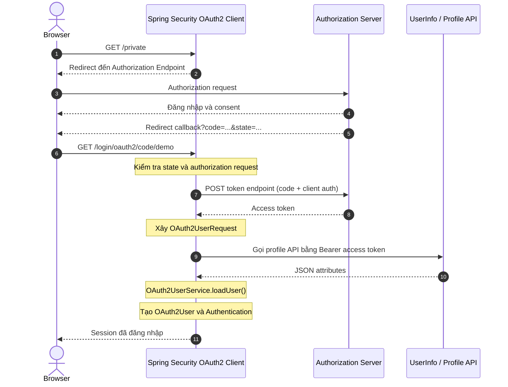

# 12.1. OAuth2UserService và DefaultOAuth2UserService

## 1. Bài toán: Sau khi có access token, ứng dụng biết người dùng là ai?

Khi một ứng dụng **Spring Security OAuth 2.0/OIDC Client** sử dụng Authorization Code Grant, bước trao đổi authorization code tại token endpoint có thể mang về access token. Với **OAuth2 Login không phải OpenID Connect**, access token thường được dùng để lấy hồ sơ người dùng từ một API do provider công bố. Spring Security cần chuyển dữ liệu đó thành **principal** cho phiên đăng nhập.

Ví dụ ứng dụng gọi UserInfo/Profile API:

```http
GET /v1/me HTTP/1.1
Host: api.partner.example.net
Authorization: Bearer ACCESS_TOKEN_VALUE
Accept: application/json
```

Provider trả JSON:

```json
{
  "id": "account-214",
  "login": "example-user",
  "display_name": "Example User",
  "email": "user@example.net",
  "avatar_url": "https://cdn.example.net/avatar/214.png"
}
```

Hai thành phần trọng tâm:

- **`OAuth2UserService<R, U>`** là hợp đồng tải hoặc dựng một người dùng từ OAuth2 user request.
- **`DefaultOAuth2UserService`** là triển khai có sẵn, dùng access token gửi HTTP request tới UserInfo/Profile Endpoint và dựng một `OAuth2User` từ attributes trả về.

Chúng nằm ở **khâu tải thông tin người dùng sau token exchange**, không thay thế việc chuyển hướng authorize, đối chiếu `state`, PKCE, token request hoặc ID Token validation.

Mục tiêu của bài là hiểu contract, cấu hình provider, các điểm tùy chỉnh HTTP/mapping và phân biệt chính xác **OAuth2 profile API** với **OIDC UserInfo**.

> Các URL, IDs, tokens và JSON trong bài đều là ví dụ minh họa. Với provider thật, cần đối chiếu scope, schema, endpoint và yêu cầu bảo mật theo tài liệu của provider đó.

## 2. UserInfo nằm ở bước nào của OAuth2 Login?



Nhìn từ lớp Java:

```text
ClientRegistrationRepository
    |
    +--> ClientRegistration
    |      |-- registrationId
    |      |-- userInfoUri
    |      +-- userNameAttributeName
    |
    v
Authorization Code Grant
    |
    v
OAuth2AccessToken (đã lấy từ token endpoint)
    |
    v
OAuth2UserRequest
    |
    v
OAuth2UserService.loadUser(...)
    |
    v
OAuth2User principal
    |
    v
OAuth2AuthenticationToken / SecurityContext
```

Các điểm quan trọng:

1. `OAuth2UserService` được gọi khi Spring Security cần một principal sau OAuth2 Login.
2. Nó dùng **access token** đã có để lấy thông tin người dùng từ endpoint được cấu hình.
3. Nó không phải nơi phát hành token, xác minh authorization code hoặc thay thế client authentication.
4. Sau login, controller lấy principal từ SecurityContext/session; **không mặc nhiên gọi lại UserInfo mỗi lần mở trang**.

## 3. Hợp đồng OAuth2UserService

Interface:

```java
org.springframework.security.oauth2.client.userinfo.OAuth2UserService
```

Dạng khái niệm:

```java
public interface OAuth2UserService<
        R extends OAuth2UserRequest,
        U extends OAuth2User> {

    U loadUser(R userRequest)
            throws OAuth2AuthenticationException;
}
```

| Thành phần | Ý nghĩa |
|---|---|
| `R` | Request mô tả client và access token. |
| `U` | Principal người dùng trả về. |
| `loadUser(R)` | Tải, chuyển đổi hoặc dựng thông tin người dùng. |
| `OAuth2AuthenticationException` | Lỗi xác thực nếu không lấy/tạo được principal hợp lệ. |

Với OAuth2 Login không phải OIDC:

```java
OAuth2UserService<OAuth2UserRequest, OAuth2User>
```

Với OIDC:

```java
OAuth2UserService<OidcUserRequest, OidcUser>
```

**Generic types có ý nghĩa giao thức.** `OidcUserRequest` chứa ngữ cảnh OIDC, gồm ID Token đã được xử lý trong quá trình authentication. Không thể thay tùy tiện một OIDC service bằng service chỉ xử lý JSON profile API.

### 3.1. OAuth2UserService khác UserDetailsService

| Interface | Công dụng thường gặp |
|---|---|
| `UserDetailsService` | Tải thông tin tài khoản theo username trong những luồng xác thực sử dụng local user details. |
| `OAuth2UserService` | Tải principal sau khi OAuth2 Client nhận access token và cần thông tin từ provider. |
| `ReactiveOAuth2UserService` | Phiên bản reactive dùng với Spring WebFlux. |
| `OidcUserService` | Dịch vụ chuyên cho principal đăng nhập OpenID Connect. |

Ứng dụng không cần triển khai `UserDetailsService` chỉ để bật OAuth2 Login. Nếu có database user nội bộ, việc liên kết tài khoản có thể do service riêng quản lý và được gọi trong lúc xử lý đăng nhập.

## 4. OAuth2UserRequest: Đầu vào của loadUser

Class:

```java
org.springframework.security.oauth2.client.userinfo.OAuth2UserRequest
```

Những API quan trọng:

| API | Dữ liệu trả về |
|---|---|
| `getClientRegistration()` | Cấu hình client và provider. |
| `getAccessToken()` | OAuth2 access token đã được cấp cho client. |
| `getAdditionalParameters()` | Tham số bổ sung của token response khi có. |

Ví dụ:

```java
import org.springframework.security.oauth2.client.userinfo.OAuth2UserRequest;
import org.springframework.security.oauth2.client.registration.ClientRegistration;
import org.springframework.security.oauth2.core.OAuth2AccessToken;

void inspect(OAuth2UserRequest request) {
    ClientRegistration registration = request.getClientRegistration();
    OAuth2AccessToken token = request.getAccessToken();

    String registrationId = registration.getRegistrationId();
    String nameKey = registration.getProviderDetails()
        .getUserInfoEndpoint()
        .getUserNameAttributeName();

    // Không log token.getTokenValue().
}
```

`registrationId` là khóa nội bộ, ví dụ `partner`; `userNameAttributeName` là tên trường UserInfo dùng làm principal name, ví dụ `id`. Đây không phải hai tên khác nhau của cùng một trường.

### 4.1. Những thông tin trong ClientRegistration liên quan UserInfo

| Thuộc tính | Vai trò |
|---|---|
| `registrationId` | Xác định registration để chọn provider đúng. |
| `clientId` | Client ID đã được Authorization Server cấp. |
| `providerDetails.userInfoEndpoint.uri` | Địa chỉ UserInfo/Profile API. |
| `providerDetails.userInfoEndpoint.userNameAttributeName` | Key định danh người dùng trong response. |
| `providerDetails.userInfoEndpoint.authenticationMethod` | Cách dùng access token khi gửi UserInfo request. |
| `scopes` | Scope client yêu cầu; có thể khác scope thực tế được cấp. |

Không đưa một UserInfo URI do trình duyệt nhập vào và tự gọi bằng access token. Endpoint phải đến từ nguồn cấu hình đã được quản trị và tin cậy.

## 5. OAuth2User: Kết quả được Spring Security sử dụng

Interface:

```java
org.springframework.security.oauth2.core.user.OAuth2User
```

Các phương thức tiêu biểu:

- `getName()`: giá trị định danh được chọn cho principal.
- `getAttributes()`: Map chứa những thuộc tính người dùng.
- `getAttribute("name")`: đọc thuộc tính theo key.
- `getAuthorities()`: authorities của principal.

Ví dụ controller:

```java
import java.util.LinkedHashMap;
import java.util.Map;

import org.springframework.security.core.annotation.AuthenticationPrincipal;
import org.springframework.security.oauth2.core.user.OAuth2User;
import org.springframework.web.bind.annotation.GetMapping;
import org.springframework.web.bind.annotation.RestController;

@RestController
class MeController {

    @GetMapping("/me")
    Map<String, Object> me(@AuthenticationPrincipal OAuth2User user) {
        Map<String, Object> result = new LinkedHashMap<>();

        result.put("externalId", user.getName());
        result.put("displayName", user.getAttribute("display_name"));

        return result;
    }
}
```

Với provider có `id = "account-214"` và `display_name = "Example User"`:

- `getName()` có thể là `"account-214"` khi name key được khai báo là `id`.
- `getAttribute("display_name")` trả tên để hiển thị.
- Hai giá trị không nên bị đánh đồng: tên hiển thị có thể thay đổi, còn external ID cần có hợp đồng ổn định.

Không tự trả toàn bộ `getAttributes()` ra endpoint public: trong đó có thể chứa dữ liệu cá nhân không cần thiết.

### 5.1. DefaultOAuth2User

Một implementation phổ biến của `OAuth2User` là:

```java
org.springframework.security.oauth2.core.user.DefaultOAuth2User
```

Ví dụ tạo principal từ dữ liệu đã được xử lý:

```java
import java.util.Map;
import java.util.Set;

import org.springframework.security.core.authority.SimpleGrantedAuthority;
import org.springframework.security.oauth2.core.user.DefaultOAuth2User;
import org.springframework.security.oauth2.core.user.OAuth2User;

OAuth2User principal = new DefaultOAuth2User(
    Set.of(new SimpleGrantedAuthority("ROLE_USER")),
    Map.of(
        "id", "account-214",
        "name", "Example User"
    ),
    "id"
);
```

Tham số cuối cùng `"id"` phải là key tồn tại trong attribute map để framework xác định principal name. Việc gắn `ROLE_USER` ở ví dụ chỉ minh họa constructor; trong ứng dụng thực tế, role phải phản ánh chính sách phân quyền được quản trị.

## 6. DefaultOAuth2UserService thực hiện gì?

Class:

```java
org.springframework.security.oauth2.client.userinfo.DefaultOAuth2UserService
```

Nó triển khai:

```java
OAuth2UserService<OAuth2UserRequest, OAuth2User>
```

Khi `loadUser()` được gọi, service:

1. Đọc `ClientRegistration` và `OAuth2AccessToken`.
2. Xác định UserInfo endpoint và cách xác thực request.
3. Dựng HTTP `RequestEntity`, mặc định thường truyền access token theo Bearer header.
4. Gửi HTTP request bằng một `RestOperations`.
5. Đọc response attributes từ provider.
6. Áp dụng converter nếu có.
7. Xác định tên principal từ `userNameAttributeName`.
8. Tạo một `OAuth2User`.
9. Ném `OAuth2AuthenticationException` khi việc lấy hoặc xây người dùng không hợp lệ.

Request thường thấy:

```http
GET /v1/me HTTP/1.1
Host: api.partner.example.net
Authorization: Bearer ACCESS_TOKEN_VALUE
Accept: application/json
```

Response ví dụ:

```json
{
  "id": "account-214",
  "display_name": "Example User"
}
```

### 6.1. Không có một UserInfo schema chung cho mọi OAuth2 provider

Một provider có thể trả:

```json
{
  "id": 34562,
  "login": "sample"
}
```

Provider khác:

```json
{
  "user_id": "u-1234",
  "nickname": "sample"
}
```

OAuth2 không bắt buộc tất cả profile APIs có cùng schema. Spring Security cần được cấu hình đúng `user-name-attribute` hoặc có mapping thích hợp.

**Đừng mặc định email là ID**, vì email có thể đổi, tái sử dụng, chưa xác minh, hoặc không được trả về.

### 6.2. Service không dành cho mọi token

Trong `client_credentials`, client lấy token đại diện cho ứng dụng, không phải một người dùng đăng nhập. Không nên gọi `DefaultOAuth2UserService` để tự tạo End-User chỉ vì đã lấy được access token cho service.

## 7. Cấu hình Spring Boot để tải profile OAuth2

Ví dụ ứng dụng Spring MVC/Servlet dùng Spring Boot 3.x:

```groovy
dependencies {
    implementation 'org.springframework.boot:spring-boot-starter-web'
    implementation 'org.springframework.boot:spring-boot-starter-security'
    implementation 'org.springframework.boot:spring-boot-starter-oauth2-client'
}
```

Với Spring Boot 4.x, tên starter web MVC và OAuth2 Client được khuyến nghị tương ứng là `spring-boot-starter-webmvc` và `spring-boot-starter-security-oauth2-client`. Để BOM/plugin của Spring Boot quản lý dependency versions, không trộn các dòng framework không tương thích.

### 7.1. Khai báo provider OAuth2 có Profile API

```yaml
spring:
  security:
    oauth2:
      client:
        registration:
          partner:
            provider: partner-oauth
            client-id: ${PARTNER_CLIENT_ID}
            client-secret: ${PARTNER_CLIENT_SECRET}
            client-authentication-method: client_secret_basic
            authorization-grant-type: authorization_code
            redirect-uri: "{baseUrl}/login/oauth2/code/{registrationId}"
            scope:
              - profile.read
        provider:
          partner-oauth:
            authorization-uri: https://login.partner.example.net/authorize
            token-uri: https://login.partner.example.net/oauth2/token
            user-info-uri: https://api.partner.example.net/v1/me
            user-name-attribute: id
```

Điểm cần nhớ:

- `partner` là registration ID của ứng dụng Spring.
- `authorization-uri` và `token-uri` là endpoint của Authorization Server.
- `user-info-uri` là endpoint lấy profile đã được provider định nghĩa.
- `user-name-attribute: id` yêu cầu response có key `id` ở vị trí Spring Security đọc được.
- `profile.read` chỉ là scope minh họa được provider quy định, không phải tên scope dùng chung cho toàn OAuth2.
- Không có `openid`; ví dụ này là **OAuth2 Login không phải OIDC**.

Không ghi secret thật vào Git. Các biến môi trường phải được cung cấp an toàn cho deployment.

### 7.2. SecurityFilterChain

```java
import org.springframework.context.annotation.Bean;
import org.springframework.context.annotation.Configuration;
import org.springframework.security.config.Customizer;
import org.springframework.security.config.annotation.web.builders.HttpSecurity;
import org.springframework.security.web.SecurityFilterChain;

@Configuration
class SecurityConfig {

    @Bean
    SecurityFilterChain securityFilterChain(HttpSecurity http)
            throws Exception {

        http
            .authorizeHttpRequests(authorize -> authorize
                .requestMatchers("/", "/public/**").permitAll()
                .anyRequest().authenticated()
            )
            .oauth2Login(Customizer.withDefaults());

        return http.build();
    }
}
```

Endpoint mặc định để bắt đầu đăng nhập:

```text
/oauth2/authorization/partner
```

Callback mặc định:

```text
/login/oauth2/code/partner
```

Với provider phù hợp, Spring Security có thể sử dụng user service mặc định mà **không cần viết một `OAuth2UserService` riêng**.

## 8. Tùy chỉnh qua userInfoEndpoint().userService(...)

Trong Servlet DSL:

```java
http.oauth2Login(login -> login
    .userInfoEndpoint(info -> info
        .userService(customOAuth2UserService)
    )
);
```

Một ví dụ bean tường minh:

```java
import org.springframework.context.annotation.Bean;
import org.springframework.context.annotation.Configuration;
import org.springframework.security.config.annotation.web.builders.HttpSecurity;
import org.springframework.security.oauth2.client.userinfo.DefaultOAuth2UserService;
import org.springframework.security.oauth2.client.userinfo.OAuth2UserRequest;
import org.springframework.security.oauth2.client.userinfo.OAuth2UserService;
import org.springframework.security.oauth2.core.user.OAuth2User;
import org.springframework.security.web.SecurityFilterChain;

@Configuration
class OAuth2UserServiceConfig {

    @Bean
    OAuth2UserService<OAuth2UserRequest, OAuth2User> userService() {
        return new DefaultOAuth2UserService();
    }

    @Bean
    SecurityFilterChain filterChain(
            HttpSecurity http,
            OAuth2UserService<OAuth2UserRequest, OAuth2User> userService)
            throws Exception {

        http
            .authorizeHttpRequests(authorize -> authorize
                .anyRequest().authenticated()
            )
            .oauth2Login(login -> login
                .userInfoEndpoint(info -> info
                    .userService(userService)
                )
            );

        return http.build();
    }
}
```

Cấu hình trên minh họa điểm gắn user service, không ngụ ý phải định nghĩa bean khi mặc định đã đáp ứng yêu cầu. Không đặt nó cùng một `SecurityFilterChain` khác có cùng matcher toàn bộ URL nếu không có chủ đích.

## 9. Bọc DefaultOAuth2UserService bằng Delegation

Nếu chỉ cần chuẩn hóa hoặc kiểm tra profile, cách đơn giản là **để DefaultOAuth2UserService gọi HTTP**, rồi xử lý `OAuth2User` mà nó trả về.

Ví dụ provider trả `id` và `display_name`; ứng dụng muốn thêm key `displayName` cho controller.

```java
import java.util.LinkedHashMap;
import java.util.Map;

import org.springframework.security.oauth2.client.userinfo.DefaultOAuth2UserService;
import org.springframework.security.oauth2.client.userinfo.OAuth2UserRequest;
import org.springframework.security.oauth2.client.userinfo.OAuth2UserService;
import org.springframework.security.oauth2.core.OAuth2AuthenticationException;
import org.springframework.security.oauth2.core.OAuth2Error;
import org.springframework.security.oauth2.core.user.DefaultOAuth2User;
import org.springframework.security.oauth2.core.user.OAuth2User;

public final class PartnerUserService
        implements OAuth2UserService<OAuth2UserRequest, OAuth2User> {

    private final DefaultOAuth2UserService delegate =
        new DefaultOAuth2UserService();

    @Override
    public OAuth2User loadUser(OAuth2UserRequest request)
            throws OAuth2AuthenticationException {

        OAuth2User loaded = delegate.loadUser(request);

        Object externalId = loaded.getAttribute("id");
        if (externalId == null
                || externalId.toString().isBlank()) {
            throw new OAuth2AuthenticationException(
                new OAuth2Error(
                    "invalid_user_info",
                    "Provider did not return a stable user identifier",
                    null
                )
            );
        }

        Map<String, Object> attributes =
            new LinkedHashMap<>(loaded.getAttributes());

        Object name = loaded.getAttribute("display_name");
        if (name != null) {
            attributes.put("displayName", name);
        }

        return new DefaultOAuth2User(
            loaded.getAuthorities(),
            attributes,
            "id"
        );
    }
}
```

Ý nghĩa:

- Delegate chỉ tải profile một lần.
- Code không ghi log access token.
- Dữ liệu được sao chép sang map mới để tránh sửa một map không chắc mutable.
- `id` là trường định danh bắt buộc của provider trong ví dụ.
- Authorities mặc định được giữ lại.
- `id` là name attribute key của principal.

Nếu cần ánh xạ nhiều provider, đọc `request.getClientRegistration().getRegistrationId()` rồi áp logic **theo registration đã được quản trị**, không đoán provider dựa vào thuộc tính do profile API tự trả.

### 9.1. Gắn custom service

```java
@Bean
OAuth2UserService<OAuth2UserRequest, OAuth2User> userService() {
    return new PartnerUserService();
}
```

Gắn bean vào `oauth2Login().userInfoEndpoint().userService(...)`. Khi project có nhiều bean cùng kiểu, sử dụng qualifier hoặc injection chính xác để tránh mơ hồ.

## 10. setAttributesConverter: chuẩn hóa JSON lồng nhau

Một số providers trả:

```json
{
  "user": {
    "id": "u-77",
    "display_name": "Example Person"
  },
  "meta": {
    "source": "partner"
  }
}
```

Nhưng cấu hình Spring yêu cầu `user-name-attribute: id` ở cấp cao. Spring Security **6.3+** có:

```java
DefaultOAuth2UserService.setAttributesConverter(...)
```

API nhận `OAuth2UserRequest` và một converter để biến đổi `Map<String,Object>` trước khi tạo principal.

Ví dụ một method trong class `@Configuration`:

```java
import java.util.LinkedHashMap;
import java.util.Map;

import org.springframework.context.annotation.Bean;
import org.springframework.security.oauth2.client.userinfo.DefaultOAuth2UserService;

@Bean
DefaultOAuth2UserService profileUserService() {
    DefaultOAuth2UserService service =
        new DefaultOAuth2UserService();

    service.setAttributesConverter(request -> attributes -> {
        Map<String, Object> result =
            new LinkedHashMap<>(attributes);

        Object nested = attributes.get("user");

        if (nested instanceof Map<?, ?> user) {
            Object id = user.get("id");
            Object displayName = user.get("display_name");

            if (id != null) {
                result.put("id", id);
            }
            if (displayName != null) {
                result.put("displayName", displayName);
            }
        }

        return result;
    });

    return service;
}
```

Lợi ích:

1. Không phải viết HTTP request mới.
2. Có thể nâng trường lồng nhau thành top-level key để thỏa `user-name-attribute`.
3. Converter nhận `OAuth2UserRequest`, nên có thể phân nhánh theo registration ID.
4. Map được copy, tránh thay đổi trực tiếp response có thể immutable.

Nếu dùng Spring Security **trước 6.3**, `setAttributesConverter` có thể chưa tồn tại. Khi đó, dùng một delegate wrapper hoặc điểm mở rộng có sẵn ở phiên bản đang triển khai.

**Không xem việc đưa một field lên cấp trên là chứng minh field đó đáng tin cậy.** Nếu field `role` đến từ profile API, quyền sử dụng nó cho authorization phải được thiết kế riêng.

## 11. setRequestEntityConverter: tùy chỉnh request UserInfo

`DefaultOAuth2UserService` dùng converter xây `RequestEntity<?>` từ `OAuth2UserRequest`. Phương thức:

```java
void setRequestEntityConverter(
    Converter<OAuth2UserRequest, RequestEntity<?>> converter
);
```

Converter mặc định của Spring Security có tên `OAuth2UserRequestEntityConverter`, thường gửi access token như sau:

```http
Authorization: Bearer ACCESS_TOKEN_VALUE
```

Tùy chỉnh converter khi provider yêu cầu header cụ thể hoặc cách truyền token khác theo hợp đồng API. Khi đó phải đảm bảo:

- URI đúng endpoint đã được cấu hình, không phải URL tùy ý từ browser.
- Access token chỉ đến đúng resource server/UserInfo endpoint được phép.
- Không làm mất header/cách xác thực token bắt buộc.
- Không đưa access token vào log hoặc thông số URL.
- Không thay HTTP method một cách tùy tiện.

Nếu provider chấp nhận request mặc định, **không cần viết converter riêng**.

## 12. setRestOperations: timeout, proxy và xử lý lỗi

`DefaultOAuth2UserService` sử dụng `RestOperations` để gọi UserInfo endpoint. API:

```java
void setRestOperations(RestOperations restOperations);
```

Một custom `RestTemplate` có thể cung cấp timeout và HTTP transport riêng.

```java
import org.springframework.http.client.SimpleClientHttpRequestFactory;
import org.springframework.security.oauth2.client.http.OAuth2ErrorResponseErrorHandler;
import org.springframework.security.oauth2.client.userinfo.DefaultOAuth2UserService;
import org.springframework.web.client.RestTemplate;

SimpleClientHttpRequestFactory factory =
    new SimpleClientHttpRequestFactory();
factory.setConnectTimeout(3000);
factory.setReadTimeout(10000);

RestTemplate restTemplate = new RestTemplate(factory);
restTemplate.setErrorHandler(new OAuth2ErrorResponseErrorHandler());

DefaultOAuth2UserService service =
    new DefaultOAuth2UserService();
service.setRestOperations(restTemplate);
```

`OAuth2ErrorResponseErrorHandler` phải được giữ khi thay `RestOperations`, để xử lý phản hồi lỗi OAuth2 mà endpoint trả về. Tùy dòng Spring Framework, setters timeout có thể hỗ trợ milliseconds hoặc `Duration`; dùng cú pháp phù hợp với dependencies dự án.

### 12.1. UserInfo và Token Endpoint có thể sử dụng HTTP client khác

```text
POST /token     -> Authorization Code Token Response Client
GET  /userinfo  -> DefaultOAuth2UserService / RestOperations
GET  /jwks      -> JWT decoder/JWK retriever
GET  /.well-known/openid-configuration -> Discovery
```

Đổi timeout/proxy của token endpoint không tự sửa kết nối UserInfo. Tương tự, kết nối JWKS thất bại sau token exchange không nên bị giải quyết bằng cách tắt ID Token signature validation.

### 12.2. TLS phải giữ nguyên kiểm tra chứng chỉ

Nếu provider dùng private CA hoặc HTTPS qua proxy nội bộ, hãy cấu hình truststore/CA đúng cho HTTP transport. **Không dùng trust-all hoặc tắt hostname verification**, vì Bearer access token là credential có thể bị lấy cắp khi gửi sai endpoint.

## 13. OAuth2UserService và OidcUserService không giống nhau

**OpenID Connect (OIDC)** bổ sung lớp xác thực danh tính lên OAuth2. Khi scope có `openid` và provider phát **ID Token** hợp lệ, Spring Security sử dụng đường xử lý OIDC chuyên biệt.

### 13.1. Luồng OAuth2 thuần

```text
OAuth2UserRequest
      |
      v
DefaultOAuth2UserService
      |
      v
OAuth2User
```

Danh tính thường dựa trên trường ID trong profile response, theo hợp đồng provider; không có bảo đảm mọi provider dùng `sub`.

### 13.2. Luồng OIDC

```text
Authorization Code
      |
      v
Token response có ID Token
      |
      v
ID Token validation
      |
      v
OidcUserRequest
      |
      v
OidcUserService
      |
      v
OidcUser
```

`OidcUserService` thuộc package:

```java
org.springframework.security.oauth2.client.oidc.userinfo.OidcUserService
```

Nó là một `OAuth2UserService<OidcUserRequest, OidcUser>`. Principal OIDC có ID Token và các claims xác thực theo giao thức. Dữ liệu OIDC được liên kết danh tính bằng cặp `(iss, sub)`, không tự động bằng email.

### 13.3. Hai điểm cấu hình khác nhau

OAuth2 Login:

```java
http.oauth2Login(login -> login
    .userInfoEndpoint(info -> info
        .userService(customOAuth2UserService)
    )
);
```

OIDC Login:

```java
http.oauth2Login(login -> login
    .userInfoEndpoint(info -> info
        .oidcUserService(customOidcUserService)
    )
);
```

Một lỗi phổ biến là ứng dụng đã đăng nhập OIDC nhưng chỉ tùy chỉnh `.userService(...)` và không thấy logic chạy. Cần chọn đúng điểm mở rộng `.oidcUserService(...)`.

### 13.4. OidcUserService có thể dùng DefaultOAuth2UserService làm delegate

`OidcUserService` có:

```java
setOauth2UserService(
    OAuth2UserService<OAuth2UserRequest, OAuth2User> userService
)
```

Ví dụ:

```java
import org.springframework.context.annotation.Bean;
import org.springframework.context.annotation.Configuration;
import org.springframework.security.oauth2.client.oidc.userinfo.OidcUserService;
import org.springframework.security.oauth2.client.userinfo.DefaultOAuth2UserService;

@Configuration
class OidcProfileConfig {

    @Bean
    OidcUserService oidcUserService() {
        DefaultOAuth2UserService userInfoDelegate =
            new DefaultOAuth2UserService();

        // Có thể đặt custom RestOperations hoặc attributes converter.

        OidcUserService oidc = new OidcUserService();
        oidc.setOauth2UserService(userInfoDelegate);

        return oidc;
    }
}
```

Gắn `oidcUserService` vào `.oidcUserService(oidcUserService)` trong `oauth2Login().userInfoEndpoint()` nếu muốn thay service mặc định cho OIDC.

Đây là cách tùy chỉnh phần HTTP/mapping UserInfo mà vẫn giữ luồng OIDC principal.

### 13.5. OIDC UserInfo không nhất thiết luôn được gọi

OIDC ID Token đã mang những claims danh tính cốt lõi. `OidcUserService` có thể quyết định có gọi UserInfo hay không tùy registration, scope và cấu hình. Trong các phiên bản Spring Security mới có `setRetrieveUserInfo(...)` để tùy chỉnh điều kiện đó.

Quan trọng: nếu OIDC UserInfo được gọi, **`sub` trong UserInfo phải khớp `sub` trong ID Token đã xác minh**. Không ghép attributes của một người khác vào principal hiện tại.

| Đặc điểm | DefaultOAuth2UserService | OidcUserService |
|---|---|---|
| Kiểu request | `OAuth2UserRequest` | `OidcUserRequest` |
| Kiểu principal | `OAuth2User` | `OidcUser` |
| Nguồn identity | Provider-specific profile ID | ID Token `iss` + `sub` |
| Tải UserInfo | Nhiệm vụ chính | Tùy điều kiện, có thể delegate |
| Cần ID Token | Không | Có |
| DSL Servlet | `.userService(...)` | `.oidcUserService(...)` |

Không dùng access token JWT như thể nó là ID Token. Token dành cho API có mục đích và audience khác.

## 14. Attributes, scopes và authorities là ba lớp khác nhau

| Loại | Ý nghĩa |
|---|---|
| UserInfo attributes | Hồ sơ người dùng: ID, name, email, avatar. |
| OAuth2 scopes | Phạm vi client được ủy quyền gọi API bằng access token. |
| Spring Security authorities | Những quyền mà ứng dụng dùng để kiểm tra authorization. |

Ví dụ provider trả:

```json
{
  "id": "user-8241",
  "email": "user@example.net",
  "role": "admin"
}
```

Không tự động chuyển `"role": "admin"` thành `ROLE_ADMIN` nếu provider không được tin cậy làm nguồn quyền hoặc người dùng có thể tự chỉnh field đó. Cũng không xem `SCOPE_email` là quyền xem email của mọi tài khoản.

`GrantedAuthoritiesMapper` là một điểm mở rộng để ánh xạ authorities sau khi user service tạo principal. Nếu cần truy cập thêm một API kiểm soát quyền bằng access token, custom delegating user service có thể làm điều đó, nhưng phải dùng endpoint tin cậy và chính sách rõ ràng.

Ví dụ mapper không thay đổi dữ liệu:

```java
import org.springframework.context.annotation.Bean;
import org.springframework.security.core.authority.mapping.GrantedAuthoritiesMapper;

@Bean
GrantedAuthoritiesMapper authoritiesMapper() {
    return authorities -> authorities;
}
```

Đây chỉ là ví dụ về vị trí customization, không phải một phương án phân quyền hoàn chỉnh.

## 15. Liên kết external identity với tài khoản nội bộ

Một hệ thống có thể lưu:

```text
external_identity
--------------------------------------
provider_key       TEXT NOT NULL
external_user_id   TEXT NOT NULL
local_user_id      UUID NOT NULL

UNIQUE (provider_key, external_user_id)
```

Với OAuth2 provider không phải OIDC, `external_user_id` phải là ID ổn định được provider cam kết. `provider_key` phải xác định chính xác namespace danh tính tương ứng; multi-tenant hoặc nhiều registrations có thể cần thiết kế kỹ hơn.

Với OIDC, khóa được chuẩn hóa là **cặp `(iss, sub)`**. Không ghép tài khoản tự động chỉ bằng email, vì email có thể thay đổi, tái sử dụng, thiếu hoặc chưa xác minh.

### 15.1. Không đồng bộ quá mức

Sau login có thể cần cập nhật tên/avatar vào local account, nhưng:

- Profile attributes có thể đổi theo thời gian.
- API UserInfo có timeout/rate limit.
- Dữ liệu cá nhân cần quy định lưu trữ/xóa.
- Không nhất thiết phải gọi lại UserInfo ở mỗi request.
- Quyền truy cập nghiệp vụ phải đến từ nguồn kiểm soát riêng.

Nếu cần đồng bộ realtime hoặc theo lịch, đó là workflow ứng dụng riêng, không phải hành vi tự động của `DefaultOAuth2UserService`.

## 16. Xử lý lỗi khi tải UserInfo

| Triệu chứng | Nguyên nhân khả dĩ | Cách xử lý |
|---|---|---|
| HTTP 401 | Token sai/hết hạn/không được UserInfo chấp nhận | Kiểm tra access token và endpoint |
| HTTP 403 | Scope/consent/chính sách không đủ | Kiểm tra scope thực cấp |
| HTTP 404 | UserInfo URI sai | Đối chiếu provider metadata |
| HTTP 400 OAuth2 error | Provider trả lỗi giao thức | Giữ `OAuth2ErrorResponseErrorHandler` |
| Timeout | Proxy, DNS, firewall, API chậm | Kiểm tra `RestOperations` transport |
| TLS/PKIX | Certificate chain hoặc CA không được tin | Sửa truststore/host |
| JSON lồng nhau | Username key không ở cấp trên | Attributes converter |
| Thiếu ID | Response thiếu dữ liệu danh tính | Từ chối hoặc xử lý theo policy |
| OIDC `sub` mismatch | ID Token/UserInfo khác chủ thể | Từ chối kết hợp |
| Role không đúng | Mapping từ profile không đáng tin | Rà soát chính sách authorities |

### 16.1. Đừng nhầm lỗi UserInfo với lỗi Token Endpoint

Ví dụ:

```text
POST /token       -> HTTP 200
GET  /userinfo    -> HTTP 503
loadUser()        -> OAuth2AuthenticationException
OAuth2 Login      -> thất bại
```

Tăng timeout token endpoint hoặc thay client secret không xử lý được UserInfo bị 503. Phải xác định bước HTTP nào thực sự lỗi.

### 16.2. Khi không có ID, không tạo principal giả

Không nên:

```java
try {
    return delegate.loadUser(request);
} catch (Exception ignored) {
    // Không nên: cho đăng nhập dù profile không được xác minh.
    return createGuestPrincipal();
}
```

Nếu không thu được định danh cần thiết theo hợp đồng, user service nên **thất bại an toàn**, không tự gán username từ email chưa xác minh hay tạo principal có quyền.

## 17. Bảo mật Bearer token và dữ liệu hồ sơ

`OAuth2UserRequest.getAccessToken().getTokenValue()` là credential. Không ghi nó vào log hoặc đưa sang frontend chỉ để hiển thị hồ sơ.

Các thực hành quan trọng:

- Chỉ gọi endpoint đã được cấu hình và tin cậy.
- Dùng HTTPS, giữ TLS certificate và hostname verification.
- Không dùng UserInfo URL do request của người dùng chỉ định.
- Không đặt access token trong query parameter hoặc log.
- Không bật HTTP wire logging chứa Authorization headers ở production.
- Không tự nâng quyền từ attributes chưa có hợp đồng tin cậy.
- Không trả toàn bộ JSON UserInfo nếu frontend chỉ cần một vài field.
- Áp dụng chính sách lưu trữ và xóa dữ liệu cá nhân phù hợp.

Một URI UserInfo bị điều khiển bởi người dùng có thể gây SSRF hoặc rò rỉ access token sang máy chủ không tin cậy. Cần ràng buộc endpoint với `ClientRegistration` đã được quản trị.

## 18. Kiểm thử custom OAuth2UserService

Để kiểm thử logic mapping mà không gọi profile API thật, nên thiết kế service nhận delegate qua constructor:

```java
import org.springframework.security.oauth2.client.userinfo.OAuth2UserRequest;
import org.springframework.security.oauth2.client.userinfo.OAuth2UserService;
import org.springframework.security.oauth2.core.user.OAuth2User;

public final class DelegatingProfileService
        implements OAuth2UserService<OAuth2UserRequest, OAuth2User> {

    private final OAuth2UserService<OAuth2UserRequest, OAuth2User> delegate;

    public DelegatingProfileService(
            OAuth2UserService<OAuth2UserRequest, OAuth2User> delegate) {
        this.delegate = delegate;
    }

    @Override
    public OAuth2User loadUser(OAuth2UserRequest request) {
        OAuth2User loaded = delegate.loadUser(request);
        // Thêm validation/mapping thật ở đây.
        return loaded;
    }
}
```

Trong unit test, có thể inject fake:

```java
OAuth2UserService<OAuth2UserRequest, OAuth2User> fake =
    request -> new DefaultOAuth2User(
        Set.of(new SimpleGrantedAuthority("OAUTH2_USER")),
        Map.of("id", "test-user", "name", "Example"),
        "id"
    );

DelegatingProfileService service = new DelegatingProfileService(fake);
OAuth2User actual = service.loadUser(testUserRequest);
```

Đoạn cuối cần imports và một `testUserRequest` đã được chuẩn bị từ `ClientRegistration` cùng access token giả. Mục tiêu là tách business mapping khỏi HTTP để kiểm thử ổn định.

Các trường hợp hữu ích:

- Response có ID hợp lệ.
- Thiếu ID hoặc key không đúng.
- JSON lồng nhau.
- Hai providers có name attributes khác nhau.
- Mapper không cấp quyền ngoài policy.
- Lỗi UserInfo được truyền thành authentication failure.

### 18.1. MockMvc oauth2Login() không gọi UserInfo thật

Spring Security Test có post-processor:

```java
import static org.springframework.security.test.web.servlet.request.SecurityMockMvcRequestPostProcessors.oauth2Login;
```

Ví dụ:

```java
mockMvc.perform(get("/me").with(oauth2Login()))
    .andExpect(status().isOk());
```

Nó chủ yếu mô phỏng một principal **đã đăng nhập**, không chứng minh `DefaultOAuth2UserService` đã gọi HTTP hay converter đã map response chính xác. Muốn kiểm thử UserInfo thực sự, cần mock HTTP ở tầng `RestOperations` hoặc tích hợp với provider thử nghiệm được kiểm soát.

## 19. Servlet so với WebFlux

Trên WebFlux, các thành phần tương ứng là:

```java
org.springframework.security.oauth2.client.userinfo.ReactiveOAuth2UserService
org.springframework.security.oauth2.client.userinfo.DefaultReactiveOAuth2UserService
```

| Tiêu chí | Servlet | WebFlux |
|---|---|---|
| Contract | `OAuth2UserService<R,U>` | `ReactiveOAuth2UserService<R,U>` |
| Mặc định | `DefaultOAuth2UserService` | `DefaultReactiveOAuth2UserService` |
| Return type | `OAuth2User` | `Mono<OAuth2User>` |
| HTTP transport | `RestOperations` | `WebClient` |
| Tùy chỉnh HTTP | `setRestOperations` | `setWebClient` |
| Bảo mật | `HttpSecurity`/`SecurityFilterChain` | `ServerHttpSecurity`/`SecurityWebFilterChain` |

Không gọi HTTP blocking bằng `RestTemplate` ngay trên event loop của ứng dụng WebFlux. Chọn đúng service reactive và giữ dữ liệu/tính bất đồng bộ xuyên suốt pipeline.

## 20. Các lỗi thường gặp

### Lỗi 1. Cấu hình sai user-name-attribute

UserInfo trả `user_id` nhưng registration khai báo `id`. Spring Security không tạo đúng principal. Sửa key cho khớp schema, hoặc chuẩn hóa attrs.

### Lỗi 2. Dùng email làm external identity

Email có thể đổi, tái sử dụng hoặc chưa được xác minh. Dùng ID ổn định của provider; với OIDC là `(iss, sub)`.

### Lỗi 3. JSON nested không được làm phẳng

Response có `user.id`, nhưng Spring tìm `id` ở cấp cao. Dùng `setAttributesConverter` từ 6.3+ hoặc custom mapping.

### Lỗi 4. Custom userService không chạy trong OIDC Login

Client có scope `openid` và đang dùng OIDC flow. Thay vì chỉ `.userService(...)`, cần xem `.oidcUserService(...)` và OIDC delegate.

### Lỗi 5. Thay RestOperations nhưng không có error handler

OAuth2 error không được chuyển đúng. Đặt `OAuth2ErrorResponseErrorHandler` trên custom RestTemplate.

### Lỗi 6. Lẫn scope với quyền nghiệp vụ

`SCOPE_profile.read` không tự tương đương `ROLE_ADMIN`. Map theo policy, không theo tên field tùy ý.

### Lỗi 7. Tưởng access token là ID Token

OAuth2 access token có thể opaque hoặc JWT nhưng không là OIDC ID Token; không thay thế xác thực OIDC.

### Lỗi 8. Gọi UserInfo lại mỗi request

Một principal đã đăng nhập thường được quản lý trong session. Muốn refresh profile phải xây workflow rõ ràng theo nhu cầu.

### Lỗi 9. Quên cấu hình proxy UserInfo

Token exchange qua proxy thành công nhưng UserInfo không đi được. Các HTTP clients có thể khác nhau.

### Lỗi 10. Nuốt lỗi UserInfo và cho phép login

Nếu thiếu ID hoặc endpoint không đáng tin cậy, không tạo principal giả để login tiếp. Xử lý thất bại an toàn.

## 21. Bài tập tình huống

**Tình huống A:** Provider trả `id = "a-1"` và `display_name = "An"`. Với `user-name-attribute: id`, `OAuth2User.getName()` phải biểu diễn external ID, không phải tên hiển thị.

**Tình huống B:** Hai providers khác nhau đều trả `id = "1234"`. Chưa thể xem là cùng một người; identity phải kèm namespace provider.

**Tình huống C:** Response là `{"user":{"uid":"u-17"}}`. Client cần normalize nested field hoặc đổi cấu hình name key để principal có định danh ổn định.

**Tình huống D:** OIDC ID Token có `sub = "user-x"` nhưng UserInfo có `sub = "user-y"`. Không được ghép profile; từ chối do mismatch.

**Tình huống E:** Token endpoint trả HTTP 200 nhưng UserInfo trả HTTP 401. Kiểm tra scope/access token và user info endpoint, không tự suy rằng token exchange đã thất bại.

**Tình huống F:** Provider trả field `role: admin` do người dùng tự chỉnh sửa. Không dùng field đó để cấp quyền admin.

**Tình huống G:** Backend Spring MVC dùng `DefaultOAuth2UserService`, nhưng dự án mới chuyển sang WebFlux. Cần dùng `DefaultReactiveOAuth2UserService` thay vì gọi service blocking trên reactive event loop.

**Tình huống H:** Cần tùy chỉnh timeout UserInfo. Dùng `setRestOperations` và giữ OAuth2 error handler; không viết lại toàn bộ authorization code grant.

## 22. Câu hỏi tự kiểm tra

**1.** `OAuth2UserService` chạy trước hay sau token exchange?  
**Đáp án:** Sau khi có access token và khi luồng OAuth2 Login cần principal.

**2.** `DefaultOAuth2UserService` nhận kiểu gì?  
**Đáp án:** `OAuth2UserRequest` và trả `OAuth2User`.

**3.** `user-name-attribute` dùng làm gì?  
**Đáp án:** Xác định field UserInfo dùng làm principal name.

**4.** JSON nested có thể xử lý bằng API nào?  
**Đáp án:** `setAttributesConverter` (Spring Security 6.3+) hoặc custom mapping.

**5.** Muốn đổi timeout/proxy UserInfo dùng gì?  
**Đáp án:** `setRestOperations` với RestOperations được cấu hình phù hợp.

**6.** OIDC Login nên tùy chỉnh service nào?  
**Đáp án:** `OidcUserService`; có thể đưa `DefaultOAuth2UserService` làm delegate để tải UserInfo.

**7.** `OAuth2User.getName()` có luôn là email?  
**Đáp án:** Không, nó lấy từ name attribute key đã cấu hình.

**8.** Có thể cấp quyền quản trị bằng field tùy ý từ profile không?  
**Đáp án:** Không nếu chưa có nguồn và hợp đồng phân quyền đáng tin cậy.

**9.** Vì sao không gửi access token tới URL browser cung cấp?  
**Đáp án:** Có thể gây SSRF và rò rỉ Bearer token.

**10.** MockMvc `.with(oauth2Login())` có xác nhận UserInfo HTTP mapping không?  
**Đáp án:** Không. Nó mô phỏng authentication; cần test user service/HTTP integration riêng.

## 23. Tổng kết

| Thành phần | Cách nhớ |
|---|---|
| `OAuth2UserService` | Contract tải/xây principal người dùng từ OAuth2 request. |
| `DefaultOAuth2UserService` | Gọi UserInfo/Profile Endpoint và trả OAuth2User. |
| `OAuth2UserRequest` | ClientRegistration, access token, additional parameters. |
| `OAuth2User` | Principal có name, attributes, authorities. |
| `DefaultOAuth2User` | Implementation với name attribute key rõ ràng. |
| `user-info-uri` | Endpoint profile của provider. |
| `user-name-attribute` | Key dùng để định danh principal trong response. |
| `setAttributesConverter` | Chuẩn hóa map attributes, từ Spring Security 6.3. |
| `setRequestEntityConverter` | Tùy chỉnh HTTP UserInfo request. |
| `setRestOperations` | Tùy chỉnh transport HTTP và xử lý lỗi. |
| `userInfoEndpoint().userService(...)` | Điểm gắn service cho OAuth2 Login trên Servlet. |
| `OidcUserService` | Dịch vụ chuyên biệt cho OIDC Login và ID Token/UserInfo. |
| `DefaultReactiveOAuth2UserService` | Tương đương cho WebFlux. |

**Kết luận:** `DefaultOAuth2UserService` là điểm xuất phát phù hợp khi provider cung cấp một UserInfo/Profile API có response rõ ràng. Hãy tận dụng khả năng chuẩn của Spring Security để gửi Bearer token, đọc attributes và xử lý lỗi, chỉ customize phần cần thiết. Với **OIDC**, ưu tiên `OidcUserService` để giữ đúng ID Token và quy tắc `sub` matching. Dù dùng service nào, cần tách bạch **hồ sơ**, **định danh**, **scope** và **quyền truy cập nghiệp vụ**.

## Tài liệu tham khảo chính thức

- [Spring Security — OAuth2 Login Advanced Configuration (Servlet)](https://docs.spring.io/spring-security/reference/servlet/oauth2/login/advanced.html) — `OAuth2UserService`, `OidcUserService` và authority mapping.
- [Spring Security — DefaultOAuth2UserService API](https://docs.spring.io/spring-security/reference/api/java/org/springframework/security/oauth2/client/userinfo/DefaultOAuth2UserService.html) — `loadUser`, `setAttributesConverter`, `setRequestEntityConverter`, `setRestOperations`.
- [Spring Security — OidcUserService API](https://docs.spring.io/spring-security/reference/api/java/org/springframework/security/oauth2/client/oidc/userinfo/OidcUserService.html) — delegate UserInfo và OIDC mapping.
- [Spring Security — Reactive OAuth2 Login](https://docs.spring.io/spring-security/reference/reactive/oauth2/login/advanced.html) — phiên bản Reactive OAuth2UserService.
- [OpenID Connect Core 1.0](https://openid.net/specs/openid-connect-core-1_0.html) — ID Token, UserInfo và so sánh `sub`.
