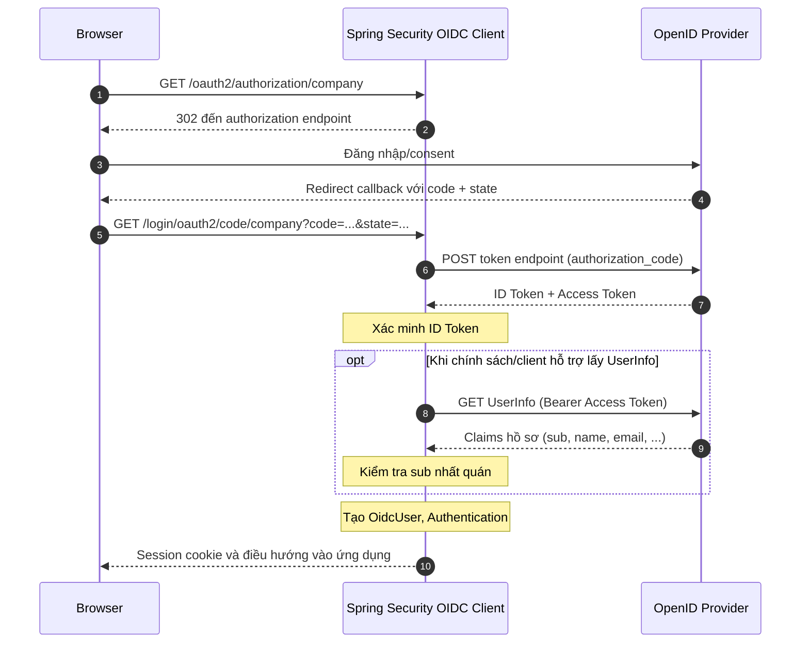
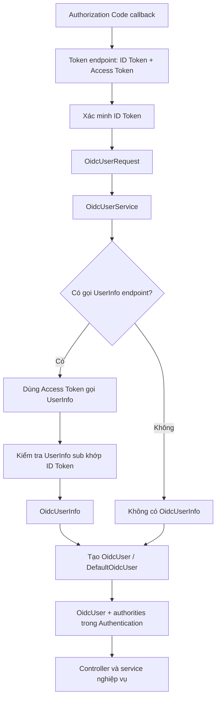
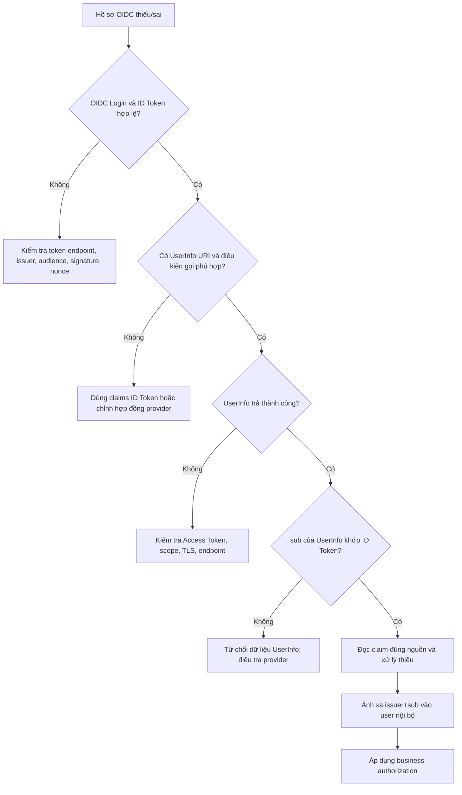

# 12.5. OidcUser, OidcUserInfo và kết hợp thông tin ID Token

Trong ứng dụng **Spring Security OAuth 2.0 / OpenID Connect (OIDC) Client**, sau khi người dùng đăng nhập thành công, chương trình thường cần biết *ai đang đăng nhập*, *thông tin nào có thể hiển thị trên giao diện* và *người đó được phép làm gì*. Ba câu hỏi này liên quan với nhau nhưng cần phân biệt rõ:

- **`OidcIdToken`** chứa các claim của **ID Token** do OpenID Provider (OP) phát hành cho client khi xác thực người dùng.
- **`OidcUserInfo`** chứa các claim hồ sơ người dùng lấy từ **UserInfo endpoint**, nếu client thực hiện yêu cầu đó.
- **`OidcUser`** là **principal OIDC** mà Spring Security đưa vào `Authentication` sau đăng nhập. Principal có thể kết hợp các claim từ ID Token và UserInfo, đồng thời có danh sách `GrantedAuthority` để Spring Security sử dụng trong authorization.

Việc kết hợp hai nguồn claim giúp ứng dụng thuận tiện hiển thị tên, email, ảnh đại diện hoặc ngôn ngữ người dùng. Tuy nhiên, **ID Token, UserInfo, principal và quyền nghiệp vụ không phải cùng một khái niệm**. Bài này giải thích mô hình của Spring Security, vòng đời tải UserInfo, cách truy cập dữ liệu đúng nguồn, các vấn đề khi claim thiếu hoặc trùng tên, cách ánh xạ user nội bộ, và cách mở rộng `OidcUserService` an toàn.

## 1. Bối cảnh: từ đăng nhập OIDC đến hồ sơ người dùng

Trong Authorization Code Flow, browser được chuyển tới OpenID Provider và quay lại ứng dụng kèm `code`. Backend Spring Security đổi code lấy token, xác minh ID Token, có thể gọi UserInfo endpoint, rồi xây dựng `OidcUser`.



Điểm cần hiểu là **UserInfo không thay thế ID Token**. ID Token là thành phần xác thực người dùng với OIDC Client; UserInfo là endpoint lấy thêm claim hồ sơ, được truy cập bằng access token thích hợp. Trong luồng OIDC, UserInfo Response phải có `sub` khớp với subject của ID Token. Nếu khác nhau, không được sử dụng response đó như hồ sơ của người dùng đã đăng nhập.

Không phải mọi lần OIDC Login đều phải gọi UserInfo. Việc endpoint có tồn tại, có được gọi hay không phụ thuộc provider metadata, scope, mặc định và cấu hình Spring Security, cũng như nhu cầu của ứng dụng.

## 2. Ba đối tượng Spring Security và trách nhiệm của chúng

| Đối tượng | Lấy từ đâu | Nội dung | Cách sử dụng |
|---|---|---|---|
| `OidcIdToken` | ID Token trong token response, sau xử lý xác minh OIDC | `iss`, `sub`, `aud`, `exp`, `iat`, `nonce` nếu có và các claim bổ sung | Chứng cứ xác thực danh tính cho OIDC Client; đọc claim từ nguồn ID Token. |
| `OidcUserInfo` | UserInfo Response từ OP, nếu được gọi | `sub` và các claim như `name`, `email`, `picture`, `locale`... | Bổ sung hồ sơ hiển thị; cần nhất quán chủ thể với ID Token. |
| `OidcUser` | Principal được Spring Security tạo sau OIDC Login | ID Token, UserInfo (nếu có), tập claims được cung cấp, authorities và tên principal | Sử dụng tại controller/service sau khi xác thực để nhận diện user và thực thi quy tắc ứng dụng. |

### 2.1. `OidcIdToken`: nguồn claim xác thực

Lớp `OidcIdToken` thuộc package `org.springframework.security.oauth2.core.oidc`. Một số thao tác thường dùng:

```java
OidcIdToken idToken = oidcUser.getIdToken();

String subject = idToken.getSubject();
URI issuer = idToken.getIssuer();
List<String> audience = idToken.getAudience();
Instant issuedAt = idToken.getIssuedAt();
Instant expiresAt = idToken.getExpiresAt();
Map<String, Object> tokenClaims = idToken.getClaims();
```

`OidcIdToken` còn giữ chuỗi token gốc qua `getTokenValue()`. Thông thường không cần trả giá trị đó cho browser hoặc ghi log. Nếu chỉ cần tên/email hiển thị, hãy sử dụng accessor tương ứng trên `OidcUser` và xử lý trường hợp vắng mặt.

**Quan trọng:** Việc tự gọi constructor của `OidcIdToken` từ một chuỗi JWT chưa xác minh không làm chuỗi đó trở nên đáng tin. Trong `oauth2Login()` hợp lệ, Spring Security xác minh ID Token trước khi dùng các claim để xây dựng principal. Code nghiệp vụ nên lấy principal từ `SecurityContext` thay vì tự parse dữ liệu do browser gửi.

### 2.2. `OidcUserInfo`: hồ sơ bổ sung

`OidcUserInfo` thuộc package `org.springframework.security.oauth2.core.oidc.user`. Nó cung cấp các claim chuẩn về hồ sơ người dùng theo OIDC:

```java
OidcUserInfo info = oidcUser.getUserInfo();

if (info != null) {
    String displayName = info.getFullName();
    String email = info.getEmail();
    Boolean verified = info.getEmailVerified();
    Map<String, Object> profileClaims = info.getClaims();
}
```

`getUserInfo()` có thể trả **`null`** nếu UserInfo không được tải hoặc không có dữ liệu UserInfo. Vì vậy không viết `user.getUserInfo().getEmail()` mà không xét trường hợp thiếu UserInfo.

UserInfo thường mang những trường phục vụ giao diện như tên, email, ảnh, ngôn ngữ, timezone hoặc số điện thoại khi OP và consent cho phép. Cấu trúc chính xác phụ thuộc provider; scope `profile` hay `email` chỉ là **yêu cầu dữ liệu**, không phải bảo đảm mọi claim sẽ hiện diện.

### 2.3. `OidcUser`: principal đã được xác thực

`OidcUser` là interface thuộc package `org.springframework.security.oauth2.core.oidc.user`. Nó mở rộng mô hình principal OAuth2 của Spring Security và cho phép:

```java
OidcIdToken idToken = user.getIdToken();
OidcUserInfo userInfo = user.getUserInfo();

String name = user.getName();
String subject = user.getSubject();
String email = user.getEmail();

Map<String, Object> claims = user.getClaims();
Collection<? extends GrantedAuthority> authorities = user.getAuthorities();
```

Các accessor như `getEmail()` và `getFullName()` sử dụng tập claim mà principal cung cấp. Trong khi đó, `user.getIdToken().getClaims()` đọc **riêng nguồn ID Token**, và `user.getUserInfo().getClaims()` (nếu không null) đọc **riêng nguồn UserInfo**.

Một triển khai thường gặp là `DefaultOidcUser`. `OidcUser` không đơn thuần là bản sao ID Token: nó còn mang UserInfo và authorities. Việc kết hợp claims phục vụ việc sử dụng thuận tiện, nhưng cần giữ khả năng phân biệt nguồn đối với các quyết định nhạy cảm.

## 3. Claims OIDC: nhóm xác thực và nhóm hồ sơ

Không phải mọi claim đều có cùng mục đích hoặc mức bảo đảm.

| Claim | Nơi thường xuất hiện | Ý nghĩa | Cách sử dụng phù hợp |
|---|---|---|---|
| `iss` | ID Token | Issuer/OP phát hành ID Token | Phân biệt miền danh tính, liên kết với registration được tin cậy. |
| `sub` | ID Token **và** UserInfo | Mã định danh chủ thể do issuer cấp | Dùng với `iss` để ánh xạ danh tính; bắt buộc đối chiếu khi tải UserInfo. |
| `aud` | ID Token | Audience, phải bao gồm client ID phù hợp | Thuộc validation OIDC, không phải quyền truy cập API. |
| `exp`, `iat` | ID Token | Thời hạn và thời điểm phát hành | Thuộc kiểm tra thời gian khi chấp nhận token. |
| `nonce` | ID Token khi áp dụng | Ràng buộc token với Authorization Request | Kiểm tra đúng yêu cầu OIDC nếu đã gửi nonce. |
| `name`, `given_name`, `family_name` | ID Token hoặc UserInfo | Tên hiển thị | Trình bày giao diện, có thể thiếu hoặc thay đổi. |
| `preferred_username` | ID Token hoặc UserInfo | Tên người dùng dễ đọc | Hiển thị/gợi ý; không mặc nhiên ổn định hay duy nhất. |
| `email`, `email_verified` | ID Token hoặc UserInfo | Email và trạng thái xác minh mà OP công bố | Dùng để liên hệ; không mặc nhiên xác định quyền sở hữu tài khoản nội bộ. |
| `picture` | ID Token hoặc UserInfo | URI ảnh đại diện | Xử lý như dữ liệu từ bên ngoài, giới hạn nguồn tải và xử lý lỗi. |
| `locale`, `zoneinfo` | ID Token hoặc UserInfo | Ngôn ngữ và múi giờ ưa thích | Tùy chỉnh giao diện; kiểm tra và fallback. |
| `updated_at` | ID Token hoặc UserInfo | Thời điểm hồ sơ được OP cập nhật, nếu OP cung cấp | Dùng để nhận biết độ mới theo hợp đồng của OP, không coi là cơ chế đồng bộ tự động. |
| `groups`, `roles` tùy chỉnh | Theo provider | Thông tin tổ chức hoặc vai trò tùy chỉnh | Chỉ dùng khi đã xác định issuer, schema và quy tắc ánh xạ được phê duyệt. |

Một ID Token có thể chứa cả claim xác thực và hồ sơ. OP cũng có thể chỉ trả `sub` và vài claim bắt buộc trong ID Token, rồi đặt phần hồ sơ mở rộng ở UserInfo. Việc claim xuất hiện ở vị trí nào tùy provider, consent, scope và cấu hình client.

### 3.1. Scope `openid` khác `profile`, `email`

Ví dụ:

```yaml
spring:
  security:
    oauth2:
      client:
        registration:
          company:
            scope:
              - openid
              - profile
              - email
```

- `openid`: yêu cầu sử dụng OIDC để xác thực, bao gồm ID Token theo flow.
- `profile`: yêu cầu nhóm claim hồ sơ như `name`, `picture`, `locale` khi OP hỗ trợ và cấp quyền.
- `email`: yêu cầu `email` và `email_verified` khi OP cung cấp theo hợp đồng.

Yêu cầu scope không bảo đảm trả về mọi claim tương ứng. Client vẫn phải xử lý hồ sơ không đầy đủ và xác định dữ liệu nào thực sự bắt buộc đối với tính năng.

### 3.2. Có nên dùng email làm khóa tài khoản?

Không nên mặc định. Email có thể thay đổi, tái sử dụng hoặc xuất hiện ở nhiều issuer. `email_verified=true` chỉ phản ánh tuyên bố của OP theo quy trình của OP đó, không phải chứng cứ phổ quát để chiếm quyền truy cập một tài khoản nội bộ có cùng email.

Đối với liên kết tài khoản OIDC, **cặp (`iss`, `sub`)** là cơ sở thường dùng để định danh một subject trong miền của issuer. Khi hỗ trợ nhiều issuer, luôn lưu cả hai thành phần. Với pairwise subject identifiers, cùng một người dùng thực tế có thể có `sub` khác nhau giữa các client; nếu cần liên kết chéo, hãy dùng quy trình được ủy quyền, không suy luận từ email.

## 4. Cách Spring Security tạo OidcUser từ hai nguồn

Trong luồng Spring Security Servlet `oauth2Login()` với scope `openid`, có thể hình dung:



`OidcUserService` sử dụng `OidcUserRequest` làm đầu vào. Request này chứa client registration, access token và ID Token trong ngữ cảnh đã hoàn tất token exchange, để service có thể lấy UserInfo và dựng principal.

Tùy phiên bản Spring Security và cấu hình, service mặc định quyết định khi nào gọi UserInfo dựa trên những điều kiện như UserInfo URI, grant type và scope liên quan. **Không nên giả định cứ có `openid` là luôn có HTTP GET tới UserInfo.** Nếu ứng dụng cần claim chỉ có ở UserInfo, hãy cấu hình và kiểm thử đúng hợp đồng của OP.

### 4.1. Ví dụ hai bộ claim trước khi kết hợp

**Claims từ ID Token:**

```json
{
  "iss": "https://idp.example.org/realms/company",
  "sub": "user-8472",
  "aud": "portal-client",
  "exp": 1795000000,
  "iat": 1794996400,
  "preferred_username": "employee8472"
}
```

**Claims từ UserInfo:**

```json
{
  "sub": "user-8472",
  "name": "Nguyen Example",
  "email": "employee@example.org",
  "email_verified": true,
  "picture": "https://cdn.example.org/avatar/user-8472.png",
  "locale": "vi-VN"
}
```

Ví dụ này dùng dữ liệu giả. ID Token hoàn chỉnh phải có cơ chế bảo vệ/chữ ký hợp lệ; các giá trị thời gian chỉ minh họa. Cả hai nguồn có chung `sub=user-8472`.

Sau OIDC Login, `OidcUser` có thể cung cấp:

```java
user.getSubject();               // "user-8472"
user.getPreferredUsername();     // "employee8472"
user.getFullName();              // "Nguyen Example"
user.getEmail();                 // "employee@example.org"
user.getLocale();                // "vi-VN" (tùy API/kiểu giá trị)
```

Ví dụ thể hiện khả năng truy cập các claim được kết hợp, không nói rằng `name` và `email` đã xuất hiện trong ID Token. Nếu một quy tắc yêu cầu “email được OP xác nhận trong ID Token”, phải kiểm tra **riêng** `user.getIdToken().getClaims()`; không dựa vào `user.getEmail()` mà không biết nguồn.

### 4.2. Khi ID Token và UserInfo có claim cùng tên

Hai nguồn đôi khi có cùng claim với giá trị khác nhau; ví dụ `name` trong ID Token là tên cũ, trong UserInfo là tên mới. Cách `DefaultOidcUser` tạo tập claim tổng hợp và thứ tự ưu tiên khi trùng khóa là chi tiết triển khai cần đối chiếu với **phiên bản Spring Security đang sử dụng**.

Đối với dữ liệu nhạy cảm hoặc yêu cầu nguồn chứng cứ cụ thể, đừng dựa vào một quy tắc ghi đè ngầm:

- Cần **subject, issuer hoặc các ràng buộc xác thực**: đọc từ ID Token đã được xác minh.
- Cần **dữ liệu hồ sơ hiện tại do UserInfo công bố**: đọc từ `OidcUserInfo` nếu có, kiểm tra `sub` và xử lý `null`.
- Cần **nhãn hiển thị thuận tiện**: đọc từ `OidcUser` với chính sách fallback rõ ràng.
- Cần **quyền truy cập nghiệp vụ**: dùng policy nội bộ và các authorities đã ánh xạ có kiểm soát, không dựa vào giá trị hồ sơ bất kỳ.

Không tự động lấy `iss`/`aud` từ UserInfo thay thế cho ID Token; UserInfo không phải nguồn để xác nhận audience của ID Token.

## 5. Đọc OidcUser trong controller Servlet

Spring Security tích hợp `OidcUser` với `SecurityContext`. Trong controller Spring MVC, có thể dùng `@AuthenticationPrincipal` để nhận principal đã được xác thực:

```java
import org.springframework.security.core.annotation.AuthenticationPrincipal;
import org.springframework.security.oauth2.core.oidc.user.OidcUser;
import org.springframework.web.bind.annotation.GetMapping;
import org.springframework.web.bind.annotation.RestController;

@RestController
class ProfileController {

    @GetMapping("/me")
    ProfileView me(@AuthenticationPrincipal OidcUser user) {
        return new ProfileView(
                user.getSubject(),
                user.getFullName(),
                user.getEmail(),
                user.getPicture());
    }

    record ProfileView(
            String subject,
            String displayName,
            String email,
            String picture) {}
}
```

Ví dụ này áp dụng cho endpoint được truy cập **sau OIDC Login**. Nếu ứng dụng đồng thời hỗ trợ form login, OAuth2 Login không dùng OIDC hoặc API bearer token, principal có thể là kiểu khác; cần kiểm soát loại authentication hoặc xử lý riêng thay vì giả định mọi user đều là `OidcUser`.

Để bảo vệ route:

```java
@Bean
SecurityFilterChain securityFilterChain(HttpSecurity http) throws Exception {
    return http
            .authorizeHttpRequests(authorize -> authorize
                    .requestMatchers("/", "/error").permitAll()
                    .anyRequest().authenticated())
            .oauth2Login(Customizer.withDefaults())
            .build();
}
```

Với ví dụ trên, `/me` yêu cầu authentication. Chỉ cần cấu hình OIDC Login hợp lệ là có thể nhận `OidcUser`; không cần viết endpoint riêng để giải mã ID Token hay tự GET UserInfo trong mỗi controller.

### 5.1. Tách nguồn claim trong response

Đôi khi ứng dụng cần hiển thị rõ dữ liệu xuất phát từ đâu, ví dụ `subject` từ ID Token còn `displayName` từ UserInfo:

```java
@GetMapping("/me/overview")
Map<String, Object> overview(@AuthenticationPrincipal OidcUser user) {
    OidcIdToken idToken = user.getIdToken();
    OidcUserInfo info = user.getUserInfo();

    String displayName = (info != null && info.getFullName() != null)
            ? info.getFullName()
            : user.getFullName();

    return Map.of(
            "issuer", idToken.getIssuer().toString(),
            "subject", idToken.getSubject(),
            "displayName", displayName != null ? displayName : "Người dùng");
}
```

Ví dụ này chỉ trả dữ liệu cần cho giao diện. Trong hệ thống thực tế, `issuer`/`subject` có thể là định danh nội bộ và không cần công khai cho frontend; nên tạo DTO dựa trên yêu cầu nghiệp vụ. Không gửi nguyên `Map` claims hoặc chuỗi ID Token vào response.

### 5.2. Fallback khi thiếu UserInfo

Ví dụ logic hiển thị nên có thứ tự được lựa chọn:

```text
Tên từ UserInfo (nếu có và đáng tin)
    -> tên trong OidcUser / ID Token
    -> preferred_username (nếu có)
    -> nhãn mặc định "Người dùng"
```

Với trường `email`, ứng dụng có thể hiển thị trống và mời người dùng bổ sung thông tin liên hệ qua quy trình riêng. Không được tự sinh email giả hoặc lấy `sub` làm email.

## 6. Cấu hình OIDC Login và UserInfo trong Spring Boot

Ví dụ `pom.xml` cho Spring MVC:

```xml
<dependencies>
    <dependency>
        <groupId>org.springframework.boot</groupId>
        <artifactId>spring-boot-starter-web</artifactId>
    </dependency>
    <dependency>
        <groupId>org.springframework.boot</groupId>
        <artifactId>spring-boot-starter-security</artifactId>
    </dependency>
    <dependency>
        <groupId>org.springframework.boot</groupId>
        <artifactId>spring-boot-starter-oauth2-client</artifactId>
    </dependency>
</dependencies>
```

Đăng ký OIDC Client trong `application.yml`:

```yaml
spring:
  security:
    oauth2:
      client:
        registration:
          company:
            provider: company-op
            client-id: "${OIDC_CLIENT_ID}"
            client-secret: "${OIDC_CLIENT_SECRET}"
            client-authentication-method: client_secret_basic
            authorization-grant-type: authorization_code
            redirect-uri: "{baseUrl}/login/oauth2/code/{registrationId}"
            scope:
              - openid
              - profile
              - email
        provider:
          company-op:
            issuer-uri: "https://idp.example.org/realms/company"
```

`issuer-uri` cho phép Spring Security/Spring Boot sử dụng OIDC discovery khi provider hỗ trợ, lấy các thông tin như authorization endpoint, token endpoint, JWK Set URI và UserInfo endpoint từ metadata. Giá trị ví dụ cần thay theo provider thật; bí mật client lấy từ biến cấu hình an toàn, không hardcode trong Git.

Đường dẫn khởi động đăng nhập mặc định:

```text
/oauth2/authorization/company
```

Callback mặc định:

```text
/login/oauth2/code/company
```

`OidcUserService` dùng đúng registration và token của lần đăng nhập để lấy thông tin UserInfo nếu điều kiện cho phép. Không lấy UserInfo bằng cách gọi URL bất kỳ từ browser, cũng không dùng ID Token làm bearer token tại UserInfo endpoint.

### 6.1. Khi provider không có UserInfo endpoint

Không phải hệ thống nào cũng có UserInfo endpoint. Nếu provider hỗ trợ OIDC nhưng không công bố hoặc không cung cấp endpoint này, ứng dụng vẫn có thể có ID Token hợp lệ với các claim cần thiết theo khả năng của provider. Trong trường hợp đó `OidcUserInfo` có thể vắng mặt, còn `OidcUser` vẫn có ID Token.

Nếu nghiệp vụ bắt buộc dữ liệu không nằm trong ID Token, cần thống nhất hợp đồng với provider: bổ sung claim trong ID Token, hỗ trợ UserInfo hoặc dùng một API hồ sơ riêng có xác thực và phân quyền. Không tạo phụ thuộc ngầm vào `getUserInfo()` luôn khác null.

### 6.2. UserInfo endpoint cần Access Token

Luồng UserInfo sử dụng access token được phát hành với quyền phù hợp. Ví dụ HTTP minh họa:

```http
GET /oidc/userinfo HTTP/1.1
Host: idp.example.org
Authorization: Bearer <ACCESS_TOKEN_REDACTED>
Accept: application/json
```

Response minh họa:

```http
HTTP/1.1 200 OK
Content-Type: application/json

{
  "sub": "user-8472",
  "name": "Nguyen Example",
  "email": "employee@example.org",
  "email_verified": true
}
```

UserInfo endpoint thường trả JSON qua TLS; OIDC cũng hỗ trợ các dạng response được ký/mã hóa khi được cấu hình. Không tự suy luận mọi UserInfo Response đều là JWT hoặc đều chứa dữ liệu nhạy cảm như email. Phải tuân thủ hợp đồng của OP và kiểm tra `sub` giống ID Token.

## 7. Tùy chỉnh OidcUserService để bổ sung xử lý hồ sơ

Ứng dụng có thể cần ánh xạ principal OIDC tới tài khoản nội bộ, ghi nhận ngày đăng nhập hoặc kiểm tra một người dùng có được phép sử dụng hệ thống không. Spring Security cung cấp điểm mở rộng `OidcUserService` trong `oauth2Login().userInfoEndpoint()`.

Một cách thường dùng là **ủy quyền cho `OidcUserService` mặc định thực hiện phần OIDC**, sau đó áp dụng quy tắc nghiệp vụ. Ví dụ:

```java
import org.springframework.context.annotation.Bean;
import org.springframework.context.annotation.Configuration;
import org.springframework.security.oauth2.client.oidc.userinfo.OidcUserRequest;
import org.springframework.security.oauth2.client.oidc.userinfo.OidcUserService;
import org.springframework.security.oauth2.client.userinfo.OAuth2UserService;
import org.springframework.security.oauth2.core.oidc.user.OidcUser;

@Configuration
class OidcProfileConfig {

    @Bean
    OAuth2UserService<OidcUserRequest, OidcUser> applicationOidcUserService(
            ExternalIdentityService identities) {

        OidcUserService delegate = new OidcUserService();

        return request -> {
            // Delegate cho Spring lấy UserInfo theo cấu hình provider.
            OidcUser user = delegate.loadUser(request);

            String issuer = user.getIdToken().getIssuer().toString();
            String subject = user.getIdToken().getSubject();

            // Kiểm tra/link với tài khoản nội bộ qua (issuer, subject).
            identities.requireActiveLinkedUser(issuer, subject);

            return user;
        };
    }
}
```

Gắn vào security chain:

```java
@Bean
SecurityFilterChain securityFilterChain(
        HttpSecurity http,
        OAuth2UserService<OidcUserRequest, OidcUser> applicationOidcUserService)
        throws Exception {

    return http
            .authorizeHttpRequests(authorize -> authorize
                    .requestMatchers("/", "/error").permitAll()
                    .anyRequest().authenticated())
            .oauth2Login(oauth2 -> oauth2
                    .userInfoEndpoint(userInfo -> userInfo
                            .oidcUserService(applicationOidcUserService)))
            .build();
}
```

`ExternalIdentityService` là service **do ứng dụng triển khai**, ví dụ truy vấn bảng liên kết (`issuer`, `subject`) và từ chối tài khoản không hoạt động. Hai đoạn code minh họa một cấu hình; cần khai báo các import Spring Security/Servlet liên quan như `HttpSecurity`, `SecurityFilterChain` trong file thực tế.

Điểm quan trọng:

1. `OidcUserService` mặc định nên tiếp tục chịu trách nhiệm tải thông tin UserInfo và xây dựng principal theo hợp đồng của Spring Security.
2. Kiểm tra tài khoản nội bộ dùng `iss` và `sub` từ **ID Token đã được xác minh**, thay vì từ tham số request hoặc email do frontend gửi.
3. Nếu không tìm thấy tài khoản nội bộ, ứng dụng chủ động chọn quy trình onboarding, mời hoặc từ chối theo chính sách.
4. Không ghi access token, ID Token hay toàn bộ claims trong log khi xử lý lỗi.
5. Đừng gọi UserInfo endpoint lần thứ hai trong mỗi controller chỉ để lấy cùng dữ liệu. Nếu cần dữ liệu mới theo thời gian thực, hãy thiết kế cơ chế refresh riêng.

### 7.1. Nếu muốn tạo DefaultOidcUser tùy chỉnh

Khi ứng dụng cần thêm `GrantedAuthority` sau khi xác định quyền nội bộ, có thể tạo một principal `DefaultOidcUser` mới từ ID Token, UserInfo và authorities đã kiểm soát:

```java
OidcUser original = delegate.loadUser(request);

Set<GrantedAuthority> authorities =
        new HashSet<>(original.getAuthorities());

if (permissionService.canReadReports(
        original.getIdToken().getIssuer().toString(),
        original.getIdToken().getSubject())) {
    authorities.add(new SimpleGrantedAuthority("PERMISSION_REPORT_READ"));
}

OidcUser mappedUser;
if (original.getUserInfo() != null) {
    mappedUser = new DefaultOidcUser(
            authorities,
            original.getIdToken(),
            original.getUserInfo());
} else {
    mappedUser = new DefaultOidcUser(
            authorities,
            original.getIdToken());
}
```

Đây là đoạn minh họa nằm **bên trong logic custom user service** và giả định có `delegate`, `request`, `permissionService` cùng các import cần thiết. `DefaultOidcUser` là một lựa chọn để dựng principal; nếu ứng dụng có chính sách tên principal tùy chỉnh, phải bảo đảm giá trị `nameAttributeKey` phù hợp và ổn định.

Không tạo authorities bằng cách lấy toàn bộ `groups` hay `roles` từ claim rồi tự thêm tiền tố `ROLE_`. Cần ánh xạ qua allowlist, xác minh issuer/tenant và kiểm tra quyền nội bộ. Với các quyền thay đổi thường xuyên hoặc nhạy cảm, authorization tại thời điểm truy cập tài nguyên vẫn cần kiểm tra dữ liệu cập nhật.

### 7.2. Khi nào không cần custom service?

Nếu ứng dụng chỉ hiển thị tên/email/ảnh và sử dụng quyền được định nghĩa trong hệ thống riêng, `OidcUserService` mặc định và các controller đọc `OidcUser` thường đã đủ. Custom service chỉ nên được thêm khi có yêu cầu rõ ràng về chính sách người dùng, liên kết tài khoản hoặc cách tạo principal/authorities.

## 8. Ranh giới tin cậy khi kết hợp ID Token và UserInfo

Việc kết hợp claim diễn ra trong bối cảnh **hai nguồn có đặc điểm khác nhau**:

```text
OpenID Provider
    |
    +-- Token endpoint --> ID Token
    |                     | issuer/audience/signature/exp/nonce...
    |                     v
    |                 [Verified identity]
    |
    +-- UserInfo endpoint --> UserInfo Response
                              | HTTPS + Access Token + sub matching
                              v
                         [Profile data]
                               |
                               v
                     Spring Security OidcUser
                               |
                   +-----------+------------+
                   |                        |
              Display fields          Internal identity
              (name, picture)         (iss, sub) -> account
                                               |
                                               v
                                        Business policy
```

### 8.1. UserInfo `sub` phải khớp ID Token `sub`

Theo OIDC, UserInfo Response phải chứa `sub` và client cần xác nhận nó **giống chính xác** subject trong ID Token. Ví dụ:

```text
ID Token: sub = "employee-8472"
UserInfo: sub = "employee-9531"
```

Không được dùng thông tin UserInfo của `employee-9531` để điền tên/email cho phiên đã xác thực là `employee-8472`. Khác biệt này có thể do provider, cấu hình endpoint, token khác ngữ cảnh hoặc một vấn đề nghiêm trọng hơn.

Spring Security có cơ chế xác minh liên quan trong luồng UserInfo mặc định; khi tự thay `OidcUserService`, dùng HTTP client tùy chỉnh hoặc tự kết hợp claims, ứng dụng phải bảo toàn kiểm tra `sub` này. Không chỉ đọc UserInfo JSON rồi merge thẳng vào ID Token claims.

### 8.2. Chữ ký ID Token và nguồn UserInfo không giống nhau

ID Token thường là JWT có chữ ký và được validate theo OIDC. UserInfo Response thông thường được lấy qua HTTPS, dùng access token và được liên kết bằng `sub`. Nếu dùng signed/encrypted UserInfo, client cần tuân theo yêu cầu xử lý bổ sung tương ứng.

Do vậy **không có kết luận tổng quát** rằng “mọi claim trong UserInfo đều đã được ký trực tiếp bằng chữ ký của ID Token”. Các thuộc tính có thể được cung cấp bởi những cơ chế khác nhau, dù đều thuộc OP được tin cậy.

### 8.3. Dữ liệu hồ sơ không đồng nghĩa quyền truy cập

Ví dụ UserInfo chứa:

```json
{
  "sub": "employee-8472",
  "email": "manager@example.org",
  "email_verified": true,
  "department": "finance",
  "groups": ["finance"]
}
```

Điều này có thể hữu ích để hiển thị phòng ban, nhưng không tự chứng minh rằng chủ thể có quyền xem mọi báo cáo tài chính. API hoặc service nghiệp vụ vẫn phải kiểm tra tài khoản nội bộ, tổ chức, vai trò được công nhận và quyền đối với từng tài nguyên.

Claim `groups` ở các provider khác nhau có thể mang ý nghĩa khác nhau. Chỉ dùng để cấp quyền nếu ứng dụng đã định nghĩa hợp đồng với issuer và ánh xạ an toàn.

### 8.4. Không tin claims do trình duyệt tự gửi

Một endpoint cho phép browser cập nhật tên hiển thị có thể nhận chuỗi `name`; đó là **dữ liệu nhập từ browser**, không tự động trở thành UserInfo đã xác minh. Tương tự, browser có thể gửi `email_verified=true` hoặc `roles=admin` trong JSON, nhưng ứng dụng không thể coi chúng là claim OIDC đáng tin.

Danh tính đăng nhập phải đến từ `Authentication` do Spring Security thiết lập. Các thao tác thay đổi hồ sơ cần kiểm soát quyền và xác minh theo nghiệp vụ.

## 9. Thiết kế DTO và hồ sơ nội bộ

`OidcUser` là mô hình bảo mật, không nhất thiết là schema API trả về cho browser. Trả toàn bộ `user.getClaims()` có thể làm lộ ngày sinh, số điện thoại, email, mã định danh tổ chức hoặc claim tùy chỉnh không cần thiết.

Thiết kế DTO tối thiểu:

```java
record PublicProfile(
        String displayName,
        String avatarUrl,
        String language) {}

PublicProfile toPublicProfile(OidcUser user) {
    String displayName = user.getFullName();
    if (displayName == null || displayName.isBlank()) {
        displayName = user.getPreferredUsername();
    }
    if (displayName == null || displayName.isBlank()) {
        displayName = "Người dùng";
    }

    return new PublicProfile(
            displayName,
            user.getPicture(),
            user.getLocale());
}
```

Ví dụ trên sử dụng claim để hiển thị, có fallback và chỉ trả ba thuộc tính cần thiết. Với URI ảnh từ bên ngoài, frontend cần xử lý URL an toàn theo chính sách CSP/nguồn ảnh; không tự động tải mọi URL được chỉ định nếu backend có cơ chế tải ảnh nhằm tránh SSRF.

### 9.1. Tách external identity và user nghiệp vụ

Một mô hình lưu trữ:

```text
local_users
  id
  status
  organization_id
  display_name

external_identities
  local_user_id
  issuer
  subject
  linked_at
  UNIQUE (issuer, subject)

permissions
  local_user_id
  resource
  action
  scope / organization constraint
```

Flow liên kết:

1. Spring Security xác minh ID Token và tạo `OidcUser`.
2. Ứng dụng lấy `issuer`, `subject` từ ID Token.
3. Truy vấn `external_identities` theo (`issuer`, `subject`).
4. Nếu đã liên kết, đọc trạng thái và quyền từ `local_users`/`permissions`.
5. Nếu chưa liên kết, đi theo quy trình onboarding/mời/từ chối được chính sách cho phép.
6. Dùng UserInfo để cập nhật **dữ liệu hiển thị** khi phù hợp; không tự ghi đè mọi trường do người dùng quản lý.

Việc cập nhật profile cần tính đến dữ liệu mới/cũ, thay đổi từ OP, quyền riêng tư và trường hợp provider ngừng trả claim. Không nên xóa email nội bộ chỉ vì một lần UserInfo Response không có `email`.

### 9.2. Khác biệt giữa snapshot tại đăng nhập và hồ sơ hiện tại

`OidcUser` thường phản ánh **snapshot của lúc đăng nhập** và thông tin UserInfo được tải tại thời điểm đó. Sau vài giờ, người dùng có thể đổi ảnh hoặc email ở OP, nhưng principal trong session không tự được cập nhật chỉ vì thông tin trên OP thay đổi.

Nếu chức năng cần hồ sơ thật sự mới, ứng dụng có thể đồng bộ có kiểm soát qua API được ủy quyền hoặc thực hiện một lần lấy UserInfo theo cơ chế phù hợp. Phải xét thời hạn access token, refresh token, caching, rate limit và chính sách lưu dữ liệu. Không biến mọi request ứng dụng thành một lần gọi UserInfo không cần thiết.

## 10. Xử lý lỗi khi UserInfo thiếu hoặc không tương thích

| Triệu chứng | Nguyên nhân có thể | Hướng xử lý |
|---|---|---|
| `OidcUser.getUserInfo() == null` | UserInfo chưa được tải, provider không cung cấp endpoint, scope/điều kiện mặc định không dẫn tới gọi UserInfo | Kiểm tra metadata, scope và cấu hình `OidcUserService`; thiết kế fallback với ID Token. |
| `getEmail()` trả `null` | Claim không được cấp, không có UserInfo, hoặc provider không lưu email | Cho phép thiếu dữ liệu; khi email là bắt buộc, có quy trình thu thập/xác minh riêng. |
| ID Token có `sub` nhưng UserInfo `sub` khác | Trả dữ liệu sai người, sai endpoint/tenant hoặc dùng token không đúng | Từ chối UserInfo và xử lý lỗi OIDC; kiểm tra provider/registration. |
| UserInfo trả 401 | Access token không hợp lệ/hết hạn/sai audience hoặc quyền gọi UserInfo | Kiểm tra authorized client và UserInfo endpoint; không dùng ID Token thay access token. |
| UserInfo trả 403 | Scope hoặc chính sách không cho truy cập | Kiểm tra `profile`, `email`, consent, client permissions và policy OP. |
| UserInfo 404 hoặc timeout | UserInfo URI sai, provider không hỗ trợ hoặc sự cố mạng/TLS | Kiểm tra metadata và connectivity, timeout; không bỏ qua xác minh token. |
| `user.getClaims()` khác `idToken.getClaims()` | Principal kết hợp UserInfo với ID Token | Đọc đúng nguồn claim khi quyết định nghiệp vụ, không coi sự khác biệt là lỗi mặc định. |
| Người dùng bị liên kết nhầm tài khoản | Dùng email/username thay (`iss`, `sub`) | Thiết kế lại external identity mapping và quy trình liên kết có kiểm soát. |
| `groups` xuất hiện nhưng không có quyền Spring | Chưa ánh xạ authorities hoặc policy không cho phép | Tạo mapping nguồn tin cậy + allowlist; xác thực quyền khi truy cập. |
| Hồ sơ không cập nhật sau khi sửa trên OP | `OidcUser` là snapshot/có cache hoặc session cũ | Thiết kế refresh profile phù hợp với nhu cầu và thời hạn token. |

### 10.1. Gỡ lỗi theo thứ tự



Khi kiểm tra, hãy phân biệt *không tải UserInfo* với *đã tải UserInfo nhưng thiếu claim*. Trường hợp thứ nhất liên quan metadata/scope/cấu hình; trường hợp thứ hai có thể hoàn toàn hợp lệ theo consent hoặc trạng thái dữ liệu ở OP.

### 10.2. Logging an toàn

Không log:

- Chuỗi `idToken.getTokenValue()`, access token hoặc refresh token.
- HTTP `Authorization` header khi gọi UserInfo.
- Authorization code, PKCE verifier, client secret hoặc session cookie.
- Toàn bộ map UserInfo/ID Token claims, vì có thể chứa dữ liệu cá nhân và nhóm quyền nội bộ.

Thông tin chẩn đoán hữu ích gồm `registrationId`, tên bước xử lý, mã lỗi đã làm sạch, latency, endpoint provider đã được phê duyệt, correlation ID và kết quả có/không có UserInfo. Nếu cần tra cứu user nội bộ, log mã định danh nội bộ theo chính sách bảo mật của hệ thống.

## 11. So sánh nhanh Servlet và Reactive

OIDC định nghĩa ID Token và UserInfo giống nhau ở cấp giao thức, nhưng API Spring Security khác nhau theo execution model:

| Chủ đề | Spring MVC / Servlet | Spring WebFlux / Reactive |
|---|---|---|
| Bảo mật web | `HttpSecurity`, `SecurityFilterChain` | `ServerHttpSecurity`, `SecurityWebFilterChain` |
| Login | `oauth2Login()` trên Servlet filter chain | `oauth2Login()` trên reactive web filter chain |
| Tải user | `OidcUserService` / `OAuth2UserService<OidcUserRequest, OidcUser>` | `OidcReactiveOAuth2UserService` / reactive user service tương ứng |
| Principal | `OidcUser` | `OidcUser` |
| Đọc claim | `getIdToken()`, `getUserInfo()`, `getClaims()` | Cùng mô hình claim, trong reactive pipeline |
| SecurityContext | `SecurityContextHolder`, truyền qua Servlet request | `ReactiveSecurityContextHolder` và Reactor `Context` |

Một controller WebFlux có thể nhận principal thông qua mechanism argument resolver hoặc publisher thay vì dựa vào thread-local. Dù dùng stack nào, các nguyên tắc **sub matching, issuer/audience validation, phân biệt ID Token và UserInfo, mapping người dùng nội bộ** vẫn giữ nguyên.

Không dùng `block()` trên WebFlux event loop để gọi UserInfo bằng client blocking; sử dụng cơ chế reactive của Spring Security hoặc các API không blocking thích hợp.

## 12. Tình huống thực tế: portal nhân viên và hồ sơ từ OP

Giả sử một cổng quản lý công việc sử dụng Corporate OpenID Provider:

```text
Corporate OP
  ID Token:
      iss = https://idp.example.org/realms/employees
      sub = staff-0042
      aud = employee-portal

  UserInfo:
      sub = staff-0042
      name = "Nguyen Example"
      email = "nguyen@example.org"
      picture = "https://cdn.example.org/avatars/0042.png"
      locale = "vi-VN"

Portal:
  OidcUser
      -> ID Token + UserInfo + authorities
      -> external identity (iss, sub)
      -> local user #509, org #12
      -> UI: displayName, avatar, language
      -> API: internal permissions for tasks
```

Khi người dùng vào trang `/me`:

1. Spring Security đã hoàn thành OIDC Login, tạo `OidcUser` trong phiên.
2. Controller đọc tên/ảnh/ngôn ngữ từ principal; nếu UserInfo thiếu thì dùng fallback.
3. Service định danh dùng cặp (`iss`, `sub`) để tìm local user.
4. Nếu local user không hoạt động, hệ thống từ chối truy cập dù OIDC authentication hợp lệ.
5. Khi người dùng muốn xem công việc của phòng khác, API kiểm tra permission và organization; **email hoặc nhóm hiển thị trong UserInfo không đủ để bỏ qua policy này**.

Khi OP đổi ảnh người dùng, dữ liệu trong `OidcUser` của session hiện tại có thể vẫn là snapshot cũ. Portal phải có chiến lược cập nhật hồ sơ khi thực sự cần, thay vì giả định principal tự đồng bộ theo từng thay đổi ở OP.

## 13. Những sai lầm thường gặp khi kết hợp claims

1. **Cho rằng `getUserInfo()` luôn tồn tại.** Nó có thể null. Hãy kiểm tra trước khi gọi accessor.
2. **Cho rằng mọi claim của `OidcUser` đều nằm trong ID Token.** Principal có thể kết hợp claim từ UserInfo.
3. **Dùng `getEmail()` làm khóa tài khoản nội bộ.** Dùng nguồn định danh (`iss`, `sub`) và quy trình linking được kiểm soát.
4. **Xem `email_verified` là quyền nghiệp vụ.** Đây là claim của OP, không chứng minh quyền xem/sửa mọi tài nguyên.
5. **Gửi ID Token thay access token đến UserInfo/API.** UserInfo và Resource Server dùng access token phù hợp với audience/scope.
6. **Ghép UserInfo JSON mà không so `sub`.** UserInfo phải khớp subject của ID Token.
7. **Phân quyền chỉ bằng claim `roles` hoặc `groups` chưa kiểm soát.** Cần mapping chính sách, nguồn và tenant.
8. **Ghi toàn bộ ID Token/UserInfo vào log.** Các nguồn có thể chứa dữ liệu cá nhân hoặc token.
9. **Đọc claims từ browser và coi đó là principal.** Phải lấy authentication từ Spring Security.
10. **Mong principal trong session tự cập nhật theo OP.** Cần chiến lược refresh hồ sơ nếu nghiệp vụ yêu cầu.

## 14. Câu hỏi ôn tập

1. `OidcIdToken`, `OidcUserInfo` và `OidcUser` có trách nhiệm khác nhau như thế nào?
2. Vì sao OIDC Login có thể thành công nhưng `OidcUser.getUserInfo()` vẫn trả null?
3. Với `user.getClaims()`, làm sao biết claim cụ thể đến từ ID Token hay UserInfo khi điều này ảnh hưởng tới logic nghiệp vụ?
4. Tại sao `sub` trong UserInfo phải trùng với `sub` trong ID Token?
5. Vì sao scope `email` không bảo đảm email luôn có mặt trong principal?
6. Tại sao cặp (`iss`, `sub`) thường phù hợp để liên kết external identity với user nội bộ hơn `email`?
7. Khi nào cần tùy chỉnh `OidcUserService` và khi nào nên dùng mặc định?
8. Vì sao không nên gửi `OidcUser.getClaims()` nguyên vẹn về browser?
9. Tại sao claim `groups` trong UserInfo không nên tự động trở thành `ROLE_ADMIN`?
10. Nếu người dùng đổi ảnh trên OP nhưng Portal còn hiển thị ảnh cũ, cần kiểm tra vòng đời dữ liệu nào?

## Tài liệu tham khảo

- [OpenID Connect Core 1.0 — UserInfo Endpoint](https://openid.net/specs/openid-connect-core-1_0.html#UserInfo)
- [OpenID Connect Core 1.0 — UserInfo Response Validation](https://openid.net/specs/openid-connect-core-1_0.html#UserInfoResponse)
- [OpenID Connect Core 1.0 — Standard Claims](https://openid.net/specs/openid-connect-core-1_0.html#StandardClaims)
- [OpenID Connect Core 1.0 — Scope Values](https://openid.net/specs/openid-connect-core-1_0.html#ScopeClaims)
- [Spring Security Reference — OAuth2 Login (Servlet)](https://docs.spring.io/spring-security/reference/servlet/oauth2/login/core.html)
- [Spring Security Reference — OAuth2 Login Advanced Configuration](https://docs.spring.io/spring-security/reference/servlet/oauth2/login/advanced.html)
- [Spring Security API — OidcUser](https://docs.spring.io/spring-security/reference/api/java/org/springframework/security/oauth2/core/oidc/user/OidcUser.html)
- [Spring Security API — OidcUserInfo](https://docs.spring.io/spring-security/reference/api/java/org/springframework/security/oauth2/core/oidc/user/OidcUserInfo.html)
- [Spring Security API — OidcIdToken](https://docs.spring.io/spring-security/reference/api/java/org/springframework/security/oauth2/core/oidc/OidcIdToken.html)
- [Spring Security API — OidcUserService](https://docs.spring.io/spring-security/reference/api/java/org/springframework/security/oauth2/client/oidc/userinfo/OidcUserService.html)
