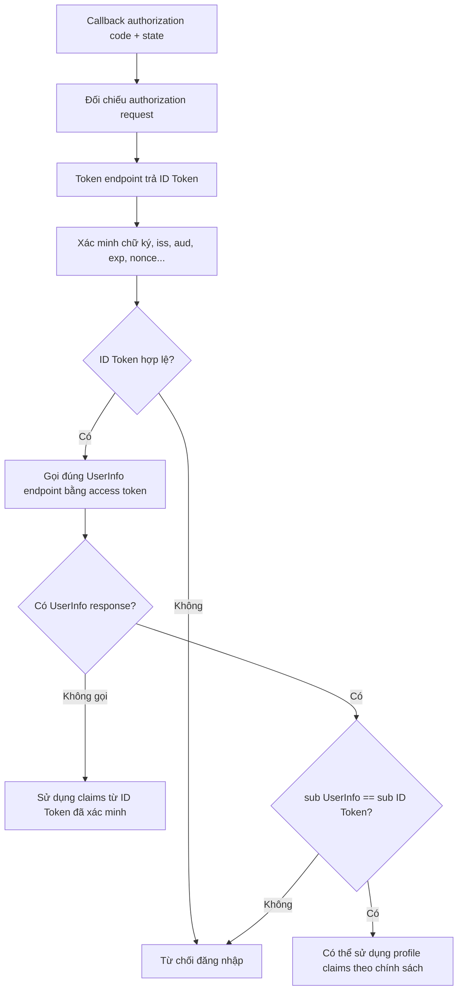

# 12.6. Đối chiếu sub giữa ID Token và UserInfo

Trong **Spring Security OAuth 2.0 / OIDC Client**, sau khi người dùng đăng nhập tại OpenID Provider (OP), ứng dụng có thể nhận **ID Token** rồi gọi **UserInfo Endpoint** để lấy thêm hồ sơ như tên hiển thị, email hoặc ảnh đại diện. Hai nguồn dữ liệu này cùng nói về người dùng, nhưng có thể đi qua các giao thức, endpoint và lớp xử lý khác nhau.

Điều kiện bảo mật bắt buộc là: **`sub` trong UserInfo Response phải khớp chính xác với `sub` trong ID Token của cùng giao dịch đăng nhập**. Nếu không khớp, client **không được sử dụng các claim từ UserInfo Response**. Quy tắc này được quy định trong OpenID Connect Core, phần *UserInfo Response Validation*.

Một lỗi tưởng như chỉ liên quan hồ sơ — chẳng hạn hai nguồn có `sub` khác nhau nhưng cùng `email` — thực chất có thể làm ứng dụng liên kết thông tin của **người dùng A** vào phiên đăng nhập của **người dùng B**. Vì vậy, đây là bước xác minh danh tính, không đơn thuần là một phép đối chiếu dữ liệu để hiển thị.

Bài học sẽ giải thích cơ sở giao thức, vị trí kiểm tra trong Spring Security, cách vận hành với nhiều provider, cách mở rộng an toàn và các tình huống phát hiện lỗi trong thực tế.

## 1. Phân biệt ID Token và UserInfo

OpenID Connect (OIDC) mở rộng OAuth 2.0 bằng một lớp xác thực danh tính. Trong Authorization Code Flow, ứng dụng thường nhận ID Token từ **token endpoint** sau khi đổi authorization code. Nếu cần thêm claim hồ sơ, ứng dụng có thể dùng **access token** để gọi **UserInfo Endpoint**.

| Đặc điểm | ID Token | UserInfo Response |
| --- | --- | --- |
| Vai trò | Khẳng định sự kiện xác thực của người dùng đối với client | Cung cấp claim hồ sơ về người dùng đã được cấp quyền |
| Nơi nhận thông thường | Token endpoint trong Authorization Code Flow | UserInfo endpoint của OP |
| Cách biểu diễn phổ biến | JWT có chữ ký theo cơ chế OIDC | JSON qua HTTPS; một số cấu hình dùng JWT ký/mã hóa |
| Thông tin cốt lõi | `iss`, `sub`, `aud`, `exp`, `iat`, và các claim theo yêu cầu | Bắt buộc có `sub`; có thể thêm `name`, `email`, `picture`, ... |
| Token nào dùng để gọi endpoint? | ID Token không dùng làm Bearer token gọi UserInfo | Access token được gửi tới UserInfo endpoint |
| Kiểm tra chính | Chữ ký/MAC, issuer, audience, thời gian và ràng buộc đăng nhập | `sub` phải bằng `sub` của ID Token; các bước kiểm tra giao thức khác tùy response mode |

**ID Token không phải access token.** Không gửi ID Token vào header `Authorization: Bearer ...` để gọi UserInfo hoặc API thông thường chỉ vì nó cũng là JWT.

Một ID Token minh họa:

```json
{
  "iss": "https://id.example.test/realms/company",
  "sub": "user-1428",
  "aud": "portal-client",
  "iat": 1794800000,
  "exp": 1794803600,
  "name": "Nguyen An"
}
```

UserInfo Response của cùng người dùng có thể là:

```json
{
  "sub": "user-1428",
  "name": "Nguyen An",
  "email": "an@example.test",
  "email_verified": true,
  "picture": "https://images.example.test/avatar/1428.png"
}
```

Hai tài liệu chứa cùng `sub = "user-1428"`. Các claim bổ sung có thể khác nhau về độ đầy đủ hoặc thời điểm cập nhật; **không bắt buộc `name` và `email` phải có ở cả hai nguồn**.

## 2. `sub` thực sự là gì?

`sub` viết tắt của **subject**: định danh chủ thể mà OP đưa vào claim của ID Token và UserInfo. Theo OIDC, nó là một chuỗi **phân biệt chữ hoa chữ thường** (*case-sensitive*) đại diện cho End-User trong phạm vi issuer phù hợp.

Các đặc điểm cần nhớ:

- **Không phải username:** `preferred_username` thường là tên đăng nhập/hiển thị, có thể đổi hoặc bị cấp lại theo chính sách.
- **Không phải email:** `email` có thể thay đổi, chưa được xác minh, hoặc được nhiều hệ thống ánh xạ khác nhau.
- **Không nhất thiết là database ID:** một OP có thể phát hành subject kiểu opaque, hashed, hoặc pairwise.
- **Không tự mang ý nghĩa toàn cục:** hai OP độc lập có thể cùng phát hành `sub="123"` cho hai người khác nhau.
- **Phải được xử lý nguyên vẹn:** không tự `trim()`, đổi chữ hoa/thường, chuẩn hóa Unicode hoặc chuyển sang số trước khi so sánh.

Trong một ứng dụng hỗ trợ nhiều issuer, khóa nhận diện liên kết danh tính thường là **cặp `(iss, sub)` từ ID Token đã được xác minh**, chứ không phải một chuỗi `sub` trần.

Ví dụ:

| Issuer đã xác minh | `sub` | Cách hiểu |
| --- | --- | --- |
| `https://id-a.example.test` | `123` | Người dùng theo OP A |
| `https://id-b.example.test` | `123` | Người dùng theo OP B, không tự xem là cùng người |
| `https://id-a.example.test` | `ABC` | Khác với `abc` trong cùng issuer |
| `https://id-a.example.test` | `abc` | Một subject khác `ABC` |

### 2.1. Public subject và pairwise subject

OIDC có thể sử dụng **public subject identifier** hoặc **pairwise subject identifier**. Với pairwise subject, OP có thể phát hành những giá trị `sub` khác nhau cho cùng người dùng theo *sector identifier* của client.

Ví dụ cùng một người đăng nhập hai ứng dụng:

```text
Client portal-a -> ID Token sub = p-0f4c8a
Client portal-b -> ID Token sub = p-d3a71e
```

Đây không tự động là lỗi; có thể là thiết kế pairwise của OP. **Điều vẫn bắt buộc** là trong *một giao dịch đăng nhập của một client*, UserInfo `sub` phải bằng `sub` của ID Token được phát hành cho giao dịch đó.

Nếu cùng issuer có hai `sub` khác nhau giữa hai client, không cố hợp nhất chúng bằng email hay tên hiển thị. Việc liên kết tài khoản phải dựa vào cơ chế đã được thiết kế, ủy quyền và xác minh riêng.

## 3. Quy tắc OIDC Core: so khớp chính xác

Quy tắc trong **OpenID Connect Core 1.0, mục 5.3.2 — UserInfo Response Validation** yêu cầu client xác minh rằng giá trị `sub` trong UserInfo Response **khớp chính xác** với giá trị `sub` trong ID Token; nếu không, **không dùng các giá trị UserInfo Response**.

Có thể biểu diễn kiểm tra cốt lõi như sau:

```text
expectedSub = validatedIdToken.sub
actualSub   = userInfoResponse.sub

if actualSub is missing OR actualSub != expectedSub:
    reject UserInfo response
    DO NOT use UserInfo claims
else:
    UserInfo belongs to the subject in this login transaction
```

Trong Java, với các chuỗi đã được parse đúng kiểu:

```java
boolean matches = idTokenSub != null
        && idTokenSub.equals(userInfoSub);
```

Phép so sánh dùng `String.equals` có tính phân biệt hoa/thường và không thực hiện chuẩn hóa giá trị.

### 3.1. “Exact match” nghĩa là gì?

| ID Token `sub` | UserInfo `sub` | Kết quả |
| --- | --- | --- |
| `user-1428` | `user-1428` | Khớp |
| `User-1428` | `user-1428` | Không khớp |
| `user-1428` | `user-1428 ` (có dấu cách cuối) | Không khớp |
| `0001428` | `1428` | Không khớp |
| `pairwise-4ac` | `public-1428` | Không khớp |
| `user-1428` | Không có `sub` | UserInfo không hợp lệ |
| `user-1428` | `null` | UserInfo không hợp lệ |

`sub` là định danh opaque. **Đừng dùng `equalsIgnoreCase`, `strip()` hoặc ép kiểu số** để “sửa” mismatch. Nếu dữ liệu thực tế khác nhau, cần tìm lỗi tại OP, token hay pipeline cấu hình.

### 3.2. Nếu không gọi UserInfo thì sao?

UserInfo là bước **có thể không xảy ra**. Một ứng dụng có thể chỉ cần ID Token đã được xác minh và không gọi UserInfo Endpoint, ví dụ vì:

- Không cấu hình UserInfo URI hoặc OP không cung cấp endpoint phù hợp.
- Logic của `OidcUserService` quyết định không cần lấy thêm claim.
- Scope/quyền không đòi hỏi hồ sơ bổ sung.
- Ứng dụng dùng riêng những claim đã được cấp trong ID Token.

Khi không có UserInfo Response, **không có hai giá trị `sub` để so sánh**. Ứng dụng vẫn phải xác minh ID Token đầy đủ; không nên tự tạo một UserInfo giả từ `name`/`email` rồi xem như đã hoàn thành bước đối chiếu.

### 3.3. Nếu có UserInfo nhưng thiếu `sub`?

Theo OIDC Core, **`sub` là claim bắt buộc trong UserInfo Response**. Một response chỉ chứa:

```json
{
  "email": "an@example.test",
  "name": "Nguyen An"
}
```

không phải UserInfo Response hợp lệ cho mục đích OIDC, ngay cả khi email và tên có vẻ trùng với ID Token. Client không được dùng các claim ấy làm hồ sơ đã được gắn với phiên đăng nhập OIDC.

## 4. Vì sao chỉ so khớp email hoặc username là nguy hiểm?

Giả sử người dùng A đã đăng nhập thành công và có ID Token:

```json
{
  "iss": "https://id.example.test/realms/company",
  "sub": "account-A",
  "aud": "portal-client",
  "email": "shared@example.test"
}
```

Nhưng ứng dụng vì lỗi tích hợp nhận UserInfo của B:

```json
{
  "sub": "account-B",
  "email": "shared@example.test",
  "name": "User B",
  "department": "finance"
}
```

Nếu ứng dụng chỉ so sánh `email` hoặc thấy tên hiển thị giống nhau rồi chấp nhận UserInfo, nó có thể:

1. Hiển thị hồ sơ của B trong phiên của A.
2. Gán thuộc tính hoặc vai trò nghiệp vụ của B cho A.
3. Tạo/sửa tài khoản nội bộ sai người.
4. Gửi thông tin, nhật ký hoặc yêu cầu thao tác vào hồ sơ không đúng.
5. Hợp nhất hai tài khoản vốn không được OP xác nhận là cùng người.

Đây là dạng **account mix-up / identity misbinding**: dữ liệu được cấp bởi các thành phần khác nhau bị nối vào sai danh tính.

Một người có thể có nhiều địa chỉ email, một email có thể đổi chủ, và hai hệ thống có thể dùng chính sách khác nhau. Kể cả `email_verified=true`, email **không thay thế** điều kiện `sub` giữa ID Token và UserInfo.

### 4.1. Cặp `(iss, sub)` là định danh ổn định hơn cho ứng dụng nhiều OP

Một bảng tài khoản nội bộ thường cần lưu liên kết danh tính theo cặp:

```text
identity_link
----------------------------------------------
provider_issuer                         subject
https://id.example.test/realms/company   account-A
https://login.partner.example.test       account-A
```

Hai hàng trên **không mặc nhiên** nói về cùng một người. Cùng `sub` nhưng issuer khác thì thuộc hai không gian danh tính khác nhau.

Sau khi ID Token được xác minh, UserInfo cùng giao dịch phải có `sub` bằng giá trị subject đã xác nhận. Không dùng UserInfo response để tự chọn issuer mới: trong UserInfo JSON thông thường, `iss` không phải claim định danh cốt lõi thay thế cho issuer của ID Token.

## 5. Vòng đời: lúc nào Spring Security nhận và đối chiếu `sub`?

Giả sử ứng dụng Spring Boot đã đăng ký OIDC client `company`:

```text
GET /oauth2/authorization/company
```

Trong Servlet flow:

1. `OAuth2AuthorizationRequestRedirectFilter` khởi động authorization request, sinh/lưu `state` và đưa browser sang OP.
2. Người dùng đăng nhập tại OP. OP chuyển browser về callback có `code` và `state`.
3. `OAuth2LoginAuthenticationFilter` khôi phục authorization request, xác nhận correlation.
4. Thành phần OIDC authentication đổi code lấy token và xác minh **ID Token**: chữ ký, issuer, audience, thời gian và các điều kiện liên quan.
5. **`OidcUserService`** có thể dùng access token để lấy UserInfo qua endpoint của OP.
6. Nếu UserInfo được nhận, Spring Security cần bảo đảm **UserInfo `sub` = ID Token `sub`**.
7. Chỉ sau khi các điều kiện cần thiết hợp lệ, hệ thống mới dựng `OidcUser` và hoàn tất Authentication.

```mermaid
sequenceDiagram
    autonumber
    actor User as Người dùng
    participant Browser as Trình duyệt
    participant Client as Spring Security Client
    participant OP as OpenID Provider
    participant UserInfo as UserInfo Endpoint

    Browser->>Client: Bắt đầu /oauth2/authorization/company
    Client-->>Browser: Redirect authorize (state, PKCE nếu dùng)
    Browser->>OP: Authorization request
    User->>OP: Đăng nhập / consent nếu cần
    OP-->>Browser: Redirect callback với code + state
    Browser->>Client: GET /login/oauth2/code/company?code=...&state=...
    Client->>Client: Khôi phục request gốc và kiểm tra state
    Client->>OP: POST token endpoint đổi code
    OP-->>Client: access_token + id_token
    Client->>Client: Xác minh ID Token, đọc sub_A
    Client->>UserInfo: GET UserInfo với Bearer access token
    UserInfo-->>Client: JSON có sub_B và profile claims
    Client->>Client: Kiểm tra sub_A == sub_B
    alt sub khớp
        Client->>Client: Kết hợp claims, tạo OidcUser/Authentication
        Client-->>Browser: Đăng nhập thành công
    else sub không khớp hoặc thiếu
        Client->>Client: Loại bỏ UserInfo; authentication thất bại theo luồng cấu hình
        Client-->>Browser: Trang lỗi đăng nhập phù hợp
    end
```

**Điểm tinh tế:** về mặt giao thức, client **không được sử dụng** các giá trị UserInfo khi `sub` mismatch. Cách thất bại cụ thể (ném exception, chuyển về login, log lỗi) là lựa chọn của thư viện và cấu hình ứng dụng; với `OidcUserService` mặc định, mismatch là lỗi xác thực UserInfo và không được coi như hồ sơ hợp lệ.

### 5.1. ID Token phải được xác minh trước

So sánh hai chuỗi `sub` tự nó không chứng minh hai response đáng tin cậy. Nếu cả hai giá trị xuất phát từ dữ liệu chưa được xác minh, attacker có thể tạo hai giá trị giống nhau.

Cần một chuỗi tin cậy hoàn chỉnh:



Nếu token được ký đúng nhưng `aud` thuộc client khác, hoặc `iss` không thuộc issuer dự kiến, phải từ chối ID Token. Không dùng việc UserInfo có cùng `sub` để “cứu” một ID Token không hợp lệ.

## 6. Các kiểu dữ liệu Spring Security có liên quan

Trong Spring Security OAuth2/OIDC Client:

| Kiểu/API | Vai trò |
| --- | --- |
| **`OidcIdToken`** | Biểu diễn ID Token đã được framework xử lý dưới dạng claim accessor |
| **`OidcUserInfo`** | Biểu diễn các claim nhận từ UserInfo Endpoint |
| **`OidcUser`** | Principal OIDC chứa ID Token và có thể có UserInfo |
| **`OidcUserRequest`** | Đầu vào của OIDC user service; chứa client registration, access token và ID Token |
| **`OidcUserService`** | Service phổ biến để tải và kết hợp thông tin principal OIDC |
| **`OAuth2UserService<OidcUserRequest, OidcUser>`** | Hợp đồng dịch vụ có thể cấu hình ở nhánh OIDC UserInfo của login |
| **`OAuth2LoginAuthenticationFilter`** | Xử lý callback và kết quả xác thực đăng nhập Servlet |

Có thể đọc các subject thông qua API:

```java
String fromIdToken = oidcUser.getIdToken().getSubject();

OidcUserInfo userInfo = oidcUser.getUserInfo();
String fromUserInfo = (userInfo == null)
    ? null
    : userInfo.getSubject();
```

Với`OidcUser` đã được tạo qua luồng mặc định sau xác minh, `getSubject()` là API thuận tiện để lấy chủ thể OIDC. Nhưng để hiểu chính xác phép so sánh giữa **hai nguồn**, nên truy cập trực tiếp `getIdToken().getSubject()` và `getUserInfo().getSubject()`.

### 6.1. `OidcUserService` mặc định

Spring Security có **`OidcUserService`** để dùng trong `oauth2Login()`. Nó dựa vào cấu hình provider/client và access token để lấy thông tin UserInfo khi việc truy xuất được kích hoạt, sau đó tạo `OidcUser`.

Trong đường xử lý mặc định, service kiểm tra **UserInfo subject phải tương ứng với ID Token subject**. Nếu không, luồng xử lý UserInfo không được coi là thành công. Đây là lý do ứng dụng thông thường **không cần tự viết controller hoặc decoder thủ công để kiểm tra `sub`**.

Việc UserInfo có được truy xuất hay không phụ thuộc vào cấu hình và điều kiện của OIDC client, ví dụ endpoint UserInfo do OP cung cấp, grant type, scope và cách dịch vụ được tùy biến. **Có `scope=openid` không đồng nghĩa chắc chắn một HTTP UserInfo request sẽ được gửi trong mọi lần login**.

### 6.2. Mismatch xảy ra trước khi dùng UserInfo claims

Nếu muốn lấy `name`/`email` từ UserInfo để tạo local account, **không được ghi dữ liệu ấy trước khi so khớp `sub`**. Đặc biệt, custom user service tự gọi UserInfo endpoint không nên:

```text
GET UserInfo -> đọc email -> UPDATE account
             -> sau đó mới so sánh sub
```

Thứ tự an toàn:

```text
GET UserInfo -> parse response
             -> kiểm tra sub có và khớp ID Token
             -> chỉ sau đó dùng claims để tạo/cập nhật profile
```

Nếu không tuân thủ thứ tự này, một lỗi đăng nhập được phát hiện ở cuối flow vẫn có thể để lại tác động phụ trong database.

## 7. Cấu hình Spring Boot và luồng UserInfo thông thường

Giả sử OP có OIDC discovery hợp lệ. Một cấu hình Servlet client đơn giản:

```yaml
spring:
  security:
    oauth2:
      client:
        registration:
          company:
            provider: company
            client-id: ${OIDC_CLIENT_ID}
            client-secret: ${OIDC_CLIENT_SECRET}
            authorization-grant-type: authorization_code
            redirect-uri: "{baseUrl}/login/oauth2/code/{registrationId}"
            scope:
              - openid
              - profile
              - email

        provider:
          company:
            issuer-uri: https://id.example.test/realms/company
```

`issuer-uri` cho phép Spring Security/Spring Boot lấy metadata của provider khi OP hỗ trợ discovery. Metadata có thể bao gồm authorization endpoint, token endpoint, JWKS URI và UserInfo endpoint.

Với nhà cung cấp không có discovery, cần cấu hình thông tin provider thủ công, ví dụ:

```yaml
spring:
  security:
    oauth2:
      client:
        provider:
          company:
            authorization-uri: https://id.example.test/oauth2/authorize
            token-uri: https://id.example.test/oauth2/token
            jwk-set-uri: https://id.example.test/oauth2/jwks
            user-info-uri: https://id.example.test/oauth2/userinfo
            user-name-attribute: sub
```

Ví dụ này chỉ cho thấy **các endpoint liên quan**. Với OIDC thực tế, cần đảm bảo metadata/issuer và các cấu hình xác minh token có sự tương thích; không được tự coi bất kỳ API trả JSON nào là UserInfo Endpoint đạt chuẩn.

### 7.1. Bật OIDC Login trong SecurityFilterChain

```java
import org.springframework.context.annotation.Bean;
import org.springframework.context.annotation.Configuration;
import org.springframework.security.config.Customizer;
import org.springframework.security.config.annotation.web.builders.HttpSecurity;
import org.springframework.security.web.SecurityFilterChain;

@Configuration
class SecurityConfig {

    @Bean
    SecurityFilterChain securityFilterChain(HttpSecurity http) throws Exception {
        return http
            .authorizeHttpRequests(auth -> auth
                .requestMatchers("/", "/error", "/public/**").permitAll()
                .anyRequest().authenticated())
            .oauth2Login(Customizer.withDefaults())
            .build();
    }
}
```

Với registration `company`, browser có thể bắt đầu:

```text
/oauth2/authorization/company
```

Sau callback thành công, Spring Security thiết lập Authentication cho principal OIDC. Nếu UserInfo được lấy, service phải bảo vệ ràng buộc `sub` trước khi sử dụng các claim.

### 7.2. Access token được dùng để gọi UserInfo

Một UserInfo request chuẩn thường có dạng:

```http
GET /oauth2/userinfo HTTP/1.1
Host: id.example.test
Authorization: Bearer ACCESS_TOKEN_VALUE
Accept: application/json
```

Đó là **access token phát hành trong giao dịch OAuth2/OIDC**, không phải ID Token hay mật khẩu người dùng. UserInfo Endpoint phải kiểm tra token và chính sách quyền truy cập thích hợp.

Nếu access token không được OP chấp nhận, ứng dụng có thể nhận lỗi HTTP/JSON từ UserInfo. **Đừng tự lấy dữ liệu hồ sơ từ một endpoint khác chỉ vì UserInfo trả 401**, và không dùng token của registration này để gọi nhầm UserInfo URI của registration khác.

## 8. Ví dụ kiểm tra subject bằng Java

Nếu phải viết một dịch vụ tùy biến dùng ID Token và UserInfo, phép kiểm tra cốt lõi nên rõ ràng và **thất bại khi có UserInfo sai**.

```java
import org.springframework.security.oauth2.core.OAuth2AuthenticationException;
import org.springframework.security.oauth2.core.OAuth2Error;
import org.springframework.security.oauth2.core.oidc.OidcIdToken;
import org.springframework.security.oauth2.core.oidc.OidcUserInfo;

final class UserInfoSubjectVerifier {

    private UserInfoSubjectVerifier() {
    }

    static void requireSameSubject(
            OidcIdToken verifiedIdToken,
            OidcUserInfo userInfo) {

        if (verifiedIdToken == null || userInfo == null) {
            throw new IllegalArgumentException(
                "Both validated ID Token and UserInfo are required");
        }

        String expected = verifiedIdToken.getSubject();
        String actual = userInfo.getSubject();

        if (expected == null || actual == null
                || !expected.equals(actual)) {
            throw new OAuth2AuthenticationException(
                new OAuth2Error(
                    "invalid_user_info_response",
                    "UserInfo subject does not match ID Token subject",
                    null));
        }
    }
}
```

Đây là helper minh họa **cho nhánh đã có UserInfo Response**. Nếu ứng dụng không gọi UserInfo, không gọi helper với `null` để giả lập một lỗi. Nếu đã nhận UserInfo, `sub` thiếu hoặc không khớp thì không được sử dụng các claim.

Điều kiện tiên quyết: tham số `verifiedIdToken` phải đến từ quy trình xác minh OIDC thích hợp, không phải JWT vừa Base64-decode từ request của client. Helper chỉ làm một việc: đảm bảo hai subject khớp; nó **không thay thế xác minh chữ ký, issuer, audience, nonce, state hoặc TLS**.

### 8.1. Vì sao dùng `expected.equals(actual)`?

Phép gọi này là **so sánh giá trị chuỗi chính xác** theo Java. Không sử dụng:

```java
// KHÔNG dùng để đối chiếu sub OIDC:
expected.equalsIgnoreCase(actual);

// KHÔNG dùng để "sửa" sub không khớp:
expected.trim().equals(actual.trim());

// KHÔNG dùng so sánh bằng email:
idTokenEmail.equalsIgnoreCase(userInfoEmail);
```

Nếu OP trả subject sai về chữ hoa/thường hoặc dấu cách, đó là lỗi dữ liệu cần xử lý tại nguồn, không phải trường hợp cho phép client tự nới lỏng xác thực.

### 8.2. Có cần so sánh constant-time không?

`sub` không phải secret dùng để xác minh MAC/password. Quy tắc ở đây là **exact string match** trên claim OIDC; `String.equals` phù hợp để diễn đạt logic. Những yêu cầu constant-time chuyên biệt thuộc kiểm tra bí mật/cryptographic primitive và không thay thế validation issuer, audience hay chữ ký.

## 9. Ví dụ kiểm tra trạng thái sau đăng nhập (chỉ để quan sát)

Trong một ứng dụng demo hoặc môi trường staging, có thể tạo endpoint trả về **trạng thái so khớp**, tránh lộ subject và claim nhạy cảm:

```java
import java.util.Map;

import org.springframework.security.core.annotation.AuthenticationPrincipal;
import org.springframework.security.oauth2.core.oidc.OidcUserInfo;
import org.springframework.security.oauth2.core.oidc.user.OidcUser;
import org.springframework.web.bind.annotation.GetMapping;
import org.springframework.web.bind.annotation.RestController;

@RestController
class OidcDiagnosticsController {

    @GetMapping("/diagnostics/oidc-userinfo")
    Map<String, Object> userInfoStatus(
            @AuthenticationPrincipal OidcUser principal) {

        OidcUserInfo info = principal.getUserInfo();
        if (info == null) {
            return Map.of(
                "userInfoPresent", false,
                "subjectMatch", "not_applicable");
        }

        boolean matches = principal.getIdToken().getSubject()
                .equals(info.getSubject());

        return Map.of(
            "userInfoPresent", true,
            "subjectMatch", matches);
    }
}
```

Khi dùng `OidcUserService` mặc định, một principal đã hoàn tất login thường không có UserInfo sai subject. Nếu custom service đã tạo principal trước khi kiểm tra, endpoint trên có thể giúp bạn **phát hiện vấn đề**, nhưng không được coi đây là nơi thực thi chính sách an ninh: việc từ chối phải xảy ra **trước khi principal được xác thực và claims được dùng**.

Endpoint chẩn đoán không nên được công khai trên production; nếu giữ lại, chỉ cho phép người có quyền truy cập và tránh trả ID Token, access token hay claim cá nhân.

## 10. Tùy chỉnh OidcUserService mà vẫn giữ đối chiếu sub

Một trường hợp phổ biến là bổ sung mapping từ OIDC claims sang authority nội bộ hoặc cấu trúc `OidcUser` tùy chỉnh.

**Hướng an toàn nhất trong đa số ứng dụng:** dùng `OidcUserService` chuẩn làm delegate để nó thực hiện tải UserInfo và các validation cần thiết, sau đó mới xử lý kết quả đã được xác minh.

Ví dụ:

```java
import org.springframework.context.annotation.Bean;
import org.springframework.context.annotation.Configuration;
import org.springframework.security.oauth2.client.oidc.userinfo.OidcUserRequest;
import org.springframework.security.oauth2.client.oidc.userinfo.OidcUserService;
import org.springframework.security.oauth2.client.userinfo.OAuth2UserService;
import org.springframework.security.oauth2.core.oidc.user.OidcUser;

@Configuration
class CustomOidcUserServiceConfig {

    @Bean
    OAuth2UserService<OidcUserRequest, OidcUser> checkedOidcUserService() {
        OidcUserService delegate = new OidcUserService();

        return request -> {
            // Delegate tải UserInfo khi cần và xử lý quy tắc OIDC.
            OidcUser user = delegate.loadUser(request);

            // Có thể bổ sung chính sách sau khi dữ liệu đã được xác minh.
            // Không tự dùng raw UserInfo JSON trước bước này.
            return user;
        };
    }
}
```

Đăng ký vào OAuth2 Login DSL:

```java
import org.springframework.context.annotation.Bean;
import org.springframework.context.annotation.Configuration;
import org.springframework.security.config.annotation.web.builders.HttpSecurity;
import org.springframework.security.oauth2.client.oidc.userinfo.OidcUserRequest;
import org.springframework.security.oauth2.client.userinfo.OAuth2UserService;
import org.springframework.security.oauth2.core.oidc.user.OidcUser;
import org.springframework.security.web.SecurityFilterChain;

@Configuration
class LoginConfiguration {

    @Bean
    SecurityFilterChain chain(
            HttpSecurity http,
            OAuth2UserService<OidcUserRequest, OidcUser> checkedOidcUserService)
            throws Exception {

        return http
            .authorizeHttpRequests(auth -> auth
                .requestMatchers("/", "/error").permitAll()
                .anyRequest().authenticated())
            .oauth2Login(login -> login
                .userInfoEndpoint(userInfo ->
                    userInfo.oidcUserService(checkedOidcUserService)))
            .build();
    }
}
```

Hai đoạn config trên diễn giải cách tổ chức bean và filter chain; gộp vào cấu hình dự án theo quy ước của bạn. **Không cần viết wrapper chỉ để lặp lại một bước mà `OidcUserService` đã có sẵn**. Wrapper có ích khi ứng dụng muốn bổ sung ánh xạ role, audit metadata đã kiểm soát, hoặc chính sách dữ liệu sau khi service trả về `OidcUser` hợp lệ.

### 10.1. Khi tự thay cơ chế gọi UserInfo

Nếu một yêu cầu tích hợp bắt buộc bạn dùng `OAuth2UserService<OAuth2UserRequest, OAuth2User>` tùy biến để truy xuất UserInfo, cần lưu ý:

- Phải gọi endpoint theo **ClientRegistration** của giao dịch và Bearer access token phù hợp.
- Không dùng endpoint do raw JWT claim hoặc query callback chỉ định.
- Kiểm tra status HTTP, content type, cấu trúc JSON/JWT và điều kiện TLS phù hợp.
- Sau khi parse response, kiểm tra **`sub` có mặt và bằng ID Token `sub`** trước khi tạo/cập nhật local profile.
- Nếu trả về UserInfo không hợp lệ, ném authentication exception và dừng xử lý thay vì trả `OidcUser` với claim trộn sai.
- Không bỏ validation chuẩn của OIDC khi thay hẳn `OidcUserService`.

### 10.2. Có nên bỏ qua UserInfo khi mismatch để đăng nhập bằng ID Token?

OIDC Core yêu cầu **không sử dụng dữ liệu UserInfo mismatch**. Ứng dụng tùy chính sách có thể quyết định thất bại login hoặc chỉ dựa vào ID Token đã xác minh nếu UserInfo là tùy chọn; tuy nhiên **phải bảo đảm không dùng bất kỳ claim nào từ UserInfo sai**.

Trong các ứng dụng dùng `OidcUserService` mặc định, sai subject thường dẫn đến authentication failure, giúp phát hiện sự cố thay vì im lặng che giấu. Không nên tự “catch exception rồi dùng UserInfo một phần” vì có thể đưa dữ liệu của người khác vào hệ thống.

## 11. Multi-provider: `sub` phải khớp trong đúng issuer

Một Spring Boot app có nhiều registration:

```yaml
spring:
  security:
    oauth2:
      client:
        registration:
          company:
            provider: company
            client-id: ${COMPANY_CLIENT_ID}
            client-secret: ${COMPANY_CLIENT_SECRET}
            authorization-grant-type: authorization_code
            scope: openid, profile

          partner:
            provider: partner
            client-id: ${PARTNER_CLIENT_ID}
            client-secret: ${PARTNER_CLIENT_SECRET}
            authorization-grant-type: authorization_code
            scope: openid, email

        provider:
          company:
            issuer-uri: https://id.example.test/realms/company
          partner:
            issuer-uri: https://login.partner.example.test/tenant
```

Mỗi registration có thể tạo login ở:

```text
/oauth2/authorization/company
/oauth2/authorization/partner
```

Trong từng giao dịch, Spring Security biết registration đã chọn từ authorization request và callback hợp lệ. ID Token phải được xác minh theo issuer và client ID tương ứng; UserInfo phải được lấy từ endpoint của **provider đó**.

### 11.1. Vì sao không chọn endpoint UserInfo dựa vào email/domain?

Giả sử ứng dụng có logic:

```text
Nếu email kết thúc bằng @partner.example.test
    -> gọi UserInfo của Partner OP
Ngược lại
    -> gọi UserInfo của Company OP
```

Đó là lỗi thiết kế. Email có thể không thuộc namespace của provider xác thực, và UserInfo endpoint chỉ có thể chấp nhận access token theo chính sách của OP tương ứng.

**Nguồn chính xác để chọn UserInfo endpoint là registration/provider của login transaction**, không phải email, `preferred_username` hoặc dữ liệu chưa được xác minh trong browser.

### 11.2. Vì sao không nối UserInfo theo cache keyed bằng email?

Một service cache UserInfo có key:

```text
cache["an@example.test"] = profileFromCompany
```

Sau đó login từ Partner có cùng email, client có thể đọc nhầm profile từ Company. Nếu profile ấy có `sub` khác, phép so sánh sẽ phát hiện mismatch.

Cache an toàn hơn cần chứa ngữ cảnh rõ ràng:

```text
cache key = (trusted issuer, subject, client/registration context nếu cần)
```

Bên cạnh việc chọn key, phải có kiểm soát TTL, quyền truy cập và lưu trữ dữ liệu cá nhân. Khi cache UserInfo, không được dùng bản ghi cũ của tài khoản khác để bù vào response đang thất bại mà chưa xác minh chủ thể.

### 11.3. Pairwise subject khi hai client dùng cùng OP

Một UserInfo response trả `public-sub` trong khi ID Token của một client được cấu hình pairwise trả `pairwise-sub` là **mismatch** đối với giao dịch hiện tại.

Đừng tự suy luận đây là cùng người vì cả hai dẫn tới cùng `email`. Cần kiểm tra chính sách subject của OP, Client Registration và UserInfo service. OP phải bảo đảm UserInfo tương ứng với ID Token của cùng client/grant.

## 12. Phân biệt `sub` của ID Token với `sub` trong access token

Một access token có thể là JWT và cũng có claim tên `sub`. Điều này dễ gây nhầm lẫn:

- **ID Token `sub`**: End-User mà OIDC client xác thực với OP.
- **UserInfo `sub`**: End-User mà UserInfo claims mô tả; phải khớp ID Token của giao dịch.
- **Access token `sub`** (nếu token là JWT): được định nghĩa theo định dạng token và API cụ thể; có thể mô tả user hoặc client tùy grant và authorization server.

**Không lấy `sub` của access token làm giá trị chuẩn để so khớp UserInfo thay cho ID Token**. Với OIDC, quy tắc chuẩn là UserInfo `sub` bằng ID Token `sub`.

Đặc biệt, với `client_credentials`, access token có thể mang danh tính ứng dụng và không có ID Token OIDC về End-User. Không sử dụng một access token kiểu machine-to-machine để tạo `OidcUser`.

## 13. UserInfo Response dạng signed/encrypted JWT

UserInfo thường trả JSON qua HTTPS. Tuy nhiên OIDC cũng có chế độ trả **signed/encrypted UserInfo Response** theo cấu hình client/OP.

Trong tình huống này:

1. Client phải xác minh chữ ký và/hoặc giải mã phản hồi theo cơ chế đã thỏa thuận.
2. Áp dụng các kiểm tra bắt buộc cho JWT/UserInfo Response phù hợp với chế độ truyền.
3. Sau đó **vẫn đối chiếu `sub` UserInfo với `sub` ID Token**.

Việc UserInfo Response là JWT được ký đúng **không thay thế phép so sánh subject**. Một JWT từ đúng OP vẫn có thể mô tả người dùng không phải chủ thể đã đăng nhập trong giao dịch hiện tại.

### Bảng ràng buộc

| Kiểm tra | Mục đích |
| --- | --- |
| TLS/endpoint đúng provider | Bảo vệ kênh giao tiếp và đúng nơi cung cấp UserInfo |
| Access token phù hợp | Cho phép client truy vấn UserInfo của người dùng được cấp quyền |
| Chữ ký/mã hóa UserInfo JWT nếu áp dụng | Xác minh hình thức bảo vệ response theo cấu hình |
| `sub` bắt buộc trong UserInfo | Xác định subject mà dữ liệu hồ sơ nói tới |
| So sánh chính xác với ID Token `sub` | Liên kết hồ sơ với người đã được xác thực trong giao dịch login |

Không nên bỏ bước cuối chỉ vì những kiểm tra trên đã thành công.

## 14. Những lỗi thường gặp và cách chẩn đoán

| Hiện tượng | Nguyên nhân có thể | Điểm cần kiểm tra |
| --- | --- | --- |
| ID Token hợp lệ nhưng UserInfo bị từ chối | `sub` khác hoặc thiếu | So sánh subject hai nguồn trong môi trường kiểm soát, không ghi giá trị thực vào log |
| ID Token `sub=A`, UserInfo `sub=B` | Gọi UserInfo với access token của user khác; cache nhầm; OP lỗi | Token được cấp trong giao dịch nào, cache key, endpoint, session |
| Email giống nhau nhưng login bị từ chối | Subject khác; có thể là hai tài khoản khác nhau hoặc pairwise subject | Không sửa bằng email; kiểm tra chính sách subject OP |
| Lúc đúng lúc sai trong ứng dụng multi-tenant | Dùng sai registration hoặc endpoint UserInfo | Issuer, client ID, registration ID, cấu hình tenant |
| Mismatch chỉ xuất hiện sau refresh/relogin | Đã dùng lại access token/profile cũ từ phiên khác | Vòng đời token, cache, correlation session |
| UserInfo trả HTTP 401 | Access token không hợp lệ với UserInfo endpoint | Audience/quyền, expiry, đúng endpoint và OP |
| UserInfo trả HTTP 403 | Token hợp lệ nhưng thiếu quyền theo chính sách | Scope và API policy của UserInfo |
| UserInfo JSON không có `sub` | Provider không tuân thủ OIDC hoặc endpoint không đúng | Metadata `userinfo_endpoint` và response thực tế |
| Dùng `sub` trùng mà vẫn login lỗi | ID Token chưa vượt qua issuer/audience/nonce/expiry hoặc lỗi khác | Kiểm tra bước xác minh ID Token, callback và authentication |
| Thay custom user service xong mới có mismatch | Custom service bỏ kiểm tra hoặc gọi UserInfo sai | Delegate, endpoint selection, validation trước khi merge claims |
| Không thấy UserInfo call | Không thỏa điều kiện truy xuất hoặc không cấu hình endpoint | Scope, provider metadata, logic `OidcUserService` |
| Login thành công nhưng hồ sơ sai sau khi lấy từ database | Logic account linking/cache ngoài Spring Security | Khóa `(iss, sub)`, mapping và truy vấn local account |

### 14.1. Tình huống: dùng nhầm access token sau khi đổi tài khoản

Người dùng đăng nhập tài khoản A, rồi logout và đăng nhập B. Một integration tùy biến giữ lại access token A trong biến cache toàn cục. ID Token B có:

```text
sub = B
```

nhưng UserInfo request dùng token A và trả:

```text
sub = A
```

**Kết quả đúng:** từ chối sử dụng UserInfo của A cho phiên B. **Nguyên nhân cần sửa:** cache token sai phạm vi principal/session, không phải phép kiểm tra sub quá nghiêm ngặt.

### 14.2. Tình huống: cấu hình sai UserInfo endpoint

OP phát hành ID Token từ issuer `https://id.company.example.test`, nhưng client lại đặt `user-info-uri` ở một môi trường staging khác, nơi access token có thể được xử lý đặc thù hoặc trả profile không tương ứng.

**Kết quả đúng:** không dùng UserInfo có `sub` sai. **Cách điều tra:** đối chiếu issuer và UserInfo URI từ metadata đã tin cậy, client registration đang dùng, và môi trường deployment.

### 14.3. Tình huống: cache UserInfo theo email

Hai tài khoản của cùng OP có email từng trùng nhau qua quá trình nhập liệu. Cache cũ lấy ra UserInfo của tài khoản thứ nhất cho người dùng thứ hai.

**Kết quả đúng:** `sub` mismatch phải chặn dữ liệu sai. **Cách sửa:** dùng cache key theo chủ thể và issuer đã xác minh, tránh email/username làm khóa danh tính OIDC duy nhất.

### 14.4. Tình huống: OP dùng pairwise subject

Ứng dụng A có ID Token `sub=p-100`, UserInfo lại trả `sub=public-100`. Dù quản trị viên OP xác nhận hai giá trị cùng trỏ tới một người trong database, **UserInfo Response vẫn không khớp ID Token của giao dịch**. Cần sửa cấu hình OP để phát hành subject nhất quán trong hai response.

## 15. Tác động khi mismatch: từ chối claims trước khi ghi dữ liệu

Một điểm thường bị bỏ sót là **tác động phụ**. Giả sử custom login service làm:

```text
1. Gọi UserInfo
2. Đọc email, tên, department
3. UPDATE users SET department = ...
4. So sánh UserInfo.sub với IDToken.sub
5. Phát hiện mismatch
```

Dù login bị từ chối ở bước 5, dữ liệu đã được ghi sai ở bước 3. Do đó, tổ chức code theo nguyên tắc:

```text
Authenticate authorization response
        |
        v
Validate ID Token
        |
        v
Call UserInfo (nếu cần)
        |
        v
Validate UserInfo sub == ID Token sub
        |
        v
Create OidcUser / apply trusted profile mapping
        |
        v
Update local account / authorities / business state
```

**Không sử dụng một phần claim của UserInfo bị mismatch** để quyết định phân quyền, xác định tenant, tạo account hoặc ghi audit với danh tính đã xác thực.

Nếu profile cần bổ sung quyền nội bộ, hãy tra cứu bằng danh tính tin cậy `(iss, sub)` và nguồn quyền đã được hệ thống kiểm soát. Claim như `department` hay `groups` không tự động là authority đủ để truy cập tài nguyên nhạy cảm nếu chưa được chính sách xác thực và ánh xạ rõ ràng.

## 16. Quan sát và logging an toàn

Khi triển khai kiểm tra subject, có thể tạo log sự kiện **không chứa giá trị định danh thô**:

```json
{
  "event": "oidc_userinfo_subject_validation",
  "registration_id": "company",
  "result": "mismatch",
  "stage": "userinfo",
  "environment": "staging",
  "trace_id": "internal-request-trace"
}
```

Đây là **schema log gợi ý**, không phải output tự động của Spring Security. Trường `registration_id` phải lấy từ registration đã được ứng dụng cấu hình, không lấy một giá trị tùy ý từ callback query.

Không ghi:

- Giá trị nguyên `sub` của user vào log rộng nếu không có nhu cầu và cơ chế bảo vệ dữ liệu phù hợp.
- ID Token, access token, refresh token, client secret, code hoặc `state`.
- Nguyên UserInfo JSON chứa email, phone, address, picture và các claim nhạy cảm.
- Header `Authorization` hoặc toàn bộ body token endpoint.
- URI không tin cậy do client/browser cung cấp.

Muốn tìm nguyên nhân, có thể ghi metadata đã giới hạn: provider/registration ID, loại lỗi, endpoint logic (không gồm token), HTTP status và trace ID. Trong môi trường kiểm soát, đối chiếu subject chỉ bởi người có quyền, sau khi che dữ liệu và tuân thủ chính sách dữ liệu.

### 16.1. Khi cần quan sát Spring Security

Có thể tạm bật DEBUG tại nhóm package liên quan:

```yaml
logging:
  level:
    org.springframework.security.oauth2.client: DEBUG
    org.springframework.security.oauth2.core.oidc: DEBUG
```

Mức log và nội dung thực tế phụ thuộc phiên bản. Cần kiểm tra interceptor/log format không ghi raw response, token hay thông tin cá nhân. Tắt logging chi tiết khi đã tìm ra nguyên nhân, đặc biệt trong production.

## 17. Đối chiếu sub trong những tình huống phức tạp

### 17.1. Người dùng có nhiều tài khoản ở cùng một OP

Một người có tài khoản cá nhân và tài khoản công việc trong cùng OP:

```text
Personal account: sub = user-personal-8
Work account:     sub = user-work-8
```

Dù họ có cùng tên hoặc email chuyển tiếp, đây là **hai subject khác nhau**. Việc đăng nhập bằng tài khoản công việc phải dùng UserInfo của `user-work-8`, không được lấy hồ sơ cá nhân để làm giàu phiên làm việc.

### 17.2. Người dùng đăng nhập song song ở nhiều tab

Một tab bắt đầu login tài khoản A, tab khác bắt đầu login tài khoản B. Nếu ứng dụng có custom repository/cache chỉ lưu một authorization request toàn cục, dữ liệu có thể bị chồng chéo.

Spring Security dùng correlation để gắn callback với yêu cầu ban đầu; nhưng nếu code tùy biến không cô lập theo session/state/principal, nguy cơ nhầm UserInfo hoặc token sẽ tăng. Việc `sub` mismatch là một tín hiệu phát hiện cuối cùng quan trọng, không thể thay thế việc sửa state management.

### 17.3. Người dùng liên kết hai provider

Ứng dụng cho phép người dùng liên kết Company SSO và Partner SSO vào cùng một local account. Điều này có thể là nghiệp vụ hợp lệ, nhưng **không có nghĩa hai UserInfo `sub` phải bằng nhau** giữa hai provider.

Mỗi giao dịch phải được xác minh độc lập:

```text
Company login:
  ID Token (iss=Company, sub=A)
  UserInfo (sub=A)  -> hợp lệ

Partner login:
  ID Token (iss=Partner, sub=B)
  UserInfo (sub=B)  -> hợp lệ
```

Việc cả hai gắn vào một local account phải dựa vào **quy trình account linking được người dùng xác thực/ủy quyền**, không suy diễn từ `A`, `B` hoặc email.

### 17.4. OIDC Front-Channel Logout hoặc session thay đổi

Trong một số hệ thống, session đăng nhập tại OP hoặc ứng dụng có thể thay đổi trong lúc user đang gọi API/UserInfo. Nếu custom code dùng token/session sai phiên, UserInfo có thể trả thông tin không tương ứng.

Không giả định “request gửi đi sau login nên chắc chắn thuộc cùng user”. Mỗi lời gọi cần sử dụng đúng authorized client/principal và token đã được cấp; việc so khớp subject giúp phát hiện sai lệch.

### 17.5. UserInfo không được trả vì scope

`openid` kích hoạt yêu cầu OIDC, còn `profile`, `email` và các scope khác liên quan đến nhóm claim được phép cung cấp. Tùy cấu hình OP và Spring Security, chỉ một tập hợp claim có thể được trả trong ID Token hoặc qua UserInfo. Việc không có UserInfo **không đồng nghĩa xảy ra mismatch**; điều kiện bắt buộc chỉ áp dụng khi **có UserInfo Response**.

## 18. Checklist tư duy khi xuất hiện lỗi `sub`

Để tìm nguyên nhân một cách có trật tự, hãy tự hỏi:

1. **ID Token đã được xác minh chưa?** Chữ ký, issuer, audience, expiration, nonce và các ràng buộc liên quan có hợp lệ?
2. **Ứng dụng đang xử lý đúng registration không?** `registrationId` và `client-id` có thuộc đúng OP/tenant không?
3. **UserInfo được gọi tới đúng endpoint không?** URI đến từ metadata/cấu hình tin cậy, không phải từ input tùy ý.
4. **Bearer access token có thuộc cùng giao dịch và principal không?** Không dùng token cũ hoặc token từ user khác.
5. **UserInfo có trả `sub` không?** Nếu không, đó là phản hồi không hợp lệ theo OIDC.
6. **Giá trị `sub` có khớp chính xác không?** Không sửa chuỗi bằng trim, lowercase hay map theo email.
7. **Có custom user service, HTTP client hoặc cache ở giữa không?** Xem liệu có trộn response giữa account, issuer hoặc session.
8. **Dữ liệu UserInfo có được dùng trước bước validation không?** Kiểm tra tác động phụ vào database, authority và local profile.
9. **Có issuer khác nhau hoặc pairwise subject không?** Xác nhận chính sách subject của OP theo client/sector.
10. **Sau khi sửa cấu hình, có thể tái hiện bằng giao dịch mới không?** Không cố tái sử dụng authorization code/ID Token cũ để che vấn đề.

Đây là cách **phân tích giao thức và hệ thống**, không phải lý do để nới lỏng chính sách validation.

## 19. Bài thực hành tình huống

### Tình huống A — Khớp subject, claim profile khác nhau

ID Token:

```json
{"iss":"https://id.example.test","sub":"user-10","aud":"portal-client","name":"Anh Nguyen"}
```

UserInfo:

```json
{"sub":"user-10","name":"Nguyen Van Anh","email":"anh@example.test"}
```

**Hỏi:** Có mismatch không?

> **Không**, vì `sub` khớp chính xác. Tên có thể khác do nguồn và thời điểm cập nhật. Ứng dụng vẫn cần chính sách chọn claim nào được dùng khi kết hợp dữ liệu.

### Tình huống B — Email giống, subject khác

ID Token:

```json
{"sub":"user-10","email":"shared@example.test"}
```

UserInfo:

```json
{"sub":"user-11","email":"shared@example.test"}
```

**Hỏi:** Có được coi là cùng người không?

> **Không**. UserInfo `sub` khác ID Token `sub`, nên các claim UserInfo không được sử dụng cho giao dịch đăng nhập này. Email giống không phải cơ sở ngoại lệ.

### Tình huống C — Cùng giá trị `sub`, khác issuer

Company ID Token: `iss=https://id.company.example.test`, `sub=123`. Partner ID Token: `iss=https://id.partner.example.test`, `sub=123`.

**Hỏi:** Có thể dùng `sub` trần làm khóa user trên toàn ứng dụng không?

> **Không**. `sub` có phạm vi issuer. Nên quản lý liên kết định danh bằng `(iss, sub)` từ ID Token đã xác minh, và dùng quy trình account linking riêng nếu muốn kết nối hai provider.

### Tình huống D — UserInfo Response không có sub

```json
{"name":"Nguyen An","email":"an@example.test","email_verified":true}
```

**Hỏi:** Có thể tự lấy `sub` từ ID Token rồi bổ sung vào UserInfo Response không?

> **Không**. Điều đó che giấu phản hồi sai chuẩn và biến một nguồn dữ liệu chưa được liên kết thành dữ liệu có vẻ hợp lệ. Phải xem đây là UserInfo Response không hợp lệ và điều tra OP/endpoint. Nếu ứng dụng không cần UserInfo, có thể thiết kế chỉ dựa vào ID Token đã xác minh mà không dùng response này.

### Tình huống E — ID Token JWT và UserInfo đều có chữ ký đúng

Hai nguồn đều được xác minh về mặt mật mã, nhưng ID Token có `sub=A` và UserInfo có `sub=B`.

**Hỏi:** Có được dùng UserInfo vì chữ ký đúng không?

> **Không**. Mỗi chữ ký chứng minh tính toàn vẹn/xuất xứ của thông điệp tương ứng, còn quy tắc OIDC buộc **hai thông điệp phải nói về cùng subject** trong giao dịch. Signature validation không thay thế subject matching.

### Tình huống F — Custom OidcUserService cập nhật account trước khi kiểm tra

UserInfo lấy được email và department; service cập nhật database ngay, rồi mới phát hiện subject mismatch.

**Hỏi:** Phần nào cần sửa?

> Thay thứ tự xử lý. Phải xác minh ID Token, nhận UserInfo, kiểm tra sub match **trước khi** áp dụng profile, quyền hoặc cập nhật database. Nếu đã có ghi nhầm, cần xử lý dữ liệu sai theo quy trình nghiệp vụ.

### Tình huống G — Không có UserInfo call

OIDC Login thành công, `OidcUser.getUserInfo()` trả `null`, nhưng ID Token đã được xác minh đầy đủ.

**Hỏi:** Có nên coi đây là mismatch?

> **Không**. Không có UserInfo Response để so sánh. Kiểm tra điều kiện truy xuất UserInfo nếu ứng dụng thực sự cần thêm claim, và chỉ dùng các claim ID Token đã được xác minh theo chính sách.

### Tình huống H — UserInfo trả `Sub` thay vì `sub`

Provider trả:

```json
{"Sub":"user-10","email":"an@example.test"}
```

**Hỏi:** Có nên tự map `Sub` thành `sub` trên client?

> Theo OIDC, tên claim là `sub`. Đây là response không đúng chuẩn và không nên âm thầm chấp nhận với tên claim khác. Cần sửa nhà cung cấp hoặc có một cơ chế adapter được đánh giá nghiêm ngặt; không bỏ yêu cầu xác minh subject.

## 20. Ghi nhớ trọng tâm

```text
Client bắt đầu OIDC Authorization Code Flow
    |
    v
Token endpoint -> ID Token đã xác minh
    |
    | ID Token:
    |    iss = trusted issuer
    |    sub = A
    |    aud = expected client_id
    v
UserInfo endpoint <- Bearer access token
    |
    | UserInfo:
    |    sub = B
    |    profile claims...
    v
Kiểm tra: A == B (exact, case-sensitive)
    |
    +-- KHỚP ------> Có thể sử dụng UserInfo claims
    |
    +-- KHÔNG KHỚP -> KHÔNG sử dụng UserInfo claims
                      Xử lý authentication failure theo chính sách
```

- **`sub` của UserInfo phải khớp chính xác `sub` của ID Token** trong cùng giao dịch; UserInfo thiếu `sub` cũng không hợp lệ.
- **`OidcUserService` mặc định của Spring Security** cung cấp cơ chế tải UserInfo và đối chiếu subject trong luồng OIDC Login. Nếu tự viết user service, phải duy trì ràng buộc này.
- **Đối chiếu subject diễn ra sau khi ID Token đã được xác minh và trước khi sử dụng UserInfo claims**. Không gán quyền, cập nhật hồ sơ hoặc liên kết local account bằng response chưa được kiểm tra.
- **Email, username và tên hiển thị không thay thế subject**. Khi có nhiều OP, định danh người dùng phải xét cặp `(iss, sub)`.
- **Không tự sửa mismatch bằng trim/lowercase, đổi endpoint hoặc thử token khác ngẫu nhiên**. Mismatch là dấu hiệu cần điều tra issuer, registration, access token, UserInfo endpoint, session và cache.

### Tài liệu tham khảo

- [OpenID Connect Core 1.0 — 5.3.2 UserInfo Response Validation](https://openid.net/specs/openid-connect-core-1_0.html#UserInfoResponseValidation)
- [OpenID Connect Core 1.0 — 2. ID Token](https://openid.net/specs/openid-connect-core-1_0.html#IDToken)
- [OpenID Connect Core 1.0 — 8. Subject Identifier Types](https://openid.net/specs/openid-connect-core-1_0.html#SubjectIDTypes)
- [Spring Security API — OidcUserService](https://docs.spring.io/spring-security/reference/api/java/org/springframework/security/oauth2/client/oidc/userinfo/OidcUserService.html)
- [Spring Security — OAuth 2.0 Login Advanced Configuration](https://docs.spring.io/spring-security/reference/servlet/oauth2/login/advanced.html)
