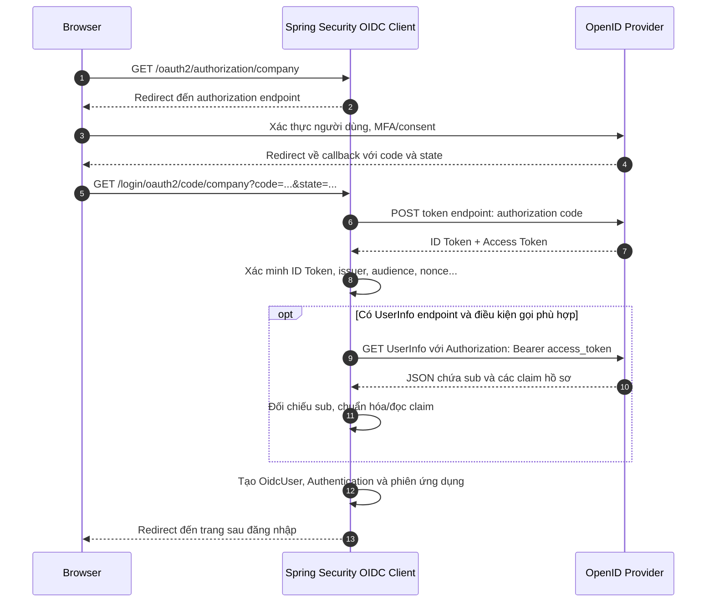
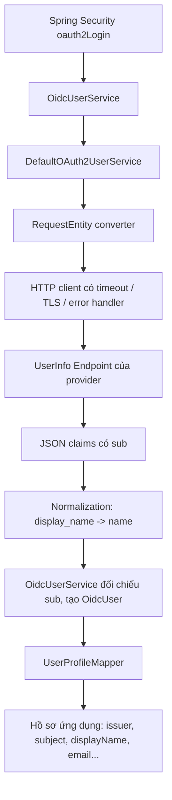

# 12.7. Tùy chỉnh request, HTTP client và ánh xạ response UserInfo

Trong **Spring Security OAuth 2.0 / OpenID Connect (OIDC) Client**, sau khi người dùng đăng nhập bằng Authorization Code Flow, ứng dụng thường đã có **ID Token** chứa danh tính cơ bản của người dùng. Nếu OpenID Provider (OP) hỗ trợ **UserInfo Endpoint**, ứng dụng còn có thể dùng **Access Token** để gọi một endpoint riêng và nhận thêm các claim hồ sơ như tên, email, ảnh đại diện hoặc thông tin mà provider cho phép.

Với provider tuân thủ OIDC, Spring Security có thể xử lý phần lớn quá trình đó thông qua `OidcUserService` và các thành phần HTTP liên quan. Nhưng ứng dụng thực tế đôi khi cần:

- Thêm HTTP header mà provider yêu cầu, hoặc thay đổi cách tạo UserInfo request trong giới hạn giao thức.
- Cấu hình **timeout, TLS, proxy, connection pool, error handling** và quan sát lỗi của HTTP client.
- Chuẩn hóa cách biểu diễn response JSON, chẳng hạn chuyển claim mở rộng `display_name` thành tên hiển thị nội bộ.
- Ánh xạ một tập claim từ ID Token/UserInfo sang **hồ sơ ứng dụng** mà không biến dữ liệu provider thành quyền truy cập không được kiểm soát.
- Phân biệt lỗi UserInfo với lỗi xác minh ID Token, token endpoint hoặc phiên đăng nhập.

Điểm quan trọng nhất: **UserInfo không thay thế ID Token và không phải nguồn tự động cấp quyền nghiệp vụ**. Việc gọi UserInfo chỉ được thực hiện trong ngữ cảnh OIDC Client đã xác thực hợp lệ; kết quả trả về phải liên kết đúng `sub` của ID Token, và dữ liệu hồ sơ cần được xử lý theo độ tin cậy của từng claim.

Bài học này đi từ giao thức tới các extension point trong **Spring Security Servlet**, kèm ví dụ mã Java và các tình huống tích hợp provider thực tế.

## 1. UserInfo Endpoint nằm ở đâu trong OIDC Login?

OIDC Authorization Code Flow có hai nhóm dữ liệu khác nhau:

1. **ID Token** do OP phát hành cho OIDC Client, dùng để xác minh sự kiện xác thực và danh tính.
2. **UserInfo Response** do OP cung cấp qua UserInfo Endpoint khi client gửi Access Token phù hợp, chứa các claim hồ sơ mà client được phép truy cập.

Sơ đồ tổng quát:



Trong một ứng dụng web Servlet, trình duyệt **không cần gọi trực tiếp UserInfo Endpoint**. Lệnh gọi thường đi từ **backend Spring Boot tới OP**, sử dụng Access Token mà backend đã nhận sau token exchange. Điều này cho phép ứng dụng quản lý token ở phía server thay vì đưa Access Token ra JavaScript chỉ để lấy tên hay email.

UserInfo không phải một bước bắt buộc cho mọi lần OIDC login. Khả năng và quyết định gọi phụ thuộc provider metadata, scope đã được cấp và cấu hình/cách hoạt động của `OidcUserService` đang dùng.

### 1.1. ID Token, Access Token và UserInfo khác nhau thế nào?

| Thành phần | Ai phát hành / xử lý? | Mục đích |
|---|---|---|
| **Authorization code** | OP cấp qua browser redirect; client đổi ở token endpoint. | Đưa flow từ authorization endpoint sang token endpoint. |
| **ID Token** | OP phát hành cho OIDC Client; client xác minh. | Chứng minh thông tin xác thực OIDC, có `iss`, `sub`, `aud` và các claim theo yêu cầu. |
| **Access Token** | Authorization Server cấp cho client. | Cho phép gọi UserInfo hoặc API Resource Server phù hợp, theo audience/scope/policy. |
| **UserInfo Response** | UserInfo Endpoint trả về khi nhận Access Token hợp lệ. | Bổ sung claim hồ sơ của subject đã xác thực. |
| **`OidcUser`** | Spring Security tạo sau khi hoàn tất xử lý OIDC. | Principal mà ứng dụng dùng trong `Authentication`. |
| **Hồ sơ ứng dụng** | Do logic nghiệp vụ quản lý. | Định danh nội bộ, tùy chọn người dùng, vai trò và các dữ liệu riêng của sản phẩm. |

Không dùng Access Token thay ID Token để xác thực OIDC Client chỉ vì Access Token có thể là JWT. Ngược lại, không gửi ID Token vào header Bearer của UserInfo khi giao thức yêu cầu Access Token.

## 2. UserInfo request cơ bản theo OIDC

UserInfo Endpoint là một protected resource. Một cách gọi phổ biến là HTTP GET qua HTTPS với Access Token trong header Bearer:

```http
GET /realms/company/protocol/openid-connect/userinfo HTTP/1.1
Host: id.example.org
Accept: application/json
Authorization: Bearer <access-token>
```

Response minh họa:

```http
HTTP/1.1 200 OK
Content-Type: application/json

{
  "sub": "person-2841",
  "name": "Nguyen Minh Anh",
  "preferred_username": "minh.anh",
  "email": "minh.anh@example.org",
  "email_verified": true,
  "picture": "https://cdn.example.org/avatars/person-2841.png",
  "department_code": "OPS"
}
```

Đây là dữ liệu minh họa. Từng OP có thể trả ít claim hơn hoặc có thêm claim riêng.

Theo OIDC, UserInfo Response **phải chứa `sub`**. OIDC Client **phải xác minh `sub` trong UserInfo khớp chính xác `sub` của ID Token** trước khi sử dụng thông tin UserInfo, để tránh trộn dữ liệu hồ sơ của hai người khác nhau.

Ví dụ đối chiếu:

```text
ID Token.sub    = person-2841
UserInfo.sub    = person-2841
Kết luận        = subject khớp; tiếp tục xử lý claim
```

Nhưng:

```text
ID Token.sub    = person-2841
UserInfo.sub    = person-5000
Kết luận        = không được sử dụng UserInfo cho phiên này
```

Không sửa một `sub` sai bằng cách thay nó bằng `sub` của ID Token rồi xem như response đã hợp lệ. Điều đó che giấu một lỗi an toàn quan trọng.

### 2.1. Dữ liệu UserInfo được bảo vệ thế nào?

UserInfo thường dùng HTTPS với Bearer Access Token. Response JSON không nhất thiết được ký bằng JWS; độ tin cậy của nó phụ thuộc **UserInfo Endpoint được cấu hình tin cậy**, Access Token đúng mục đích và kết nối HTTPS hợp lệ.

Một số provider có thể hỗ trợ **signed hoặc encrypted UserInfo Response** theo OIDC. Nếu client đăng ký nhận dạng response đó, HTTP client/decoder cần được triển khai tương ứng. Không mặc định một response `application/jwt` hoặc JWT UserInfo đã được xử lý như JSON thông thường.

### 2.2. Khi nào UserInfo không được gọi?

Có thể xảy ra khi:

- Metadata/provider configuration không có UserInfo Endpoint.
- Scope được cấp không đáp ứng điều kiện truy xuất của `OidcUserService` theo phiên bản/cấu hình.
- Ứng dụng cố ý dùng claim từ ID Token mà không truy vấn UserInfo.
- Provider không cấp Access Token có quyền gọi UserInfo.
- Flow được cấu hình riêng theo chính sách của tổ chức.

Không nên xem mọi lần login OIDC đều có ít nhất một HTTP request UserInfo. Khi điều tra thiếu claim, cần kiểm tra **UserInfo có được gọi thật không** trước khi kết luận response mapping sai.

## 3. Spring Boot tìm UserInfo Endpoint từ đâu?

Thông thường, Spring Boot khai báo **issuer** của OP:

```yaml
spring:
  security:
    oauth2:
      client:
        registration:
          company:
            provider: company-oidc
            client-id: ${OIDC_CLIENT_ID}
            client-secret: ${OIDC_CLIENT_SECRET}
            authorization-grant-type: authorization_code
            client-authentication-method: client_secret_basic
            redirect-uri: "{baseUrl}/login/oauth2/code/{registrationId}"
            scope:
              - openid
              - profile
              - email
        provider:
          company-oidc:
            issuer-uri: https://id.example.org/realms/company
```

Khi OP hỗ trợ OIDC Discovery, metadata có thể công bố:

```json
{
  "issuer": "https://id.example.org/realms/company",
  "authorization_endpoint": "https://id.example.org/realms/company/protocol/openid-connect/auth",
  "token_endpoint": "https://id.example.org/realms/company/protocol/openid-connect/token",
  "userinfo_endpoint": "https://id.example.org/realms/company/protocol/openid-connect/userinfo",
  "jwks_uri": "https://id.example.org/realms/company/protocol/openid-connect/certs"
}
```

Nhờ thông tin này, Spring Security có thể biết UserInfo URI để gọi. Mối quan hệ các property cần rõ:

| Nhóm cấu hình | Thông tin |
|---|---|
| `spring.security.oauth2.client.registration.company.*` | `client-id`, `client-secret`, `scope`, `authorization-grant-type`, redirect URI và phương thức xác thực client. |
| `spring.security.oauth2.client.provider.company-oidc.*` | `issuer-uri`, `user-info-uri`, `user-name-attribute` và các endpoint/metadata của provider. |

Nếu phải khai báo UserInfo URI thủ công cho một provider cụ thể, property tương ứng là:

```properties
spring.security.oauth2.client.provider.company-oidc.user-info-uri=https://id.example.org/realms/company/protocol/openid-connect/userinfo
```

Đây là **thuộc tính của provider**, không phải `registration.company.user-info-uri`.

### 3.1. `user-name-attribute` có thay thế `sub` không?

Với OAuth2 Login **không phải OIDC**, provider có thể trả JSON dùng khóa `id` hoặc `login` thay cho tên chuẩn. `user-name-attribute` cho phép Spring Security chọn khóa định danh trong dữ liệu OAuth2 user.

Với OIDC, **`sub` là subject identifier chuẩn**; việc cấu hình `user-name-attribute` không cho phép bỏ qua quy tắc `sub` giữa ID Token và UserInfo. Không thay `sub` bằng email, username hoặc employee code để «chữa» UserInfo thiếu `sub`.

### 3.2. Scope và claim không tương đương

Các scope OIDC chuẩn thường gặp:

- `openid`: yêu cầu OIDC.
- `profile`: xin các claim hồ sơ chuẩn mà OP có thể cung cấp.
- `email`: xin email/email_verified theo chính sách OP.
- `address`, `phone`: xin các nhóm claim tương ứng nếu OP hỗ trợ.

**Scope được yêu cầu không bảo đảm claim được trả.** Provider có thể chỉ trả `sub`, yêu cầu consent hoặc giới hạn claim theo client/user. Claim có thể nằm ở ID Token, UserInfo, hoặc không được cấp.

Nếu cần claim riêng như `department_code`, phải kiểm tra tài liệu provider, scope/mapper/claim configuration tại OP và khả năng truy xuất từ UserInfo; code ánh xạ ở ứng dụng không thể tự làm provider cấp dữ liệu mà nó chưa cung cấp.

## 4. Những extension point quan trọng trong Spring Security Servlet

Trong `oauth2Login()`, các thành phần có vai trò khác nhau:

| Thành phần | Chức năng |
|---|---|
| `OAuth2LoginAuthenticationFilter` | Nhận callback authorization code tại ứng dụng. |
| `OidcAuthorizationCodeAuthenticationProvider` | Hoàn tất quá trình authentication OIDC, gồm ID Token và UserInfo khi cấu hình cho phép. |
| `OidcUserService` | Tải/xử lý OIDC UserInfo và xây dựng `OidcUser`. |
| `DefaultOAuth2UserService` | Triển khai tải thuộc tính OAuth2 User từ UserInfo URI bằng một HTTP client; cũng được `OidcUserService` sử dụng phù hợp. |
| `OAuth2UserService<OidcUserRequest, OidcUser>` | Hợp đồng cho một service xử lý OIDC user; phù hợp khi cần wrap/decorate. |
| `OAuth2UserService<OAuth2UserRequest, OAuth2User>` | Hợp đồng tải OAuth2 user attributes, dùng cho non-OIDC và làm delegate trong một số luồng OIDC. |
| `DefaultOidcUser` / `OidcUser` / `OidcUserInfo` | Mô hình principal và claim OIDC. |
| `RestOperations` / `RestTemplate` và HTTP request converter | Điểm có thể cấu hình request headers, HTTP client, timeout và xử lý HTTP response. |
| `AuthenticationSuccessHandler` | Định tuyến sau khi login thành công; không phải chỗ thay thế việc xác minh `sub`. |

**Phân biệt API cấu hình:**

- `.oauth2Login(oauth2 -> oauth2.userInfoEndpoint(userInfo -> userInfo.oidcUserService(...)))` dành cho **OIDC user service**.
- `.oauth2Login(oauth2 -> oauth2.userInfoEndpoint(userInfo -> userInfo.userService(...)))` dành cho **OAuth2 user service** của non-OIDC login.

Không gắn một `OAuth2UserService<OAuth2UserRequest, OAuth2User>` vào vị trí yêu cầu `OAuth2UserService<OidcUserRequest, OidcUser>` mà không có lớp thích nghi phù hợp. Generic type và vòng đời hai loại login khác nhau.

### 4.1. Chuỗi xử lý phổ biến

```text
HTTP callback có authorization code
  |
  v
OAuth2LoginAuthenticationFilter
  |
  v
Token endpoint -> ID Token + Access Token
  |
  v
OIDC ID Token validation
  |
  v
OidcUserService
  |
  +-> DefaultOAuth2UserService (nếu UserInfo được truy xuất)
  |     |
  |     +-> RequestEntity converter
  |     +-> RestOperations/HTTP client
  |     +-> UserInfo response JSON
  |     +-> Attributes converter (nếu cấu hình hỗ trợ)
  |
  v
Đối chiếu sub; tạo OidcUser
  |
  v
Authentication / SecurityContext / phiên ứng dụng
```

Không tự gọi UserInfo từ controller trước khi có Access Token hợp lệ rồi coi đó là một bước thay thế đăng nhập. Tùy biến nên đặt đúng extension point của framework.

## 5. Cấu hình OIDC login nền tảng

Dependency Maven:

```xml
<dependencies>
    <dependency>
        <groupId>org.springframework.boot</groupId>
        <artifactId>spring-boot-starter-web</artifactId>
    </dependency>
    <dependency>
        <groupId>org.springframework.boot</groupId>
        <artifactId>spring-boot-starter-security</artifactId>
    </dependency>
    <dependency>
        <groupId>org.springframework.boot</groupId>
        <artifactId>spring-boot-starter-oauth2-client</artifactId>
    </dependency>
</dependencies>
```

Một cấu hình Servlet login đơn giản:

```java
import org.springframework.context.annotation.Bean;
import org.springframework.context.annotation.Configuration;
import org.springframework.security.config.Customizer;
import org.springframework.security.config.annotation.web.builders.HttpSecurity;
import org.springframework.security.web.SecurityFilterChain;

@Configuration
public class SecurityConfiguration {

    @Bean
    SecurityFilterChain securityFilterChain(HttpSecurity http) throws Exception {
        http
            .authorizeHttpRequests(auth -> auth
                .requestMatchers("/", "/public/**").permitAll()
                .anyRequest().authenticated()
            )
            .oauth2Login(Customizer.withDefaults());

        return http.build();
    }
}
```

Với `scope` có `openid`, Spring Security xử lý OIDC login và có thể lấy UserInfo qua metadata provider. Nhiều dự án **không cần tùy biến UserInfo** nếu các claim chuẩn đã đủ cho ứng dụng.

Khi cần tùy biến, nên mở rộng từng tầng **có mục tiêu**, không thay toàn bộ protocol flow. Một lỗi HTTP UserInfo không phải lý do để bỏ ID Token validation hoặc chuyển sang tin trực tiếp các query parameter từ callback.

## 6. Tùy chỉnh UserInfo request: thêm HTTP header hợp lệ

Một số provider yêu cầu header phụ như `X-Client-Application`, `Accept` hoặc correlation ID nội bộ. Điểm can thiệp có thể là `DefaultOAuth2UserService#setRequestEntityConverter`.

Ví dụ service chuyên dùng cho UserInfo của OIDC:

```java
import java.net.URI;
import java.util.List;

import org.springframework.http.MediaType;
import org.springframework.http.RequestEntity;
import org.springframework.security.oauth2.client.userinfo.DefaultOAuth2UserService;
import org.springframework.security.oauth2.client.userinfo.OAuth2UserRequest;
import org.springframework.security.oauth2.client.userinfo.OidcUserService;
import org.springframework.security.oauth2.client.userinfo.OidcUserRequest;
import org.springframework.security.oauth2.client.userinfo.OAuth2UserService;
import org.springframework.security.oauth2.core.oidc.user.OidcUser;

public final class UserInfoServices {

    private UserInfoServices() { }

    public static OAuth2UserService<OidcUserRequest, OidcUser>
            oidcUserServiceWithHeader() {

        DefaultOAuth2UserService userInfoDelegate =
                new DefaultOAuth2UserService();

        userInfoDelegate.setRequestEntityConverter(
            (OAuth2UserRequest request) -> {
                String uri = request.getClientRegistration()
                    .getProviderDetails()
                    .getUserInfoEndpoint()
                    .getUri();

                URI endpoint = URI.create(uri);

                return RequestEntity.get(endpoint)
                    .headers(headers -> {
                        headers.setBearerAuth(
                            request.getAccessToken().getTokenValue()
                        );
                        headers.setAccept(List.of(MediaType.APPLICATION_JSON));
                        headers.set("X-Client-Application", "orders-web");
                    })
                    .build();
            }
        );

        OidcUserService oidcUserService = new OidcUserService();
        oidcUserService.setOauth2UserService(userInfoDelegate);

        return oidcUserService;
    }
}
```

Ở đây:

1. UserInfo endpoint URI được lấy từ **`ClientRegistration` đã được cấu hình tin cậy**, không lấy từ query parameter hoặc token header chưa xác minh.
2. Access Token được gửi bằng `Authorization: Bearer ...`, không phải client secret hoặc ID Token.
3. `Accept: application/json` cho provider biết dạng response ứng dụng đang yêu cầu.
4. Header bổ sung chỉ dùng nếu hợp đồng provider yêu cầu và đã được đánh giá bảo mật.
5. `OidcUserService` vẫn thực hiện logic OIDC cần thiết; custom delegate không thay thế nguyên tắc đối chiếu `sub`.

**Giới hạn của ví dụ:** trình bày một request GET JSON phù hợp provider hỗ trợ cách này. Một provider yêu cầu UserInfo POST hoặc JWT response đòi hỏi converter/response handling phù hợp hơn; không chuyển sang phương thức khác chỉ vì muốn «tùy biến».

### 6.1. Vì sao nên cẩn trọng khi tự xây RequestEntity?

Khi cung cấp request converter tùy biến, ứng dụng chịu trách nhiệm giữ đúng thành phần cần thiết. Một converter sai có thể:

- Quên `Authorization: Bearer` nên nhận `401 Unauthorized`.
- Gửi nhầm **ID Token** thay vì Access Token.
- Đặt Content-Type/Accept hoặc HTTP method provider không hỗ trợ.
- Thêm một URL nhận từ browser rồi vô tình gửi token đến bên thứ ba.
- Vô tình log Access Token trong debug/tracing.
- Gắn header mâu thuẫn với chính sách bảo mật hoặc gateway.

Vì vậy, **chỉ tùy biến khi thực sự cần** và dùng HTTPS tới endpoint đã được tin cậy. Trường hợp không cần header hay hành vi đặc biệt, nên giữ request converter mặc định của Spring Security.

### 6.2. Không tùy ý chuyển UserInfo sang URL mới

Nếu có nhiều OP, đường UserInfo của từng registration phải nằm trong cấu hình provider đã được kiểm soát. Không viết:

```java
// SAI: chuyển Access Token sang URL nhận trực tiếp từ người dùng
String userSuppliedUrl = request.getParameter("userinfo_url");
// Sau đó gọi URL ấy với Authorization: Bearer ...
```

Đây là nguy cơ **rò Access Token và SSRF**. Nguồn endpoint cần đến từ issuer/metadata đã được kiểm tra hoặc allowlist nội bộ. Nếu provider dùng endpoint UserInfo riêng theo tenant, cơ chế ánh xạ tenant -> provider/issuer phải được thiết kế và kiểm soát ở giai đoạn cấu hình, không dựa vào một tham số callback chưa tin cậy.

## 7. Tùy chỉnh HTTP client: timeout, TLS, proxy và lỗi

Một UserInfo call có thể thất bại vì mạng/TLS dù token exchange đã thành công. Nếu không giới hạn thời gian, request login có thể bị treo vì UserInfo endpoint quá chậm.

Trong phiên bản Spring Security cung cấp `DefaultOAuth2UserService#setRestOperations(RestOperations)`, có thể cung cấp một `RestTemplate` đã cấu hình. Ví dụ:

```java
import org.springframework.http.client.SimpleClientHttpRequestFactory;
import org.springframework.security.oauth2.client.http.OAuth2ErrorResponseErrorHandler;
import org.springframework.security.oauth2.client.userinfo.DefaultOAuth2UserService;
import org.springframework.security.oauth2.client.userinfo.OidcUserService;
import org.springframework.security.oauth2.client.userinfo.OAuth2UserService;
import org.springframework.security.oauth2.client.userinfo.OidcUserRequest;
import org.springframework.security.oauth2.core.oidc.user.OidcUser;
import org.springframework.web.client.RestTemplate;

public final class TimedUserInfoService {

    private TimedUserInfoService() { }

    public static OAuth2UserService<OidcUserRequest, OidcUser>
            create() {

        SimpleClientHttpRequestFactory requestFactory =
                new SimpleClientHttpRequestFactory();
        requestFactory.setConnectTimeout(3000);
        requestFactory.setReadTimeout(5000);

        RestTemplate restTemplate = new RestTemplate(requestFactory);
        restTemplate.setErrorHandler(
            new OAuth2ErrorResponseErrorHandler()
        );

        DefaultOAuth2UserService userInfoDelegate =
                new DefaultOAuth2UserService();
        userInfoDelegate.setRestOperations(restTemplate);

        OidcUserService oidcUserService = new OidcUserService();
        oidcUserService.setOauth2UserService(userInfoDelegate);

        return oidcUserService;
    }
}
```

Đây là **ví dụ theo các API có sẵn trong các phiên bản Spring Security sử dụng `RestOperations`**. Khi dự án chạy phiên bản khác hoặc dùng client HTTP thế hệ mới, cần chọn cơ chế tương đương mà phiên bản đó hỗ trợ.

Ý nghĩa:

- `setConnectTimeout(3000)`: giới hạn thời gian chờ kết nối ở request factory minh họa, đơn vị mili giây.
- `setReadTimeout(5000)`: giới hạn thời gian chờ đọc response ở request factory tương ứng.
- `OAuth2ErrorResponseErrorHandler`: giúp xử lý response lỗi OAuth 2.0 theo cơ chế Spring Security mong đợi; không thay nó bằng một handler nuốt mọi lỗi.
- `setRestOperations`: áp dụng HTTP client đã cấu hình cho `DefaultOAuth2UserService`.

Mức timeout **3 giây và 5 giây chỉ là giá trị ví dụ**; lựa chọn thực tế phụ thuộc latency mạng, SLA và trải nghiệm đăng nhập.

### 7.1. Tại sao không dùng một `RestTemplate` tùy tiện?

Nếu cấu hình một HTTP client mới nhưng không giữ các điều kiện Spring Security yêu cầu, có thể gặp:

- Không parse được JSON response do thiếu message converter phù hợp.
- Không chuyển lỗi OAuth2 UserInfo thành exception đúng loại.
- Không đặt Bearer token ở UserInfo request.
- Xử lý TLS quá lỏng, ví dụ tin mọi certificate hoặc tắt hostname verification.
- Tự retry POST/GET vô hạn và làm quá tải provider.
- Gửi token tới host không nằm trong cấu hình issuer tin cậy.

Một `RestTemplate` được tạo với constructor mặc định thường có message converters phổ biến khi dependency JSON sẵn có. Nếu thay toàn bộ danh sách converters hoặc response/error handlers, cần cung cấp lại các thành phần phù hợp với giao thức UserInfo.

### 7.2. Connection pooling và proxy

`SimpleClientHttpRequestFactory` phù hợp cho ví dụ timeout đơn giản. Ở production, nhiều ứng dụng chọn HTTP client có **connection pooling**, DNS timeout, keep-alive, proxy, TLS và metric theo quy định hạ tầng.

Khi áp dụng:

1. Cấu hình pool/connection limits để số lượng login đồng thời không làm cạn tài nguyên.
2. Đặt connection timeout, response timeout và chính sách retry/backoff có giới hạn.
3. Kiểm tra trust store, hostname verification và CA của provider.
4. Nếu đi qua forward proxy, chỉ cho phép proxy đáng tin cậy và không để Access Token bị log.
5. Hạn chế kết nối đến UserInfo URI đã được cấu hình/allowlist, không tuân theo redirect bất thường có thể làm lộ Authorization header.
6. Tách metric timeout/HTTP 401/403/429/5xx để xử lý đúng nguyên nhân.

Mã cấu hình proxy/pool phụ thuộc HTTP client library và phiên bản Spring, nên không nhất thiết phải nhét tất cả vào một Bean duy nhất nếu hạ tầng đã cung cấp cấu hình chuẩn.

### 7.3. Có nên retry UserInfo khi lỗi?

Không phải lỗi nào cũng nên retry:

| Lỗi | Hướng xử lý |
|---|---|
| **401 Unauthorized** | Kiểm tra Access Token có đúng đối tượng/scope, còn hiệu lực và được gửi đúng Bearer hay không; retry cùng token thường không giải quyết. |
| **403 Forbidden** | Kiểm tra quyền và policy OP; retry mù quáng không cấp thêm scope. |
| **429 Too Many Requests** | Tôn trọng giới hạn/`Retry-After` nếu có; không tạo vòng lặp retry trong login. |
| **5xx hoặc timeout tạm thời** | Có thể cân nhắc retry giới hạn nếu chính sách cho phép, nhưng phải tính tới latency của login và tránh gây tải. |
| **TLS/certificate error** | Sửa trust và cấu hình mạng; không tắt kiểm tra TLS để retry. |
| **JSON/claims không hợp lệ** | Không retry vô hạn; chẩn đoán hợp đồng response và mapping. |

Nếu UserInfo là nguồn dữ liệu tùy chọn, ứng dụng có thể **thiết kế** một chiến lược fallback chỉ dùng dữ liệu ID Token đã xác minh. Nhưng fallback phải là quyết định có chủ đích, nhất quán với chính sách bảo mật và nhu cầu hồ sơ; **không bỏ qua response sai `sub` hoặc token bị từ chối như một lỗi không quan trọng**.

## 8. Gắn một `OidcUserService` tùy biến vào `oauth2Login()`

Từ các ví dụ trước, có thể tạo một Bean `OAuth2UserService<OidcUserRequest, OidcUser>` để Spring Security sử dụng:

```java
import org.springframework.context.annotation.Bean;
import org.springframework.context.annotation.Configuration;
import org.springframework.security.config.annotation.web.builders.HttpSecurity;
import org.springframework.security.oauth2.client.userinfo.OAuth2UserService;
import org.springframework.security.oauth2.client.userinfo.OidcUserRequest;
import org.springframework.security.oauth2.core.oidc.user.OidcUser;
import org.springframework.security.web.SecurityFilterChain;

@Configuration
public class SecurityConfiguration {

    @Bean
    OAuth2UserService<OidcUserRequest, OidcUser> customOidcUserService() {
        return TimedUserInfoService.create();
    }

    @Bean
    SecurityFilterChain securityFilterChain(
            HttpSecurity http,
            OAuth2UserService<OidcUserRequest, OidcUser> customOidcUserService
    ) throws Exception {

        http
            .authorizeHttpRequests(auth -> auth
                .requestMatchers("/", "/public/**").permitAll()
                .anyRequest().authenticated()
            )
            .oauth2Login(oauth2 -> oauth2
                .userInfoEndpoint(userInfo -> userInfo
                    .oidcUserService(customOidcUserService)
                )
            );

        return http.build();
    }
}
```

**Các đoạn code trong bài là những ví dụ độc lập hoặc các thành phần cần ghép một lần cho ứng dụng thực tế**. Không đăng ký đồng thời nhiều Bean `SecurityFilterChain` có cùng matcher chỉ vì mỗi ví dụ đều chứa một class configuration.

Ở đây:

- `customOidcUserService` vẫn có kiểu OIDC: nhận `OidcUserRequest` và trả `OidcUser`.
- `TimedUserInfoService.create()` cung cấp một `OidcUserService` đã được gắn `DefaultOAuth2UserService` với HTTP client timeout.
- `.oidcUserService(...)` bảo Spring Security dùng service này khi tải OIDC user.
- Các bước nhận callback, đổi code và xác minh ID Token vẫn do Spring Security quản lý.

### 8.1. Khi nào nên wrap `OidcUserService` thay vì thay thế hoàn toàn?

Khi cần enrich hồ sơ, chuẩn hóa dữ liệu nội bộ hoặc quan sát login, mô hình **delegate/wrapper** thường dễ giữ được kiểm tra giao thức hơn.

Ví dụ:

```java
import org.springframework.security.oauth2.client.userinfo.OAuth2UserService;
import org.springframework.security.oauth2.client.userinfo.OidcUserRequest;
import org.springframework.security.oauth2.client.userinfo.OidcUserService;
import org.springframework.security.oauth2.core.oidc.user.OidcUser;

public final class AuditedOidcUserService
        implements OAuth2UserService<OidcUserRequest, OidcUser> {

    private final OidcUserService delegate = new OidcUserService();

    @Override
    public OidcUser loadUser(OidcUserRequest request) {
        OidcUser user = delegate.loadUser(request);

        // Chỉ thao tác sau khi delegate đã xử lý OIDC:
        String issuer = user.getIdToken().getIssuer().toString();
        String subject = user.getSubject();

        // Có thể dùng (issuer, subject) cho ánh xạ hồ sơ nội bộ.
        // Không log Access Token, ID Token, secret hoặc UserInfo đầy đủ.
        return user;
    }
}
```

Đây là wrapper tối giản nên chưa thực sự lưu hồ sơ; mục tiêu là minh họa nơi có thể tích hợp một service nội bộ sau khi delegate hoàn tất. Nếu cần HTTP timeout và request customization, hãy dùng delegate đã cấu hình ở phần trước thay vì tự tạo `new OidcUserService()` không nhận cấu hình ấy.

**Không bắt exception xác minh `sub` rồi tự tạo `OidcUser` giả để tiếp tục đăng nhập.** Wrapper cần giữ nguyên các bước xác minh của Spring Security và chỉ thay đổi dữ liệu ứng dụng theo chính sách.

## 9. Ánh xạ UserInfo JSON: từ claim của OP sang cấu trúc ứng dụng

Một UserInfo response thường có các claim chuẩn:

```json
{
  "sub": "person-2841",
  "name": "Nguyen Minh Anh",
  "given_name": "Minh Anh",
  "family_name": "Nguyen",
  "preferred_username": "minh.anh",
  "email": "minh.anh@example.org",
  "email_verified": true,
  "picture": "https://cdn.example.org/avatar/person-2841.png",
  "updated_at": 1760000000
}
```

Ngoài ra, provider có thể trả claim mở rộng như `department_code` hoặc `tenant_code` theo tài liệu riêng.

Ứng dụng có thể muốn biểu diễn dữ liệu qua một kiểu bất biến:

```java
public record UserProfile(
    String issuer,
    String subject,
    String displayName,
    String email,
    boolean emailVerified,
    String departmentCode
) { }
```

Không nhất thiết phải thay đổi `OidcUser` để ứng dụng có hồ sơ nội bộ. Một cách an toàn là **đọc principal đã được xác minh và ánh xạ sang DTO/domain model**.

### 9.1. Ánh xạ sau OIDC Login

Ví dụ mapper:

```java
import org.springframework.security.oauth2.core.oidc.user.OidcUser;
import org.springframework.stereotype.Component;

@Component
public class UserProfileMapper {

    public UserProfile fromOidcUser(OidcUser user) {
        String issuer = user.getIdToken().getIssuer().toString();
        String subject = user.getSubject();

        String displayName = optionalString(
            user.getClaims().get("name")
        );
        if (displayName == null || displayName.isBlank()) {
            displayName = optionalString(
                user.getClaims().get("preferred_username")
            );
        }
        if (displayName == null || displayName.isBlank()) {
            displayName = subject;
        }

        String email = optionalString(user.getClaims().get("email"));
        boolean verified = Boolean.TRUE.equals(
            user.getClaims().get("email_verified")
        );
        String departmentCode = optionalString(
            user.getClaims().get("department_code")
        );

        return new UserProfile(
            issuer, subject, displayName, email,
            verified, departmentCode
        );
    }

    private static String optionalString(Object value) {
        return value instanceof String s ? s : null;
    }
}
```

Ý nghĩa các quyết định:

- **`issuer + subject`** là khóa liên kết danh tính phù hợp hơn email/username, vì email và tên có thể thay đổi hoặc trùng trong hệ thống nhiều issuer.
- `displayName` là thông tin hiển thị, nên có fallback nếu không có `name`.
- `emailVerified` chỉ là `true` nếu giá trị Boolean được OP cung cấp đúng kiểu và có ý nghĩa phù hợp.
- `departmentCode` là claim bổ sung; không tự động trở thành role quản trị.
- Các claim có thể đến từ ID Token hoặc UserInfo theo cách Spring Security xây dựng `OidcUser`; **không giả định một claim luôn hiện diện**.

Nếu có xung đột cùng một tên claim giữa các nguồn, cần làm rõ chính sách lựa chọn nguồn. Không tùy tiện ưu tiên UserInfo cho mọi claim nếu đó là dữ liệu quan trọng phục vụ xác thực/ủy quyền. Đối với `sub`, luôn bảo đảm quy tắc nhất quán với ID Token.

### 9.2. Controller sử dụng mapper

```java
import org.springframework.security.core.annotation.AuthenticationPrincipal;
import org.springframework.security.oauth2.core.oidc.user.OidcUser;
import org.springframework.web.bind.annotation.GetMapping;
import org.springframework.web.bind.annotation.RestController;

@RestController
public class ProfileController {

    private final UserProfileMapper mapper;

    public ProfileController(UserProfileMapper mapper) {
        this.mapper = mapper;
    }

    @GetMapping("/me")
    public UserProfile currentUser(
            @AuthenticationPrincipal OidcUser user) {
        return mapper.fromOidcUser(user);
    }
}
```

Endpoint `/me` nằm **sau** khi Spring Security đã hoàn tất OIDC login. Nó không cần trực tiếp đổi code hoặc gọi UserInfo lại ở mỗi lần request, trừ khi ứng dụng có yêu cầu đồng bộ hồ sơ riêng được thiết kế rõ ràng.

**Lưu ý dữ liệu cá nhân:** `email`, `picture` và `department_code` chỉ nên được trả ở endpoint/đối tượng phù hợp với quyền của người gọi; ví dụ trên giả định `/me` được bảo vệ bằng authentication và chủ thể chỉ xem thông tin của chính mình. Các field nhạy cảm không nên được mở mặc định cho mọi API.

## 10. Chuẩn hóa response đặc thù provider ở tầng `DefaultOAuth2UserService`

Một số provider trả response có field mở rộng:

```json
{
  "sub": "person-2841",
  "display_name": "Nguyen Minh Anh",
  "mail": "minh.anh@example.org",
  "employee_group": "ops"
}
```

Giả sử đây là OP có UserInfo tuân thủ OIDC (vẫn có `sub` đúng), nhưng một số claim tên không chuẩn. Ứng dụng có thể **normalize những field bổ sung** mà không sửa `sub`.

Trong các phiên bản Spring Security hỗ trợ `DefaultOAuth2UserService#setAttributesConverter`, một ví dụ:

```java
import java.util.LinkedHashMap;
import java.util.Map;

import org.springframework.security.oauth2.client.userinfo.DefaultOAuth2UserService;
import org.springframework.security.oauth2.client.userinfo.OidcUserService;
import org.springframework.security.oauth2.client.userinfo.OAuth2UserService;
import org.springframework.security.oauth2.client.userinfo.OidcUserRequest;
import org.springframework.security.oauth2.core.oidc.user.OidcUser;

public final class NormalizingOidcService {

    private NormalizingOidcService() { }

    public static OAuth2UserService<OidcUserRequest, OidcUser>
            create() {

        DefaultOAuth2UserService userInfoDelegate =
                new DefaultOAuth2UserService();

        userInfoDelegate.setAttributesConverter(request -> attributes -> {
            Map<String, Object> normalized =
                    new LinkedHashMap<>(attributes);

            Object displayName = normalized.get("display_name");
            if (displayName instanceof String name
                    && !normalized.containsKey("name")) {
                normalized.put("name", name);
            }

            Object mail = normalized.get("mail");
            if (mail instanceof String email
                    && !normalized.containsKey("email")) {
                normalized.put("email", email);
            }

            return normalized;
        });

        OidcUserService service = new OidcUserService();
        service.setOauth2UserService(userInfoDelegate);

        return service;
    }
}
```

Đoạn code này dùng API `setAttributesConverter` trong các phiên bản hỗ trợ nó; nếu dự án dùng phiên bản không có method ấy, phải áp dụng extension point phù hợp thay vì sao chép nguyên mã.

Các nguyên tắc:

1. Chỉ **bổ sung/chuẩn hóa claim** theo hợp đồng provider; tránh ghi đè một claim chuẩn đã hiện diện trừ khi có quy tắc rõ ràng.
2. Không xóa hoặc thay `sub` từ UserInfo để lách kiểm tra trùng subject.
3. Không đổi `email_verified` từ `false`/không có thành `true` chỉ vì có địa chỉ email.
4. Không dùng dữ liệu provider để tự cấp authorities nhạy cảm nếu chưa có mapping và policy cho phép.
5. Nếu provider trả cấu trúc không chuẩn đến mức thiếu `sub`, đó là vấn đề hợp đồng OIDC cần xử lý ở nguồn hoặc qua adapter được đánh giá kỹ, không phải lý do bỏ qua kiểm tra subject.

### 10.1. Dữ liệu UserInfo dạng lồng nhau

Một API không phải UserInfo chuẩn có thể trả:

```json
{
  "profile": {
    "id": "person-2841",
    "displayName": "Nguyen Minh Anh"
  }
}
```

Response này **không phải UserInfo JSON chuẩn OIDC** nếu thiếu `sub` ở cấp phù hợp. Không nên chỉ đổi tên `profile.id` thành `sub` trong một bước mapping rồi coi mọi ID Token/UserInfo đã xác thực đúng.

Nếu OP thực sự có UserInfo tuân chuẩn nhưng ứng dụng cần thêm API hồ sơ riêng, có thể:

- Dùng UserInfo chuẩn để hoàn thành OIDC authentication.
- Sau đó gọi **API profile khác** bằng Access Token phù hợp, qua một HTTP client tách biệt.
- Ràng buộc dữ liệu API profile với **issuer/subject đã xác minh** theo hợp đồng rõ ràng.
- Kiểm tra audience/scope của Access Token, authorization và privacy của API riêng.

Đây thường là thiết kế rõ ràng hơn so với ép API tùy biến thành UserInfo Endpoint khi nó không tuân thủ OIDC.

## 11. UserInfo `sub`: kiểm tra bất biến không được bỏ qua

Quy tắc OIDC rất quan trọng:

```text
ID Token.sub == UserInfo.sub
```

Giả sử có ID Token đã xác minh:

```json
{
  "iss": "https://id.example.org/realms/company",
  "sub": "person-2841",
  "aud": "orders-web",
  "exp": 1760000300,
  "iat": 1760000000
}
```

Và UserInfo:

```json
{
  "sub": "person-5000",
  "email": "someone-else@example.org"
}
```

Đây là mismatch. **Không dùng email trong UserInfo đó để đăng nhập hoặc liên kết hồ sơ cho `person-2841`.** Một triển khai OIDC đúng phải từ chối sử dụng response không khớp subject.

Vì thế, khi viết custom `OidcUserService`:

- Nên **delegate** cho cơ chế OIDC của Spring Security để giữ kiểm tra `sub` và các kiểm soát liên quan.
- Không tự dựng `DefaultOidcUser` từ JSON chưa được đối chiếu đầy đủ.
- Không bắt và bỏ qua lỗi subject mismatch.
- Không quyết định `sub` bằng email hoặc employee number nếu ID Token đã có `sub` chuẩn.

### 11.1. Tại sao `sub` quan trọng hơn email?

Trong hệ thống nhiều provider:

```text
Issuer A: https://employees.example.org
    sub = 2841
    email = person@example.org

Issuer B: https://partners.example.org
    sub = 9100
    email = person@example.org
```

Đây có thể là hai danh tính khác nhau dù email trùng nhau. `sub` là subject identifier trong ngữ cảnh issuer; vì vậy cặp **`(issuer, sub)`** là cơ sở thường phù hợp để liên kết tài khoản nội bộ.

Ngoài ra, email có thể đổi, chưa xác minh hoặc không được trả. Không dùng email chưa xác minh làm bằng chứng tự động ghép quyền vào tài khoản có đặc quyền.

### 11.2. `email_verified` có nghĩa gì?

`email_verified` là thông tin của OP về trạng thái xác minh email theo chính sách của OP. Giá trị `true` hữu ích nhưng không có nghĩa email trở thành khóa định danh bất biến hay người dùng tự động được cấp quyền trong tổ chức.

Khi hệ thống có chính sách bảo mật cao, cần xem xét độ tin cậy của issuer, quy trình xác minh email, khả năng thay đổi/thu hồi và mapping tài khoản nội bộ. Role/permission vẫn phải do nguồn ủy quyền thích hợp xác định.

## 12. Ánh xạ UserInfo sang authorities và role: ranh giới an toàn

Có hệ thống muốn dùng claim như:

```json
{
  "sub": "person-2841",
  "department_code": "OPS",
  "groups": ["operations", "readers"]
}
```

để cấp quyền vào ứng dụng. Đây không chỉ là **response mapping**, mà đã trở thành **authorization mapping**.

Phải phân biệt:

- **Profile mapping:** hiển thị tên, email, ảnh đại diện, phòng ban.
- **Identity linking:** ánh xạ `(issuer, sub)` tới một user nội bộ.
- **Authority mapping:** quyết định role/permission của ứng dụng dựa trên nguồn tin cậy và chính sách được kiểm soát.

Nếu một provider trả `groups` nhưng không có hợp đồng bảo mật xác định ý nghĩa của nó, ứng dụng không nên tự động thêm `ROLE_ADMIN` chỉ vì mảng chứa chuỗi `admin`.

Cách triển khai an toàn thường là:

1. Xác minh OIDC login hoàn chỉnh.
2. Xác định principal nội bộ từ issuer và subject.
3. Áp dụng chính sách mapping role theo provider/tenant/nhóm được phép.
4. Nếu cần, đối chiếu role với cơ sở dữ liệu quyền nội bộ hoặc policy engine.
5. Tạo authorities bằng một extension point phù hợp, không làm sai `OidcUser` hoặc bỏ kiểm tra UserInfo.
6. Tách trách nhiệm đồng bộ quyền khỏi việc hiển thị hồ sơ.

Có thể dùng custom `OAuth2UserService<OidcUserRequest, OidcUser>`, `GrantedAuthoritiesMapper` hoặc thành phần nghiệp vụ khác tùy yêu cầu; chọn API được phiên bản Spring Security dự án hỗ trợ. Một hệ thống lớn có thể phù hợp hơn khi để backend lấy role từ kho quyền riêng thay vì phụ thuộc hoàn toàn vào UserInfo.

## 13. Tùy chỉnh HTTP call mà không phá vỡ trust boundary

Vì UserInfo request mang **Bearer Access Token**, bất kỳ custom HTTP client nào cũng có trách nhiệm bảo vệ token.

### 13.1. Không gửi Bearer token tới host không đáng tin cậy

Sai lầm nguy hiểm:

```java
// SAI về nguyên tắc: destination lấy trực tiếp từ người dùng
URI uri = URI.create(userProvidedUrl);
// HTTP client sau đó gửi Authorization: Bearer tới uri
```

Tình huống này có thể làm Access Token bị gửi tới máy chủ của kẻ tấn công hoặc tài nguyên nội bộ. Endpoint phải được chọn từ **provider metadata đã xác minh** hoặc allowlist cấu hình chặt.

### 13.2. Không tắt TLS verification để «sửa lỗi»

Nếu môi trường staging dùng certificate tự ký hoặc CA nội bộ, giải pháp phù hợp là cấu hình **trust store**/CA chain được tổ chức cho phép, không phải tắt hostname verification hoặc tin mọi chứng chỉ.

Ngoài nguy cơ bị đánh cắp token, một UserInfo response bị sửa trên đường truyền có thể làm hỏng hồ sơ và gây sai khác `sub`.

### 13.3. Cẩn trọng với HTTP redirect

Nếu UserInfo Endpoint trả redirect sang host khác, HTTP client cần có chính sách xử lý redirect bảo vệ `Authorization` header. Không được tự động gửi lại Bearer token tới host không nằm trong phạm vi provider đáng tin cậy.

Khi endpoint bị đổi, nên cập nhật metadata/configuration theo quy trình an toàn, không để một redirect không kiểm soát âm thầm thay nguồn UserInfo.

### 13.4. Cẩn trọng với caching thông tin hồ sơ

Profile có thể thay đổi theo thời gian. Nếu ứng dụng cache UserInfo:

- Dùng khóa cache có issuer, subject và các ngữ cảnh cần thiết; không chỉ email.
- Không cache toàn bộ Access Token như khóa lộ trong logs hoặc metrics.
- Đặt TTL và chính sách làm mới phù hợp với quyền riêng tư.
- Không xem cached profile là bằng chứng phiên đăng nhập còn hiệu lực.
- Với claim liên quan quyền truy cập, áp dụng mô hình cache/thu hồi riêng theo chính sách authorization.

UserInfo trả về trong lúc login không đồng nghĩa phải gọi lại ở mọi request. Ngược lại, nếu ứng dụng cần dữ liệu hồ sơ luôn mới, cần thiết kế đồng bộ riêng, không dựa vào một lần login ban đầu.

## 14. UserInfo lỗi: tác động tới quá trình đăng nhập

Một số tình huống thường gặp:

| Trạng thái | Có nghĩa gì? | Hướng điều tra |
|---|---|---|
| `401 Unauthorized` | Access Token không được chấp nhận tại UserInfo endpoint. | Kiểm tra đúng Access Token, expiry, audience/scope/policy và Bearer header. |
| `403 Forbidden` | Token hoặc client không được phép truy cập UserInfo theo chính sách. | Xem scope, consent, policy provider. |
| `404 Not Found` | UserInfo URI sai hoặc endpoint không được cung cấp. | Đối chiếu discovery metadata và provider configuration. |
| `429 Too Many Requests` | Bị giới hạn tốc độ. | Throttle/retry có giới hạn, giảm lượng login/call không cần thiết. |
| `5xx` | Provider có lỗi tạm thời. | Quan sát SLA/timeout, chiến lược fallback nếu đã được thiết kế an toàn. |
| Timeout / connection refused | Không kết nối hoặc chờ vượt giới hạn. | Proxy, DNS, TLS, firewall, pool, timeout. |
| Response không phải JSON mong đợi | Provider thay hợp đồng hoặc cấu hình nhận response không đúng. | Content-Type, message converters, phiên bản/profile. |
| JSON thiếu `sub` hoặc `sub` khác ID Token | Response không đáp ứng ràng buộc OIDC. | Kiểm tra provider mapping, API trả nhầm user, token nhầm context; không bỏ validation. |
| Claim không có `email` | Provider không cấp claim do scope/policy hoặc user không có email. | Kiểm tra scope, consent và nguồn claim. |
| Login thành công nhưng dữ liệu hồ sơ không cập nhật | Ứng dụng dùng cached UserInfo/session hoặc mapper cũ. | Chính sách refresh hồ sơ và cache. |

### 14.1. Không nhầm lỗi UserInfo với lỗi token endpoint

Nếu backend chưa nhận được ID Token/Access Token do `invalid_client`, `invalid_grant` hoặc token endpoint unavailable, thì **UserInfo chưa có cơ sở để được gọi**. Hãy khắc phục token exchange trước.

Nếu ID Token đã được xác minh nhưng UserInfo trả 401, đây là vấn đề **Access Token/UserInfo endpoint**, không nhất thiết là lỗi xác thực người dùng tại OP.

Nếu UserInfo hợp lệ nhưng phiên sau login mất, cần xem `SecurityContextRepository` và session cookie, không chỉ ánh xạ claim.

### 14.2. Có nên cho phép login khi UserInfo endpoint lỗi?

Câu trả lời phụ thuộc nhu cầu và chính sách sản phẩm:

- Nếu ứng dụng cần chỉ ID Token đã xác minh để đăng nhập và UserInfo chỉ cung cấp avatar/tên hiển thị, có thể cân nhắc fallback có kiểm soát dựa trên ID Token.
- Nếu ứng dụng cần một claim UserInfo bắt buộc để liên kết tài khoản hoặc ra quyết định bảo mật, việc tiếp tục login khi thiếu claim có thể không an toàn.
- Nếu UserInfo trả `sub` không khớp, không nên coi đây là lỗi tùy chọn rồi dùng response ấy.
- Nếu fallback được áp dụng, phải ghi nhận lỗi theo cách không lộ token và có giải pháp đồng bộ hồ sơ sau.

Không áp dụng kiểu xử lý:

```java
try {
    return userInfoService.loadUser(request);
} catch (Exception ignored) {
    return trustUncheckedClaimsFromUserInfoOrCallback();
}
```

Đoạn này minh họa **điều không được làm**. Fallback cần bảo vệ các điều kiện xác thực đã có, không biến một exception bảo mật thành chấp nhận danh tính không kiểm chứng.

## 15. Vấn đề response mapping khi provider khác chuẩn

### 15.1. Provider trả claim nằm trong `data`

Một API tự phát triển có thể trả:

```json
{
  "data": {
    "id": "person-2841",
    "fullName": "Nguyen Minh Anh",
    "mailAddress": "minh.anh@example.org"
  }
}
```

Đây không phải response UserInfo OIDC chuẩn vì không có `sub` ở vị trí bắt buộc. Nếu tổ chức muốn kết nối provider đó như một OP, cần xử lý hợp đồng chuẩn **tại OP/adapter được đánh giá bảo mật**, bảo đảm `sub` phù hợp ID Token.

Không chỉ làm:

```text
data.id -> sub
data.mailAddress -> email
=> xem như UserInfo OIDC hoàn toàn hợp lệ
```

Nếu API profile này không phải UserInfo, có thể gọi nó ở **tầng nghiệp vụ sau login** bằng token phù hợp rồi map thành `UserProfile` nội bộ. Điều đó giữ trách nhiệm xác thực OIDC tách khỏi tích hợp dữ liệu hồ sơ.

### 15.2. Provider trả claim có kiểu dữ liệu khác chuẩn

Ví dụ response:

```json
{
  "sub": "person-2841",
  "email": "minh.anh@example.org",
  "email_verified": "true"
}
```

Trong mô hình OIDC, `email_verified` được biểu diễn dạng Boolean. Chuỗi `"true"` là khác kiểu dữ liệu. Với một provider không tuân chuẩn, có thể cần mapper chuyển kiểu, nhưng cần chính sách rõ:

- Chuyển những giá trị nào?
- Có chấp nhận `"TRUE"`, `1` hay các biến thể không?
- Nếu không parse được thì mặc định an toàn là gì?
- Quy tắc này có làm ảnh hưởng việc sử dụng claim để cấp quyền không?

Không tự mặc định mọi giá trị khác `false` là đã xác minh email. Một cách bảo thủ là chỉ coi `Boolean.TRUE` đúng kiểu là verified khi chưa có adapter đã được kiểm chứng.

### 15.3. Provider trả claim tên khác nhau giữa môi trường

Dev có `department_code`, production có `departmentId`. Đây là vấn đề hợp đồng dữ liệu. Mapper cần có chính sách thích ứng/phiên bản hóa rõ ràng, không phụ thuộc tên field tình cờ.

Khi claim ảnh hưởng nghiệp vụ, nên có kiểm tra khả năng hiện diện/kiểu dữ liệu và kịch bản dữ liệu bị thiếu. Không tự cấp quyền mặc định cao hơn khi field không được trả.

## 16. Nhiều OIDC provider và ánh xạ hồ sơ nhất quán

Một ứng dụng có thể hỗ trợ hai registration:

```yaml
spring:
  security:
    oauth2:
      client:
        registration:
          employee:
            provider: employee-idp
            client-id: ${EMPLOYEE_CLIENT_ID}
            client-secret: ${EMPLOYEE_CLIENT_SECRET}
            authorization-grant-type: authorization_code
            redirect-uri: "{baseUrl}/login/oauth2/code/{registrationId}"
            scope: [openid, profile, email]
          partner:
            provider: partner-idp
            client-id: ${PARTNER_CLIENT_ID}
            client-secret: ${PARTNER_CLIENT_SECRET}
            authorization-grant-type: authorization_code
            redirect-uri: "{baseUrl}/login/oauth2/code/{registrationId}"
            scope: [openid, profile]
        provider:
          employee-idp:
            issuer-uri: https://employees.example.org
          partner-idp:
            issuer-uri: https://partners.example.org
```

Hai OP có thể trả claim khác nhau:

| Nhóm | Employee OP | Partner OP |
|---|---|---|
| Subject | `sub` | `sub` |
| Tên hiển thị | `name` | `display_name` |
| Email | `email` | Có thể không cấp |
| Phòng ban | `department_code` | Không áp dụng |
| Organization | Có thể không cấp | `partner_company` |

Hướng thiết kế phù hợp:

1. **OIDC validation riêng theo issuer/registration:** mỗi provider có metadata và UserInfo endpoint của mình.
2. **Normalization provider-specific:** chỉ áp dụng mapping đặc thù cho registration tương ứng.
3. **Domain model chung:** `UserProfile` hoặc kiểu tương ứng, có field tùy chọn.
4. **Identity linking:** dùng cặp `(issuer, sub)`, không chỉ email.
5. **Authorization tách riêng:** đối tác không tự có quyền nhân viên vì claim tên giống nhau.

Nếu cùng một `DefaultOAuth2UserService` được chia sẻ cho nhiều OP, một request converter hardcode header/URL cho OP A có thể làm OP B thất bại. Customization nên xác định đúng registration khi áp dụng hoặc định nghĩa service phù hợp cho từng nguồn, tránh rò token giữa các provider.

## 17. Quan sát UserInfo an toàn trong production

Khi chẩn đoán, có thể log **dữ liệu không chứa bí mật**:

- Registration ID và issuer được cấu hình.
- Giai đoạn: UserInfo request started, success, HTTP error, timeout, JSON mapping error hoặc subject mismatch.
- Thời gian phản hồi và HTTP status, không kèm raw token.
- Tên exception đã được chuẩn hóa.
- Số lượng hoặc tên claim thuộc allowlist đã được cấp, không in giá trị nhạy cảm.
- Một diagnostic correlation ID nội bộ không được dùng làm credential.

Không log:

- `Authorization: Bearer <access-token>` hoặc header auth của token endpoint.
- Full UserInfo JSON nếu chứa email, số điện thoại, địa chỉ, ngày sinh hay dữ liệu cá nhân.
- ID Token, Access Token, Refresh Token, authorization code, PKCE verifier.
- Cookie session, client secret, private key.
- URL callback đầy đủ có `code`/`state`.

Nếu một HTTP logging interceptor đã được gắn vào `RestTemplate`, cần cấu hình redaction **trước** khi đưa nó vào UserInfo client. Những thư viện ghi request/response body ở mức DEBUG có thể khiến dữ liệu hồ sơ bị lưu ngoài ý muốn.

### 17.1. Metric nên đo

Một số metric hữu ích:

| Metric/nhóm đo | Ý nghĩa |
|---|---|
| UserInfo call duration | Quan sát độ trễ của OP và ảnh hưởng tới login. |
| UserInfo success/error count | Xác định mức độ ổn định của endpoint. |
| 401/403/429/5xx by provider alias | Phân biệt token/scope/policy với rate limit và outage. |
| Timeout count | Phát hiện DNS/TLS/pool/provider chậm. |
| Mapping failure count | Phát hiện response schema thay đổi hoặc thiếu claim bắt buộc. |
| Subject mismatch count | Dấu hiệu vi phạm điều kiện OIDC cần điều tra nghiêm túc. |

Không dùng email, subject, Access Token hoặc giá trị `state` làm metric label vì có thể tạo cardinality lớn và lộ dữ liệu nhạy cảm. Provider alias đã cấu hình thường là nhãn phù hợp hơn.

## 18. Các điểm dễ nhầm khi tích hợp

| Nhầm lẫn | Thực tế |
|---|---|
| «Có `openid` thì chắc chắn gọi UserInfo.» | UserInfo còn phụ thuộc endpoint, scope đã cấp, điều kiện của service và cấu hình. |
| «UserInfo là nơi xác thực người dùng thay ID Token.» | UserInfo bổ sung profile; OIDC Client vẫn cần xác minh ID Token và các ràng buộc liên quan. |
| «`sub` trong UserInfo khác cũng không sao vì email đúng.» | Phải kiểm tra `sub` khớp ID Token; email không thay thế subject. |
| «Có Access Token thì gọi được mọi API.» | Token phải dành cho API/endpoint và có quyền phù hợp. |
| «HTTP client UserInfo có thể dùng URL do frontend gửi.» | Dễ rò Bearer token/SSRF; phải dùng endpoint provider tin cậy. |
| «Chỉ cần tăng read timeout là giải quyết mọi lỗi.» | 401/403, sai scope, thiếu claim và mismatch `sub` cần xử lý theo nguyên nhân riêng. |
| «Map `groups` sang ROLE_ADMIN ngay là xong.» | Đây là quyết định phân quyền cần nguồn tin cậy, chính sách và kiểm soát riêng. |
| «Response thiếu `sub` chỉ cần thêm field vào map.» | Một UserInfo Response thiếu `sub` không tuân quy tắc OIDC; phải đánh giá provider/adapter, không lách validation. |
| «Tùy biến UserInfo nghĩa là phải tự xử lý authorization code.» | Không; dùng `OidcUserService` và extension point phù hợp, giữ callback/token validation của Spring Security. |
| «ID Token là JWT nên được gửi làm Bearer khi gọi UserInfo.» | UserInfo dùng Access Token theo OIDC; ID Token dành cho client xác minh identity. |

## 19. Một luồng triển khai tổng hợp

Giả sử ứng dụng nội bộ cần hiển thị tên, email và phòng ban; OP trả UserInfo có `display_name` và `department_code`. Backend phải gọi UserInfo với timeout, chuẩn hóa tên rồi ánh xạ `UserProfile`.

Kiến trúc có thể tách thành ba lớp:



Đối với code cấu hình, cần:

1. Đặt `registration` và `issuer-uri` đúng với OP; scope có `openid` và các nhóm claim cần yêu cầu.
2. Sử dụng `oauth2Login()` trên Servlet Security Filter Chain.
3. Nếu cần header đặc thù, cấu hình `DefaultOAuth2UserService#setRequestEntityConverter` giữ đúng Bearer Access Token và endpoint đáng tin cậy.
4. Nếu cần timeout/proxy, cấu hình `RestOperations`/HTTP client phù hợp và giữ OAuth2 error handling.
5. Nếu cần normalize claim, dùng converter phù hợp phiên bản Spring Security hoặc ánh xạ sau khi OIDC login đã được xác thực.
6. Gắn service vào `userInfoEndpoint().oidcUserService(...)`.
7. Dùng `OidcUser` đã xác minh để ánh xạ sang hồ sơ nội bộ, gắn quyền theo chính sách riêng.
8. Bảo vệ Bearer token và dữ liệu cá nhân trong log, cache và HTTP response.

**Ví dụ về trách nhiệm tách biệt**: việc xử lý `display_name` là logic hồ sơ; việc kiểm tra `sub` khớp ID Token là yêu cầu giao thức; việc quyết định nhân viên được xem đơn hàng nào là authorization nghiệp vụ. Ba trách nhiệm này không nên bị gom thành một method tùy biến rồi bỏ qua các ranh giới bảo mật.

## 20. Tài liệu tham khảo

- [OpenID Connect Core 1.0 — UserInfo Endpoint](https://openid.net/specs/openid-connect-core-1_0.html#UserInfo)
- [OpenID Connect Core 1.0 — UserInfo Response Validation](https://openid.net/specs/openid-connect-core-1_0.html#UserInfoResponseValidation)
- [OpenID Connect Discovery 1.0 — Provider Metadata](https://openid.net/specs/openid-connect-discovery-1_0.html)
- [Spring Security Reference — OAuth 2.0 Login (Servlet)](https://docs.spring.io/spring-security/reference/servlet/oauth2/login/index.html)
- [Spring Security Reference — OAuth 2.0 Client Core](https://docs.spring.io/spring-security/reference/servlet/oauth2/client/core.html)
- [Spring Security API — OidcUserService](https://docs.spring.io/spring-security/site/docs/current/api/org/springframework/security/oauth2/client/userinfo/OidcUserService.html)
- [Spring Security API — DefaultOAuth2UserService](https://docs.spring.io/spring-security/site/docs/current/api/org/springframework/security/oauth2/client/userinfo/DefaultOAuth2UserService.html)
- [OAuth 2.0 Bearer Token Usage — RFC 6750](https://www.rfc-editor.org/rfc/rfc6750)
- [OAuth 2.0 Security Best Current Practice — RFC 9700](https://www.rfc-editor.org/rfc/rfc9700)

Tóm lại, **tùy chỉnh UserInfo trong Spring Security nên đi qua đúng lớp trách nhiệm**: request converter để điều chỉnh HTTP request, HTTP client để quản lý kết nối/timeout/lỗi, `OidcUserService` để giữ tính đúng đắn của OIDC và mapper nghiệp vụ để chuẩn hóa hồ sơ. Chọn endpoint từ cấu hình provider đáng tin cậy, gửi **Access Token** đúng cách, giữ kiểm tra **`sub` của UserInfo trùng ID Token**, không lộ token và không tự động biến claim hồ sơ thành quyền truy cập. Khi làm đúng các ranh giới này, ứng dụng có thể tích hợp UserInfo đặc thù của provider mà không phải đánh đổi an toàn của luồng đăng nhập OIDC.
