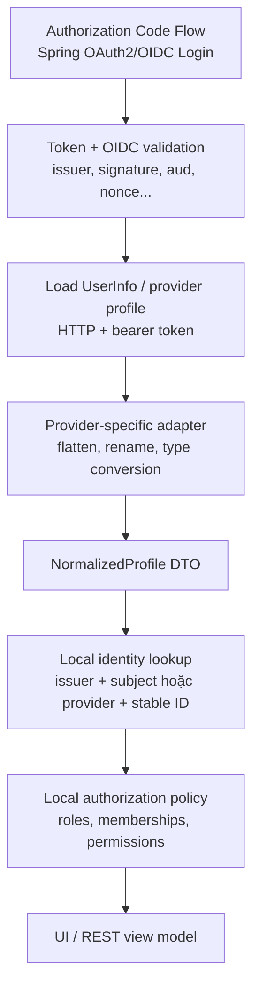

# 12.8. Xử lý provider trả cấu trúc thuộc tính khác nhau

Trong **Spring Security OAuth 2.0/OIDC Client**, sau khi người dùng đăng nhập, ứng dụng thường cần các thông tin như mã định danh, tên hiển thị, email, ảnh đại diện, ngôn ngữ hoặc nhóm quyền. Khó khăn là **các Identity Provider (IdP) không nhất thiết trả cùng một cấu trúc JSON**, ngay cả khi giao diện ứng dụng muốn hiển thị cùng một hồ sơ.

Ví dụ cùng một người dùng, nhưng ba hệ thống có thể trả:

- **OpenID Provider chuẩn OIDC:** `sub`, `name`, `preferred_username`, `email`, `email_verified`, `picture`.
- **OAuth 2.0 provider có profile API riêng:** `id`, `login`, `avatar_url`, `display_name`.
- **Hệ thống doanh nghiệp:** thông tin lồng trong `data.user`, với `uid` dạng số, `fullName`, `contact.primaryEmail` và `roles` dạng mảng.

Nếu controller nghiệp vụ đọc trực tiếp từng kiểu JSON, ứng dụng sẽ đầy các nhánh `if ("providerA".equals(...))`, dễ lỗi khi provider thay đổi schema và đặc biệt dễ **ánh xạ nhầm danh tính hoặc quyền**.

Cách tiếp cận thích hợp là **giữ phần xác thực đúng giao thức**, sau đó dùng **adapter/normalizer theo từng provider** để chuyển dữ liệu hồ sơ vào một mô hình nội bộ ổn định. Phân biệt rõ:

1. **Identity:** ai đã đăng nhập; nguồn định danh đáng tin là gì?
2. **Profile:** tên, email, ảnh, thông tin hiển thị có thể thiếu hoặc thay đổi.
3. **Authorization:** người dùng được phép làm gì; không tự suy ra từ một trường JSON chưa được chuẩn hóa/chưa được tin cậy.

Bài học này trình bày cấu trúc dữ liệu thường gặp, cách dùng `user-name-attribute`, `DefaultOAuth2UserService`, `OidcUserService`, mapping DTO, xử lý kiểu dữ liệu và dữ liệu thiếu, cùng các nguyên tắc bảo mật khi hỗ trợ nhiều provider trong Spring Security.

## 1. Vì sao cấu trúc UserInfo khác nhau?

### 1.1. OAuth 2.0 không định nghĩa một schema hồ sơ người dùng chung

**OAuth 2.0** là framework ủy quyền. Nó định nghĩa cách client nhận và dùng access token, **không tự định nghĩa** một JSON profile chuẩn gồm `id`, `name` và `email`.

Một provider có thể có endpoint:

```http
GET /api/v1/account HTTP/1.1
Host: oauth-a.example.org
Authorization: Bearer <access-token>
```

Phản hồi:

```json
{
  "id": 2048,
  "login": "mai.dev",
  "name": "Mai Tran",
  "avatar_url": "https://cdn.example.org/avatar/2048.png"
}
```

Provider khác có thể dùng API:

```json
{
  "data": {
    "user": {
      "uid": "u-2048",
      "fullName": "Mai Tran",
      "contact": {
        "primaryEmail": "mai@example.org"
      },
      "picture": {
        "url": "https://assets.example.org/u-2048.jpg"
      }
    }
  }
}
```

Hai payload có ý nghĩa gần nhau nhưng **không thể** đọc bằng cùng một expression như `attributes.get("id")`.

### 1.2. OIDC chuẩn hóa claim nhưng không bảo đảm mọi claim đều hiện diện

**OpenID Connect** bổ sung lớp xác thực trên OAuth 2.0. ID Token chuẩn có claim **`sub`** để định danh subject cùng các claim bắt buộc như `iss`, `aud` và thời gian. OIDC cũng quy định **UserInfo Endpoint** và các standard claims như:

| Claim OIDC | Mục đích | Có luôn tồn tại? |
|---|---|---|
| `sub` | Định danh subject tại issuer | **Bắt buộc trong ID Token; UserInfo response cũng phải có `sub`** |
| `name` | Tên đầy đủ hiển thị | Không |
| `given_name` / `family_name` | Tên / họ | Không |
| `preferred_username` | Tên người dùng ưu tiên | Không |
| `email` | Địa chỉ email | Không |
| `email_verified` | OP cho biết email đã được xác minh hay chưa | Không |
| `picture` | URL ảnh đại diện | Không |
| `locale` | Ngôn ngữ/locale | Không |
| `groups` / `roles` | Extension của OP, **không phải standard claims cơ bản đảm bảo có** | Phụ thuộc OP và hợp đồng tích hợp |

Ví dụ ID Token hoặc UserInfo có thể cung cấp:

```json
{
  "sub": "248289761001",
  "preferred_username": "mai.dev",
  "name": "Mai Tran",
  "email": "mai@example.org",
  "email_verified": true,
  "picture": "https://images.example.org/mai.png"
}
```

Một OP khác có thể chỉ cấp `sub`, hoặc đưa email và tên vào UserInfo nhưng không đưa vào ID Token. Scope như `profile` và `email` **yêu cầu quyền truy cập vào một nhóm claim**, không bảo đảm mọi claim trong nhóm đều được trả ở mọi lần đăng nhập.

**Điểm mấu chốt:** OIDC chuẩn hóa ngữ nghĩa quan trọng nhưng dữ liệu hồ sơ vẫn có thể thiếu, khác giá trị hoặc có extension. Hệ thống không nên lấy `email` hay `name` làm điều kiện bắt buộc để nhận diện một user OIDC hợp lệ khi nghiệp vụ không cần.

## 2. Các hình dạng payload cần dự kiến

### 2.1. Provider A: thuộc tính phẳng, ID dạng số

```json
{
  "id": 2048,
  "login": "mai.dev",
  "name": "Mai Tran",
  "email": null,
  "avatar_url": "https://a.example.org/2048.png"
}
```

Đặc điểm:

- `id` là số.
- `login` khác tên hiển thị.
- `email` có thể `null`.
- `avatar_url` dùng tên claim riêng, không phải `picture` của OIDC.

Không nên ép user phải có email nếu API cho phép giữ email riêng tư. Nếu `id` là định danh ổn định trong phạm vi provider, adapter có thể chuyển nó thành chuỗi `"2048"` để lưu ở domain model.

### 2.2. Provider B: thuộc tính lồng nhiều cấp

```json
{
  "data": {
    "user": {
      "uid": "external-2048",
      "fullName": "Mai Tran",
      "contact": {
        "primaryEmail": "mai@example.org"
      },
      "picture": {
        "url": "https://b.example.org/avatar/2048"
      }
    }
  },
  "requestId": "req-123"
}
```

Đặc điểm:

- ID ở `data.user.uid`.
- Tên hiển thị ở `data.user.fullName`.
- Email và ảnh nằm ở object lồng nhau.
- `requestId` là metadata của API, **không phải định danh người dùng**.

Nếu cấu hình `user-name-attribute: uid` nhưng UserInfo response có `uid` **chỉ ở bên trong `data.user`**, một số bước tạo `OAuth2User` không tìm được attribute gốc; cần normalize/flatten trước hoặc dùng OAuth2 user service tùy chỉnh.

### 2.3. Provider C: dữ liệu vừa phẳng vừa có extension

```json
{
  "sub": "employee-2048",
  "preferred_username": "mai.dev",
  "profile": {
    "displayName": "Mai T.",
    "department": "Engineering"
  },
  "groups": ["engineering", "reviewers"],
  "email_verified": "true"
}
```

Đặc điểm:

- `sub` có thể là định danh OIDC nếu được phát bởi OP đúng chuẩn.
- `profile.displayName` là một extension riêng.
- `groups` là danh sách tên nhóm, **không mặc nhiên là Spring authorities**.
- `email_verified` được gửi dưới dạng chuỗi `"true"` — khác kiểu Boolean chuẩn của OIDC. Đây là dấu hiệu schema không nhất quán; adapter cần hợp đồng rõ ràng thay vì đoán.

Việc provider trả khác schema không có nghĩa ứng dụng phải chấp nhận mọi dữ liệu. Đối với OIDC, claim chuẩn phải được xác minh theo giao thức; lỗi kiểu dữ liệu của claim bảo mật nên được xử lý nghiêm ngặt.

## 3. Tách xác thực, UserInfo và mô hình hồ sơ nội bộ

Một kiến trúc rõ ràng có các bước:



Mỗi lớp chịu một trách nhiệm:

| Lớp | Việc thực hiện | Việc không nên làm |
|---|---|---|
| OIDC/OAuth client | Hoàn tất login, xác minh token và giao thức | Tự nhận token JWT chưa xác minh làm session |
| UserInfo client | Gọi endpoint bằng access token đúng scope | Coi response JSON là quyền truy cập nội bộ |
| Adapter | Chuyển field/kiểu dữ liệu theo contract của provider | Tự tạo `sub` OIDC từ email hay nickname |
| Identity mapping | Ghép external identity với account nội bộ | Hợp nhất tài khoản tự động chỉ theo email |
| Authorization service | Kiểm tra quyền từ nguồn tin cậy | Gán `ROLE_ADMIN` vì một field tự do có chữ `admin` |
| UI DTO | Chỉ trả trường cần hiển thị | Trả nguyên token hoặc mọi claim nhạy cảm ra browser |

**Hồ sơ là dữ liệu ứng dụng sử dụng; danh tính xác thực là một khẳng định đã được kiểm chứng.** Không làm mất phân biệt đó chỉ để giảm số dòng code.

## 4. Phân biệt OAuth2User và OidcUser

Spring Security cung cấp hai nhóm principal thường gặp:

| Đặc tính | OAuth 2.0 Login không có OIDC | OIDC Login |
|---|---|---|
| Scope đặc trưng | Scope theo provider, không có `openid` | Có `openid` |
| Principal | `OAuth2User` | `OidcUser` |
| Token chứng thực định danh chuẩn | Không có ID Token OIDC | Có ID Token |
| Dữ liệu profile | Provider-specific UserInfo/API | ID Token + UserInfo OIDC |
| Định danh người dùng | `id` / `uid` theo hợp đồng provider | `sub` trong phạm vi `iss` |
| User service phổ biến | `DefaultOAuth2UserService` | `OidcUserService` |
| Điểm cấu hình | `userInfoEndpoint().userService(...)` | `userInfoEndpoint().oidcUserService(...)` |

Ví dụ trong Spring Security Servlet:

```java
http.oauth2Login(oauth2 -> oauth2
    .userInfoEndpoint(userInfo -> userInfo
        .userService(customOAuth2UserService)
        .oidcUserService(customOidcUserService)));
```

Đoạn minh họa giả định hai biến user service đã được xây dựng. **Hai nhánh phục vụ những tình huống khác nhau:** một adapter cho OAuth2-only không tự động chạy cho OIDC Login; khi dùng scope `openid`, ứng dụng phải xem xét riêng hành vi `OidcUserService`.

Nếu chỉ muốn chuẩn hóa hồ sơ để hiển thị và lưu domain profile, **có thể để user service mặc định thực hiện xác thực** rồi mapping từ `OAuth2User` hoặc `OidcUser` thành DTO riêng, thay vì thay đổi principal của Spring.

## 5. Khi nào dùng user-name-attribute là đủ?

Trong `ClientRegistration.ProviderDetails.UserInfoEndpoint`, property **`user-name-attribute`** chỉ định thuộc tính từ UserInfo được dùng làm principal name trong trường hợp tương ứng.

Ví dụ provider OAuth2-only trả:

```json
{
  "id": "user-2048",
  "login": "mai.dev",
  "display_name": "Mai Tran"
}
```

Cấu hình:

```yaml
spring:
  security:
    oauth2:
      client:
        registration:
          legacy:
            provider: legacy
            client-id: ${LEGACY_CLIENT_ID}
            client-secret: ${LEGACY_CLIENT_SECRET}
            client-authentication-method: client_secret_basic
            authorization-grant-type: authorization_code
            redirect-uri: "{baseUrl}/login/oauth2/code/{registrationId}"
            scope: profile.read
        provider:
          legacy:
            authorization-uri: https://oauth-legacy.example.org/authorize
            token-uri: https://oauth-legacy.example.org/token
            user-info-uri: https://oauth-legacy.example.org/api/me
            user-name-attribute: id
```

Nếu JSON có key top-level `id` ổn định, `DefaultOAuth2UserService` thường có thể dùng trực tiếp, không cần viết custom adapter chỉ để tạo principal.

**`user-name-attribute` chỉ nhận tên thuộc tính**, không phải expression truy cập object lồng nhau. Giá trị như:

```yaml
user-name-attribute: data.user.uid
```

**không nên được giả định** có cơ chế JSONPath tự động. Nếu data thực tế chỉ chứa object `data` và không có key tên đúng nguyên văn `data.user.uid`, Spring không tự tìm đường dẫn lồng bằng property này.

Khi provider dùng field sâu hoặc tên/kiểu thuộc tính không phù hợp, cần thực hiện bước chuyển đổi trước khi Spring tạo `OAuth2User`.

## 6. Chuẩn hóa response OAuth2-only bằng DefaultOAuth2UserService

### 6.1. Ý tưởng: chuyển cấu trúc nested thành thuộc tính top-level ổn định

Giả sử provider `partner` trả:

```json
{
  "data": {
    "user": {
      "uid": 2048,
      "fullName": "Mai Tran",
      "contact": {
        "primaryEmail": "mai@example.org"
      },
      "picture": {
        "url": "https://partner.example.org/avatar/2048.png"
      }
    }
  }
}
```

Spring cần một attribute top-level cho `user-name-attribute`. Adapter có thể chuyển payload thành:

```json
{
  "provider_user_id": "2048",
  "display_name": "Mai Tran",
  "email": "mai@example.org",
  "avatar_url": "https://partner.example.org/avatar/2048.png",
  "data": {
    "user": {
      "uid": 2048
    }
  }
}
```

Ví dụ vẫn giữ object gốc để các thành phần chuyên biệt có thể đọc nếu cần. Trong hệ thống có dữ liệu cá nhân nhạy cảm, có thể chọn loại bỏ trường không cần thiết theo chính sách lưu trữ.

### 6.2. Dùng setAttributesConverter

Ở những phiên bản Spring Security hỗ trợ `DefaultOAuth2UserService#setAttributesConverter(...)`, có thể tùy chỉnh phần mapping **sau khi lấy response UserInfo nhưng trước khi dựng OAuth2User**.

```java
import java.util.LinkedHashMap;
import java.util.Map;

import org.springframework.context.annotation.Bean;
import org.springframework.security.oauth2.client.userinfo.DefaultOAuth2UserService;
import org.springframework.security.oauth2.client.userinfo.OAuth2UserRequest;
import org.springframework.security.oauth2.client.userinfo.OAuth2UserService;
import org.springframework.security.oauth2.core.OAuth2AuthenticationException;
import org.springframework.security.oauth2.core.OAuth2Error;
import org.springframework.security.oauth2.core.user.OAuth2User;

@Bean
OAuth2UserService<OAuth2UserRequest, OAuth2User> oauth2UserService() {
    var service = new DefaultOAuth2UserService();

    service.setAttributesConverter(userRequest -> attributes -> {
        String registrationId =
            userRequest.getClientRegistration().getRegistrationId();

        // Chỉ áp dụng adapter cho provider có schema nested.
        if (!"partner".equals(registrationId)) {
            return attributes;
        }

        Map<String, Object> flattened = new LinkedHashMap<>(attributes);

        Map<?, ?> data = asMap(attributes.get("data"));
        Map<?, ?> user = asMap(data.get("user"));

        String providerId = requiredId(user.get("uid"));
        flattened.put("provider_user_id", providerId);

        String fullName = optionalText(user.get("fullName"));
        if (fullName != null) {
            flattened.put("display_name", fullName);
        }

        Map<?, ?> contact = asMap(user.get("contact"));
        String email = optionalText(contact.get("primaryEmail"));
        if (email != null) {
            flattened.put("email", email);
        }

        Map<?, ?> picture = asMap(user.get("picture"));
        String avatar = optionalText(picture.get("url"));
        if (avatar != null) {
            flattened.put("avatar_url", avatar);
        }

        return flattened;
    });

    return service;
}

private static Map<?, ?> asMap(Object value) {
    if (value instanceof Map<?, ?> map) {
        return map;
    }
    return Map.of();
}

private static String optionalText(Object value) {
    if (value instanceof String s && !s.isBlank()) {
        return s;
    }
    return null;
}

private static String requiredId(Object value) {
    if (value instanceof String s && !s.isBlank()) {
        return s;
    }
    if (value instanceof Number n) {
        return n.toString();
    }
    throw new OAuth2AuthenticationException(
        new OAuth2Error("invalid_user_info"),
        "Provider profile has no valid stable user ID"
    );
}
```

Các helper method ở ví dụ cần được đặt trong **cùng một lớp Java** với bean method hoặc một utility class phù hợp; đoạn mã minh họa phần cần thiết để dễ tập trung vào conversion.

Các điểm cần chú ý:

- `getRegistrationId()` được lấy từ registration do Spring Security dùng, không lấy từ query parameter tùy ý của browser.
- Chỉ normalize khi registration là `partner`; response của provider khác giữ nguyên.
- `uid` được kiểm tra là chuỗi không rỗng hoặc số trước khi chuyển thành external user ID.
- `fullName`, `email` và `avatar_url` là dữ liệu tùy chọn.
- Không lấy `email` làm fallback cho `provider_user_id`; thiếu ID ổn định là **lỗi dữ liệu cần xử lý**.
- Không biến object/map bất kỳ thành chuỗi ID bằng `String.valueOf(...)` vì dễ che mất schema sai.

### 6.3. Khai báo user-name-attribute sau chuẩn hóa

Với registration `partner`:

```yaml
spring:
  security:
    oauth2:
      client:
        provider:
          partner:
            authorization-uri: https://auth.partner.example.org/authorize
            token-uri: https://auth.partner.example.org/token
            user-info-uri: https://auth.partner.example.org/api/me
            user-name-attribute: provider_user_id
```

`provider_user_id` là **key top-level do attributes converter thêm vào**, giúp phần tạo `DefaultOAuth2User` dùng đúng định danh.

Nếu bỏ bước chuẩn hóa mà UserInfo chỉ có `data.user.uid`, việc cấu hình `user-name-attribute: provider_user_id` sẽ không đủ vì trường ấy chưa tồn tại ở top-level.

### 6.4. Gắn custom user service vào OAuth2 Login

Ví dụ Spring Security Servlet:

```java
import org.springframework.context.annotation.Bean;
import org.springframework.context.annotation.Configuration;
import org.springframework.security.config.annotation.web.builders.HttpSecurity;
import org.springframework.security.oauth2.client.userinfo.OAuth2UserRequest;
import org.springframework.security.oauth2.client.userinfo.OAuth2UserService;
import org.springframework.security.oauth2.core.user.OAuth2User;
import org.springframework.security.web.SecurityFilterChain;

@Configuration
public class SecurityConfig {

    @Bean
    SecurityFilterChain securityFilterChain(
            HttpSecurity http,
            OAuth2UserService<OAuth2UserRequest, OAuth2User> profileUserService)
            throws Exception {

        http
            .authorizeHttpRequests(auth -> auth
                .requestMatchers("/", "/login", "/error").permitAll()
                .anyRequest().authenticated())
            .oauth2Login(oauth2 -> oauth2
                .userInfoEndpoint(userInfo -> userInfo
                    .userService(profileUserService)));

        return http.build();
    }
}
```

Lưu ý: bean `profileUserService` trong ví dụ trỏ đến bean đã được định nghĩa ở mục 6.2. Khi ứng dụng có nhiều bean cùng kiểu, cần dùng `@Qualifier` hoặc tên bean rõ ràng để chọn đúng service.

**Quan trọng:** `userInfoEndpoint().userService(...)` áp dụng cho nhánh OAuth2 UserInfo. Nếu registration có scope `openid` và đi qua OIDC Login, Spring thường dùng `OidcUserService`. Không kết luận converter ở đây tự động sửa tất cả OIDC claims.

## 7. Khi nào dùng OAuth2UserService tự viết thay vì attributes converter?

`setAttributesConverter(...)` phù hợp khi HTTP UserInfo response vẫn đọc được bằng client mặc định và chỉ cần thay **dữ liệu map**. Có tình huống cần nhiều hơn:

- Provider dùng một header đặc thù khi gọi profile endpoint.
- Provider trả response không phải JSON object theo định dạng mà default client xử lý.
- Cần gọi thêm endpoint thứ hai để bổ sung thông tin.
- Provider trả thông tin danh tính ở header response hoặc một envelope có kiểm tra chữ ký riêng.
- Cần fallback có điều kiện nhưng vẫn giữ nguyên nguyên tắc về định danh.

Khi đó có thể triển khai:

```java
OAuth2UserService<OAuth2UserRequest, OAuth2User>
```

và trả một `OAuth2User` phù hợp. Ví dụ cấu trúc tối giản:

```java
import org.springframework.security.oauth2.client.userinfo.OAuth2UserRequest;
import org.springframework.security.oauth2.client.userinfo.OAuth2UserService;
import org.springframework.security.oauth2.core.user.OAuth2User;

public final class ProviderAwareOAuth2UserService
        implements OAuth2UserService<OAuth2UserRequest, OAuth2User> {

    private final OAuth2UserService<OAuth2UserRequest, OAuth2User> standard;

    public ProviderAwareOAuth2UserService(
            OAuth2UserService<OAuth2UserRequest, OAuth2User> standard) {
        this.standard = standard;
    }

    @Override
    public OAuth2User loadUser(OAuth2UserRequest request) {
        String registrationId =
            request.getClientRegistration().getRegistrationId();

        if ("custom-api".equals(registrationId)) {
            // Gọi client profile riêng, kiểm tra response, normalize...
            // Sau đó tạo OAuth2User với stable ID và authorities phù hợp.
            throw new UnsupportedOperationException(
                "Implement the custom provider profile contract here");
        }

        return standard.loadUser(request);
    }
}
```

Đây là **khung minh họa**, nhánh `custom-api` cố ý chưa phải implementation chạy được: cần cung cấp HTTP client, bảo vệ access token, chuẩn hóa schema và tạo `OAuth2User` thật. Không dùng placeholder/exception trên môi trường production.

Khi tự tạo principal, có thể dùng `DefaultOAuth2User` với authorities, attributes và tên key định danh:

```java
import java.util.Map;

import org.springframework.security.oauth2.core.user.DefaultOAuth2User;

var user = new DefaultOAuth2User(
    authorities,
    Map.of(
        "provider_user_id", "external-2048",
        "display_name", "Mai Tran"
    ),
    "provider_user_id"
);
```

Ví dụ này giả định `authorities` đã được tạo từ nguồn phù hợp. Không gán quyền quản trị từ dữ liệu profile thô chưa được tin cậy. **`Map.of` không cho phép giá trị null**; với thuộc tính tùy chọn, dùng map có thể thêm có điều kiện.

Nếu chỉ cần chuyển `data.user.uid` thành top-level `provider_user_id`, dùng `DefaultOAuth2UserService` và converter thường ngắn, dễ bảo trì và giữ được hành vi HTTP/token handling mặc định hơn.

## 8. OIDC: giữ sub và validation, chỉ chuẩn hóa profile ở lớp ứng dụng

### 8.1. ID Token và UserInfo phải nhất quán về subject

OIDC RP nhận ID Token sau token exchange. Nếu ứng dụng gọi **UserInfo Endpoint**, response UserInfo phải chứa `sub` và **`sub` đó phải khớp với `sub` của ID Token đã xác minh**.

Ví dụ ID Token đã xác minh:

```json
{
  "iss": "https://login.example.org",
  "sub": "user-2048",
  "aud": "portal-web",
  "exp": 1924999999,
  "iat": 1924996399
}
```

UserInfo response hợp lệ về subject:

```json
{
  "sub": "user-2048",
  "name": "Mai Tran",
  "email": "mai@example.org"
}
```

UserInfo response không phù hợp:

```json
{
  "sub": "another-user",
  "name": "Mai Tran",
  "email": "mai@example.org"
}
```

**Không hợp nhất response thứ hai vào principal của user-2048 chỉ vì email và tên giống nhau.** Spring Security `OidcUserService` đảm nhận việc liên kết UserInfo với ID Token theo OIDC; khi tùy biến cần bảo toàn các kiểm tra này.

### 8.2. Ưu tiên dùng OidcUser mà không thay principal

Trong nhiều trường hợp, không cần chỉnh `OidcUserService`. Sau OIDC Login, các service nghiệp vụ có thể lấy thông tin từ `OidcUser` và chuyển thành DTO chuẩn của hệ thống.

Ví dụ:

```java
import org.springframework.security.core.annotation.AuthenticationPrincipal;
import org.springframework.security.oauth2.core.oidc.user.OidcUser;
import org.springframework.web.bind.annotation.GetMapping;
import org.springframework.web.bind.annotation.RestController;

@RestController
public class MyProfileController {

    public record ProfileView(
        String issuer,
        String subject,
        String displayName,
        String email,
        boolean emailVerified
    ) {}

    @GetMapping("/me")
    public ProfileView me(@AuthenticationPrincipal OidcUser user) {
        String displayName = user.getFullName();

        if (displayName == null || displayName.isBlank()) {
            displayName = user.getPreferredUsername();
        }

        if (displayName == null || displayName.isBlank()) {
            displayName = user.getSubject();
        }

        return new ProfileView(
            user.getIdToken().getIssuer().toString(),
            user.getSubject(),
            displayName,
            user.getEmail(),
            Boolean.TRUE.equals(user.getEmailVerified())
        );
    }
}
```

Trong ví dụ:

- `getSubject()` biểu diễn subject đã được OIDC xác minh, không phải email.
- `getFullName()` và `getPreferredUsername()` có thể thiếu; fallback dùng **chỉ để hiển thị**.
- `emailVerified` chỉ đúng khi claim đúng Boolean `true`; missing/null được biểu diễn `false` trong view.
- Endpoint giả định principal là `OidcUser`; nếu ứng dụng còn hỗ trợ OAuth2 Login không OIDC, cần xử lý kiểu principal khác thay vì ép kiểu.

`email_verified = false` không nhất thiết có nghĩa OP chứng minh email sai; có thể chỉ là chưa có bằng chứng email đã được xác minh. Đối với tác vụ nhạy cảm (khôi phục tài khoản, gửi thông tin bí mật), cần chính sách xác minh email cụ thể.

### 8.3. Nếu OP trả extension profile phức tạp

Giả sử một OP hợp chuẩn vẫn trả `sub`, nhưng thêm:

```json
{
  "sub": "user-2048",
  "name": "Mai Tran",
  "organization": {
    "code": "ORG-01",
    "department": {
      "name": "Engineering"
    }
  }
}
```

Đây là **extension claim**. Ứng dụng có thể đọc qua `user.getClaims()` (nếu claim đã được hợp nhất vào principal) và normalize riêng:

```java
import java.util.Map;

Map<String, Object> claims = user.getClaims();

Object organizationValue = claims.get("organization");
if (organizationValue instanceof Map<?, ?> organization) {
    Object departmentValue = organization.get("department");
    if (departmentValue instanceof Map<?, ?> department) {
        Object name = department.get("name");
        if (name instanceof String s) {
            // Dùng s làm dữ liệu hồ sơ hiển thị, không làm role.
        }
    }
}
```

Giữ `sub` từ ID Token làm identity key. Không thay `sub` bằng `organization.code` hay `preferred_username` để giải quyết việc hiển thị hồ sơ.

Nếu OP không tuân thủ OIDC UserInfo (ví dụ thiếu `sub` hoặc trả `sub` khác ID Token), cần xem đó là lỗi hợp đồng giao thức cần sửa ở OP hoặc lớp tích hợp có kiểm soát, **không nên bỏ qua bước đối chiếu subject**.

## 9. Thiết kế mô hình NormalizedProfile

Để controller, service và persistence không phụ thuộc JSON của từng provider, có thể dùng một DTO nội bộ:

```java
public record NormalizedProfile(
    String registrationId,
    String issuer,
    String externalUserId,
    String displayName,
    String email,
    boolean emailVerified,
    String avatarUrl
) {}
```

Ý nghĩa các trường:

| Field | Mục đích | Chú ý |
|---|---|---|
| `registrationId` | Xác định adapter/registration đã dùng trong Spring | Là tên cục bộ, không thay thế issuer |
| `issuer` | OP đã xác minh trong OIDC | Với OAuth2-only, có thể không có issuer theo chuẩn OIDC |
| `externalUserId` | ID ổn định của user tại nguồn | OIDC dùng `sub`; OAuth2-only dùng ID provider đã được đảm bảo |
| `displayName` | Tên hiển thị | Có thể thay đổi, không phải khóa tài khoản |
| `email` | Thông tin liên hệ | Có thể thiếu, thay đổi hoặc chưa được xác minh |
| `emailVerified` | Có bằng chứng được provider chấp nhận về xác minh email hay không | Không suy diễn từ việc email tồn tại |
| `avatarUrl` | Đường dẫn ảnh đại diện | Có thể thiếu; cần hạn chế cách tải/render URL |

**Không dùng chính DTO để quyết định OAuth token có hợp lệ hay không**. DTO được tạo **sau bước xác thực** và dùng để phục vụ nghiệp vụ.

### 9.1. Hai dạng khóa danh tính

Với OIDC:

```text
external_identity_key = (iss, sub)
```

Ví dụ:

```text
(https://login.example.org, user-2048)
```

Với OAuth2-only, provider có thể không định nghĩa `iss` theo OIDC. Khi đó cần một namespace do hệ thống kiểm soát:

```text
external_identity_key = (provider_namespace, provider_stable_user_id)
```

Ví dụ:

```text
(legacy-partner-prod, external-2048)
```

Không trộn hai namespaces hoặc cho rằng ID `2048` của provider A là cùng người với ID `2048` của provider B.

### 9.2. Chọn fallback chỉ cho thuộc tính hiển thị

Tên hiển thị có thể chọn theo thứ tự:

1. `name` hoặc `fullName` hợp lệ.
2. `preferred_username` hoặc `login` hợp lệ.
3. Một placeholder thân thiện như “Người dùng” hoặc một phần ID đã được xử lý an toàn.

**Không** sử dụng email hoặc tên hiển thị làm fallback cho **externalUserId** trừ khi có contract định danh rất cụ thể, đã được phân tích rủi ro và quản trị tài khoản riêng. Tên và email có thể thay đổi hoặc được cấp lại.

## 10. Một mapper ứng dụng hỗ trợ cả OIDC và OAuth2

Ví dụ sau minh họa chuyển principal đã được Spring Security xác thực thành DTO nội bộ, không ghi đè principal. Dữ liệu bên dưới giả định nhánh OAuth2-only đã được normalize theo provider thành các trường như `provider_user_id`, `display_name`, `avatar_url`.

```java
import org.springframework.security.oauth2.core.oidc.user.OidcUser;
import org.springframework.security.oauth2.core.user.OAuth2User;

public final class ProfileMapper {

    private ProfileMapper() {}

    public static NormalizedProfile fromOidc(
            String registrationId,
            OidcUser user) {

        String displayName = firstNonBlank(
            user.getFullName(),
            user.getPreferredUsername(),
            user.getSubject()
        );

        return new NormalizedProfile(
            registrationId,
            user.getIdToken().getIssuer().toString(),
            user.getSubject(),
            displayName,
            user.getEmail(),
            Boolean.TRUE.equals(user.getEmailVerified()),
            user.getClaimAsString("picture")
        );
    }

    public static NormalizedProfile fromOauth2(
            String registrationId,
            OAuth2User user) {

        String providerUserId = asText(
            user.getAttributes().get("provider_user_id")
        );

        // Ví dụ provider OAuth2-only đã có ID top-level tên "id".
        if (providerUserId == null) {
            providerUserId = asText(user.getAttributes().get("id"));
        }
        if (providerUserId == null) {
            throw new IllegalArgumentException(
                "OAuth provider returned no stable user ID");
        }

        String displayName = firstNonBlank(
            asText(user.getAttributes().get("display_name")),
            asText(user.getAttributes().get("name")),
            asText(user.getAttributes().get("login")),
            providerUserId
        );

        return new NormalizedProfile(
            registrationId,
            null, // OAuth2-only không có issuer theo OIDC.
            providerUserId,
            displayName,
            asText(user.getAttributes().get("email")),
            Boolean.TRUE.equals(
                user.getAttributes().get("email_verified")),
            firstNonBlank(
                asText(user.getAttributes().get("avatar_url")),
                asText(user.getAttributes().get("picture"))
            )
        );
    }

    private static String asText(Object value) {
        if (value instanceof String s && !s.isBlank()) {
            return s;
        }
        if (value instanceof Number n) {
            return n.toString();
        }
        return null;
    }

    private static String firstNonBlank(String... values) {
        for (String value : values) {
            if (value != null && !value.isBlank()) {
                return value;
            }
        }
        return null;
    }
}
```

Giả sử `NormalizedProfile` là record ở mục 9, những phương thức này chỉ lấy dữ liệu từ principal **đã qua bước login của Spring**.

Đây là một mapper minh họa. Trong ứng dụng nhiều provider, không nên để `fromOauth2(...)` luôn thử lần lượt các field của mọi provider nếu có nguy cơ **trùng tên nhưng khác ngữ nghĩa**. Khi số lượng provider tăng, nên tách mỗi provider thành adapter xác định bằng `registrationId`.

### 10.1. Dùng Authentication để chọn đúng nhánh

Trong Servlet OAuth2/OIDC Login, `OAuth2AuthenticationToken` cho phép đọc registration ID:

```java
import org.springframework.security.core.Authentication;
import org.springframework.security.oauth2.client.authentication.OAuth2AuthenticationToken;
import org.springframework.security.oauth2.core.oidc.user.OidcUser;
import org.springframework.security.oauth2.core.user.OAuth2User;

public final class CurrentProfileService {

    public NormalizedProfile normalize(Authentication authentication) {
        if (!(authentication instanceof OAuth2AuthenticationToken oauth)) {
            throw new IllegalStateException(
                "Expected an OAuth2/OIDC login authentication");
        }

        String registrationId =
            oauth.getAuthorizedClientRegistrationId();

        Object principal = oauth.getPrincipal();

        if (principal instanceof OidcUser oidcUser) {
            return ProfileMapper.fromOidc(registrationId, oidcUser);
        }

        if (principal instanceof OAuth2User oauth2User) {
            return ProfileMapper.fromOauth2(registrationId, oauth2User);
        }

        throw new IllegalStateException("Unsupported principal type");
    }
}
```

Trong sản phẩm thật, có thể định nghĩa `ProviderProfileAdapter` theo registration, thay vì giữ các nhánh trong một class lớn. Không dùng `authentication.getName()` như định danh duy nhất cho mọi provider mà chưa biết nó đã được ánh xạ ra sao.

### 10.2. API trả DTO, không trả raw principal

Ví dụ controller:

```java
import org.springframework.security.core.Authentication;
import org.springframework.web.bind.annotation.GetMapping;
import org.springframework.web.bind.annotation.RestController;

@RestController
public class ProfileApi {

    private final CurrentProfileService profiles;

    public ProfileApi(CurrentProfileService profiles) {
        this.profiles = profiles;
    }

    @GetMapping("/api/me")
    public NormalizedProfile me(Authentication authentication) {
        return profiles.normalize(authentication);
    }
}
```

Đoạn ví dụ giả định `CurrentProfileService` đã được đăng ký thành bean Spring và endpoint được bảo vệ bằng `authenticated()`. Trong ứng dụng có yêu cầu riêng tư, không nhất thiết trả mọi field DTO về browser. Có thể tạo **ProfileView** chỉ chứa tên/avatar mà UI cần; issuer và external user ID có thể là dữ liệu nội bộ.

## 11. Adapter riêng cho từng provider

Khi có nhiều nhà cung cấp, phương pháp bền vững là mỗi adapter chịu trách nhiệm một schema. Ví dụ interface:

```java
public interface ProviderProfileAdapter {

    String registrationId();

    NormalizedProfile normalize(
        org.springframework.security.oauth2.core.user.OAuth2User user
    );
}
```

Hai implementation có thể:

- `LegacyProviderAdapter`: lấy `id`, `login`, `avatar_url` từ top-level.
- `PartnerProviderAdapter`: lấy `provider_user_id`, `display_name` sau bước flatten.
- OIDC nên được xử lý bằng adapter nhận `OidcUser` hoặc một nhánh chuẩn riêng; không bắt buộc ép mọi loại principal vào một interface thiếu thông tin ID Token.

Ưu điểm:

| Lợi ích | Giải thích |
|---|---|
| Cô lập schema | Provider thay JSON chỉ cần sửa adapter của chính provider |
| Dễ kiểm soát lỗi | Phân biệt lỗi thiếu ID bắt buộc với thiếu email tùy chọn |
| Hạn chế nhầm danh tính | Mỗi provider có quy tắc ID/namespace được ghi rõ |
| Giảm thay đổi nghiệp vụ | Service sử dụng `NormalizedProfile` ổn định |
| Tránh nhánh lớn | Không cần hàng chục `if` trong controller |
| Quản lý extension | Claim `department`, `groups` hoặc metadata được đọc theo contract riêng |

Một adapter không nhất thiết chỉ có vài câu lệnh map. Nó còn phải biết **trường nào là bắt buộc**, **kiểu nào được hỗ trợ**, **trường nào được phép dùng để phân quyền**, và **dữ liệu nào phải bị bỏ qua**.

## 12. Xử lý giá trị null, thiếu field và thay đổi kiểu

### 12.1. Phân loại trường bắt buộc/tùy chọn

| Trường | Mức độ yêu cầu | Xử lý khi thiếu |
|---|---|---|
| `sub` của OIDC ID Token | Bắt buộc theo OIDC | Từ chối token/đăng nhập nếu không hợp lệ |
| `sub` của OIDC UserInfo | Bắt buộc và phải khớp ID Token khi gọi UserInfo | Từ chối UserInfo không hợp lệ |
| Stable ID của OAuth2-only provider | Bắt buộc cho cơ chế ánh xạ tài khoản đã chọn | Từ chối profile hoặc login theo chính sách |
| `name`/`displayName` | Tùy chọn | Fallback dùng cho hiển thị |
| `email` | Tùy chọn | Để `null` hoặc yêu cầu user bổ sung qua quy trình tin cậy |
| `email_verified` | Tùy chọn | Không coi missing là verified |
| `picture` / `avatar_url` | Tùy chọn | Avatar mặc định |
| `locale` | Tùy chọn | Locale mặc định của ứng dụng |
| `groups` | Tùy hợp đồng | Không tự cấp quyền nếu thiếu hoặc chưa được xác minh |

Thiếu email không phải bằng chứng user không tồn tại. Ngược lại, thiếu stable ID làm **mất khả năng xác định một tài khoản duy nhất**, nên cần xử lý theo hướng thất bại an toàn.

### 12.2. Số so với chuỗi

Một provider có thể trả:

```json
"id": 2048
```

lúc khác:

```json
"id": "2048"
```

Nếu contract cho phép cả hai biểu diễn, adapter có thể chuyển thành chuỗi ổn định. Tuy nhiên:

- Không dùng `double` để xử lý ID lớn; dữ liệu integer lớn có thể mất độ chính xác nếu qua kiểu floating point.
- Không tự bỏ số 0 đầu chuỗi (`"0002048"` khác `"2048"` nếu provider coi là identifier khác).
- Không trim/biến đổi case tùy tiện đối với ID trừ khi provider xác định quy tắc tương ứng.
- Không dùng `String.valueOf(mapOrList)` để biến một kiểu JSON sai thành ID hợp lệ.

### 12.3. Boolean và string boolean

OIDC `email_verified` về ngữ nghĩa là Boolean. Provider nonstandard có thể trả `"true"` hoặc `1`.

**Không nên tự động cho rằng mọi dạng giống true đều đáng tin như claim chuẩn.** Cần tài liệu provider định nghĩa rõ và một converter chỉ áp dụng cho provider đó. Nếu không có hợp đồng, chỉ nhận đúng Boolean `true` và coi dữ liệu khác là chưa được xác minh hoặc lỗi schema tùy mức độ quan trọng.

Ví dụ parsing có chủ đích cho một provider riêng cho phép `"Y"` và `"N"`:

```java
static boolean verifiedForLegacyProvider(Object value) {
    if ("Y".equals(value)) {
        return true;
    }
    if ("N".equals(value)) {
        return false;
    }
    return false; // Không tự suy ra verified.
}
```

Hàm này **không phải** bộ parse OIDC chung. Nó chỉ hợp lệ nếu hợp đồng legacy provider nêu rõ `Y/N`.

### 12.4. Object lồng/array

Một attribute có thể là:

```json
"organization": {
  "id": "org-1",
  "departments": [
    {"code": "eng", "name": "Engineering"},
    {"code": "qa", "name": "Quality"}
  ]
}
```

Không ép:

```java
(String) attributes.get("organization")
```

vì giá trị là `Map`, không phải `String`. Khi thao tác generic JSON:

- Kiểm tra `instanceof Map<?, ?>` trước khi lấy key.
- Kiểm tra `instanceof List<?>` trước khi duyệt danh sách.
- Kiểm tra phần tử list đúng kiểu mong đợi.
- Giới hạn kích thước và độ sâu dữ liệu nếu profile từ nguồn không đáng tin có thể rất lớn.
- Không ném toàn bộ object gốc vào log lỗi.

## 13. Vì sao không nên dùng email để tự động ghép tài khoản?

Giả sử:

- OP công ty trả `sub=employee-2048` và `email=mai@example.org`.
- Provider đối tác trả `id=partner-987` và `email=mai@example.org`.

Hai email bằng nhau **không chứng minh** đây là cùng một external identity. Email có thể chưa được xác minh, bị thay đổi hoặc được gán lại cho người khác. Nếu tự động hợp nhất dữ liệu nội bộ bằng email, ứng dụng có thể cho phép đăng nhập vào tài khoản không thuộc người dùng.

Thiết kế phù hợp:

```text
local_user_id: 3152

external_identities:
  - provider: OIDC company
    issuer: https://login.company.example
    subject: employee-2048

  - provider: OAuth2 partner
    provider_namespace: partner-prod
    provider_user_id: partner-987
```

Nếu muốn hai identity trỏ cùng `local_user_id`, thực hiện **quy trình liên kết tài khoản có xác thực**, được thiết kế theo chính sách sản phẩm.

### 13.1. Pairwise subject trong OIDC

OIDC hỗ trợ **pairwise subject identifiers**: cùng một người dùng có thể nhận giá trị `sub` khác nhau cho những RP thuộc các sector khác nhau. Vì vậy không kỳ vọng `sub` là ID chung toàn bộ doanh nghiệp chỉ vì cùng OP.

Tại một RP, nên dùng cặp `(iss, sub)` làm khóa external identity; khi có nhu cầu liên kết nhiều RP hoặc nhiều provider cần một cơ chế identity federation/account linking riêng.

## 14. Quyền và roles không phải profile field bình thường

Một provider có thể trả:

```json
{
  "id": "user-2048",
  "groups": ["engineering", "admin"],
  "permissions": ["orders.read", "orders.write"]
}
```

Không tự động:

```java
new SimpleGrantedAuthority("ROLE_" + group.toUpperCase())
```

cho mọi string nhóm từ UserInfo. Trước khi mapping thành authorities:

1. Xác định nguồn dữ liệu `groups` có được provider xác nhận là đáng tin và đúng người dùng hay không.
2. Xác định issuer/provider nào được phép cấp từng role nội bộ.
3. Đối chiếu danh sách nhóm/role với allowlist chính sách ứng dụng.
4. Phân biệt **role phía provider** với **role nội bộ**, có thể không trùng ngữ nghĩa.
5. Kiểm tra trường hợp nhóm bị thu hồi và cache session/authorities còn hiệu lực.
6. Tách authentication khỏi authorization tại endpoint nghiệp vụ.

Có thể dùng `GrantedAuthoritiesMapper` hoặc custom user service/authorization service cho phần ánh xạ quyền, nhưng không nên trộn luôn vào adapter hiển thị tên/avatar.

**Không cấp `ROLE_ADMIN` chỉ vì payload có `"admin"`** mà không xác định nguồn và policy.

## 15. Xử lý các khác biệt trong endpoint, scope và HTTP response

Đôi khi khác biệt không chỉ nằm trong JSON.

### 15.1. UserInfo endpoint có thể không sẵn sàng

Với OIDC, provider có thể công bố UserInfo endpoint; OP cung cấp claim từ ID Token và UserInfo theo chính sách. Nếu provider không hỗ trợ endpoint cần thiết hoặc ứng dụng không được cấp scope, dữ liệu có thể không đầy đủ.

Với OAuth2-only, URI profile là **API riêng**. Spring cần biết:

```yaml
provider:
  legacy:
    user-info-uri: https://oauth-legacy.example.org/api/me
    user-name-attribute: id
```

Nếu thiếu `user-info-uri` cho OAuth2-only Login trong kiến trúc phụ thuộc profile, framework có thể không tạo được principal như mong đợi. Không đặt một URL bất kỳ và coi đó là OIDC UserInfo chuẩn.

### 15.2. Authorization header khi gọi UserInfo

Thông thường client gọi UserInfo/profile endpoint bằng access token qua HTTPS:

```http
GET /userinfo HTTP/1.1
Host: login.example.org
Authorization: Bearer <access-token>
```

Không gửi ID Token thay access token chỉ vì hai token đều có dạng JWT. Cũng không gửi client secret trong URL profile request.

Một số OAuth2-only provider dùng header đặc thù; nếu cần, custom HTTP request conversion phải được giới hạn cho đúng provider và không để lộ credential sang hostname ngoài danh sách tin cậy.

### 15.3. Token hết hạn và quyền xem profile

UserInfo access token có thể hết hạn. Nếu ứng dụng gọi profile endpoint lại sau login, cần xác định authorized client storage và cơ chế refresh token (khi có) phù hợp; không gọi API bằng token đã hết hạn rồi quy lỗi thành “người dùng không tồn tại”.

Nếu không có access token hợp lệ để gọi UserInfo, ứng dụng có thể dùng những claim đã nhận đúng từ ID Token cho phạm vi đã xác minh, hoặc yêu cầu tương tác đăng nhập mới theo chính sách. Không tự bỏ kiểm tra `sub` chỉ vì profile endpoint gặp lỗi.

### 15.4. Profile API thay schema theo version

Provider có thể chuyển từ:

```json
{"id": "user-2048", "name": "Mai Tran"}
```

sang:

```json
{"data": {"user": {"uid": "user-2048", "fullName": "Mai Tran"}}}
```

Thay đổi này có thể phá adapter mà không phá OAuth token exchange. Cần có contract rõ với từng provider, chọn API version phù hợp và thiết kế lỗi không che mất sự cố định danh. Phân biệt:

- **Login token hợp lệ nhưng profile thiếu displayName**: có thể dùng fallback hiển thị.
- **Login token hợp lệ nhưng provider profile mất stable ID**: không được âm thầm liên kết với một user khác.
- **OIDC UserInfo `sub` không khớp ID Token**: phải từ chối UserInfo như một sự cố ràng buộc danh tính.

## 16. Khi provider có nhiều cấp danh sách hoặc field phụ thuộc scope

### 16.1. Scope quyết định dữ liệu có thể xuất hiện

Ví dụ scope `profile`, `email` ở OIDC không nhất thiết làm mọi claim xuất hiện. Với OAuth2-only, provider có thể yêu cầu `user.read` hoặc `profile:email` để trả email.

Không dùng logic:

```java
if (email == null) {
    throw new IllegalStateException("Provider login invalid");
}
```

trừ khi email là yêu cầu nghiệp vụ bắt buộc được đảm bảo bởi hợp đồng tích hợp. Nếu cần email cho liên hệ, nên có bước bổ sung thông tin sau login với cơ chế xác minh riêng.

### 16.2. Một người dùng có nhiều email

Một provider có thể trả:

```json
{
  "id": "user-2048",
  "emails": [
    {"value": "mai.personal@example.org", "primary": false, "verified": true},
    {"value": "mai.work@example.org", "primary": true, "verified": false}
  ]
}
```

Không lấy phần tử đầu tiên và coi đó là email chính/đã xác minh. Adapter cần lựa chọn theo contract:

- Nếu nghiệp vụ cần email chính đã xác minh, chọn phần tử thỏa điều kiện đúng.
- Nếu không có email đáp ứng, để email `null` hoặc đánh dấu chưa xác minh.
- Không tạo account linking chỉ dựa trên một email trong danh sách.

Trong OIDC chuẩn, `email` và `email_verified` là claims có ngữ nghĩa riêng; payload `emails[]` của provider là extension/API-specific.

### 16.3. Locale và tên đa ngôn ngữ

`name` có thể chứa ký tự Unicode, dấu tiếng Việt, ký tự ghép hoặc chữ từ hệ chữ khác. Không ép thành ASCII hay tự viết lowercase cho identifier. Profile adapter có thể chuẩn hóa chuỗi hiển thị ở mức cần thiết cho UI, nhưng không được làm thay đổi giá trị `sub`/stable provider ID.

Nếu có `locale`, chỉ sử dụng khi định dạng hợp lệ và nằm trong tập ngôn ngữ ứng dụng hỗ trợ; nếu không dùng locale mặc định.

## 17. Xử lý dữ liệu ảnh đại diện an toàn

Một profile có thể cung cấp:

```json
{
  "picture": "https://cdn.example.org/u-2048.png"
}
```

Đây là URL phục vụ hiển thị, không phải mã định danh user.

Khi sử dụng URL từ provider:

- Ưu tiên `https`.
- Có thể chỉ cho phép hostname CDN đáng tin hoặc proxy ảnh thông qua dịch vụ có kiểm soát.
- Nếu server tự tải ảnh, chặn truy cập tới địa chỉ nội bộ, loopback, metadata endpoint và các hostname không được phép để giảm nguy cơ **SSRF**.
- Xác thực content type, giới hạn kích thước response, timeout và không tự giải nén nội dung vô hạn.
- Nếu chỉ nhúng hình qua browser, cân nhắc privacy: browser có thể gửi request đến hostname của provider/CDN.
- Không đưa giá trị URL chưa kiểm soát vào HTML bằng cách nối chuỗi không escaping.

Trường hợp `picture` là object `{"url":"..."}`, adapter phải đọc đúng trường. Không dùng `toString()` của map làm URL vì kết quả không phải địa chỉ hợp lệ.

## 18. Caching, cập nhật profile và thay đổi danh tính

Thông tin hồ sơ có thể thay đổi theo thời gian: tên mới, ảnh mới, chuyển phòng ban, email mới. Vì vậy cần phân biệt:

| Dữ liệu | Cách quản lý phù hợp |
|---|---|
| External identity key | Ổn định theo hợp đồng; OIDC dùng `(iss, sub)` |
| Display name, avatar, locale | Có thể cập nhật định kỳ hoặc theo lần đăng nhập |
| Email | Có thể thay đổi; kiểm tra xác minh khi cần |
| Roles và permissions | Theo chính sách authorization, cần xử lý thu hồi quyền kịp thời |
| Access/refresh token | Lưu và bảo vệ theo vòng đời OAuth; không trộn vào DTO profile |

Một cách triển khai:

1. Hoàn tất đăng nhập và xác minh identity.
2. Dùng external identity key tra local account.
3. Nếu account chưa có, thực hiện provisioning/linking theo chính sách.
4. Cập nhật các field hồ sơ được phép ghi đè.
5. Áp dụng quyền nội bộ qua nguồn và logic được quản trị.
6. Trả ProfileView tối thiểu cho giao diện.

Không ghi đè tên hoặc email do người dùng đã tự chỉnh trong ứng dụng chỉ vì provider trả giá trị khác; cần xác định **source of truth** cho từng field.

## 19. Lỗi thường gặp và cách phân loại

| Biểu hiện | Nguyên nhân có thể | Cách xử lý |
|---|---|---|
| `missing attribute id` khi OAuth2 Login | `user-name-attribute` sai hoặc ID nằm trong object nested | Kiểm tra response schema, dùng attributes converter |
| `ClassCastException: Map cannot be cast to String` | Ép object lồng thành chuỗi | Kiểm tra kiểu `Map<?, ?>` và lấy field đúng |
| Email luôn `null` | Provider không cấp scope/claim hoặc user giữ email riêng tư | Không giả định email bắt buộc; kiểm tra contract và scope |
| ID đôi khi là số, đôi khi là chuỗi | Schema/API provider không thống nhất | Parse có kiểm soát, giữ external ID ổn định |
| OIDC Login thất bại vì `sub` không khớp | UserInfo response không cùng subject với ID Token | Không bỏ xác minh; xử lý lỗi tại OP/profile integration |
| Cấu hình `user-name-attribute: data.user.uid` không hoạt động | Tên property không phải JSONPath | Flatten sang key top-level rồi dùng key đó |
| Custom `userService(...)` không chạy cho OIDC | OIDC dùng `OidcUserService` riêng | Chuẩn hóa sau OIDC Login hoặc tùy biến OIDC service đúng điểm |
| Người dùng đăng nhập được nhưng tạo tài khoản trùng | Ghép bằng email/tên thay stable identity | Lưu `(iss,sub)` hoặc namespace + provider ID |
| Phân quyền sai khi chuyển provider | Mapping nhóm/role cùng tên nhưng ngữ nghĩa khác | Chính sách authorities theo provider tin cậy |
| Ảnh không hiển thị | `picture` là object hoặc URL không hợp lệ | Provider adapter đọc URL đúng field; fallback ảnh |
| Lỗi chỉ xảy ra trên một môi trường | Provider version, scope, cấu hình tenant khác nhau | Tách registration/adapter theo môi trường và contract |
| OIDC token hợp lệ nhưng UserInfo thiếu trường tùy chọn | Claim không được cấp; scope không bảo đảm đủ mọi field | Dùng fallback hiển thị; không bỏ thông tin định danh bắt buộc |
| API trả 401 khi gọi UserInfo | Access token hết hạn/scope sai hoặc endpoint không chấp nhận token | Kiểm tra authorized client, scope và endpoint |
| Log có toàn bộ profile/token | Debugging ghi raw payload/headers | Redact PII, token và chỉ log metadata cần thiết |

### 19.1. Phân biệt lỗi token với lỗi profile

Khi OAuth2/OIDC Login bị lỗi, cần xác định:

- **Authorization callback/token exchange thất bại:** xem `state`, PKCE, client ID/secret, token endpoint.
- **OIDC ID Token validation thất bại:** xem issuer, audience, chữ ký, thời hạn, nonce; không sửa profile adapter để bỏ kiểm tra.
- **UserInfo HTTP call thất bại:** xem access token, scope, URI, TLS, response status.
- **Profile JSON mapping thất bại:** xem tên field, nested map, kiểu dữ liệu và contract.
- **Local account mapping thất bại:** xem identity key và provisioning/linking.
- **Authorization thất bại:** xem policies/roles, không coi đó là lỗi tên/avatar.

Phân loại đúng tầng giúp không áp dụng biện pháp nguy hiểm như “bỏ qua ID Token validation vì profile JSON lạ”.

## 20. Những nguyên tắc bảo mật khi chuẩn hóa provider profile

### 20.1. Chỉ tin data từ kết nối/giao thức phù hợp

Đối với OIDC:

- Xác minh ID Token từ issuer tin cậy, audience là RP client ID, chữ ký và các claim cần thiết.
- Nếu gọi UserInfo, bảo đảm response được nhận từ endpoint đã cấu hình và `sub` khớp ID Token.
- Không chọn issuer/JWKS/UserInfo URI tùy ý từ một query parameter hoặc claim chưa được xác minh.

Đối với OAuth2-only:

- Lấy profile qua HTTPS từ endpoint do registration tin cậy chỉ định.
- Dùng access token đúng client/grant/scopes.
- Xác định stable user ID theo tài liệu provider và namespace của provider.
- Không mặc nhiên coi một OAuth2 profile API là chứng minh xác thực OIDC chuẩn.

### 20.2. Không ghi dữ liệu nhạy cảm ra log

Raw UserInfo có thể chứa thông tin cá nhân và extension private claims. Access token có thể xuất hiện trong HTTP headers. Không log:

```text
Authorization: Bearer <access-token>
id_token=<id-token>
refresh_token=<refresh-token>
client_secret=<client-secret>
raw_user_info=<complete-profile-json>
```

Có thể log an toàn hơn:

```text
event=oauth2_profile_normalization
registrationId=partner
schemaVersion=v2
result=rejected
reason=missing_stable_user_id
correlationId=<non-secret-id>
```

Ngay cả external IDs cũng cần được xử lý theo chính sách logging và retention của tổ chức.

### 20.3. Không tạo quyền từ claim không đáng tin

Provider-specific `groups` hay `roles` không có cùng ngữ nghĩa giữa các IdP. Ánh xạ theo policy và ràng buộc issuer/registration được xác minh. Không dùng String contains trên role như `"super-admin"` để cấp quyền chỉ vì chứa `"admin"`.

### 20.4. Chống lộ dữ liệu qua response

`OAuth2User.getAttributes()` có thể chứa nhiều trường hơn giao diện cần. Không trả toàn bộ attributes/claims hoặc token qua `/me` công khai; dùng ProfileView đã chọn trường. Nếu có email, số điện thoại hoặc thông tin tổ chức, áp dụng nguyên tắc **data minimization**.

### 20.5. Xử lý trường hợp provider tạm thời không sẵn sàng

Nếu profile endpoint lỗi tạm thời:

- Không tự tạo user mới với ID rỗng.
- Không ghép tài khoản bằng email fallback.
- Nếu đã có principal OIDC hợp lệ và policy cho phép, có thể sử dụng các claim đã xác minh/đã có trong phiên để hiển thị tối thiểu.
- Nếu flow bắt buộc cần UserInfo để tạo identity, nên thất bại an toàn và cung cấp thông báo login phù hợp.

## 21. Ví dụ kiến trúc nhiều provider trong Spring Boot

Giả sử ứng dụng có hai registration:

1. `company-oidc`: OP chuẩn OIDC với issuer `https://login.company.example`.
2. `legacy-partner`: provider OAuth2-only trả `data.user.uid`.

### 21.1. Cấu hình YAML minh họa

```yaml
spring:
  security:
    oauth2:
      client:
        registration:
          company-oidc:
            provider: company
            client-id: ${COMPANY_CLIENT_ID}
            client-secret: ${COMPANY_CLIENT_SECRET}
            client-authentication-method: client_secret_basic
            authorization-grant-type: authorization_code
            redirect-uri: "{baseUrl}/login/oauth2/code/{registrationId}"
            scope:
              - openid
              - profile
              - email

          legacy-partner:
            provider: legacy
            client-id: ${PARTNER_CLIENT_ID}
            client-secret: ${PARTNER_CLIENT_SECRET}
            client-authentication-method: client_secret_basic
            authorization-grant-type: authorization_code
            redirect-uri: "{baseUrl}/login/oauth2/code/{registrationId}"
            scope:
              - profile.read

        provider:
          company:
            issuer-uri: https://login.company.example

          legacy:
            authorization-uri: https://auth.partner.example/authorize
            token-uri: https://auth.partner.example/token
            user-info-uri: https://api.partner.example/profile
            user-name-attribute: provider_user_id
```

Cần điều chỉnh điều kiện trong converter mục 6.2 từ `"partner"` sang **`"legacy-partner"`** để khớp registration ID thực tế. Đây là điểm minh họa rằng tên provider configuration (`legacy`) và registration ID (`legacy-partner`) **không nhất thiết giống nhau**.

### 21.2. Đường dẫn bắt đầu đăng nhập

Trang login có thể hiển thị:

```html
<a th:href="@{/oauth2/authorization/company-oidc}">
    Đăng nhập tài khoản công ty
</a>

<a th:href="@{/oauth2/authorization/legacy-partner}">
    Đăng nhập tài khoản đối tác
</a>
```

Spring xử lý flow theo `ClientRegistration` riêng. Sau thành công:

- Với `company-oidc`, principal là `OidcUser`; identity key dùng `(iss,sub)`.
- Với `legacy-partner`, principal là `OAuth2User` được normalize; identity key dùng provider namespace và `provider_user_id`.
- Tầng nghiệp vụ nhận `NormalizedProfile` (hoặc domain identity riêng), không phụ thuộc trực tiếp schema gốc.

Không cần bắt hai IdP trả cùng JSON. Điều cần thống nhất là **hợp đồng domain model sau adapter** và **quy tắc identity/authorization**.

### 21.3. Khi một provider thêm thuộc tính mới

Ví dụ provider mới trả thêm `timezone` hoặc `preferred_language`. Adapter có thể bổ sung mapping nếu nghiệp vụ cần, không làm thay đổi phần xác thực hoặc external identity key.

Nếu provider đổi tên trường ID hoặc thay ý nghĩa của ID, đó không phải thay đổi giao diện đơn thuần; cần migration/đối chiếu tài khoản có kiểm soát, tránh tạo duplicate account hoặc ghép sai dữ liệu.

## 22. Quy trình tiếp cận một provider mới

Khi tích hợp thêm nhà cung cấp định danh vào Spring Security OAuth2/OIDC Client, nên làm theo thứ tự:

1. **Xác định giao thức:** OP có hỗ trợ OIDC đúng chuẩn hay chỉ cung cấp OAuth2 Login + profile API riêng?
2. **Xác định registration và endpoint:** client ID, secret/auth method, scope, issuer hoặc authorization/token/UserInfo URI.
3. **Xác định nguồn stable ID:** OIDC dùng `(iss,sub)`; OAuth2-only cần ID do provider bảo đảm và provider namespace.
4. **Đọc schema profile:** key top-level hay nested, dữ liệu bắt buộc/tùy chọn, kiểu string/number/boolean/list/map.
5. **Cấu hình user-name-attribute:** chỉ dùng khi provider có một key phù hợp ở top-level; không xem giá trị là JSONPath.
6. **Chọn chỗ normalize:** attributes converter cho OAuth2 UserInfo đơn giản; custom user service khi HTTP contract khác biệt; DTO adapter sau OIDC Login khi chỉ cần hồ sơ hiển thị.
7. **Giữ ranh giới OIDC:** không thay `sub` và không bỏ kiểm tra subject của UserInfo với ID Token.
8. **Tách quyền khỏi profile:** ánh xạ roles/groups qua chính sách tin cậy theo từng issuer/provider.
9. **Xử lý thông tin thiếu có chủ đích:** optional fields có fallback; thiếu identity key cần thất bại an toàn.
10. **Giới hạn dữ liệu:** không log tokens/raw UserInfo, chỉ trả ProfileView tối thiểu, xử lý avatar URL có kiểm soát.
11. **Duy trì hợp đồng theo provider:** version schema, rule chuyển kiểu, source of truth và account linking được mô tả rõ.
12. **Phân biệt lỗi theo tầng:** token exchange, ID Token validation, UserInfo HTTP, profile normalization và local authorization.

**Ghi nhớ:** Không cần ép mọi Identity Provider xuất cùng một JSON. Hãy để **Spring Security thực hiện đăng nhập OAuth2/OIDC đúng chuẩn**, dùng adapter **theo từng provider** để chuyển dữ liệu sang một **profile nội bộ nhất quán**, và giữ **định danh ổn định** tách biệt khỏi tên hiển thị, email và quyền truy cập.

## 23. Tài liệu tham khảo

- [OpenID Connect Core 1.0 — UserInfo Endpoint](https://openid.net/specs/openid-connect-core-1_0.html#UserInfo): cách nhận UserInfo và yêu cầu subject khớp ID Token.
- [OpenID Connect Core 1.0 — Standard Claims](https://openid.net/specs/openid-connect-core-1_0.html#StandardClaims): `sub`, `name`, `email`, `picture`, `locale` và các claim chuẩn.
- [OpenID Connect Core 1.0 — ID Token Validation](https://openid.net/specs/openid-connect-core-1_0.html#IDTokenValidation): các phép xác minh token trước khi nhận diện người dùng.
- [RFC 6749 — The OAuth 2.0 Authorization Framework](https://www.rfc-editor.org/rfc/rfc6749): OAuth 2.0 authorization/token semantics.
- [RFC 9700 — Best Current Practice for OAuth 2.0 Security](https://www.rfc-editor.org/rfc/rfc9700): khuyến nghị bảo mật OAuth 2.0.
- [Spring Security — OAuth 2.0 Login](https://docs.spring.io/spring-security/reference/servlet/oauth2/login/index.html): đăng nhập Servlet OAuth2/OIDC.
- [Spring Security — OAuth 2.0 Login Advanced Configuration](https://docs.spring.io/spring-security/reference/servlet/oauth2/login/advanced.html): `userInfoEndpoint`, `OAuth2UserService` và `OidcUserService`.
- [Spring Security — OAuth 2.0 Client](https://docs.spring.io/spring-security/reference/servlet/oauth2/client/index.html): `ClientRegistration`, provider details, authorized clients và tích hợp OAuth.
