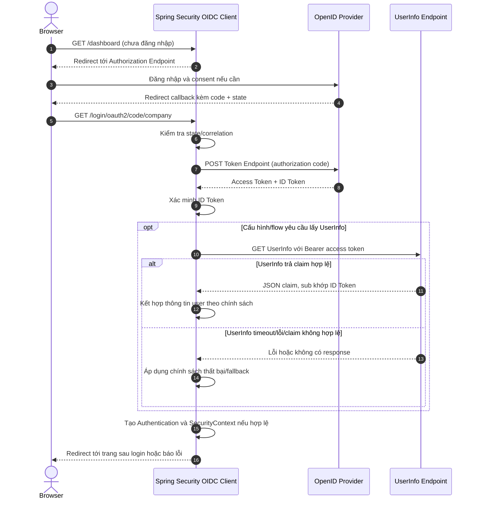

# 12.10. Timeout, lỗi UserInfo và xử lý thất bại đăng nhập

## 1. Bối cảnh: ID Token hợp lệ nhưng đăng nhập vẫn thất bại

Giả sử **Employee Portal** là ứng dụng Spring Boot MVC sử dụng **Spring Security OAuth 2.0 / OIDC Client** để đăng nhập người dùng qua một OpenID Provider (OP).

Người dùng truy cập `/dashboard`, hoàn tất xác thực tại OP, rồi browser quay về callback của Spring Security. Ứng dụng đổi authorization code lấy access token và ID Token. Chữ ký và các claim quan trọng của ID Token đều hợp lệ. Tuy nhiên, trong quá trình lấy thêm thông tin hồ sơ từ **UserInfo Endpoint**, ứng dụng gặp một trong các tình huống:

- UserInfo phản hồi quá chậm, dẫn tới **read timeout**.
- Không thiết lập được kết nối đến UserInfo, dẫn tới **connection timeout** hoặc lỗi DNS/TLS.
- OP trả `401 Unauthorized` vì access token không được chấp nhận.
- OP trả `403 Forbidden` do chính sách quyền hoặc scope không phù hợp.
- OP trả `429 Too Many Requests` hoặc `503 Service Unavailable`.
- OP trả JSON không hợp lệ hoặc claim `sub` không khớp `sub` trong ID Token.

Khi đó, ứng dụng phải đưa ra quyết định chính xác: **có thể hoàn tất đăng nhập chỉ dựa trên ID Token đã được xác minh không, hay phải từ chối login vì dữ liệu UserInfo là điều kiện bắt buộc?** Ngoài ra, cần kiểm soát thời gian chờ, trải nghiệm người dùng, logging, retry và tác động tới hệ thống khi nhà cung cấp gặp sự cố.

Đây là nội dung của bài **“12.10. Timeout, lỗi UserInfo và xử lý thất bại đăng nhập”** trong chương **“12. UserInfo và hồ sơ”**.

> **Nguyên tắc:** UserInfo là một nguồn **claim về người dùng** được bảo vệ bằng OAuth access token. Lỗi UserInfo **không có nghĩa ID Token tự động sai**, nhưng cũng **không cho phép ứng dụng bỏ qua một điều kiện xác thực/ủy quyền mà nghiệp vụ yêu cầu**.

Sau bài học, bạn sẽ biết cách phân biệt giai đoạn lỗi, cấu hình HTTP timeout cho UserInfo, thiết lập failure handler trong Spring Security Servlet, cân nhắc fallback có kiểm soát và quan sát sự cố mà không lộ token.

## 2. UserInfo đóng vai trò gì trong OIDC Login?

### 2.1. ID Token và UserInfo có mục đích khác nhau

| Thành phần | ID Token | UserInfo Endpoint |
| --- | --- | --- |
| Cách nhận | Trong token response của OIDC flow, hoặc Authorization Endpoint ở một số flow | HTTP request đến endpoint của OP, dùng access token |
| Dữ liệu chính | Các claim xác thực: `iss`, `sub`, `aud`, `exp`, `iat`, `nonce` khi áp dụng | Các claim hồ sơ: `sub`, `name`, `email`, `picture`, `locale`... tùy OP |
| Vai trò bảo mật | Xác thực thông tin đăng nhập của user tại OIDC Client | Bổ sung claim về user theo scopes/consent và chính sách OP |
| Giá trị đáng tin cậy | Sau khi chữ ký/issuer/audience/thời hạn/nonce được kiểm tra | Sau khi endpoint/token được xác thực và `sub` được đối chiếu với ID Token |
| Có bắt buộc gọi mọi lần login? | ID Token phải được xử lý trong OIDC login | **Không nhất thiết**; phụ thuộc dữ liệu cần dùng, provider, flow và cấu hình |
| Bên sử dụng | OIDC Client (Relying Party) | OIDC Client, dùng access token gọi OP |

Ví dụ payload ID Token đã xác minh (giá trị minh họa):

```json
{
  "iss": "https://login.example.com/realms/company",
  "sub": "employee-4821",
  "aud": "employee-portal",
  "iat": 1794800000,
  "exp": 1794800600
}
```

Một phản hồi UserInfo hợp lệ có thể là:

```json
{
  "sub": "employee-4821",
  "name": "Nguyen Van A",
  "preferred_username": "nva",
  "email": "nva@example.com",
  "email_verified": true,
  "locale": "vi"
}
```

**`sub` trong UserInfo phải khớp chính xác `sub` của ID Token**. Nếu hai giá trị không khớp, client không được dùng các claim trong UserInfo để nhận diện user đó. Đây không phải lỗi giao diện có thể tự động bỏ qua.

### 2.2. Scopes không bảo đảm mọi claim luôn có

Ví dụ client yêu cầu:

```text
scope=openid profile email
```

Ý nghĩa:

- `openid` yêu cầu cơ chế OIDC login, có ID Token.
- `profile` đề nghị các claim hồ sơ tiêu chuẩn khi OP cho phép.
- `email` đề nghị claim email và `email_verified` khi khả dụng.

Dù đã xin scope `profile` hoặc `email`, **không có cam kết mọi claim tùy chọn đều xuất hiện**. Sự hiện diện còn phụ thuộc người dùng, consent, provider và chính sách dữ liệu. Không viết business logic mặc định email không thể null hoặc mọi user đều có avatar.

### 2.3. Không phải lần đăng nhập OIDC nào cũng gọi UserInfo

Một ứng dụng có thể nhận đủ claim cần thiết trong **ID Token đã được xác minh**. Trong trường hợp đó, ứng dụng có thể không cần UserInfo. Mặt khác, nếu chính sách của ứng dụng đòi hỏi dữ liệu mới nhất từ OP hoặc thông tin không có trong ID Token, UserInfo có thể là một bước thiết yếu.

Trong Spring Security, việc **`OidcUserService` có gọi UserInfo hay không** phụ thuộc cấu hình và điều kiện xử lý, chẳng hạn UserInfo endpoint có được công bố và request có đủ điều kiện lấy thông tin hồ sơ hay không. Không nên giả định “mỗi lần OIDC login luôn có một HTTP GET UserInfo”.

Lời khuyên khi phân tích lỗi là xác định **có thật sự phát sinh request UserInfo** trong lần đăng nhập đó hay không, trước khi thay đổi timeout hoặc failure handler.

## 3. Luồng OIDC Login và vị trí của UserInfo

### 3.1. Sơ đồ trình tự



Một số bước có thể được xử lý bên trong authentication provider và user service theo thứ tự cụ thể của phiên bản Spring Security, nhưng trách nhiệm cốt lõi không đổi: **UserInfo là một pha bổ sung trong quá trình tạo user principal**, không phải một callback mới từ browser.

### 3.2. Các điểm lỗi cần phân biệt

| Giai đoạn | Thành phần | Dấu hiệu khi lỗi |
| --- | --- | --- |
| Authorization request | `OAuth2AuthorizationRequestRedirectFilter` | Sai registration, redirect URI, provider không chấp nhận scopes |
| Callback/correlation | `OAuth2LoginAuthenticationFilter` và authorization request repository | State mismatch, session mất, không tìm thấy request gốc |
| Token exchange | `OAuth2AccessTokenResponseClient` | `invalid_client`, `invalid_grant`, token endpoint timeout |
| ID Token validation | OIDC authentication provider / decoder | Sai chữ ký, issuer, audience, nonce, hết hạn |
| **UserInfo call** | **`OidcUserService` / `DefaultOAuth2UserService`** | **Connect/read timeout, 401/403/429/5xx, JSON không hợp lệ, sub mismatch** |
| User mapping/authority | Custom user service / authorities mapper | Claim thiếu, role mapping lỗi, nguồn quyền nội bộ không sẵn sàng |
| SecurityContext/session | Spring Security và session store | Login xong vẫn anonymous hoặc lặp về trang đăng nhập |
| Authorization nghiệp vụ | Authorization rules | Đã login nhưng vào trang riêng bị 403 |

Nếu token exchange đã thất bại, **không thể gọi đó là lỗi UserInfo** dù browser vẫn hiển thị trang login thất bại. Cần phân biệt cụ thể để sửa đúng tầng.

## 4. HTTP request tới UserInfo Endpoint

### 4.1. Mẫu request thông dụng

Sau khi nhận access token phù hợp, OIDC Client gọi UserInfo:

```http
GET /realms/company/protocol/openid-connect/userinfo HTTP/1.1
Host: login.example.com
Authorization: Bearer <access-token>
Accept: application/json
```

OP trả JSON chứa claim về user, điển hình:

```http
HTTP/1.1 200 OK
Content-Type: application/json

{
  "sub": "employee-4821",
  "name": "Nguyen Van A",
  "email": "nva@example.com",
  "email_verified": true
}
```

Đây là ví dụ để giải thích giao thức, **không phải kết quả HTTP đã chạy**. UserInfo được gọi **từ backend**, nên Browser Developer Tools thường không thấy request này.

Trong một số hồ sơ OIDC, UserInfo có thể dùng phản hồi ký/mã hóa theo đăng ký và metadata tương ứng thay vì chỉ JSON object. Ứng dụng cần sử dụng client/parser hỗ trợ loại phản hồi thực tế, không đơn thuần ép mọi response thành JSON.

### 4.2. Dữ liệu nào là bắt buộc?

Theo OIDC, UserInfo response phải có `sub`; những claim khác phụ thuộc scope, người dùng và policy. `sub` phải khớp subject được xác nhận trong ID Token.

Ví dụ **không chấp nhận**:

```json
{
  "sub": "another-user-9999",
  "name": "Someone Else"
}
```

Nếu ID Token nói `sub=employee-4821` thì response nói `sub=another-user-9999` không thể được dùng làm thông tin người dùng đang đăng nhập.

Các claim mang tính chất nhận diện/ủy quyền nhạy cảm như tổ chức, tenant, vai trò và trạng thái account phải được diễn giải theo **hợp đồng claim của provider**, không suy ra từ `name` hay `email`.

## 5. Timeout là gì, và timeout xảy ra ở đâu?

### 5.1. Các loại timeout thường gặp

| Loại | Giai đoạn | Nguyên nhân phổ biến |
| --- | --- | --- |
| **Connection timeout** | Thiết lập kết nối tới UserInfo host | Host không phản hồi, firewall, route lỗi, sự cố mạng |
| **Read/response timeout** | Đã kết nối nhưng chờ dữ liệu response quá lâu | OP quá tải, backend phụ thuộc của OP chậm, proxy giữ kết nối |
| **Connection pool acquisition timeout** | Chờ được cấp một kết nối từ pool | Pool hết khả năng phục vụ do nhiều request đồng thời |
| **DNS resolution timeout/failure** | Phân giải tên miền OP | DNS lỗi hoặc trễ |
| **TLS handshake error/timeout** | Thiết lập kết nối HTTPS an toàn | Trust store, chứng chỉ, proxy/TLS cấu hình sai |
| **Upstream gateway timeout** | Proxy giữa Client và OP nhận lỗi quá hạn từ backend | `504 Gateway Timeout` |
| **Ứng dụng timeout toàn cục** | Request login vượt thời hạn hệ thống cho phép | Ingress, load balancer, gateway hoặc request timeout |

Tùy HTTP client, một số lỗi mạng có thể được bao gộp trong exception khác nhau. Ví dụ `SocketTimeoutException`, `ResourceAccessException` hoặc một exception của thư viện HTTP có thể là triệu chứng của read timeout, nhưng không nên dựa duy nhất vào tên exception để kết luận loại lỗi.

### 5.2. Độ trễ của login gồm nhiều bước

Thời gian của một lần đăng nhập có thể gần đúng:

```text
Thời gian browser xác thực tại OP
+ Thời gian callback và session lookup
+ Thời gian Token Endpoint
+ Thời gian xác minh ID Token / JWKS nếu cần
+ Thời gian UserInfo (nếu gọi)
+ Thời gian tải quyền/hồ sơ nội bộ (nếu có)
+ Thời gian lưu session và success redirect
```

Ví dụ nếu Token Endpoint 700 ms, UserInfo 2.500 ms và lookup quyền nội bộ 800 ms, người dùng có thể thấy login chậm dù UserInfo **chưa vượt timeout**. Vì vậy cần đo thời gian theo từng pha, không chỉ một số “login latency” tổng.

### 5.3. Vì sao cần timeout rõ ràng?

Không giới hạn thời gian có thể làm callback bị treo, giữ Servlet request thread quá lâu và khiến người dùng thử đăng nhập nhiều lần. Nhưng timeout quá thấp cũng tạo false failure khi OP có độ trễ bình thường.

Nên:

- Đặt **connect timeout** và **read timeout** có chủ đích.
- Xác định ngưỡng dựa trên độ trễ thực tế, SLA, mạng và yêu cầu trải nghiệm.
- Phân biệt timeout UserInfo với Token Endpoint, Discovery, JWKS hoặc database quyền nội bộ.
- Giới hạn tác động của retry, connection pool và circuit breaker khi OP quá tải.
- Trả thông báo phù hợp khi không thể hoàn tất yêu cầu trong giới hạn an toàn.

Các con số 2 giây/3 giây ở ví dụ tiếp theo chỉ là **giá trị minh họa**, không phải khuyến nghị SLA áp dụng chung.

## 6. Các mã lỗi UserInfo thường gặp

| HTTP/OAuth error | Ý nghĩa khả dĩ | Cách phản ứng ưu tiên |
| --- | --- | --- |
| `401 Unauthorized` / `invalid_token` | Access token thiếu, hết hạn, sai issuer/audience hoặc không được UserInfo chấp nhận | Kiểm tra token từ đúng provider, quyền/token format, cấu hình UserInfo |
| `403 Forbidden` / `insufficient_scope` | Không đủ scope/quyền hoặc chính sách OP từ chối | Đối chiếu scopes và policy; không mở rộng quyền tùy tiện |
| `400 Bad Request` | Request malformed, endpoint hoặc token transport không đúng | Kiểm tra request method/headers và hợp đồng provider |
| `404 Not Found` | UserInfo URI sai, không tồn tại hoặc định tuyến proxy lỗi | Xác nhận OIDC metadata `userinfo_endpoint` và cấu hình OP |
| `429 Too Many Requests` | Rate limiting/quota ở OP | Giới hạn burst/retry, giám sát Retry-After, liên hệ capacity policy |
| `500/502/503/504` | OP hoặc upstream lỗi | Fail theo chính sách, đo lỗi và phục hồi sau khi dịch vụ ổn định |
| HTTP 200 nhưng JSON lỗi | Phản hồi không parse được hoặc content type sai | Kiểm tra media type, converter và cấu hình OP |
| HTTP 200 nhưng không có `sub` | UserInfo response không đạt điều kiện cần | Không tạo principal từ response này |
| HTTP 200 nhưng `sub` khác ID Token | Nhận dữ liệu của user khác/nhầm phiên/OP lỗi | **Từ chối**, không dùng claim từ UserInfo |
| HTTP 200 nhưng thiếu `email` | Claim tùy chọn không được cấp | Xử lý thiếu dữ liệu theo nghiệp vụ, không mặc nhiên coi là lỗi OIDC |
| Chứng chỉ TLS không hợp lệ | Endpoint không thể xác thực an toàn | Sửa trust/hostname/certificate; **không tắt TLS verification** |

`401` không có nghĩa “ID Token sai”. UserInfo sử dụng **access token**, nên có thể OP từ chối token tại UserInfo trong khi ID Token vẫn có chữ ký/claims hợp lệ. Ngược lại, nếu ID Token sai issuer hoặc nonce, phải từ chối login **trước khi tin tưởng vào thông tin từ UserInfo**, dù endpoint đó trả `200`.

### 6.1. Khi access token bị từ chối

Nguyên nhân cần cân nhắc:

1. Client dùng access token từ **registration/issuer khác** để gọi UserInfo.
2. Access token đã hết hạn hoặc OP thu hồi quyền.
3. OP yêu cầu scope hoặc audience cụ thể cho UserInfo.
4. Client tạo sai HTTP Authorization header.
5. Môi trường dev/staging/prod bị trộn endpoint.
6. UserInfo proxy/gateway không nhận dạng hoặc không forward Bearer token đúng.

Không dùng ID Token thay access token trong header `Authorization: Bearer` để “sửa” `401`. ID Token dành cho OIDC Client, không mặc định là credential để gọi UserInfo/Resource Server.

### 6.2. Khi claim hồ sơ không đủ

Một UserInfo response có `sub` hợp lệ nhưng không có `email` hoặc `name` thường khác với response bị lỗi bảo mật. Ví dụ nghiệp vụ chỉ cần `iss` + `sub` để định danh và có thể cho phép user điền tên sau khi đăng nhập. Tuy nhiên, nếu sản phẩm bắt buộc email đã xác minh, thiếu `email_verified=true` có thể là lý do **không được truy cập tính năng** dù OAuth/OIDC protocol đã xác thực.

Hãy tách:

- **OIDC protocol validity**: response và danh tính có hợp lệ?
- **Profile completeness**: user có đủ trường hiển thị?
- **Business authorization policy**: user có được vào nghiệp vụ hay không?

Ba quyết định không luôn cùng một kết quả.

## 7. Các lớp Spring Security liên quan

Đối với **Spring Boot Servlet/MVC**:

| Class/abstraction | Trách nhiệm |
| --- | --- |
| `DefaultOAuth2UserService` | Lấy thông tin user từ UserInfo/User Attributes Endpoint trong OAuth2 Client; có thể được OIDC service sử dụng bên trong |
| `OidcUserService` | Xây dựng `OidcUser` dựa trên ID Token và UserInfo khi phù hợp |
| `OAuth2UserService<OAuth2UserRequest, OAuth2User>` | Contract cho user service OAuth2 thông thường |
| `OAuth2UserService<OidcUserRequest, OidcUser>` | Contract cho user service OIDC |
| `OidcUserRequest` | Gồm ClientRegistration, access token và ID Token đã được xử lý trong flow OIDC |
| `OAuth2LoginAuthenticationFilter` | Nhận callback OAuth2 Login và phối hợp xác thực |
| `OidcAuthorizationCodeAuthenticationProvider` | Xác minh OIDC Authorization Code login và gọi user service phù hợp |
| `AuthenticationFailureHandler` | Xử lý giao diện/phản hồi khi authentication thất bại |
| `SecurityFilterChain` / `HttpSecurity` | Nơi cấu hình `oauth2Login`, UserInfo user service và failure handler |
| `OAuth2AuthorizedClientService` / repository | Lưu token đã được cấp cho client và principal theo chính sách |

**`DefaultOAuth2UserService` và `OidcUserService` không giống nhau**. OAuth2 Login không sử dụng `openid` thường lấy user attributes để xây `OAuth2User`; OIDC Login có ID Token và logic riêng để kiểm tra/ghép UserInfo thành `OidcUser`.

### 7.1. Spring có tự fail login khi UserInfo lỗi không?

Nếu UserInfo thực sự được gọi bên trong pipeline xác thực và lời gọi đó ném exception không được xử lý an toàn, quá trình authentication thường không thể hoàn tất; failure handler của OAuth2 Login xử lý thất bại.

Nhưng **không phải lúc nào Spring cũng gọi UserInfo**. Nếu UserInfo không được yêu cầu theo flow/cấu hình, một login có thể thành công bằng thông tin của ID Token. Ngoài ra, ứng dụng có thể cài user service tùy biến nên chính sách thất bại có thể khác.

Do đó không nên đưa ra một khẳng định tuyệt đối kiểu “UserInfo 503 luôn chặn mọi OIDC login” hoặc “ID Token hợp lệ thì luôn được bỏ qua UserInfo 503” mà chưa xác định **policy và điểm tích hợp**.

## 8. Ví dụ Spring Boot: OIDC Client cơ bản

### 8.1. Dependencies

Ví dụ Maven với Spring Boot 3.x / Spring Security 6.x:

```xml
<dependencies>
    <dependency>
        <groupId>org.springframework.boot</groupId>
        <artifactId>spring-boot-starter-web</artifactId>
    </dependency>
    <dependency>
        <groupId>org.springframework.boot</groupId>
        <artifactId>spring-boot-starter-security</artifactId>
    </dependency>
    <dependency>
        <groupId>org.springframework.boot</groupId>
        <artifactId>spring-boot-starter-oauth2-client</artifactId>
    </dependency>
</dependencies>
```

Các ví dụ code tiếp theo dùng **Servlet stack** (`HttpSecurity`, `SecurityFilterChain`, `OidcUserService`), không dùng `ServerHttpSecurity` / `SecurityWebFilterChain` của WebFlux.

### 8.2. Client registration tại `application.yml`

```yaml
server:
  port: 8080

spring:
  security:
    oauth2:
      client:
        registration:
          company:
            provider: company-oidc
            client-id: ${OIDC_CLIENT_ID}
            client-secret: ${OIDC_CLIENT_SECRET}
            client-authentication-method: client_secret_basic
            authorization-grant-type: authorization_code
            redirect-uri: "{baseUrl}/login/oauth2/code/{registrationId}"
            scope:
              - openid
              - profile
              - email
        provider:
          company-oidc:
            issuer-uri: https://login.example.com/realms/company
```

OP cần công bố metadata OIDC hợp lệ, có `authorization_endpoint`, `token_endpoint`, `jwks_uri` và `userinfo_endpoint` nếu có hỗ trợ UserInfo.

Bảng các trường liên quan:

| Thuộc tính | Ảnh hưởng khi đăng nhập |
| --- | --- |
| `registration.company` | Registration ID dùng trong `/oauth2/authorization/company` và callback |
| `client-id` | Audience ứng dụng và định danh trong yêu cầu OAuth2 |
| `client-secret` | Xác thực confidential client tại Token Endpoint |
| `scope: openid` | Yêu cầu OIDC login và ID Token |
| `scope: profile/email` | Đề nghị claim hồ sơ nếu OP cho phép |
| `provider.company-oidc.issuer-uri` | Xác định OP tin cậy; Discovery cung cấp UserInfo URI |
| `redirect-uri` | Callback Spring nhận authorization code, phải khớp OP |

Không tự đổi `userinfo_endpoint` sang domain nhận từ input của người dùng. URL đó phải đến từ **provider đáng tin cậy** hoặc cấu hình quản trị.

### 8.3. SecurityFilterChain tối thiểu

```java
package com.example.portal.security;

import org.springframework.context.annotation.Bean;
import org.springframework.context.annotation.Configuration;
import org.springframework.security.config.Customizer;
import org.springframework.security.config.annotation.web.builders.HttpSecurity;
import org.springframework.security.web.SecurityFilterChain;

@Configuration
public class SecurityConfig {

    @Bean
    SecurityFilterChain securityFilterChain(HttpSecurity http) throws Exception {
        http.authorizeHttpRequests(authorize -> authorize
                .requestMatchers("/", "/css/**", "/error").permitAll()
                .anyRequest().authenticated()
            )
            .oauth2Login(Customizer.withDefaults());

        return http.build();
    }
}
```

Với cấu hình này, Spring Security xử lý authorization request, callback, token exchange và OIDC login. Trong trường hợp tiêu chuẩn không cần tự viết controller nhận `code` hoặc tự gọi UserInfo bằng một HTTP client riêng.

Nhưng nếu cần **timeout UserInfo có chủ đích** hoặc **failure handler nhất quán**, ta có thể tùy chỉnh `OidcUserService` và `oauth2Login` mà không viết lại toàn bộ flow.

## 9. Cấu hình HTTP timeout riêng cho UserInfo trong Servlet stack

Ví dụ sau sử dụng `DefaultOAuth2UserService` với một `RestTemplate` có connection/read timeout, rồi đưa service đó vào `OidcUserService`. Các thời gian là số minh họa, phải được chọn theo vận hành thực tế.

### 9.1. Tạo các bean UserInfo service

```java
package com.example.portal.security;

import org.springframework.context.annotation.Bean;
import org.springframework.context.annotation.Configuration;
import org.springframework.http.client.SimpleClientHttpRequestFactory;
import org.springframework.security.oauth2.client.http.OAuth2ErrorResponseErrorHandler;
import org.springframework.security.oauth2.client.oidc.userinfo.OidcUserService;
import org.springframework.security.oauth2.client.userinfo.DefaultOAuth2UserService;
import org.springframework.web.client.RestTemplate;

@Configuration
public class UserInfoHttpConfig {

    @Bean
    DefaultOAuth2UserService oauth2UserInfoService() {
        SimpleClientHttpRequestFactory factory =
                new SimpleClientHttpRequestFactory();

        // Các giá trị ví dụ: 2 giây connect, 3 giây read.
        factory.setConnectTimeout(2_000);
        factory.setReadTimeout(3_000);

        RestTemplate http = new RestTemplate();
        http.setRequestFactory(factory);
        http.setErrorHandler(new OAuth2ErrorResponseErrorHandler());

        DefaultOAuth2UserService service = new DefaultOAuth2UserService();
        service.setRestOperations(http);

        return service;
    }

    @Bean
    OidcUserService oidcUserService(
            DefaultOAuth2UserService oauth2UserInfoService) {

        OidcUserService oidc = new OidcUserService();

        // Dùng HTTP transport đã cấu hình khi OIDC service
        // quyết định cần lấy UserInfo từ provider.
        oidc.setOauth2UserService(oauth2UserInfoService);

        return oidc;
    }
}
```

Cấu hình sử dụng các lớp có sẵn:

- **`SimpleClientHttpRequestFactory`**: cấu hình timeout cho việc kết nối và đọc phản hồi của HTTP request được thực hiện qua factory này.
- **`RestTemplate`**: gửi HTTP request UserInfo, có thể sử dụng HTTP client khác theo chính sách mạng/proxy.
- **`OAuth2ErrorResponseErrorHandler`**: giúp diễn giải các phản hồi lỗi OAuth2 từ HTTP endpoint.
- **`DefaultOAuth2UserService`**: nhận `RestOperations` để tải user attributes.
- **`OidcUserService`**: sử dụng OAuth2 user service bên dưới khi cần gọi UserInfo, nhưng vẫn giữ logic tạo OIDC principal.

**Chỉ timeout dành cho UserInfo được cấu hình ở ví dụ này.** Nó **không tự điều chỉnh timeout Token Endpoint, JWKS fetch, OIDC Discovery, HTTP session store hay dữ liệu role nội bộ**. Mỗi thành phần có HTTP client/tài nguyên riêng cần cấu hình khi thực sự gặp vấn đề.

### 9.2. Vì sao không tạo `RestTemplate` trống rồi bỏ converter/error handler?

`RestTemplate` mặc định thường có các HTTP message converter cơ bản, gồm converter JSON nếu Jackson có trên classpath. Tuy nhiên, khi thay RestOperations được `DefaultOAuth2UserService` sử dụng, cần bảo đảm nó vẫn có:

- Converter phù hợp với media type/response của OP.
- Handler nhận diện OAuth2 error response.
- TLS/proxy/timeouts đúng.
- Chính sách redirect, headers và Bearer token theo cơ chế user service.

Nếu tự thay `RestOperations` bằng implementation không tương thích, một lỗi JSON converter có thể bị nhầm thành UserInfo timeout hoặc OP trả claim không hợp lệ.

Đối với môi trường cần connection pooling, proxy authentication, mTLS hoặc TLS trust store riêng, nên cấu hình HTTP transport thích hợp và quan sát **pool acquisition timeout** ngoài connect/read timeout. Không dùng cấu hình bỏ kiểm tra chứng chỉ để giảm timeout.

### 9.3. Đưa các service vào `oauth2Login`

```java
package com.example.portal.security;

import org.springframework.context.annotation.Bean;
import org.springframework.context.annotation.Configuration;
import org.springframework.security.config.annotation.web.builders.HttpSecurity;
import org.springframework.security.oauth2.client.oidc.userinfo.OidcUserService;
import org.springframework.security.oauth2.client.userinfo.DefaultOAuth2UserService;
import org.springframework.security.web.SecurityFilterChain;

@Configuration
public class UserInfoLoginSecurityConfig {

    @Bean
    SecurityFilterChain securityFilterChain(
            HttpSecurity http,
            OidcUserService oidcUserService,
            DefaultOAuth2UserService oauth2UserInfoService)
            throws Exception {

        http.authorizeHttpRequests(authorize -> authorize
                .requestMatchers("/", "/login", "/error", "/css/**")
                    .permitAll()
                .anyRequest().authenticated()
            )
            .oauth2Login(oauth2 -> oauth2
                .userInfoEndpoint(userInfo -> userInfo
                    .oidcUserService(oidcUserService)
                    .userService(oauth2UserInfoService)
                )
                .failureUrl("/login?error")
            );

        return http.build();
    }
}
```

Đây là **cấu hình thay thế** cho `SecurityConfig` ở mục 8.3, không đặt đồng thời hai `SecurityFilterChain` cùng matcher mặc định trong một demo.

Giải thích:

1. `userInfoEndpoint().oidcUserService(...)`: chỉ định service xử lý **OIDC**.
2. `userInfoEndpoint().userService(...)`: chỉ định service xử lý **OAuth2 login không dùng OIDC**, khi provider dựa vào user attributes endpoint.
3. `failureUrl("/login?error")`: khi authentication thất bại, Spring đưa người dùng tới URL lỗi đăng nhập theo cấu hình.
4. `/login` được cho phép truy cập để người dùng chưa authenticated vẫn xem trang đăng nhập. Nếu sử dụng custom login page, cần trả nội dung trang đó trong ứng dụng.
5. `OidcUserService` vẫn là nơi chứa chính sách tạo user OIDC; dùng HTTP client có timeout không đồng nghĩa bỏ validation hoặc mặc định fallback.

Nếu login thất bại vì UserInfo, failure handler là nơi thích hợp để điều hướng hiển thị thông báo. **Không viết controller callback để tự bắt exception UserInfo rồi tự tạo session**.

## 10. Thất bại đăng nhập: failure handler hoạt động như thế nào?

`oauth2Login` có **`AuthenticationFailureHandler`** dành cho các trường hợp pipeline authentication không hoàn tất. Khi quá trình xác thực ném lỗi được chuyển qua handler, Spring Security có thể xóa trạng thái phù hợp và chuyển người dùng đến trang báo lỗi.

### 10.1. Failure URL mặc định và custom

Cách đơn giản:

```java
http.oauth2Login(oauth2 -> oauth2
        .failureUrl("/login?error"));
```

Với trang login tùy biến:

```java
http.authorizeHttpRequests(authorize -> authorize
        .requestMatchers("/login.html", "/error", "/css/**").permitAll()
        .anyRequest().authenticated()
    )
    .oauth2Login(oauth2 -> oauth2
        .loginPage("/login.html")
        .failureUrl("/login.html?error")
    );
```

Trang báo lỗi cho người dùng nên dùng thông điệp trung tính, chẳng hạn:

> Không thể hoàn tất đăng nhập lúc này. Vui lòng thử lại hoặc liên hệ bộ phận hỗ trợ nếu sự cố tiếp diễn.

Không đưa nội dung exception từ UserInfo HTTP response, raw access token, ID Token, client secret, authorization code, stack trace hoặc URL chứa dữ liệu riêng tư ra màn hình.

### 10.2. Failure handler có logging an toàn

Nếu cần ghi log cấu trúc một cách có kiểm soát, có thể bọc `SimpleUrlAuthenticationFailureHandler`:

```java
package com.example.portal.security;

import org.slf4j.Logger;
import org.slf4j.LoggerFactory;
import org.springframework.context.annotation.Bean;
import org.springframework.context.annotation.Configuration;
import org.springframework.security.web.authentication.AuthenticationFailureHandler;
import org.springframework.security.web.authentication.SimpleUrlAuthenticationFailureHandler;

@Configuration
public class LoginFailureHandlerConfig {

    private static final Logger log =
            LoggerFactory.getLogger(LoginFailureHandlerConfig.class);

    @Bean
    AuthenticationFailureHandler loginFailureHandler() {
        SimpleUrlAuthenticationFailureHandler redirect =
                new SimpleUrlAuthenticationFailureHandler("/login?error");

        return (request, response, exception) -> {
            // Chỉ log tên loại lỗi; không log message/cause thô vì
            // nội dung từ HTTP client có thể chứa dữ liệu nhạy cảm.
            log.warn("OIDC login failed; exceptionType={}",
                    exception.getClass().getSimpleName());

            redirect.onAuthenticationFailure(request, response, exception);
        };
    }
}
```

Gắn vào OAuth2 Login:

```java
@Bean
SecurityFilterChain securityFilterChain(
        HttpSecurity http,
        OidcUserService oidcUserService,
        AuthenticationFailureHandler loginFailureHandler)
        throws Exception {

    http.authorizeHttpRequests(authorize -> authorize
            .requestMatchers("/", "/login", "/error").permitAll()
            .anyRequest().authenticated())
        .oauth2Login(oauth2 -> oauth2
            .userInfoEndpoint(userInfo -> userInfo
                .oidcUserService(oidcUserService))
            .failureHandler(loginFailureHandler));

    return http.build();
}
```

Đây là một **biến thể thay thế** cho chain ở mục 9.3; không khai báo cùng lúc nhiều chain khớp mọi request.

Trong sản phẩm thực tế, có thể bổ sung một **correlation ID dành riêng cho observability**, mã lỗi phân loại đã được chuẩn hóa, thời gian và tên provider **đã xác định từ cấu hình tin cậy**. Cần tránh log exception message tùy tiện vì nó có thể chứa URL, query, token hoặc thông tin người dùng.

### 10.3. Khi nào không chỉ redirect về login?

Một số hệ thống muốn:

- Hiển thị thông báo bảo trì khi OP không sẵn sàng.
- Đếm số lần lỗi theo provider để cảnh báo vận hành.
- Đưa người dùng về trang hướng dẫn hỗ trợ thay vì vòng lặp login.
- Phân biệt sai quyền tài khoản với lỗi hạ tầng nhưng không lộ chi tiết nội bộ.

Có thể dùng `AuthenticationFailureHandler` để triển khai phản hồi UX/HTTP phù hợp, nhưng cần giới hạn tập URL đích và tránh open redirect. Với ứng dụng API hoặc SPA có backend khác, response có thể là mã lỗi JSON theo hợp đồng riêng; tuy vậy không tự biến một lỗi xác thực thành `200 OK` chứa session đã đăng nhập.

## 11. Khi UserInfo lỗi: fail-closed hay fallback sang ID Token?

Đây là quyết định kiến trúc quan trọng nhất của bài. Không có câu trả lời “luôn fallback” hoặc “luôn chặn” phù hợp cho mọi ứng dụng, vì vai trò của UserInfo trong quy trình xác thực và phân quyền có thể khác nhau.

### 11.1. Phân biệt ba mô hình nghiệp vụ

| Mô hình | Dữ liệu bắt buộc | Phản ứng khi UserInfo timeout |
| --- | --- | --- |
| **A. Chỉ cần danh tính OIDC tối thiểu** | ID Token hợp lệ với `iss` + `sub`, audience, thời hạn... | Có thể thiết kế login **không phụ thuộc** UserInfo, nếu đã cấu hình rõ và không cần dữ liệu đó để cấp quyền |
| **B. UserInfo dùng cho hồ sơ tùy chọn** | ID Token hợp lệ; tên/ảnh/ngôn ngữ không quyết định quyền | Có thể chọn chính sách dự phòng giới hạn, nhưng phải phân biệt profile thiếu với authentication bị lỗi và không giấu sự cố provider |
| **C. UserInfo là nguồn bắt buộc để quyết định quyền** | Claim/nhóm/tình trạng tài khoản cần thiết và đã được xác minh | **Fail closed**: không hoàn tất đăng nhập/không cấp quyền nếu không lấy được thông tin bắt buộc |

Ví dụ:

- Ứng dụng xem báo cáo công khai sau đăng nhập, chỉ dùng `iss` và `sub` để định danh; tên/avatar có thể cập nhật sau → thường không cần chặn toàn bộ login nếu giao thức cho phép bỏ UserInfo.
- Portal nội bộ bắt buộc kiểm tra user đang thuộc phòng ban nào hoặc đã được duyệt quyền truy cập hay chưa, mà thông tin này chỉ có ở UserInfo → timeout UserInfo **không được mặc định biến thành quyền truy cập**.
- UserInfo trả `sub` không khớp ID Token → **không phải lỗi “profile tùy chọn”**; đây là vấn đề tính nhất quán danh tính. Client phải từ chối sử dụng response đó theo OIDC.

### 11.2. Fail-closed: hành vi an toàn mặc định khi dữ liệu là bắt buộc

Với hệ thống có dữ liệu nhạy cảm, quyết định đăng nhập/ủy quyền có thể phụ thuộc vào role, tenant, group, trạng thái tài khoản hoặc điều kiện truy cập tại provider.

Nếu thiếu dữ liệu bắt buộc, lựa chọn đúng là:

1. Không tạo một authenticated principal với quyền “đoán” hoặc quyền kế thừa không rõ nguồn.
2. Không tự cấp quyền admin/default role chỉ vì ID Token đã hợp lệ.
3. Dùng failure handler để cung cấp thông báo đăng nhập thất bại có kiểm soát.
4. Ghi metric và phân loại lỗi, không ghi token hoặc response nhạy cảm.
5. Cho người dùng thử lại **qua flow mới** khi provider phục hồi, tránh tái sử dụng callback/code cũ.

Nếu ứng dụng muốn cho phép một phiên đăng nhập **ít quyền** hơn, cần thiết kế rõ “degraded mode”, giới hạn tài nguyên được phép xem và nguồn quyền được tin cậy. Không coi degraded mode là một nhánh catch exception vô điều kiện.

### 11.3. Dùng claim từ ID Token: chỉ khi thiết kế đã cho phép

Đôi khi có thể hoàn tất đăng nhập OIDC bằng các claim đã xác minh từ ID Token mà không gọi UserInfo. Điều này hợp lý nếu:

- ID Token chứa đủ danh tính cần thiết theo hợp đồng OIDC.
- Ứng dụng không sử dụng claim chỉ có ở UserInfo để cấp quyền bắt buộc.
- Không có quy định bảo mật yêu cầu trạng thái/nhóm người dùng **mới nhất**.
- Không tồn tại UserInfo response mâu thuẫn về `sub` đã được nhận và bị bỏ qua.
- Cách bỏ qua UserInfo được **cấu hình có chủ đích** và có giám sát, không phải một fallback bắt mọi exception.

Với Spring Security, có thể cân nhắc cấu hình chính sách lấy UserInfo trong `OidcUserService` tùy **API của phiên bản được sử dụng**, hoặc triển khai một user service chính thức sử dụng ID Token làm nguồn danh tính theo yêu cầu đã duyệt. Không cần tự viết lại filter callback hay ID Token signature validation.

**Một lỗi hay gặp** là viết:

```java
// CHỐNG CHỈ ĐỊNH: chỉ là ví dụ phản mẫu.
try {
    return oidcUserService.loadUser(userRequest);
} catch (Exception ignored) {
    return new DefaultOidcUser(
            List.of(new SimpleGrantedAuthority("ROLE_ADMIN")),
            userRequest.getIdToken());
}
```

Đoạn phản mẫu trên cố ý **không phải code cần áp dụng**: nó nuốt mọi lỗi (kể cả sub mismatch, sai profile bắt buộc), lại gán `ROLE_ADMIN` cho user mà không có bằng chứng quyền. Một triển khai kiểu này có thể tạo lỗ hổng nghiêm trọng.

Nếu chỉ cần danh tính tối thiểu, hãy dùng cơ chế bỏ qua UserInfo có chủ đích và chỉ cấp **quyền tối thiểu theo chính sách**. Nếu UserInfo cần cho authorization, **không fallback để bỏ qua lỗi hạ tầng**.

### 11.4. Bảng quyết định theo từng loại lỗi

| Tình huống | Có thể chỉ dựa ID Token không? | Ghi chú |
| --- | --- | --- |
| Không có UserInfo endpoint, ID Token đủ claim | Có thể theo thiết kế/flow | Không tạo request tới endpoint không tồn tại |
| UserInfo không được gọi theo chính sách | Có thể nếu ID Token đủ và policy cho phép | Không tự gọi thêm chỉ vì đã xin `profile` |
| UserInfo timeout nhưng chỉ cần tên hiển thị tùy chọn | Chỉ khi đã thiết kế chính sách fallback rõ ràng | Không che sự cố; không cấp thêm quyền |
| UserInfo timeout khi nhóm/role là điều kiện bắt buộc | **Không** | Fail closed |
| UserInfo trả `sub` không khớp ID Token | **Không thể dùng response này** | Từ chối theo quy tắc OIDC, điều tra nguồn dữ liệu |
| UserInfo trả `401 invalid_token` | Không tự động | Điều tra token, issuer, scopes; không retry mù quáng |
| UserInfo trả `429/503` | Chỉ nếu profile thực sự tùy chọn và fallback được phép | Giới hạn retry, theo dõi circuit breaker |
| UserInfo thiếu `email` nhưng không dùng email để định danh | Có thể hoàn tất login | Xử lý email trống trong UI |
| UserInfo thiếu email đã xác minh khi sản phẩm bắt buộc | Không vào được nghiệp vụ cần email | Có thể chuyển sang luồng hoàn thiện hồ sơ **được kiểm soát**, không tự gán email verified |

## 12. Tùy chỉnh user service để áp dụng chính sách hồ sơ bắt buộc

Trong nhiều dự án, **lỗi HTTP UserInfo** và **thiếu claim sau khi UserInfo đã trả lời** cần được xử lý khác nhau. Ví dụ sau minh họa cách kiểm tra **email bắt buộc** ở giai đoạn tạo principal, **sau khi OIDC service mặc định xử lý các kiểm tra liên quan**.

### 12.1. Wrapper cho `OidcUserService`

```java
package com.example.portal.security;

import org.springframework.security.oauth2.client.oidc.userinfo.OidcUserRequest;
import org.springframework.security.oauth2.client.oidc.userinfo.OidcUserService;
import org.springframework.security.oauth2.client.userinfo.OAuth2UserService;
import org.springframework.security.oauth2.core.OAuth2AuthenticationException;
import org.springframework.security.oauth2.core.OAuth2Error;
import org.springframework.security.oauth2.core.oidc.user.OidcUser;

public class RequiredProfileOidcUserService
        implements OAuth2UserService<OidcUserRequest, OidcUser> {

    private final OidcUserService delegate;

    public RequiredProfileOidcUserService(OidcUserService delegate) {
        this.delegate = delegate;
    }

    @Override
    public OidcUser loadUser(OidcUserRequest request)
            throws OAuth2AuthenticationException {

        // Delegate vẫn chịu trách nhiệm xử lý OIDC UserInfo thông thường.
        // Không bắt exception mạng rồi tự tạo user với quyền cao.
        OidcUser user = delegate.loadUser(request);

        // Chỉ minh họa một yêu cầu nghiệp vụ: email bắt buộc.
        // Giá trị email có thể nằm trong ID Token hoặc UserInfo hợp lệ.
        String email = user.getEmail();

        if (email == null || email.isBlank()) {
            throw new OAuth2AuthenticationException(
                    new OAuth2Error(
                            "profile_incomplete",
                            "Required email claim is missing",
                            null));
        }

        return user;
    }
}
```

Lúc này:

- Nếu UserInfo thật sự được gọi và thất bại, exception không được wrapper nuốt; authentication không thể hoàn tất bằng đường tắt.
- Nếu service tạo được `OidcUser` nhưng email không có, ứng dụng từ chối theo **chính sách nghiệp vụ minh họa**.
- Nếu ứng dụng chỉ cần `iss` + `sub`, không nên đặt điều kiện email bắt buộc như ví dụ.
- **Email hiện diện không có nghĩa đã được xác minh.** Nếu sản phẩm yêu cầu email verified, cần thêm điều kiện dựa trên claim `email_verified` đã được xác minh và hợp đồng provider, không chỉ kiểm tra chuỗi email có giá trị.

### 12.2. Gắn wrapper vào cấu hình

```java
@Bean
RequiredProfileOidcUserService requiredProfileOidcUserService(
        OidcUserService oidcUserService) {
    return new RequiredProfileOidcUserService(oidcUserService);
}
```

Sau đó trong chain:

```java
http.oauth2Login(oauth2 -> oauth2
    .userInfoEndpoint(userInfo -> userInfo
        .oidcUserService(requiredProfileOidcUserService))
    .failureUrl("/login?error"));
```

Hai đoạn trên là phần minh họa khi các bean/import đã được chuẩn bị như mục trước. Không khai báo đồng thời nhiều `SecurityFilterChain` với matcher toàn cục chỉ để thêm một wrapper.

**Cần tách policy từ vai trò của UserInfo:** nếu email là trường bắt buộc cho nghiệp vụ nhưng cho phép hoàn thiện sau login, có thể tạo một trạng thái user chưa hoàn thiện hồ sơ với phân quyền hạn chế. Nếu email là điều kiện cấp quyền bắt buộc, thiếu email phải chặn truy cập tương ứng.

### 12.3. Tránh đồng nhất “email không có” với “UserInfo endpoint bị lỗi”

Nếu OIDC service không cần gọi UserInfo, `OidcUser` vẫn có thể không có email vì scope/consent không cấp. Trường hợp này là **thiếu claim**, không phải connect/read timeout.

Ngược lại, nếu code nhận `ResourceAccessException` từ HTTP transport khi gọi UserInfo, vấn đề là **mạng/timeout**, không phải người dùng chưa khai báo email. Đưa cả hai vào một thông điệp kỹ thuật “invalid profile” sẽ khiến việc vận hành khó hơn.

## 13. Retry, backoff và circuit breaker

### 13.1. Có nên retry UserInfo khi timeout?

UserInfo thường được gọi qua **HTTP GET**, nên việc thử lại có thể phù hợp về mặt request semantics trong một số tình huống tạm thời. Nhưng đó **không phải quyền retry vô hạn**:

- Access token là credential nhạy cảm; mỗi lần retry phải tiếp tục gửi tới **đúng UserInfo endpoint đáng tin cậy**.
- Retry có thể làm OP đang quá tải càng quá tải.
- Callback có timeout tổng từ ingress/browser; retry nhiều lần khiến người dùng chờ lâu.
- Một `401 invalid_token` thường không được giải quyết bằng việc GET lại nguyên token.
- Một `403 insufficient_scope` hoặc `sub` mismatch phải được xử lý bằng kiểm tra cấu hình/bảo mật, không phải lặp lại vô hạn.
- Với `429`, cần tôn trọng hạn mức và `Retry-After` theo chính sách OP, không tự tạo request storm.

### 13.2. Phân loại khả năng retry

| Loại lỗi | Có thể retry tự động? | Điều kiện |
| --- | --- | --- |
| Connect timeout tạm thời | Có thể, số lần rất nhỏ | Có retry budget, backoff, timeout tổng và kiểm soát tải |
| Read timeout tạm thời | Có thể trong giới hạn | GET UserInfo không có side effect được mong đợi; tránh nhân đôi tải |
| `429 Too Many Requests` | Chỉ theo policy OP | Backoff, `Retry-After`, rate limit; không vượt hạn mức |
| `502/503/504` | Có thể giới hạn | Quan sát khả năng phục hồi và circuit breaker |
| `401 invalid_token` | Thường không retry cùng token | Kiểm tra token/issuer/scopes; nếu có cơ chế refresh hợp lệ, dùng theo flow riêng |
| `403 insufficient_scope` | Không | Cần quyền/scope phù hợp, không phải lỗi tạm thời |
| `sub` mismatch | **Không** | Từ chối sử dụng response, điều tra sự cố danh tính |
| JSON sai hoặc thiếu `sub` | Không retry vô hạn | Kiểm tra provider/format; không được chấp nhận response sai |
| TLS certificate invalid | Không | Sửa trust/certificate, không tắt xác minh TLS |

### 13.3. Circuit breaker theo provider

Nếu một OP xảy ra lỗi UserInfo hàng loạt, circuit breaker có thể ngăn ứng dụng liên tục gửi yêu cầu tới một endpoint đang hỏng, giúp giảm tải và giảm thời gian thất bại.

Nhưng cần thiết kế:

1. **Theo provider/registration** thay vì một circuit chung làm hỏng mọi phương thức đăng nhập.
2. Chỉ tính lỗi phù hợp (timeout/5xx), tránh coi user thiếu quyền là lỗi hạ tầng.
3. Có trạng thái phục hồi/half-open với lưu lượng kiểm soát.
4. Không tự động chuyển người dùng sang một issuer khác chỉ vì UserInfo của issuer hiện tại lỗi.
5. Nếu UserInfo bắt buộc, circuit breaker mở phải dẫn tới **login failure có kiểm soát**, không tạo session tự động.
6. Có cảnh báo sự cố để người vận hành biết tỷ lệ login failure tăng.

Nếu dùng thư viện resilience ngoài Spring Security, bọc đúng **HTTP call UserInfo** hoặc user service theo kiến trúc và giữ nguyên quy tắc OAuth/OIDC validation. Không áp circuit breaker rồi nuốt mọi exception ở tầng authentication provider.

### 13.4. Timeout budget cho toàn bộ login

Ví dụ kế hoạch minh họa:

```text
Token Endpoint:     timeout tối đa 3 giây
UserInfo Endpoint:  connect 2 giây, read 3 giây
Role service:       timeout tối đa 1 giây
Ingress callback:   ngân sách tổng cần phù hợp các pha và overhead
```

Không cộng các ngưỡng một cách cơ học rồi coi đó là SLA. Connection pooling, retries, TLS, DNS và nhiều request nội bộ có thể tăng thời gian thực tế. Hãy đo độ trễ theo percentile và xác định một ngân sách phù hợp với yêu cầu người dùng.

## 14. UserInfo có thể lỗi vì một lớp mạng khác, không phải OP

Hệ thống production thường có nhiều điểm trung gian:

```text
Spring Boot Employee Portal
       |
       | HTTPS GET UserInfo + Bearer token
       v
Corporate Proxy / Service Mesh / Egress Gateway
       |
       | TLS / DNS / Routing / Rate Limit
       v
OIDC Provider API Gateway
       |
       v
UserInfo Service / User Directory
```

Vì vậy một timeout có thể đến từ:

- DNS không phân giải được host mới.
- Proxy không cho outbound network tới realm/provider.
- TLS trust store của JVM thiếu CA phù hợp.
- Service mesh có outbound policy chặn UserInfo.
- Pool của HTTP client quá nhỏ so với lưu lượng login.
- OP phải gọi LDAP/HR database bên trong và bị chậm.
- Các vùng triển khai có network route hoặc firewall khác nhau.

Khi chỉ một vài pod/instance lỗi, hãy so sánh **môi trường triển khai, DNS/TLS/proxy và cấu hình HTTP client**. Khi mọi instance lỗi đồng loạt với HTTP 503, có thể đây là sự cố upstream hoặc configuration chung. Không đoán chắc nguyên nhân chỉ từ mã status.

### 14.1. Reverse proxy cho callback khác proxy của UserInfo

Hai chiều traffic có thể đi qua đường khác nhau:

- **Browser → Employee Portal callback**: đi qua ingress; ảnh hưởng cookie, session và redirect URI.
- **Employee Portal → OP UserInfo**: outbound từ backend; ảnh hưởng DNS, egress, TLS, proxy và timeout HTTP client.

Một callback bị mất `state` thường là lỗi session/cookie/correlation **trước giai đoạn UserInfo**. Một `UserInfo 504` lại xảy ra **sau token exchange**, khi backend gọi provider. Sửa forwarded headers ở ingress không nhất thiết khắc phục được lỗi kết nối outbound UserInfo.

## 15. Observability: biết lỗi UserInfo đang tăng ở đâu

Một hệ thống thật cần tách rõ các giai đoạn để không phải đọc log chứa dữ liệu nhạy cảm:

### 15.1. Những metric hữu ích

| Metric/chiều đo | Mục đích |
| --- | --- |
| `oidc.login.attempts` | Số lần bắt đầu đăng nhập |
| `oidc.login.success` | Số lần xác thực thành công |
| `oidc.login.failure` | Số lần xác thực thất bại theo loại lỗi |
| `oidc.userinfo.requests` | Số request UserInfo thật sự được gửi |
| `oidc.userinfo.duration` | Phân phối latency của UserInfo theo provider |
| `oidc.userinfo.errors` | Phân loại timeout, HTTP 401/403/429/5xx, parse lỗi, sub mismatch |
| `oidc.token_exchange.duration` | Phân biệt độ trễ Token Endpoint với UserInfo |
| `oidc.userinfo.fallback` | Theo dõi số lần cơ chế degraded/fallback đã được cho phép sử dụng |
| `oidc.userinfo.circuit_state` | Theo dõi trạng thái circuit breaker khi dùng |

Các tên metric trên **chỉ là gợi ý thiết kế**, không phải metrics Spring Security luôn tự phát ra. Có thể tích hợp Micrometer/OpenTelemetry hoặc công cụ observability hiện có, tùy stack.

### 15.2. Tag/label an toàn

Nên dùng:

```text
registration_id = company
provider = company-oidc
stage = userinfo
result = failure
reason = read_timeout
http_status = 504
```

Đừng dùng làm label:

- Raw access token, refresh token, ID Token hoặc authorization code.
- Email, tên thật, số điện thoại, địa chỉ hay `sub` của từng người dùng.
- Toàn bộ UserInfo URL có query string nhạy cảm.
- Exception message chưa lọc hoặc response body chứa dữ liệu cá nhân.

Nếu cần correlation một phiên, dùng **correlation/request ID riêng** với cơ chế retention và phân quyền đọc log phù hợp. Tránh sử dụng OAuth `state`/`nonce` làm thông tin giám sát công khai.

### 15.3. Sự khác nhau giữa tỷ lệ lỗi và độ trễ

Một OP có thể chưa trả lỗi HTTP nhưng latency tăng mạnh. Ví dụ:

- p50 200 ms, p95 2.5 giây, p99 6 giây.
- Client read timeout 3 giây.
- Login failure tăng ở nhóm request nằm ở đuôi latency.

Người vận hành cần đo cả **latency distribution và error rate**, đồng thời quan sát pool saturation và số request đang chờ. Không nên chỉ nhìn tỷ lệ `5xx` vì timeout có thể xảy ra tại client **trước khi nhận được HTTP status**.

## 16. Xử lý lỗi thân thiện với người dùng mà vẫn an toàn

### 16.1. Thông điệp UI theo loại tình huống

| Tình huống | Gợi ý thông điệp cho người dùng |
| --- | --- |
| Provider tạm chậm/không sẵn sàng | “Không thể hoàn tất đăng nhập lúc này. Vui lòng thử lại sau.” |
| Tài khoản chưa đủ quyền | “Tài khoản chưa được cấp quyền truy cập ứng dụng. Vui lòng liên hệ quản trị viên.” |
| Cần bổ sung hồ sơ theo policy | “Vui lòng hoàn thiện thông tin tài khoản để tiếp tục.” |
| Có lỗi dữ liệu định danh | “Đăng nhập chưa thành công. Vui lòng liên hệ hỗ trợ.” |
| Thời gian phiên đăng nhập hết hạn | “Phiên đăng nhập đã hết hạn. Vui lòng bắt đầu lại.” |

Các thông điệp này phải được lựa chọn theo **mã lỗi đã phân loại an toàn**. Không phơi bày nội dung OP phản hồi nếu chứa kỹ thuật nội bộ/PII. Nếu không phân loại được chính xác, dùng thông điệp tổng quát.

### 16.2. Không tự redirect liên tục về Authorization Endpoint

Một failure handler luôn chuyển về `/oauth2/authorization/company` có thể tạo vòng lặp:

```text
UserInfo timeout
  → OAuth2 Login failure
  → tự động bắt đầu login
  → Token Endpoint thành công
  → UserInfo timeout
  → lặp vô hạn
```

Cách phù hợp hơn là đưa user về **trang lỗi có tùy chọn thử lại bằng hành động rõ ràng**, kèm mã hỗ trợ nếu cần. Nếu cung cấp auto retry, phải có giới hạn hợp lý và không kích hoạt liên tục khi OP đang sự cố.

### 16.3. Không hiển thị quyền hoặc thông tin hồ sơ chưa được xác minh

Khi login chưa hoàn tất, UI không được tự lấy dữ liệu từ payload ID Token chưa xác minh rồi hiển thị như user đã authenticated. Nếu một lần lấy UserInfo thất bại, cũng không nên hiển thị claim của **một user khác từ cache** do key không có issuer/subject.

Với hồ sơ đã lưu trước đó, cần có chính sách freshness, định danh bằng `issuer + subject` và ranh giới giữa **dữ liệu hiển thị** với **dữ liệu cấp quyền**. Không sử dụng cache hồ sơ lỗi thời làm bằng chứng user vẫn được phép truy cập hệ thống nhạy cảm.

## 17. Multi-provider và multi-tenant: chính sách không nhất thiết giống nhau

Một Spring Security Client có thể có nhiều registration:

| Registration | Mục đích | Chính sách UserInfo ví dụ |
| --- | --- | --- |
| `company` | Đăng nhập nhân viên nội bộ | Yêu cầu trạng thái tổ chức/role mới nhất; lỗi UserInfo quan trọng → fail closed |
| `partner` | Đăng nhập đối tác | Chỉ yêu cầu OIDC identity; hồ sơ hiển thị có thể được đồng bộ sau nếu policy cho phép |
| `customer` | Đăng nhập khách hàng | Chỉ dùng `iss + sub` để định danh, email tùy chọn |
| `admin` | Đăng nhập quản trị | Cần thêm step-up/MFA/authority tin cậy; không fallback thành admin nếu UserInfo lỗi |

Đây là ví dụ **chính sách giả định**, không phải quy tắc chung cho những tên registration này.

### 17.1. Chọn policy từ registration đã được cấu hình

Bên trong `OidcUserService`, có thể lấy registration ID bằng:

```java
String registrationId = request.getClientRegistration()
        .getRegistrationId();
```

Sau đó áp dụng chính sách đã được quản trị, ví dụ “`admin` phải có claim quyền xác thực từ issuer tin cậy”. **Không lấy issuer hoặc UserInfo URI tùy ý từ query parameter** để tạo outbound HTTP request; chỉ chọn giữa những client registration đã được cấu hình và cho phép.

### 17.2. Tránh trộn dữ liệu từ các issuer

Một `sub` có thể chỉ duy nhất **trong phạm vi một issuer**; email cũng có thể trùng hoặc thay đổi. Nếu cache user profile, nên dùng khóa có namespace gắn với issuer và subject, chẳng hạn:

```text
user_key = (issuer, subject)
```

Trong hệ thống đa tenant, có thể cần cả tenant/realm policy cụ thể và kiểm tra `aud` của ID Token. Không ghép hồ sơ theo email hoặc `preferred_username` mà thiếu kiểm tra issuer.

### 17.3. Circuit breaker theo registration

Nếu `partner` gặp UserInfo 503, điều đó không nhất thiết buộc `company` phải lỗi. Lý tưởng, việc rate limit, timeout, circuit breaker và metric có thể phân tách theo provider. Trong code, các registration sử dụng cùng user service có thể vẫn dùng chung HTTP connection pool, nên cần xem xét giới hạn tài nguyên nếu một provider quá tải.

## 18. So sánh Servlet và WebFlux trong xử lý UserInfo

Bài đã sử dụng **Servlet/MVC**, nhưng kiến trúc reactive có các lớp tương ứng:

| Servlet | Reactive WebFlux |
| --- | --- |
| `HttpSecurity` / `SecurityFilterChain` | `ServerHttpSecurity` / `SecurityWebFilterChain` |
| `DefaultOAuth2UserService` | `DefaultReactiveOAuth2UserService` |
| `OidcUserService` | `OidcReactiveOAuth2UserService` |
| `RestTemplate` / RestOperations | `WebClient` |
| HTTP sync exception/timeout | Reactive error signal / timeout operator / WebClient exception |
| `AuthenticationFailureHandler` | Authentication failure handling trong reactive security filters |

Với WebFlux, không dùng `RestTemplate` đồng bộ rồi gọi `block()` bên trong event loop để tải UserInfo. Thay bằng **reactive user service** và WebClient được cấu hình connect/read timeout phù hợp. Retry/circuit breaker cũng phải hoạt động theo publisher, không giữ thread bằng sleep.

Nguyên tắc OIDC **không thay đổi theo stack**: ID Token phải được xác minh, UserInfo `sub` phải khớp, không dùng claim sai để tạo principal, và policy đối với dữ liệu quyền bắt buộc phải fail closed.

## 19. Các tình huống thực hành và cách suy luận

Những tình huống sau là **ví dụ để hiểu hành vi dự kiến**, không phải khẳng định đã chạy trên hệ thống hoặc kết quả kiểm thử thực tế.

### 19.1. Case A — UserInfo chậm, cuối cùng trả 200

```text
Token Endpoint: 200 OK sau 350 ms
UserInfo: 200 OK sau 2.8 giây
Read timeout: 3.0 giây
```

Có thể login thành công nếu UserInfo response hợp lệ và các bước khác đạt yêu cầu. Tuy vậy, tổng thời gian chờ tăng. Cần đo latency và cân nhắc ngân sách timeout/UX, không vội xếp thành HTTP lỗi.

### 19.2. Case B — UserInfo vượt read timeout

```text
Token Endpoint: 200 OK
ID Token: hợp lệ
UserInfo: không có response trước read timeout
Policy: yêu cầu role mới nhất từ UserInfo
```

Hành vi đúng theo policy này là **đăng nhập thất bại có kiểm soát**. Không tạo session có quyền cũ hoặc cấp role mặc định. Failure handler hiển thị thông báo trung tính và metric ghi lý do `read_timeout`.

### 19.3. Case C — UserInfo 401

```text
UserInfo response: 401 invalid_token
Access token: đến từ token response của company registration
```

Kiểm tra: issuer/UserInfo endpoint có đúng không, access token có hợp lệ không, scope/format/audience theo OP, có nhầm registration hay không. Không lấy ID Token thay thế vào header Bearer. Retry GET với cùng token nhiều lần thường không giải quyết.

### 19.4. Case D — UserInfo trả `sub` khác

```text
ID Token: sub = employee-4821
UserInfo: sub = employee-9999
```

Đây là sai lệch nghiêm trọng về định danh. **Không gộp claim UserInfo vào user đang đăng nhập**; phải từ chối response và điều tra config/bug/provider. Không fallback theo kiểu bỏ qua kiểm tra chủ thể rồi tiếp tục dùng các claim không đáng tin cậy.

### 19.5. Case E — Không có email nhưng UserInfo hợp lệ

```text
ID Token: sub = employee-4821
UserInfo: {"sub":"employee-4821","name":"Nguyen Van A"}
Policy: email tùy chọn
```

Có thể hoàn tất login nếu các điều kiện khác đáp ứng; trang profile hiển thị email trống hoặc yêu cầu bổ sung. **Thiếu email là khác với UserInfo timeout**.

Nếu chính sách bắt buộc email đã xác minh trước khi sử dụng một chức năng, có thể chặn chức năng đó hoặc chuyển user sang luồng hoàn thiện hồ sơ được quản lý.

### 19.6. Case F — Một OP lỗi nhưng OP khác vẫn hoạt động

```text
company UserInfo: 503
partner UserInfo: 200
```

Nếu dùng nhiều provider, theo dõi metric/circuit breaker theo registration. Không tự chuyển login của nhân viên sang OP partner khi client registration, audience, tenant và authority không tương đương.

### 19.7. Case G — Token Endpoint timeout trước khi có ID Token

```text
Callback có code + state
POST Token Endpoint: read timeout
Không có token response
```

Đây là **lỗi token exchange**, không phải UserInfo. Cấu hình timeout UserInfo ở mục 9 không xử lý nó. Cần kiểm tra token response client/transport và policy retry Authorization Code, tránh gửi lại code một lần dùng vô điều kiện.

### 19.8. Case H — UserInfo hợp lệ nhưng application role service lỗi

```text
UserInfo: 200, sub khớp
Internal role service: 503
Policy: role nội bộ bắt buộc
```

Đây là lỗi **nguồn quyền nội bộ**, không phải lỗi UserInfo. Hành vi fail-closed vẫn có thể cần thiết, nhưng metric và hướng xử lý khác. Đừng tăng UserInfo timeout vì lỗi role service.

## 20. Bảng chẩn đoán nhanh

| Triệu chứng | Giai đoạn cần kiểm tra trước | Hướng xử lý |
| --- | --- | --- |
| Login treo rất lâu sau callback | Token Endpoint, UserInfo, JWKS, role service | Đo thời gian từng pha, cấu hình timeout riêng |
| `ResourceAccessException` khi UserInfo GET | HTTP transport tới UserInfo | DNS, TCP/TLS, proxy, connect/read timeout |
| UserInfo 401 `invalid_token` | Access token và cấu hình OP | Xác minh đúng registration/issuer/scope, không gửi ID Token thay access token |
| UserInfo 403 | Quyền/scope/policy | Kiểm tra OP, consent, grant và role |
| UserInfo 429 | Rate limiting | Giảm request burst, backoff có giới hạn, theo dõi quota |
| UserInfo 502/503/504 | OP/upstream/network | Fail theo policy, giám sát, phục hồi khi provider ổn định |
| UserInfo HTTP 200 nhưng parse lỗi | Media type/JSON converter/format | Kiểm tra protocol response và converter |
| UserInfo HTTP 200 nhưng thiếu `sub` | Response OIDC không đáp ứng yêu cầu | Từ chối dữ liệu response đó |
| UserInfo `sub` khác ID Token | Mismatch danh tính | Từ chối và điều tra sự cố |
| Đã login nhưng bị 403 | Application authorization | Kiểm tra role/authority mapping, không sửa callback |
| Đăng nhập xong lại anonymous | Session/SecurityContext | Kiểm tra cookie, LB, session store |
| Chỉ một pod lỗi UserInfo | Local egress/proxy/trust store | So sánh network/cấu hình theo instance |
| Cùng lỗi ở mọi provider | Cấu hình HTTP client hoặc shared dependency | Kiểm tra timeout/pool/global network |
| Chỉ một provider lỗi | Provider-specific endpoint, quota, policy | Tách metric/circuit breaker theo registration |
| Đã thêm UserInfo timeout nhưng Token Endpoint vẫn chậm | Sai điểm cấu hình | Cấu hình token client riêng, không đồng nhất hai HTTP client |

### Sơ đồ xác định nguồn lỗi

```text
Browser quay về callback
        |
        +-- Không có authorization request/state phù hợp?
        |       -> session / cookie / OAuth2 correlation
        |
        v
Đổi authorization code lấy token
        |
        +-- Timeout / invalid_client / invalid_grant?
        |       -> Token Endpoint / client authentication / PKCE
        |
        v
Xác minh ID Token
        |
        +-- Signature / issuer / audience / nonce sai?
        |       -> OIDC validation / JWKS
        |
        v
Có cần UserInfo theo provider/policy?
        |
        +-- Không -> dùng claim ID Token đã xác minh theo policy
        |
        v
HTTP GET UserInfo với Bearer access token
        |
        +-- Connect/read timeout? -> network / transport / OP
        +-- 401/403? -> token / scope / provider policy
        +-- 429/5xx? -> rate limit / upstream outage
        +-- JSON sai? -> response converter / provider
        +-- sub mismatch? -> TỪ CHỐI, lỗi tính nhất quán danh tính
        |
        v
Hồ sơ/claim đáp ứng policy của ứng dụng?
        |
        +-- Không -> failure hoặc restricted profile flow được thiết kế
        |
        v
Tạo Authentication / SecurityContext
        |
        v
Success handler -> trang đã yêu cầu
```

## 21. Câu hỏi thường gặp

### 21.1. UserInfo timeout có làm ID Token hết hợp lệ không?

**Không tự động.** Một ID Token đã xác minh vẫn có thể hợp lệ về chữ ký và claims ngay cả khi UserInfo không sẵn sàng. Tuy nhiên, nếu UserInfo là nguồn quyền hoặc claim bắt buộc, ứng dụng vẫn phải **từ chối login/không cấp quyền** khi không lấy được dữ liệu cần thiết.

### 21.2. Có thể dùng ID Token thay access token để gọi UserInfo không?

Không nên. OIDC UserInfo Endpoint được bảo vệ bằng **OAuth access token** phù hợp. ID Token dành cho Relying Party xác minh danh tính, không mặc định được chấp nhận như bearer credential tại UserInfo.

### 21.3. Tại sao `scope=email` nhưng UserInfo không có email?

Scope là yêu cầu quyền truy cập vào loại claim, **không phải bảo đảm dữ liệu luôn tồn tại**. User có thể không có email hoặc provider chưa cấp/cho phép claim đó. Cần xử lý giá trị thiếu theo nghiệp vụ; nếu yêu cầu xác minh email, kiểm tra `email_verified` theo nguồn tin cậy.

### 21.4. Tại sao Spring không gọi UserInfo trong một lần đăng nhập?

Có thể do OP không có UserInfo endpoint, dữ liệu claim được dùng trực tiếp từ ID Token hoặc điều kiện tải UserInfo của `OidcUserService` không được thỏa. Cần xác định cấu hình và hành vi phiên bản Spring Security đang chạy trước khi coi đó là bug.

### 21.5. Tại sao UserInfo lỗi thì trang login vẫn báo lỗi OAuth chung?

`OidcUserService` chạy bên trong pipeline OAuth2 Login. Nếu nó thất bại, lỗi có thể được chuyển tới `AuthenticationFailureHandler` và hiển thị bằng trang lỗi chung. Muốn biết nguồn lỗi, phân loại ở server-side logs/metrics một cách an toàn, không đưa exception chi tiết cho browser.

### 21.6. Có thể retry UserInfo GET ngay trong `OidcUserService` không?

Có thể nếu được thiết kế với HTTP client/policy phù hợp, nhưng cần timeout tổng, số lần tối đa, backoff và bảo vệ provider. Không retry vô hạn với 401/403 hoặc sub mismatch, và không tăng tải vào OP đang trả 429.

### 21.7. Nếu OP trả 503, có nên tự động đăng nhập bằng tài khoản đã cache?

**Không được mặc định làm vậy.** Cache profile có thể phục vụ dữ liệu hiển thị theo chính sách, nhưng không được tự chứng minh danh tính hiện tại hay quyền bắt buộc. Nếu có degraded mode, phải được thiết kế cụ thể với bằng chứng xác thực đáng tin cậy và giới hạn quyền.

### 21.8. UserInfo `sub` khác ID Token nhưng email giống nhau có thể chấp nhận không?

**Không.** OIDC yêu cầu subject của UserInfo khớp subject của ID Token. Email giống không chứng minh cùng người dùng; email còn có thể thay đổi hoặc được tái sử dụng.

### 21.9. Timeout UserInfo có giúp sửa lỗi Token Endpoint không?

Không. Chúng là các HTTP request/điểm mở rộng khác nhau. `OAuth2AccessTokenResponseClient` gọi Token Endpoint, còn `DefaultOAuth2UserService` gọi UserInfo. Phải cấu hình đúng client tương ứng.

### 21.10. Có nên tắt CSRF hoặc kiểm tra `state` để login bớt lỗi không?

Không. CSRF/session/state bảo vệ authorization flow và callback. UserInfo timeout là lỗi **giao tiếp backend với OP**; tắt state hoặc CSRF không giải quyết nguyên nhân và có thể tạo lỗ hổng.

## 22. Tổng kết

Trong Spring Security OAuth 2.0/OIDC Client, UserInfo là nguồn claim hồ sơ của user được gọi bằng **access token** sau hoặc trong quá trình xử lý OIDC authentication. Nếu UserInfo chậm hoặc lỗi, một lần đăng nhập có thể thất bại dù **Authorization Code đã đổi token thành công** và **ID Token hợp lệ**.

Để xử lý đúng:

1. **Xác định đúng giai đoạn lỗi**: callback/state, Token Endpoint, ID Token/JWKS, UserInfo, role service hay session.
2. **Đặt timeout và cấu hình HTTP transport cho UserInfo** tại `DefaultOAuth2UserService` / `OidcUserService` trên Servlet; không nhầm với timeout token exchange.
3. **Phân biệt lỗi mạng, HTTP error và claim không hợp lệ**. Đặc biệt, `sub` trong UserInfo phải khớp `sub` của ID Token.
4. **Dùng `AuthenticationFailureHandler`** để hiển thị lỗi an toàn, tránh vòng lặp đăng nhập và giữ dữ liệu nhạy cảm khỏi log/UI.
5. **Chọn chính sách fail-closed hoặc fallback theo yêu cầu nghiệp vụ rõ ràng**. Nếu UserInfo mang dữ liệu quyền bắt buộc, không được bỏ qua lỗi để cấp phiên có quyền.
6. **Giới hạn retry, backoff, circuit breaker và giám sát theo provider**; không làm nặng thêm sự cố OP.
7. **Giữ nguyên bảo vệ OAuth/OIDC**: TLS, `state`, PKCE, chữ ký ID Token, `iss`, `aud`, `nonce` và phân quyền ứng dụng.

Cách tiếp cận này giúp hệ thống vừa **an toàn khi provider xảy ra sự cố**, vừa có khả năng xác định nguyên nhân, giảm thời gian đăng nhập thất bại và cung cấp trải nghiệm người dùng rõ ràng thay vì xử lý lỗi UserInfo bằng những ngoại lệ khó kiểm soát.

### Tài liệu tham khảo

- [Spring Security — OAuth2 Login (Servlet)](https://docs.spring.io/spring-security/reference/servlet/oauth2/login/index.html)
- [Spring Security — OAuth2 Login Advanced Configuration](https://docs.spring.io/spring-security/reference/servlet/oauth2/login/advanced.html)
- [Spring Security — OAuth2 Client Core Components](https://docs.spring.io/spring-security/reference/servlet/oauth2/client/core.html)
- [OpenID Connect Core 1.0 — UserInfo Endpoint](https://openid.net/specs/openid-connect-core-1_0.html#UserInfo)
- [OpenID Connect Core 1.0 — UserInfo Response](https://openid.net/specs/openid-connect-core-1_0.html#UserInfoResponse)
- [OAuth 2.0 Bearer Token Usage — RFC 6750](https://www.rfc-editor.org/rfc/rfc6750)
