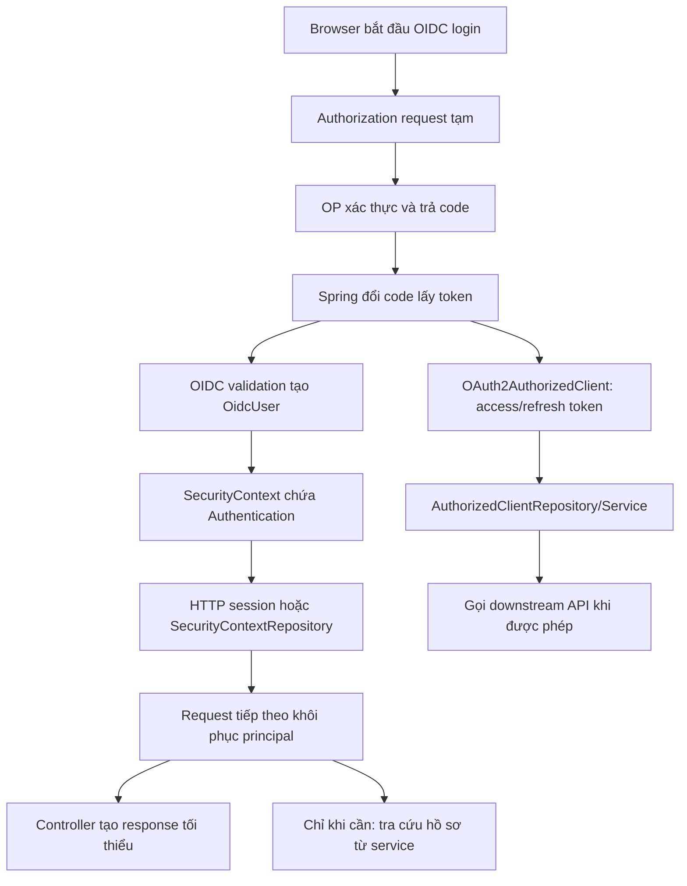

# 12.11. Giới hạn dữ liệu cá nhân được lưu trong phiên

Khi ứng dụng **Spring Security OAuth 2.0 / OpenID Connect (OIDC) Client** đăng nhập thành công, Spring Security có thể tạo `OidcUser` và lưu `Authentication` trong `SecurityContext`. Từ góc nhìn lập trình viên, việc đọc `user.getEmail()` hoặc `user.getFullName()` rất thuận tiện. Tuy nhiên, sự thuận tiện đó dễ dẫn đến một thói quen nguy hiểm: **sao chép toàn bộ ID Token, UserInfo claims hoặc hồ sơ người dùng vào HTTP session** rồi giữ chúng lâu hơn nhu cầu thực tế.

Bài học này tập trung vào nguyên tắc **data minimization** — chỉ thu thập, xử lý và lưu giữ những dữ liệu thực sự cần cho phiên đăng nhập và nghiệp vụ. Trong Spring Security Servlet, mục tiêu không phải xóa mọi thông tin khỏi `SecurityContext` bằng mọi giá; mục tiêu là hiểu **dữ liệu nào đã tồn tại trong các cấu trúc bảo mật**, tránh nhân bản vô ích, giảm phạm vi truy cập, kiểm soát thời gian sống và chọn kiến trúc lưu trữ thích hợp.

Ngữ cảnh: **Spring Boot 3.x, Spring Security 6.x, `oauth2Login()` trên Servlet/Spring MVC**, có thể sử dụng Spring Session hoặc HTTP session của servlet container. Các ví dụ dùng tên và URL giả lập; chính sách lưu giữ cuối cùng cần phù hợp mục đích sản phẩm, yêu cầu bảo mật và quy định áp dụng.

## 1. Mục tiêu của việc giới hạn dữ liệu trong session

Sau bài này, bạn cần phân biệt được:

- **Thông tin xác thực cần thiết:** issuer, subject, authorities, client registration và các dữ liệu phục vụ cơ chế Spring Security.
- **Hồ sơ hiển thị:** tên, email, ảnh đại diện, số điện thoại, địa chỉ, ngày sinh hoặc các claims chuyên biệt do provider trả về.
- **Credential và token:** ID Token, access token, refresh token, client secret và session cookie; mỗi loại có yêu cầu bảo vệ riêng.
- **Trạng thái phiên ứng dụng:** `SecurityContext`, các `HttpSession` attributes tự thêm, `OAuth2AuthorizedClient` và dữ liệu tạm của Authorization Code Flow.
- **Dữ liệu nghiệp vụ lâu dài:** hồ sơ người dùng trong database, audit records và dữ liệu cần được quản lý bằng chính sách retention khác với HTTP session.

Một nguyên tắc xuyên suốt:

> **Không lưu thêm một bản sao hồ sơ vào session chỉ vì có thể lấy được nó từ `OidcUser`.** Hãy bắt đầu từ mục đích cần dùng, xác định tập dữ liệu tối thiểu và chọn nơi lưu phù hợp.

Giảm dữ liệu trong session giúp giảm tác động khi session store, log, backup hoặc hệ thống quan sát bị truy cập trái phép; đồng thời hạn chế dữ liệu cũ, lỗi đồng bộ và chi phí nhân bản session giữa các node.

## 2. Một phiên OIDC login có thể chứa những gì?

### 2.1. Ba nhóm dữ liệu thường bị đánh đồng

| Nhóm dữ liệu | Thành phần thường liên quan | Mục đích | Rủi ro nếu sao chép tùy tiện |
| --- | --- | --- | --- |
| **`SecurityContext` và principal** | `Authentication`, thường là `OAuth2AuthenticationToken` chứa `OidcUser` | Nhận diện người dùng và áp dụng authorization trong web request | Principal có thể mang claims/ID Token; nhân bản làm tăng vùng dữ liệu nhạy cảm |
| **`OAuth2AuthorizedClient`** | `OAuth2AuthorizedClientRepository` / `OAuth2AuthorizedClientService` | Quản lý access token và refresh token khi client gọi API | Token có thể cấp quyền truy cập API nếu bị lộ |
| **Ứng dụng tự thêm session attributes** | `HttpSession#setAttribute`, session-scoped beans | Giữ trạng thái UI hoặc nghiệp vụ giữa các request | Dễ lưu dư tên, email, địa chỉ, permissions hoặc bản sao token |

Ngoài ra, trong lúc **đang bắt đầu đăng nhập**, `AuthorizationRequestRepository` có thể giữ `OAuth2AuthorizationRequest` trong session, gồm `state`, nonce/PKCE context và thông tin liên kết callback. Dữ liệu này là **trạng thái tạm** và không nên được sử dụng như hồ sơ sau đăng nhập.

Điểm quan trọng: **nơi lưu `OAuth2AuthorizedClient` phụ thuộc cấu hình**. Có ứng dụng dùng repository dựa trên session, có ứng dụng dùng `OAuth2AuthorizedClientService` với storage khác. Không khẳng định access/refresh token luôn nằm trong session, cũng không giả định chúng chưa từng được lưu chỉ vì code ứng dụng không gọi `session.setAttribute(...)`.

### 2.2. Sơ đồ một ứng dụng web stateful



```text
Browser cookie (thường chỉ là opaque session identifier)
          |
          v
Session store phía server
  - SecurityContext và Authentication
  - Có thể có dữ liệu pending OAuth2 login
  - Các session attributes do ứng dụng tự thêm
          |
          +--> Authorized client / token storage có thể riêng hoặc liên quan session
```

Trong cấu hình session phía server thông thường, cookie `JSESSIONID` **không tự chứa toàn bộ claims OIDC**; nó là một định danh giúp server tìm phiên. Nhưng một ứng dụng tự triển khai **client-side session/JWT cookie** có thể đặt dữ liệu trong cookie — cần đánh giá kiến trúc thực tế, không được suy từ tên “session”.

### 2.3. `OidcUser` có thể giữ ID Token và UserInfo

`OidcUser` trong Spring Security thường cho phép đọc:

```java
user.getSubject();
user.getIssuer();
user.getIdToken();
user.getUserInfo();
user.getClaims();
user.getAuthorities();
```

`DefaultOidcUser` thông dụng có `OidcIdToken` và có thể có `OidcUserInfo`. Vì vậy:

- Xóa `email` khỏi một session attribute tự tạo **không đồng nghĩa** email biến mất khỏi mọi dữ liệu trong `SecurityContext`.
- Giảm scopes có thể giảm số claims OP phát, nhưng OP vẫn có thể đưa claims bổ sung vào ID Token.
- Một authority hay custom principal cũng có thể mang chi tiết claims nếu implementation đã giữ nguyên đối tượng `OidcUserAuthority`.

**Nếu yêu cầu đặt ra là “session store không được chứa ID Token hoặc PII ở bất kỳ hình thức nào”**, không thể bảo đảm yêu cầu này chỉ bằng việc bỏ vài lệnh `session.setAttribute`. Cần thiết kế principal/`SecurityContextRepository`/token store có chủ đích, xem phần nâng cao bên dưới.

## 3. Dữ liệu nào thực sự cần cho một phiên đăng nhập?

Trong OIDC, danh tính nền tảng thường gắn với:

```text
(issuer, subject)
```

Trong đó:

- `iss` là issuer của OP.
- `sub` là định danh subject trong phạm vi issuer.
- `aud` giúp xác định ID Token dành cho đúng client, thuộc bước **xác minh token**.

Đối với ứng dụng có nhiều OP, dùng mỗi `sub` làm khóa toàn cục có thể dẫn đến nhầm người vì hai issuer khác nhau có thể cùng phát `sub="123"`. Một cách liên kết danh tính phổ biến là **cặp issuer + subject**, rồi ánh xạ đến **ID tài khoản nội bộ** qua dịch vụ người dùng.

Ngay cả cặp issuer/subject hay ID tài khoản nội bộ vẫn là dữ liệu **có thể liên kết đến một cá nhân**, nên không được coi là “vô hại” chỉ vì nó không phải email. Dữ liệu giả danh (pseudonymous) vẫn cần chính sách truy cập và lưu giữ.

### 3.1. Ma trận quyết định lưu dữ liệu

| Dữ liệu | Có cần để giữ phiên đăng nhập? | Gợi ý xử lý |
| --- | --- | --- |
| Issuer + subject | Thường cần cho ánh xạ danh tính và liên kết tài khoản | Chỉ dùng ở nơi cần; hạn chế bản sao và log |
| Internal account reference | Có thể cần cho authorization/nghiệp vụ | Dùng định danh nội bộ ổn định, có kiểm soát truy cập |
| Authority/role tối thiểu | Cần cho các rule phân quyền đang áp dụng | Chỉ đưa quyền mà ứng dụng hiểu và thực sự dùng; quản lý thời hạn cập nhật |
| Display name | Không phải điều kiện cốt lõi để xác thực OIDC | Tạo response khi hiển thị, không mặc định lưu cả phiên |
| Email | Không phải định danh OIDC bắt buộc, có thể thay đổi | Chỉ lấy nếu có mục đích nghiệp vụ rõ; xét `email_verified` khi phù hợp |
| Avatar URL | Không thiết yếu cho xác thực | Tải khi UI cần; xem xét rò rỉ tới host ảnh bên thứ ba |
| Số điện thoại, địa chỉ, ngày sinh | Thường không cần cho phiên đăng nhập | Không yêu cầu scope/claims nếu không có nhu cầu minh bạch |
| Toàn bộ `getClaims()` / UserInfo JSON | Gần như không nên thêm vào session tùy ý | Chỉ truy cập thuộc tính cần thiết tại nơi sử dụng |
| ID Token raw | Cần được framework kiểm tra khi login; lưu giữ tùy principal/thiết kế | Không tự sao chép vào session hoặc log |
| Access/refresh token | Chỉ cần khi có chức năng OAuth2 Client gọi API | Quản lý qua authorized client storage bảo mật, không gắn vào UI session tùy tiện |
| Client secret | Không phải dữ liệu của phiên người dùng | Chỉ giữ trong backend secret store/configuration |

Quyết định cụ thể tùy ứng dụng. Ví dụ website chỉ hiển thị “đã đăng nhập” có thể không cần truy cập email; một ứng dụng gửi hóa đơn qua email lại có mục đích riêng để lưu địa chỉ trong hệ thống nghiệp vụ. **Nhu cầu nghiệp vụ lâu dài không phải lý do tự động lưu toàn bộ email/profile trong HTTP session.**

## 4. Các nguyên tắc data minimization khi dùng UserInfo

### 4.1. Bắt đầu từ phạm vi quyền (scopes) nhỏ nhất

OIDC dùng `openid` để yêu cầu xác thực. Các scope `profile`, `email`, `phone` và `address` có thể cho phép client nhận thêm claims tương ứng, tùy hỗ trợ, chính sách OP và consent của người dùng.

Nếu ứng dụng chỉ cần biết một user đã đăng nhập, không nên mặc định yêu cầu mọi scope:

**Cấu hình rộng — không dùng làm mặc định khi không cần:**

```yaml
spring:
  security:
    oauth2:
      client:
        registration:
          academy:
            scope: [openid, profile, email, phone, address]
```

**Cấu hình tối giản để khởi đầu:**

```yaml
spring:
  security:
    oauth2:
      client:
        registration:
          academy:
            scope: [openid]
```

Ví dụ này giả định những property client ID, secret, issuer và redirect URI khác đã được cấu hình đầy đủ. Nó minh họa **thu hẹp scope**, không phải một `application.yml` hoàn chỉnh.

Điểm cần hiểu: **scope là một yêu cầu gửi đến OP, không phải cơ chế xóa dữ liệu đã nhận**. OP có thể cấp scope khác theo cấu hình/consent, hoặc trả claims bổ sung trong ID Token; ứng dụng cần xem xét thực tế token/claims do OP phát và chính sách lưu trữ phía mình.

### 4.2. Không gọi UserInfo khi không có mục đích

UserInfo Endpoint có thể trả nhiều thông tin hơn một UI đang cần. Với OIDC Login, `OidcUserService` có thể gọi UserInfo theo điều kiện về token, scopes và cấu hình. Nếu không cần claims bổ sung, hãy đánh giá việc **không yêu cầu scope/không tải dữ liệu không cần thiết**, thay vì tải toàn bộ profile rồi tìm cách xóa khỏi session sau đó.

Không nên tự gọi:

```text
GET https://idp.example.com/oidc/userinfo
```

ở mỗi request chỉ “cho chắc chắn đã đăng nhập”. OIDC login đã có luồng xác thực ID Token. UserInfo dùng để lấy thêm claims khi nghiệp vụ cần, không thay thế Session/Authentication.

Khi custom `OidcUserService`, cần bảo đảm các quy tắc OIDC, đặc biệt việc **`sub` trong UserInfo khớp `sub` của ID Token**. Không ghép thông tin hai tài khoản chỉ dựa trên email.

### 4.3. Ánh xạ trường hiển thị, không truyền nguyên profile

Giả sử UserInfo trả:

```json
{
  "sub": "user-183",
  "name": "Nguyen An",
  "email": "an@example.com",
  "email_verified": true,
  "phone_number": "+84xxxxxxxxx",
  "address": {
    "country": "VN",
    "locality": "HCMC"
  },
  "picture": "https://images.example.com/users/183.png",
  "custom_groups": ["students", "alumni"]
}
```

Nếu màn hình chỉ hiện lời chào, application layer chỉ cần một giá trị hiển thị như `name` — không cần đưa toàn bộ JSON, số điện thoại, địa chỉ và groups vào session hoặc trả hết về frontend.

Một ví dụ controller:

```java
import org.springframework.security.core.annotation.AuthenticationPrincipal;
import org.springframework.security.oauth2.core.oidc.user.OidcUser;
import org.springframework.web.bind.annotation.GetMapping;
import org.springframework.web.bind.annotation.RestController;

@RestController
public class GreetingController {

    public record GreetingView(String greeting) {}

    @GetMapping("/api/greeting")
    public GreetingView greeting(@AuthenticationPrincipal OidcUser user) {
        String givenName = user.getGivenName();
        String greeting = (givenName == null || givenName.isBlank())
                ? "Xin chào"
                : "Xin chào, " + givenName;

        return new GreetingView(greeting);
    }
}
```

Endpoint này **dùng dữ liệu tại thời điểm tạo response**, không tạo thêm session attribute chứa profile. Nó giả định endpoint chỉ được truy cập bởi người dùng đã đăng nhập OIDC. Nếu ứng dụng còn phương thức authentication khác, cần kiểm tra loại principal phù hợp.

**Cảnh báo:** việc trả tên ra response vẫn là một hoạt động xử lý dữ liệu cá nhân; frontend không nên lưu nó vô thời hạn trong local storage hoặc analytics chỉ vì server không lưu thêm bản sao trong session.

## 5. Dữ liệu cá nhân nằm ở đâu trong `SecurityContext`?

Trong luồng Servlet OIDC Login thông dụng:

```text
SecurityContext
  |
  +-- Authentication: OAuth2AuthenticationToken
        |
        +-- principal: OidcUser (thường là DefaultOidcUser)
        |     |
        |     +-- OidcIdToken
        |     |     +-- raw token value
        |     |     +-- ID Token claims
        |     |
        |     +-- OidcUserInfo (tùy cấu hình)
        |     |     +-- UserInfo claims
        |     |
        |     +-- Authorities
        |
        +-- authorizedClientRegistrationId
```

Vì `SecurityContext` thường được giữ giữa các request trong ứng dụng stateful, **object graph của principal có thể đi vào session store**. Khi dùng Spring Session với Redis/JDBC, dữ liệu serialized có thể được sao chép qua mạng nội bộ và nằm trong storage ngoài JVM.

### 5.1. Giảm dữ liệu tự lưu là bước đầu tiên, không phải bước cuối

Đoạn mã sau là **anti-pattern**:

```java
// KHÔNG NÊN: tự nhân bản toàn bộ hồ sơ và token vào session
session.setAttribute("oidcClaims", oidcUser.getClaims());
session.setAttribute("idTokenRaw",
        oidcUser.getIdToken().getTokenValue());
session.setAttribute("userInfo", oidcUser.getUserInfo());
session.setAttribute("profile", entireProfileFromProvider);
```

Tác hại:

- Một số dữ liệu có thể đã tồn tại trong `OidcUser` được Spring quản lý.
- Session có thể bị nhân bản sang Redis hoặc nhiều node.
- Dữ liệu tồn tại tới hết TTL/session invalidation, không nhất thiết đồng bộ với cập nhật của OP.
- Các thành phần có quyền đọc session giờ có thêm đường truy cập token và profile.
- Việc xóa user/profile theo retention policy phức tạp hơn vì nhiều bản sao.

Thay vào đó, hãy **sử dụng `Authentication`/`OidcUser` có sẵn khi cần**, tránh tự thêm claims vào session.

### 5.2. Không phải mọi `OidcUser` đều “nhỏ”

Không nên viết trong báo cáo bảo mật rằng “session không chứa PII” chỉ vì application code chỉ thêm `session.setAttribute("uiTheme", "dark")`.

`DefaultOidcUser` có thể tiếp tục chứa ID Token và UserInfo. Ngoài principal, authority object hoặc `OAuth2AuthorizedClientRepository` có thể giữ dữ liệu nhạy cảm theo cách lưu cụ thể.

Khi yêu cầu bảo mật thật sự là **không giữ raw ID Token hoặc UserInfo claims trong session**, cần thiết kế cơ chế tạo principal tối giản hoặc cơ chế lưu `SecurityContext` khác và thẩm định đầy đủ các hậu quả về xác thực, OIDC semantics, serialization và refresh token. Không có một property Spring Boot đơn giản để đảm bảo loại bỏ tất cả những dữ liệu này trong mọi cấu hình.

## 6. Không nhân bản dữ liệu vì mục đích hiển thị

### 6.1. Ví dụ xấu: đưa toàn bộ profile vào session sau login

```java
// Ví dụ anti-pattern, không dùng trong production:
http.oauth2Login(oauth2 -> oauth2
    .successHandler((request, response, authentication) -> {
        OidcUser user = (OidcUser) authentication.getPrincipal();
        request.getSession().setAttribute(
                "fullProfile", user.getClaims());
        response.sendRedirect("/dashboard");
    }));
```

Vấn đề không chỉ là dữ liệu nhạy cảm. Khi tự thay `AuthenticationSuccessHandler` mặc định, code còn phải chịu trách nhiệm điều hướng thành công phù hợp, ví dụ saved request. Việc thêm session attribute toàn bộ claims là sự nhân bản không cần thiết.

### 6.2. Ví dụ tốt hơn: tạo DTO nhỏ cho request hiện tại

Thay vì thêm profile vào session, tạo representation tối thiểu cho frontend khi có request:

```java
import org.springframework.security.core.annotation.AuthenticationPrincipal;
import org.springframework.security.oauth2.core.oidc.user.OidcUser;
import org.springframework.web.bind.annotation.GetMapping;
import org.springframework.web.bind.annotation.RestController;

@RestController
class ProfileViewController {

    record ProfileView(boolean signedIn, String displayName) {}

    @GetMapping("/api/profile-view")
    ProfileView view(@AuthenticationPrincipal OidcUser user) {
        String name = user.getGivenName();
        if (name == null || name.isBlank()) {
            name = "Người dùng";
        }

        return new ProfileView(true, name);
    }
}
```

Ưu điểm:

1. Không tự tạo thêm session attribute chứa toàn bộ UserInfo.
2. Response chỉ có hai trường cần thiết cho UI.
3. Khi UI đổi yêu cầu, không buộc session trở thành nơi chứa mọi dữ liệu hồ sơ.
4. Bộ điều khiển truy cập của Spring áp dụng trước khi response được tạo.

Tuy nhiên, **đây không phải biện pháp xóa claims khỏi `OidcUser` gốc**. Nó chỉ hạn chế dữ liệu ứng dụng chủ động nhân bản và trả cho frontend.

### 6.3. Không giữ nguyên tên/ảnh đại diện trên mọi tầng

Nếu UI chỉ cần một tên hiển thị, đừng tự động lưu nó đồng thời trong:

```text
Spring Security principal
+ HttpSession profile object
+ Redis session map
+ Application cache
+ Browser localStorage
+ Analytics event
+ Request/response logs
```

Một giá trị được nhân bản ở sáu nơi tạo ra sáu bề mặt bảo vệ và xóa. Hãy xác định **nơi sở hữu dữ liệu** và mỗi bản sao có mục đích/time-to-live gì. Đặc biệt không dùng localStorage cho access/refresh tokens của một ứng dụng server-side chỉ để thuận tiện truy cập frontend.

## 7. Nếu session thực sự cần trạng thái ứng dụng riêng

Có những trạng thái UI hợp lý được lưu ngắn hạn trong session, ví dụ chế độ hiển thị, trang wizard hiện tại hoặc tùy chọn tạm. Không phải dữ liệu nào cũng cần đến OP hoặc database.

Ví dụ Java record chỉ chứa trạng thái hiển thị không nhạy cảm:

```java
import java.io.Serializable;

public record UiState(
        String theme,
        boolean showTips
) implements Serializable {
}
```

Khi lưu:

```java
import jakarta.servlet.http.HttpSession;

public void rememberUiPreference(HttpSession session) {
    session.setAttribute("uiState",
            new UiState("dark", false));
}
```

Nếu cần liên kết với tài khoản nội bộ để điều khiển nghiệp vụ, cân nhắc lưu **một tham chiếu opaque** do backend quản lý thay vì toàn bộ profile. Tuy nhiên, tham chiếu vẫn là dữ liệu có thể gắn với cá nhân; phải giữ ngắn hạn, giới hạn quyền đọc và kiểm soát session hijacking.

### 7.1. Chọn đúng nơi chứa dữ liệu

| Nhu cầu | Nơi thường phù hợp hơn | Lý do |
| --- | --- | --- |
| Principal và authorities của request | `SecurityContext` do Spring Security quản lý | Tránh tự tạo một “user session object” trùng lặp |
| Gọi downstream API bằng OAuth2 access token | Authorized client repository/service bảo mật | Có cơ chế gắn token với registration/principal |
| Hiển thị tên/người dùng | Tạo view từ principal hoặc truy vấn dữ liệu đã cho phép | Không cần lưu thêm toàn bộ profile trong session |
| Lưu hồ sơ có vòng đời nghiệp vụ | Database/service có retention và access control | Quản lý cập nhật, xóa, kiểm toán tốt hơn session |
| Trạng thái wizard UI ngắn hạn | Session attribute nhỏ nếu thực sự cần | TTL theo phiên, tránh PII |
| Ghi nhận sự kiện an ninh | Audit log tối thiểu, có chính sách lưu giữ riêng | Audit không phải kho sao chép raw tokens/claims |

Một phiên đăng nhập không nên trở thành **database hồ sơ thứ hai**.

## 8. Quản lý access token và refresh token riêng với profile

Sau OAuth2/OIDC Login, Spring Security có thể tạo `OAuth2AuthorizedClient` chứa access token và refresh token (nếu OP cấp). Nó thường được truy xuất qua `OAuth2AuthorizedClientRepository`, `OAuth2AuthorizedClientService` hoặc các API OAuth2 Client tương ứng.

Cần phân biệt:

- **ID Token:** chứng minh danh tính người dùng cho OIDC Client; trong default principal có thể còn được giữ.
- **Access token:** credential để client gọi API/resource server, tùy scope/audience.
- **Refresh token:** credential có thể cấp access token mới; thường nhạy cảm và có thời hạn/quyền sử dụng riêng.
- **Session cookie:** định danh phiên của Spring application, không được xem là access token của OP.

**Không lưu một bản sao access token vào `session.setAttribute("access_token", token)`** chỉ để controller gọi API. Dùng authorized client abstraction và HTTP client integration phù hợp.

### 8.1. Chỉ yêu cầu offline access khi thật sự cần

Một số OP dùng `offline_access` hoặc các cấu hình riêng để cấp refresh token. Nếu ứng dụng không cần gọi API sau khi người dùng rời browser hoặc không cần refresh token, hãy tránh yêu cầu quyền rộng hơn mục đích.

Việc giới hạn scopes/token lifetime **không tự xóa token khỏi storage**, nhưng giảm khả năng phát sinh token nhiều quyền hơn nhu cầu. Cần cân nhắc tách client registrations nếu các tính năng có yêu cầu quyền khác nhau.

### 8.2. Dữ liệu trong authorized client có thể được lưu ở đâu?

| Lựa chọn | Đặc điểm | Quyết định bảo mật |
| --- | --- | --- |
| Repository dựa trên HTTP session | Token liên quan session ứng dụng | Bảo vệ session store, TTL và việc logout |
| Authorized client service dạng in-memory | Dữ liệu nằm trong tiến trình backend | Không phù hợp mọi triển khai nhiều instance/durable storage |
| Service/repository database hoặc store phân tán | Token có thể sống và được truy xuất ngoài JVM | Cần encryption/access control/audit/retention riêng |
| Custom service với secret storage bảo mật | Phù hợp yêu cầu bảo vệ chặt | Cần kiểm soát khóa mã hóa, rotation và quyền đọc |

Đừng mặc định dùng database là tự an toàn hơn session hay ngược lại. Nơi lưu token phải được thiết kế theo mức nhạy cảm, phạm vi sử dụng, lifecycle và khả năng thu hồi. Không ghi raw token vào log, error responses hoặc analytics.

## 9. Thời gian sống: session, token và hồ sơ là ba vòng đời riêng

Một lỗi vận hành thường gặp là đặt `session timeout = 24 giờ` rồi cho rằng mọi dữ liệu danh tính và token nên được giữ 24 giờ.

Thực tế:

- **HTTP session timeout:** quyết định thời gian không hoạt động trước khi phiên ứng dụng hết hạn theo container/store.
- **ID Token `exp`:** thời hạn token theo OP, không nhất thiết đồng nghĩa thời điểm session phải tự hết.
- **Access token `expires_at`:** thời hạn token gọi API; có thể được refresh theo quy tắc client.
- **Refresh token:** vòng đời riêng, có thể chịu rotation/revocation.
- **Profile cache:** nếu có, nên dùng thời hạn dựa trên mục đích và khả năng cập nhật của OP.
- **Audit records:** có chính sách retention riêng; không nên lấy theo thời hạn session hoặc token.

Nếu ứng dụng giữ ID Token hoặc UserInfo claims trong `SecurityContext`, các claims có thể **không tự được làm mới khi OP thay đổi hồ sơ**. Vì vậy không nên coi session principal là nguồn hồ sơ luôn cập nhật.

### 9.1. Cấu hình session timeout

Ví dụ `application.yml`:

```yaml
server:
  servlet:
    session:
      timeout: 20m
      cookie:
        http-only: true
        secure: true
        same-site: lax
```

`application.properties` tương đương:

```properties
server.servlet.session.timeout=20m
server.servlet.session.cookie.http-only=true
server.servlet.session.cookie.secure=true
server.servlet.session.cookie.same-site=lax
```

Giá trị `20m` **chỉ là ví dụ**, không phải timeout bắt buộc cho mọi sản phẩm. Hãy chọn theo rủi ro, UX, loại dữ liệu và chính sách tổ chức.

- `HttpOnly` giảm khả năng JavaScript đọc session cookie trực tiếp.
- `Secure` buộc cookie được gửi trên HTTPS; cấu hình proxy/TLS phải đúng.
- `SameSite=Lax` thường phù hợp callback top-level GET của OIDC Authorization Code Flow, nhưng **có thể không phù hợp nếu OP dùng `response_mode=form_post`**.
- Cookie attributes bảo vệ **tham chiếu session**, không mã hóa dữ liệu đã nằm ở session store.

Nếu backend chạy sau reverse proxy, cần đảm bảo host/scheme công khai và forwarded headers chỉ được tin khi đến từ proxy đáng tin cậy. Không sửa cấu hình cookie bằng cách tắt bảo vệ toàn cục để “cho login chạy”.

### 9.2. Timeout ngắn không giải quyết toàn bộ retention

Dù timeout 20 phút, dữ liệu có thể còn trong snapshot, database backup, log, queue hoặc bản sao cache theo chính sách hạ tầng. Data minimization cần giải quyết toàn bộ đường đi của dữ liệu, không chỉ TTL của `JSESSIONID`.

## 10. Logout và dọn dữ liệu phiên

Spring Security cho phép cấu hình logout để xóa Authentication và hủy HTTP session:

```java
import org.springframework.context.annotation.Bean;
import org.springframework.context.annotation.Configuration;
import org.springframework.security.config.Customizer;
import org.springframework.security.config.annotation.web.builders.HttpSecurity;
import org.springframework.security.web.SecurityFilterChain;

@Configuration
public class SecurityConfig {

    @Bean
    SecurityFilterChain securityFilterChain(HttpSecurity http)
            throws Exception {

        http
            .authorizeHttpRequests(auth -> auth
                .requestMatchers("/", "/error", "/assets/**").permitAll()
                .anyRequest().authenticated()
            )
            .oauth2Login(Customizer.withDefaults())
            .logout(logout -> logout
                .invalidateHttpSession(true)
                .clearAuthentication(true)
                .deleteCookies("JSESSIONID")
                .logoutSuccessUrl("/"));

        return http.build();
    }
}
```

Trong ứng dụng có CSRF protection (mặc định cho nhiều cấu hình Servlet), logout thường phải được kích hoạt bằng **POST có CSRF token hợp lệ**, không tùy ý đặt liên kết GET làm hành động thay đổi trạng thái.

**Lưu ý về phạm vi:** xóa session Spring application không mặc định:

- Xóa bản ghi người dùng lâu dài trong database.
- Thu hồi toàn bộ access/refresh token ở OP.
- Xóa authorized clients đang được lưu ngoài session.
- Đăng xuất khỏi SSO session tại OP.
- Xóa backups hoặc analytics đã thu thập trước đó.

Nếu ứng dụng dùng `OAuth2AuthorizedClientService` lưu token độc lập, cần chính sách dọn token theo principal/registration và quyền thu hồi khi logout hoặc khi người dùng yêu cầu chấm dứt liên kết. Nếu cần logout OP, hãy dùng luồng OIDC logout phù hợp thay vì giả định xóa `JSESSIONID` đã logout mọi hệ thống.

### 10.1. Dọn session attributes tự tạo

Khi một flow đặc thù kết thúc, có thể xóa attribute sớm hơn logout:

```java
session.removeAttribute("temporaryWizardState");
```

Trạng thái tạm chỉ cần cho một bước nên được **xóa ngay khi hoàn tất bước**. Không đợi toàn bộ HTTP session hết hạn nếu dữ liệu không còn mục đích sử dụng.

## 11. Giảm dữ liệu trong response, log và hệ thống quan sát

Session store không phải bề mặt duy nhất có dữ liệu người dùng. Nếu ứng dụng không lưu hồ sơ trong session nhưng lại ghi raw ID Token vào log, yêu cầu minimization vẫn thất bại.

### 11.1. Không log toàn bộ `OidcUser`

Không nên:

```java
// KHÔNG NÊN: toString() có thể vô tình lộ dữ liệu cần bảo vệ
log.info("OIDC user: {}", oidcUser);
log.info("OIDC claims: {}", oidcUser.getClaims());
log.info("Raw ID token: {}", oidcUser.getIdToken().getTokenValue());
```

Thay vào đó, ghi metadata vận hành cần thiết, ví dụ:

```java
log.info("OIDC login succeeded: registrationId={}", registrationId);
```

Nếu cần tương quan sự kiện theo người dùng, cân nhắc một **audit reference** được thiết kế riêng, giới hạn truy cập và có chính sách retention; không lấy toàn bộ email hoặc raw subject làm correlation ID mặc định trên mọi hệ thống.

### 11.2. Tránh logging HTTP Authorization và callback URL

Các trường có nguy cơ chứa credential:

- `Authorization: Bearer <access-token>`.
- `Authorization: Basic <client-credential>` ở Token Endpoint.
- Callback query `?code=...&state=...`.
- Session cookie (`Cookie: JSESSIONID=...`).
- ID Token, refresh token, PKCE `code_verifier`.
- JSON UserInfo và hồ sơ người dùng từ OP.

Đặc biệt chú ý ở **reverse proxy access logs, distributed tracing, APM, exception telemetry** và công cụ hỗ trợ người dùng. Request ID dùng để debug nên **không có chức năng xác thực**.

### 11.3. Masking không thay thế nguyên tắc không thu thập

Che email trong log có thể hữu ích, nhưng tốt hơn là **không log email khi không cần**. Redaction có thể thất bại nếu cùng claim xuất hiện ở exception text, structured logs, request body hay custom metadata; giảm lượng dữ liệu đi vào pipeline quan sát giúp giảm gánh nặng bảo vệ.

## 12. Session replication và Spring Session Redis/JDBC

Một HTTP session chỉ tồn tại trong JVM của một node có thể bị mất khi instance chết hoặc browser callback sang node khác. Nhiều hệ thống chọn **Spring Session** để lưu session trong Redis/JDBC hoặc một store phân tán.

Điều này không chỉ là vấn đề khả dụng:

- `SecurityContext` và principal có thể được serialize.
- Các dữ liệu UserInfo/ID Token đang giữ trong principal có thể được ghi vào external session store.
- Nhiều thành phần hạ tầng, operator, backup pipeline hoặc tài khoản vận hành có thể tiếp cận dữ liệu session.
- Dữ liệu có thể được nhân bản sang replica, snapshot hoặc backup.
- Một bản ghi session hết hạn không đồng nghĩa mọi bản sao lưu đã được xóa.

Vì thế trước khi bật session replication, cần biết **session thực tế đang chứa gì**. Không nên mở tool quản trị Redis rồi dump toàn bộ key/value có token ra log hoặc ticket chỉ để tìm kích thước.

### 12.1. Biện pháp bảo vệ session store

Các lựa chọn triển khai thường cần:

1. **Network isolation**: store chỉ nhận kết nối từ những ứng dụng/operational components được phép.
2. **Authentication và phân quyền**: hạn chế ai đọc/ghi session data.
3. **TLS khi truyền** tới store nếu kiến trúc cho phép và yêu cầu.
4. **Encryption at rest** ở mức phù hợp, kết hợp bảo vệ backup.
5. **TTL và cleanup** rõ ràng cho session và dữ liệu tạm.
6. **Không log raw key/value** hoặc serialize token sang analytics.
7. **Bảo vệ quá trình khôi phục và debug**: chỉ dùng dữ liệu đã làm sạch nếu có thể.
8. **Cập nhật/giảm vòng đời bản sao** trong replication và backup theo chính sách.

Không đặt raw session ID làm metric label hoặc log correlation ID vì session ID là credential có thể dẫn đến hijacking nếu bị lộ.

### 12.2. Session attribute nhỏ giúp gì cho khả năng vận hành?

Một profile 20 KB được lưu lặp trong hàng trăm nghìn phiên có thể làm tăng bộ nhớ, network traffic và dung lượng lưu trữ. Nếu còn nhiều lần serialize/replicate, chi phí tăng thêm. Quan trọng hơn, session profile thường trở nên **stale** so với nguồn dữ liệu thực. Một session nhỏ giúp giảm cả bề mặt rò rỉ lẫn chi phí vận hành.

## 13. Có nên tạo `OidcUser` tối giản để giảm dữ liệu trong SecurityContext?

Đây là câu hỏi nâng cao. Cần phân biệt ba mức:

### Mức A — Không lưu thêm bản sao profile

Giữ `oauth2Login()` mặc định, giới hạn scopes và không thêm `user.getClaims()`/raw tokens vào session. Đây là **bước dễ áp dụng, ít rủi ro**. Nó không loại bỏ dữ liệu đang tồn tại trong `DefaultOidcUser` của SecurityContext.

### Mức B — Chỉ sử dụng một projection tối thiểu ở application layer

Các controller/service dùng một dữ liệu ứng dụng nhỏ, chẳng hạn internal account reference và authorities cần thiết. Profile được lấy khi cần từ một nguồn đã được kiểm soát hoặc được chuyển thành DTO nhỏ cho response. Cách này **không sửa principal gốc**, nhưng giới hạn sự lan truyền dữ liệu sang phần còn lại của hệ thống.

### Mức C — Chủ động tối giản principal/session storage

Khi policy thật sự cấm raw ID Token/UserInfo trong session, đội bảo mật có thể yêu cầu:

- `OidcUserService` hoặc cơ chế tạo principal được thiết kế riêng, chỉ lưu tối thiểu thông tin cần cho ứng dụng.
- SecurityContext representation tùy biến hoặc `SecurityContextRepository` có chính sách serialize/load tối giản.
- Tách token storage khỏi session và kiểm soát truy cập token theo principal/registration.
- Thiết kế session lifecycle, logout và claim refresh rõ ràng.
- Xác minh rằng dữ liệu nhạy cảm không còn nằm gián tiếp trong authorities, custom attributes, pending authorization request hay các bean session-scoped khác.

**Không nên làm việc này bằng cách chỉ loại ID Token khỏi `DefaultOidcUser` một cách máy móc.** `OidcUser` có ngữ nghĩa OIDC và framework/ứng dụng có thể cần các thành phần token/claims để hoạt động đúng. Một triển khai custom phải bảo đảm **OIDC ID Token validation hoàn tất trước khi tạo principal tin cậy**, không làm mất issuer/subject/audience/nonce checks và không nhầm OAuth2 authentication với local authentication.

### 13.1. Vì sao `OidcUserService` chỉ là một điểm mở rộng, không phải “công tắc xóa PII”?

Ví dụ customizer:

```java
.oauth2Login(oauth2 -> oauth2
    .userInfoEndpoint(userInfo -> userInfo
        .oidcUserService(customOidcUserService)))
```

`customOidcUserService` là một `OAuth2UserService<OidcUserRequest, OidcUser>` do ứng dụng cung cấp. Custom service có thể thay đổi cách lấy UserInfo/ánh xạ principal. Tuy nhiên, nếu service **vẫn trả `DefaultOidcUser` với ID Token và UserInfo đầy đủ**, session vẫn có thể giữ dữ liệu đó. Muốn minimization sâu, phải hiểu object graph được lưu, trách nhiệm xác thực và contract của các API đang dùng.

Tùy biến chỉ để “giấu” dữ liệu trong controller không chứng minh dữ liệu không tồn tại ở session store.

### 13.2. Stateless có phải giải pháp ngay lập tức?

Một lựa chọn kỹ thuật là API **Resource Server stateless**, xác minh access token ở mỗi request. Nhưng việc bật:

```java
.sessionManagement(session -> session
    .sessionCreationPolicy(SessionCreationPolicy.STATELESS))
```

một cách máy móc trong ứng dụng `oauth2Login()` có thể phá vỡ những giả định về lưu **authorization request, state và SecurityContext** của browser login. Stateless API và **server-side OIDC login có browser redirect** là hai kiến trúc khác nhau. Nếu muốn chuyển sang kiến trúc không lưu session, cần thiết kế lại cách lưu correlation, token và trạng thái đăng nhập — không chỉ thay một enum.

## 14. Thiết kế authorization không phụ thuộc profile dư thừa

Đôi khi ứng dụng muốn lưu `department`, `groups`, `email` hoặc toàn bộ UserInfo trong session “để kiểm tra quyền nhanh hơn”. Điều này có thể khiến:

- Quyền bị stale khi người dùng bị thu hồi role tại OP.
- Claim được diễn giải khác nhau giữa nhiều provider.
- Dữ liệu nhạy cảm bị rò vào các phần code chỉ cần biết user đã login.
- Session bị phình to theo số lượng groups.

Hướng thiết kế thường an toàn hơn:

1. Xác định **role/permission nội bộ** mà ứng dụng hiểu và cần.
2. Chỉ chuyển các claims đã được OP kiểm chứng và được chính sách tin cậy cho phép thành authorities phù hợp.
3. Xác định **thời hạn làm mới quyền** hoặc kiểm tra lại ở nguồn authorization khi nghiệp vụ nhạy cảm.
4. Không giữ nguyên danh sách `groups` nếu ứng dụng chỉ cần một authority như `ROLE_VIEWER`.
5. Không sử dụng email, ảnh đại diện, họ tên như “bằng chứng” người dùng thuộc một vai trò.

Đặc biệt, cặp `(issuer, subject)` dùng để liên kết danh tính, còn chính sách cho phép thao tác của ứng dụng cần cơ chế authorization riêng.

## 15. Hồ sơ thay đổi trong khi session vẫn sống

Giả sử người dùng đăng nhập lúc 09:00, OP trả email cũ và tên hiển thị cũ. Đến 09:10, người dùng đổi email ở OP; HTTP session của ứng dụng vẫn còn.

Nếu ứng dụng **lưu nguyên profile vào session**, nó có thể hiển thị hoặc sử dụng dữ liệu cũ cho đến hết session. Điều này dẫn đến những vấn đề:

- Thông tin hiển thị không phản ánh thay đổi gần nhất.
- Người dùng yêu cầu chỉnh sửa/xóa dữ liệu nhưng bản cũ vẫn tồn tại trong session.
- Quyết định nghiệp vụ dựa trên email/department cũ có thể sai.
- Việc đồng bộ các bản sao trở nên phức tạp.

Một thiết kế phù hợp hơn là xác định **nguồn dữ liệu chính**:

- OP là nguồn của claims danh tính được quản lý bởi OP.
- Database của ứng dụng là nguồn của hồ sơ nghiệp vụ nội bộ nếu có.
- Session chỉ đại diện một phiên đăng nhập và trạng thái tạm cần thiết.

Khi cần dữ liệu cập nhật, ứng dụng có thể truy vấn nguồn có kiểm soát hoặc dùng cache ngắn hạn theo nhu cầu. Không nên gọi UserInfo cho mọi request nếu chi phí cao; thay vào đó thiết kế rõ **freshness, TTL, event-driven invalidation** hoặc cache phù hợp.

## 16. Một ví dụ triển khai từ đầu với dữ liệu tối thiểu

Giả sử website học tập dùng OP `academy`, chỉ cần xác thực người dùng và hiển thị trạng thái đăng nhập. Chúng ta có thể bắt đầu với cấu hình scope nhỏ:

**`application.yml`:**

```yaml
spring:
  security:
    oauth2:
      client:
        registration:
          academy:
            provider: academy-op
            client-id: ${OIDC_CLIENT_ID}
            client-secret: ${OIDC_CLIENT_SECRET}
            authorization-grant-type: authorization_code
            scope: [openid]
            redirect-uri: "{baseUrl}/login/oauth2/code/{registrationId}"
        provider:
          academy-op:
            issuer-uri: ${OIDC_ISSUER_URI}

server:
  servlet:
    session:
      timeout: 20m
      cookie:
        http-only: true
        secure: true
        same-site: lax
```

**`SecurityFilterChain`:**

```java
import org.springframework.context.annotation.Bean;
import org.springframework.context.annotation.Configuration;
import org.springframework.security.config.Customizer;
import org.springframework.security.config.annotation.web.builders.HttpSecurity;
import org.springframework.security.web.SecurityFilterChain;

@Configuration
class SecurityConfig {

    @Bean
    SecurityFilterChain securityFilterChain(HttpSecurity http) throws Exception {
        http
            .authorizeHttpRequests(auth -> auth
                .requestMatchers("/", "/error", "/assets/**").permitAll()
                .anyRequest().authenticated()
            )
            .oauth2Login(Customizer.withDefaults())
            .logout(logout -> logout
                .invalidateHttpSession(true)
                .clearAuthentication(true));

        return http.build();
    }
}
```

**Endpoint trạng thái nhỏ**, không cần truy xuất toàn bộ profile:

```java
import org.springframework.security.core.Authentication;
import org.springframework.web.bind.annotation.GetMapping;
import org.springframework.web.bind.annotation.RestController;

@RestController
class SessionStatusController {

    record SessionStatus(boolean signedIn) {}

    @GetMapping("/api/session-status")
    SessionStatus status(Authentication authentication) {
        return new SessionStatus(
                authentication != null && authentication.isAuthenticated());
    }
}
```

Với `/api/session-status` nằm dưới `anyRequest().authenticated()`, request chưa login sẽ bị đưa vào login flow trước khi controller chạy; endpoint này không thay cho kiểm tra phân quyền hay cung cấp thông tin account. Nếu muốn trả trạng thái cho anonymous request mà không redirect, phải thiết kế request matcher/entry point riêng.

**Điều đạt được:** không yêu cầu `profile`/`email` mặc định, không tự lưu toàn bộ UserInfo, không trả raw token/profile cho browser, session có TTL và logout. **Điều chưa được bảo đảm:** principal mặc định Spring vẫn có thể giữ ID Token và các claims trong `SecurityContext`; cần đánh giá mức C nếu policy yêu cầu loại hoàn toàn.

### 16.1. Phiên bản properties

```properties
spring.security.oauth2.client.registration.academy.provider=academy-op
spring.security.oauth2.client.registration.academy.client-id=${OIDC_CLIENT_ID}
spring.security.oauth2.client.registration.academy.client-secret=${OIDC_CLIENT_SECRET}
spring.security.oauth2.client.registration.academy.authorization-grant-type=authorization_code
spring.security.oauth2.client.registration.academy.scope=openid
spring.security.oauth2.client.registration.academy.redirect-uri={baseUrl}/login/oauth2/code/{registrationId}
spring.security.oauth2.client.provider.academy-op.issuer-uri=${OIDC_ISSUER_URI}

server.servlet.session.timeout=20m
server.servlet.session.cookie.http-only=true
server.servlet.session.cookie.secure=true
server.servlet.session.cookie.same-site=lax
```

Chọn YAML **hoặc** properties theo convention dự án; không cố tình định nghĩa hai giá trị khác nhau rồi bỏ mặc độ ưu tiên nguồn cấu hình.

## 17. Các lỗi triển khai thường gặp

| Hiện tượng hoặc quyết định sai | Hậu quả | Cách xử lý |
| --- | --- | --- |
| `session.setAttribute("profile", user.getClaims())` | Nhân bản claims/PII vào session | Tạo DTO tối thiểu khi request cần hoặc dùng storage có retention riêng |
| Lưu raw access token trong session attribute do ứng dụng tự đặt | Token nằm ngoài authorized client abstraction | Dùng `OAuth2AuthorizedClientRepository/Service` có chính sách bảo vệ |
| Yêu cầu đủ `profile,email,phone,address` từ ngày đầu | Thu thập nhiều claims hơn mục đích | Thu hẹp scopes; chỉ xin quyền khi tính năng cần |
| Chỉ xóa email khỏi DTO rồi tuyên bố session không chứa PII | `DefaultOidcUser` có thể vẫn chứa ID Token/UserInfo | Xem đầy đủ `SecurityContext` và storage thực tế |
| Đặt `session.timeout` ngắn nhưng log raw claims/token | Token/PII tồn tại lâu hơn ở logging pipeline | Giới hạn log fields, che credential, retention của log |
| Dùng `email` làm khóa duy nhất cho tài khoản OIDC | Email có thể thiếu, đổi hoặc trùng giữa OP | Dùng issuer+subject và quy trình account linking |
| Lưu toàn bộ groups vào session để phân quyền | Dữ liệu có thể nhạy cảm và stale | Chuyển thành authority nội bộ tối thiểu, có chính sách refresh |
| Redis session store không có access control | Nhiều thành phần có thể đọc dữ liệu phiên | Network isolation, xác thực/phân quyền và bảo vệ backup |
| Logout chỉ xóa `JSESSIONID` nhưng token nằm ở DB khác | Token có thể còn dùng được | Xây dựng policy dọn authorized clients/revoke token tương ứng |
| Đổi sang `STATELESS` mà không xử lý OAuth2 correlation | Login callback không tìm được state/authorization request | Thiết kế lại flow hoặc dùng session theo cơ chế phù hợp |
| Trả `OidcUser.getClaims()` qua endpoint `/me` | Lộ nhiều trường profile không cần cho frontend | Trả projection chứa các field thật sự cần |
| Dùng cache profile không TTL | Dữ liệu stale và retention không kiểm soát | TTL ngắn, refresh/invalidation theo nhu cầu |

## 18. Thực hành đánh giá dữ liệu trong một ứng dụng có sẵn

Một bài tập vận hành có thể thực hiện **trong môi trường test, dữ liệu giả**, không dump session/token production.

### 18.1. Lập sơ đồ dòng dữ liệu

```text
OP /authorize
   -> authorization code callback
   -> /token
   -> ID Token (+ access token)
   -> OidcUser / SecurityContext
   -> HttpSession/Spring Session
   -> Controller/service
   -> API response / cache / log / database
```

Với từng điểm, trả lời:

1. Dữ liệu nào đi qua?
2. Có cần dữ liệu ấy để phục vụ mục đích này không?
3. Nó được lưu hay chỉ xử lý trong request?
4. Ai có quyền truy cập?
5. Bao lâu thì xóa hoặc làm mới?
6. Có được sao chép vào backup/tracing hay không?

### 18.2. Kiểm tra session attributes ở mức metadata an toàn

Khi cần khảo sát session trong môi trường test, **chỉ liệt kê tên attribute**, không in nội dung:

```java
import java.util.Collections;
import java.util.List;

import jakarta.servlet.http.HttpSession;
import org.springframework.web.bind.annotation.GetMapping;
import org.springframework.web.bind.annotation.RestController;

@RestController
class SessionAttributeInspector {

    @GetMapping("/internal/session-attributes")
    List<String> attributeNames(HttpSession session) {
        return Collections.list(session.getAttributeNames());
    }
}
```

Endpoint minh họa này phải được **giới hạn chặt trong môi trường kiểm thử nội bộ hoặc không triển khai lên production**. Tên attribute có thể vô tình tiết lộ cấu trúc hệ thống. Ngoài ra, liệt kê tên **không thể chứng minh nội dung bên trong đối tượng đã được tối giản**; muốn kiểm tra dữ liệu serialized, hãy dùng test fixture tổng hợp và môi trường bảo mật, không xuất bản dump dữ liệu thật.

### 18.3. Các tình huống cần thử nghiệm

- Đăng nhập với scope `openid` rồi so sánh loại claims được cấp với scope `openid profile email` trong một OP test.
- Truy cập endpoint UI và xác nhận response chỉ chứa những trường thực sự cần.
- Đăng xuất và xác nhận session cũ không còn truy cập được endpoint bảo vệ.
- Đợi session hết hạn và xác nhận phiên không thể dùng lại.
- Chạy hai instance với session store phù hợp và đảm bảo không có nơi nào dump raw token.
- Đổi profile tại OP và kiểm tra ứng dụng không phụ thuộc dữ liệu cache vô hạn.
- Cho hai OP trả cùng email nhưng khác issuer/subject và đảm bảo hệ thống không tự gộp tài khoản.
- Kiểm tra tracing/proxy log trong môi trường test để xác định `Authorization` header, callback code và token không bị ghi lại.

Đây là **các đề xuất kiểm thử cho người học hoặc bước xác minh sau này**, không phải bằng chứng rằng hệ thống hiện tại đã đạt yêu cầu.

## 19. Câu hỏi tự kiểm tra

**Câu 1.** Ứng dụng chỉ hiện lời chào nhưng lưu `user.getClaims()` trong session. Điều gì nên thay đổi?

> Không nhân bản toàn bộ claims. Chỉ tạo một response field cần thiết khi render lời chào, và đánh giá scope/claims mà OP trả.

**Câu 2.** Đã bỏ `session.setAttribute("email", ...)`. Có thể khẳng định session không còn email?

> Chưa. `OidcUser` trong `SecurityContext` có thể giữ ID Token hoặc UserInfo chứa email. Cần đánh giá object graph và storage thực tế.

**Câu 3.** Có nên dùng email làm định danh bền vững cho tài khoản đăng nhập qua nhiều OP không?

> Không nên. Cần phân biệt issuer và subject, còn email có thể thay đổi hoặc không được xác minh.

**Câu 4.** Session cookie chỉ chứa một opaque session ID. Có nghĩa dữ liệu session phía server không nhạy cảm?

> Không. Định danh cookie cấp đường truy cập tới phiên; phía server có thể lưu `Authentication`, claims, token hoặc state khác.

**Câu 5.** Nếu ứng dụng cần gọi API với OAuth2 access token, có nên thêm `accessToken` vào session attribute tự tạo?

> Không nên. Dùng authorized client abstraction và kho lưu token được bảo vệ phù hợp.

**Câu 6.** Session timeout 20 phút có bảo đảm token không còn trong backup hoặc logs sau 20 phút không?

> Không. Session, token store, log và backup có các vòng đời độc lập cần chính sách retention riêng.

**Câu 7.** Tắt session bằng `STATELESS` có phải cách nhanh nhất để website `oauth2Login()` không giữ UserInfo?

> Không. Authorization Code Flow vẫn cần quản lý `state`, nonce/PKCE context và callback correlation. Cần thiết kế lại kiến trúc nếu thật sự muốn stateless.

**Câu 8.** Tại sao không dùng danh sách `groups` trong ID Token làm nguyên một trường session dài hạn?

> Vì groups có thể nhạy cảm, thay đổi hoặc không phản ánh quyền nội bộ. Hãy chỉ ánh xạ quyền thực sự cần và đặt chính sách cập nhật.

**Câu 9.** Một user sửa địa chỉ tại OP nhưng session còn tồn tại. Hệ thống phải làm gì?

> Không mặc định tin hồ sơ cũ trong session là nguồn sự thật. Thiết kế cách tải lại/cập nhật dữ liệu theo mục đích, độ mới và quyền truy cập.

**Câu 10.** Nếu yêu cầu pháp lý cấm giữ raw ID Token trong session, giảm scopes có đủ không?

> Chưa đủ. Principal Spring mặc định có thể vẫn chứa ID Token; cần thiết kế SecurityContext/principal/token storage và chứng minh phạm vi dữ liệu đã được giới hạn.

## 20. Những điểm cần ghi nhớ

1. **`SecurityContext`, `OidcUser`, `OAuth2AuthorizedClient` và các `HttpSession` attributes tự thêm là những nơi lưu/đọc khác nhau.** Cần nhìn toàn bộ đường đi dữ liệu.
2. **Đừng sao chép `getClaims()`, `OidcUserInfo`, raw ID Token hoặc access/refresh token vào session theo thói quen.**
3. **Yêu cầu scope tối thiểu**, chỉ dùng UserInfo và claims phục vụ nhu cầu đã xác định.
4. **Tạo DTO nhỏ khi trả response**, thay vì đưa nguyên profile xuống browser.
5. **Hiểu rằng `DefaultOidcUser` có thể giữ ID Token/UserInfo trong SecurityContext**; bỏ custom session attributes không tự xóa dữ liệu ấy.
6. **Token để gọi API thuộc authorized client storage**, cần chính sách riêng về lưu, truy cập, refresh, revoke và logout.
7. **Session timeout, cookie policy, logout, logging, Spring Session/Redis và backup** cùng ảnh hưởng thời gian và phạm vi tồn tại của dữ liệu.
8. **Issuer + subject** là nền tảng phổ biến cho liên kết danh tính OIDC; email/tên không phải khóa duy nhất đáng tin cậy.
9. Với yêu cầu nghiêm ngặt “session không chứa dữ liệu cá nhân/token”, cần **kiến trúc lưu SecurityContext và principal tùy biến có kiểm chứng**, không phải một cấu hình hời hợt.
10. Data minimization là **quyết định thiết kế xuyên suốt vòng đời dữ liệu**, không chỉ là một dòng code xóa attribute.

### Tài liệu tham khảo

- [Spring Security Reference — OAuth 2.0 Login](https://docs.spring.io/spring-security/reference/servlet/oauth2/login/index.html).
- [Spring Security Reference — OAuth 2.0 Login Advanced Configuration](https://docs.spring.io/spring-security/reference/servlet/oauth2/login/advanced.html).
- [Spring Security Reference — OAuth 2.0 Client](https://docs.spring.io/spring-security/reference/servlet/oauth2/client/index.html).
- [Spring Security Reference — SecurityContext and SecurityContextHolder](https://docs.spring.io/spring-security/reference/servlet/authentication/architecture.html).
- [Spring Security Reference — Persisting Authentication](https://docs.spring.io/spring-security/reference/servlet/authentication/persistence.html).
- [Spring Session Reference](https://docs.spring.io/spring-session/reference/).
- [Spring Boot Reference — Servlet Web Sessions](https://docs.spring.io/spring-boot/reference/web/servlet.html).
- [OpenID Connect Core 1.0 — Claims](https://openid.net/specs/openid-connect-core-1_0.html#Claims).
- [OpenID Connect Core 1.0 — UserInfo Endpoint](https://openid.net/specs/openid-connect-core-1_0.html#UserInfo).
- [OpenID Connect Core 1.0 — ID Token Validation](https://openid.net/specs/openid-connect-core-1_0.html#IDTokenValidation).
- [OWASP Session Management Cheat Sheet](https://cheatsheetseries.owasp.org/cheatsheets/Session_Management_Cheat_Sheet.html).
