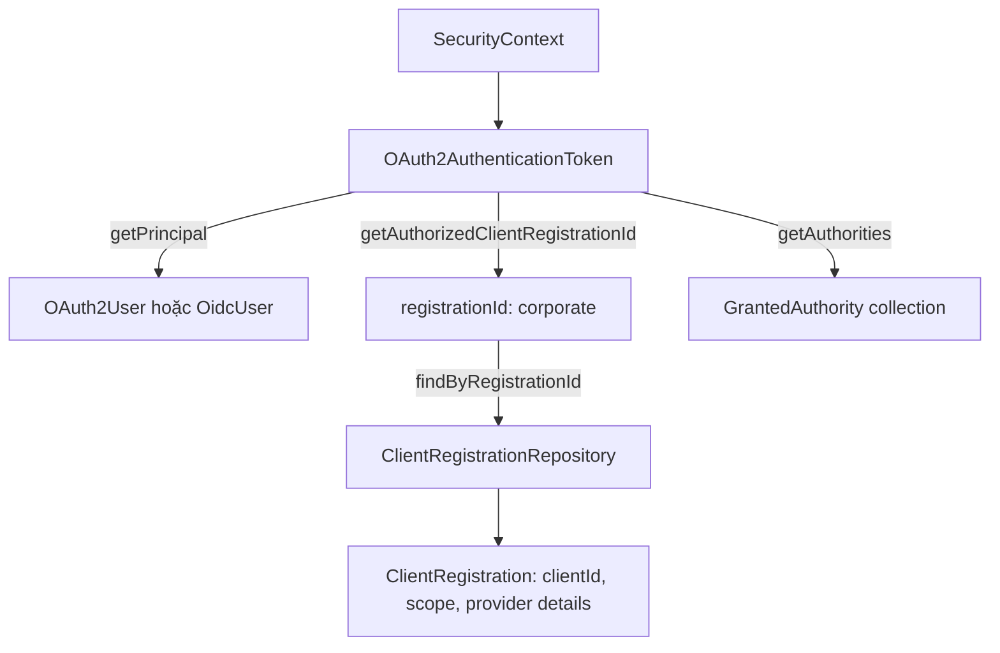
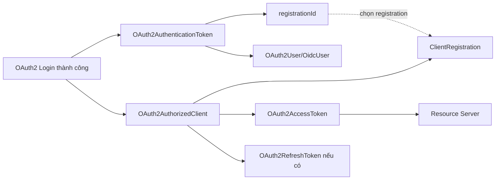
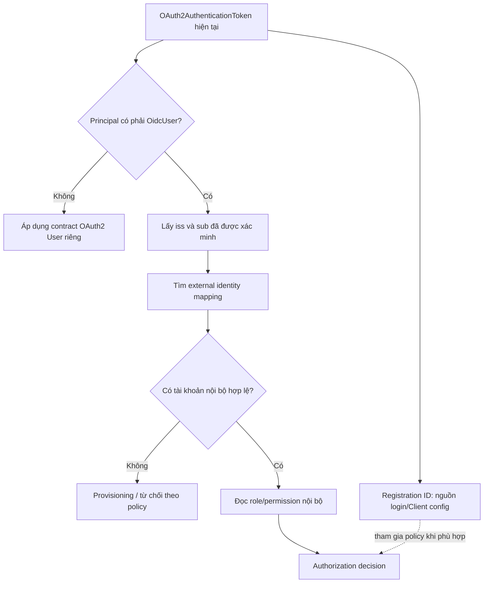

# 13.1. OAuth2AuthenticationToken và cách lấy registration ID

> **Module:** Spring Security OAuth 2.0 OIDC Client  
> **Chương:** 13. Principal và phân quyền  
> **Trọng tâm:** Hiểu `OAuth2AuthenticationToken` trong Spring Security Servlet sau OAuth 2.0/OIDC Login; lấy đúng **registration ID** của Client đã dùng để đăng nhập; phân biệt thông tin danh tính, Client registration và quyền truy cập; sử dụng trong controller, service và luồng gọi API.

Một ứng dụng Spring Boot có thể cho phép đăng nhập bằng nhiều Identity Providers: SSO nội bộ, Google, GitHub hoặc các OpenID Providers của từng tổ chức. Sau khi người dùng đăng nhập thành công, Spring Security thường đưa đối tượng `OAuth2AuthenticationToken` vào `SecurityContext` của request web.

Đối tượng này giúp trả lời hai câu hỏi khác nhau:

1. **Người dùng hiện tại là ai, có những authorities nào?** → xem `getPrincipal()`, `getName()`, `getAuthorities()`.
2. **Người dùng đã đăng nhập bằng cấu hình OAuth2 Client nào của ứng dụng?** → xem `getAuthorizedClientRegistrationId()`.

Ví dụ ứng dụng có registration ID `corporate` trỏ tới một OpenID Provider và client ID thật là `employee-portal-web`. Sau khi người dùng chọn “Đăng nhập bằng SSO công ty”, `getAuthorizedClientRegistrationId()` trả về **`corporate`**, không phải `employee-portal-web`, không phải URL issuer và không phải role của người dùng.

Chỉ một sự nhầm lẫn nhỏ ở đây có thể khiến code tìm sai `OAuth2AuthorizedClient`, truy xuất access token của registration khác, hoặc sử dụng nhà cung cấp đăng nhập làm căn cứ cấp quyền không an toàn.

Bài học phân tích đối tượng, quy trình tạo nó, những cách lấy registration ID đúng trong Spring MVC, cách dùng ID đó với authorized client, cùng các bẫy bảo mật khi chuyển từ đăng nhập sang phân quyền.

---

## 1. Mục tiêu học tập

Sau bài này, bạn có thể:

1. Mô tả `OAuth2AuthenticationToken` là gì và được tạo ở giai đoạn nào của Servlet OAuth2/OIDC Login.
2. Phân biệt `Authentication`, `OAuth2AuthenticationToken`, `OAuth2User`, `OidcUser` và `OAuth2AuthorizedClient`.
3. Dùng `getAuthorizedClientRegistrationId()` để lấy registration ID của lần đăng nhập hiện tại.
4. Phân biệt **registration ID**, **provider ID**, **client ID**, **issuer** và **subject** bằng ví dụ cấu hình cụ thể.
5. Truy cập registration ID trong controller thông qua tham số `OAuth2AuthenticationToken` hoặc `SecurityContextHolder` ở một service đồng bộ.
6. Viết code an toàn khi authentication chưa tồn tại hoặc không phải OAuth2 Login.
7. Hiểu vì sao OIDC user vẫn thường có `OAuth2AuthenticationToken` ở cấp Authentication, dù principal là `OidcUser`.
8. Sử dụng registration ID để định vị `ClientRegistration` hoặc `OAuth2AuthorizedClient` phù hợp khi cần, mà không nhầm token đăng nhập với access token gọi API.
9. Nhận diện khác biệt giữa registration được dùng để **login** và registration được dùng để **authorize** một API Client khác.
10. Xác định ranh giới giữa thông tin đăng nhập, role/authority và chính sách phân quyền nghiệp vụ.

## 2. Ba khái niệm cần tách: Authentication, principal và registration

Spring Security quản lý thông tin xác thực hiện tại bằng giao diện `Authentication`. Trong ứng dụng web dùng OAuth2 Login, một implementation phổ biến sau login là `OAuth2AuthenticationToken`.

Một đối tượng Authentication thường bao gồm:

- **Principal:** đối tượng biểu diễn người dùng đã được xác thực.
- **Authorities:** tập các `GrantedAuthority` được dùng khi đánh giá quyền.
- **Name:** tên principal do cơ chế đăng nhập tạo.
- **Authenticated flag:** trạng thái xác thực của đối tượng.
- **Details:** thông tin bổ sung phụ thuộc cơ chế xử lý.

Riêng `OAuth2AuthenticationToken` giữ thêm **authorized client registration ID**, tức khóa của Client registration dùng trong luồng đăng nhập.

Sơ đồ:



Những dữ liệu trong sơ đồ giải quyết câu hỏi khác nhau:

| Dữ liệu | Trả lời câu hỏi | Không có nghĩa |
|---|---|---|
| `authentication.getName()` | Principal hiện tại có tên gì theo user service? | Không phải registration ID |
| `authentication.getPrincipal()` | Đối tượng người dùng sau OAuth2/OIDC Login là gì? | Không phải access token |
| `authentication.getAuthorities()` | Principal có những authorities nào? | Không phải danh sách Client registrations |
| `getAuthorizedClientRegistrationId()` | Cấu hình Client nào được dùng để đăng nhập? | Không tự chứng minh role hoặc tenant membership |
| `ClientRegistration.getClientId()` | Client ID nào đã đăng ký với OP/AS? | Không phải tên registration nội bộ |
| `OAuth2AuthorizedClient` | Token/ủy quyền của Client registration trong một ngữ cảnh | Không đồng nghĩa với Authentication hiện tại |

**Quy tắc nền tảng:** registration ID là metadata về **Client**, còn principal là thông tin về **người dùng**. Hai loại thông tin không thể thay thế cho nhau.

## 3. OAuth2AuthenticationToken là gì?

`org.springframework.security.oauth2.client.authentication.OAuth2AuthenticationToken` là một lớp Spring Security cho Authentication sau khi người dùng đăng nhập thông qua OAuth 2.0 Login.

Các thành phần được quan tâm:

```java
// Chữ ký ở mức khái niệm, rút gọn để giải thích:
public class OAuth2AuthenticationToken
        extends AbstractAuthenticationToken {

    public OAuth2AuthenticationToken(
            OAuth2User principal,
            Collection<? extends GrantedAuthority> authorities,
            String authorizedClientRegistrationId);

    public OAuth2User getPrincipal();

    public String getAuthorizedClientRegistrationId();

    public String getName();
}
```

Đây là hình thức minh họa các thành phần công khai; không sao chép lại khai báo lớp vào dự án. Hãy dùng implementation có sẵn trong dependency Spring Security.

### 3.1. Các phương thức thường sử dụng

| Method | Kiểu dữ liệu | Ý nghĩa thực tế |
|---|---|---|
| `getAuthorizedClientRegistrationId()` | `String` | Registration ID dùng để đăng nhập |
| `getPrincipal()` | `OAuth2User` | Người dùng đã được xác thực; có thể là `OidcUser` |
| `getName()` | `String` | Tên principal theo mapping của OAuth2/OIDC user service |
| `getAuthorities()` | `Collection<? extends GrantedAuthority>` | Các quyền/authority trong Authentication |
| `isAuthenticated()` | `boolean` | Trạng thái của đối tượng Authentication |
| `getDetails()` | `Object` | Dữ liệu chi tiết tùy cấu hình |

Trong ứng dụng sản phẩm, không nên trả nguyên toàn bộ `Authentication` về API hoặc ghi `authentication.toString()` vào log vô điều kiện: tùy implementation và custom details, dữ liệu có thể nhiều hơn mức cần công khai.

### 3.2. Khi nào đối tượng này xuất hiện?

Ở Spring Security Servlet với `oauth2Login()`, callback được xử lý bằng `OAuth2LoginAuthenticationFilter`. Sau khi `AuthenticationManager` xác thực OAuth2/OIDC thành công, kết quả được chuyển thành Authentication phục vụ request tiếp theo và được lưu theo chiến lược `SecurityContextRepository`/session của ứng dụng.

Trong luồng đăng nhập thông thường, object đó là `OAuth2AuthenticationToken`.

Không nên nhầm với:

- `OAuth2LoginAuthenticationToken`: token **nội bộ** dùng trong lúc xử lý callback và trao đổi authorization code.
- `OAuth2AuthorizationCodeAuthenticationToken`: token liên quan xác thực authorization code ở lớp thấp.
- `JwtAuthenticationToken`: thường gặp khi ứng dụng là Resource Server xác minh bearer JWT đến từ API client.
- `UsernamePasswordAuthenticationToken`: có thể xuất hiện nếu ứng dụng đồng thời hỗ trợ form login.
- `AnonymousAuthenticationToken`: đại diện anonymous authentication trong một số ngữ cảnh không đăng nhập.

Không phải mọi `Authentication` trong mọi ứng dụng đều là `OAuth2AuthenticationToken`. Vì vậy cần **kiểm tra kiểu** khi dùng cơ chế xác thực hỗn hợp.

## 4. Registration ID, provider ID và client ID: cùng một ví dụ

Giả sử cấu hình `application.yml`:

```yaml
spring:
  security:
    oauth2:
      client:
        registration:
          corporate:
            provider: company-op
            client-id: employee-portal-web
            client-secret: ${CORP_CLIENT_SECRET}
            authorization-grant-type: authorization_code
            redirect-uri: "{baseUrl}/login/oauth2/code/{registrationId}"
            scope:
              - openid
              - profile
              - email

        provider:
          company-op:
            issuer-uri: https://id.example.test/realms/employees
```

Bây giờ có ít nhất bốn định danh:

| Thuật ngữ | Giá trị trong ví dụ | Được dùng cho |
|---|---|---|
| **Registration ID** | `corporate` | Chọn Client registration trong Spring; login URL, callback, authorized client lookup |
| **Provider ID** | `company-op` | Liên kết registration với nhánh provider config |
| **Client ID** | `employee-portal-web` | Định danh OAuth2 Client tại OP; ID Token `aud` phải phù hợp |
| **Issuer URI** | `https://id.example.test/realms/employees` | Định danh OP, discovery và kiểm tra `iss` |
| **Subject** | Ví dụ `person-492` | Định danh người dùng trong phạm vi issuer |

Khi người dùng đăng nhập qua:

```text
GET /oauth2/authorization/corporate
```

thì sau khi thành công:

```java
authentication.getAuthorizedClientRegistrationId()
// "corporate"
```

Không phải:

```java
// Không phải giá trị của method trên:
"employee-portal-web"                          // client-id
"company-op"                                   // provider ID
"https://id.example.test/realms/employees"     // issuer
"person-492"                                   // subject
```

### 4.1. Callback dùng registration ID

Với redirect URI mặc định:

```text
{baseUrl}/login/oauth2/code/{registrationId}
```

callback là:

```text
https://app.example.test/login/oauth2/code/corporate
```

OP cũng cần đăng ký URI phù hợp. Việc callback có `corporate` giúp Spring Security tìm đúng ClientRegistration và ngữ cảnh authorization request. Nhưng **không nên tự đọc path callback để suy ra authentication hiện tại** ở các request sau login; dùng `getAuthorizedClientRegistrationId()` từ Authentication đã được Spring Security xác thực.

### 4.2. Đổi registration ID ảnh hưởng điều gì?

Nếu đổi `corporate` thành `employee-sso` trong YAML:

- URL bắt đầu login mặc định đổi sang `/oauth2/authorization/employee-sso`.
- Callback mặc định đổi sang `/login/oauth2/code/employee-sso`.
- Kết quả `getAuthorizedClientRegistrationId()` đổi thành `employee-sso`.
- Mã dùng `findByRegistrationId("corporate")` hoặc `@RegisteredOAuth2AuthorizedClient("corporate")` cần xem xét cập nhật.
- Các authorized clients đã lưu với registration ID cũ có thể cần xử lý migration/invalidation tùy kiến trúc.

Trong khi đó, client ID `employee-portal-web` và issuer có thể giữ nguyên nếu OP registration không thay đổi. Việc đặt lại tên ở Spring **không mặc nhiên** sửa đăng ký callback bên OP.

## 5. Luồng tạo OAuth2AuthenticationToken trong Servlet

Luồng giản lược:

```mermaid
sequenceDiagram
    autonumber
    actor U as Người dùng
    participant B as Browser
    participant R as AuthorizationRequestRedirectFilter
    participant OP as OpenID Provider
    participant F as OAuth2LoginAuthenticationFilter
    participant AM as AuthenticationManager
    participant SC as SecurityContext
    U->>B: Chọn đăng nhập corporate
    B->>R: GET /oauth2/authorization/corporate
    R->>R: Tìm ClientRegistration corporate; tạo state/PKCE/nonce khi phù hợp
    R-->>B: 302 tới authorization endpoint
    B->>OP: Xác thực và chấp thuận
    OP-->>B: Redirect code/state về /login/oauth2/code/corporate
    B->>F: Callback
    F->>AM: authenticate(OAuth2LoginAuthenticationToken)
    AM->>AM: OAuth2/OIDC provider xác thực; tải principal
    AM-->>F: OAuth2User hoặc OidcUser đã xác thực
    F->>F: Tạo OAuth2AuthenticationToken(principal, authorities, corporate)
    F->>SC: Lưu Authentication; lưu authorized client theo cấu hình
    F-->>B: Redirect tới trang sau đăng nhập
    B->>SC: Request sau đó qua session/security context
    SC-->>B: Authentication có registrationId=corporate
```

Trong thực tế việc lưu Authentication và authorized client còn qua các repository/filter/strategy phù hợp với phiên bản và cấu hình, nhưng ý tưởng vẫn là: **registration ID được biết từ ClientRegistration của giao dịch đăng nhập**, không phải được suy đoán từ username.

### 5.1. Registration được quyết định trước khi login

Client có thể hiển thị nhiều liên kết đăng nhập:

```html
<a href="/oauth2/authorization/corporate">SSO công ty</a>
<a href="/oauth2/authorization/google-work">Google Workspace</a>
<a href="/oauth2/authorization/github-account">GitHub</a>
```

Người dùng chọn một registration; Spring Security khởi tạo giao dịch, lưu thông tin correlation như `state` và xử lý callback. Đến lúc Authentication thành công, registration ID của giao dịch được gắn vào `OAuth2AuthenticationToken`.

Không nên tin một HTTP header do người gọi đặt như `X-Registration-Id: corporate` để tuyên bố người dùng đã đăng nhập qua nhà cung cấp đó. Metadata đáng tin của phiên đăng nhập phải đến từ kết quả xác thực đã được Spring Security thiết lập.

## 6. Cách 1 — Lấy registration ID trực tiếp trong Spring MVC controller

Đây là cách dễ đọc nhất khi endpoint chỉ phục vụ người dùng OAuth2/OIDC Login.

```java
package example.web;

import java.util.Map;

import org.springframework.security.oauth2.client.authentication
    .OAuth2AuthenticationToken;
import org.springframework.web.bind.annotation.GetMapping;
import org.springframework.web.bind.annotation.RestController;

@RestController
class LoginInfoController {

    @GetMapping("/login-info")
    Map<String, String> loginInfo(
            OAuth2AuthenticationToken authentication) {

        return Map.of(
            "registrationId",
            authentication.getAuthorizedClientRegistrationId(),
            "principalName",
            authentication.getName()
        );
    }
}
```

**Lưu ý về import:** trong file Java thật, tên package cần viết trên **một dòng**:

```java
import org.springframework.security.oauth2.client.authentication.OAuth2AuthenticationToken;
```

Ví dụ dùng `Map.of` của Java 9+, phù hợp với dự án Spring Boot 3.x/Java 17.

Nếu đăng nhập qua registration `corporate`, response minh họa:

```json
{
  "registrationId": "corporate",
  "principalName": "person-492"
}
```

`principalName` phụ thuộc user service và thuộc tính định danh của provider; không giả định nó luôn là email. Với OIDC, nó có thể là subject hoặc giá trị được tùy chỉnh.

### 6.1. Điều kiện của ví dụ

Phương thức nhận `OAuth2AuthenticationToken` giả định request đã đi qua OAuth2 Login. Với endpoint chỉ yêu cầu `authenticated()` và ứng dụng có nhiều phương thức login, principal có thể không phải loại token này.

Để xử lý nhiều loại Authentication, dùng giao diện chung rồi kiểm tra kiểu như mục tiếp theo. Không nên cast mù:

```java
// Dễ gây ClassCastException nếu request dùng form login hoặc JWT bearer:
OAuth2AuthenticationToken oauth =
    (OAuth2AuthenticationToken) SecurityContextHolder
        .getContext().getAuthentication();
```

Một cách an toàn hơn là `instanceof` trước khi gọi phương thức riêng của OAuth2AuthenticationToken.

### 6.2. Cấu hình HTTP Security mẫu

```java
package example.security;

import org.springframework.context.annotation.Bean;
import org.springframework.context.annotation.Configuration;
import org.springframework.security.config.Customizer;
import org.springframework.security.config.annotation.web.builders.HttpSecurity;
import org.springframework.security.web.SecurityFilterChain;

@Configuration
class SecurityConfiguration {

    @Bean
    SecurityFilterChain securityFilterChain(HttpSecurity http)
            throws Exception {
        return http
            .authorizeHttpRequests(auth -> auth
                .requestMatchers("/", "/error").permitAll()
                .anyRequest().authenticated()
            )
            .oauth2Login(Customizer.withDefaults())
            .build();
    }
}
```

Nếu ứng dụng tự khai báo `SecurityFilterChain`, phải bật `oauth2Login()` khi muốn có luồng đăng nhập OAuth2/OIDC. Chỉ có một registration trong YAML không đảm bảo chain tùy chỉnh đã bật tính năng này.

## 7. Cách 2 — Nhận Authentication chung và kiểm tra kiểu

Một ứng dụng thực tế có thể nhận request đã xác thực bằng OIDC session, form login hoặc bearer JWT. Khi ấy method nên nhận `Authentication` và chỉ gọi `getAuthorizedClientRegistrationId()` nếu đúng kiểu.

```java
package example.web;

import java.util.LinkedHashMap;
import java.util.Map;

import org.springframework.http.HttpStatus;
import org.springframework.http.ResponseEntity;
import org.springframework.security.core.Authentication;
import org.springframework.security.oauth2.client.authentication.OAuth2AuthenticationToken;
import org.springframework.web.bind.annotation.GetMapping;
import org.springframework.web.bind.annotation.RestController;

@RestController
class AuthenticationInfoController {

    @GetMapping("/authentication-info")
    ResponseEntity<Map<String, Object>> authenticationInfo(
            Authentication authentication) {

        if (!(authentication instanceof OAuth2AuthenticationToken oauth)) {
            return ResponseEntity.status(HttpStatus.BAD_REQUEST)
                .body(Map.of(
                    "error", "This endpoint requires OAuth2/OIDC Login"
                ));
        }

        Map<String, Object> result = new LinkedHashMap<>();
        result.put(
            "registrationId",
            oauth.getAuthorizedClientRegistrationId()
        );
        result.put("principalName", oauth.getName());
        result.put(
            "principalType",
            oauth.getPrincipal().getClass().getSimpleName()
        );
        return ResponseEntity.ok(result);
    }
}
```

Ở đây `Authentication` là abstraction chung, `OAuth2AuthenticationToken` là trường hợp chuyên biệt. Cách kiểm tra này tránh ClassCastException. HTTP 400 trong ví dụ chỉ là lựa chọn minh họa; trong sản phẩm, tùy hợp đồng API có thể dùng 401/403 hoặc response khác. Chính sách HTTP Security vẫn phải chặn truy cập không phù hợp.

### 7.1. Vì sao không chỉ dùng isAuthenticated()?

Một số implementation như `AnonymousAuthenticationToken` có thể trả `isAuthenticated() == true` theo cách chúng được tạo, dù người dùng thực tế là anonymous. Do đó, kiểm tra `isAuthenticated()` một mình không đồng nghĩa với “đã đăng nhập OAuth2”.

Nếu mục tiêu là lấy registration ID, kiểm tra **loại Authentication** là điều cần thiết. Nếu mục tiêu là bảo vệ endpoint, dùng `authorizeHttpRequests()` hoặc method security với chính sách cụ thể, thay vì tự viết một điều kiện Boolean trong controller.

### 7.2. Authentication khác null và authentication sai loại

| Trạng thái | Giá trị có thể gặp | Cách xử lý hợp lý |
|---|---|---|
| Chưa đăng nhập | `null`, anonymous hoặc redirect login theo chain | Không gọi method riêng của OAuth2AuthenticationToken |
| Đăng nhập OAuth2/OIDC | `OAuth2AuthenticationToken` | Có thể lấy registration ID |
| API bearer JWT | `JwtAuthenticationToken` | Không có registration ID của OAuth2 Login theo method này |
| Đăng nhập username/password | `UsernamePasswordAuthenticationToken` | Không cast sang OAuth2AuthenticationToken |
| Authentication do ứng dụng tự tạo | Implementation tùy chỉnh | Chỉ dùng những contract thực sự được hỗ trợ |

Với API đa cơ chế, hãy xác định rõ điều kiện chấp nhận và loại principal. Không giả định “thư viện có OAuth2 Client dependency nên mọi Authentication đều là OAuth2AuthenticationToken”.

## 8. Cách 3 — Dùng SecurityContextHolder trong service đồng bộ

Khi đang ở tầng service và không muốn phụ thuộc trực tiếp vào controller argument, có thể lấy Authentication từ SecurityContext hiện tại.

```java
package example.security;

import java.util.Optional;

import org.springframework.security.core.Authentication;
import org.springframework.security.core.context.SecurityContextHolder;
import org.springframework.security.oauth2.client.authentication.OAuth2AuthenticationToken;
import org.springframework.stereotype.Component;

@Component
public class CurrentOAuth2Login {

    public Optional<String> registrationId() {
        Authentication authentication = SecurityContextHolder
            .getContext()
            .getAuthentication();

        if (authentication instanceof OAuth2AuthenticationToken oauth) {
            return Optional.of(
                oauth.getAuthorizedClientRegistrationId()
            );
        }
        return Optional.empty();
    }
}
```

Cách dùng:

```java
package example.service;

import org.springframework.stereotype.Service;

@Service
class LoginAuditService {

    private final CurrentOAuth2Login currentOAuth2Login;

    LoginAuditService(CurrentOAuth2Login currentOAuth2Login) {
        this.currentOAuth2Login = currentOAuth2Login;
    }

    public String currentLoginMethod() {
        return currentOAuth2Login.registrationId()
            .orElse("not-an-oauth2-login");
    }
}
```

Đoạn mã này trả về một tên registration hoặc một trạng thái thay thế, **không quyết định người dùng có quyền hay không**. Không dùng kết quả `not-an-oauth2-login` để mặc định cấp quyền cho người dùng chưa đăng nhập.

### 8.1. Lưu ý về thread và xử lý bất đồng bộ

`SecurityContextHolder` thường gắn security context với thread xử lý request trong Servlet stack. Khi chạy `@Async`, tạo thread mới hoặc đặt công việc vào executor, context có thể **không được truyền tự động** theo cách bạn mong đợi.

Nếu cần sử dụng identity trong xử lý bất đồng bộ:

- Ưu tiên truyền rõ thông tin tối thiểu đã được xác thực qua tham số nghiệp vụ.
- Nếu cần truyền toàn bộ context, dùng cơ chế propagation được Spring Security hỗ trợ phù hợp với executor và kiến trúc.
- Không dùng biến static hoặc `ThreadLocal` tự tạo để “ghi nhớ” registration ID qua các request.
- Không cho rằng một tác vụ background vẫn dùng cùng OAuth2AuthenticationToken sau khi request kết thúc.

Trong một service có API rõ ràng, truyền `registrationId` hoặc một principal context đã được kiểm soát thường dễ test và ít phụ thuộc vào thread hơn.

## 9. Cách 4 — Lấy principal, đồng thời nhận registration ID riêng

Spring MVC có thể inject principal qua `@AuthenticationPrincipal`. Ví dụ:

```java
package example.web;

import java.util.LinkedHashMap;
import java.util.Map;

import org.springframework.security.core.annotation.AuthenticationPrincipal;
import org.springframework.security.oauth2.client.authentication.OAuth2AuthenticationToken;
import org.springframework.security.oauth2.core.oidc.user.OidcUser;
import org.springframework.security.oauth2.core.user.OAuth2User;
import org.springframework.web.bind.annotation.GetMapping;
import org.springframework.web.bind.annotation.RestController;

@RestController
class PrincipalController {

    @GetMapping("/whoami")
    Map<String, Object> whoami(
            OAuth2AuthenticationToken authentication,
            @AuthenticationPrincipal OAuth2User principal) {

        Map<String, Object> data = new LinkedHashMap<>();
        data.put("registrationId",
            authentication.getAuthorizedClientRegistrationId());
        data.put("name", principal.getName());
        data.put("oidc", principal instanceof OidcUser);

        if (principal instanceof OidcUser oidc) {
            data.put("subject", oidc.getSubject());
            data.put("issuer",
                oidc.getIdToken().getIssuer().toString());
        }
        return data;
    }
}
```

Kết quả minh họa:

```json
{
  "registrationId": "corporate",
  "name": "person-492",
  "oidc": true,
  "subject": "person-492",
  "issuer": "https://id.example.test/realms/employees"
}
```

`@AuthenticationPrincipal` truy xuất **principal**, chứ không tự trả về `OAuth2AuthenticationToken` chứa registration ID. Nếu chỉ nhận:

```java
@GetMapping("/principal")
OAuth2User principal(@AuthenticationPrincipal OAuth2User user) {
    return user;
}
```

thì bạn có một OAuth2User nhưng không có method `getAuthorizedClientRegistrationId()` trực tiếp trên chính interface đó. Hơn nữa, trả toàn bộ principal object trực tiếp có thể khiến nhiều attributes/claims bị public không cần thiết; với API thực, nên tạo DTO chứa thông tin được phép tiết lộ.

### 9.1. OAuth2User không phải OAuth2AuthenticationToken

| Kiểu | Dữ liệu nổi bật | Có method lấy registration ID không? |
|---|---|---|
| `OAuth2AuthenticationToken` | Authentication, principal, authorities, registration ID | **Có:** `getAuthorizedClientRegistrationId()` |
| `OAuth2User` | Name, attributes, authorities | **Không** có method đó |
| `OidcUser` | ID Token, UserInfo, OIDC claims, authorities | **Không** có method đó trên interface |
| `ClientRegistration` | Client ID, scopes, redirect/provider details, registration ID | **Có:** `getRegistrationId()` |
| `OAuth2AuthorizedClient` | ClientRegistration, access/refresh token | Lấy từ `getClientRegistration().getRegistrationId()` |

Điều này cũng giải thích vì sao một component chỉ nhận `OidcUser` không thể mặc định suy ra OAuth2 Client registration từ `getIssuer()`: cùng một issuer có thể phục vụ nhiều registrations trong một ứng dụng.

## 10. OIDC Login: OAuth2AuthenticationToken vẫn chứa OidcUser

Với OIDC, Spring Security sử dụng những thành phần xác thực chuyên biệt để nhận và xác minh ID Token. Sau khi đăng nhập hoàn tất trong Servlet stack, Authentication thường vẫn là `OAuth2AuthenticationToken`, nhưng principal bên trong là một implementation của `OidcUser`, chẳng hạn `DefaultOidcUser`.

Ví dụ:

```java
OAuth2AuthenticationToken oauth = ...;

OAuth2User principal = oauth.getPrincipal();

if (principal instanceof OidcUser oidc) {
    String subject = oidc.getSubject();
    String issuer = oidc.getIdToken().getIssuer().toString();
    String registrationId =
        oauth.getAuthorizedClientRegistrationId();
}
```

Ở đây:

- `registrationId` nói ứng dụng đã dùng registration nào.
- `issuer` nói ID Token được OP nào phát hành.
- `subject` nói người dùng nào được OP định danh.
- `client_id` của registration cần được đối chiếu với ID Token audience trong xác minh OIDC.
- Các authorities của principal/Authentication được ứng dụng sử dụng để đánh giá quyền.

### 10.1. Không dùng isOidc để kết luận quyền quản trị

Một OIDC principal đã được xác thực không tự có quyền `ADMIN`. Phương thức `getAuthorities()` mới cung cấp các authority được Spring Security đặt vào Authentication sau user service và mapping. Ngay cả khi có claims `roles` hoặc `groups`, ứng dụng phải có chính sách ánh xạ và nguồn tin cậy rõ ràng.

**OIDC trả lời “ai được xác thực và bởi ai?”; authorization nội bộ trả lời “người đó được làm gì?”** Registration ID có thể giúp chọn một chính sách, nhưng không phải bản thân quyền.

### 10.2. Phân biệt subject và name

Trong một ứng dụng đa provider:

- `OidcUser.getSubject()` là subject do OP xác nhận.
- `OAuth2User.getName()` là tên principal theo service/mapping; có thể là subject hoặc một thuộc tính provider khác.
- `OAuth2AuthenticationToken.getName()` theo tên principal.
- `getAuthorizedClientRegistrationId()` vẫn là Client registration của ứng dụng.

Để liên kết tài khoản OIDC dài hạn, thường cần khóa gồm **issuer + subject** thay vì chỉ lưu principal name hoặc email. Với OAuth2 Login không OIDC, cần chính sách danh tính theo contract provider được đánh giá riêng.

## 11. Có nhiều registrations: kết quả lấy ID như thế nào?

Ví dụ ứng dụng có ba registrations:

```yaml
spring:
  security:
    oauth2:
      client:
        registration:
          corporate:
            provider: company-op
            client-id: employee-portal
            client-secret: ${CORPORATE_CLIENT_SECRET}
            scope: [openid, profile, email]

          google-work:
            provider: google
            client-id: ${GOOGLE_CLIENT_ID}
            client-secret: ${GOOGLE_CLIENT_SECRET}
            scope: [openid, profile, email]

          github-account:
            provider: github
            client-id: ${GITHUB_CLIENT_ID}
            client-secret: ${GITHUB_CLIENT_SECRET}
            scope: [read:user]

        provider:
          company-op:
            issuer-uri: https://id.example.test/realms/employees
```

Trong cấu hình này, tên `google`/`github` là các provider IDs có defaults phổ biến khi phiên bản Spring Security hỗ trợ. Đây là ví dụ logic; OP/AS phải có Client registrations, secrets và redirect URI đúng để chạy thực tế.

| Người dùng chọn login URL | Principal thường là | `getAuthorizedClientRegistrationId()` |
|---|---|---|
| `/oauth2/authorization/corporate` | `OidcUser` | `corporate` |
| `/oauth2/authorization/google-work` | `OidcUser` | `google-work` |
| `/oauth2/authorization/github-account` | `OAuth2User` | `github-account` |

Nếu có hai registrations cùng tham chiếu một provider, registration ID vẫn phân biệt hai Client configurations. Chỉ dùng issuer hoặc hostname không đủ để biết người dùng đăng nhập bằng registration nào.

### 11.1. Cùng provider, khác registrations

Ví dụ:

```yaml
registration:
  portal:
    provider: shared-op
    client-id: portal-web
    scope: [openid, profile]
  support:
    provider: shared-op
    client-id: support-web
    scope: [openid, profile, support.read]
provider:
  shared-op:
    issuer-uri: https://id.example.test/realms/company
```

Người dùng đăng nhập bằng `portal` thì `getAuthorizedClientRegistrationId()` trả `portal`, dù issuer và subject có thể giống với một lần login qua `support`. Hai registrations có client IDs, scopes và authorized client records khác nhau.

**Không suy ra** rằng scope `support.read` hoặc role hỗ trợ đã được cấp chỉ vì người dùng đến từ issuer chung.

### 11.2. Đăng nhập lần hai trong cùng session

Nếu một web session cho phép đăng nhập qua registration A rồi lại đăng nhập qua B, Authentication hiện hành thường phản ánh **lần login tạo hoặc thay Authentication hiện tại**. Trong khi đó, tùy repository, các `OAuth2AuthorizedClient` từ các registrations trước đó có thể vẫn được lưu.

Vì vậy:

- `getAuthorizedClientRegistrationId()` là **registration của Authentication đang có**, không phải danh sách tất cả Clients từng được ủy quyền.
- Muốn biết một API Client đã có authorized client không, cần hỏi authorized-client repository/service/manager theo registration ID và principal/ngữ cảnh.
- Logout, session expiration và chính sách lưu token có thể ảnh hưởng những authorized clients còn tồn tại.

Không thiết kế UI “tất cả accounts đã kết nối” chỉ từ một chuỗi registration ID trên Authentication.

## 12. Lấy ClientRegistration từ registration ID

Khi cần biết Client ID, scopes hoặc provider metadata sau login, dùng `ClientRegistrationRepository` và registration ID đã được Spring Security xác lập.

```java
package example.service;

import org.springframework.security.oauth2.client.authentication.OAuth2AuthenticationToken;
import org.springframework.security.oauth2.client.registration.ClientRegistration;
import org.springframework.security.oauth2.client.registration.ClientRegistrationRepository;
import org.springframework.stereotype.Service;

@Service
public class CurrentClientDescription {

    private final ClientRegistrationRepository registrations;

    public CurrentClientDescription(
            ClientRegistrationRepository registrations) {
        this.registrations = registrations;
    }

    public ClientRegistration find(
            OAuth2AuthenticationToken authentication) {

        String registrationId =
            authentication.getAuthorizedClientRegistrationId();

        ClientRegistration registration =
            registrations.findByRegistrationId(registrationId);

        if (registration == null) {
            throw new IllegalStateException(
                "ClientRegistration not found: " + registrationId
            );
        }

        return registration;
    }
}
```

Từ `ClientRegistration`, có thể xem:

```java
ClientRegistration registration = ...;

String registrationId = registration.getRegistrationId();
String clientId = registration.getClientId();
String redirectUri = registration.getRedirectUri();
String issuerUri = registration.getProviderDetails().getIssuerUri();
```

Nếu provider không dùng OIDC issuer metadata, `getIssuerUri()` có thể không có giá trị. Không cần dùng issuer để suy ra Client ID vì `ClientRegistration` đã cung cấp trực tiếp.

**Không trả nguyên ClientRegistration ra API hoặc log:** object có thể chứa client secret, endpoints và metadata không dành cho mọi người dùng. Khi cần chẩn đoán, chỉ chọn những trường được phép công khai, và đừng in `getClientSecret()`.

### 12.1. Khi nào findByRegistrationId trả null?

Có một số khả năng:

- Registration đã đổi ID giữa phiên và lần chạy hiện tại.
- Bean `ClientRegistrationRepository` được tùy biến không có registration đã dùng trước đó.
- Cấu hình ở các profiles/environments không nhất quán.
- Ứng dụng sử dụng tenant-specific/dynamic registration repository nhưng ngữ cảnh tenant không khớp.

Đây là lỗi đồng bộ cấu hình/lifecycle cần xử lý, không phải lý do tự chọn ngẫu nhiên một registration khác.

## 13. OAuth2AuthorizedClient khác OAuth2AuthenticationToken

Hai tên lớp gần giống nhau nên dễ bị nhầm:

**`OAuth2AuthenticationToken`** đại diện cho **Authentication của người dùng trong web app**.

**`OAuth2AuthorizedClient`** đại diện cho **Client registration đã được cấp quyền và token liên quan**, dùng khi ứng dụng cần truy cập một Resource Server hoặc quản lý authorized client.

Sơ đồ:



So sánh:

| Đối tượng | Nội dung chính | Trường hữu ích |
|---|---|---|
| `OAuth2AuthenticationToken` | Principal + authorities + registration ID của login | `getAuthorizedClientRegistrationId()` |
| `OAuth2AuthorizedClient` | ClientRegistration + access token + refresh token nếu có | `getClientRegistration()`, `getAccessToken()`, `getRefreshToken()` |
| `ClientRegistration` | Cấu hình một OAuth 2.0 Client | `getRegistrationId()`, `getClientId()` |
| `OAuth2User`/`OidcUser` | Danh tính người dùng | `getName()`, claims, authorities |
| `OAuth2AuthorizedClientRepository` | Lưu/truy xuất Client đã được ủy quyền trong ngữ cảnh Servlet | `loadAuthorizedClient(...)` |

Quan trọng: **OAuth2AuthenticationToken không có phương thức chung `getAccessToken()`** để bạn gửi token tới API. Muốn gọi API, cần lấy authorized client/token qua cơ chế OAuth2 Client phù hợp.

## 14. Dùng registration ID để tải OAuth2AuthorizedClient

Trong Servlet application có repository cho authorized clients, có thể dùng:

```java
import jakarta.servlet.http.HttpServletRequest;

import org.springframework.security.oauth2.client.OAuth2AuthorizedClient;
import org.springframework.security.oauth2.client.web.OAuth2AuthorizedClientRepository;
import org.springframework.security.oauth2.client.authentication.OAuth2AuthenticationToken;
import org.springframework.stereotype.Service;

@Service
class AuthorizedClientLookup {

    private final OAuth2AuthorizedClientRepository authorizedClients;

    AuthorizedClientLookup(
            OAuth2AuthorizedClientRepository authorizedClients) {
        this.authorizedClients = authorizedClients;
    }

    OAuth2AuthorizedClient currentLoginAuthorizedClient(
            OAuth2AuthenticationToken authentication,
            HttpServletRequest request) {

        String registrationId =
            authentication.getAuthorizedClientRegistrationId();

        return authorizedClients.loadAuthorizedClient(
            registrationId,
            authentication,
            request
        );
    }
}
```

Hành vi `loadAuthorizedClient(...)` phụ thuộc repository, cách lưu session và việc Client đã được cấp quyền thật hay chưa. Kết quả có thể là `null`. Không được giả định mọi `OAuth2AuthenticationToken` luôn có authorized client trong mọi kho lưu trữ ở mọi thời điểm.

Nếu ứng dụng sử dụng `OAuth2AuthorizedClientService` thay cho repository HTTP, cách tra phổ biến có dạng:

```java
OAuth2AuthorizedClient authorized = authorizedClientService
    .loadAuthorizedClient(
        authentication.getAuthorizedClientRegistrationId(),
        authentication.getName()
    );
```

Tuy nhiên, **service và repository không nhất thiết dùng cùng cơ chế lưu**. Với session-backed repository, truy xuất trực tiếp bằng service có thể không thấy authorized client đã được lưu trong HTTP session. Hãy dùng abstraction phù hợp với cấu hình thực tế.

### 14.1. Tại sao cần cả registration ID và principal?

Một người dùng có thể ủy quyền nhiều Client registrations, và một Client có thể được nhiều người dùng ủy quyền. Authorized client thường được định vị bằng **registration ID + principal name/ngữ cảnh lưu trữ**.

Ví dụ:

```text
(user-42, corporate)       -> token set của Client corporate
(user-42, calendar-api)    -> token set của Client calendar-api
(user-99, corporate)       -> token set của user-99 với corporate
```

Một registration ID không đủ để lấy token của một người dùng bất kỳ, và không được dùng để đọc token xuyên người dùng/tenant.

### 14.2. Có access token không nghĩa là được truy cập mọi API

Access token phải phù hợp với Resource Server, scope, audience và những chính sách của API. Một authorized client được tìm thấy không chứng minh token còn hạn hay có quyền với API mục tiêu. Khi cần tự động cấp mới/refresh, sử dụng `OAuth2AuthorizedClientManager` và các cơ chế client phù hợp thay vì tự coi token cũ luôn sử dụng được.

Với OIDC, **ID Token không thay access token** để gọi API.

## 15. @RegisteredOAuth2AuthorizedClient: lấy authorized client theo ID khai báo

Spring Security có hỗ trợ tham số controller `@RegisteredOAuth2AuthorizedClient` trong ngữ cảnh MVC được cấu hình OAuth2 Client.

Ví dụ:

```java
import java.util.Map;

import org.springframework.security.oauth2.client.OAuth2AuthorizedClient;
import org.springframework.security.oauth2.client.annotation.RegisteredOAuth2AuthorizedClient;
import org.springframework.web.bind.annotation.GetMapping;
import org.springframework.web.bind.annotation.RestController;

@RestController
class ApiClientInfoController {

    @GetMapping("/calendar-client-info")
    Map<String, String> clientInfo(
            @RegisteredOAuth2AuthorizedClient("calendar-api")
            OAuth2AuthorizedClient authorizedClient) {

        return Map.of(
            "registrationId",
            authorizedClient.getClientRegistration().getRegistrationId(),
            "clientId",
            authorizedClient.getClientRegistration().getClientId()
        );
    }
}
```

Đây là ví dụ chỉ trả metadata, **không trả access token**. Nó giả định ứng dụng đã cấu hình registration `calendar-api`, authorized client infrastructure và chính sách truy cập phù hợp. Tùy cấu hình, argument resolver có thể tham gia quá trình authorize Client khi chưa có authorized client; đừng xem annotation này chỉ là một getter bất biến.

**Điểm quan trọng:** `"calendar-api"` trong annotation là **registration được yêu cầu để sử dụng Client**, không bắt buộc là registration đã dùng để login.

Ví dụ người dùng:

- Đăng nhập bằng `corporate`.
- Sau đó ứng dụng cần quyền truy cập lịch ở một dịch vụ khác thông qua Client registration `calendar-api`.

Khi đó:

```text
authentication.getAuthorizedClientRegistrationId() = corporate
@RegisteredOAuth2AuthorizedClient("calendar-api") = Client calendar-api
```

Hai registration IDs khác nhau nhưng cùng phục vụ một phiên làm việc hợp lệ. Không nhầm “login provider” và “authorized API Client”.

### 15.1. Khi nào không dùng registration ID từ login?

Nếu mục đích là **gọi API của nhà cung cấp khác**, bạn phải chọn registration tương ứng với API đó, không lấy mù registration từ người dùng đăng nhập.

Chẳng hạn login bằng corporate SSO nhưng gọi Google Calendar, yêu cầu phải theo registration/authorized client được đăng ký cho Google Calendar. Dùng `corporate` để truy cập token của `google-calendar` là nhầm lớp trách nhiệm.

## 16. Đọc registration ID trong security-aware service một cách rõ ràng

Trong các hệ thống lớn, logic nghiệp vụ không nên biết quá nhiều chi tiết framework. Có thể định nghĩa một interface nhỏ truyền thông tin đăng nhập đã được xác thực.

Ví dụ:

```java
package example.security;

public record LoginIdentity(
        String registrationId,
        String principalName,
        boolean oidc) {
}
```

Tạo thông tin từ Authentication:

```java
package example.security;

import java.util.Optional;

import org.springframework.security.core.Authentication;
import org.springframework.security.oauth2.client.authentication.OAuth2AuthenticationToken;
import org.springframework.security.oauth2.core.oidc.user.OidcUser;
import org.springframework.stereotype.Component;

@Component
public class LoginIdentityMapper {

    public Optional<LoginIdentity> map(Authentication authentication) {
        if (!(authentication instanceof OAuth2AuthenticationToken oauth)) {
            return Optional.empty();
        }

        return Optional.of(new LoginIdentity(
            oauth.getAuthorizedClientRegistrationId(),
            oauth.getName(),
            oauth.getPrincipal() instanceof OidcUser
        ));
    }
}
```

Sau đó controller/service có thể nhận một `LoginIdentity` thay vì tự gọi nhiều lớp framework. Tuy nhiên, record trên chỉ là **projection của thông tin đăng nhập**, không chứa đủ dữ liệu để chứng minh tenant membership hoặc quyền truy cập.

Nếu hệ thống cần liên kết danh tính OIDC bền vững, mô hình nên có `issuer` và `subject` sau khi được xác minh, không chỉ `principalName`.

## 17. Registration ID có phải là thông tin phân quyền không?

Không. Đây là câu hỏi đặc biệt quan trọng trong chương **Principal và phân quyền**.

Giả sử ứng dụng cho phép hai login registrations:

- `employees`: OP của nhân viên.
- `partners`: OP của đối tác.

Một developer viết:

```java
// Sai nếu dùng làm điều kiện DUY NHẤT để cấp quyền nghiệp vụ.
if ("employees".equals(
        oauth.getAuthorizedClientRegistrationId())) {
    grantAdminAccess();
}
```

Điều này có thể nguy hiểm vì:

1. Registration ID chỉ nói người dùng đã đi qua **cấu hình Client nào** của ứng dụng.
2. Không chứng minh người dùng có authority `ADMIN` trong tổ chức.
3. Không xác định tài khoản đã được provision và duy trì trạng thái hợp lệ.
4. Không đảm bảo mọi người dùng của OP đều có cùng cấp quyền.
5. Một người dùng được xác thực tại OP nhân viên vẫn có thể không đủ điều kiện truy cập chức năng quản trị.

### 17.1. Registration ID có thể tham gia policy, nhưng không đủ một mình

Ứng dụng có thể yêu cầu: chỉ chấp nhận user đã đăng nhập qua một issuer/registration tin cậy **và** user có authority do ứng dụng ánh xạ. Ví dụ:

- Client registration phải thuộc tập cho phép.
- ID Token đã được Spring Security xác minh từ đúng OP.
- Cặp issuer/subject được liên kết với tài khoản nội bộ hợp lệ.
- Tài khoản nội bộ có role/permission cần thiết.
- Các điều kiện bổ sung như MFA, session freshness hoặc tenant policy được đáp ứng.

Dùng registration ID như **một điều kiện định tuyến/chính sách**, không làm bằng chứng độc lập để cấp quyền.

### 17.2. Authorities là đầu vào trực tiếp của Spring Security authorization

Ví dụ:

```java
@Bean
SecurityFilterChain securityFilterChain(HttpSecurity http)
        throws Exception {
    return http
        .authorizeHttpRequests(auth -> auth
            .requestMatchers("/", "/error").permitAll()
            .requestMatchers("/admin/**").hasRole("ADMIN")
            .anyRequest().authenticated()
        )
        .oauth2Login(Customizer.withDefaults())
        .build();
}
```

`hasRole("ADMIN")` theo mặc định kiểm tra authority mang tiền tố `ROLE_ADMIN`. Đăng nhập OIDC thành công **không tự tạo ROLE_ADMIN**. Ứng dụng cần cấu hình ánh xạ role/authority từ nguồn tin cậy hoặc chính sách quản lý tài khoản nội bộ.

### 17.3. Default authorities không phải role nghiệp vụ

OAuth2/OIDC Login có thể tạo authorities như `OAUTH2_USER`, `OIDC_USER` hoặc các authorities liên quan scopes/tokens tùy cấu hình. Không xem những authority mặc định đó tương đương “được phép quản trị”.

Với OIDC, `OidcUserAuthority` có thể chứa ID Token/UserInfo; ánh xạ sang `ROLE_ADMIN` nên được thiết kế rõ, không đọc ngẫu nhiên một claim rồi cho quyền cao.

## 18. Từ OIDC claims đến tài khoản nội bộ

Một ứng dụng doanh nghiệp thường không chỉ lưu registration ID. Nó cần ánh xạ người dùng OIDC vào tài khoản của chính sản phẩm.

Khóa danh tính thường nên dùng:

```text
externalIdentityKey = (issuer, subject)
```

Ví dụ:

```text
issuer  = https://id.example.test/realms/employees
subject = person-492
```

Có thể hai OP khác nhau cấp cùng chuỗi `sub="person-492"` nhưng đại diện hai người khác nhau. Registration ID không thay được issuer trong khóa này: một OP có thể được nhiều Client registrations tham chiếu, và việc đổi tên registration không nhất thiết làm thay đổi danh tính OP đã xác minh.

### 18.1. Ví dụ đọc claims đã được xác minh

```java
import org.springframework.security.oauth2.client.authentication.OAuth2AuthenticationToken;
import org.springframework.security.oauth2.core.oidc.user.OidcUser;

public record ExternalIdentity(
        String registrationId,
        String issuer,
        String subject) {

    public static ExternalIdentity from(
            OAuth2AuthenticationToken authentication) {

        if (!(authentication.getPrincipal() instanceof OidcUser oidc)) {
            throw new IllegalArgumentException(
                "OIDC Login is required"
            );
        }

        return new ExternalIdentity(
            authentication.getAuthorizedClientRegistrationId(),
            oidc.getIdToken().getIssuer().toString(),
            oidc.getSubject()
        );
    }
}
```

Dùng ID Token đã được Spring Security xử lý trong login. Không lấy raw JWT từ HTTP header do client gửi và parse thủ công để tạo `ExternalIdentity`.

### 18.2. Quy trình ánh xạ danh tính và quyền



Dòng từ registration ID có thể hữu ích để áp chính sách cho từng nguồn login, nhưng việc cấp quyền cao vẫn phải dựa trên danh tính và role/permission đã được xác minh, không phải tên cấu hình đơn thuần.

## 19. Trường hợp người dùng chưa đăng nhập

Với một controller được bảo vệ bởi `anyRequest().authenticated()` và `oauth2Login()`, người chưa đăng nhập thường được chuyển đến luồng login trước khi controller chạy. Tuy nhiên, nếu endpoint công khai hoặc được gọi trong bối cảnh mixed authentication, có thể có Authentication null hoặc anonymous.

Ví dụ:

```java
import java.util.Map;

import org.springframework.security.core.Authentication;
import org.springframework.security.oauth2.client.authentication.OAuth2AuthenticationToken;
import org.springframework.web.bind.annotation.GetMapping;
import org.springframework.web.bind.annotation.RestController;

@RestController
class OptionalLoginController {

    @GetMapping("/optional-login")
    Map<String, String> optional(Authentication authentication) {

        if (authentication instanceof OAuth2AuthenticationToken oauth) {
            return Map.of(
                "login", "oauth2",
                "registrationId",
                oauth.getAuthorizedClientRegistrationId()
            );
        }

        return Map.of("login", "not-oauth2");
    }
}
```

Cách này không làm lộ token, không giả định principal tồn tại, và chỉ đọc registration ID khi đúng loại authentication.

**Không nên trả nguyên đối tượng `Authentication` trong JSON** chỉ để xem debug; nhiều implementation chứa dữ liệu details/claims không cần công khai.

## 20. Trường hợp ứng dụng là Resource Server

Một Spring Boot API có thể dùng:

```java
http.oauth2ResourceServer(resourceServer ->
    resourceServer.jwt(Customizer.withDefaults()));
```

Khi request mang:

```http
GET /api/orders HTTP/1.1
Authorization: Bearer <access-token>
```

authentication trong SecurityContext thường là `JwtAuthenticationToken`, không phải `OAuth2AuthenticationToken` tạo từ interactive login. Vì vậy đoạn sau không luôn hợp lệ:

```java
OAuth2AuthenticationToken oauth =
    (OAuth2AuthenticationToken) authentication;
```

Một Resource Server chỉ xác minh bearer token **không có khái niệm đăng nhập bằng ClientRegistration của ứng dụng web** theo `getAuthorizedClientRegistrationId()`. Nếu cần Client ID từ access token, Resource Server phải dựa vào claims/contract của access token đã được xác minh, ví dụ `client_id` hoặc `azp` tùy issuer, và không đồng nhất chúng với registration ID của Spring Security Client.

### 20.1. Ứng dụng vừa OAuth2 Client vừa Resource Server

Có thể dùng nhiều SecurityFilterChain, chẳng hạn:

- Web chain bảo vệ UI bằng `oauth2Login()`, cung cấp `OAuth2AuthenticationToken`.
- API chain xử lý bearer JWT bằng `oauth2ResourceServer()`, cung cấp `JwtAuthenticationToken`.

Trong service được gọi từ cả hai đường đi, logic cần phân biệt loại Authentication. Không tạo một method `currentRegistrationId()` luôn ép cast, vì request API không có login registration ID theo cách đó.

## 21. Kiểm tra loại principal và authorities

Khi làm màn hình hồ sơ hoặc chẩn đoán nội bộ, có thể trích xuất thông tin tối thiểu:

```java
import java.util.List;
import java.util.Map;
import java.util.stream.Collectors;

import org.springframework.security.core.GrantedAuthority;
import org.springframework.security.oauth2.client.authentication.OAuth2AuthenticationToken;
import org.springframework.security.oauth2.core.oidc.user.OidcUser;

static Map<String, Object> describe(
        OAuth2AuthenticationToken authentication) {

    List<String> authorities =
        authentication.getAuthorities().stream()
            .map(GrantedAuthority::getAuthority)
            .collect(Collectors.toList());

    return Map.of(
        "registrationId",
        authentication.getAuthorizedClientRegistrationId(),
        "principalName",
        authentication.getName(),
        "oidc",
        authentication.getPrincipal() instanceof OidcUser,
        "authorities",
        authorities
    );
}
```

Chỉ dùng trong endpoint có chính sách phù hợp: authorities có thể bộc lộ cấu trúc phân quyền nội bộ. Không in toàn bộ claims hoặc access token để lấy “thông tin nhanh”.

### 21.1. Khi cần OIDC-specific data

Một số thông tin chỉ áp dụng khi principal là `OidcUser`:

```java
if (authentication.getPrincipal() instanceof OidcUser oidc) {
    String issuer = oidc.getIdToken().getIssuer().toString();
    String subject = oidc.getSubject();
}
```

Với provider OAuth2 Login thông thường như một profile API không hỗ trợ OIDC, principal có thể là `DefaultOAuth2User` và không có ID Token. Đừng cast bừa sang `OidcUser` chỉ vì registration tên `google` hoặc `corporate`; quyết định còn phụ thuộc protocol/scope/luồng thực tế.

## 22. MockMvc: kiểm tra registration ID mà không gọi OP thật

Spring Security Test cung cấp request post-processors cho OAuth2/OIDC Login, cho phép mô phỏng Authentication trong `MockMvc`.

### 22.1. Dependency test

Ví dụ Maven:

```xml
<dependency>
    <groupId>org.springframework.security</groupId>
    <artifactId>spring-security-test</artifactId>
    <scope>test</scope>
</dependency>
```

### 22.2. Test OAuth2 Login với ClientRegistration cụ thể

Ví dụ khung test, khi controller trả `registrationId` theo mục 6:

```java
import static org.springframework.security.test.web.servlet.request
    .SecurityMockMvcRequestPostProcessors.oauth2Login;
import static org.springframework.test.web.servlet.request
    .MockMvcRequestBuilders.get;
import static org.springframework.test.web.servlet.result
    .MockMvcResultMatchers.jsonPath;

// ClientRegistration registration được tạo trong test fixture với
// registrationId = "corporate" và các thuộc tính hợp lệ.

mockMvc.perform(get("/login-info")
        .with(oauth2Login().clientRegistration(registration)))
    .andExpect(jsonPath("$.registrationId").value("corporate"));
```

Trong mã Java thật, các static imports phải viết một dòng:

```java
import static org.springframework.security.test.web.servlet.request.SecurityMockMvcRequestPostProcessors.oauth2Login;
import static org.springframework.test.web.servlet.request.MockMvcRequestBuilders.get;
import static org.springframework.test.web.servlet.result.MockMvcResultMatchers.jsonPath;
```

`oauth2Login()` tạo Authentication dùng cho request test mà **không thực hiện đầy đủ giao thức OAuth2 với OP thật**. Đây là test controller/security integration trong môi trường mock, không phải kiểm thử chữ ký ID Token hay Token Endpoint.

### 22.3. Test OIDC Login

Với OIDC, có thể dùng `oidcLogin()`:

```java
import static org.springframework.security.test.web.servlet.request.SecurityMockMvcRequestPostProcessors.oidcLogin;

mockMvc.perform(get("/login-info")
        .with(oidcLogin().clientRegistration(registration)))
    .andExpect(jsonPath("$.registrationId").value("corporate"));
```

Các request post-processors thường cho phép tùy chỉnh user/authorities/ClientRegistration cho các tình huống test. Lúc tạo fixture OIDC, cần bảo đảm registration và ID Token mock phù hợp về mặt dữ liệu cho test; những test này **không thay thế integration test** chạy qua OP, Authorization Code, PKCE, ID Token validation và session thực.

### 22.4. Test âm tính

Nên có trường hợp endpoint hoặc service không nhận OAuth2AuthenticationToken:

- Anonymous request.
- `@WithMockUser` tạo Authentication dạng khác.
- Bearer JWT request trên API chain nếu kiến trúc hỗn hợp.
- Registration ID không có trong repository nếu code cần lookup.
- Authorized client repository chưa có token cho registration được yêu cầu.

Mục tiêu là xác nhận code **không cast sai** và xử lý đúng khi không có registration của interactive login.

## 23. Bài thực hành A — In registration ID sau OIDC Login

**Mục tiêu:** quan sát `getAuthorizedClientRegistrationId()` trong một ứng dụng Servlet.

**Chuẩn bị:**

1. Một OP hỗ trợ OIDC ở môi trường lab.
2. Client registration `corporate` trong `application.yml`.
3. Client ID, secret và redirect URI đúng với OP.
4. Bean `SecurityFilterChain` bật `oauth2Login()`.
5. Controller `/login-info` ở mục 6.

**Các bước:**

1. Khởi động OP và ứng dụng.
2. Mở cửa sổ riêng tư, truy cập `/oauth2/authorization/corporate`.
3. Hoàn tất đăng nhập tại OP, xác nhận callback `/login/oauth2/code/corporate`.
4. Truy cập `/login-info`.
5. Ghi lại trường `registrationId` mà không lưu raw token.
6. So sánh với tên registration trong YAML và giá trị `client-id`.

**Kết quả mong đợi:** `registrationId=corporate`, dù client ID thực tế là `employee-portal-web`.

**Câu hỏi:** tại sao không nên lấy issuer URI để suy ra registration ID khi một OP có thể phục vụ nhiều Client registrations?

## 24. Bài thực hành B — Hai registrations, một principal type

**Mục tiêu:** thấy registration ID phân biệt login configurations trong khi Authentication type có thể giống nhau.

**Chuẩn bị:** hai OIDC registrations `corporate` và `google-work` với redirect URIs hợp lệ.

**Các bước:**

1. Đăng nhập qua `/oauth2/authorization/corporate`, mở `/whoami` và ghi nhận registration ID.
2. Đăng xuất theo chính sách ứng dụng hoặc dùng browser session mới.
3. Đăng nhập qua `/oauth2/authorization/google-work`, mở `/whoami`.
4. So sánh `registrationId`, issuer, subject và principal type.
5. Quan sát cả hai trường hợp Authentication vẫn có thể là `OAuth2AuthenticationToken`, còn principal có thể cùng triển khai `OidcUser`.

**Kết quả mong đợi:** hai lần login tạo hai giá trị registration ID khác nhau. Việc cùng principal type không làm mất thông tin registration.

**Câu hỏi:** nếu một lần login không trả về `OidcUser`, nên kiểm tra scope `openid` và cấu hình OP ở đâu?

## 25. Bài thực hành C — Đăng nhập bằng Client A, gọi API bằng Client B

**Mục tiêu:** hiểu không nên lạm dụng registration ID của Authentication hiện tại để chọn API token.

**Chuẩn bị:** web login `corporate`, một registration riêng `calendar-api` dùng để truy cập API và infrastructure `oauth2Client()`/authorized client phù hợp.

**Các bước:**

1. Đăng nhập vào ứng dụng bằng `corporate`.
2. Xác nhận `getAuthorizedClientRegistrationId()` trả `corporate`.
3. Thiết kế luồng ủy quyền cho `calendar-api` nếu chưa có authorized client.
4. Truy xuất authorized client của `calendar-api` bằng repository/manager phù hợp.
5. Không dùng ID Token của `corporate` làm access token cho API.
6. Quan sát kết quả authorized client có thể chứa `ClientRegistration.getRegistrationId() = calendar-api`.
7. Kiểm tra quyền API bằng access token đúng audience/scopes.

**Kết quả mong đợi:** registration dùng để login và registration dùng để gọi API không nhất thiết giống nhau. Dữ liệu của `OAuth2AuthenticationToken` không phải danh sách tất cả các Clients được ủy quyền.

## 26. Bài thực hành D — Phân quyền không dựa chỉ vào registration ID

**Mục tiêu:** thấy rõ source of login không phải role nghiệp vụ.

**Các bước:**

1. Cấu hình `/admin/**` yêu cầu `hasRole("ADMIN")`.
2. Đăng nhập bằng `corporate` với tài khoản lab không có authority `ROLE_ADMIN`.
3. Xác nhận `getAuthorizedClientRegistrationId() = corporate`.
4. Truy cập `/admin/dashboard`; quan sát bị từ chối theo chính sách.
5. Dùng cơ chế mapping roles nội bộ/claims tin cậy để cấp `ROLE_ADMIN` cho một tài khoản lab thực sự có quyền.
6. Đăng nhập lại để authority mapping có hiệu lực và thử `/admin/dashboard`.

**Kết quả mong đợi:** cùng registration `corporate` nhưng chỉ người dùng có authority phù hợp mới được vào admin. Registration ID có thể dùng để định tuyến policy, không phải lối tắt thay role.

## 27. Bài thực hành E — Service hoạt động với nhiều kiểu Authentication

**Mục tiêu:** tránh ClassCastException trong hệ thống kết hợp OAuth2 Login và API bearer JWT.

**Các bước:**

1. Tạo service sử dụng `CurrentOAuth2Login.registrationId()` ở mục 8.
2. Gọi từ một request OAuth2 Login; quan sát Optional có giá trị.
3. Gọi từ ngữ cảnh không đăng nhập; quan sát Optional rỗng.
4. Thử một ngữ cảnh `JwtAuthenticationToken` hoặc `UsernamePasswordAuthenticationToken` trong test.
5. Kiểm tra service không cast sai và không cấp quyền dựa trên giá trị fallback.
6. Nếu chạy bất đồng bộ, truyền thông tin ngữ cảnh cần thiết theo cách được kiểm soát thay vì trông đợi ThreadLocal tự sao chép.

**Kết quả mong đợi:** code chỉ lấy registration ID khi Authentication thực sự là OAuth2AuthenticationToken.

## 28. Bảng chẩn đoán lỗi thường gặp

| Triệu chứng | Nguyên nhân cần xem | Hướng xử lý |
|---|---|---|
| `ClassCastException` khi ép Authentication | Request không dùng OAuth2 Login | Dùng `instanceof OAuth2AuthenticationToken` |
| `getAuthorizedClientRegistrationId()` không có trên `OAuth2User` | Nhầm principal với Authentication | Lấy method từ `OAuth2AuthenticationToken` |
| Method trả `corporate` nhưng code mong `employee-portal-web` | Nhầm registration ID với client ID | Truy `ClientRegistration.getClientId()` khi cần |
| Truy `/oauth2/authorization/company-op` nhưng không login | Nhầm provider ID với registration ID | Dùng `/oauth2/authorization/corporate` |
| Controller chỉ chạy được khi OIDC, lỗi với GitHub OAuth2 | Cast principal sang `OidcUser` | Kiểm tra `instanceof OidcUser` |
| Có registration ID nhưng không tìm thấy token | Không có authorized client hoặc dùng sai storage | Kiểm tra repository/service/manager và principal |
| `@RegisteredOAuth2AuthorizedClient("calendar-api")` không trùng registration login | Đây là hai Client registrations khác nhau | Phân biệt login Client và API Client |
| Đăng nhập SSO thành công nhưng `/admin` 403 | Chưa có `ROLE_ADMIN` | Kiểm tra authority mapping và policy nội bộ |
| SecurityContext trong `@Async` rỗng | Context không tự propagate vào thread mới | Truyền identity an toàn hoặc dùng propagation được hỗ trợ |
| API bearer JWT không có registration ID của login | Authentication là `JwtAuthenticationToken` | Đọc contract JWT đã xác minh, không cast |
| Thay tên registration làm lookup token lỗi | Mã và lưu trữ còn dùng ID cũ | Đồng bộ YAML, login URL, callback, repository |
| Dùng issuer làm ID lookup và sai | Một issuer có thể có nhiều registrations | Dùng `getAuthorizedClientRegistrationId()` |

## 29. Các hiểu lầm cần tránh

| Hiểu lầm | Cách hiểu đúng |
|---|---|
| “`OAuth2AuthenticationToken` chính là access token.” | Đây là Spring Security Authentication object, không phải OAuth2 access token dạng chuỗi. |
| “`getAuthorizedClientRegistrationId()` trả Client ID của IdP.” | Nó trả **registration ID nội bộ** trong Spring Security. |
| “OIDC login luôn tạo `OidcAuthenticationToken` thay cho OAuth2AuthenticationToken.” | Trong Servlet `oauth2Login()`, Authentication sau login thường là `OAuth2AuthenticationToken` với principal `OidcUser`. |
| “`OAuth2User.getName()` là tên registration.” | Nó là tên principal, không phải cấu hình Client. |
| “Có `OAuth2AuthenticationToken` nghĩa access token còn hạn và gọi mọi API được.” | Authorized client, token lifetime, scopes và audience cần được quản lý riêng. |
| “Đăng nhập từ corporate SSO thì tự có quyền admin.” | Role/permission phụ thuộc authority mapping và chính sách nghiệp vụ. |
| “Issuer đủ để suy ra registration ID.” | Nhiều Client registrations có thể cùng OP/issuer. |
| “AnonymousAuthenticationToken.isAuthenticated() là false trong mọi trường hợp.” | Không nên dựa vào giả định này; xác định loại Authentication và chính sách truy cập. |
| “`@RegisteredOAuth2AuthorizedClient` luôn lấy Client của lần login.” | Annotation có thể chỉ định một registration khác cho API Client. |
| “Session chứa OAuth2AuthenticationToken nên mọi thread đều thấy nó.” | SecurityContext propagation phụ thuộc request/thread và cấu hình async. |

## 30. Câu hỏi tự kiểm tra

**Câu 1.** Vì sao `getAuthorizedClientRegistrationId()` trả `corporate` thay vì `employee-portal-web`?

*Gợi ý:* một giá trị là khóa registration của Spring, giá trị còn lại là client ID tại OP.

**Câu 2.** Nếu muốn tìm Client secret/scopes/issuer từ registration ID, dùng loại repository nào?

*Gợi ý:* `ClientRegistrationRepository.findByRegistrationId(...)`; không tự giải mã principal để đoán.

**Câu 3.** Có thể gọi `getAuthorizedClientRegistrationId()` từ `OidcUser` không?

*Gợi ý:* không trực tiếp; method nằm trên `OAuth2AuthenticationToken`.

**Câu 4.** Tại sao ứng dụng OIDC có thể thấy Authentication type `OAuth2AuthenticationToken`?

*Gợi ý:* OIDC principal nằm trong OAuth2 Login Authentication của Spring Security Servlet.

**Câu 5.** Đăng nhập bằng `corporate` rồi gọi Google Calendar bằng registration `calendar-api`. ID nào nên dùng khi tìm token Calendar?

*Gợi ý:* registration dùng cho Calendar, không phải mặc định lấy login registration.

**Câu 6.** Có thể quyết định `hasRole("ADMIN")` chỉ bằng registration ID không?

*Gợi ý:* không; quyền phải dựa trên authorities/identity policy được quản lý đáng tin.

**Câu 7.** `SecurityContextHolder.getContext().getAuthentication()` luôn là OAuth2AuthenticationToken không?

*Gợi ý:* có thể null, anonymous, form login hoặc JWT bearer Authentication.

**Câu 8.** Vì sao cặp issuer + subject thích hợp hơn chỉ dùng `getName()` để liên kết tài khoản OIDC?

*Gợi ý:* subject có phạm vi issuer; name có thể được tùy chỉnh và không duy nhất giữa OPs.

**Câu 9.** Vì sao `OAuth2AuthorizedClientRepository.loadAuthorizedClient(...)` có thể trả null dù request đã xác thực?

*Gợi ý:* Authorized Client có storage/lifecycle riêng, không phải mọi registration đều đã được ủy quyền.

**Câu 10.** Khi test với `oauth2Login()`/`oidcLogin()` của Spring Security Test, đã kiểm thử đầy đủ ID Token validation thật chưa?

*Gợi ý:* chưa; mock principal/authentication để test controller, còn protocol/integration test cần đi qua xác minh thực.

## 31. Nguyên tắc triển khai trong sản phẩm

Khi thiết kế mô-đun nhận diện người dùng và phân quyền, nên phân ranh giới rõ ràng:

1. **Đăng nhập (authentication):** Spring Security xác thực kết quả OAuth2/OIDC và cung cấp `Authentication`.
2. **Thông tin Client:** `OAuth2AuthenticationToken.getAuthorizedClientRegistrationId()` cho biết Client registration của login.
3. **Danh tính người dùng:** `OAuth2User` hoặc `OidcUser` cung cấp các attributes/claims theo giao thức; với OIDC ưu tiên khóa `(iss, sub)`.
4. **Quyền nghiệp vụ:** ánh xạ principal vào tài khoản nội bộ và authorities/permissions được kiểm soát.
5. **Gọi API:** lấy `OAuth2AuthorizedClient` thích hợp theo registration/username/ngữ cảnh, quản lý access token riêng.
6. **Quan sát và vận hành:** chỉ log registration ID, loại principal và các metadata không nhạy cảm khi thực sự cần; không in tokens, secrets hoặc toàn bộ claims.

Đặt tên biến để giảm nhầm lẫn:

```java
String loginRegistrationId =
    authentication.getAuthorizedClientRegistrationId();

String principalName = authentication.getName();

ClientRegistration clientRegistration =
    registrations.findByRegistrationId(loginRegistrationId);

String oauthClientId = clientRegistration.getClientId();
```

Tên `loginRegistrationId` và `oauthClientId` làm rõ đây là hai giá trị **không đồng nhất**, dù đôi khi người phát triển tình cờ đặt chúng giống nhau.

## 32. Tài liệu tham khảo

- [Spring Security Reference — OAuth 2.0 Login](https://docs.spring.io/spring-security/reference/servlet/oauth2/login/index.html): luồng login Servlet và Authentication sau callback.
- [Spring Security Reference — OAuth 2.0 Client](https://docs.spring.io/spring-security/reference/servlet/oauth2/client/index.html): ClientRegistration, OAuth2AuthorizedClient, repositories và authorized client manager.
- [Spring Security API — OAuth2AuthenticationToken](https://docs.spring.io/spring-security/reference/api/java/org/springframework/security/oauth2/client/authentication/OAuth2AuthenticationToken.html): lớp Authentication và `getAuthorizedClientRegistrationId()`.
- [Spring Security API — OAuth2User](https://docs.spring.io/spring-security/reference/api/java/org/springframework/security/oauth2/core/user/OAuth2User.html): principal và attributes của OAuth2 Login.
- [Spring Security API — OidcUser](https://docs.spring.io/spring-security/reference/api/java/org/springframework/security/oauth2/core/oidc/user/OidcUser.html): principal OIDC, ID Token và subject.
- [Spring Security API — ClientRegistration](https://docs.spring.io/spring-security/reference/api/java/org/springframework/security/oauth2/client/registration/ClientRegistration.html): client ID, registration ID, scopes và provider details.
- [Spring Security API — OAuth2AuthorizedClient](https://docs.spring.io/spring-security/reference/api/java/org/springframework/security/oauth2/client/OAuth2AuthorizedClient.html): Client đã được ủy quyền và token set.
- [Spring Security Reference — Testing OAuth2](https://docs.spring.io/spring-security/reference/servlet/test/mockmvc/oauth2.html): `oauth2Login()` và `oidcLogin()` trong MockMvc.
- [Spring Security Reference — Authorize HTTP Requests](https://docs.spring.io/spring-security/reference/servlet/authorization/authorize-http-requests.html): kiểm tra authorities/roles ở HTTP Security.
- [OpenID Connect Core 1.0](https://openid.net/specs/openid-connect-core-1_0.html): `iss`, `sub`, ID Token và xác minh danh tính.

**Điểm cần nhớ:** trong ứng dụng Spring Security Servlet sau OAuth2/OIDC Login, hãy gọi **`OAuth2AuthenticationToken.getAuthorizedClientRegistrationId()`** để lấy đúng **registration ID của lần đăng nhập hiện tại**. Sử dụng principal để xác định người dùng, `ClientRegistrationRepository` để tìm cấu hình Client và `OAuth2AuthorizedClientRepository`/manager để quản lý token gọi API. Registration ID chỉ là metadata về nguồn login; **không dùng riêng nó để cấp quyền nghiệp vụ hoặc suy ra danh tính/role chưa được xác minh**.
