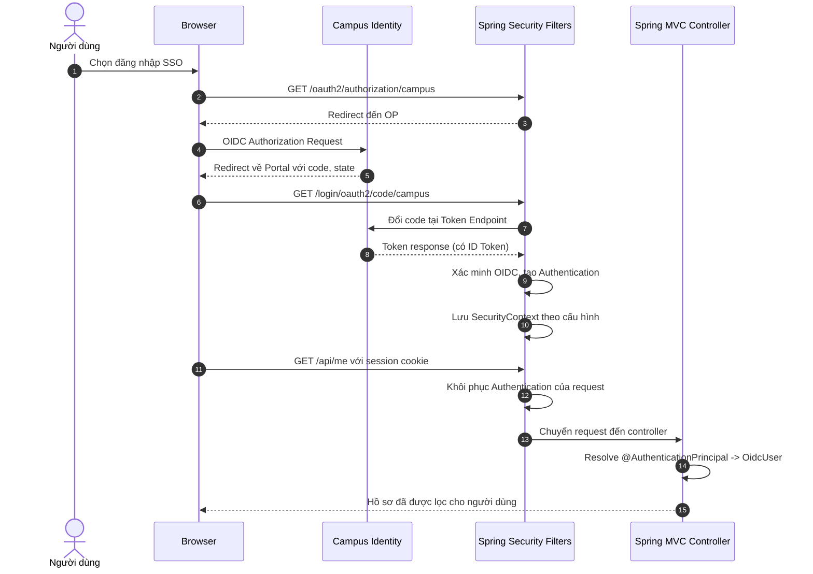

# 13.3. @AuthenticationPrincipal trong controller Servlet

## Mục tiêu bài học

Sau bài học, bạn có thể:

- Giải thích **principal** là gì và `@AuthenticationPrincipal` lấy principal từ đâu trong một ứng dụng Spring Security **Servlet**.
- Sử dụng `@AuthenticationPrincipal` trong Spring MVC controller để lấy `OidcUser`, `OAuth2User` hoặc `UserDetails` theo phương thức xác thực đã cấu hình.
- Hiểu sự khác nhau giữa **`Authentication`**, **`SecurityContext`**, **principal** và **`OAuth2AuthorizedClient`** trong luồng Spring Security OAuth 2.0/OIDC Client.
- Lấy `sub`, `iss` và các thông tin hồ sơ đã được xác thực từ `OidcUser` mà không để lộ ID Token, access token hoặc refresh token.
- Biết khi nào tham số có thể là `null`, khi nào xảy ra lỗi kiểu dữ liệu, cách dùng `expression`, `errorOnInvalidType` và annotation tùy biến.
- Thiết kế endpoint `/api/me` và API nghiệp vụ có **phân quyền đúng**, không dùng email/tên hiển thị hoặc một nút đăng nhập làm bằng chứng quyền truy cập.
- Kiểm thử controller với Spring Security Test và phân biệt OIDC login với JWT Resource Server.

## 1. Bối cảnh: người dùng đã đăng nhập và controller cần biết họ là ai

Giả sử **Learning Portal** là web application Spring Boot. Người dùng đăng nhập qua **Campus Identity**, một OpenID Provider (OP). Spring Security hoàn tất OIDC Authorization Code Flow, kiểm tra ID Token, có thể lấy UserInfo và tạo một `Authentication` cho phiên ứng dụng.

Sau đó trình duyệt gửi:

```http
GET /api/me HTTP/1.1
Host: portal.example.org
Cookie: JSESSIONID=<session-cookie>
```

Controller cần biết **ai đang gửi request này** để hiển thị hồ sơ của chính họ.

Một cách viết trực tiếp:

```java
@RestController
class MeController {

    @GetMapping("/api/me")
    Map<String, String> me(@AuthenticationPrincipal OidcUser user) {
        return Map.of(
            "subject", user.getSubject(),
            "issuer", user.getIdToken().getIssuer().toString()
        );
    }
}
```

Ở đây, `@AuthenticationPrincipal` yêu cầu Spring MVC lấy **principal đã được Spring Security xác thực** của request hiện tại rồi truyền vào tham số `user`.

Nó **không đọc `userId` từ query string**, không tự giải mã ID Token và cũng không gọi trực tiếp OpenID Provider mỗi lần controller chạy.

> **Ý tưởng chính:** `@AuthenticationPrincipal` là cách thuận tiện để lấy `Authentication.getPrincipal()` từ `SecurityContext` khi xử lý một request Servlet bằng Spring MVC. Nó giúp controller dùng **danh tính đã được framework xác thực**, nhưng bản thân annotation **không quyết định quyền truy cập tài nguyên**.

### 1.1. Từ OIDC login đến principal của request



Trong luồng session-based thường gặp, authentication được lưu giữa các request qua cơ chế phiên/cookie được cấu hình. Tùy ứng dụng, `SecurityContext` cũng có thể được xây từ Bearer token trên mỗi request; khi ấy loại principal có thể khác `OidcUser`.

## 2. Bốn khái niệm cần phân biệt

| Khái niệm | Mục đích | Trong OIDC Login Servlet |
| --- | --- | --- |
| `SecurityContext` | Giữ thông tin bảo mật của quá trình xử lý hiện tại | Chứa `Authentication` |
| `Authentication` | Kết quả xác thực cùng authorities, principal và thông tin liên quan | Thường là `OAuth2AuthenticationToken` sau OAuth2/OIDC login |
| `principal` | Đại diện cho danh tính được xác thực | Thường là `OidcUser` khi dùng OIDC, hoặc `OAuth2User` với OAuth2 Login thông thường |
| `OAuth2AuthorizedClient` | Lưu Client Registration, access token và refresh token nếu được cấp | Phục vụ việc gọi API bằng OAuth2 Client; **không phải** principal |

Một ví dụ minh họa ý nghĩa:

```text
SecurityContext
  |
  +-- Authentication: OAuth2AuthenticationToken
        |
        +-- principal: OidcUser
        |     +-- ID Token claims
        |     +-- UserInfo claims (nếu có)
        |     +-- authorities
        |
        +-- authenticated: true
        +-- authorities: [...]
        +-- authorizedClientRegistrationId: "campus"

OAuth2AuthorizedClient (quản lý riêng)
  +-- ClientRegistration("campus")
  +-- accessToken
  +-- refreshToken (tùy chọn)
```

**Không nhầm `OidcUser` với access token.** Một `OidcUser` giúp ứng dụng biết danh tính và các claims; khi backend cần gọi Resource Server, nó phải dùng **access token phù hợp** từ authorized client, không lấy ID Token hoặc principal làm Bearer token.

### 2.1. `Authentication.getPrincipal()` khác `Authentication.getName()`

`getPrincipal()` trả đối tượng danh tính, có thể mang claims hoặc thông tin người dùng.

`getName()` trả tên định danh theo triển khai `Authentication` và principal. Trong một luồng OIDC, giá trị thường dựa trên định danh `sub` hoặc tên thuộc tính được cấu hình; **không nên mặc định** nó là email hoặc tên hiển thị.

Một controller có thể nhận cả đối tượng:

```java
@GetMapping("/api/whoami")
Map<String, String> whoami(Authentication authentication) {
    return Map.of(
        "authenticationType",
        authentication.getClass().getSimpleName(),
        "name",
        authentication.getName()
    );
}
```

Ví dụ này đòi hỏi endpoint đã được bảo vệ để có `Authentication` phù hợp. Khi cần `OidcUser` và claims OIDC cụ thể, `@AuthenticationPrincipal` thường rõ ý hơn.

## 3. `@AuthenticationPrincipal` hoạt động trong Spring MVC thế nào?

Import chuẩn:

```java
import org.springframework.security.core.annotation.AuthenticationPrincipal;
```

Trong Servlet web application dùng Spring MVC, Spring Security tích hợp một **argument resolver** (thường là `AuthenticationPrincipalArgumentResolver`) vào quá trình xử lý method arguments của controller.

Khi controller khai báo:

```java
@GetMapping("/profile")
ProfileResponse profile(@AuthenticationPrincipal OidcUser user) {
    // ...
}
```

Về mặt khái niệm, resolver thực hiện:

```text
1. Nhận request đã đi qua Spring Security Filter Chain.
2. Lấy Authentication của SecurityContext hiện tại.
3. Lấy authentication.getPrincipal().
4. Nếu có biểu thức annotation, đánh giá expression trên principal.
5. Chuyển giá trị phù hợp vào tham số controller.
```

Controller **không cần** tự viết:

```java
SecurityContextHolder.getContext()
    .getAuthentication()
    .getPrincipal();
```

cho những tình huống chỉ cần principal; annotation giúp tách code HTTP/controller khỏi thao tác truy cập `SecurityContextHolder` trực tiếp.

### 3.1. Điều kiện để annotation có tác dụng

- Request phải đi qua **SecurityFilterChain** phù hợp.
- Cơ chế xác thực cần được bật và thực hiện thành công trước khi gọi controller.
- Spring MVC cần có Spring Security argument resolver được đăng ký; ứng dụng Spring Boot Servlet với Spring Security MVC tích hợp thông thường đã có hỗ trợ.
- Loại tham số phải phù hợp **kiểu principal thực tế** trong `Authentication` của request.

`@AuthenticationPrincipal` không tự bật bảo mật. Nếu controller chỉ được cấu hình `permitAll()`, người dùng chưa đăng nhập có thể không có principal theo kiểu bạn kỳ vọng; cần kiểm tra trường hợp đó.

### 3.2. Không phải đọc trực tiếp HTTP header

Người dùng không thể tự gửi:

```http
X-Principal-Sub: admin
```

rồi khiến `@AuthenticationPrincipal OidcUser user` tự biến thành `admin`. Resolver lấy principal từ `SecurityContext` do các thành phần bảo mật thiết lập. Dĩ nhiên, ứng dụng phải bảo vệ việc tạo `Authentication` và không tự đưa dữ liệu không đáng tin vào SecurityContext.

Đây là lý do controller nên dựa trên principal đã xác thực thay vì tin `userId`, `email` hoặc `role` do client truyền qua request.

## 4. Principal là kiểu dữ liệu nào?

Kiểu principal phụ thuộc **cơ chế xác thực**, không phụ thuộc việc tham số controller được đặt tên là `user`.

| Cơ chế xác thực | Kiểu principal thường gặp | Cách đọc trong controller |
| --- | --- | --- |
| **OIDC Login** qua `oauth2Login()` với scope `openid` | `OidcUser`, thường là `DefaultOidcUser` | `@AuthenticationPrincipal OidcUser user` |
| **OAuth2 Login** không dùng OIDC | `OAuth2User`, thường là `DefaultOAuth2User` | `@AuthenticationPrincipal OAuth2User user` |
| **Form Login** với `UserDetailsService` thông thường | `UserDetails` hoặc class triển khai như `org.springframework.security.core.userdetails.User` | `@AuthenticationPrincipal UserDetails user` |
| **JWT Resource Server** với Bearer token | `Jwt` trong cấu hình mặc định | `@AuthenticationPrincipal Jwt jwt` |
| **Opaque token Resource Server** | Một `OAuth2AuthenticatedPrincipal` hoặc class provider-specific | `@AuthenticationPrincipal OAuth2AuthenticatedPrincipal user` khi phù hợp |
| **Authentication tùy biến** | Principal class do ứng dụng thiết lập | `@AuthenticationPrincipal MyPrincipal user` |

Cần phân biệt:

- **`OAuth2User`** là giao diện chung cho principal OAuth2 Login.
- **`OidcUser`** kế thừa từ `OAuth2User` và có thêm API dành cho ID Token, UserInfo.
- Không phải mọi `OAuth2User` đều là `OidcUser`; nếu provider không chạy OIDC, ép kiểu có thể không phù hợp.
- Một Bearer JWT trong Resource Server không tự trở thành `OidcUser`, kể cả JWT có claim tên `sub`, `iss` hoặc `email`.

### 4.1. Khi nào `@AuthenticationPrincipal OidcUser` phù hợp?

Khi ứng dụng dùng **OpenID Connect Login**:

```yaml
spring:
  security:
    oauth2:
      client:
        registration:
          campus:
            scope:
              - openid
              - profile
              - email
```

Và SecurityFilterChain bật:

```java
http.oauth2Login(Customizer.withDefaults());
```

Nếu đăng nhập đã hoàn tất hợp lệ, principal có thể được đọc qua `OidcUser` và chứa các claims được OP cung cấp theo đúng luồng.

### 4.2. Khi nào cần `OAuth2User` thay vì `OidcUser`?

Một OAuth2 Login không dùng `openid` có thể sử dụng provider-specific user-info service:

```java
@GetMapping("/profile/oauth2")
Map<String, Object> profile(@AuthenticationPrincipal OAuth2User user) {
    return Map.of(
        "name", user.getName(),
        "attributes", user.getAttributes()
    );
}
```

Đoạn trên minh họa API, nhưng **không nên trả nguyên `attributes` ra production API** vì có thể chứa dữ liệu cá nhân hoặc nội dung không cần thiết. Ở hệ thống thật, hãy lọc thuộc tính thành DTO.

Nếu cần `getIdToken()` hoặc `getUserInfo()`, chỉ dùng khi principal thực sự là `OidcUser`.

## 5. Cấu hình mẫu Spring Boot OIDC Client (Servlet)

Ví dụ Learning Portal dùng Campus Identity:

```yaml
spring:
  security:
    oauth2:
      client:
        registration:
          campus:
            provider: campus
            client-id: ${CAMPUS_CLIENT_ID}
            client-secret: ${CAMPUS_CLIENT_SECRET}
            client-authentication-method: client_secret_basic
            authorization-grant-type: authorization_code
            redirect-uri: "{baseUrl}/login/oauth2/code/{registrationId}"
            scope:
              - openid
              - profile
              - email
        provider:
          campus:
            issuer-uri: https://login.example.org/realms/campus
```

Đây là **cấu hình minh họa**. Cần đăng ký OAuth Client thực tế tại OP, dùng HTTPS và quản lý client secret qua hệ thống bí mật phù hợp. `issuer-uri` cho phép Spring Security/Boot sử dụng cơ chế OIDC Discovery khi OP hỗ trợ.

Cấu hình SecurityFilterChain:

```java
@Configuration
class WebSecurityConfig {

    @Bean
    SecurityFilterChain securityFilterChain(HttpSecurity http) throws Exception {
        http
            .authorizeHttpRequests(auth -> auth
                .requestMatchers("/", "/login", "/error", "/assets/**")
                    .permitAll()
                .requestMatchers("/api/me", "/api/me/**")
                    .authenticated()
                .anyRequest()
                    .authenticated()
            )
            .oauth2Login(Customizer.withDefaults());

        return http.build();
    }
}
```

Đoạn code giả định đã có dependency cho Spring Web/MVC, Spring Security và OAuth2 Client; import được lược bỏ.

Thao tác đăng nhập mặc định thường bắt đầu tại:

```text
/oauth2/authorization/campus
```

Sau khi OP xử lý, callback thường đến:

```text
/login/oauth2/code/campus
```

Spring xác minh OIDC ID Token, xây `Authentication` rồi controller có thể nhận `OidcUser` qua annotation.

### 5.1. Có cần bật form login để dùng annotation không?

Không. `@AuthenticationPrincipal` chỉ dựa vào `Authentication` đã hiện diện trong `SecurityContext`. Nó có thể được dùng với OIDC Login, OAuth2 Login, form login, JWT Bearer và nhiều cơ chế khác.

Đối với một Portal dùng SSO, chỉ bật `oauth2Login()` là đủ cho đường đăng nhập OIDC khi phần cấu hình còn lại phù hợp. Không cần triển khai form chứa mật khẩu Campus Identity trong ứng dụng.

### 5.2. `@AuthenticationPrincipal` có gọi lại UserInfo không?

Không. Annotation chỉ lấy principal **đang có** trong request. Việc lấy dữ liệu UserInfo (nếu diễn ra) thuộc giai đoạn OIDC user loading và cấu hình `OidcUserService`/provider, không được trigger mỗi khi controller tham chiếu principal.

Nếu profile ở provider thay đổi nhưng `OidcUser` còn chứa dữ liệu của phiên đăng nhập trước, chỉ đọc annotation sẽ không tự lấy tên/email mới.

## 6. Xây endpoint `/api/me` trả DTO an toàn

Đây là tình huống phổ biến nhất: backend cung cấp thông tin ngắn gọn về người đang đăng nhập.

### 6.1. DTO chỉ chứa những trường cần thiết

Có thể sử dụng Java record:

```java
public record MyProfileResponse(
    String subject,
    String issuer,
    String displayName,
    String email,
    Boolean emailVerified
) {}
```

Controller:

```java
@RestController
@RequestMapping("/api")
class MyProfileController {

    @GetMapping("/me")
    MyProfileResponse me(@AuthenticationPrincipal OidcUser user) {
        return new MyProfileResponse(
            user.getSubject(),
            user.getIdToken().getIssuer().toString(),
            user.getClaimAsString("name"),
            user.getClaimAsString("email"),
            user.getClaimAsBoolean("email_verified")
        );
    }
}
```

Trong ví dụ, Spring Security phải bảo vệ `/api/me` bằng `.authenticated()` và ứng dụng này giả định người dùng đã đăng nhập qua OIDC, nên có `OidcUser`.

Response minh họa:

```json
{
  "subject": "student-9b71",
  "issuer": "https://login.example.org/realms/campus",
  "displayName": "Nguyen Anh",
  "email": "anh@example.org",
  "emailVerified": true
}
```

Không phải OP nào cũng trả `name`, `email` hoặc `email_verified`. Nếu claim không có, API có thể trả `null` hoặc áp dụng fallback theo hợp đồng của sản phẩm. `sub` là định danh từ issuer; không suy ra email từ `sub`.

**Đừng `return user;` trực tiếp.** `OidcUser` có thể chứa tập claims rộng, ID Token, UserInfo hoặc những thuộc tính không dành cho browser. Chỉ trả DTO đã lọc và được phép sử dụng.

### 6.2. Vì sao ưu tiên `sub` thay vì email để định danh?

Email và tên có thể thay đổi; nhiều provider thậm chí không trả email. Trong OIDC, `sub` được OP dùng để xác định subject. Khi có nhiều OP, định danh nội bộ nên gắn với **cặp `(issuer, sub)`**, ví dụ:

```text
(https://login.example.org/realms/campus, student-9b71)
```

Không dùng email làm khóa duy nhất để truy cập bản ghi cá nhân hoặc tự động gộp tài khoản từ hai OP khác nhau mà không có quy trình liên kết an toàn.

### 6.3. Đọc claim ID Token và UserInfo riêng

Một `OidcUser` cung cấp:

```java
OidcIdToken idToken = user.getIdToken();
OidcUserInfo userInfo = user.getUserInfo();
Map<String, Object> mergedClaims = user.getClaims();
```

- `idToken` biểu diễn ID Token mà OIDC Client đã xử lý.
- `userInfo` có thể là `null` nếu UserInfo Endpoint không được gọi hoặc không có kết quả cần thiết.
- `getClaims()` cung cấp tập claims để ứng dụng truy cập; nó có thể tổng hợp từ ID Token và UserInfo tùy cách principal được tạo.

Khi cần biết **nguồn gốc** của email hoặc một claim khác:

```java
boolean emailFromIdToken =
    user.getIdToken().getClaims().containsKey("email");

boolean emailFromUserInfo =
    user.getUserInfo() != null
        && user.getUserInfo().getClaims().containsKey("email");
```

Không giả định `@AuthenticationPrincipal` khiến mọi claim luôn hiện diện, hay rằng `getClaims()` chỉ lấy từ ID Token.

## 7. Lấy một thuộc tính bằng `expression`

`@AuthenticationPrincipal` có thuộc tính `expression` sử dụng Spring Expression Language (SpEL). Biểu thức được đánh giá trên principal làm đối tượng gốc, có thể truy cập các property của principal.

Ví dụ chỉ lấy email:

```java
@GetMapping("/api/me/email")
Map<String, String> email(
        @AuthenticationPrincipal(expression = "claims['email']")
        String email) {

    if (email == null) {
        return Map.of("message", "Không có email được chia sẻ");
    }

    return Map.of("email", email);
}
```

Đây là ví dụ về cú pháp expression, không có nghĩa một email được OP chia sẻ luôn đáng tin để dùng làm **khóa phân quyền**. Nếu ứng dụng cần email đã xác minh, phải kiểm tra thêm `email_verified` và chính sách tin cậy đối với OP.

Một biểu thức khác lấy subject từ ID Token:

```java
@GetMapping("/api/me/subject")
Map<String, String> subject(
        @AuthenticationPrincipal(expression = "idToken.subject")
        String subject) {
    return Map.of("subject", subject);
}
```

Đoạn ví dụ giả định principal là `OidcUser` có `idToken`; nếu sử dụng `OAuth2User` không phải OIDC, property này có thể không tồn tại.

### 7.1. Khi nào dùng expression, khi nào lấy cả `OidcUser`?

**Dùng expression** nếu controller chỉ cần một thuộc tính đơn giản và bạn biết chắc type của principal trong endpoint đó.

**Lấy cả `OidcUser`** nếu phải:

- Đọc đồng thời `iss`, `sub`, email và các claim.
- Xử lý fallback khi thiếu thuộc tính.
- Truy vấn service dùng định danh `(iss, sub)`.
- Kiểm tra `UserInfo` có tồn tại hay không.
- Áp dụng logic nghiệp vụ cần nhiều trường đã xác thực.

Tránh đưa logic phân quyền phức tạp vào chuỗi SpEL trong annotation: một service được kiểm thử và quản lý rõ ràng thường phù hợp hơn.

## 8. `errorOnInvalidType`: khi kiểu principal không khớp

Đối với annotation:

```java
@AuthenticationPrincipal OidcUser user
```

Nếu `Authentication.getPrincipal()` thực tế là `UserDetails`, `Jwt` hoặc `String`, giá trị đó **không thể** được gán thành `OidcUser`.

Theo thiết kế của `@AuthenticationPrincipal`, khi type không khớp, mặc định resolver có thể truyền `null` thay vì ép kiểu sai. Thuộc tính `errorOnInvalidType` giúp chọn hành vi chặt chẽ hơn:

```java
@GetMapping("/api/me/strict")
String strictMe(
        @AuthenticationPrincipal(errorOnInvalidType = true)
        OidcUser user) {

    return user.getSubject();
}
```

Nếu principal tồn tại nhưng khác loại `OidcUser`, resolver có thể ném `ClassCastException` thay vì âm thầm trả `null`.

**Không dùng `errorOnInvalidType = true` như cơ chế xác thực hoặc phân quyền.** Nó chỉ giúp phát hiện mismatch kiểu dữ liệu trong controller; quyền truy cập phải được đảm bảo từ SecurityFilterChain và các quy tắc authorization.

### 8.1. Vì sao có thể gặp mismatch?

- Đăng nhập bằng form và principal là `UserDetails`, không phải `OidcUser`.
- Cùng ứng dụng có endpoint dùng Bearer JWT Resource Server, principal là `Jwt`.
- Một OAuth2 provider không phải OIDC tạo `OAuth2User` thông thường.
- Unit test dùng `@WithMockUser` nên principal không giống môi trường OIDC.
- Ứng dụng tự tạo `Authentication` với custom principal.
- Endpoint được phép truy cập ẩn danh và không có principal theo type mong đợi.

Khi có nhiều cơ chế xác thực, nên thiết kế endpoint hoặc abstraction phù hợp thay vì ép mọi request thành OIDC.

### 8.2. Kiểm tra `null` khi endpoint công khai

Nếu endpoint `permitAll()`, một người chưa đăng nhập có thể không có `OidcUser`:

```java
@GetMapping("/public/greeting")
Map<String, String> greeting(
        @AuthenticationPrincipal OidcUser user) {

    String message = (user == null)
        ? "Xin chào khách"
        : "Xin chào " + user.getSubject();

    return Map.of("message", message);
}
```

Cách viết này phù hợp cho một endpoint công khai muốn hiển thị nội dung tùy chọn theo danh tính. Không dùng nó cho việc truy cập dữ liệu riêng tư: với API cần principal bắt buộc, hãy cấu hình `.authenticated()` thay vì chỉ hy vọng `user` khác `null`.

## 9. Sử dụng `Authentication` khi cần authorities hoặc thông tin về cơ chế login

Đôi khi controller cần không chỉ principal mà còn authorities hoặc registration ID:

```java
@GetMapping("/api/me/authentication")
Map<String, Object> authentication(Authentication authentication) {
    Map<String, Object> response = new LinkedHashMap<>();

    response.put("name", authentication.getName());
    response.put(
        "authorities",
        authentication.getAuthorities().stream()
            .map(GrantedAuthority::getAuthority)
            .toList()
    );

    if (authentication instanceof OAuth2AuthenticationToken oauth) {
        response.put(
            "registrationId",
            oauth.getAuthorizedClientRegistrationId()
        );
    }

    return response;
}
```

Đây là ví dụ quan sát metadata trong một endpoint **được bảo vệ**. Trong sản phẩm thật, danh sách authorities có thể là thông tin nội bộ; chỉ trả khi có yêu cầu rõ ràng.

So sánh:

| Controller parameter | Bạn nhận được gì? | Dùng khi nào? |
| --- | --- | --- |
| `@AuthenticationPrincipal OidcUser user` | Principal OIDC | Đọc danh tính và claims OIDC |
| `@AuthenticationPrincipal OAuth2User user` | Principal OAuth2 | Dùng API chung cho OAuth2/OIDC principal |
| `Authentication authentication` | Authentication hiện tại | Cần authorities, `isAuthenticated`, type hoặc registration ID |
| `Principal principal` | Giao diện principal chuẩn | Chỉ cần tên ở mức khái quát |
| `@CurrentSecurityContext(expression = "authentication") Authentication auth` | Authentication qua SecurityContext | Cần tùy biến cách resolve security context |
| `@RegisteredOAuth2AuthorizedClient("campus") OAuth2AuthorizedClient client` | Authorized client và token state | Backend cần quản lý/gọi API OAuth2; phải bảo vệ token |

`@AuthenticationPrincipal` là công cụ **lấy principal**, không phải cách đọc trực tiếp mọi chi tiết của `OAuth2AuthorizedClient`.

### 9.1. Vì sao `Authentication.getName()` không nên mặc định là email?

Với OIDC, subject `sub` thường là định danh ổn định theo issuer. Một vài hệ thống cấu hình `nameAttributeKey` hoặc custom user principal, nên `getName()` có thể là thuộc tính khác.

Nếu API cần email, hãy lấy claim email theo chính sách. Nếu cần định danh không đổi để tra cứu tài khoản, nên lấy **`iss` và `sub`** đã được OIDC xác thực rồi ánh xạ sang local user ID.

## 10. Principal không tự cấp quyền: thiết kế authorization đúng

Có `OidcUser` chỉ cho biết Spring Security đã nhận diện một người dùng từ OIDC. Nó **không tự động chứng minh** người đó có quyền xem mọi bản ghi khóa học.

Ví dụ nguy hiểm:

```java
@GetMapping("/api/students/{studentId}/grades")
GradeResponse grades(
        @PathVariable String studentId,
        @AuthenticationPrincipal OidcUser user) {

    // SAI nếu chỉ dùng studentId do caller tự truyền
    // mà không kiểm tra user có quyền xem bản ghi này.
    return gradeService.findGrades(studentId);
}
```

Một người dùng đã đăng nhập có thể tự đổi `studentId` trong URL để đọc thông tin của người khác nếu backend không thực thi ownership.

### 10.1. Dùng principal để tìm local user rồi kiểm tra quyền

Một cách thiết kế tốt hơn:

```text
OIDC issuer + subject
    |
    v
ExternalIdentityRepository
    |
    v
LocalUser ID (user nội bộ)
    |
    v
AccessPolicy / Service
    |
    v
Trả tài nguyên chỉ khi có quyền
```

Ví dụ mô tả logic controller:

```java
@RestController
class GradeController {

    private final IdentityService identities;
    private final GradeService grades;

    GradeController(
            IdentityService identities,
            GradeService grades) {
        this.identities = identities;
        this.grades = grades;
    }

    @GetMapping("/api/courses/{courseId}/my-grades")
    GradeResponse myGrades(
            @PathVariable Long courseId,
            @AuthenticationPrincipal OidcUser oidcUser) {

        String issuer =
            oidcUser.getIdToken().getIssuer().toString();
        String subject = oidcUser.getSubject();

        Long localUserId =
            identities.requireLocalUserId(issuer, subject);

        return grades.findGradesForEnrolledStudent(
            courseId, localUserId
        );
    }
}
```

Trong ví dụ, `findGradesForEnrolledStudent` **phải kiểm tra enrollment/ownership tại tầng service** trước khi truy xuất dữ liệu. Các interface/class nghiệp vụ do ứng dụng tự định nghĩa, không phải class có sẵn của Spring.

Ý nghĩa bảo mật:

- `issuer` và `subject` đến từ principal OIDC đã được xác thực.
- `localUserId` được tìm trong kho liên kết danh tính tin cậy.
- `courseId` do caller truyền **không đủ** để xác nhận được phép xem điểm.
- Service quyết định quyền dựa trên user nội bộ và quan hệ với tài nguyên.

### 10.2. Dùng method security khi cần

Spring Security có thể bảo vệ method bằng `@PreAuthorize` khi bật method security:

```java
@Configuration
@EnableMethodSecurity
class MethodSecurityConfiguration {
}
```

Ví dụ chỉ mô tả ý tưởng khi ứng dụng đã có bean `courseAccess`:

```java
@PreAuthorize("@courseAccess.canView(authentication, #courseId)")
@GetMapping("/api/courses/{courseId}")
CourseResponse course(@PathVariable Long courseId) {
    return courseService.load(courseId);
}
```

Biểu thức trên gọi phương thức `canView` của service do ứng dụng xây dựng; service phải kiểm tra quyền bằng dữ liệu đáng tin cậy. `authentication` trong method security đại diện cho Authentication hiện tại, không phải request parameter do browser tự đưa.

Nếu dùng:

```java
@PreAuthorize("hasRole('ADMIN')")
```

thì ứng dụng phải thực sự có cơ chế ánh xạ role nghiệp vụ đến `GrantedAuthority` tương ứng. OIDC Login thông thường **không tự tạo `ROLE_ADMIN` từ một chuỗi `groups` hay `roles` bất kỳ**. Phải có hợp đồng tin cậy và mapping được cấu hình rõ ràng.

### 10.3. Claim hồ sơ không phải quyền

Những claim như:

```text
email
name
preferred_username
picture
locale
```

phục vụ hồ sơ, không phải bằng chứng quyền nghiệp vụ.

Ngay cả khi OP trả:

```json
{
  "groups": ["staff"]
}
```

cũng cần xác định nguồn claim, mức độ tin cậy, tính mới, ý nghĩa và cách ánh xạ thành authority. Không gán quyền quản trị chỉ vì người dùng bấm `/oauth2/authorization/staff` hoặc email kết thúc bằng một domain nào đó.

## 11. Custom annotation dùng lại trong nhiều controller

Nếu nhiều endpoint đều nhận `OidcUser`, có thể tạo một annotation riêng để code dễ đọc. Spring Security cho phép sử dụng `@AuthenticationPrincipal` như **meta-annotation**.

Ví dụ:

```java
@Target(ElementType.PARAMETER)
@Retention(RetentionPolicy.RUNTIME)
@AuthenticationPrincipal
public @interface CurrentOidcUser {
}
```

Sau đó:

```java
@GetMapping("/api/me")
MyProfileResponse me(@CurrentOidcUser OidcUser user) {
    return new MyProfileResponse(
        user.getSubject(),
        user.getIdToken().getIssuer().toString(),
        user.getClaimAsString("name"),
        user.getClaimAsString("email"),
        user.getClaimAsBoolean("email_verified")
    );
}
```

Cần import các annotation thuộc `java.lang.annotation` và `AuthenticationPrincipal` của Spring Security. `@CurrentOidcUser` không cần tự triển khai logic xác thực; nó chỉ là bí danh dễ đọc cho chức năng resolve principal.

### 11.1. Khi nào annotation riêng có ích?

- Hệ thống có nhiều controller muốn giữ cách inject principal thống nhất.
- Cần phân biệt rõ endpoint dành cho **OIDC session** với endpoint dành cho JWT API.
- Muốn giảm việc lặp các import/annotation dài.
- Muốn thiết kế lại một tầng abstraction principal về sau.

Tuy nhiên, annotation này **không biến một JWT Resource Server principal thành OidcUser**. Tên `CurrentOidcUser` cũng không thay thế kiểm tra authentication/authorization.

### 11.2. Có nên inject luôn JPA `User` entity?

Không nên tự giả định rằng principal OIDC chính là một entity database có thể serialize ra response. Thường tốt hơn:

```text
OIDC principal (iss, sub)
  -> IdentityService
  -> local account/domain user
  -> DTO đã lọc
```

Cách này tránh phụ thuộc vào persistence entity trong SecurityContext, giảm rủi ro lộ field nhạy cảm và cho phép mapping nhiều provider về một local account theo quy trình được kiểm soát.

## 12. Resource Server không giống OIDC Client Login

Trong một hệ thống Spring Boot, có thể tồn tại hai ứng dụng:

```text
Learning Portal
  - oauth2Login()
  - login với OIDC
  - principal thường là OidcUser
  - session/cookie cho browser

Course API
  - oauth2ResourceServer().jwt()
  - nhận Bearer Access Token
  - principal thường là Jwt
  - thường xác thực mỗi request
```

Ví dụ controller trong Course API:

```java
@RestController
class CourseApiController {

    @GetMapping("/api/token-subject")
    Map<String, String> subject(
            @AuthenticationPrincipal Jwt jwt) {

        return Map.of("subject", jwt.getSubject());
    }
}
```

Với `oauth2ResourceServer().jwt()` mặc định, principal thường là đối tượng `Jwt`. Endpoint vẫn cần SecurityFilterChain yêu cầu Bearer token hợp lệ và Resource Server phải kiểm tra issuer, audience/scope, thời gian, chữ ký theo cấu hình.

**Đừng dùng `@AuthenticationPrincipal OidcUser` trong JWT Resource Server rồi kết luận annotation bị lỗi khi kết quả là `null`.** Đó có thể chỉ là khác biệt kiểu principal do cơ chế xác thực.

### 12.1. Ví dụ SecurityFilterChain của API nhận Bearer token

```java
@Bean
SecurityFilterChain apiSecurity(HttpSecurity http) throws Exception {
    http
        .securityMatcher("/api/**")
        .authorizeHttpRequests(auth -> auth
            .anyRequest().authenticated()
        )
        .oauth2ResourceServer(oauth2 -> oauth2
            .jwt(Customizer.withDefaults())
        );

    return http.build();
}
```

Đây là cấu hình minh họa cho Resource Server, **không thay thế** cấu hình OIDC Login của Learning Portal. Nếu một ứng dụng có cả OIDC Login và Bearer API, cần thiết kế nhiều filter chain/entry point và thứ tự match rõ ràng; không suy đoán principal chỉ từ tên URL.

### 12.2. `@AuthenticationPrincipal` không làm mới access token

Khi backend sử dụng OAuth2 Client để gọi API thay mặt người dùng, cần sử dụng cơ chế lấy **`OAuth2AuthorizedClient`** hoặc `OAuth2AuthorizedClientManager`. Việc đọc principal chỉ cho biết danh tính request:

```java
void handler(@AuthenticationPrincipal OidcUser user) {
    // user giúp nhận diện người dùng.
    // Không tự cung cấp access token mới để gọi Resource Server.
}
```

Nếu token hết hạn, tầng OAuth2 Authorized Client Manager và cấu hình refresh xử lý việc cấp lại token theo grant của client. Đừng lưu access token trong controller field singleton hoặc cố dùng ID Token như access token.

## 13. Session, request thread và SecurityContext

Trong Servlet security, các filter của Spring Security thiết lập `SecurityContext` cho quá trình xử lý request. Cơ chế thông dụng dùng `SecurityContextHolder` để các phần code đang xử lý cùng request có thể truy cập authentication.

Với OIDC Login dựa trên HTTP session:

```text
Browser Cookie
   -> Spring Security filters
   -> tải SecurityContext/Authentication theo session
   -> DispatcherServlet
   -> Controller method
   -> resolve @AuthenticationPrincipal
```

Điều này có vài hệ quả:

- `@AuthenticationPrincipal` hoạt động trong **ngữ cảnh request** của Spring MVC.
- Không nên trông chờ nó làm việc trong một tác vụ nền không có HTTP request.
- Khi đẩy xử lý sang thread khác, cần cơ chế truyền security context đúng của framework nếu thực sự cần.
- Không tự copy đối tượng principal hoặc SecurityContext vào global/static mutable field để dùng chung giữa nhiều user.
- Khi logout, phiên local có thể bị hủy; điều đó khác với trạng thái phiên SSO ở OP và việc thu hồi token.

### 13.1. Tại sao không gọi `SecurityContextHolder` trong mọi service?

Một service nghiệp vụ nhận trực tiếp `OidcUser` ở khắp nơi sẽ phụ thuộc mạnh vào framework bảo mật và khó kiểm thử độc lập. Tùy thiết kế, controller hoặc boundary service có thể biến principal đã xác thực thành **định danh nội bộ** rồi truyền vào service:

```java
record CurrentIdentity(String issuer, String subject) {}

CurrentIdentity identityFrom(OidcUser user) {
    return new CurrentIdentity(
        user.getIdToken().getIssuer().toString(),
        user.getSubject()
    );
}
```

Sau đó service kiểm tra quyền dựa trên định danh/trạng thái đã xác minh và dữ liệu nghiệp vụ.

Một số ứng dụng dùng `Authentication` trực tiếp trong service hoặc method security cũng hợp lệ, nhưng nên thống nhất ranh giới trách nhiệm để tránh việc service âm thầm dùng context sai khi chạy background.

## 14. Kiểm thử controller dùng `@AuthenticationPrincipal`

Spring Security Test hỗ trợ mô phỏng principal cho MockMvc. Với OIDC Login, có thể dùng `oidcLogin()`.

Ví dụ ở mức ý tưởng:

```java
@Test
void meReturnsSubject() throws Exception {
    mockMvc.perform(
            get("/api/me")
                .with(oidcLogin()
                    .idToken(token -> token
                        .claim("sub", "student-9b71")
                        .claim("name", "Nguyen Anh")
                    )
                )
        )
        .andExpect(status().isOk())
        .andExpect(jsonPath("$.subject").value("student-9b71"));
}
```

Trong ví dụ, giả định:

- `mockMvc` được cấu hình với Spring Security Test integration.
- Controller `/api/me` trả DTO có trường `subject`.
- `oidcLogin()` đến từ `SecurityMockMvcRequestPostProcessors`.
- Test đã thêm dependency `spring-security-test` tương thích phiên bản dự án.
- Các import `get`, `status`, `jsonPath` và class test được cấu hình phù hợp.

**Quan trọng:** `oidcLogin()` giúp tạo **authentication giả lập** cho test controller. Nó **không có nghĩa đã chạy toàn bộ Authorization Code Flow, kiểm tra JWT signature của OP hoặc gọi Token Endpoint thật**. Khi cần xác minh cấu hình OIDC provider, issuer, audience, redirect URI và callback, phải có integration test hoặc môi trường OP phù hợp riêng.

### 14.1. Vì sao `@WithMockUser` không phù hợp mọi test OIDC?

Ví dụ:

```java
@WithMockUser(username = "alice")
```

thường tạo một `Authentication` với principal thuộc dạng Spring Security `UserDetails`/mock user. Nếu controller khai báo:

```java
@AuthenticationPrincipal OidcUser user
```

principal mô phỏng không phải `OidcUser`, dẫn tới `null` hoặc type mismatch theo cấu hình annotation.

Với endpoint đòi hỏi `OidcUser`, `oidcLogin()` thường rõ mục đích hơn. Còn với endpoint chỉ nhận `Authentication` chung, `@WithMockUser` có thể đủ để kiểm tra các quy tắc đơn giản.

### 14.2. Kiểm thử authorization khác kiểm thử inject principal

Có thể cần ít nhất hai nhóm test:

1. **Controller test:** đảm bảo OIDC principal được resolve đúng, DTO chỉ chứa dữ liệu cho phép, và xử lý claim thiếu.
2. **Authorization test:** đảm bảo user không có quyền bị chặn, ownership được kiểm tra và user khác không thể đọc bản ghi của nhau.

Một test có `@AuthenticationPrincipal OidcUser` chạy thành công **không chứng minh** endpoint đã được bảo vệ đúng trước kẻ tấn công.

## 15. Các lỗi thường gặp khi tích hợp

| Triệu chứng | Nguyên nhân khả dĩ | Hướng xử lý |
| --- | --- | --- |
| `@AuthenticationPrincipal OidcUser user` trả `null` | Request chưa đăng nhập, principal không phải OIDC hoặc sai SecurityFilterChain | Kiểm tra `.authenticated()`, flow login và kiểu principal thực tế |
| `ClassCastException` khi inject | Bật `errorOnInvalidType` và principal khác kiểu | Xác định form login/OAuth2/JWT đang xử lý request |
| `getIdToken()` không dùng được với `OAuth2User` | Principal là OAuth2 User không phải OIDC | Dùng `OidcUser` chỉ trong OIDC Login với `openid` |
| Truy cập claim email trả `null` | OP không cung cấp hoặc không chia sẻ claim | Xem scope/consent/UserInfo; áp dụng fallback |
| Controller NPE khi `user.getSubject()` | Endpoint cho phép anonymous hoặc mismatch type | Bảo vệ endpoint, hoặc xử lý `user == null` ở endpoint công khai |
| Test dùng `@WithMockUser` nhưng muốn `OidcUser` | Mock principal không có OIDC type | Dùng `oidcLogin()` |
| API Bearer nhận `Jwt` nhưng controller chờ `OidcUser` | Nhầm Resource Server với OAuth2 Login | Dùng `@AuthenticationPrincipal Jwt` hoặc thiết kế identity abstraction phù hợp |
| Đã đăng nhập nhưng `hasRole('ADMIN')` không qua | Role nghiệp vụ chưa được ánh xạ thành authority | Kiểm tra mapping từ nguồn quyền có thẩm quyền |
| `getName()` không phải email | Principal name attribute khác email | Đọc claim email riêng; định danh bằng `(iss, sub)` |
| User đổi email tạo ra bản ghi mới | Dùng email làm khóa định danh | Tạo mapping issuer/subject với local account ID |
| Trả `return user` làm rò dữ liệu | Serialize nguyên OIDC principal | Trả DTO được lọc, không bao gồm token/raw claims |
| Đọc token từ principal để gọi API bị từ chối | Dùng nhầm ID Token hoặc principal thay access token | Lấy authorized client và access token phù hợp |
| Async task không thấy `SecurityContext` | Ngữ cảnh thread/request không được truyền | Truyền identity rõ ràng hoặc dùng cơ chế security context propagation phù hợp |
| Login thành công nhưng API nghiệp vụ lộ dữ liệu user khác | Chỉ xác thực, thiếu kiểm tra ownership | Kiểm tra authorization theo bản ghi/tài nguyên |

### 15.1. Cách khoanh vùng sự cố

Khi controller không nhận được principal mong đợi:

1. **Xác định request thực tế** đi qua SecurityFilterChain nào.
2. **Xác định cơ chế xác thực**: OIDC Login, OAuth2 Login, form login, bearer JWT hay anonymous.
3. **Kiểm tra route có yêu cầu authenticated không**, và có custom entry point/CSRF/session nào ảnh hưởng.
4. **Xem kiểu `Authentication` và principal** bằng log kỹ thuật đã được làm sạch (không log token).
5. **Chọn annotation và parameter type phù hợp** với cơ chế xác thực, hoặc thay thiết kế nhiều filter chain nếu endpoint sử dụng sai cơ chế.
6. Nếu claim bị thiếu, **kiểm tra phạm vi dữ liệu OP cấp**, không mặc định do annotation hỏng.

Không tắt SecurityFilterChain hay thay `@AuthenticationPrincipal` bằng đọc user ID từ request chỉ để vượt qua lỗi.

## 16. Những tình huống thực tế

### Tình huống A — Portal dùng OIDC Login

Learning Portal có `scope: [openid, profile, email]`, Spring xác thực ID Token và tạo `OidcUser`. Endpoint `/api/me` nhận `@AuthenticationPrincipal OidcUser`.

**Cách xử lý:** trả DTO gồm `iss`, `sub`, tên/email khi được chia sẻ. Dùng `(iss, sub)` để ánh xạ user nội bộ và không phơi bày ID Token.

### Tình huống B — User chưa đăng nhập gọi endpoint công khai

Người dùng mở `/public/greeting` không có session. `@AuthenticationPrincipal OidcUser` có thể `null`.

**Cách xử lý:** trả nội dung khách hoặc yêu cầu login tùy mục đích. Với endpoint chứa dữ liệu riêng tư, bảo vệ bằng `.authenticated()` và quy tắc authorization thay vì cho phép anonymous.

### Tình huống C — Backend là Resource Server

Course API nhận access token JWT, còn controller khai báo `@AuthenticationPrincipal OidcUser`. Trong cấu hình JWT Resource Server mặc định, principal là `Jwt`, không phải `OidcUser`.

**Cách xử lý:** dùng kiểu `Jwt` ở API và xác minh token đúng audience/issuer/scope. Đừng thêm `openid` trong Access Token rồi cho rằng nó trở thành OIDC login session.

### Tình huống D — Người dùng thay đổi email

OIDC `sub` vẫn được provider cấp cho cùng chủ thể, nhưng email thay đổi ở OP. Ứng dụng đang liên kết account theo email nên tạo trùng người dùng.

**Cách xử lý:** liên kết bằng issuer và subject, còn email chỉ là thuộc tính hồ sơ có thể thay đổi, được cập nhật theo chính sách.

### Tình huống E — Nhấn nút Staff nhưng không có role

Người dùng đi qua `/oauth2/authorization/campus-staff`, OIDC login thành công và controller nhận `OidcUser`. Tuy vậy người dùng không có quyền xem `/staff/reports`.

**Cách xử lý:** chỉ chọn login registration **không cấp quyền staff**. Cần kiểm tra authority/quyền nghiệp vụ thực tế, có thể dùng method security/service policy.

### Tình huống F — Nhiều request xử lý đồng thời

Hai request của cùng người dùng vào hai controller, mỗi controller được inject `OidcUser`. Đó là **principal của request**, không phải một object phải được lưu trong singleton field.

**Cách xử lý:** dùng giá trị tại request hoặc identity abstraction bất biến; không lưu thông tin người dùng hiện tại thành biến toàn cục.

## 17. Bài tập thực hành

### Bài tập 1 — Viết endpoint tên hiển thị

Yêu cầu: sau OIDC login, endpoint `/api/me/name` trả tên hiển thị hoặc fallback nếu OP không cấp `name`.

Gợi ý:

```java
@GetMapping("/api/me/name")
Map<String, String> displayName(
        @AuthenticationPrincipal OidcUser user) {

    String name = user.getClaimAsString("name");

    if (name == null || name.isBlank()) {
        name = "Người dùng " + user.getSubject();
    }

    return Map.of("displayName", name);
}
```

Endpoint giả định đã yêu cầu authentication. Trong sản phẩm thật, cần cân nhắc có muốn hiển thị `sub` hay dùng fallback không tiết lộ định danh kỹ thuật.

### Bài tập 2 — So sánh `Authentication` và principal

Cho code:

```java
@GetMapping("/api/me/details")
String details(
        Authentication authentication,
        @AuthenticationPrincipal OidcUser user) {
    // ...
}
```

**Câu hỏi:** Vì sao hai tham số không nhất thiết chứa cùng kiểu dữ liệu?

**Đáp án:** `Authentication` biểu diễn toàn bộ trạng thái xác thực, authorities và principal; `OidcUser` là đối tượng `Authentication.getPrincipal()` được resolver trích riêng.

### Bài tập 3 — Tránh lộ ID Token

Một endpoint viết:

```java
@GetMapping("/api/me/raw")
OidcUser raw(@AuthenticationPrincipal OidcUser user) {
    return user;
}
```

**Câu hỏi:** Vì sao nên sửa?

**Đáp án:** Serialize nguyên principal có thể vô tình đưa claims hoặc đối tượng token vào response. Hãy tạo DTO chỉ chứa trường cần thiết, được phép chia sẻ.

### Bài tập 4 — Chọn đúng kiểu principal

Hãy chọn kiểu tham số phù hợp:

| Ngữ cảnh | Kiểu tham số hợp lý |
| --- | --- |
| OIDC Login trong web Portal | `@AuthenticationPrincipal OidcUser user` |
| OAuth2 Login không có OIDC | `@AuthenticationPrincipal OAuth2User user` |
| Form Login dùng UserDetails | `@AuthenticationPrincipal UserDetails user` |
| JWT Resource Server | `@AuthenticationPrincipal Jwt jwt` |
| Cần authorities và registration ID sau OAuth2 Login | `Authentication` / `OAuth2AuthenticationToken` |

### Bài tập 5 — Phân quyền theo bản ghi

Người dùng gửi:

```text
GET /api/courses/77/my-grades
```

**Câu hỏi:** Có nên chỉ kiểm tra `user != null`?

**Đáp án:** Không. Cần ánh xạ OIDC identity sang local user và kiểm tra người dùng có được xem điểm ở khóa học 77 hay không. Xác thực không tự quyết định ownership.

### Bài tập 6 — Test dùng mock principal

Test:

```java
mockMvc.perform(get("/api/me").with(user("alice")));
```

Controller đòi:

```java
@AuthenticationPrincipal OidcUser user
```

**Câu hỏi:** Tại sao test có thể không nhận `OidcUser`?

**Đáp án:** `user("alice")` tạo mock principal dựa trên UserDetails, không phải OIDC principal. Dùng `oidcLogin()` để mô phỏng đúng dạng login của controller.

## 18. Câu hỏi tự kiểm tra

**1. `@AuthenticationPrincipal` tự kiểm tra chữ ký của ID Token không?**

> Không. Annotation chỉ lấy principal từ `SecurityContext`. Xác minh ID Token thuộc về quy trình OIDC Login của Spring Security trước đó.

**2. `@AuthenticationPrincipal OidcUser` lấy dữ liệu từ đâu?**

> Từ `Authentication.getPrincipal()` của request hiện tại; khi đăng nhập OIDC thành công, principal thường là `OidcUser`.

**3. Vì sao có thể nhận `null` dù controller có annotation?**

> Người dùng có thể chưa đăng nhập, principal có kiểu khác hoặc request không được xử lý theo cơ chế OIDC mong đợi. Cần xem filter chain và authentication.

**4. Nếu muốn xem authorities, nên dùng gì?**

> Có thể nhận `Authentication` rồi gọi `getAuthorities()`; `OidcUser` cũng cung cấp authorities nhưng việc cấp quyền phải dựa trên mapping và chính sách hợp lệ.

**5. `OidcUser` và `OAuth2AuthorizedClient` khác nhau thế nào?**

> `OidcUser` biểu diễn danh tính đã xác thực cùng các claim; `OAuth2AuthorizedClient` chứa trạng thái ủy quyền OAuth2 và token để client gọi Resource Server.

**6. Có nên dùng email làm khóa truy vấn dữ liệu của người dùng không?**

> Không nên coi email là định danh bất biến. Dùng `(iss, sub)` ánh xạ sang local user ID rồi kiểm tra quyền.

**7. Vì sao endpoint `/api/me` nên trả DTO thay vì nguyên `OidcUser`?**

> Để kiểm soát những trường được phép tiết lộ, tránh lộ token, claim nhạy cảm và các chi tiết nội bộ của principal.

**8. `@AuthenticationPrincipal Jwt` dùng ở đâu?**

> Trong ứng dụng Resource Server nhận Bearer JWT với principal kiểu `Jwt`, không phải mặc định của OIDC Login trong web app.

**9. `@WithMockUser` có thể thay hoàn toàn test OIDC không?**

> Không. Nó thường tạo UserDetails/mock Authentication; dùng `oidcLogin()` cho controller cần `OidcUser` và test tích hợp riêng cho các bước OIDC thật.

**10. Có `OidcUser` hợp lệ nghĩa là người dùng được phép gọi mọi endpoint không?**

> Không. Còn cần authorization theo roles, scopes, chính sách nghiệp vụ và quyền truy cập từng tài nguyên.

---

## Ghi nhớ

Trong **Spring Security Servlet**, **`@AuthenticationPrincipal`** cho phép Spring MVC inject **principal của `Authentication` hiện tại** vào controller. Sau đăng nhập OIDC qua `oauth2Login()`, principal thường là **`OidcUser`**; nó cung cấp `sub`, ID Token và claims hồ sơ, nhưng **không tự thay access token hoặc cơ chế phân quyền**. Hãy sử dụng principal đã xác thực để xác định danh tính bằng `(iss, sub)`, ánh xạ sang user nội bộ khi cần, kiểm tra quyền nghiệp vụ và trả **DTO tối thiểu**. Trong các cơ chế khác như OAuth2 Login thông thường, form login hoặc JWT Resource Server, hãy chọn **kiểu principal phù hợp**, bảo vệ endpoint với SecurityFilterChain/method security, và không để lộ nguyên đối tượng principal trong response.
