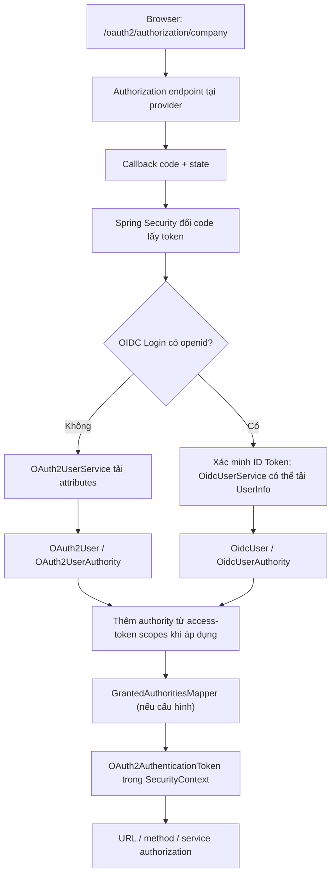
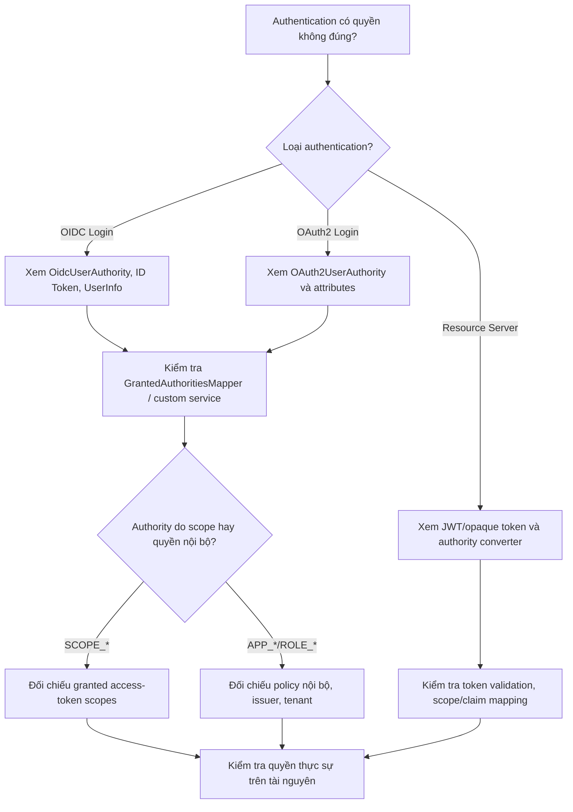

# 13.5. OAuth2UserAuthority, OidcUserAuthority và các authority từ scope

Trong **Spring Security OAuth 2.0 / OpenID Connect (OIDC) Client**, đăng nhập thành công và được phép truy cập một chức năng là **hai quyết định khác nhau**. Khi người dùng đăng nhập qua Authorization Server/OpenID Provider, Spring Security tạo `Authentication` chứa principal và tập `GrantedAuthority`. Chính những authority này có thể được sử dụng bởi `authorizeHttpRequests`, `@PreAuthorize` hoặc các cơ chế phân quyền khác.

Ba khái niệm thường xuất hiện trong cùng một tập authority nhưng mang ý nghĩa khác nhau:

- **`OAuth2UserAuthority`**: authority gắn với thông tin người dùng từ một luồng **OAuth2 Login**, thường chứa attributes do OAuth2 User Service tải từ provider.
- **`OidcUserAuthority`**: authority gắn với **OIDC Login**, chứa `OidcIdToken` và có thể chứa `OidcUserInfo`, cho phép đọc claims đến từ nhà cung cấp danh tính.
- **Authority dạng `SCOPE_xxx`**: biểu diễn một **scope của access token** thành `GrantedAuthority` để ứng dụng có thể sử dụng trong một số quyết định authorization. Nó không tự động tương đương role nội bộ và cũng không phải là một claim `roles` của ID Token.

Bài học tập trung vào **nguồn gốc, cấu trúc, cách quan sát và ánh xạ** các authority này trong Spring Security, cùng ranh giới giữa thông tin định danh, quyền OAuth2 được cấp và quyền nghiệp vụ của ứng dụng.

## 1. Principal, GrantedAuthority, role và scope: đừng gộp làm một

Sau khi OAuth2/OIDC Login hoàn thành, một ứng dụng Servlet có thể nhận `OAuth2AuthenticationToken` trong `SecurityContext`. Token xác thực này có:

1. **Principal**: đối tượng mô tả người đã đăng nhập, ví dụ `OAuth2User` hoặc `OidcUser`.
2. **Authorities**: tập các đối tượng implement `GrantedAuthority`, mỗi đối tượng thể hiện một quyền hoặc nhãn quyền mà Spring Security có thể kiểm tra.
3. **Authorized client**: dữ liệu registration và access/refresh token tương ứng, được quản lý riêng qua `OAuth2AuthorizedClientRepository` hoặc `OAuth2AuthorizedClientService`.

| Khái niệm | Ví dụ | Nó trả lời câu hỏi nào? |
|---|---|---|
| Principal | `OidcUser` với `sub=user-42` | *Ai đã đăng nhập?* |
| `GrantedAuthority` | `APP_REPORT_READ` | *Ứng dụng công nhận quyền nào cho Authentication này?* |
| Role | `ROLE_ADMIN` | *Ứng dụng gom những quyền nào vào một vai trò?* |
| OAuth2 scope | `reports.read` | *Client đã yêu cầu/được cấp phạm vi OAuth2 nào từ provider?* |
| Scope authority | `SCOPE_reports.read` | *Spring đang biểu diễn scope thành authority bằng quy ước tên nào?* |
| ID Token claim | `email`, `groups`, `sub` | *Provider khẳng định thông tin gì về chủ thể?* |
| Quyền trên tài nguyên | “Được đọc báo cáo của phòng ban A” | *Hành động này có được cho phép đối với đối tượng cụ thể?* |

`GrantedAuthority` là một interface nhỏ, thường chỉ cung cấp `String getAuthority()`. Cùng interface đó có thể được cài bởi `SimpleGrantedAuthority`, `OAuth2UserAuthority`, `OidcUserAuthority` và các kiểu tùy chỉnh. **Một chuỗi authority chỉ có ý nghĩa khi ứng dụng biết ai đã cấp nó, nó được tạo theo quy tắc nào và nơi nào kiểm tra nó.**

### 1.1. `hasAuthority` khác `hasRole`

Trong Spring Security, `hasAuthority("APP_REPORT_READ")` so khớp trực tiếp tên authority. Với cấu hình role prefix mặc định, `hasRole("ADMIN")` kiểm tra authority `ROLE_ADMIN`.

```java
@PreAuthorize("hasAuthority('APP_REPORT_READ')")
public Report viewReport(long reportId) { /* ... */ }

@PreAuthorize("hasRole('ADMIN')")
public void manageUsers() { /* ... */ }
```

Hai phương thức trên minh họa cách viết điều kiện; chúng không tự sinh các authority tương ứng. Phải có một cơ chế đáng tin cậy ánh xạ quyền vào `Authentication` hoặc kiểm tra quyền động ở service. Nếu provider chỉ cấp `scope=openid profile`, điều đó không tự tạo `ROLE_ADMIN`.

> **Quy ước đặt tên không phải cơ chế bảo mật.** Không nên cho phép browser tự gửi chuỗi `ROLE_ADMIN` hay `SCOPE_reports.write` rồi biến nó thành `GrantedAuthority`. Quyền phải được tạo bởi cơ chế xác thực/ủy quyền đã kiểm soát và được kiểm tra theo chính sách.

## 2. Authority được tạo ở giai đoạn nào?

Hãy đặt các authority vào đúng luồng xử lý của Servlet OAuth2 Login:



Với cấu hình OAuth2 Login thông thường:

- `OAuth2UserAuthority` thường mang tên authority mặc định `OAUTH2_USER`.
- `OidcUserAuthority` thường mang tên authority mặc định `OIDC_USER`.
- Với access token có scope được cấp, Spring Security có thể thêm các `SimpleGrantedAuthority` mang tên `SCOPE_<scope>`.

Tập authority thực tế phụ thuộc phiên bản Spring Security, provider, scope được cấp và phần tùy chỉnh. Đặc biệt, không thể suy luận rằng mọi ứng dụng OIDC luôn có cùng các authority nếu có `GrantedAuthoritiesMapper` hoặc `OidcUserService` tùy biến.

### 2.1. Một ví dụ trước và sau đăng nhập

Giả sử client đăng ký scope `openid`, `profile`, `reports.read`. Sau lần đăng nhập, provider cấp access token có scope:

```text
openid profile reports.read
```

Một `Authentication` OIDC điển hình có thể chứa:

```text
OIDC_USER
SCOPE_openid
SCOPE_profile
SCOPE_reports.read
```

Nếu ứng dụng bổ sung mapper kiểm tra một nhóm người dùng được OP phát hành và ánh xạ quyền nội bộ, nó có thể có thêm:

```text
APP_REPORT_READ
```

`APP_REPORT_READ` là authority **do ứng dụng quy định**, không phải một authority mặc định của Spring hay một scope OIDC chuẩn.

## 3. OAuth2UserAuthority: attributes trong OAuth2 Login

`OAuth2UserAuthority` thuộc package:

```java
org.springframework.security.oauth2.core.user.OAuth2UserAuthority
```

Nó implement `GrantedAuthority` và giữ một `Map<String, Object>` chứa các **user attributes** từ một OAuth2 provider. Trong OAuth2 Login thuần, thông tin người dùng có thể được lấy từ UserInfo-like endpoint theo cấu hình provider và `OAuth2UserService`.

Các phương thức thường quan tâm:

```java
String authorityName = oauth2Authority.getAuthority();
Map<String, Object> attributes = oauth2Authority.getAttributes();
```

Ví dụ minh họa về attributes:

```json
{
  "id": "u-2048",
  "login": "example-user",
  "display_name": "Example User",
  "team": "reporting"
}
```

Một OAuth2 provider không nhất thiết là OpenID Provider. OAuth2 thuần **không định nghĩa ID Token**, và các key như `id`, `login` hoặc `team` là cấu trúc riêng của provider. Vì vậy không tự áp dụng quy tắc OIDC `iss/sub` hoặc ID Token validation lên một `OAuth2UserAuthority` không có nguồn OIDC tương ứng.

### 3.1. Đọc attributes an toàn

```java
for (GrantedAuthority authority : authentication.getAuthorities()) {
    if (authority instanceof OAuth2UserAuthority userAuthority) {
        Map<String, Object> attrs = userAuthority.getAttributes();
        Object team = attrs.get("team");

        if ("reporting".equals(team)) {
            // Chỉ là ví dụ đọc claim; chưa tự kết luận có quyền nghiệp vụ.
        }
    }
}
```

Với provider thực tế, hãy xác định rõ nguồn attributes, user-info endpoint, loại dữ liệu và hợp đồng schema. Không tự tạo `ROLE_ADMIN` bằng cách đưa nguyên chuỗi do provider trả về vào authority:

```java
// KHÔNG NÊN: tên role từ dữ liệu ngoài được dùng không kiểm soát.
new SimpleGrantedAuthority("ROLE_" + attrs.get("role"));
```

Nếu business cần vai trò, nên ánh xạ theo allowlist và policy đã xác định, ví dụ nhóm `reporting` có thể là một điều kiện đầu vào để **xem xét** `APP_REPORT_READ`, đồng thời kiểm tra tài khoản nội bộ và tenant. Đặc biệt không dùng thuộc tính do browser có thể chỉnh sửa làm bằng chứng phân quyền.

### 3.2. Khởi tạo OAuth2UserAuthority

Một vài API tạo đối tượng thường gặp:

```java
Map<String, Object> attrs = Map.of(
        "id", "user-123",
        "login", "alice");

OAuth2UserAuthority userAuthority = new OAuth2UserAuthority(attrs);
String name = userAuthority.getAuthority(); // "OAUTH2_USER" mặc định
```

Spring Security cũng có constructor cho phép chỉ định tên authority tùy chỉnh. Tuy vậy, việc **tự tạo đối tượng trong unit test** không xác thực nguồn attributes. Ở production, dữ liệu phải đến từ luồng OAuth2 Login và service được cấu hình đúng.

## 4. OidcUserAuthority: ID Token và UserInfo

`OidcUserAuthority` thuộc package:

```java
org.springframework.security.oauth2.core.oidc.user.OidcUserAuthority
```

Đối tượng này mang:

- `getIdToken()`: một `OidcIdToken` đại diện cho ID Token của OIDC Login.
- `getUserInfo()`: một `OidcUserInfo` nếu UserInfo đã được tải; có thể không có dữ liệu UserInfo.
- `getAuthority()`: tên authority, mặc định thường là `OIDC_USER`.

Khác với `OAuth2UserAuthority`, `OidcUserAuthority` cho phép truy cập **riêng** nguồn ID Token và UserInfo, điều quan trọng khi ứng dụng muốn ánh xạ thông tin người dùng theo một nguồn tin cậy cụ thể.

```java
for (GrantedAuthority authority : authentication.getAuthorities()) {
    if (authority instanceof OidcUserAuthority oidcAuthority) {
        OidcIdToken idToken = oidcAuthority.getIdToken();
        OidcUserInfo info = oidcAuthority.getUserInfo();

        String issuer = idToken.getIssuer().toString();
        String subject = idToken.getSubject();
        String email = info != null ? info.getEmail() : null;

        // issuer + subject dùng để nhận diện tài khoản bên ngoài.
        // email có thể dùng hiển thị; không mặc nhiên làm khóa phân quyền.
    }
}
```

Các import tương ứng:

```java
import org.springframework.security.core.GrantedAuthority;
import org.springframework.security.oauth2.core.oidc.OidcIdToken;
import org.springframework.security.oauth2.core.oidc.user.OidcUserAuthority;
import org.springframework.security.oauth2.core.oidc.user.OidcUserInfo;
```

### 4.1. ID Token claim không tự đồng nghĩa quyền ứng dụng

Một ID Token có thể mang `sub`, `email`, `email_verified`, `acr` hoặc claim tùy chỉnh `groups`. Chúng là những thông tin do provider khẳng định về người dùng, nhưng không tự động có nghĩa:

- `email_verified=true` là người dùng có quyền quản trị.
- `groups=["finance"]` là quyền truy cập mọi báo cáo tài chính của mọi tenant.
- `acr` mô tả phương thức xác thực là quyền `ROLE_ADMIN`.

Chúng chỉ là đầu vào để ứng dụng đưa ra quyết định nếu issuer/tenant/client đã được kiểm tra và hợp đồng claim được tin cậy. Phân quyền thực tế nên nằm ở chính sách ứng dụng hoặc service có dữ liệu cập nhật.

### 4.2. UserInfo và ID Token là hai nguồn cần phân biệt

Ví dụ ID Token chứa:

```json
{
  "iss": "https://idp.example.org/realms/company",
  "sub": "u-123",
  "aud": "portal-client",
  "groups": ["report-readers"]
}
```

Trong khi UserInfo trả:

```json
{
  "sub": "u-123",
  "email": "person@example.org",
  "name": "Example Person"
}
```

Khi quyết định dựa trên nhóm người dùng, ứng dụng phải biết `groups` đến từ ID Token hay UserInfo, quyền tin cậy tới đâu và claim có được provider bảo vệ theo cơ chế OIDC hay không. `OidcUserAuthority` giúp giữ hai nguồn riêng biệt để tránh ghép mọi thuộc tính thành một `Map` rồi mất dấu nguồn gốc.

OIDC yêu cầu `sub` trong UserInfo Response khớp với `sub` trong ID Token. Nếu không khớp, **không được dùng UserInfo đó**. Khi tùy chỉnh `OidcUserService`, cần bảo toàn kiểm tra này và không tự merge response từ endpoint không đáng tin.

### 4.3. OidcUserAuthority không phải toàn bộ OidcUser

`OidcUser` là **principal**, cung cấp ID Token, UserInfo (nếu có), claims và authorities. `OidcUserAuthority` là một **GrantedAuthority** chứa các nguồn dữ liệu OIDC. Trong controller, thường thuận tiện nhận principal:

```java
@GetMapping("/me")
Map<String, String> me(@AuthenticationPrincipal OidcUser user) {
    return Map.of(
            "subject", user.getSubject(),
            "displayName",
            user.getFullName() != null ? user.getFullName() : "Người dùng");
}
```

Trong logic phân quyền, nên đọc `Authentication.getAuthorities()` để xem **những authority thực sự được cấp cho phiên**; không giả định `OidcUser.getAuthorities()` và authorities sau custom mapper luôn hoàn toàn giống nhau trong mọi cấu hình.

## 5. Authority từ scope: `SCOPE_` biểu thị điều gì?

**Scope** là quyền/phạm vi OAuth2 mà client yêu cầu và Authorization Server quyết định cấp. Một token response có thể bao gồm các granted scope, ví dụ:

```json
{
  "access_token": "<REDACTED>",
  "token_type": "Bearer",
  "expires_in": 3600,
  "scope": "openid profile reports.read"
}
```

Trong OAuth2 Login, Spring Security có thể biểu diễn từng scope của access token thành `SimpleGrantedAuthority` có prefix `SCOPE_`:

```text
openid        -> SCOPE_openid
profile       -> SCOPE_profile
reports.read  -> SCOPE_reports.read
```

Vì thế trong một `Authentication` có thể có cả `OIDC_USER` lẫn `SCOPE_reports.read`. Hai loại này mang ý nghĩa khác nhau:

| Authority | Nguồn/ý nghĩa phổ biến |
|---|---|
| `OIDC_USER` | Principal được tạo qua OIDC Login, chứa dữ liệu ID Token/UserInfo. |
| `OAUTH2_USER` | Principal được tạo qua OAuth2 Login thuần, chứa attributes của OAuth2 user. |
| `SCOPE_reports.read` | Access token của OAuth2 Login được cấp scope `reports.read` và scope được biểu diễn thành authority theo convention. |
| `APP_REPORT_READ` | Quyền nội bộ do **ứng dụng tự định nghĩa và ánh xạ**. |
| `ROLE_ADMIN` | Role của ứng dụng; không tự tạo chỉ vì có OIDC Login hoặc access-token scope. |

### 5.1. Requested scope khác granted scope

Ví dụ `ClientRegistration` yêu cầu:

```yaml
spring:
  security:
    oauth2:
      client:
        registration:
          company:
            scope:
              - openid
              - profile
              - reports.read
              - reports.export
```

Provider có thể chỉ cấp `openid profile reports.read`. **Không được kết luận người dùng có `reports.export` chỉ vì YAML đã yêu cầu scope đó.** Khi kiểm tra quyền dựa trên scope, phải hiểu nguồn của granted scopes và chính sách của provider.

```java
Set<String> requested = registration.getScopes();
Set<String> granted = authorizedClient.getAccessToken().getScopes();

boolean canRequestExport = requested.contains("reports.export");
boolean hasGrantedExport = granted.contains("reports.export");
```

Đoạn code minh họa sự khác biệt giữa hai tập thông tin, không có nghĩa đây là kiểm tra phân quyền nghiệp vụ đầy đủ. Provider có thể có token format và quy tắc scope riêng; Resource Server là nơi kiểm tra access token khi API được gọi.

### 5.2. `hasAuthority('SCOPE_xxx')` dùng được, nhưng cần hiểu giới hạn

Một ứng dụng có thể quy định một controller chỉ cho phép authentication có authority `SCOPE_reports.read`:

```java
@PreAuthorize("hasAuthority('SCOPE_reports.read')")
public List<Report> listReports() {
    return reportService.listVisibleReports();
}
```

Điều kiện này kiểm tra authority đang có trong Spring Security context, **không tự truy vấn Authorization Server**, không bảo đảm token mới nhất vẫn còn scope đó và không kiểm tra người dùng có quyền đọc tất cả báo cáo.

Với dữ liệu nhiều tenant, controller/service cần kiểm tra thêm local account, tổ chức, đối tượng báo cáo và các quy tắc truy cập khác.

### 5.3. Scope authority không làm access token thay đổi

Giả sử ứng dụng thêm:

```java
new SimpleGrantedAuthority("SCOPE_reports.export")
```

vào `Authentication` qua custom mapper. Việc đó **không thêm scope `reports.export` vào access token** do provider đã ký/phát hành. Nếu backend gửi access token này tới Reports API, API vẫn dựa trên token và policy của chính nó để quyết định truy cập.

Ngược lại, một access token có scope rộng không đồng nghĩa mọi phương thức của ứng dụng nên được mở tự động. Cần quy tắc authorization ở nơi sử dụng.

## 6. Cấu hình OAuth2/OIDC Login để quan sát authorities

Ví dụ Spring Boot Servlet với các dependency Maven chính:

```xml
<dependency>
    <groupId>org.springframework.boot</groupId>
    <artifactId>spring-boot-starter-web</artifactId>
</dependency>
<dependency>
    <groupId>org.springframework.boot</groupId>
    <artifactId>spring-boot-starter-security</artifactId>
</dependency>
<dependency>
    <groupId>org.springframework.boot</groupId>
    <artifactId>spring-boot-starter-oauth2-client</artifactId>
</dependency>
```

`application.yml` minh họa:

```yaml
spring:
  security:
    oauth2:
      client:
        registration:
          company:
            provider: company-op
            client-id: "${OIDC_CLIENT_ID}"
            client-secret: "${OIDC_CLIENT_SECRET}"
            client-authentication-method: client_secret_basic
            authorization-grant-type: authorization_code
            redirect-uri: "{baseUrl}/login/oauth2/code/{registrationId}"
            scope:
              - openid
              - profile
              - reports.read
        provider:
          company-op:
            issuer-uri: "https://idp.example.org/realms/company"
```

`reports.read` là scope ví dụ do provider ứng dụng hỗ trợ; cần cấu hình phía Authorization Server. `openid` yêu cầu OIDC Login. `issuer-uri` phải trùng issuer mà OP công bố; khi discovery được hỗ trợ, Spring có thể lấy thông tin endpoint và khóa xác minh.

Một `SecurityFilterChain` Servlet:

```java
import org.springframework.context.annotation.Bean;
import org.springframework.context.annotation.Configuration;
import org.springframework.security.config.Customizer;
import org.springframework.security.config.annotation.web.builders.HttpSecurity;
import org.springframework.security.web.SecurityFilterChain;

@Configuration
class SecurityConfig {

    @Bean
    SecurityFilterChain securityFilterChain(HttpSecurity http) throws Exception {
        return http
                .authorizeHttpRequests(authorize -> authorize
                        .requestMatchers("/", "/error").permitAll()
                        .anyRequest().authenticated())
                .oauth2Login(Customizer.withDefaults())
                .build();
    }
}
```

Ứng dụng bắt đầu luồng ở `/oauth2/authorization/company`; sau callback và token exchange thành công, Spring Security tạo `Authentication` cho user.

### 6.1. Xem authority names trong `Authentication`

Trong môi trường phát triển, có thể tạo endpoint chẩn đoán giới hạn truy cập:

```java
import java.util.List;
import org.springframework.security.core.Authentication;
import org.springframework.web.bind.annotation.GetMapping;
import org.springframework.web.bind.annotation.RestController;

@RestController
class AuthorityDebugController {

    @GetMapping("/internal/auth-summary")
    List<String> currentAuthorityNames(Authentication authentication) {
        return authentication.getAuthorities().stream()
                .map(GrantedAuthority::getAuthority)
                .sorted()
                .toList();
    }
}
```

Ví dụ này chỉ mô tả cách quan sát **tên authority**, không trả access token, ID Token hoặc toàn bộ claims. Trong production, hạn chế endpoint chẩn đoán cho admin nội bộ hoặc chỉ bật ở môi trường kiểm thử; ngay cả tên authority cũng có thể bộc lộ cấu trúc quyền nội bộ.

Có thể đọc `authentication.getPrincipal()` để phân biệt OAuth2 và OIDC:

```java
Object principal = authentication.getPrincipal();

if (principal instanceof OidcUser oidcUser) {
    String subject = oidcUser.getIdToken().getSubject();
    // Đây là principal OIDC đã đăng nhập trong Spring Security.
} else if (principal instanceof OAuth2User oauth2User) {
    String name = oauth2User.getName();
    // OAuth2 Login không nhất thiết có ID Token.
}
```

Nếu ứng dụng hỗ trợ nhiều kiểu authentication, đừng cast principal trực tiếp sang `OidcUser` ở mọi controller.

## 7. Ánh xạ OAuth2/OIDC authorities bằng GrantedAuthoritiesMapper

Mặc định `OAUTH2_USER`, `OIDC_USER` và `SCOPE_*` có thể chưa đủ để biểu đạt quyền nội bộ. Spring Security cho phép sử dụng `GrantedAuthoritiesMapper` để **chuyển đổi hoặc bổ sung** authorities của OAuth2/OIDC Login.

Ví dụ chính sách:

- Chỉ issuer nội bộ `https://idp.example.org/realms/company` được phép cung cấp claim `groups` dùng trong mapping.
- Nhóm `report-readers` có thể được ánh xạ sang quyền ứng dụng `APP_REPORT_READ`.
- Nhóm `report-admins` **không tự động** biến thành `ROLE_ADMIN` nếu chưa có quy trình phê duyệt và kiểm tra tenant.
- Giữ lại các authorities gốc nếu cần các điều kiện khác sử dụng chúng.

### 7.1. Mã Java cho mapper với allowlist

```java
import java.util.Collection;
import java.util.HashSet;
import java.util.Set;
import org.springframework.context.annotation.Bean;
import org.springframework.security.core.GrantedAuthority;
import org.springframework.security.core.authority.SimpleGrantedAuthority;
import org.springframework.security.core.authority.mapping.GrantedAuthoritiesMapper;
import org.springframework.security.oauth2.core.oidc.OidcIdToken;
import org.springframework.security.oauth2.core.oidc.user.OidcUserAuthority;

@Bean
GrantedAuthoritiesMapper businessAuthoritiesMapper() {
    return authorities -> {
        Set<GrantedAuthority> mapped = new HashSet<>(authorities);

        for (GrantedAuthority authority : authorities) {
            if (!(authority instanceof OidcUserAuthority oidcAuthority)) {
                continue;
            }

            OidcIdToken idToken = oidcAuthority.getIdToken();

            // Chỉ tin hợp đồng claim của issuer được duyệt.
            if (!"https://idp.example.org/realms/company"
                    .equals(idToken.getIssuer().toString())) {
                continue;
            }

            Object rawGroups = idToken.getClaims().get("groups");
            if (rawGroups instanceof Collection<?> groups
                    && groups.contains("report-readers")) {
                mapped.add(
                        new SimpleGrantedAuthority("APP_REPORT_READ"));
            }
        }

        return mapped;
    };
}
```

Ví dụ trên giả định claim `groups` được provider công bố là một collection và nhận giá trị `report-readers`. Nó không lấy tên authority trực tiếp từ claim, cũng không tự động tạo quyền admin. Chỉ kiểm tra issuer là chưa đủ để bảo đảm mọi quy tắc nghiệp vụ: trong ứng dụng đa tenant còn cần xác nhận issuer được cấu hình cho đúng registration, chủ thể đã được liên kết với user nội bộ, tổ chức, trạng thái tài khoản và chính sách quyền hiện hành.

Những bước xác minh ID Token như chữ ký, audience và thời gian thuộc luồng OIDC Login của Spring Security; mapper nên xử lý dữ liệu từ **authentication đã được xác thực**, không phải tự chấp nhận JWT do browser gửi.

### 7.2. Gắn mapper vào OAuth2 Login

```java
@Bean
SecurityFilterChain securityFilterChain(
        HttpSecurity http,
        GrantedAuthoritiesMapper businessAuthoritiesMapper) throws Exception {

    return http
            .authorizeHttpRequests(authorize -> authorize
                    .requestMatchers("/", "/error").permitAll()
                    .anyRequest().authenticated())
            .oauth2Login(oauth2 -> oauth2
                    .userInfoEndpoint(userInfo -> userInfo
                            .userAuthoritiesMapper(businessAuthoritiesMapper)))
            .build();
}
```

Đây là một **cấu hình thay thế** cho bean `SecurityFilterChain` ở mục 6, không nên khai báo đồng thời hai chain trùng phạm vi nếu không có chủ ý. Sau đăng nhập, `Authentication.getAuthorities()` có thể chứa cả authorities gốc và `APP_REPORT_READ`.

### 7.3. Kiểm tra quyền bằng method security

Khi muốn dùng `@PreAuthorize`, bật method security:

```java
import org.springframework.context.annotation.Configuration;
import org.springframework.security.config.annotation.method.configuration.EnableMethodSecurity;

@Configuration
@EnableMethodSecurity
class MethodSecurityConfig {}
```

Service nghiệp vụ:

```java
import org.springframework.security.access.prepost.PreAuthorize;
import org.springframework.stereotype.Service;

@Service
class ReportService {

    @PreAuthorize("hasAuthority('APP_REPORT_READ')")
    public Report readReport(long reportId) {
        // Còn phải kiểm tra quyền với reportId/organization trong nghiệp vụ.
        return loadAllowedReport(reportId);
    }
}
```

`loadAllowedReport` chỉ là phương thức nghiệp vụ minh họa, không có triển khai trong snippet. Với dữ liệu đa tenant, cần kiểm tra quyền **trên tài nguyên cụ thể**, không chỉ điều kiện authority chung. Ngoài ra, method security dựa trên AOP; cách gọi nội bộ cùng bean (self-invocation) có thể không đi qua proxy ở cấu hình thông dụng.

## 8. Khi cần quyền từ cơ sở dữ liệu hoặc API nội bộ

Không phải hệ thống nào cũng nên ánh xạ quyền từ claim nhóm trong ID Token. Có nhiều lý do:

- Role nội bộ thay đổi thường xuyên hơn vòng đời session.
- Cùng một `groups` ở hai issuer có ý nghĩa khác nhau.
- Quyền phụ thuộc organization, tenant, hợp đồng, đối tượng báo cáo hoặc trạng thái user.
- Provider chỉ có chức năng xác thực danh tính, không nắm các quyền nghiệp vụ.

Trong những trường hợp đó, cách tốt hơn là:

1. Sử dụng OIDC Login xác minh danh tính người dùng.
2. Lấy `iss` và `sub` của ID Token đã xác minh.
3. Tra cứu `external_identity` để tìm user nội bộ.
4. Lấy roles/permissions từ nguồn do ứng dụng quản lý.
5. Áp dụng điều kiện quyền tại service/API; nếu cần, thêm authority đại diện cho một số quyền ổn định.

Mô hình dữ liệu:

```text
external_identity
    issuer
    subject
    local_user_id
    UNIQUE(issuer, subject)

local_user
    id
    organization_id
    status

permission
    local_user_id
    resource_type
    action
    scope_to_organization
```

Không dùng `email` hoặc `preferred_username` làm khóa liên kết tự động. Những claim này có thể thay đổi hoặc trùng nhau ở nhiều issuer. Cặp (`iss`, `sub`) thường phù hợp hơn khi nhận diện subject do một OP phát hành, kết hợp với quy trình liên kết tài khoản có kiểm soát.

### 8.1. GrantedAuthoritiesMapper hay OidcUserService tùy chỉnh?

| Điểm mở rộng | Phù hợp khi |
|---|---|
| `GrantedAuthoritiesMapper` | Chuyển đổi những authorities/claims **đã có** sau OAuth2/OIDC Login, ví dụ mapping nhóm đã biết sang authority nội bộ. |
| `OidcUserService` tùy chỉnh | Cần tải thêm dữ liệu nội bộ, kiểm tra user bị khóa, liên kết account, hoặc tạo principal với authorities được bổ sung. |
| Method/service authorization | Cần kiểm tra quyền **tại thời điểm truy cập tài nguyên**, đặc biệt khi quyền thay đổi hoặc phụ thuộc report/tenant. |
| Resource Server authorization | Bảo vệ API dựa trên access token của API và policy của Resource Server, độc lập với authority của session web client. |

`GrantedAuthoritiesMapper` nhận một collection authorities và trả collection mới; nó không tự có thông tin tenant từ database, cũng không là nơi mặc định thực hiện những lời gọi phức tạp đến hệ thống quyền.

### 8.2. Tùy chỉnh OidcUserService theo nhu cầu

Nếu cần lấy quyền từ hệ thống nội bộ khi người dùng đăng nhập, có thể bao `OidcUserService` mặc định để nhận `OidcUser`, dùng `iss/sub` truy vấn service nội bộ, rồi xây dựng `DefaultOidcUser` với authorities đã được phê duyệt:

```java
OidcUserService delegate = new OidcUserService();

OAuth2UserService<OidcUserRequest, OidcUser> service = request -> {
    OidcUser original = delegate.loadUser(request);

    String issuer = original.getIdToken().getIssuer().toString();
    String subject = original.getIdToken().getSubject();

    // InternalPermissionService: dịch vụ nghiệp vụ do ứng dụng triển khai.
    Set<String> allowedPermissions =
            internalPermissionService.findPermissions(issuer, subject);

    Set<GrantedAuthority> authorities =
            new HashSet<>(original.getAuthorities());

    if (allowedPermissions.contains("report.read")) {
        authorities.add(new SimpleGrantedAuthority("APP_REPORT_READ"));
    }

    if (original.getUserInfo() != null) {
        return new DefaultOidcUser(
                authorities, original.getIdToken(), original.getUserInfo());
    }
    return new DefaultOidcUser(authorities, original.getIdToken());
};
```

Đây là **một đoạn minh họa bên trong cấu hình service**, giả định có `internalPermissionService` và các import cần thiết. Một ứng dụng hoàn chỉnh cần đăng ký service ở `oauth2Login().userInfoEndpoint().oidcUserService(...)`. Không dùng code này để bỏ qua bước Spring Security xác minh ID Token; `delegate.loadUser(request)` cần được gọi với `OidcUserRequest` đến từ luồng xác thực.

Khi tạo `DefaultOidcUser`, cần cân nhắc attribute định danh chính (`nameAttributeKey`) nếu ứng dụng đang dùng cấu hình riêng. Không coi việc mở rộng authorities tại login là giải pháp thay thế mọi kiểm tra permission động.

## 9. OAuth2 Login, OIDC Login và Resource Server có cùng `SCOPE_*` không?

Các tình huống có thể sử dụng chuỗi `SCOPE_xxx`, nhưng **nguồn xác thực và ý nghĩa theo ngữ cảnh khác nhau**:

| Ngữ cảnh | Thành phần tạo authentication | Nguồn scope thường gặp | Authority cuối cùng |
|---|---|---|---|
| OAuth2 Login ở Servlet | `OAuth2LoginAuthenticationFilter` và provider xác thực liên quan | Granted scopes của access token nhận trong token exchange | Có thể gồm `OAUTH2_USER`, `SCOPE_*` và custom authorities. |
| OIDC Login ở Servlet | Thành phần OIDC Login của Spring Security | Granted scopes của access token và principal OIDC | Có thể gồm `OIDC_USER`, `SCOPE_*` và custom authorities. |
| JWT Resource Server | `BearerTokenAuthenticationFilter`, `JwtAuthenticationProvider` | Claim `scope` hoặc `scp` của **JWT access token** theo converter mặc định | Thường là `SCOPE_*`; phụ thuộc converter/config. |
| Opaque-token Resource Server | Opaque token introspection/Authentication provider | Attributes/scope provider trả qua introspection | Phụ thuộc cấu hình và converter tương ứng. |
| Client credentials | Authorized client không đại diện người dùng đăng nhập | Scope được cấp cho ứng dụng/service | Không tự tạo `OidcUser` hay phiên đăng nhập của người dùng cuối. |

Với JWT Resource Server, `JwtGrantedAuthoritiesConverter` thường chuyển scope trong token thành authorities với prefix `SCOPE_`. Nhưng token được kiểm tra tại API có **audience/resource và chính sách riêng**. Việc frontend/BFF đang có `SCOPE_reports.read` trong session không khiến Reports API tự tin cậy session đó.

### 9.1. Cùng tên authority không đồng nghĩa cùng nguồn

Ví dụ một BFF đăng nhập bằng OIDC và một API bảo vệ bằng JWT đều kiểm tra:

```java
hasAuthority("SCOPE_reports.read")
```

Nhưng:

- Trong BFF, authority có thể đến từ access token được cấp lúc OAuth2 Login, sau đó được lưu trong security context của phiên.
- Trong API, authority có thể đến từ JWT access token mà API xác minh trên **mỗi request**.

Một policy dùng ở cả hai nơi chỉ an toàn khi các assumptions về token, issuer, audience, scope và thời hạn được kiểm soát. Không chia sẻ nguyên một chuỗi mà bỏ qua nguồn gốc xác thực.

## 10. Phân quyền URL và phương thức: ví dụ thực tế

Giả sử cổng báo cáo có hai tầng:

1. Người dùng cần đăng nhập và có scope `reports.read` để truy cập màn hình báo cáo.
2. Người dùng cần quyền nội bộ `APP_REPORT_READ` và thuộc đúng tổ chức để xem một báo cáo cụ thể.

Cấu hình đường dẫn:

```java
@Bean
SecurityFilterChain securityFilterChain(HttpSecurity http) throws Exception {
    return http
            .authorizeHttpRequests(authorize -> authorize
                    .requestMatchers("/", "/error").permitAll()
                    .requestMatchers("/reports/**")
                        .hasAuthority("SCOPE_reports.read")
                    .anyRequest().authenticated())
            .oauth2Login(Customizer.withDefaults())
            .build();
}
```

Quy tắc service:

```java
@PreAuthorize("hasAuthority('APP_REPORT_READ')")
public ReportDetails loadReport(long reportId) {
    // Kiểm tra reportId thuộc organization mà local user được phép truy cập.
    return reportRepository.loadVisibleReport(reportId);
}
```

Những ví dụ này dùng các class/service minh họa (`ReportDetails`, `reportRepository`) không có triển khai trong đoạn code. Nếu dùng `@PreAuthorize` cần bật `@EnableMethodSecurity`.

**Quy tắc hai tầng không tự động bảo đảm quyền trên từng báo cáo.** Câu lệnh truy vấn phải ràng buộc report với tenant/user, hoặc service phải kiểm tra chính sách theo report ID; nếu không, người dùng có authority đọc báo cáo có thể tìm được báo cáo không thuộc quyền của mình.

## 11. Chuỗi authority có thể thay đổi theo thời gian

Authorities được ánh xạ lúc OAuth2 Login thường là **snapshot tại thời điểm đăng nhập**. Nếu người dùng vừa bị gỡ khỏi `report-readers` trên OP hoặc mất quyền nội bộ trong database, session đang mở có thể vẫn mang `APP_REPORT_READ` cho đến khi có cơ chế làm mới hoặc kết thúc phiên.

Một số lựa chọn quản trị:

- Giới hạn tuổi của session và yêu cầu đăng nhập lại theo chính sách.
- Kiểm tra permission động ở service khi truy cập dữ liệu nhạy cảm.
- Chủ động vô hiệu hóa session hoặc cập nhật security context khi user bị khóa/thu hồi quyền, nếu kiến trúc hỗ trợ.
- Phân biệt quyền chỉ ảnh hưởng giao diện và quyền bắt buộc được thực thi lại tại API.
- Đối với resource server, cấu hình xác thực token và thời gian tồn tại token theo chính sách; token đã phát hành không tự bị chỉnh sửa khi role thay đổi.

`OAuth2AuthorizedClientManager` có thể làm mới access token nếu có refresh token và điều kiện phù hợp, nhưng điều đó **không tự chạy lại `GrantedAuthoritiesMapper` để cập nhật session authorities** hay bảo đảm quyền nội bộ được đồng bộ ngay.

### 11.1. Đừng dùng authority từ scope để suy luận người dùng đã xác thực MFA

Một scope như `profile`, `reports.read` hoặc `offline_access` mô tả quyền OAuth2, không tự chứng minh người dùng vừa vượt qua MFA. Nếu ứng dụng cần xác thực mức cao, có thể phải dựa trên `acr`, `amr`, `auth_time`, chính sách `max_age` hoặc flow step-up theo hợp đồng với OP. Các claim đó cũng cần kiểm tra ngữ nghĩa cụ thể; không tự biến một chuỗi `amr` thành vai trò quản trị.

## 12. Kiểm thử và quan sát authority trong ứng dụng

Khi thiết kế quyền, nên phân biệt các lớp kiểm tra:

| Cấp kiểm thử | Cần chứng minh điều gì? |
|---|---|
| Mapper unit test | Authority đầu vào chứa claim hợp lệ thì tạo `APP_REPORT_READ`; issuer không phù hợp hoặc claim khác schema thì không tạo. |
| OAuth2/OIDC Login integration | Spring có tạo principal và authorities như mong đợi sau token exchange và UserInfo không? |
| Method security test | Người có/không có `APP_REPORT_READ` có đi qua `@PreAuthorize` đúng không? |
| Resource Server test | API xác thực đúng access token, issuer, audience, scope và chính sách theo đối tượng chưa? |
| End-to-end | Khi role bị thu hồi, session/token và quyền API được áp dụng theo chính sách mới như thế nào? |

Ví dụ test mapper về cách làm:

```java
// Tạo OidcIdToken thử nghiệm đã chuẩn bị trong test.
// Tạo OidcUserAuthority từ token thử nghiệm và truyền vào mapper.
// Kiểm tra mapper trả APP_REPORT_READ khi issuer/claim đúng.
// Kiểm tra mapper không trả APP_REPORT_READ khi issuer/claim không phù hợp.
//
// Đây là unit test của mapping, KHÔNG phải test xác minh chữ ký ID Token.
```

Một `OidcIdToken` được tạo trong test **không trở thành token đã xác minh cryptographically**. Khi kiểm thử integration cần có provider thử nghiệm hoặc cơ chế mô phỏng thích hợp để chứng minh toàn bộ luồng issuer/audience/nonce và token verification.

Khi chẩn đoán, chỉ log những thông tin cần thiết: `registrationId`, loại authentication, tên authority đã được cho phép ghi log và mã lỗi. Không dump `OidcIdToken.getTokenValue()`, access token, refresh token, client secret, authorization code hoặc toàn bộ UserInfo attributes.

## 13. Bảng lỗi thường gặp

| Triệu chứng | Nguyên nhân khả dĩ | Cách xử lý |
|---|---|---|
| Có `OIDC_USER` nhưng `hasRole('ADMIN')` không cho truy cập | `OIDC_USER` không phải `ROLE_ADMIN` | Thiết kế authority/role nội bộ và ánh xạ được kiểm soát. |
| Có `SCOPE_reports.read` nhưng API vẫn trả 403 | API có audience/policy khác, token sai hoặc thiếu quyền với report cụ thể | Kiểm tra access token gửi tới API, issuer/audience, scope và quyền tài nguyên. |
| `getAuthorities()` của principal và `Authentication` khác nhau | Mapper đã biến đổi authorities ở giai đoạn tạo authentication | Kiểm tra nguồn được sử dụng cho authorization thực tế và cách xây principal. |
| Không thấy `SCOPE_reports.export` | Scope chỉ được yêu cầu nhưng chưa được cấp, hoặc khác registration/provider | Kiểm tra scope trong access token và token response hợp lệ, không chỉ YAML. |
| Mapper không thấy `OidcUserAuthority` | Đây có thể là OAuth2 Login không theo OIDC, hoặc nguồn authorities đã được custom | Kiểm tra scope `openid`, provider và kiểu principal thực tế. |
| Đọc `getUserInfo()` gây lỗi | UserInfo vắng mặt | Kiểm tra null; dùng ID Token và fallback phù hợp. |
| Claim `groups` không tạo quyền | Claim không có trong ID Token, nằm ở UserInfo, sai schema hoặc issuer | Kiểm tra nguồn claim/format và hợp đồng tin cậy, không tự chấp nhận mọi giá trị. |
| Sau khi gỡ role ở OP, user vẫn truy cập được | Authority bị snapshot trong session | Áp dụng chính sách refresh/session invalidation/permission động. |
| Một đối tác có quyền như nhân viên | Mapping nhóm không giới hạn issuer/tenant | Thêm policy nguồn, local identity và kiểm tra tổ chức. |
| Scope authority đúng nhưng người dùng vẫn xem được tài nguyên ngoài tổ chức | Chỉ kiểm tra authority, thiếu object-level authorization | Kiểm tra quyền trên report/tenant và chặn truy cập ở service/API. |
| `client_credentials` không có `OidcUser` | Flow máy tới máy không đăng nhập người dùng | Phân biệt authorized client của service với web user authentication. |

### 13.1. Quy trình xác định nguồn authority



Phân loại theo nguồn authority giúp tránh sửa nhầm ClientRegistration khi nguyên nhân thật sự nằm ở role mapping hoặc object-level policy.

## 14. Tình huống tổng hợp: portal và Reports API

Giả sử hệ thống gồm:

- **Corporate OP** xác thực nhân viên bằng OIDC.
- **Portal BFF** dùng Spring Security `oauth2Login()`, giữ session và authorized client.
- **Reports API** là Resource Server độc lập, xác minh access token.
- **Local Permission Service** quản lý quyền đọc báo cáo theo phòng ban.

Người dùng Alice đăng nhập:

```text
Corporate OP:
  ID Token:
    iss = https://idp.example.org/realms/company
    sub = employee-0042
    groups = ["report-readers"]

  Access Token:
    granted scopes = openid profile reports.read

Portal Authentication:
    OIDC_USER
    SCOPE_openid
    SCOPE_profile
    SCOPE_reports.read
    APP_REPORT_READ    # do mapper hoặc permission service của Portal tạo

Reports API:
    xác minh access token dành cho API
    kiểm tra scope reports.read và quyền trên reportId/organization
```

Phân tích:

1. `OidcUserAuthority` cho Portal đọc issuer, subject và claim `groups` từ ID Token đã được Spring xác minh.
2. `SCOPE_reports.read` thể hiện granted scope trong ngữ cảnh OAuth2 Login, không phải bảo đảm Alice xem được mọi báo cáo.
3. `APP_REPORT_READ` là quyết định nội bộ của Portal; nó có thể được tạo khi policy xác nhận Alice là nhân viên hoạt động của tổ chức phù hợp.
4. Reports API vẫn phải xác minh access token và chỉ trả báo cáo mà Alice được phép xem. Một authority ở session Portal không tự được truyền vào token của API.
5. Nếu Alice bị rút quyền giữa phiên, hệ thống phải có chính sách làm mới/thu hồi quyền và kiểm tra động khi cần; không chỉ chờ token access hết hạn.

Mô hình này làm rõ ba tầng: **xác thực người dùng qua OP**, **ánh xạ quyền ở Portal**, và **phân quyền thực tế tại API**. Khi chỉ một tầng không được bảo vệ, việc có tên authority trông đúng vẫn chưa bảo đảm an toàn.

## 15. Câu hỏi ôn tập

1. `OAuth2UserAuthority` và `OidcUserAuthority` khác nhau về dữ liệu bên trong và nguồn gốc như thế nào?
2. Vì sao `OIDC_USER` không đồng nghĩa với `ROLE_ADMIN`?
3. `SCOPE_reports.read` có thể được tạo từ đâu trong OAuth2 Login? Nó khác scope được yêu cầu trong YAML thế nào?
4. Vì sao một custom mapper thêm `SCOPE_reports.export` không thể làm access token được provider cấp thêm quyền?
5. Nếu cần quyền đọc báo cáo theo tổ chức, vì sao chỉ kiểm tra `SCOPE_reports.read` là chưa đủ?
6. Trong `GrantedAuthoritiesMapper`, tại sao nên giữ nguồn issuer và dùng allowlist khi ánh xạ claim nhóm thành quyền?
7. Vì sao `Authentication.getAuthorities()` nên được dùng để chẩn đoán quyền thực tế sau mapper thay vì chỉ đọc principal?
8. Khi nào nên dùng `OidcUserService` thay cho `GrantedAuthoritiesMapper`, và khi nào cần kiểm tra permission ngay tại service?
9. Vì sao cùng tên `SCOPE_xxx` ở BFF và Resource Server có thể có nguồn xác thực và ngữ nghĩa khác nhau?
10. Nếu user bị gỡ khỏi nhóm quyền ở OP nhưng vẫn có session Portal, hệ thống cần xử lý authority cũ như thế nào?

## Tài liệu tham khảo

- [Spring Security Reference — OAuth2 Login Advanced Configuration](https://docs.spring.io/spring-security/reference/servlet/oauth2/login/advanced.html)
- [Spring Security Reference — OAuth2 Login Core Configuration](https://docs.spring.io/spring-security/reference/servlet/oauth2/login/core.html)
- [Spring Security Reference — OAuth2 Client (Servlet)](https://docs.spring.io/spring-security/reference/servlet/oauth2/client/index.html)
- [Spring Security Reference — JWT Resource Server](https://docs.spring.io/spring-security/reference/servlet/oauth2/resource-server/jwt.html)
- [Spring Security Reference — Method Security](https://docs.spring.io/spring-security/reference/servlet/authorization/method-security.html)
- [Spring Security API — OAuth2UserAuthority](https://docs.spring.io/spring-security/reference/api/java/org/springframework/security/oauth2/core/user/OAuth2UserAuthority.html)
- [Spring Security API — OidcUserAuthority](https://docs.spring.io/spring-security/reference/api/java/org/springframework/security/oauth2/core/oidc/user/OidcUserAuthority.html)
- [Spring Security API — GrantedAuthoritiesMapper](https://docs.spring.io/spring-security/reference/api/java/org/springframework/security/core/authority/mapping/GrantedAuthoritiesMapper.html)
- [OpenID Connect Core 1.0 — ID Token](https://openid.net/specs/openid-connect-core-1_0.html#IDToken)
- [RFC 6749 — OAuth 2.0 Scope](https://datatracker.ietf.org/doc/html/rfc6749#section-3.3)
