# 13.7. User service tùy chỉnh để bổ sung vai trò nghiệp vụ

Trong **Spring Security OAuth 2.0 / OIDC Client**, đăng nhập thành công với một OpenID Provider (OP) chủ yếu trả lời câu hỏi **người dùng là ai**. Tuy nhiên, ứng dụng còn phải quyết định **người dùng được phép làm gì**: xem báo cáo, duyệt đơn hàng, chỉnh sửa hợp đồng hoặc quản lý tài khoản. Các quyền này nhiều khi được quản lý trong cơ sở dữ liệu nội bộ thay vì nằm trong ID Token hay UserInfo của nhà cung cấp danh tính.

Một cách tích hợp phù hợp trên **Servlet stack** là tạo **user service tùy chỉnh**: dùng service mặc định của Spring Security để tải và xác minh principal, sau đó tra cứu vai trò nghiệp vụ theo danh tính đã xác thực, bổ sung `GrantedAuthority` và trả về principal mới. Spring Security sẽ dùng các authority đó trong `SecurityFilterChain` và cơ chế method security.

Bài này triển khai đầy đủ hướng tiếp cận với **`OidcUserService`** cho OIDC và phân biệt với **`DefaultOAuth2UserService`** cho OAuth2 Login không dùng OIDC. Nội dung áp dụng chủ yếu cho **Spring Boot 3.x / Spring Security 6.x**, với cú pháp Servlet `SecurityFilterChain`; phiên bản khác cần đối chiếu API tương ứng.

## 1. Bài toán: xác thực qua SSO, phân quyền theo ứng dụng

Giả sử công ty có một portal nội bộ. Người dùng đăng nhập bằng OIDC tại Identity Provider (IdP). Sau khi xác thực, OP cấp ID Token chứa danh tính:

```json
{
  "iss": "https://id.example.test/realms/company",
  "sub": "a83ef2b1",
  "aud": "company-portal",
  "preferred_username": "an.nguyen",
  "email": "an@example.test",
  "email_verified": true
}
```

Ứng dụng lưu riêng quyền nghiệp vụ:

| Issuer | Subject | Vai trò nội bộ |
| --- | --- | --- |
| `https://id.example.test/realms/company` | `a83ef2b1` | `VIEWER`, `EDITOR` |
| `https://id.example.test/realms/company` | `b29ac004` | `VIEWER` |
| `https://id.example.test/realms/company` | `c014fa91` | `ADMIN` |

Ở đây, OP chứng minh người đăng nhập là chủ thể `a83ef2b1` của issuer đã xác minh. Portal tự biết chủ thể này có vai trò `EDITOR` vì dữ liệu quản trị nội bộ quy định như vậy.

Sau đăng nhập, ứng dụng muốn có các authority:

```text
OIDC_USER                    # Authority do OIDC login tạo
SCOPE_openid                 # Scope được cấp, theo cơ chế Spring Security
SCOPE_profile
ROLE_VIEWER                  # Vai trò nghiệp vụ của portal
ROLE_EDITOR                  # Vai trò nghiệp vụ của portal
```

Đây là **ví dụ tập authority có thể gặp**, không phải bảo đảm mọi provider trả đúng các scope và authority đó. Tên vai trò nội bộ và ngữ nghĩa của chúng do ứng dụng quản lý.

### Tại sao không dựa hoàn toàn vào ID Token?

ID Token xác nhận danh tính và ngữ cảnh xác thực, còn các vai trò như `APPROVER` hoặc `BILLING_ADMIN` có thể phải được người quản trị portal cấp, thu hồi hay giới hạn theo phòng ban. Vai trò của OP (nếu có) chưa chắc tương đương quyền nghiệp vụ tại ứng dụng.

Một thiết kế thường dùng:

```mermaid
flowchart LR
    B["Browser"] -->|"OIDC login"| OP["OpenID Provider"]
    OP -->|"ID Token + Access Token"| APP["Spring Security Client"]
    APP -->|"OidcUserService"| PRINCIPAL["OidcUser đã xác minh"]
    PRINCIPAL -->|"iss + sub"| DB["Kho quyền nghiệp vụ"]
    DB -->|"VIEWER, EDITOR"| AUTH["GrantedAuthority: ROLE_*"]
    AUTH --> CHECK["SecurityFilterChain / Method Security"]
    CHECK --> API["Tài nguyên nghiệp vụ"]
```



**Nguyên tắc:** danh tính đến từ giao thức OIDC đã được xác minh; quyết định quyền nghiệp vụ dựa trên nguồn quyền mà ứng dụng tin cậy và chính sách nội bộ đã định nghĩa.

## 2. Phân biệt Authentication, Principal, Authority, Role và Scope

Những khái niệm này thường xuất hiện cùng lúc trong Spring Security nhưng phục vụ mục đích khác nhau.

| Thuật ngữ | Ý nghĩa trong ứng dụng | Ví dụ |
| --- | --- | --- |
| **`Authentication`** | Kết quả xác thực được Spring Security giữ trong SecurityContext | `OAuth2AuthenticationToken` |
| **Principal** | Đối tượng mô tả người dùng đã xác thực | `OidcUser` hoặc `OAuth2User` |
| **`GrantedAuthority`** | Một quyền mà Spring Security có thể kiểm tra | `ROLE_EDITOR`, `SCOPE_orders.read` |
| **Role** | Nhóm quyền nghiệp vụ do hệ thống định nghĩa; có thể ánh xạ thành authority | `EDITOR` → `ROLE_EDITOR` |
| **OAuth scope** | Quyền được cấp cho OAuth client khi truy cập tài nguyên theo token | `openid`, `profile`, `orders.read` |
| **`SecurityContext`** | Ngữ cảnh lưu Authentication cho request/phiên | Người dùng và authorities hiện tại |

### 2.1. ROLE_ và SCOPE_ không tương đương

Trong cấu hình thông thường:

- `hasRole("EDITOR")` kiểm tra authority `ROLE_EDITOR`.
- `hasAuthority("ROLE_EDITOR")` kiểm tra chính xác chuỗi `ROLE_EDITOR`.
- `hasAuthority("SCOPE_orders.read")` kiểm tra scope authority tương ứng.
- `hasRole("orders.read")` không phải cách kiểm tra OAuth scope.

`ROLE_EDITOR` thể hiện quyền do **ứng dụng** xác định. `SCOPE_orders.read` thể hiện scope mà OAuth client được cấp và Spring Security ánh xạ, không tự chứng minh người dùng có quyền duyệt mọi đơn hàng trong cơ sở dữ liệu của portal.

### 2.2. Đăng nhập được không có nghĩa có vai trò nghiệp vụ

Một người dùng có thể có ID Token hợp lệ nhưng chưa được cấp role nào trong portal. Khi đó **xác thực có thể thành công**, nhưng truy cập endpoint yêu cầu `ROLE_EDITOR` sẽ bị từ chối.

Hệ thống có thể chọn:

1. Cho phép đăng nhập nhưng chỉ truy cập trang dành cho người dùng đã xác thực.
2. Từ chối hoàn toàn quá trình login nếu nghiệp vụ yêu cầu phải có bản ghi nhân sự hợp lệ.
3. Gắn một vai trò tối thiểu theo chính sách đã công bố rõ và được kiểm soát.

Không nên mặc định rằng mọi tài khoản SSO đều được `ROLE_USER` hoặc `ROLE_ADMIN`. Quy tắc đó phải là quyết định của ứng dụng.

## 3. Chọn đúng extension point trong Spring Security

Với Servlet OAuth2 Login, Spring Security hỗ trợ hai loại user service chính:

| Luồng đăng nhập | Interface / implementation thường dùng | Cấu hình DSL |
| --- | --- | --- |
| **OAuth2 Login thông thường** (không có `openid` scope) | `OAuth2UserService<OAuth2UserRequest, OAuth2User>`; `DefaultOAuth2UserService` | `oauth2Login().userInfoEndpoint().userService(...)` |
| **OIDC Login** (có `openid` scope) | `OAuth2UserService<OidcUserRequest, OidcUser>`; `OidcUserService` | `oauth2Login().userInfoEndpoint().oidcUserService(...)` |

Trong cấu hình Java hiện đại:

```java
http.oauth2Login(oauth2 -> oauth2
    .userInfoEndpoint(userInfo -> userInfo
        .oidcUserService(customOidcUserService)
        .userService(customOAuth2UserService)));
```

Hai service có **đầu vào và principal khác nhau**. Nếu ứng dụng đăng nhập OIDC, chỉ thay `userService(...)` thường không can thiệp vào nhánh tải `OidcUser`.

### 3.1. `OidcUserService` làm gì?

Theo đường xử lý OIDC phổ biến, trước khi service được gọi:

1. Authorization Code Flow đã được khởi động và callback đã được liên kết với authorization request.
2. Token endpoint đã phát hành token response.
3. ID Token đã được kiểm tra bởi các thành phần xác thực OIDC thích hợp.

`OidcUserService.loadUser(OidcUserRequest)` có thể gọi **UserInfo Endpoint** bằng access token khi điều kiện truy vấn phù hợp, xử lý claim UserInfo và tạo `OidcUser`. Nó còn phải bảo đảm UserInfo `sub` thuộc cùng chủ thể với ID Token, khi UserInfo được sử dụng.

**Nên delegate vào `OidcUserService` chuẩn trước khi bổ sung role.** Việc tự đọc ID Token, tự gọi UserInfo và tự tạo principal từ JSON chưa được xác minh có thể bỏ sót yêu cầu OIDC.

### 3.2. `DefaultOAuth2UserService` dùng khi nào?

Với OAuth2 Login không phải OIDC, `DefaultOAuth2UserService` tải thông tin người dùng từ UserInfo endpoint mà provider cấu hình. Đối tượng `OAuth2User` trả về mang attributes và authorities.

Ví dụ dịch vụ OAuth2 thuần có thể cung cấp `id` hoặc `username` làm khóa định danh. Việc xác định một khóa ổn định, không bị cấp lại tùy tiện và thuộc namespace của provider là trách nhiệm của cấu hình tích hợp; không được giả định nó có cùng bảo đảm với `(iss, sub)` của OIDC.

### 3.3. `GrantedAuthoritiesMapper` là lựa chọn khác

Spring Security cũng cung cấp `GrantedAuthoritiesMapper` thông qua `oauth2Login().userInfoEndpoint().userAuthoritiesMapper(...)`. Cách này phù hợp khi ánh xạ authority hiện có thành authority nội bộ, ví dụ dựa trên một claim role được OP phát hành theo hợp đồng tin cậy.

Tuy nhiên, nếu cần **tra bảng role trong database, dùng issuer + subject, đọc tình trạng tài khoản hoặc quyết định logic nghiệp vụ**, custom `OidcUserService` thường là điểm mở rộng dễ hiểu hơn vì có quyền truy cập `OidcUserRequest` và principal OIDC đã được xử lý.

Nếu cần các authority mới xuất hiện nhất quán cả trong `Authentication` và `OidcUser.getAuthorities()`, việc trả về một `DefaultOidcUser` mới từ custom service là một cách triển khai rõ ràng.

## 4. Mô hình dữ liệu vai trò nghiệp vụ

Một bảng minh họa trên database:

```sql
CREATE TABLE account_role_grant (
    issuer      VARCHAR(512) NOT NULL,
    subject     VARCHAR(255) NOT NULL,
    role_code   VARCHAR(40) NOT NULL,
    enabled     BOOLEAN NOT NULL DEFAULT TRUE,
    PRIMARY KEY (issuer, subject, role_code)
);
```

Dữ liệu ví dụ:

```sql
INSERT INTO account_role_grant (issuer, subject, role_code, enabled)
VALUES
  ('https://id.example.test/realms/company', 'a83ef2b1', 'VIEWER', TRUE),
  ('https://id.example.test/realms/company', 'a83ef2b1', 'EDITOR', TRUE),
  ('https://id.example.test/realms/company', 'b29ac004', 'VIEWER', TRUE);
```

Đây là mô hình đơn giản cho bài học. Database thật có thể có bảng user nội bộ, tenant, quyền theo tài nguyên, hiệu lực từ/đến, người phê duyệt và audit lịch sử.

**Hai cột `issuer` và `subject` phải được xử lý có tính phân biệt giá trị chính xác.** Theo OIDC, `sub` là identifier phân biệt chữ hoa/thường; nếu database dùng collation không phân biệt hoa/thường, cần thiết kế kiểu cột/collation hoặc cơ chế khóa duy nhất thích hợp để tránh trộn tài khoản.

### Tại sao không dùng email làm khóa tra role?

Email có thể bị đổi, alias, chưa xác minh hoặc được tái sử dụng. Hai OP có thể cấp cùng địa chỉ email cho hai danh tính khác nhau, trong khi các client pairwise OIDC còn có `sub` khác nhau cho cùng người ở các sector khác nhau.

Với một OIDC principal đã được xác minh, cặp **`(iss, sub)`** là nền tảng nhận diện external account phù hợp hơn. Nếu portal hỗ trợ liên kết nhiều OP vào một tài khoản nội bộ, cần một **quy trình account linking có xác thực** để tạo quan hệ đó, không tự gộp chỉ vì email trùng.

## 5. Thiết kế role lookup service

Ta định nghĩa các role nghiệp vụ hợp lệ bằng `enum`, tránh biến chuỗi bất kỳ trong database thành authority có quyền cao.

```java
import java.util.Set;

// Vai trò được portal chấp nhận.
enum BusinessRole {
    VIEWER,
    EDITOR,
    ADMIN
}

interface BusinessRoleLookup {
    Set<BusinessRole> findEnabledRoles(String issuer, String subject);
}
```

Service là ranh giới giữa **identity đã được OP xác thực** và **chính sách của portal**. Nó có thể lấy dữ liệu từ PostgreSQL, MySQL, service cấp quyền nội bộ hoặc nguồn khác.

Ví dụ implementation với Spring JDBC:

```java
import java.util.LinkedHashSet;
import java.util.List;
import java.util.Set;

import org.springframework.jdbc.core.JdbcTemplate;
import org.springframework.stereotype.Service;
import org.springframework.transaction.annotation.Transactional;

@Service
class JdbcBusinessRoleLookup implements BusinessRoleLookup {

    private final JdbcTemplate jdbc;

    JdbcBusinessRoleLookup(JdbcTemplate jdbc) {
        this.jdbc = jdbc;
    }

    @Override
    @Transactional(readOnly = true)
    public Set<BusinessRole> findEnabledRoles(String issuer, String subject) {
        List<String> codes = jdbc.queryForList(
            """
            SELECT role_code
            FROM account_role_grant
            WHERE issuer = ?
              AND subject = ?
              AND enabled = TRUE
            """,
            String.class,
            issuer,
            subject
        );

        Set<BusinessRole> result = new LinkedHashSet<>();

        for (String code : codes) {
            // Fail closed nếu dữ liệu chứa role không nằm trong enum cho phép.
            result.add(BusinessRole.valueOf(code));
        }

        return result;
    }
}
```

Với cách viết trên, database phải được cấu hình với datasource/JDBC driver và `JdbcTemplate` phù hợp. `BusinessRole.valueOf(code)` ném lỗi khi gặp mã role không được định nghĩa; đó là một tín hiệu cần khắc phục dữ liệu/quản trị, không phải lý do để tự cấp quyền rộng hơn.

**Phân biệt “không có role” với “không thể đọc role”:**

- Không có bản ghi hoặc mọi bản ghi bị vô hiệu hóa: `findEnabledRoles(...)` có thể trả `Set.of()`.
- Database lỗi, timeout hoặc kết quả không đáng tin: không tự mặc định cấp `ADMIN` hoặc toàn bộ role. Thiết kế nên dừng cấp quyền hoặc thất bại đăng nhập theo chính sách đã chọn.
- Tài khoản bị vô hiệu hóa: có thể cần kiểm tra thêm `account_status` và ngăn đăng nhập, thay vì chỉ trả danh sách role rỗng.

## 6. Ví dụ hoàn chỉnh: custom OidcUserService thêm role

Ta giữ nguyên `OidcUserService` chuẩn rồi bổ sung authorities từ bảng nội bộ. Từ `OidcUser`, ta lấy **issuer và subject của ID Token đã được xác minh**:

```java
import java.util.LinkedHashSet;
import java.util.Set;

import org.springframework.context.annotation.Bean;
import org.springframework.context.annotation.Configuration;
import org.springframework.security.core.GrantedAuthority;
import org.springframework.security.core.authority.SimpleGrantedAuthority;
import org.springframework.security.oauth2.client.oidc.userinfo.OidcUserRequest;
import org.springframework.security.oauth2.client.oidc.userinfo.OidcUserService;
import org.springframework.security.oauth2.client.userinfo.OAuth2UserService;
import org.springframework.security.oauth2.core.oidc.user.DefaultOidcUser;
import org.springframework.security.oauth2.core.oidc.user.OidcUser;

@Configuration
class BusinessOidcUserConfiguration {

    @Bean
    OAuth2UserService<OidcUserRequest, OidcUser> businessOidcUserService(
            BusinessRoleLookup roleLookup) {

        OidcUserService delegate = new OidcUserService();

        return request -> {
            // 1. Để Spring Security xử lý OIDC UserInfo như bình thường.
            OidcUser user = delegate.loadUser(request);

            // 2. Định danh đến từ ID Token đã được xác minh.
            String issuer = user.getIdToken().getIssuer().toString();
            String subject = user.getIdToken().getSubject();

            // 3. Tra quyền nghiệp vụ trong hệ thống nội bộ.
            Set<BusinessRole> roles =
                    roleLookup.findEnabledRoles(issuer, subject);

            // 4. Giữ những authority có sẵn (OIDC_USER, SCOPE_...).
            Set<GrantedAuthority> authorities =
                    new LinkedHashSet<>(user.getAuthorities());

            // 5. Chỉ chuyển enum role đã được định nghĩa thành ROLE_*.
            for (BusinessRole role : roles) {
                authorities.add(
                    new SimpleGrantedAuthority("ROLE_" + role.name()));
            }

            // 6. Giữ ID Token, UserInfo và dùng sub làm principal name.
            return new DefaultOidcUser(
                    authorities,
                    user.getIdToken(),
                    user.getUserInfo(),
                    "sub");
        };
    }
}
```

**Các bước quan trọng:**

1. `delegate.loadUser(request)` tái sử dụng quy trình chuẩn của Spring Security, bao gồm lấy UserInfo khi cần và kiểm tra UserInfo `sub` phù hợp ID Token.
2. `user.getIdToken().getIssuer()` và `getSubject()` là định danh OIDC đã được xác minh theo client registration.
3. `roleLookup` truy vấn nguồn cấp quyền nội bộ. Ứng dụng chỉ ánh xạ role nằm trong tập `BusinessRole`.
4. `new LinkedHashSet<>(user.getAuthorities())` giữ các authority hiện có của OIDC login, thay vì xóa chúng.
5. `new SimpleGrantedAuthority("ROLE_" + role.name())` chuyển role thành convention Spring Security.
6. `DefaultOidcUser` giữ nguyên ID Token và UserInfo, thêm tập authority đã hợp nhất.

**Không đưa access token/refresh token vào principal mới bằng cách ghép chuỗi hoặc log.** Vòng đời token được Spring Security quản lý qua `OAuth2AuthorizedClient` và repository/service tương ứng, không phải qua danh sách role.

### 6.1. Vì sao cần giữ authorities cũ?

Trong OIDC login, `OidcUser` có thể chứa `OidcUserAuthority` và các scope authority `SCOPE_*`. Nếu thay tập authority bằng chỉ `ROLE_EDITOR`, ứng dụng có thể làm mất thông tin được các thành phần khác dùng.

Đối với bài toán **bổ sung** role, cách hợp lý là hợp nhất:

```text
Existing authorities
    +
Internal business roles mapped to ROLE_*
    =
Authorities của OidcUser mới
```

Nếu muốn chủ động loại bỏ authority có sẵn vì chính sách bảo mật, đó là một thay đổi phân quyền riêng cần thiết kế rõ; không nên vô tình xảy ra trong quá trình thêm role.

### 6.2. Principal name nên là gì?

Ví dụ dùng `nameAttributeKey = "sub"` để tên principal OIDC ổn định theo subject. Điều này phù hợp với kiểu cấu hình phổ biến. Nếu ứng dụng đã có contract về `OidcUser.getName()` hoặc custom principal name khác, phải duy trì contract đó một cách có chủ đích.

**Không dùng email thay cho subject làm identity key chỉ vì email dễ đọc hơn.** Có thể hiển thị email hoặc display name ở giao diện, nhưng cơ chế lưu permission nên dựa vào định danh tin cậy.

### 6.3. Nếu UserInfo không được truy vấn

`user.getUserInfo()` có thể là `null`. Constructor của `DefaultOidcUser` hỗ trợ kiểu principal dựa trên ID Token và UserInfo tùy chọn; code không tự giả lập UserInfo khi provider không trả.

Đừng đồng nhất “không có UserInfo” với “không có người dùng”: ID Token đã được xác minh vẫn có `iss` và `sub` để tra quyền nội bộ.

## 7. Gắn custom service vào SecurityFilterChain

Định nghĩa bean user service **không phải lúc nào cũng đủ** để mọi cấu hình OAuth2 Login tự chuyển sang dùng bean đó. Cách dễ đọc và rõ ràng là đăng ký qua `userInfoEndpoint().oidcUserService(...)`:

```java
import org.springframework.context.annotation.Bean;
import org.springframework.context.annotation.Configuration;
import org.springframework.security.config.annotation.method.configuration.EnableMethodSecurity;
import org.springframework.security.config.annotation.web.builders.HttpSecurity;
import org.springframework.security.oauth2.client.oidc.userinfo.OidcUserRequest;
import org.springframework.security.oauth2.client.userinfo.OAuth2UserService;
import org.springframework.security.oauth2.core.oidc.user.OidcUser;
import org.springframework.security.web.SecurityFilterChain;

@Configuration
@EnableMethodSecurity
class SecurityConfig {

    @Bean
    SecurityFilterChain securityFilterChain(
            HttpSecurity http,
            OAuth2UserService<OidcUserRequest, OidcUser>
                    businessOidcUserService) throws Exception {

        return http
            .authorizeHttpRequests(auth -> auth
                .requestMatchers("/", "/error", "/public/**").permitAll()
                .requestMatchers("/admin/**").hasRole("ADMIN")
                .requestMatchers("/reports/edit/**")
                    .hasAnyRole("EDITOR", "ADMIN")
                .requestMatchers("/reports/**")
                    .hasAnyRole("VIEWER", "EDITOR", "ADMIN")
                .anyRequest().authenticated())
            .oauth2Login(oauth2 -> oauth2
                .userInfoEndpoint(userInfo -> userInfo
                    .oidcUserService(businessOidcUserService)))
            .build();
    }
}
```

Cấu hình này làm hai việc liên quan:

- **Authentication:** `oauth2Login().userInfoEndpoint().oidcUserService(...)` sử dụng service tùy chỉnh để tạo `OidcUser` có vai trò nghiệp vụ.
- **Authorization:** các `requestMatchers` dùng những authority `ROLE_*` do user service đưa vào.

Thứ tự matcher có ý nghĩa: `/reports/edit/**` được đặt trước `/reports/**` để quy tắc chỉnh sửa nghiêm ngặt được áp dụng.

Ví dụ người dùng chỉ có `ROLE_VIEWER`:

| HTTP request | Quy tắc | Kết quả kỳ vọng |
| --- | --- | --- |
| `GET /reports/summary` | `hasAnyRole("VIEWER", "EDITOR", "ADMIN")` | Được phép |
| `POST /reports/edit/42` | `hasAnyRole("EDITOR", "ADMIN")` | Bị từ chối nếu không có role tương ứng |
| `GET /admin/users` | `hasRole("ADMIN")` | Bị từ chối |
| `GET /account` | `authenticated()` | Được phép nếu đã login |

**Không dùng `anyRequest().authenticated()` như kiểm tra quyền nghiệp vụ cho tất cả API.** Nó chỉ yêu cầu người dùng đã xác thực; với tài nguyên nhạy cảm cần matcher hoặc method security cụ thể.

## 8. Kiểm tra quyền trong tầng service với Method Security

HTTP authorization bảo vệ route, nhưng nghiệp vụ thường có nhiều cách gọi cùng một service: REST controller, batch job, scheduler hoặc một service khác. Khi đó có thể kiểm tra authority ngay tại method:

```java
import org.springframework.security.access.prepost.PreAuthorize;
import org.springframework.stereotype.Service;

@Service
class ReportService {

    @PreAuthorize("hasRole('VIEWER') or hasRole('EDITOR') or hasRole('ADMIN')")
    public String viewReport(String reportId) {
        return "Report " + reportId;
    }

    @PreAuthorize("hasRole('EDITOR') or hasRole('ADMIN')")
    public void updateReport(String reportId, String content) {
        // Kiểm tra tính hợp lệ của dữ liệu và cập nhật.
    }

    @PreAuthorize("hasRole('ADMIN')")
    public void configureReportAccess(String reportId) {
        // Chỉ role ADMIN mới vào được method.
    }
}
```

Với `@EnableMethodSecurity`, Spring Security áp dụng các annotation tương ứng thông qua proxy/method interceptors. Cần lưu ý cơ chế proxy, self-invocation và cách gọi method từ code bên trong cùng bean, vì nó có thể ảnh hưởng đến việc advice thực sự được chạy.

### 8.1. Role không thay thế kiểm tra quyền đối với từng bản ghi

`ROLE_EDITOR` có thể cho phép chỉnh sửa báo cáo nói chung, nhưng không có nghĩa người dùng được sửa **mọi báo cáo của mọi tenant**.

Một biểu thức thực tế hơn có thể dựa trên authorization service:

```java
@PreAuthorize(
    "hasAnyRole('EDITOR', 'ADMIN') " +
    "and @reportPermission.canEdit(authentication, #reportId)")
public void updateReport(String reportId, String content) {
    // ...
}
```

Ở đây `reportPermission` là bean nghiệp vụ do ứng dụng triển khai. Nó phải kiểm tra ownership, tenant, trạng thái bản ghi hoặc các điều kiện tương ứng từ nguồn đáng tin cậy. Code minh họa thể hiện nguyên tắc kết hợp **role + quyền trên tài nguyên**, không phải tên bean được Spring Security cung cấp sẵn.

### 8.2. Role hierarchy nếu nghiệp vụ cần kế thừa

Nếu ADMIN được phép làm mọi việc của EDITOR và VIEWER, có hai cách:

- Kiểm tra rõ `hasAnyRole("VIEWER","EDITOR","ADMIN")` trong các rule.
- Cấu hình **RoleHierarchy** hoặc cơ chế policy để mô tả quan hệ kế thừa.

**Không tự mặc định Spring Security coi `ROLE_ADMIN` bao hàm `ROLE_EDITOR`.** Hai chuỗi authority khác nhau không có quan hệ kế thừa nếu bạn chưa cấu hình.

## 9. Lấy principal và authority trong controller

Sau login thành công, code có thể đọc `OidcUser` và authorities:

```java
import java.util.Map;

import org.springframework.security.core.annotation.AuthenticationPrincipal;
import org.springframework.security.oauth2.core.oidc.user.OidcUser;
import org.springframework.web.bind.annotation.GetMapping;
import org.springframework.web.bind.annotation.RestController;

@RestController
class AccountController {

    @GetMapping("/account/me")
    Map<String, Object> me(@AuthenticationPrincipal OidcUser user) {
        boolean editor = user.getAuthorities().stream()
            .anyMatch(authority ->
                "ROLE_EDITOR".equals(authority.getAuthority()));

        return Map.of(
            "authenticated", true,
            "displayName", user.getFullName() == null ? "" : user.getFullName(),
            "canEditReports", editor);
    }
}
```

Endpoint này chỉ minh họa cách lấy dữ liệu. Trong ứng dụng thật, **không dựa vào giá trị `canEditReports` mà frontend nhận để quyết định có cho phép chỉnh sửa trên backend hay không**. Frontend có thể ẩn/hiện nút, nhưng backend phải kiểm tra quyền khi nhận request thực hiện thao tác.

Nếu chỉ cần role trong service, thường có thể dùng `Authentication` hoặc method security trực tiếp, không nhất thiết chuyền `OidcUser` qua nhiều lớp.

## 10. Phiên bản cho OAuth2 Login không phải OIDC

Không phải nhà cung cấp nào cũng hỗ trợ OIDC. Với OAuth2 Login thông thường, Spring Security dùng `DefaultOAuth2UserService` và `OAuth2User`.

Giả sử provider `legacy-provider` cung cấp UserInfo JSON có trường `id` là định danh tài khoản ổn định:

```json
{
  "id": "legacy-219",
  "display_name": "Nguyen An",
  "email": "an@example.test"
}
```

Cấu hình cần chỉ rõ thuộc tính tên người dùng:

```yaml
spring:
  security:
    oauth2:
      client:
        registration:
          legacy-provider:
            provider: legacy
            client-id: ${LEGACY_CLIENT_ID}
            client-secret: ${LEGACY_CLIENT_SECRET}
            authorization-grant-type: authorization_code
            redirect-uri: "{baseUrl}/login/oauth2/code/{registrationId}"
            scope: profile

        provider:
          legacy:
            authorization-uri: https://auth.example.test/oauth2/authorize
            token-uri: https://auth.example.test/oauth2/token
            user-info-uri: https://api.example.test/v1/me
            user-name-attribute: id
```

**Lưu ý:** đây là **OAuth2 Login không phải OIDC**. Không có ID Token chuẩn OIDC; trường `id` là contract của provider và phải được đánh giá xem có đủ ổn định làm external account key hay không.

### 10.1. Custom OAuth2UserService

```java
import java.util.LinkedHashSet;
import java.util.Set;

import org.springframework.context.annotation.Bean;
import org.springframework.context.annotation.Configuration;
import org.springframework.security.core.GrantedAuthority;
import org.springframework.security.core.authority.SimpleGrantedAuthority;
import org.springframework.security.oauth2.client.userinfo.DefaultOAuth2UserService;
import org.springframework.security.oauth2.client.userinfo.OAuth2UserRequest;
import org.springframework.security.oauth2.client.userinfo.OAuth2UserService;
import org.springframework.security.oauth2.core.user.DefaultOAuth2User;
import org.springframework.security.oauth2.core.user.OAuth2User;

@Configuration
class LegacyOAuth2UserConfiguration {

    @Bean
    OAuth2UserService<OAuth2UserRequest, OAuth2User> businessOAuth2UserService(
            LegacyRoleLookup roleLookup) {

        DefaultOAuth2UserService delegate = new DefaultOAuth2UserService();

        return request -> {
            OAuth2User user = delegate.loadUser(request);

            String registrationId =
                request.getClientRegistration().getRegistrationId();
            String externalId = user.getName();

            Set<GrantedAuthority> authorities =
                new LinkedHashSet<>(user.getAuthorities());

            for (BusinessRole role :
                    roleLookup.findRoles(registrationId, externalId)) {
                authorities.add(
                    new SimpleGrantedAuthority("ROLE_" + role.name()));
            }

            String nameAttribute =
                request.getClientRegistration()
                    .getProviderDetails()
                    .getUserInfoEndpoint()
                    .getUserNameAttributeName();

            return new DefaultOAuth2User(
                authorities, user.getAttributes(), nameAttribute);
        };
    }
}

interface LegacyRoleLookup {
    Set<BusinessRole> findRoles(
        String registrationId, String externalId);
}
```

Với OAuth2 thuần, ví dụ dùng **`registrationId + externalId`** làm khóa tra quyền. Điều này chỉ an toàn nếu registration đó trỏ tới provider có định danh external ID đáng tin cậy, ổn định và không bị cấp lại theo cách gây nhầm tài khoản. Nếu provider có issuer hoặc tenant namespace chính thức, cần bổ sung vào khóa thay vì chỉ tin một chuỗi ID.

### 10.2. Đăng ký service tương ứng

```java
http.oauth2Login(oauth2 -> oauth2
    .userInfoEndpoint(userInfo -> userInfo
        .userService(businessOAuth2UserService)));
```

**`userService(...)` và `oidcUserService(...)` không thể tùy tiện thay thế nhau**. Một ứng dụng dùng cả OAuth2 thuần và OIDC có thể cấu hình cả hai, đồng thời tách quy tắc ánh xạ identity để tránh nhầm provider.

## 11. Khi provider có sẵn group/role claim

Một số OP đưa claim `groups` hoặc `roles` vào ID Token/UserInfo, ví dụ:

```json
{
  "iss": "https://id.example.test/realms/company",
  "sub": "a83ef2b1",
  "groups": ["employees", "finance-approvers"]
}
```

Ứng dụng có thể ánh xạ group thành role nội bộ khi đã xác định rõ:

1. OP nào được tin cậy phát hành claim.
2. Claim nằm ở ID Token đã xác minh hay UserInfo đã qua kiểm tra subject.
3. Giá trị group nào hợp lệ và map sang role gì.
4. Vai trò đó có được phép cấp từ phía OP không.
5. Quy tắc revocation, vòng đời claim và quyền bổ sung theo tenant.

Ví dụ mapping theo allowlist:

| Group từ OP đã được xác minh | Role của portal |
| --- | --- |
| `employees` | `ROLE_VIEWER` |
| `finance-approvers` | `ROLE_EDITOR` |
| `security-admins` | Có thể cấp `ROLE_ADMIN` nếu có hợp đồng tin cậy/chính sách riêng |

Không nên viết:

```java
// Sai về chính sách: nhóm từ nguồn bất kỳ trở thành quyền tùy ý.
String authority = "ROLE_" + incomingGroup.toUpperCase();
```

Cách đó có thể tạo `ROLE_ADMIN` chỉ vì một chuỗi claim trùng tên. **Mapped authorities phải thuộc allowlist và nguồn claim phải được xác minh**. Với quyền nhạy cảm, nhiều tổ chức vẫn ưu tiên bảng cấp quyền nội bộ hoặc quy trình phê duyệt độc lập.

## 12. Thứ tự bảo mật: xác minh danh tính trước, cấp vai trò sau

Một flow an toàn có thể được biểu diễn:

```mermaid
sequenceDiagram
    autonumber
    actor U as Người dùng
    participant B as Browser
    participant OP as OpenID Provider
    participant S as Spring Security
    participant USER as OidcUserService
    participant ROLE as BusinessRoleLookup
    participant API as Portal API

    U->>B: Chọn đăng nhập
    B->>S: GET /oauth2/authorization/company
    S-->>B: Redirect sang OP
    B->>OP: Authorization request
    OP->>U: Xác thực / MFA / consent khi cần
    OP-->>B: Callback có code và state
    B->>S: Callback
    S->>S: Kiểm tra state; đổi code; xác minh ID Token
    S->>USER: loadUser(OidcUserRequest)
    USER->>OP: UserInfo bằng access token (nếu cần)
    OP-->>USER: UserInfo response
    USER->>USER: Kiểm tra UserInfo sub khớp ID Token
    USER->>ROLE: findEnabledRoles(issuer, subject)
    ROLE-->>USER: Các vai trò nội bộ hợp lệ
    USER-->>S: DefaultOidcUser có ROLE_*
    S-->>B: Đăng nhập thành công
    B->>API: Gọi /reports/edit/42
    API->>S: Kiểm tra ROLE_EDITOR / ROLE_ADMIN
    S-->>API: Cho phép hoặc từ chối
```

Không thêm role từ `email`, `groups` hoặc JSON UserInfo **trước khi chứng minh chúng thuộc danh tính vừa đăng nhập**.

### 12.1. Không đặt kết quả role lookup vào ID Token

ID Token do OP phát hành và ký. Ứng dụng không thể tự sửa ID Token để thêm một claim `roles` mà vẫn giữ chữ ký gốc hợp lệ. Việc thêm role nội bộ nên diễn ra trong **`GrantedAuthority` của principal**, trong một policy engine hoặc trong authorization context của ứng dụng.

### 12.2. Tránh cập nhật dữ liệu trước khi xác minh

Nếu custom user service gọi UserInfo rồi tự ghi hồ sơ người dùng xuống database trước khi kiểm tra `sub` tương ứng với ID Token, một mismatch có thể để lại thay đổi sai tài khoản.

Delegate vào service mặc định giúp hạn chế lỗi này. Nếu cần tự viết service hoàn toàn, phải giữ bước so khớp `sub` và các kiểm tra OIDC khác trước khi sử dụng claim hoặc cấp quyền.

## 13. Xử lý lỗi khi tra quyền nghiệp vụ

Có ít nhất bốn tình huống khác nhau:

| Tình huống | Cách phản ứng nên cân nhắc |
| --- | --- |
| Người dùng đã xác thực nhưng chưa có bản ghi role | Cho login với tập quyền hạn chế hoặc từ chối login theo chính sách đã định |
| Tài khoản nội bộ bị khóa/thu hồi | Chặn cấp quyền, có thể từ chối login và báo tình trạng tài khoản |
| Database role lookup đang lỗi | Không tự cấp role; fail closed hoặc từ chối login có kiểm soát |
| Kho role trả mã không hợp lệ | Không bỏ qua để cấp đặc quyền; báo lỗi dữ liệu cấu hình để điều tra |

### 13.1. Lỗi lookup có nên làm login thất bại?

Không có một câu trả lời duy nhất cho mọi hệ thống:

- Với portal quản trị bắt buộc kiểm soát quyền ngay tại đăng nhập, role lookup không khả dụng có thể khiến **login thất bại có kiểm soát**.
- Với portal có một vùng chỉ cần xác thực mà không cần role nghiệp vụ, có thể cho phép login với **không có role nội bộ** và từ chối tất cả thao tác yêu cầu role.
- Nếu role lookup nằm ngoài hệ thống, cần có timeout, giới hạn retry và chính sách circuit breaker phù hợp để không treo hàng loạt request login.

Điều quan trọng là **không chuyển lỗi hạ tầng thành quyền rộng hơn**. Trả `ROLE_ADMIN` khi service lỗi là một lỗ hổng phân quyền nghiêm trọng.

### 13.2. Tránh log dữ liệu nhạy cảm

Khi role lookup thất bại, các log có thể dùng nhãn cấu hình và mã lỗi nội bộ:

```json
{
  "event": "business_role_lookup_failed",
  "provider": "company",
  "reason": "repository_unavailable",
  "environment": "staging",
  "trace_id": "internal-request-trace"
}
```

Không ghi nguyên ID Token, access token, refresh token, client secret, authorization code, session cookie, toàn bộ UserInfo hoặc email/subject vào log rộng. Nếu cần liên kết lỗi với tài khoản, dùng mã nội bộ đã được quản trị và bảo vệ theo chính sách lưu trữ dữ liệu.

## 14. Vai trò có thay đổi sau khi người dùng đăng nhập không?

Khi custom user service gắn `ROLE_EDITOR` vào `Authentication`, tập authority thường là **ảnh chụp tại thời điểm login**. Nếu quản trị viên gỡ quyền `EDITOR` trong database, session đã đăng nhập **không tự động được cập nhật ngay**.

Ví dụ:

```text
09:00  User đăng nhập → ROLE_EDITOR được nạp từ database
09:15  Admin gỡ EDITOR khỏi user
09:16  Session hiện tại vẫn có Authentication cũ
```

Đây là bài toán **freshness của phân quyền**, không phải lỗi `OidcUserService`.

Những cách xử lý tùy yêu cầu:

- **Phiên ngắn / đăng nhập lại:** giảm thời gian quyền cũ còn hiệu lực.
- **Thu hồi/invalidate session:** khi quyền nhạy cảm thay đổi, vô hiệu hóa những phiên bị ảnh hưởng.
- **Kiểm tra quyền trực tiếp ở backend:** đối với hành động quan trọng, dùng `AuthorizationManager` hoặc service policy truy vấn nguồn role mới nhất.
- **Version/epoch của quyền:** so sánh quyền hiện tại với phiên đã cấp; khi có thay đổi thì buộc reload hoặc login lại.
- **Cache có TTL và invalidation:** cải thiện hiệu năng nhưng phải xác định thời gian quyền cũ có thể được dùng.

**Refresh access token không đồng nghĩa Spring Security tự gọi lại `OidcUserService` để cập nhật business roles.** Refresh token thuộc vòng đời OAuth2AuthorizedClient; principal/Authentication của session có vòng đời riêng.

### 14.1. Khi vai trò thay đổi thường xuyên

Nếu quyền duyệt đơn cần bị thu hồi ngay, chỉ nạp role một lần lúc login có thể chưa đáp ứng. Một giải pháp là dùng Authentication cho danh tính, rồi kiểm tra chính sách nghiệp vụ tại mỗi thao tác nhạy cảm, hoặc sử dụng cache có sự kiện invalidation.

Đừng đặt mọi truy vấn role vào một API nội bộ gọi lại database hàng trăm lần trong cùng request nếu có thể thiết kế cache theo request và chính sách nhất quán. Đánh đổi hiệu năng phải được cân nhắc cùng yêu cầu thu hồi quyền.

## 15. Khi có nhiều tenant và nhiều provider

### 15.1. Tách identity và tenant membership

Với ứng dụng SaaS, cùng một người dùng có thể tham gia nhiều tenant:

```text
Identity:
  issuer = https://id.example.test/realms/company
  subject = a83ef2b1

Membership:
  tenant-A -> VIEWER
  tenant-B -> EDITOR
```

Trong trường hợp này, nếu user service gắn chung `ROLE_EDITOR` vào session, ứng dụng có thể vô tình cho phép quyền EDITOR **trên cả tenant-A**.

Cần phân biệt:

- **Global application role** (ví dụ `ROLE_SUPPORT_ADMIN` nếu thực sự áp dụng toàn hệ thống).
- **Tenant-scoped role** (ví dụ `EDITOR` chỉ trong tenant-B).

Với tenant-scoped role, thường nên lưu membership và kiểm tra `(identity, tenant, resource)` trong authorization service, thay vì biến mọi quyền tenant thành một chuỗi `ROLE_*` dùng chung.

### 15.2. Không tin tenant ID do request cung cấp một cách độc lập

Nếu API nhận:

```http
POST /tenants/tenant-B/reports/42 HTTP/1.1
Host: app.example.test
```

Backend phải xác minh người dùng thuộc tenant-B và có quyền trên báo cáo 42. Không chỉ dựa vào `ROLE_EDITOR` đã nạp ở một tenant khác hoặc chấp nhận `X-Tenant-Id` do client tự khai mà không kiểm tra membership.

### 15.3. Multi-provider: tránh collision của sub

Khi cho đăng nhập qua Company OP và Partner OP, hai issuer có thể cùng phát hành `sub="123"` nhưng là hai người khác nhau.

```text
Company OP: (iss=https://id.company.example.test, sub=123)
Partner OP: (iss=https://id.partner.example.test, sub=123)
```

Do đó, `BusinessRoleLookup` dùng `(iss, sub)` hoặc internal user ID đã liên kết theo cơ chế tin cậy. Chỉ truy vấn `WHERE subject = ?` khi hỗ trợ nhiều provider có thể làm lộ quyền của người khác.

## 16. Phân biệt bổ sung role lúc login và kiểm tra scope của API

Một ứng dụng có thể vừa dùng OIDC Login vừa gọi OAuth Resource Server. Có hai hướng phân quyền khác nhau:

1. **Phân quyền trên web ứng dụng:** `SecurityContext` chứa `OAuth2AuthenticationToken` với principal `OidcUser` và business authorities.
2. **Phân quyền khi API nhận bearer access token:** Resource Server xác minh access token, scope/audience và chính sách API của chính nó.

Việc portal thêm `ROLE_EDITOR` vào session **không sửa access token** mà portal dùng để gọi downstream API và cũng không tự cấp `ROLE_EDITOR` cho Resource Server bên ngoài.

Ví dụ:

```text
Portal session:
  ROLE_EDITOR = true

Bearer access token gửi cho Orders API:
  scope = orders.read
```

Orders API vẫn có thể từ chối ghi đơn hàng do thiếu `orders.write` scope hoặc permission tương ứng. Không được coi role nội bộ của portal là chứng cứ rằng downstream API đã cho phép mọi hành động.

Nếu cần đưa quyền cho downstream service, phải thiết kế **token exchange, delegation, service authorization hoặc policy sharing** phù hợp, chứ không copy authority của session vào một bearer token không ký.

## 17. Khi nào chọn GrantedAuthoritiesMapper thay vì custom user service?

Nếu việc ánh xạ role chỉ cần dựa trên những authority/claim **đã được xác minh và có hợp đồng tin cậy**, `GrantedAuthoritiesMapper` có thể đơn giản hơn.

Ví dụ ý tưởng:

```text
Verified OIDC group claim:  finance-approvers
             |
             v
Allowlisted mapping in GrantedAuthoritiesMapper
             |
             v
ROLE_FINANCE_APPROVER
```

`userAuthoritiesMapper` có thể được cấu hình qua:

```java
http.oauth2Login(oauth2 -> oauth2
    .userInfoEndpoint(userInfo -> userInfo
        .userAuthoritiesMapper(customMapper)));
```

Đây là **một extension point khác**, không phải `OAuth2UserService`. Với mapper, cần hiểu thứ tự nó áp dụng lên authorities trong Authentication và cách principal đang được dựng; nếu ứng dụng muốn custom principal có cùng danh sách authority hay cần gọi database theo `iss+sub`, custom `OidcUserService` thường dễ giữ nhất quán hơn.

Tóm lại, chọn công cụ theo nguồn dữ liệu và thời điểm cần bổ sung quyền:

| Nhu cầu | Hướng tiếp cận |
| --- | --- |
| Đọc role từ database nội bộ ngay sau OIDC login | Custom `OidcUserService` delegate rồi trả `DefaultOidcUser` |
| Đọc role từ UserInfo/API OAuth2 không phải OIDC | Custom `DefaultOAuth2UserService` |
| Ánh xạ nhanh authority/claim tin cậy thành authority mới | `GrantedAuthoritiesMapper` |
| Quyết định quyền phụ thuộc bản ghi, tenant, trạng thái hiện tại | `AuthorizationManager` hoặc policy service tại thời điểm request |
| Cần thu hồi quyền tức thì | Session invalidation và/hoặc kiểm tra quyền hiện thời ở backend |

## 18. Các lỗi thường gặp khi viết custom user service

| Hiện tượng | Nguyên nhân cần kiểm tra | Hướng xử lý |
| --- | --- | --- |
| Đã tạo bean nhưng role không xuất hiện | Bean chưa được gắn vào `oauth2Login().userInfoEndpoint().oidcUserService(...)` | Đăng ký tường minh trong đúng SecurityFilterChain |
| `ROLE_EDITOR` không có dù DB trả `EDITOR` | Chưa map sang `SimpleGrantedAuthority("ROLE_EDITOR")` | Chuẩn hóa role bằng enum và prefix đúng |
| `hasRole("ROLE_EDITOR")` không hoạt động như mong đợi | `hasRole` thường tự thêm prefix `ROLE_` | Dùng `hasRole("EDITOR")` hoặc `hasAuthority("ROLE_EDITOR")` |
| Chỉ có `SCOPE_profile`, không thấy business role | Service chỉ giữ authorities mặc định | Tra role lookup và hợp nhất authorities |
| Người dùng company được, partner không được | Role lookup key chỉ dùng subject hoặc provider/issuer cấu hình sai | Dùng `(trusted issuer, sub)` đúng giao dịch |
| UserInfo `sub` mismatch | Custom service đọc dữ liệu từ user khác hoặc OP/provider sai | Delegate chuẩn, không sử dụng UserInfo sai |
| Role xuất hiện trong principal nhưng không có tác dụng trên API | Endpoint thực tế dùng resource-server token hoặc chain khác | Xem SecurityFilterChain và phân biệt session role với bearer-token authority |
| Admin đã thu hồi role nhưng user vẫn thao tác được | Authorities của Authentication còn từ lần login trước | Thiết kế revalidation/session invalidation |
| User login thành công nhưng `@PreAuthorize` không chạy | Chưa bật `@EnableMethodSecurity` hoặc proxy không áp dụng | Kiểm tra method-security configuration và cách gọi bean |
| Người dùng mới không có quyền gì | Role lookup trả empty, chưa cấp membership | Thiết kế onboarding/role grant rõ ràng; không tự mặc định quyền cao |
| Mở endpoint `/reports/edit/**` nhưng role VIEWER vẫn qua | Rule matcher đặt sai thứ tự hoặc chỉ dùng `authenticated()` | Đặt matcher chi tiết trước matcher rộng và thêm method security |
| Đăng nhập chậm hoặc timeout | Role lookup đồng bộ tới database/service chậm | Thêm timeout, index theo identity, cache và fail-closed policy |
| Vai trò bị nhân đôi | Ghép authorities mỗi lần bằng list có trùng | Dùng `Set<GrantedAuthority>` như ví dụ |
| `DefaultOidcUser` mất thông tin principal | Tự tạo principal mới nhưng bỏ ID Token/UserInfo/name attribute | Giữ token claims và thuộc tính định danh phù hợp |

### 18.1. Anti-pattern: cấp ADMIN nếu không tra được role

```java
// SAI: lỗi database dẫn đến cấp quyền cao nhất.
try {
    return roleLookup.findEnabledRoles(issuer, subject);
} catch (Exception ex) {
    return Set.of(BusinessRole.ADMIN);
}
```

Nếu database hỏng, toàn bộ người dùng có thể thành admin. Thiết kế đúng là giữ không có quyền hoặc từ chối login theo chính sách, đồng thời ghi nhận sự cố.

### 18.2. Anti-pattern: ánh xạ username trực tiếp sang quyền

```java
// SAI: username hiển thị không phải chính sách cấp quyền.
if (user.getPreferredUsername().startsWith("admin")) {
    authorities.add(new SimpleGrantedAuthority("ROLE_ADMIN"));
}
```

Username có thể đổi, trùng, tái cấp hoặc không thuộc quyền kiểm soát của portal. Hãy dùng nguồn role nghiệp vụ đã được cấp theo danh tính xác thực.

### 18.3. Anti-pattern: dùng authority của SSO như quyền quản trị nội bộ

```java
// SAI về nghiệp vụ nếu không có hợp đồng mapping đáng tin cậy.
if (user.getAuthorities().stream()
        .anyMatch(a -> a.getAuthority().equals("SCOPE_profile"))) {
    authorities.add(new SimpleGrantedAuthority("ROLE_ADMIN"));
}
```

Scope `profile` chủ yếu cho biết client được cấp quyền lấy hồ sơ OIDC; nó không phải giấy phép quản trị portal.

## 19. Một quy trình triển khai thực tế

Để đưa custom user service vào ứng dụng, có thể làm theo thứ tự:

1. **Xác định vai trò nghiệp vụ**: những hành động nào tương ứng với VIEWER, EDITOR, ADMIN; quyền nào phụ thuộc tenant/tài nguyên.
2. **Chọn identity key**: với OIDC, `(iss, sub)` từ ID Token đã được xác minh; nếu liên kết local account, thiết kế mapping rõ ràng.
3. **Thiết kế nguồn quyền**: database, policy service hoặc group claim đã được đánh giá; phân biệt role đang hiệu lực và role đã bị thu hồi.
4. **Tạo `BusinessRoleLookup`**: giao diện trả enum role đã allowlist, không nhận payload JWT thô.
5. **Tạo custom `OidcUserService`**: delegate chuẩn, lấy danh tính, nạp role, hợp nhất authorities, tạo `DefaultOidcUser` mới.
6. **Đăng ký service trong `SecurityFilterChain`**: dùng `userInfoEndpoint().oidcUserService(...)`.
7. **Áp dụng authorization**: `hasRole`, `hasAuthority`, `@PreAuthorize` và permission service khi cần.
8. **Thiết kế vòng đời quyền**: timeout, lỗi lookup, user bị khóa, role thay đổi sau login, session invalidation.
9. **Quan sát an toàn**: log nhóm lỗi và metadata đã lọc, không log token hay dữ liệu nhận dạng cá nhân tự do.
10. **Xác minh theo tình huống nghiệp vụ**: người dùng không có role, role chỉ đọc, role quản trị, multi-provider, multi-tenant, thu hồi role và lỗi dịch vụ cấp quyền.

Đây là trình tự triển khai hệ thống; các phần test/QA của dự án cần được thực hiện ở giai đoạn riêng theo quy trình nhóm.

## 20. Câu hỏi tự kiểm tra

**Câu 1.** Người dùng đã đăng nhập bằng OIDC, nhưng ID Token không có claim `roles`. Có bắt buộc phải sửa OP để thêm claim?

> Không. Ứng dụng có thể dùng custom `OidcUserService` để tra role nghiệp vụ từ database theo `(iss, sub)` đã xác minh, rồi bổ sung `GrantedAuthority` vào principal.

**Câu 2.** Nên cấu hình `userService(...)` hay `oidcUserService(...)` khi registration dùng `scope=openid`?

> Dùng `oidcUserService(...)` cho nhánh OIDC. `userService(...)` là extension point của OAuth2 Login không phải OIDC.

**Câu 3.** Có thể truy vấn role bằng `user.getEmail()` vì dễ dùng hơn `sub` không?

> Không nên. Email không phải identifier ổn định hoặc duy nhất được OIDC bảo đảm cho mọi issuer. Hãy dùng `(issuer, subject)` từ ID Token đã xác minh, hoặc internal account ID được liên kết đúng quy trình.

**Câu 4.** Tại sao custom service nên tạo `new LinkedHashSet<>(user.getAuthorities())` trước khi thêm role?

> Để giữ các authority OIDC và scope đã có, sau đó bổ sung `ROLE_*`. Dùng Set cũng giúp loại trùng authority.

**Câu 5.** Nếu có authority `ROLE_EDITOR`, dùng biểu thức method security nào?

> Có thể dùng `hasRole("EDITOR")` hoặc `hasAuthority("ROLE_EDITOR")`. Với cấu hình prefix mặc định, không đưa sẵn `ROLE_` vào đối số `hasRole`.

**Câu 6.** Kho quyền lỗi tại thời điểm login, ứng dụng nên gán `ROLE_VIEWER` để “người dùng vẫn vào được” không?

> Chỉ khi đó là chính sách fallback được thiết kế rõ ràng và thực sự được phép. Không tự coi lỗi lookup là bằng chứng người dùng có quyền; với hệ thống nhạy cảm nên fail closed hoặc từ chối login có kiểm soát.

**Câu 7.** Quản trị viên gỡ role EDITOR nhưng session hiện tại vẫn có ROLE_EDITOR. Vì sao?

> Vì authorities thường được gắn lúc `OidcUser` được tạo khi login. Session có thể giữ Authentication cũ; cần chính sách refresh/revalidate, thu hồi session hoặc kiểm tra quyền tại mỗi request quan trọng.

**Câu 8.** User chỉ có EDITOR cho tenant-B. Có thể thêm `ROLE_EDITOR` toàn cục rồi kiểm tra mỗi request chỉ bằng role đó không?

> Không đủ. Cần kiểm tra tenant/resource context. Nếu role chỉ áp dụng cho tenant-B, backend phải xác minh membership và quyền tương ứng với tenant-B khi thực hiện thao tác.

**Câu 9.** Có thể sửa ID Token để chèn role từ database rồi gửi cho API khác không?

> Không. ID Token là token do OP phát hành và ký. Việc sửa payload làm chữ ký không còn hợp lệ, và ID Token không phải token dùng ủy quyền cho Resource Server. Hãy giữ role trong authorization context của ứng dụng hoặc thiết kế cơ chế token delegation phù hợp.

**Câu 10.** Vì sao delegate vào `OidcUserService` chuẩn trước khi tra role?

> Để giữ quá trình lấy UserInfo và xác minh OIDC đúng chuẩn, đặc biệt kiểm tra UserInfo `sub` phải khớp ID Token `sub`, trước khi ứng dụng quyết định cấp quyền nghiệp vụ.

---

## Ghi nhớ

Một custom user service phù hợp kết hợp **danh tính đã xác thực** và **quyền nghiệp vụ đã được cấp**:

```text
OIDC Authorization Code login
        |
        v
Spring Security xác minh ID Token
        |
        v
OidcUserService chuẩn -> OidcUser
        |
        v
Lấy (iss, sub) đã xác minh
        |
        v
Tra BusinessRoleLookup theo identity
        |
        v
VIEWER, EDITOR, ADMIN (theo chính sách)
        |
        v
Thêm SimpleGrantedAuthority("ROLE_*")
        |
        v
DefaultOidcUser có authorities hợp nhất
        |
        v
SecurityFilterChain + @PreAuthorize + policy service
        |
        v
Cho phép hoặc từ chối thao tác nghiệp vụ
```

- **`OidcUserService`** là điểm mở rộng phù hợp để bổ sung role sau OIDC Login; **`DefaultOAuth2UserService`** phục vụ OAuth2 Login không phải OIDC.
- **Delegate service mặc định**, dùng danh tính tin cậy và giữ ID Token/UserInfo cùng authorities hiện có khi dựng principal mới.
- **Map role theo allowlist thành `ROLE_*`**, phân biệt với OAuth scope `SCOPE_*`.
- **Áp dụng authorization ở backend**, xét thêm tenant/tài nguyên khi role không có phạm vi toàn cục.
- **Cân nhắc vòng đời quyền**, vì role đã nạp lúc login không tự thay đổi ngay khi database role được cập nhật.

### Tài liệu chính thức

- [Spring Security — Advanced OAuth 2.0 Login Configuration](https://docs.spring.io/spring-security/reference/servlet/oauth2/login/advanced.html)
- [Spring Security API — OidcUserService](https://docs.spring.io/spring-security/reference/api/java/org/springframework/security/oauth2/client/oidc/userinfo/OidcUserService.html)
- [Spring Security API — DefaultOAuth2UserService](https://docs.spring.io/spring-security/reference/api/java/org/springframework/security/oauth2/client/userinfo/DefaultOAuth2UserService.html)
- [Spring Security API — DefaultOidcUser](https://docs.spring.io/spring-security/reference/api/java/org/springframework/security/oauth2/core/oidc/user/DefaultOidcUser.html)
- [Spring Security — Method Security](https://docs.spring.io/spring-security/reference/servlet/authorization/method-security.html)
- [OpenID Connect Core — ID Token](https://openid.net/specs/openid-connect-core-1_0.html#IDToken)
