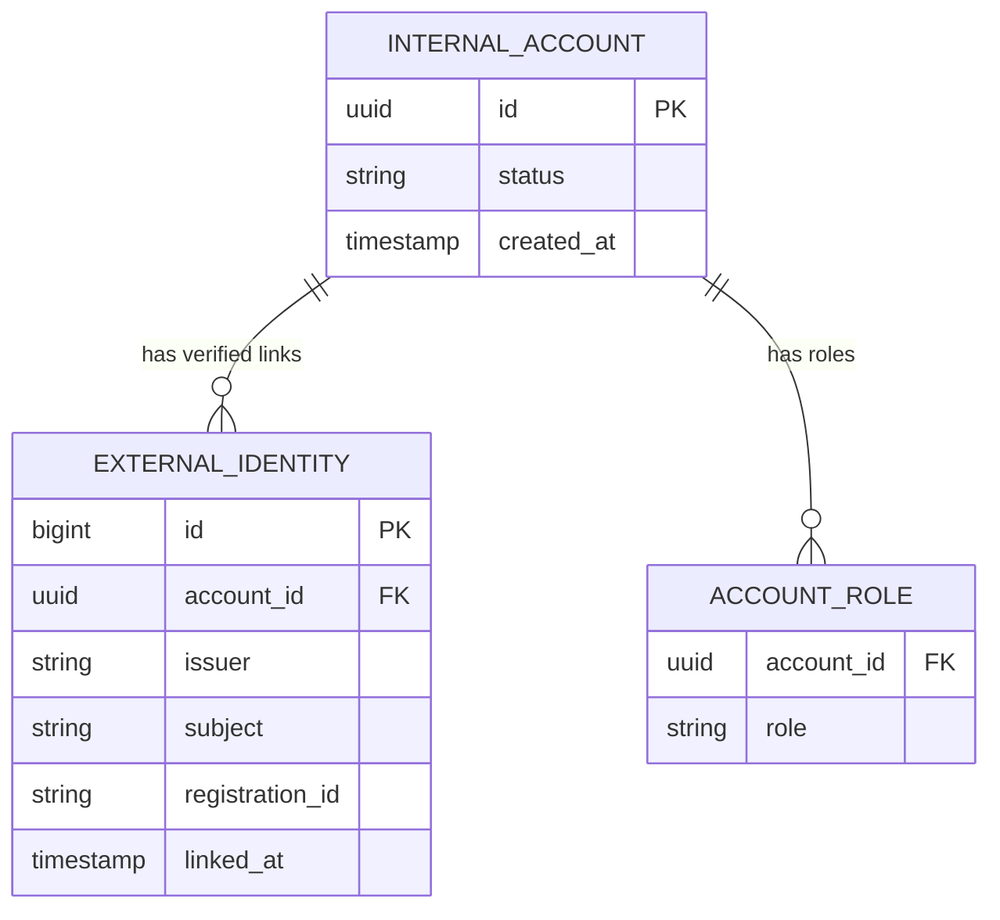
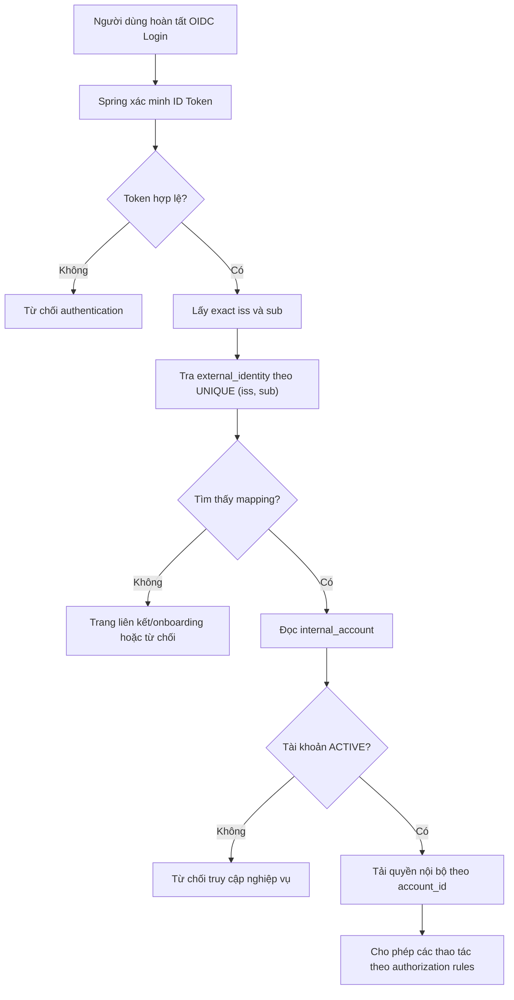
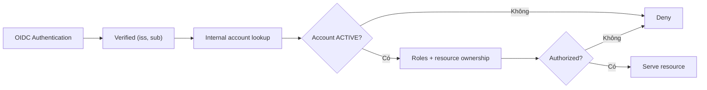

# 13.8. Liên kết tài khoản nội bộ bằng issuer và subject

Trong ứng dụng **Spring Security OAuth 2.0/OIDC Client**, việc người dùng đăng nhập thành công qua Google, Microsoft Entra ID, Keycloak hoặc một OpenID Provider (OP) khác chỉ mới chứng minh họ đã được **nhà cung cấp danh tính xác thực**. Ứng dụng vẫn cần trả lời câu hỏi riêng: **danh tính bên ngoài này tương ứng với tài khoản nào trong hệ thống nội bộ?**

Ví dụ, ứng dụng quản lý đơn hàng có tài khoản nội bộ `account_id=7f4...`, quyền xem kho hàng, giỏ hàng và lịch sử giao dịch. Khi người dùng đăng nhập qua Keycloak, Spring Security nhận ID Token có `iss` và `sub`. Ứng dụng phải tìm đúng tài khoản nội bộ để gắn dữ liệu và phân quyền, nhưng **không nên dựa vào email hoặc tên hiển thị để ghép tài khoản tự động**.

Theo OIDC, khóa định danh bền vững để phân biệt một người dùng ở nhà cung cấp là **cặp `(issuer, subject)`**, thường viết **`(iss, sub)`**. Bài học trình bày ý nghĩa của cặp khóa này, cách lưu trữ và tra cứu, xử lý đăng nhập lần đầu, liên kết nhiều nhà cung cấp, thiết kế bảo mật để ngăn chiếm đoạt tài khoản, và cách tích hợp với Spring Security Servlet.

> **Thông điệp chính:** `(iss, sub)` là khóa của **danh tính OIDC bên ngoài**, còn `account_id` là khóa **tài khoản nghiệp vụ nội bộ**. Liên kết giữa chúng phải là một quan hệ được tạo, kiểm soát và cập nhật an toàn, không phải một phép so sánh email tùy tiện.

## 1. Phân biệt ba khái niệm trước khi thiết kế

| Khái niệm | Ví dụ | Nguồn dữ liệu | Mục đích |
|---|---|---|---|
| **External identity** | `(https://id.example.test/realms/staff, 00u8abc123)` | ID Token OIDC đã được xác minh | Xác định danh tính người đăng nhập tại một OP cụ thể |
| **Internal account** | `account_id=9d1a...` | Database của ứng dụng | Chủ thể sở hữu đơn hàng, cấu hình, vai trò và dữ liệu nghiệp vụ |
| **Profile attributes** | `name`, `email`, `picture` | ID Token, UserInfo hoặc hồ sơ nội bộ | Hiển thị và liên lạc; có thể thay đổi theo thời gian |

Với cùng một tài khoản nội bộ, người dùng có thể liên kết nhiều external identities:

```text
InternalAccount
  id = 7f4f8f9c-...  (bất biến trong ứng dụng)
  status = ACTIVE

ExternalIdentity A
  issuer  = https://id.example.test/realms/staff
  subject = keycloak-user-567
  account_id = 7f4f8f9c-...

ExternalIdentity B
  issuer  = https://accounts.google.com
  subject = google-sub-890
  account_id = 7f4f8f9c-...
```

Đây là quan hệ **nhiều danh tính bên ngoài → một tài khoản nội bộ**. Nó không có nghĩa hai external identities là cùng một người chỉ vì chúng có email giống nhau. Chúng trở thành hai phương thức đăng nhập của cùng một tài khoản **sau khi một quy trình liên kết được ủy quyền hợp lệ**.

### 1.1. Authentication khác authorization và account linking

- **Authentication:** OP xác thực người dùng và Spring kiểm tra ID Token.
- **Account resolution:** ứng dụng tìm `account_id` từ `(iss, sub)`.
- **Account linking:** ứng dụng tạo quan hệ mới giữa external identity và internal account theo một quy trình có kiểm chứng.
- **Authorization:** ứng dụng kiểm tra tài khoản nội bộ có được xem/sửa tài nguyên hoặc thực hiện thao tác không.

Nếu đăng nhập OIDC thành công nhưng không tìm được mapping, điều đó **không tự cấp** quyền truy cập dữ liệu của một tài khoản nội bộ nào. Ứng dụng có thể yêu cầu onboarding, liên kết tài khoản có kiểm chứng hoặc từ chối truy cập theo chính sách.

### 1.2. Không dùng principal name làm khóa nghiệp vụ một cách vô điều kiện

`Authentication#getName()`, `OidcUser#getName()` hay `preferred_username` không phải lúc nào cũng là khóa duy nhất toàn hệ thống. Một số provider định nghĩa tên principal theo `sub`, nhưng có thể tùy biến `userNameAttributeName`. Muốn liên kết OIDC, hãy lấy **issuer và subject từ ID Token đã được Spring Security xác minh**, không lấy từ tên hiển thị hoặc một trường tùy ý trong giao diện.

## 2. `iss` và `sub` trong ID Token

Một ID Token OIDC đã được xác minh có thể chứa payload minh họa:

```json
{
  "iss": "https://id.example.test/realms/staff",
  "sub": "0cae8f5c-9e83-47f0-a42f-167a9b8c2f20",
  "aud": "warehouse-web",
  "iat": 1794791100,
  "exp": 1794794700,
  "email": "lan@example.test",
  "email_verified": true,
  "name": "Nguyễn Thị Lan"
}
```

Các giá trị chỉ để minh họa, không phải JWT thật đã ký.

### 2.1. Issuer — `iss`

`iss` định danh OpenID Provider phát hành ID Token. Với OIDC, đó là một URL issuer được OP công bố, thường tương ứng với metadata discovery và claim issuer trong token.

Ví dụ:

```text
https://accounts.google.com
https://id.example.test/realms/staff
https://login.microsoftonline.com/TENANT_ID/v2.0
```

Issuer giúp phân biệt hai OP cùng cấp một `sub` giống nhau. Nó cũng là một ranh giới bảo mật: token từ issuer không được tin cậy **không thể** được dùng như token của issuer đã đăng ký.

### 2.2. Subject — `sub`

`sub` định danh người dùng cuối theo **issuer**. OIDC định nghĩa `sub` là một giá trị định danh, tối đa 255 ký tự ASCII, có tính duy nhất tại issuer và không nên được gán lại cho người dùng khác theo các cam kết của giao thức.

Ví dụ:

```text
iss = https://id.example.test/realms/staff
sub = user-782
```

Không có nghĩa `user-782` là khóa chung trên Internet. Một nhà cung cấp khác cũng có thể phát `sub=user-782` cho một người hoàn toàn khác.

### 2.3. Vì sao dùng **cặp** `(iss, sub)`?

| Issuer | Subject | Danh tính OIDC |
|---|---|---|
| `https://id-a.example.test` | `user-101` | A |
| `https://id-b.example.test` | `user-101` | B, **khác A** |
| `https://id-a.example.test` | `user-102` | C, **khác A** |
| `https://id-a.example.test` | `user-101` | A trong phạm vi issuer/Client phù hợp |

Vì `sub` chỉ được hiểu trong phạm vi issuer, khóa liên kết đúng là:

```text
external_identity_key = (exact_verified_issuer, exact_verified_subject)
```

Đừng chỉ dùng `sub` trong database nhiều provider. Cũng đừng chỉ dùng `iss`: một issuer có thể phát token cho rất nhiều người dùng.

### 2.4. Public và pairwise subject identifiers

OIDC hỗ trợ các loại subject identifier phổ biến:

- **Public subject:** provider có thể trả cùng một `sub` cho cùng một người dùng tới các Client liên quan theo chính sách OP.
- **Pairwise subject:** provider trả những `sub` khác nhau cho cùng một người dùng ở các **sector identifier** khác nhau để hạn chế khả năng theo dõi/đối chiếu người dùng giữa các Client.

Ví dụ người dùng thật là một, nhưng ứng dụng A và B có thể nhận:

```text
Ứng dụng A:
iss = https://accounts.example.test
sub = pairwise-aaa

Ứng dụng B:
iss = https://accounts.example.test
sub = pairwise-bbb
```

**Không suy ra rằng A và B là cùng một người** chỉ dựa vào email, tên hoặc việc issuer giống nhau. Nếu có nhu cầu hợp nhất tài khoản khi chuyển Client ID, sector identifier hoặc cấu hình OP, cần quy trình migration/link được OP hoặc người dùng xác thực, có chứng cứ và kiểm soát.

### 2.5. Vì sao không chuẩn hóa chuỗi một cách tùy tiện?

Issuer trong ID Token phải được Spring Security kiểm tra theo metadata/client registration tin cậy. Khi lưu khóa mapping:

- Giữ nguyên issuer **đã được xác minh** theo biểu diễn chuẩn mà OP công bố.
- Không tự thay `http` thành `https` hoặc bỏ path tenant/realm.
- Không tự xóa dấu `/` cuối, lower-case toàn URL hoặc thay host nếu không có cơ chế canonicalization được OP xác nhận.
- Không trim/lowercase `sub` hoặc chuyển nó thành email; `sub` là chuỗi định danh opaque.
- Dùng phép so sánh chuỗi theo quy tắc phù hợp, tránh collation không phân biệt hoa/thường làm hai subject khác nhau trở thành một.

Ví dụ `https://id.example.test/realms/a` và `https://id.example.test/realms/b` là hai issuer khác nhau; gộp cả hai chỉ theo host sẽ làm hỏng ranh giới tenant.

## 3. Điều kiện trước khi tin `iss` và `sub`

Cặp `(iss, sub)` chỉ hữu ích nếu đến từ **một ID Token đã được xác minh đúng**. Không được lấy hai chuỗi trong JWT được Base64-decode rồi coi là bằng chứng xác thực.

Một OIDC Login đúng phải kiểm tra các yếu tố giao thức liên quan, gồm:

| Điều kiện | Vì sao quan trọng? |
|---|---|
| Chữ ký và thuật toán ID Token | Ngăn token giả hoặc bị sửa |
| `iss` đúng issuer OP đã tin cậy | Ngăn trộn danh tính của các nhà cung cấp |
| `aud` chứa Client ID được mong đợi | Token phải dành cho Client này, không phải ứng dụng khác |
| `azp` nếu áp dụng | Ràng buộc authorized party khi token có nhiều audience |
| `exp` và các điều kiện thời gian | Token chưa hết hạn và hợp lệ theo chính sách OIDC |
| `nonce` khi flow yêu cầu | Ràng buộc ID Token với yêu cầu xác thực, giảm nguy cơ replay/swap |
| `state` ở authorization flow | Ràng buộc callback với yêu cầu do Client bắt đầu, chống login CSRF |
| `sub` không rỗng và đúng kiểu | Tạo khóa định danh có ý nghĩa |
| UserInfo `sub` trùng ID Token `sub` | Không nhận hồ sơ của người khác |

Trong Spring Security Servlet, cấu hình `oauth2Login` và ClientRegistration đúng giúp framework thực hiện các bước xử lý OIDC. **Chỉ sau khi Spring trả một principal `OidcUser` đã xác thực** mới nên dùng `getIdToken().getIssuer()` và `getSubject()` để tra mapping.

### 3.1. Không tin issuer do trình duyệt tự gửi

Ví dụ một request độc hại:

```http
POST /api/link-account HTTP/1.1
Content-Type: application/json

{
  "issuer": "https://id.example.test",
  "subject": "admin-sub"
}
```

Hai trường JSON do trình duyệt gửi không chứng minh người gửi kiểm soát danh tính đó. Endpoint liên kết **không được** tạo mapping chỉ từ `issuer` và `subject` mà Client nhập; bằng chứng danh tính phải đến từ **luồng OIDC hoàn tất, được Spring xác minh**.

Ngoài ra, không nhận một issuer URL tùy ý rồi lập tức tải metadata từ đó nếu chưa đăng ký và phê duyệt. Việc này có thể mở đường tới SSRF, lạm dụng mạng nội bộ hoặc tin một OP giả.

### 3.2. UserInfo không thể thay thế một ID Token đã kiểm chứng

UserInfo có thể chứa `sub`, `email` và `name`. Nhưng dữ liệu UserInfo phải được gắn với token và đối chiếu subject của ID Token; không dùng JSON UserInfo từ endpoint bất kỳ làm bằng chứng chủ thể.

Nếu:

```text
ID Token sub  = customer-11
UserInfo sub = customer-22
```

ứng dụng phải **không sử dụng UserInfo response** cho principal này. Không “sửa” `sub` bằng cách thay giá trị trong JSON rồi tiếp tục đăng nhập.

## 4. Vì sao email không phải khóa liên kết an toàn?

Một cạm bẫy phổ biến là tìm tài khoản nội bộ theo email ngay khi người dùng đăng nhập OIDC:

```java
// KHÔNG AN TOÀN để tự động gắn vào tài khoản đã tồn tại:
String email = oidcUser.getEmail();
Account account = accountRepository.findByEmail(email);
```

Ngay cả khi ID Token có `email_verified=true`, **email vẫn không phải thay thế cho `(iss, sub)`**.

### 4.1. Những trường hợp có thể dẫn đến sai liên kết

1. **Email thay đổi:** người dùng đổi địa chỉ trong OP, nhưng vẫn là một `sub`.
2. **Email được tái sử dụng:** địa chỉ cũ có thể được cấp lại cho người mới trong tổ chức hoặc một hệ thống khác.
3. **Email thiếu/ẩn:** provider không bắt buộc trả email, hoặc người dùng chưa consent.
4. **Nhiều người/tenant có cùng email hiển thị:** chính sách từng IdP khác nhau, chưa chắc là một danh tính.
5. **Email chưa được xác minh:** claim `email_verified` có thể vắng mặt hoặc `false`.
6. **Claim không đủ để chứng minh quyền sở hữu tài khoản nội bộ:** một email hợp lệ ở OP mới không chứng minh người dùng kiểm soát tài khoản đã tồn tại trong ứng dụng.
7. **Alias, cộng dấu, chữ hoa/thường và Unicode:** canonicalization email khác nhau giữa provider và hệ thống mail; các “mẹo” chuẩn hóa có thể gây gộp nhầm.

### 4.2. Tấn công chiếm đoạt tài khoản bằng automatic email linking

Giả sử tài khoản nội bộ `account_id=1001` có email `staff@example.test` nhưng chưa liên kết OIDC. Ứng dụng cho phép mọi OP mà nó tích hợp trả email giống vậy được gắn tự động vào tài khoản nội bộ.

Nếu một external identity mới được phép chứng minh hoặc khai báo email ấy trong một bối cảnh không tương đương mức tin cậy, kẻ tấn công có thể khiến ứng dụng gắn external identity của họ vào `account_id=1001`.

**Giải pháp:** nếu tìm thấy email giống tài khoản cũ, chỉ coi đây là **tín hiệu gợi ý cho quy trình liên kết**; không lập tức đăng nhập như chủ tài khoản cũ. Người dùng cần chứng minh quyền kiểm soát **tài khoản nội bộ** bằng một yếu tố/phương thức đáng tin khác và **external identity** qua OIDC mới.

### 4.3. Email dùng làm gì thì hợp lý?

- Hiển thị tên người nhận thông báo.
- Gửi email xác nhận theo chính sách.
- Gợi ý phát hiện có thể đã có tài khoản, nhưng tránh tiết lộ sự tồn tại tài khoản nếu không phù hợp.
- Đồng bộ profile khi `(iss, sub)` đã được liên kết và chính sách cho phép.
- Hỗ trợ quy trình khôi phục tài khoản với cơ chế xác minh riêng.

Email có thể được lưu như **thuộc tính mutable**, không phải khóa ngoại bền vững gắn danh tính đăng nhập.

## 5. Mô hình database: tách tài khoản và external identities

Một thiết kế phổ biến gồm:

- Bảng `internal_account`: tài khoản nghiệp vụ trong ứng dụng.
- Bảng `external_identity`: các phương thức đăng nhập bên ngoài đã liên kết.
- Các bảng quyền/nhóm liên quan `account_id`, không phụ thuộc email.

### 5.1. Sơ đồ quan hệ



Ví dụ một tài khoản nội bộ có thể liên kết:

```text
account_id = 01H...
  ├─ Google:   (https://accounts.google.com, sub-A)
  ├─ Keycloak: (https://id.example.test/realms/staff, sub-B)
  └─ Entra ID: (https://login.microsoftonline.com/TENANT/v2.0, sub-C)
```

Ba cặp issuer-subject khác nhau nhưng cùng `account_id` vì **đã được liên kết có xác thực**.

### 5.2. SQL tham khảo cho PostgreSQL

```sql
CREATE TABLE internal_account (
    id UUID PRIMARY KEY,
    status VARCHAR(20) NOT NULL
        CHECK (status IN ('ACTIVE', 'DISABLED', 'PENDING')),
    created_at TIMESTAMPTZ NOT NULL DEFAULT CURRENT_TIMESTAMP
);

CREATE TABLE external_identity (
    id BIGINT GENERATED ALWAYS AS IDENTITY PRIMARY KEY,
    account_id UUID NOT NULL REFERENCES internal_account(id),
    issuer TEXT NOT NULL,
    subject VARCHAR(255) NOT NULL,
    registration_id VARCHAR(128) NOT NULL,
    linked_at TIMESTAMPTZ NOT NULL DEFAULT CURRENT_TIMESTAMP,

    CONSTRAINT ck_external_issuer_nonempty CHECK (length(issuer) > 0),
    CONSTRAINT ck_external_subject_nonempty CHECK (length(subject) > 0),
    CONSTRAINT uq_external_identity_issuer_subject
        UNIQUE (issuer, subject)
);

CREATE INDEX idx_external_identity_account
    ON external_identity(account_id);

CREATE TABLE account_role (
    account_id UUID NOT NULL REFERENCES internal_account(id),
    role VARCHAR(80) NOT NULL,
    PRIMARY KEY (account_id, role)
);
```

**Đây là thiết kế mẫu**, không phải migration bắt buộc cho mọi dự án. Ứng dụng cần bổ sung audit, chính sách xử lý xóa tài khoản, row-level access, encryption hoặc những trường quản trị khác theo nhu cầu.

Điểm cốt lõi:

- `internal_account.id` là khóa nghiệp vụ độc lập và ổn định.
- `external_identity.issuer` và `subject` lưu **giá trị từ token đã xác minh**.
- Ràng buộc **`UNIQUE (issuer, subject)`** ngăn một external identity được gắn vào hai tài khoản khác nhau.
- `registration_id` lưu metadata về cấu hình Client đã dùng, nhưng **không thay `issuer`** trong unique key.
- `account_role` trỏ tới `account_id`; đổi email hoặc đổi provider không làm mọi dữ liệu nghiệp vụ mất liên kết.
- `issuer` và `subject` phải được so sánh với semantics phân biệt chuỗi như OIDC quy định; xem lại collation/case sensitivity ở hệ CSDL đang dùng.

Không tự thiết lập `UNIQUE(email)` trong bảng external identity để suy ra một email chỉ có một danh tính. Hai provider có thể gắn cùng email cho hai external identities, và đó **không tự chứng minh** là cùng một người.

### 5.3. Lưu issuer dưới dạng URL hay ID nội bộ của provider?

Mô hình trên lưu giá trị issuer thật để giữ nguyên danh tính OIDC. Ở hệ thống nhiều provider, có thể thêm bảng `trusted_identity_provider`:

```text
trusted_identity_provider:
  provider_id (internal key)
  issuer (unique, exact)
  status
  allowed_clients
  trust_policy
```

Bảng này giúp định nghĩa issuer nào được phép đăng nhập, nhưng **không thay đổi nguyên tắc liên kết**. Mapping phải ràng buộc tới issuer cụ thể đã xác minh, không chỉ tên cấu hình `company` do developer đặt.

Nếu một registration có nhiều issuer hợp lệ theo cơ chế multi-tenant đặc thù, cần policy xác minh issuer tường minh. Không dùng tên `registrationId` làm bằng chứng rằng hai tenant là một.

## 6. Quy trình đăng nhập: tra cứu mapping đã có

Một flow an toàn cho ứng dụng chỉ cho phép tài khoản đã được cấp trước (*pre-provisioned*):



**Không được có bước “mapping chưa thấy → tìm tài khoản có cùng email → tự gắn vào”.** Đó là con đường dễ dẫn đến account takeover.

### 6.1. Những kết quả tra cứu cần xử lý

| Kết quả | Hành vi phù hợp |
|---|---|
| Có đúng một `(iss, sub)` liên kết với tài khoản `ACTIVE` | Cho đăng nhập theo tài khoản nội bộ và áp rule phân quyền |
| Không có mapping, chính sách chỉ cho phép tài khoản đã cấp trước | Không cấp quyền truy cập; hiển thị hướng liên hệ quản trị/onboarding |
| Không có mapping, ứng dụng cho phép đăng ký mới | Tạo **tài khoản nội bộ mới** theo onboarding được kiểm soát, không chiếm tài khoản cũ theo email |
| Mapping tồn tại nhưng tài khoản `DISABLED` | Từ chối quyền truy cập ứng dụng dù OIDC token còn hợp lệ |
| Một cặp `(iss, sub)` trỏ tới nhiều tài khoản | Lỗi dữ liệu nghiêm trọng; unique constraint phải ngăn tình huống này |
| Provider/issuer bị thu hồi tin cậy | Không chấp nhận đăng nhập chỉ vì mapping cũ tồn tại |

Một ID Token hợp lệ không chứng minh tài khoản trong ứng dụng còn hoạt động. **Account status** và policy nội bộ phải được kiểm tra độc lập.

### 6.2. Mã Java: trích xuất khóa từ `OidcUser`

Sau khi Spring Security đã thực hiện `oauth2Login`:

```java
import org.springframework.security.oauth2.core.oidc.user.OidcUser;

public record ExternalIdentityKey(String issuer, String subject) {

    public ExternalIdentityKey {
        if (issuer == null || issuer.isBlank()) {
            throw new IllegalArgumentException("issuer is required");
        }
        if (subject == null || subject.isBlank()) {
            throw new IllegalArgumentException("subject is required");
        }
    }

    public static ExternalIdentityKey from(OidcUser principal) {
        if (principal == null) {
            throw new IllegalArgumentException("OIDC principal is required");
        }

        return new ExternalIdentityKey(
            principal.getIdToken().getIssuer().toString(),
            principal.getSubject()
        );
    }
}
```

Ý nghĩa:

- `getIdToken().getIssuer()` lấy issuer từ ID Token đã được Spring xác minh.
- `getSubject()` lấy subject theo chuẩn OIDC.
- `ExternalIdentityKey` đóng gói khóa để dịch vụ nội bộ tra cứu database.

**Điều kiện quan trọng:** chỉ gọi `from(...)` trên một `OidcUser` thuộc Authentication mà Spring Security đã chấp nhận, không tự dựng `OidcUser` từ JSON token do trình duyệt gửi rồi tin dữ liệu đó.

### 6.3. Controller đọc tài khoản hiện tại bằng mapping

Một lớp ứng dụng có thể trừu tượng hóa việc tra cứu:

```java
import java.util.UUID;

public interface AccountBindingService {

    UUID requireActiveAccountId(ExternalIdentityKey identity);
}
```

Trong controller:

```java
import java.util.Map;
import java.util.UUID;

import org.springframework.security.core.annotation.AuthenticationPrincipal;
import org.springframework.security.oauth2.core.oidc.user.OidcUser;
import org.springframework.web.bind.annotation.GetMapping;
import org.springframework.web.bind.annotation.RestController;

@RestController
public class CurrentAccountController {

    private final AccountBindingService bindings;

    public CurrentAccountController(AccountBindingService bindings) {
        this.bindings = bindings;
    }

    @GetMapping("/me")
    public Map<String, String> me(@AuthenticationPrincipal OidcUser user) {
        ExternalIdentityKey external = ExternalIdentityKey.from(user);
        UUID accountId = bindings.requireActiveAccountId(external);

        // Chỉ minh họa một endpoint đã được bảo vệ.
        return Map.of("accountId", accountId.toString());
    }
}
```

`AccountBindingService` là interface **do ứng dụng cài đặt** bằng database; code trên không tự tạo mapping. Với thực tế production, không nhất thiết trả internal account ID ra frontend nếu UI không cần.

**Lưu ý phân quyền:** chỉ chặn tại controller `/me` không đủ. Các endpoint khác cũng phải lấy account context đáng tin và kiểm tra trạng thái/quyền. Thường nên có service hoặc security layer chung để giải quyết mapping, tránh một endpoint quên kiểm tra rồi truy cập dữ liệu bằng ID người dùng tự cung cấp.

## 7. Tra cứu `(iss, sub)` bằng database

Ví dụ lớp truy vấn PostgreSQL sử dụng `JdbcTemplate`:

```java
import java.util.List;
import java.util.Optional;
import java.util.UUID;

import org.springframework.jdbc.core.JdbcTemplate;
import org.springframework.stereotype.Repository;

@Repository
public class JdbcExternalIdentityRepository {

    private final JdbcTemplate jdbc;

    public JdbcExternalIdentityRepository(JdbcTemplate jdbc) {
        this.jdbc = jdbc;
    }

    public Optional<UUID> findActiveAccountId(ExternalIdentityKey identity) {
        List<UUID> ids = jdbc.query(
            """
            SELECT e.account_id
            FROM external_identity e
            JOIN internal_account a ON a.id = e.account_id
            WHERE e.issuer = ?
              AND e.subject = ?
              AND a.status = 'ACTIVE'
            """,
            (rs, rowNum) -> rs.getObject("account_id", UUID.class),
            identity.issuer(),
            identity.subject()
        );

        return ids.stream().findFirst();
    }
}
```

Đoạn mã giả định PostgreSQL, bảng theo DDL bên trên và Spring JDBC đã được cấu hình. Java text blocks cần JDK phù hợp. **Unique constraint `(issuer, subject)`** đảm bảo không thể trả về nhiều row cùng khóa trong tình huống dữ liệu hợp lệ.

Đoạn này cố ý **không tìm theo email**, không tự động tạo account mới, cũng không coi một record `DISABLED` là có quyền đăng nhập.

### 7.1. Đọc tài khoản khác với cấp quyền

Một service có thể triển khai:

```java
import java.util.UUID;

import org.springframework.security.access.AccessDeniedException;
import org.springframework.stereotype.Service;

@Service
public class DatabaseAccountBindingService implements AccountBindingService {

    private final JdbcExternalIdentityRepository identities;

    public DatabaseAccountBindingService(
            JdbcExternalIdentityRepository identities) {
        this.identities = identities;
    }

    @Override
    public UUID requireActiveAccountId(ExternalIdentityKey identity) {
        return identities.findActiveAccountId(identity)
            .orElseThrow(() ->
                new AccessDeniedException("Internal account unavailable")
            );
    }
}
```

Câu thông báo cố ý không tiết lộ tài khoản có tồn tại hay không. Với người dùng không có mapping, ứng dụng có thể chọn flow onboarding thay vì trả 403; đó là lựa chọn UX/sản phẩm phải gắn với chính sách bảo mật.

### 7.2. Vì sao vẫn cần truy vấn bằng account ID?

Trong mọi thao tác nghiệp vụ, service nên giới hạn dữ liệu theo account đã resolve:

```sql
SELECT *
FROM orders
WHERE account_id = :trusted_account_id
  AND id = :requested_order_id;
```

`trusted_account_id` phải đến từ mapping `(iss, sub)` và authorization context được kiểm chứng, **không phải** từ query parameter `?accountId=...` do người dùng tự chọn.

## 8. Ba chiến lược khi người dùng đăng nhập lần đầu

Không tồn tại một chính sách duy nhất cho mọi sản phẩm. Có ít nhất ba mô hình:

| Chiến lược | Khi chưa có `(iss, sub)` | Phù hợp với |
|---|---|---|
| **Pre-provisioned/invitation** | Từ chối quyền vào dữ liệu, hướng người dùng nhận lời mời hoặc xác minh qua quản trị | Doanh nghiệp có danh sách người dùng được phép |
| **Just-in-time (JIT) signup** | Tạo **account nội bộ mới** nếu issuer và điều kiện đăng ký hợp lệ | Sản phẩm cho phép tự đăng ký |
| **Link existing account** | Yêu cầu chứng minh quyền kiểm soát tài khoản cũ rồi mới tạo mapping | Người dùng có tài khoản local sẵn và muốn thêm phương thức login |

### 8.1. Pre-provisioning

Quản trị viên hoặc hệ thống provisioning tạo bản ghi tài khoản và mapping từ external identity đã xác minh hoặc được cấp qua kênh đáng tin. Lúc login:

```text
(verified iss, sub) -> account_id -> status/roles
```

Nếu chưa có mapping, người dùng không tự động được gắn vào tài khoản có email trùng. Trong các hệ thống nội bộ, thông tin mapping có thể được đưa vào qua SCIM hoặc quy trình quản trị đáng tin, nhưng phải xác định chính xác subject của issuer/Client liên quan.

### 8.2. JIT signup: tạo account mới, không tự liên kết account cũ

Nếu chính sách cho phép đăng ký mới, transaction nên:

1. Xác minh external identity qua OIDC.
2. Kiểm tra issuer, audience, loại Client và policy onboarding.
3. Tra cứu `(iss, sub)`; nếu đã có thì dùng mapping cũ.
4. Nếu chưa có, tạo **internal_account mới** ở trạng thái thích hợp.
5. Tạo `external_identity` trỏ tới account mới.
6. Commit transaction; xử lý trường hợp hai request đồng thời tranh chấp unique key.
7. Không tự chiếm account cũ chỉ vì email giống.

Nên để account mới ở trạng thái `PENDING` nếu chưa hoàn tất điều kiện kinh doanh, thay vì cấp toàn bộ quyền ngay.

### 8.3. Link existing: phải xác minh cả hai phía

Khi người dùng đã có tài khoản nội bộ, họ có thể muốn liên kết Google/Keycloak/Entra ID làm phương thức đăng nhập mới. Quy trình đúng cần bằng chứng rằng người dùng kiểm soát:

- **Tài khoản nội bộ đang được liên kết** (phiên đăng nhập đáng tin, có thể cần reauthentication gần đây).
- **External identity mới** (OIDC Login hoàn tất với đúng OP/Client và ID Token đã được Spring xác minh).

Chỉ kiểm soát một trong hai **không đủ** để cho phép gắn danh tính mới vào tài khoản cũ.

## 9. Thiết kế luồng liên kết tài khoản an toàn

Giả sử người dùng đang đăng nhập bằng username/password vào tài khoản nội bộ `A` và muốn thêm một đăng nhập Google.

### 9.1. Quy trình đề xuất

1. Người dùng vào **Account Settings → Linked accounts** từ phiên nội bộ đã xác thực.
2. Ứng dụng yêu cầu **xác thực lại** hoặc xác nhận bằng yếu tố phù hợp khi thao tác nhạy cảm.
3. Backend tạo một **pending-link context** ngắn hạn, gắn với `account_id=A`, session hiện tại và provider được phép; đặt trong kho server-side đáng tin.
4. Backend bắt đầu OAuth2/OIDC Authorization Code Flow tới OP mong muốn. `state`/PKCE/nonce và callback do Spring Security quản lý.
5. OP xác thực external identity mới.
6. Spring xác minh ID Token, rút `(iss, sub)` từ principal hợp lệ.
7. Backend kiểm tra pending-link context còn hiệu lực, không bị dùng lại, đúng session/account và provider.
8. Trong transaction, kiểm tra external identity chưa thuộc tài khoản khác; tạo mapping `(iss, sub) -> A`.
9. Ghi audit event không chứa token nhạy cảm; đánh dấu pending-link context đã dùng; hiển thị kết quả liên kết.
10. Ở lần login sau, mapping cho phép cùng external identity tìm về `account_id=A`.

```mermaid
sequenceDiagram
    autonumber
    actor User as Người dùng
    participant Browser as Trình duyệt
    participant App as Ứng dụng Spring
    participant OP as OpenID Provider
    participant DB as Account DB

    User->>App: Đăng nhập vào account A
    User->>App: Chọn "Liên kết Google"
    App->>App: Kiểm tra reauthentication/CSRF
    App->>DB: Lưu pending link gắn account A + session
    App-->>Browser: Bắt đầu OIDC authorization code
    Browser->>OP: Người dùng đăng nhập Google
    OP-->>Browser: Callback với code, state
    Browser->>App: OAuth2 callback
    App->>App: Spring xác minh state, token, issuer, subject
    App->>DB: Kiểm tra pending link + UNIQUE(issuer,subject)
    alt Chưa liên kết và hợp lệ
        App->>DB: INSERT external_identity -> account A
        App-->>Browser: Liên kết thành công
    else Thuộc account khác / ngữ cảnh không hợp lệ
        App-->>Browser: Không liên kết; thông báo an toàn
    end
```

**Không thay thế `state` của Spring bằng account ID hoặc email.** Pending-link context là nghiệp vụ riêng, cần được ràng buộc an toàn với authorization flow, không sửa hoặc làm yếu cơ chế chống login CSRF của OAuth2.

### 9.2. Tại sao phải reauthentication?

Một trình duyệt còn session cũ nhưng bị người khác sử dụng có thể đủ quyền sửa cài đặt thông thường. Liên kết thêm một phương thức đăng nhập mới là hành động có thể trao **quyền truy cập dài hạn** vào tài khoản. Vì vậy, nhiều hệ thống yêu cầu:

- Password/passkey/MFA hoặc quy trình xác thực lại đã được quy định.
- Giới hạn thời gian từ lần xác thực gần nhất.
- CSRF protection cho thao tác “bắt đầu liên kết”.
- Thông báo bảo mật sau khi liên kết thành công.
- Kiểm tra phiên/lời yêu cầu trước khi commit mapping.

Nếu dùng OIDC làm phương thức đăng nhập chính, có thể dùng `max_age`/`auth_time` để yêu cầu phiên xác thực gần đây theo chính sách OP. `iat` của ID Token không tự chứng minh người dùng vừa nhập lại thông tin xác thực.

### 9.3. Tránh account-linking CSRF

Đây là tấn công khi kẻ xấu cố làm nạn nhân gắn external identity **của kẻ xấu** vào tài khoản nội bộ của nạn nhân. Ví dụ nạn nhân đang login account A nhưng bị lừa mở URL hoàn tất một flow liên kết đã được kẻ xấu bắt đầu.

Phòng tránh cần nhiều lớp:

- Spring Security quản lý `state`, PKCE và session của authorization request.
- Pending-link context phải do backend tạo, gắn với account/session đáng tin.
- Đảm bảo callback đang hoàn tất **đúng thao tác liên kết mà người dùng chủ động bắt đầu**.
- Reauthentication/step-up khi liên kết, không chỉ click một link lạ.
- Không chấp nhận `accountId`, `issuer` và `sub` từ query string làm quyết định liên kết.
- Ngăn replay bằng TTL và trạng thái one-time của pending link.
- Kiểm tra ràng buộc uniqueness và ownership trong transaction.

Không thể thay cả flow bằng `POST /link {email: "..."}`, dù API có CSRF token; CSRF protection không chứng minh người dùng kiểm soát external identity mới.

## 10. Transaction và ràng buộc dữ liệu khi tạo liên kết

### 10.1. Hai request đồng thời

Giả sử hai trình duyệt cố gắng liên kết cùng external identity `(iss, sub)` vào hai tài khoản khác nhau.

```text
Request 1 -> account A
Request 2 -> account B

Cả hai SELECT trước:
  không có mapping

Nếu không UNIQUE:
  cả hai INSERT thành công -> danh tính trỏ tới hai account

Nếu có UNIQUE(iss, sub):
  chỉ một INSERT được phép thành công
  request còn lại gặp conflict và phải xử lý rõ
```

Một truy vấn `SELECT` trước `INSERT` **không đủ** để ngăn race condition. Database unique constraint là lớp bảo vệ cuối cùng.

### 10.2. Ví dụ repository liên kết có kiểm soát

Ví dụ đơn giản với `JdbcTemplate` và transaction, giả định các điều kiện OIDC và pending-link đã được **xác minh trước khi gọi method**:

```java
import java.util.UUID;

import org.springframework.dao.DuplicateKeyException;
import org.springframework.jdbc.core.JdbcTemplate;
import org.springframework.stereotype.Repository;
import org.springframework.transaction.annotation.Transactional;

@Repository
public class JdbcIdentityLinkWriter {

    private final JdbcTemplate jdbc;

    public JdbcIdentityLinkWriter(JdbcTemplate jdbc) {
        this.jdbc = jdbc;
    }

    @Transactional
    public void createLink(
            UUID verifiedInternalAccountId,
            ExternalIdentityKey verifiedIdentity,
            String trustedRegistrationId) {

        try {
            jdbc.update(
                """
                INSERT INTO external_identity (
                    account_id, issuer, subject, registration_id
                )
                VALUES (?, ?, ?, ?)
                """,
                verifiedInternalAccountId,
                verifiedIdentity.issuer(),
                verifiedIdentity.subject(),
                trustedRegistrationId
            );
        } catch (DuplicateKeyException duplicate) {
            // Không tự ghi đè owner của external identity.
            // Gửi lỗi nghiệp vụ sau khi transaction/lỗi SQL được xử lý đúng.
            throw new IdentityAlreadyLinkedException();
        }
    }

    public static final class IdentityAlreadyLinkedException
            extends RuntimeException {

        public IdentityAlreadyLinkedException() {
            super("External identity is already linked");
        }
    }
}
```

Lưu ý kỹ thuật: ví dụ mô tả một **bước ghi** và phải được gọi trong luồng linking có kiểm tra account đang `ACTIVE`, pending link, session, reauthentication, issuer được phép và ràng buộc giao dịch. Nó **không phải một endpoint công khai** nhận `verifiedInternalAccountId` từ người dùng. Tùy database và transaction manager, sau lỗi unique constraint transaction có thể phải rollback toàn bộ; cách xử lý idempotent hoặc conflict ở mức service cần được thiết kế tương ứng.

### 10.3. Idempotency và xử lý mapping đã tồn tại

Nếu `(iss, sub)` đã trỏ về đúng `account_id=A`, ứng dụng có thể coi thao tác liên kết lặp là idempotent **sau khi xác minh lại quyền thao tác**.

Nếu `(iss, sub)` trỏ về `account_id=B` mà yêu cầu muốn gắn với A:

- **Không** ghi đè sang A.
- **Không** tự gộp A và B.
- Không tiết lộ dữ liệu tài khoản B trong thông báo lỗi.
- Hướng người dùng vào quy trình hỗ trợ/khôi phục có xác minh hai phía nếu sản phẩm cho phép.

Một identity key chỉ nên có **một owner active** tại một thời điểm, theo chính sách lưu trữ và lịch sử liên kết của ứng dụng.

### 10.4. Có nên unique một external identity theo registration ID?

Một cách sai thường gặp là dùng:

```text
UNIQUE (registration_id, sub)
```

mà bỏ issuer. `registrationId` là tên do ứng dụng đặt và có thể thay đổi khi nâng cấp/deploy; nó không nhất thiết mô tả issuer theo chuẩn OIDC. Tệ hơn, hai registration ID có thể cùng trỏ tới một issuer và cùng subject.

Cặp khóa OIDC nên là **`UNIQUE (issuer, subject)`**. Có thể giữ `registrationId` để hỗ trợ tracing/cấu hình nhưng không dùng làm định danh thay thế.

## 11. Tích hợp Spring Security OIDC Login

### 11.1. Cấu hình ClientRegistration

Một provider doanh nghiệp có OIDC discovery:

```yaml
spring:
  security:
    oauth2:
      client:
        registration:
          staff:
            provider: staff-op
            client-id: ${OIDC_CLIENT_ID}
            client-secret: ${OIDC_CLIENT_SECRET}
            authorization-grant-type: authorization_code
            scope:
              - openid
              - profile
              - email
            redirect-uri: "{baseUrl}/login/oauth2/code/{registrationId}"
        provider:
          staff-op:
            issuer-uri: https://id.example.test/realms/staff
```

Tên miền `example.test` và credentials chỉ là minh họa. Ứng dụng thật phải đăng ký Client, callback và policy với OP, đồng thời dùng issuer chính xác mà provider công bố.

Cấu hình Servlet:

```java
import org.springframework.context.annotation.Bean;
import org.springframework.context.annotation.Configuration;
import org.springframework.security.config.Customizer;
import org.springframework.security.config.annotation.web.builders.HttpSecurity;
import org.springframework.security.web.SecurityFilterChain;

@Configuration
public class SecurityConfig {

    @Bean
    SecurityFilterChain securityFilterChain(HttpSecurity http) throws Exception {
        http
            .authorizeHttpRequests(authorize -> authorize
                .requestMatchers("/", "/error").permitAll()
                .anyRequest().authenticated()
            )
            .oauth2Login(Customizer.withDefaults());

        return http.build();
    }
}
```

Với cấu hình này, người dùng có thể đăng nhập OIDC. Nhưng để bảo vệ dữ liệu nghiệp vụ theo `account_id`, ứng dụng vẫn cần một **bước resolve internal account** và các rule phân quyền nội bộ.

### 11.2. Khóa từ `Authentication` đã được xác thực

`OAuth2AuthenticationToken` có thể chứa registration ID của Client đã đăng nhập; principal cho OIDC thường là `OidcUser`:

```java
import org.springframework.security.core.Authentication;
import org.springframework.security.oauth2.client.authentication.OAuth2AuthenticationToken;
import org.springframework.security.oauth2.core.oidc.user.OidcUser;

public final class OidcPrincipalKeys {

    private OidcPrincipalKeys() {}

    public static ExternalIdentityKey requireKey(
            Authentication authentication) {

        if (!(authentication instanceof OAuth2AuthenticationToken oauth)) {
            throw new IllegalArgumentException(
                "OAuth2 authentication is required"
            );
        }

        if (!(oauth.getPrincipal() instanceof OidcUser user)) {
            throw new IllegalArgumentException(
                "OIDC principal is required"
            );
        }

        return ExternalIdentityKey.from(user);
    }
}
```

`oauth.getAuthorizedClientRegistrationId()` hữu ích cho audit và policy chọn ClientRegistration; còn external identity key vẫn lấy từ `user.getIdToken().getIssuer()` và `user.getSubject()`. Không có lý do để dùng raw authorization code hoặc access token làm khóa liên kết.

## 12. Kiểm tra mapping trong `OidcUserService`

Nếu sản phẩm yêu cầu **chỉ người có tài khoản nội bộ ACTIVE mới được hoàn tất login vào ứng dụng**, có thể tích hợp một bước resolve mapping vào custom OIDC user service.

Nguyên tắc an toàn: **ủy quyền cho `OidcUserService` mặc định** trước, sau đó kiểm tra mapping và trả lại `OidcUser` đã xác thực.

```java
import java.util.Optional;
import java.util.UUID;

import org.springframework.security.oauth2.client.oidc.userinfo.OidcUserRequest;
import org.springframework.security.oauth2.client.oidc.userinfo.OidcUserService;
import org.springframework.security.oauth2.client.userinfo.OAuth2UserService;
import org.springframework.security.oauth2.core.OAuth2Error;
import org.springframework.security.oauth2.core.OAuth2AuthenticationException;
import org.springframework.security.oauth2.core.oidc.user.OidcUser;

public final class MappedOidcUserService
        implements OAuth2UserService<OidcUserRequest, OidcUser> {

    private final OidcUserService delegate = new OidcUserService();
    private final ActiveAccountLookup accounts;

    public MappedOidcUserService(ActiveAccountLookup accounts) {
        this.accounts = accounts;
    }

    @Override
    public OidcUser loadUser(OidcUserRequest request) {
        // Delegate giữ các bước xử lý UserInfo/OIDC mặc định.
        OidcUser user = delegate.loadUser(request);

        ExternalIdentityKey key = ExternalIdentityKey.from(user);
        Optional<UUID> accountId = accounts.findActiveAccountId(key);

        if (accountId.isEmpty()) {
            throw new OAuth2AuthenticationException(
                new OAuth2Error("internal_account_not_available"),
                "Internal account is not available"
            );
        }

        return user;
    }

    public interface ActiveAccountLookup {
        Optional<UUID> findActiveAccountId(ExternalIdentityKey key);
    }
}
```

Code này minh họa **pre-provisioned mode**. Chưa có mapping thì bước đăng nhập không hoàn tất, thay vì âm thầm gắn tài khoản theo email. `ActiveAccountLookup` do ứng dụng triển khai bằng database và chính sách tenant/status.

Gắn service vào `oauth2Login`:

```java
import org.springframework.context.annotation.Bean;
import org.springframework.security.config.annotation.web.builders.HttpSecurity;
import org.springframework.security.oauth2.client.oidc.userinfo.OidcUserRequest;
import org.springframework.security.oauth2.client.userinfo.OAuth2UserService;
import org.springframework.security.oauth2.core.oidc.user.OidcUser;
import org.springframework.security.web.SecurityFilterChain;

@Bean
SecurityFilterChain securityFilterChain(
        HttpSecurity http,
        OAuth2UserService<OidcUserRequest, OidcUser> oidcUserService)
        throws Exception {

    http
        .authorizeHttpRequests(auth -> auth
            .requestMatchers("/", "/error").permitAll()
            .anyRequest().authenticated()
        )
        .oauth2Login(oauth2 -> oauth2
            .userInfoEndpoint(userInfo -> userInfo
                .oidcUserService(oidcUserService)
            )
        );

    return http.build();
}
```

Trong một cấu hình ứng dụng thực tế, cần đăng ký bean tương ứng, ví dụ:

```java
@Bean
OAuth2UserService<OidcUserRequest, OidcUser> oidcUserService(
        MappedOidcUserService.ActiveAccountLookup lookup) {

    return new MappedOidcUserService(lookup);
}
```

**Không dùng chính cấu hình này nguyên trạng cho workflow “link existing”** nếu người dùng OIDC mới chưa có mapping: nó sẽ bị từ chối ngay trong user service và không đến bước liên kết. Một sản phẩm vừa hỗ trợ login thường vừa hỗ trợ linking cần thiết kế flow/linking session và authorization policy tách biệt, với success handler hoặc bước ứng dụng phù hợp. Điều cốt lõi là external identity mới **không được cấp quyền vào tài khoản cũ** trước khi liên kết hoàn tất.

### 12.1. Tại sao không tự gán `ROLE_ADMIN` ngay khi login?

`OidcUserService` mặc định tạo principal/authorities liên quan OIDC. Nhưng quyền ứng dụng có thể đến từ bảng `account_role`. Mã dạng:

```java
// KHÔNG NÊN:
if (user.getEmail().endsWith("@company.test")) {
    authorities.add(new SimpleGrantedAuthority("ROLE_ADMIN"));
}
```

không chứng minh `user` có tài khoản nội bộ đúng hoặc đang là admin. Thay vào đó, resolve `account_id` từ cặp `(iss, sub)`, đọc role của tài khoản còn `ACTIVE` từ hệ quyền được kiểm soát, rồi áp dụng authorization trong Spring Security hoặc service nghiệp vụ.

### 12.2. Cache mapping và quyền như thế nào?

Nếu lookup database mỗi request quá tốn kém, có thể cache:

```text
cache key   = (verified issuer, verified subject)
cache value = internal account ID + status/version (theo policy)
```

Nhưng caching làm phát sinh câu hỏi về **thu hồi quyền**:

- Khi tài khoản bị disable, cache có bị xóa/cập nhật nhanh không?
- Khi unlink một provider, phiên login cũ còn tồn tại bao lâu?
- Khi chuyển role từ admin sang user, các session/caches có bị invalidated không?
- Có phân vùng cache theo tenant/environment để tránh cross-tenant lookup không?

Với dữ liệu nhạy cảm, thời gian sống cache cần được cân bằng với yêu cầu thu hồi quyền; không mặc định cache mapping/role vĩnh viễn trong `SecurityContext`.

## 13. Mô hình phân quyền sau khi liên kết

Giả sử OP cho biết danh tính:

```text
iss = https://id.example.test/realms/staff
sub = user-782
```

Ứng dụng tra được:

```text
external_identity -> account_id = a3e9...
internal_account  -> status = ACTIVE
account_role      -> ROLE_READER
```

Một request đọc dữ liệu có thể đi qua:



**Người dùng đã đăng nhập** không đồng nghĩa **được phép truy cập mọi tài nguyên**. Quyền có thể phụ thuộc:

- Role/permission của tài khoản nội bộ.
- Tenant sở hữu tài nguyên.
- Owner của order/document.
- Trạng thái tài khoản và dữ liệu.
- Policy MFA hoặc reauthentication cho thao tác nhạy cảm.

Một người dùng có external identity hợp lệ nhưng đã nghỉ việc cần bị **disable/thu hồi quyền trong hệ thống nội bộ** theo quy trình, kể cả nếu token OIDC từ OP vẫn còn hợp lệ.

### 13.1. Bảo vệ theo account ID, không tin account ID từ request

Ví dụ một service truy xuất hóa đơn nên kiểm tra:

```sql
SELECT i.*
FROM invoice i
WHERE i.id = :invoice_id
  AND i.account_id = :current_verified_account_id;
```

Không để client cung cấp `current_verified_account_id` tùy ý rồi bỏ qua mapping. Đây là nguyên tắc chống truy cập đối tượng không được phép (*IDOR/BOLA*).

### 13.2. Có dùng `ROLE_USER` chung cho mọi OIDC Login được không?

Một role chung có thể cho phép truy cập màn hình onboarding, nhưng **không nên tự cấp quyền đọc dữ liệu nghiệp vụ** nếu chưa có mapping. Cần phân biệt trạng thái:

```text
EXTERNALLY_AUTHENTICATED  -> đã xác thực tại OP
INTERNAL_ACCOUNT_LINKED   -> có mapping hợp lệ
ACCOUNT_ACTIVE            -> tài khoản nội bộ được phép hoạt động
AUTHORIZED_FOR_ACTION     -> có quyền theo policy cụ thể
```

Các trạng thái trên không tự chuyển đổi chỉ vì ID Token chứa email hoặc group name.

## 14. Một tài khoản nội bộ liên kết nhiều provider

Có thể cho người dùng thêm phương thức đăng nhập dự phòng:

```text
Account A
  ├── Google: (iss=accounts.google.com, sub=G123)
  ├── Keycloak: (iss=id.example.test/realms/staff, sub=K456)
  └── Entra: (iss=login.microsoftonline.com/TENANT/v2.0, sub=E789)
```

Cùng một `account_id=A` nhưng ba khóa bên ngoài khác nhau. Các phương thức này chỉ cùng trỏ tới A sau khi được liên kết.

### 14.1. Không tự liên kết provider dựa trên email trùng

Ví dụ:

```text
Google email: lan@example.test
Keycloak email: lan@example.test
```

Đó chỉ là hai claim hồ sơ bằng nhau. Không có phép suy luận OIDC nào tự chứng minh đây là một tài khoản nội bộ duy nhất. Cần quy trình linking hoặc provisioning từ nguồn quản trị đáng tin.

### 14.2. Cách xử lý provider bị loại bỏ

Nếu tổ chức ngừng dùng provider A, hệ thống có thể:

1. Thông báo và yêu cầu người dùng liên kết phương thức đăng nhập mới.
2. Xác minh quyền kiểm soát tài khoản theo quy trình migration.
3. Tạo external identity mới cho provider B.
4. Kiểm tra người dùng có thể đăng nhập bằng B.
5. Thu hồi/unlink A theo chính sách, giữ audit.
6. Không thay đổi `account_id` hoặc toàn bộ dữ liệu nghiệp vụ.

Không tìm/merge người dùng theo `email` trong migration như một shortcut khi không có bằng chứng đủ tin cậy.

## 15. Multi-tenant và issuer theo tenant

Trong Microsoft Entra ID, Keycloak realms hoặc IdP doanh nghiệp, issuer có thể chứa thông tin tenant/realm.

Ví dụ:

```text
Keycloak tenant A:
https://id.example.test/realms/tenant-a

Keycloak tenant B:
https://id.example.test/realms/tenant-b
```

Hai token cùng có `sub=user-15` nhưng khác issuer là **hai external identities khác nhau**. Nếu ứng dụng có thêm internal tenant ID, cần quyết định policy:

```text
(verified iss, sub) -> internal_account_id -> internal_tenant_id
```

Không nên:

```text
strip /realms/{tenant}
then lookup by sub only
```

Cách này có thể gắn danh tính từ tenant B vào tài khoản tenant A.

### 15.1. Issuer allowlist

Chỉ chấp nhận những issuer đã được phê duyệt cho ứng dụng hoặc tenant cụ thể. Ví dụ cấu hình:

```text
Tenant A -> allowed issuer(s): id.example.test/realms/tenant-a
Tenant B -> allowed issuer(s): id.example.test/realms/tenant-b
```

Việc mapping nội bộ là một kiểm tra **bổ sung**, không thay thế OIDC validation và issuer trust policy. Dù database vô tình có mapping tới issuer cũ/không được tin nữa, Client vẫn phải từ chối token không hợp lệ.

### 15.2. `aud` và Client ID cũng cần đúng

Khi dùng cùng một OP cho nhiều ứng dụng, một ID Token cấp cho app B không được app A chấp nhận chỉ vì `iss` và `sub` giống. OIDC Client phải kiểm tra `aud`/`azp` theo yêu cầu. Mapping trong database **không cho phép bỏ audience validation**.

### 15.3. Với pairwise subject và migration Client ID

Một người dùng có thể có `sub` khác khi đổi Client hoặc sector identifier. Nếu mapping cũ không tìm được, không phải lúc nào đây cũng là “người dùng mới”. Tuy nhiên, không được tự coi hai subject là một chỉ vì email bằng nhau.

Có thể giải quyết bằng:

- Quy trình migration có xác nhận từ OP hoặc hệ thống định danh doanh nghiệp.
- Người dùng chứng minh quyền kiểm soát tài khoản cũ và đăng nhập OIDC mới.
- Quản trị viên xử lý trường hợp ngoại lệ theo chính sách.
- Audit việc chuyển đổi mapping, không sửa im lặng `sub` trong database.

## 16. OIDC khác đăng nhập OAuth2 không có ID Token

`OidcUser` có ID Token đã được xác minh, nên ta có `iss` và `sub` theo OIDC. Nhưng không phải mọi OAuth2 provider đều cung cấp OIDC.

Ví dụ GitHub OAuth App thông thường trả `OAuth2User`, với ID người dùng nằm trong user attributes API, không có ID Token OIDC.

Đừng viết:

```java
// KHÔNG ĐÚNG khi ứng dụng cũng chấp nhận OAuth2 non-OIDC:
OidcUser user = (OidcUser) authentication.getPrincipal();
```

cho mọi provider.

Nếu sản phẩm hỗ trợ cả hai:

- Với OIDC: dùng **`(verified iss, sub)`**.
- Với OAuth2 không OIDC: định nghĩa một **provider-specific identity key** từ provider đã tin cậy và thuộc tính tài khoản ổn định mà API công bố, ví dụ `(provider, provider_user_id)`.
- Hai loại khóa cần có namespace/loại rõ ràng; không tự gán `iss` giả rồi coi đó là bằng chứng OIDC.
- Cơ chế token validation, user attributes, permissions và linking phải được xem xét riêng.

**Bài học này tập trung vào OIDC**, nên các đoạn code dựa trên `OidcUser` không áp dụng nguyên trạng cho GitHub OAuth App.

## 17. Link, unlink, disable và vòng đời tài khoản

### 17.1. Unlink provider

Khi người dùng muốn gỡ một external identity:

1. Yêu cầu xác thực lại phù hợp.
2. Xác nhận danh tính đang liên kết thuộc đúng internal account.
3. Kiểm tra người dùng còn ít nhất một phương thức đăng nhập/khôi phục khả dụng, nếu chính sách yêu cầu.
4. Thu hồi quyền/authorized client liên quan khi cần và khi provider hỗ trợ.
5. Xóa hoặc chuyển trạng thái link; giữ audit theo chính sách lưu trữ.
6. Vô hiệu hóa phiên/token nội bộ liên quan nếu chính sách yêu cầu.

Không cho phép gỡ phương thức duy nhất rồi khóa người dùng khỏi tài khoản mà không có cơ chế khôi phục, trừ khi đó là quyết định có chủ đích.

### 17.2. Disable internal account

Nếu internal account bị disable, mapping có thể vẫn còn trong database để phục vụ audit/khôi phục; nhưng authorization phải **từ chối quyền ứng dụng**. Không nên xóa `account_id` và tạo account mới chỉ vì OP vẫn cho đăng nhập.

### 17.3. Xóa tài khoản và dữ liệu riêng tư

Quy trình xóa tài khoản cần xem xét:

- Dữ liệu nghiệp vụ nào bị xóa, giữ lại hoặc ẩn danh theo chính sách.
- Thông tin mapping `iss`/`sub` và lịch sử liên kết có phải dữ liệu cá nhân trong bối cảnh hệ thống không.
- Audit trail tối thiểu cho các sự kiện linking/unlinking khi cần kiểm tra bảo mật.
- Token/credential còn được lưu hoặc có thể bị thu hồi.
- Tránh tái sử dụng `account_id` của người đã xóa cho người khác.

Cần nhất quán về bảo mật và quyền riêng tư, không lưu claim thừa chỉ vì IdP đã cung cấp.

### 17.4. SCIM và provisioning không tự động là OIDC identity linking

SCIM được dùng để quản lý lifecycle người dùng/nhóm ở một số hệ thống doanh nghiệp. SCIM record có thể có ID riêng. **SCIM user ID không tự động chính là OIDC `sub`** nếu không có hợp đồng rõ ràng giữa hệ thống provisioning và OP.

Nếu nhận mapping từ SCIM, ứng dụng cần xác minh:

- Nguồn provisioning đáng tin, có quyền cấp mapping.
- Trường nào ánh xạ tới issuer và subject thật trong OIDC.
- Tenant, Client và trust boundary tương ứng.
- Quy trình thu hồi khi user bị disable/deprovisioned.
- Tránh dùng email làm khóa duy nhất chỉ vì SCIM cung cấp `userName`/`emails`.

## 18. Lỗi thường gặp và cách khoanh vùng

| Hiện tượng | Nguyên nhân có thể | Cách xử lý |
|---|---|---|
| OIDC Login thành công nhưng không tìm được tài khoản nội bộ | Chưa có mapping, issuer/subject thay đổi hoặc nhầm tenant | Kiểm tra cặp `(iss, sub)` đã xác minh và workflow onboarding/link |
| Hai người dùng bị gộp vào cùng account | Đã auto-link theo email hoặc chỉ dùng `sub` | Dừng auto-link, điều tra audit, khôi phục mapping chính xác |
| Một identity dùng được cho hai account | Thiếu unique constraint trên `(issuer, subject)` | Áp ràng buộc CSDL và xử lý dữ liệu lỗi trước migration |
| Đổi email gây mất tài khoản | Lookup theo email thay vì `(iss, sub)` | Dùng account mapping bền vững, email chỉ là thuộc tính |
| Keycloak realm A đăng nhập vào dữ liệu realm B | Đã bỏ qua path realm trong issuer | Giữ issuer chính xác và kiểm tra tenant policy |
| Token của app khác vẫn được chấp nhận | Audience/azp validation thiếu hoặc bị vô hiệu | Khôi phục xác minh OIDC chuẩn |
| Chuyển Client ID làm `sub` đổi | Pairwise subject hoặc cấu hình OP đổi | Migration/link theo bằng chứng tin cậy, không đoán qua email |
| `OAuth2User` cast sang `OidcUser` lỗi | Provider OAuth2 không OIDC | Phân biệt cơ chế identity key theo loại provider |
| Account đã disable nhưng user vẫn vào app | Chỉ dựa vào token/session, không kiểm tra status nội bộ | Kiểm tra status và thu hồi session/cache theo policy |
| Role admin còn sau khi đã gỡ quyền | Authority/cache snapshot cũ | Kiểm tra role tại nguồn tin cậy hoặc cơ chế invalidation |
| Link mới bị lỗi unique key | Identity đã liên kết hoặc race condition | Không overwrite; trả lỗi an toàn và điều tra owner |
| Kẻ xấu gắn external identity của họ vào account nạn nhân | Thiếu reauth/pending-link binding, account-linking CSRF | Bắt đầu link từ phiên tin cậy; xác thực hai phía và one-time context |
| Email verified vẫn bị link nhầm | Đã coi verified email là bằng chứng quyền kiểm soát internal account | Tách email verification khỏi proof of ownership |
| Người dùng mới thấy dữ liệu của account cũ | JIT signup tự reuse account theo email | Tạo account mới; chỉ hợp nhất bằng quy trình kiểm chứng |
| Không thể unlink provider cuối | Không có phương thức đăng nhập thay thế | Thiết kế recovery/step-up trước khi unlink |
| UserInfo trả `sub` khác ID Token | Endpoint, token hoặc provider không nhất quán | Không dùng UserInfo; sửa cấu hình và kiểm tra flow |

### 18.1. Thứ tự debug an toàn

1. **Xác định OIDC Login có hợp lệ không.** Chữ ký, issuer, audience, expiry, nonce, state.
2. **Xem registrationId và issuer đã được xác minh.** Đúng môi trường, tenant, realm?
3. **So sánh khóa `(iss, sub)` với mapping database.** Không so sánh email để quyết định.
4. **Kiểm tra trạng thái internal account.** `ACTIVE`, `PENDING` hay `DISABLED`?
5. **Kiểm tra quyền nội bộ và tenant ownership.** Có role và resource policy phù hợp không?
6. **Nếu là liên kết mới, xem pending-link audit.** Ai bắt đầu, đã xác thực lại, session/expiry còn hợp lệ?
7. **Nếu gặp race, xem unique key và transaction result.** Không ghi đè owner tùy tiện.
8. **Nếu sau migration mất mapping, xem loại subject và thay đổi Client/sector.** Thực hiện migration có bằng chứng.

Không cần ghi raw ID Token, refresh token, authorization code hoặc email thật vào log. Có thể ghi một correlation ID ngẫu nhiên, registration ID, mã loại lỗi và khóa mapping được băm bằng cơ chế HMAC vận hành nếu cần đối chiếu mà không phơi lộ subject.

## 19. Bảo vệ thông tin `iss`, `sub` và nhật ký liên kết

Dù `sub` không phải password, nó là **pseudonymous identifier** có thể liên kết các sự kiện đến một tài khoản. Vì vậy:

- Hạn chế ghi `sub` công khai ở frontend/log nếu không có mục đích.
- Bảo vệ bảng external identity như dữ liệu danh tính, giới hạn truy cập và sao lưu.
- Không sử dụng subject thô làm URL người dùng có thể đoán và truy xuất dữ liệu tài khoản.
- Không để external identity linking endpoint tiết lộ “danh tính này đã gắn với tài khoản X” cho người chưa được xác thực.
- Ghi audit `LINK_STARTED`, `LINK_SUCCEEDED`, `LINK_REJECTED`, `UNLINKED` với metadata tối thiểu.
- Có quy trình ứng phó nếu một mapping bị tạo sai hoặc external identity bị chiếm quyền.
- Xác định rõ thời hạn lưu, nhu cầu audit và quyền riêng tư cho dữ liệu mapping.

Nếu muốn correlation ổn định trong log, có thể HMAC khóa `issuer + delimiter + subject` bằng key nội bộ, nhưng phải quản lý key và quy tắc format an toàn; không dùng hash thường như một bảo đảm ẩn danh tuyệt đối.

## 20. Những tình huống thiết kế

### Tình huống A: nhân viên được cấp sẵn tài khoản

Công ty chỉ cho các nhân viên đã được provisioning đăng nhập. Người dùng OIDC hợp lệ nhưng không có mapping.

**Hướng xử lý:** từ chối quyền truy cập dữ liệu nội bộ, hiển thị hướng liên hệ quản trị, hoặc dùng onboarding được phê duyệt. Không tạo mapping theo email công ty.

### Tình huống B: người dùng tự đăng ký mới

Sản phẩm cho phép bất kỳ người dùng Google hợp lệ nào tạo tài khoản mới.

**Hướng xử lý:** nếu `(iss, sub)` chưa có mapping, tạo **internal_account mới** trong transaction. Nếu email giống account đã tồn tại, không tự hợp nhất; người dùng phải trải qua flow linking.

### Tình huống C: một người muốn liên kết Keycloak và Google

Người dùng đang login bằng Keycloak vào Account A, sau đó chọn “Liên kết Google”.

**Hướng xử lý:** xác minh lại quyền truy cập Account A theo policy, bắt đầu OIDC flow Google, kiểm tra pending link/session/state, nhận Google `(iss, sub)` đã xác minh, tạo mapping vào A nếu chưa thuộc tài khoản khác.

### Tình huống D: hai đăng nhập có `sub` giống nhau nhưng issuer khác

```text
Provider X: iss=X, sub=777
Provider Y: iss=Y, sub=777
```

**Hướng xử lý:** đây là hai external identities khác nhau. Không gộp dựa trên số `777`.

### Tình huống E: cùng email nhưng Subject khác sau thay đổi OP

Một tài khoản cũ có `(iss=A, sub=old)`, nhưng sau đổi Client/sector người dùng nhận `(iss=A, sub=new)` và email giống cũ.

**Hướng xử lý:** không thay `old` bằng `new` tự động. Dùng migration được OP/nhóm danh tính xác nhận hoặc reauthorization/linking có kiểm chứng. Giữ audit về hai khóa và hành động chuyển đổi.

### Tình huống F: OIDC Login thành công nhưng nội bộ đã khóa tài khoản

Provider còn cho user đăng nhập, nhưng `internal_account.status=DISABLED`.

**Hướng xử lý:** chặn các hoạt động nghiệp vụ. Nếu yêu cầu an toàn cao, invalidation session/cache và phối hợp deprovisioning với IdP để tránh vòng lặp đăng nhập không mong muốn.

## 21. Bài tập thực hành

### Bài tập 1: Chọn khóa đúng

Cho ba ID Token hợp lệ:

```text
A: iss=https://id-a.example.test, sub=user-1, email=alice@example.test
B: iss=https://id-b.example.test, sub=user-1, email=alice@example.test
C: iss=https://id-a.example.test, sub=user-2, email=alice@example.test
```

Hỏi A, B, C có tự động cùng một tài khoản nội bộ không?

**Đáp án:** không. A, B, C là ba external identity keys khác nhau. Email giống không cho phép tự gộp; nếu cùng người dùng thật, cần liên kết được xác thực.

### Bài tập 2: Thiết kế unique constraint

Bảng mapping hiện có `UNIQUE(subject)`. Có phù hợp không?

**Đáp án:** không, vì hai issuer khác nhau có thể phát cùng subject. Nên dùng `UNIQUE(issuer, subject)` với so sánh chuỗi phù hợp OIDC.

### Bài tập 3: Link chỉ bằng email verified

Một OP trả `email=staff@example.test` và `email_verified=true`. Hệ thống tìm thấy tài khoản nội bộ trùng email và lập tức cho vào dữ liệu của tài khoản cũ.

**Đáp án:** đây là linking thiếu bằng chứng quyền kiểm soát tài khoản cũ, có nguy cơ account takeover. Yêu cầu người dùng xác thực tài khoản cũ hoặc một cơ chế provisioning đáng tin trước khi tạo mapping.

### Bài tập 4: Đăng nhập từ issuer mới

Keycloak di chuyển realm từ `https://old.example.test/realms/staff` sang `https://new.example.test/realms/staff`. `sub` giữ nguyên.

**Đáp án:** cặp `(iss, sub)` đã thay đổi vì issuer đổi. Cần quy trình migration danh tính có xác nhận và audit; không tự bỏ qua host issuer để giữ đăng nhập.

### Bài tập 5: Race khi tạo mapping

Hai request cùng tra `(iss, sub)` và chưa thấy record. Một request muốn gắn Account A, một request muốn gắn Account B.

**Đáp án:** unique constraint tại database quyết định chỉ một row được tạo. Request còn lại phải xử lý conflict; không tự ghi đè hoặc merge. `SELECT` trước `INSERT` không đủ để chống race.

### Bài tập 6: UserInfo thiếu email

Ứng dụng nhận ID Token có issuer/subject hợp lệ nhưng UserInfo không trả `email`.

**Đáp án:** nếu policy không yêu cầu email, mapping vẫn dựa trên `(iss, sub)`. Nếu nghiệp vụ cần email, có thể yêu cầu người dùng bổ sung/xác minh theo luồng riêng. Không từ bỏ `(iss, sub)` để dùng tên hiển thị.

### Bài tập 7: Phân quyền sau login

Người dùng login OIDC thành công; mapping trỏ đến Account A có `ROLE_READER`. Người dùng truy cập `/admin/delete`.

**Đáp án:** từ chối nếu thiếu quyền tương ứng. Authentication thành công không tự cấp `ROLE_ADMIN`. Authorization phải kiểm tra role/permission nội bộ.

### Bài tập 8: Thêm provider đăng nhập thứ hai

Người dùng đã login Account A bằng Keycloak muốn liên kết Google. Hãy nêu các bước tối thiểu để không bị account-linking CSRF.

**Gợi ý:** kiểm tra phiên Account A và reauthentication, tạo pending-link server-side một lần, khởi động OIDC flow Google với state/PKCE/nonce chuẩn, kiểm tra callback và `(iss, sub)` đã xác minh, đối chiếu pending link, kiểm tra unique ownership, ghi mapping trong transaction và audit.

## 22. Tài liệu tham khảo

1. [OpenID Connect Core 1.0 — ID Token](https://openid.net/specs/openid-connect-core-1_0.html#IDToken): ý nghĩa `iss` và `sub` trong ID Token.
2. [OpenID Connect Core 1.0 — Subject Identifier Types](https://openid.net/specs/openid-connect-core-1_0.html#SubjectIDTypes): public và pairwise subject identifiers.
3. [OpenID Connect Core 1.0 — ID Token Validation](https://openid.net/specs/openid-connect-core-1_0.html#IDTokenValidation): kiểm tra issuer, audience và các điều kiện OIDC.
4. [OpenID Connect Core 1.0 — UserInfo Endpoint](https://openid.net/specs/openid-connect-core-1_0.html#UserInfo): yêu cầu khớp `sub` của UserInfo với ID Token.
5. [Spring Security Reference — OAuth2 Login (Servlet)](https://docs.spring.io/spring-security/reference/servlet/oauth2/login/core.html): cấu hình đăng nhập OIDC, ClientRegistration và principal.
6. [Spring Security Reference — Advanced OAuth2 Login](https://docs.spring.io/spring-security/reference/servlet/oauth2/login/advanced.html): các điểm mở rộng user service và authority mapping.
7. [Spring Security API — OidcUser](https://docs.spring.io/spring-security/reference/api/java/org/springframework/security/oauth2/core/oidc/user/OidcUser.html): đọc ID Token, issuer và subject từ principal.
8. [Spring Security API — OidcUserService](https://docs.spring.io/spring-security/reference/api/java/org/springframework/security/oauth2/client/oidc/userinfo/OidcUserService.html): xử lý OIDC principal.
9. [Spring Security API — OAuth2AuthenticationToken](https://docs.spring.io/spring-security/reference/api/java/org/springframework/security/oauth2/client/authentication/OAuth2AuthenticationToken.html): registration ID và Authentication cho OAuth2 Login.
10. [Spring Security Reference — Authorization](https://docs.spring.io/spring-security/reference/servlet/authorization/index.html): phân quyền HTTP/method, tách authentication khỏi authorization.
11. [RFC 9700 — OAuth 2.0 Security Best Current Practice](https://www.rfc-editor.org/rfc/rfc9700): thực hành bảo mật OAuth 2.0, bảo vệ flow và tránh nhầm lẫn Client.

## 23. Ghi nhớ trọng tâm

**Liên kết tài khoản nội bộ bằng issuer và subject** có nghĩa: sau khi Spring Security OIDC Client xác minh ID Token, ứng dụng rút ra cặp **`(iss, sub)`**, dùng cặp đó tra một bảng external identity có ràng buộc duy nhất, từ đó tìm **`account_id`** nghiệp vụ và quyền liên quan.

Những nguyên tắc cốt lõi:

- **`(iss, sub)`** là khóa định danh OIDC, không phải `email`, `name` hay `preferred_username`.
- **Issuer phải được xác minh**; đừng nhận issuer và subject thuần từ browser hoặc decode JWT chưa kiểm chứng.
- **Không tự gộp tài khoản theo email**, kể cả khi `email_verified=true`.
- **Database phải có `UNIQUE(issuer, subject)`** và quy tắc concurrency an toàn.
- **Account linking là một thao tác bảo mật nhạy cảm**: chứng minh quyền kiểm soát tài khoản cũ lẫn external identity mới, dùng state/PKCE/pending context và audit.
- **Tài khoản nội bộ và quyền nghiệp vụ sống độc lập** với nhà cung cấp OIDC; thay OP hoặc đổi email không nên đổi khóa dữ liệu.
- **Multi-tenant và pairwise subject** có thể làm issuer hoặc subject khác nhau; migration phải dựa vào bằng chứng, không đoán.
- **OIDC Authentication thành công không tự đồng nghĩa được phép vào ứng dụng**: account status, tenant, role và ownership phải được kiểm tra.

Khi ranh giới này được thiết kế rõ, ứng dụng có thể hỗ trợ nhiều nhà cung cấp đăng nhập mà không đánh mất tính nhất quán của dữ liệu nội bộ, đồng thời tránh được lớp lỗi nghiêm trọng nhất của account linking: **đưa người dùng đã xác thực ở một nguồn vào nhầm tài khoản thuộc người khác**.
