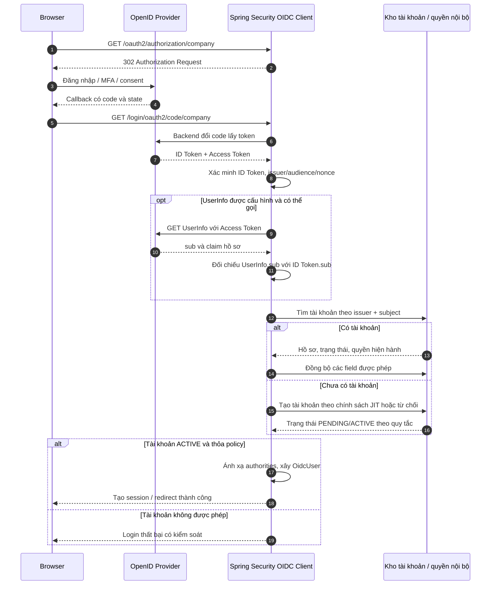
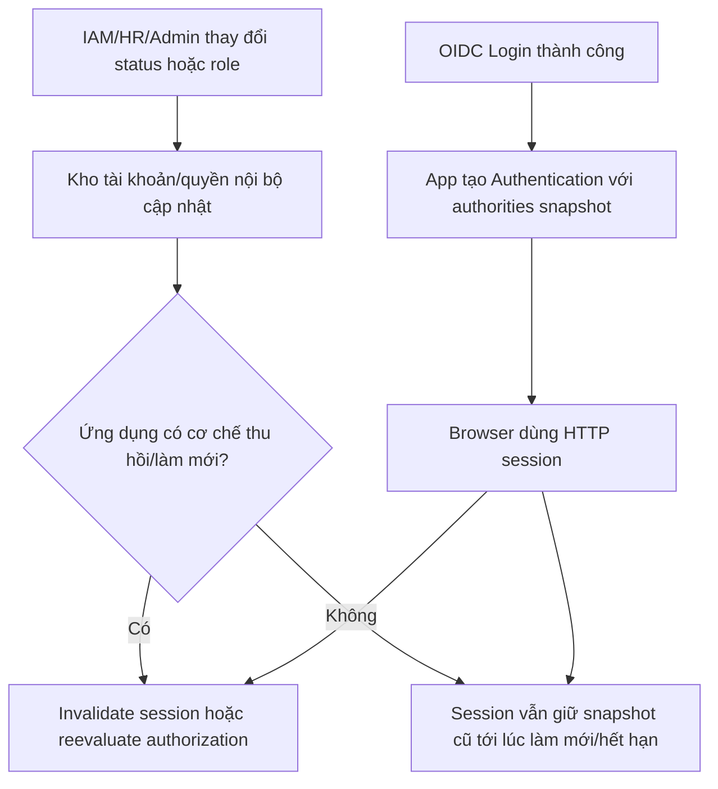

# 13.10. Đồng bộ hồ sơ, trạng thái tài khoản và quyền ứng dụng

Một ứng dụng Spring Boot tích hợp **Spring Security OAuth 2.0 / OpenID Connect (OIDC) Client** có thể xác thực người dùng qua OpenID Provider (OP) và nhận một `OidcUser` hợp lệ. Tuy nhiên, **đăng nhập thành công ở OP không có nghĩa tài khoản được phép sử dụng mọi chức năng của ứng dụng**, cũng không bảo đảm mọi dữ liệu hồ sơ nội bộ đã được cập nhật.

Ví dụ: một nhân viên vẫn có phiên SSO tại nhà cung cấp định danh nhưng đã bị vô hiệu hóa trong hệ thống quản lý đơn hàng; một người thay đổi phòng ban nhưng quyền cũ còn nằm trong HTTP session; hoặc một người dùng mới đăng nhập lần đầu, chưa có bản ghi hồ sơ trong cơ sở dữ liệu ứng dụng. Đây là những vấn đề thuộc **đồng bộ hồ sơ, vòng đời tài khoản và phân quyền**, không chỉ thuộc xác thực OIDC.

Bài học này trình bày cách thiết kế một luồng an toàn: từ **ID Token/UserInfo đã xác minh**, liên kết với **tài khoản nội bộ**, cập nhật **hồ sơ có kiểm soát**, xác định **trạng thái tài khoản và quyền thực tế**, sau đó đưa authorities phù hợp vào Spring Security và duy trì tính nhất quán khi dữ liệu thay đổi.

## 1. Ba lớp cần tách biệt: identity, profile và authorization

Một hệ thống web thường có ba nhóm câu hỏi:

1. **Identity / authentication:** Người đang đăng nhập là ai? OpenID Provider nào đã xác thực họ?
2. **Profile / account lifecycle:** Ứng dụng có tài khoản nào gắn với danh tính đó? Tài khoản còn hoạt động, đang chờ duyệt hay bị khóa?
3. **Authorization:** Tài khoản này được thực hiện hành động gì trên tài nguyên nào, trong tenant/phạm vi dữ liệu nào?

Ba nhóm có thể lấy dữ liệu từ các nguồn khác nhau:

| Lớp | Dữ liệu thường gặp | Nguồn đáng tin cậy điển hình | Quyết định được phép thực hiện |
|---|---|---|---|
| Danh tính OIDC | `iss`, `sub`, `aud`, thời gian, nonce và thông tin xác thực | ID Token được Spring Security xác minh theo OP đã đăng ký | Nhận diện một principal đã xác thực |
| Hồ sơ hiển thị | Tên, email, avatar, locale, phòng ban | ID Token/UserInfo, HR/SCIM, người dùng sửa trong ứng dụng | Hiển thị và đồng bộ dữ liệu hồ sơ theo chính sách |
| Trạng thái tài khoản | `PENDING`, `ACTIVE`, `SUSPENDED`, `DELETED` | Cơ sở dữ liệu ứng dụng, IAM hoặc hệ thống quản trị được chỉ định | Cho phép hoặc chặn sử dụng ứng dụng |
| Quyền ứng dụng | `ROLE_MANAGER`, `orders:read`, membership, ownership | Chính sách ứng dụng, kho quyền, nhóm IAM đã được ánh xạ tin cậy | Quyết định hành động và phạm vi dữ liệu cụ thể |
| Phiên đăng nhập cục bộ | `Authentication`, authorities, session cookie | Spring Security / session repository | Duy trì ngữ cảnh đăng nhập giữa các request |

**Nguyên tắc:** một claim profile như `department=finance` hoặc `email_verified=true` **không tự động** là role `ADMIN`. Muốn biến dữ liệu bên ngoài thành quyền, ứng dụng phải có **hợp đồng nguồn dữ liệu, mapping, giới hạn tin cậy và chính sách thu hồi** rõ ràng.

### 1.1. OIDC SSO không thay thế quản lý tài khoản nội bộ

OIDC trả lời «OP đã xác thực subject nào cho client này?». Ứng dụng còn cần biết:

- Subject ấy có được đăng ký sử dụng sản phẩm không?
- Tài khoản nội bộ có đang bị khóa vì vi phạm chính sách, hết hợp đồng hoặc yêu cầu hỗ trợ không?
- Người dùng thuộc tenant/organization nào?
- Quyền đọc, sửa, phê duyệt hay quản trị được xác định ở đâu?
- Khi HR vô hiệu hóa người dùng, việc thu hồi quyền có cần tức thì hay chấp nhận độ trễ?
- Dữ liệu hồ sơ nào được phép ghi đè từ OP, dữ liệu nào do người dùng hoặc bộ phận vận hành sở hữu?

Nếu không xác định những câu hỏi này, hệ thống dễ **nhầm authentication với authorization**, hoặc đồng bộ một lần lúc login rồi để quyền cũ tồn tại quá lâu.

## 2. Luồng tổng thể: OIDC login rồi liên kết tài khoản

Giả sử một ứng dụng quản lý đơn hàng dùng OP nội bộ. Trình duyệt bắt đầu đăng nhập qua registration `company`.



Bước lấy danh tính và bước cho phép vào ứng dụng phải được thiết kế như **hai kiểm tra độc lập**:

- ID Token đã được xác minh và `sub` đúng chỉ khẳng định danh tính.
- Ứng dụng phải kiểm tra trạng thái tài khoản và quyền từ **nguồn được chỉ định** trước khi cấp khả năng truy cập.

Với tài khoản bị khóa, không nên tạo phiên authenticated có quyền nghiệp vụ chỉ vì callback OIDC thành công. Một failure handler có thể hiển thị thông báo thích hợp, không lộ lý do nội bộ nhạy cảm.

## 3. Liên kết danh tính: dùng `(issuer, subject)` thay vì email

Trong OIDC, claim `sub` là định danh subject trong ngữ cảnh issuer. Một OP có thể phát hành `sub` dạng UUID, mã opaque hoặc chuỗi khác.

Ví dụ ID Token đã được xác minh:

```json
{
  "iss": "https://id.example.org/realms/company",
  "sub": "8f21d0a1-0b36-4c2a-8949-fca12e0f8d4c",
  "aud": "orders-web",
  "iat": 1760000000,
  "exp": 1760000300
}
```

Trong ứng dụng, nên dùng **cặp `(iss, sub)`** làm khóa định danh liên kết, hoặc một khóa nội bộ tham chiếu đến cặp này.

| Trường | Có nên dùng làm khóa danh tính lâu dài? | Lý do |
|---|---|---|
| `issuer + sub` | Thường có, sau khi OIDC validation hợp lệ | Phân biệt subject giữa các issuer khác nhau. |
| `sub` đơn lẻ | Không trong hệ thống nhiều issuer | Hai OP có thể dùng cùng một chuỗi `sub` cho hai người. |
| `email` | Không nên làm khóa nhận diện duy nhất | Có thể đổi, chưa xác minh, được tái cấp hoặc trùng giữa các provider. |
| `preferred_username` | Không | Có thể đổi, có thể không duy nhất và mang tính hiển thị. |
| `name` | Không | Chỉ là thông tin hồ sơ. |
| `kid` của ID Token | Không | Là ID khóa ký, thay đổi khi OP xoay khóa. |
| `client-id` | Không | Xác định ứng dụng client, không xác định người dùng. |

### 3.1. Ví dụ bảng dữ liệu liên kết

Một cấu trúc SQL đơn giản minh họa:

```sql
CREATE TABLE app_user (
    id                BIGINT GENERATED ALWAYS AS IDENTITY PRIMARY KEY,
    issuer            VARCHAR(512) NOT NULL,
    subject           VARCHAR(255) NOT NULL,
    display_name      VARCHAR(255),
    email             VARCHAR(320),
    email_verified    BOOLEAN NOT NULL DEFAULT FALSE,
    account_status    VARCHAR(32) NOT NULL,
    profile_version   BIGINT NOT NULL DEFAULT 0,
    created_at        TIMESTAMP NOT NULL,
    updated_at        TIMESTAMP NOT NULL,
    UNIQUE (issuer, subject)
);

CREATE TABLE app_user_role (
    user_id           BIGINT NOT NULL REFERENCES app_user(id),
    role_code         VARCHAR(100) NOT NULL,
    PRIMARY KEY (user_id, role_code)
);
```

Đây là DDL minh họa, cần điều chỉnh cú pháp identity/auto increment, kiểu thời gian, migration và khóa ngoại theo DBMS thật.

Ràng buộc `UNIQUE(issuer, subject)` quan trọng khi nhiều callback của cùng người dùng xảy ra đồng thời. Tạo tài khoản JIT phải **idempotent**: hai request cạnh tranh không nên tạo hai user bản sao. Cần transaction và xử lý unique constraint/upsert đúng cách.

### 3.2. Định danh nội bộ ổn định

Sau khi liên kết, ứng dụng có thể gán `app_user.id` làm định danh nội bộ:

```text
OIDC principal:
  issuer = https://id.example.org/realms/company
  sub    = 8f21d0a1-...

Identity mapping:
  (issuer, sub) -> app_user.id = 4107
```

Các entity như đơn hàng, bình luận, audit event có thể tham chiếu `app_user.id` thay vì email. Tuy nhiên cần giữ ánh xạ nguồn OIDC để xác thực login tương lai.

Nếu doanh nghiệp thay OP và issuer/subject thay đổi, đó là bài toán **account linking/migration được ủy quyền**. Không tự liên kết người dùng mới với tài khoản cũ chỉ vì email giống nhau.

### 3.3. Multi-tenant cần thêm ràng buộc

Trong ứng dụng nhiều tenant, cặp `(issuer, sub)` nhận diện danh tính OIDC nhưng chưa mặc định cho phép người dùng truy cập mọi tenant. Quyền truy cập tenant phải dựa trên membership nội bộ hoặc nguồn IAM đã được tin cậy và mapping chính thức.

Một người dùng có thể có:

```text
app_user.id = 4107
  memberships:
    tenant A -> ROLE_READER
    tenant B -> ROLE_APPROVER
```

Không gắn `ROLE_APPROVER` toàn cục chỉ vì người dùng có quyền phê duyệt ở tenant B. Kiểm tra authorization cần gắn với tenant/tài nguyên của request.

## 4. Nguồn dữ liệu chuẩn: ai có quyền ghi đè field nào?

Trước khi đồng bộ, cần xác định **source of truth** cho từng loại dữ liệu. Ví dụ:

| Dữ liệu | Nguồn chuẩn đề xuất | Cách cập nhật |
|---|---|---|
| `issuer` / `subject` | OIDC identity đã xác minh | Không đổi tùy tiện sau khi liên kết. |
| `name` / `picture` | OP/UserInfo hoặc tùy chọn người dùng, theo chính sách | Đồng bộ có chọn lọc, giữ provenance. |
| `email` / `email_verified` | OP đáng tin cậy hoặc hệ thống xác minh riêng | Không coi email chưa xác minh là khóa tài khoản. |
| `department` / `manager` | HR/SCIM hoặc directory được chỉ định | Đồng bộ có version/event và quy tắc conflict. |
| `locale` / `preferredTheme` | Người dùng điều chỉnh trong ứng dụng | Không ghi đè bằng claim mặc định của OP. |
| `account_status` nội bộ | Hệ thống quản trị ứng dụng/IAM được chỉ định | Được cập nhật theo workflow và chính sách khóa tài khoản. |
| `role` / `permission` nội bộ | Role store/policy engine hoặc mapping IAM được phê duyệt | Phải có quy tắc xác định quyền và thu hồi. |
| `last_login_at` | Ứng dụng | Cập nhật sau login hợp lệ. |

Chẳng hạn, người dùng tự chọn tên hiển thị «Minh Anh» trong ứng dụng nhưng OP trả tên pháp lý dài hơn. Nếu thiết kế cho phép **user override**, mỗi lần login không nên ghi đè tùy chọn này. Có thể lưu song song:

```text
display_name_from_idp = "Nguyen Thi Minh Anh"
preferred_display_name = "Minh Anh"
effective_display_name = preferred_display_name nếu có
```

Cách này tách dữ liệu từ bên ngoài và sở thích nội bộ, tránh tình trạng đồng bộ khiến người dùng không thể sửa hồ sơ.

### 4.1. Giá trị thiếu không đồng nghĩa cần xóa

Nếu OP không trả `email` trong một lần login, lý do có thể là scope/consent/provider policy thay đổi. Không nên lập tức ghi `email=NULL` vào DB nếu không có quy tắc rằng **vắng mặt claim nghĩa là xóa dữ liệu**.

Có ba trường hợp cần phân biệt:

- **Missing**: claim không xuất hiện.
- **Explicit null/empty**: provider có trả nhưng giá trị rỗng.
- **Value changed**: provider trả giá trị khác.

Chỉ cập nhật hoặc xóa dữ liệu khi hợp đồng nguồn dữ liệu định nghĩa rõ ngữ nghĩa, đồng thời lưu thời điểm và nguồn cập nhật khi cần truy vết.

### 4.2. Tránh giả định claim luôn tồn tại

OIDC scope `profile` hoặc `email` chỉ yêu cầu nhóm claim, không đảm bảo provider sẽ trả tất cả. Trong Java, nên dùng kiểu nullable/Optional phù hợp, kiểm tra kiểu dữ liệu của claim và có fallback an toàn cho field chỉ dùng hiển thị.

Một profile mapper không được crash toàn bộ login vì thiếu `picture` tùy chọn. Ngược lại, nếu policy yêu cầu một định danh tổ chức bắt buộc, thiếu nó phải được xử lý như một điều kiện đăng ký/tài khoản chưa thỏa, không tự tạo quyền mặc định.

## 5. Những mô hình đồng bộ hồ sơ phổ biến

Không có một chiến lược duy nhất phù hợp mọi ứng dụng. Thông thường có thể kết hợp nhiều cơ chế.

### 5.1. Just-in-time provisioning (JIT) khi đăng nhập

**JIT provisioning** là cách tạo hoặc cập nhật tài khoản nội bộ trong lần OIDC login.

```text
OIDC login thành công
       |
       v
Tìm (issuer, sub)
       |
       +-- Đã tồn tại -> đồng bộ field cho phép, kiểm tra status và quyền
       |
       +-- Chưa tồn tại -> kiểm tra policy tạo tài khoản
                           |
                           +-- Cho phép -> tạo ACTIVE hoặc PENDING
                           |
                           +-- Không cho phép -> từ chối login vào ứng dụng
```

**Ưu điểm:** triển khai tương đối đơn giản, dữ liệu được làm mới khi người dùng đăng nhập, không cần đồng bộ toàn bộ danh bạ trước.

**Giới hạn:** thay đổi quyền, phòng ban, trạng thái người dùng **sau khi đã đăng nhập** có thể không được cập nhật cho đến lần login kế tiếp. Người dùng không đăng nhập thì tài khoản nội bộ cũng có thể không được cập nhật; trường hợp nhân viên bị thu hồi quyền cần cơ chế bổ sung.

JIT thích hợp để cung cấp hồ sơ ban đầu và một số field profile, nhưng không nên là cơ chế duy nhất nếu có yêu cầu khóa tài khoản tức thời.

### 5.2. Provisioning từ hệ thống HR/IAM hoặc SCIM

Một hệ thống IAM/HR có thể đẩy dữ liệu vòng đời người dùng và nhóm tới ứng dụng thông qua API provisioning hoặc **SCIM**.

Ví dụ:

```text
HR / Directory -> IAM / SCIM -> App user store
                       |
                       +-> create / update / deactivate
                       +-> group / membership changes
```

**Ưu điểm:** cập nhật trạng thái và quyền mà không đợi người dùng đăng nhập; phù hợp cho onboarding/offboarding ở doanh nghiệp.

**Giới hạn:** cần quản lý bảo mật của kênh provisioning, mapping định danh, tính nhất quán, retry, idempotency, thứ tự event và xử lý mất kết nối.

SCIM không thay thế OIDC login. **OIDC xác thực người dùng ở thời điểm đăng nhập; provisioning quản lý hồ sơ và vòng đời tài khoản**. Hai kênh cần liên kết tới cùng một tài khoản nội bộ theo định danh đáng tin cậy.

### 5.3. Webhook hoặc event-driven synchronization

Provider hoặc hệ thống nhân sự có thể phát sự kiện:

```json
{
  "event_id": "evt-10482",
  "type": "user.suspended",
  "subject": "8f21d0a1-0b36-4c2a-8949-fca12e0f8d4c",
  "issuer": "https://id.example.org/realms/company",
  "occurred_at": "2026-11-16T02:00:00Z"
}
```

Đây là ví dụ **schema nội bộ**, không phải định dạng webhook chuẩn chung của OIDC.

Khi nhận event:

1. Xác thực nguồn sự kiện bằng chữ ký, mTLS hoặc credential đã đăng ký.
2. Kiểm tra issuer, event type, subject và quyền của nguồn gửi.
3. Xử lý chống replay bằng `event_id` và phiên bản/thời gian đã xác thực.
4. Cập nhật account status hoặc quyền trong transaction.
5. Phát thông báo/invalidation tới cache và session nếu yêu cầu.
6. Ghi audit event nhưng không lộ token hay dữ liệu cá nhân quá mức.

Không tin một POST có `type=user.suspended` nếu endpoint webhook không xác thực nguồn. Sự kiện giả có thể khóa tài khoản người dùng khác hoặc cấp quyền trái phép.

### 5.4. Đồng bộ theo lịch và reconciliation

Một job định kỳ có thể so dữ liệu ứng dụng với nguồn chuẩn, phát hiện drift và sửa sai theo quy tắc. Mô hình này hữu ích khi webhook mất, hệ thống không đảm bảo delivery hoặc cần báo cáo quyền tồn đọng.

Các chiến lược thường được kết hợp:

| Chiến lược | Thời điểm cập nhật | Tình huống phù hợp |
|---|---|---|
| JIT login | Khi người dùng hoàn tất OIDC login | Tạo tài khoản, làm mới claim hồ sơ. |
| SCIM/HR provisioning | Khi nguồn quản lý thay đổi | Gia nhập/rời tổ chức, đổi phòng ban, suspend. |
| Webhook/event | Gần thời điểm event phát sinh | Thu hồi quyền nhanh, cập nhật membership. |
| Polling/reconciliation | Theo lịch | Khôi phục event thất lạc, phát hiện dữ liệu lệch. |
| Authorization lookup tại request | Mỗi thao tác hoặc cache TTL ngắn | Quyền nhạy cảm cần luôn xét trạng thái mới. |

## 6. Trạng thái tài khoản nội bộ là một state machine

Một mô hình đơn giản:

| Trạng thái | Ý nghĩa | Có cho phép login vào ứng dụng? |
|---|---|---|
| `PENDING` | Đã tạo hồ sơ nhưng chưa được duyệt/đủ điều kiện. | Thường **chưa** cho sử dụng chức năng nghiệp vụ. |
| `ACTIVE` | Đã được cấp quyền sử dụng ứng dụng. | Có thể login và được kiểm tra permission cụ thể. |
| `SUSPENDED` | Tạm khóa do quản trị, rủi ro hoặc chính sách. | Không cho tạo phiên truy cập mới; cần xử lý phiên hiện có. |
| `DEACTIVATED` | Ngừng hoạt động theo vòng đời tổ chức/hợp đồng. | Không cho truy cập. |
| `DELETED` | Đã xóa/ẩn theo retention policy. | Không cho đăng nhập; dữ liệu cần xử lý theo chính sách. |

Tên trạng thái và workflow do ứng dụng quyết định; đây **không phải các claim chuẩn của OIDC**.

Một số quy tắc nên được xác định trước:

- Ai được phép chuyển `PENDING -> ACTIVE`?
- Chỉ người quản trị hay IAM/HR mới được `SUSPENDED` hoặc `DEACTIVATED`?
- `SUSPENDED -> ACTIVE` có cần approval hay điều kiện bổ sung?
- Có phục hồi được tài khoản `DELETED` không hay phải tạo identity linking mới?
- Khi nguồn IAM báo «active» nhưng admin ứng dụng đang khóa vì gian lận, nguồn nào ưu tiên?
- Lịch sử trạng thái có được audit với người thực hiện và lý do không?

### 6.1. Chặn tại login khác với chặn mọi request đang tồn tại

Nếu tài khoản chuyển sang `SUSPENDED` sau khi đã đăng nhập, một HTTP session có thể vẫn chứa `Authentication` và authorities của thời điểm trước đó. Vì vậy, **chỉ kiểm tra trạng thái trong `OidcUserService` lúc login là chưa đủ cho yêu cầu thu hồi tức thời**.

Hệ thống có thể cần:

1. Invalidate các session của user khi trạng thái đổi.
2. Hoặc kiểm tra trạng thái tài khoản trong authorization/service layer của các request quan trọng.
3. Hoặc kết hợp session invalidation và cache TTL ngắn cho tài nguyên nhạy cảm.
4. Đồng bộ thay đổi cho mọi node và thiết bị của người dùng.

Hành vi phù hợp phụ thuộc độ nhạy cảm của nghiệp vụ và SLA thu hồi quyền. Không được tuyên bố rằng thao tác disable tại IdP sẽ tự động xóa mọi phiên đăng nhập nội bộ của ứng dụng.

### 6.2. IdP account status và app account status độc lập

Một người bị vô hiệu hóa ở OP có thể không xin được **token mới**, nhưng HTTP session ứng dụng đã tạo trước đó vẫn có thể còn hiệu lực. Ngược lại, một người vẫn đăng nhập OP bình thường nhưng app account đã khóa thì ứng dụng cần chủ động từ chối.

OIDC Login không mặc định cung cấp đồng bộ trạng thái tài khoản theo thời gian thực. Back-channel logout, SCIM, session event hoặc API quản lý user đều là khả năng/tích hợp riêng, cần được thiết kế và triển khai đúng.

## 7. Vai trò, quyền và phạm vi dữ liệu không giống nhau

Ví dụ ứng dụng có:

- Role `ROLE_USER`: có quyền sử dụng cơ bản.
- Role `ROLE_MANAGER`: có chức năng phê duyệt.
- Permission `orders:read`: đọc đơn hàng.
- Permission `orders:approve`: phê duyệt đơn hàng.
- Tenant membership: chỉ thao tác trong tenant đã được cấp.

Những khái niệm cần tách:

| Khái niệm | Ý nghĩa | Ví dụ |
|---|---|---|
| **Role** | Nhóm quyền có ý nghĩa nghiệp vụ. | `MANAGER`, `SUPPORT`. |
| **Permission/authority** | Năng lực cụ thể được áp dụng trong authorization. | `orders:read`, `orders:approve`. |
| **Scope OAuth2** | Phạm vi client yêu cầu và được Authorization Server cấp cho Access Token. | `openid`, `profile`, `orders.read`. |
| **Group ở IdP** | Membership do directory/provider quản lý. | `corporate/ops`. |
| **Ownership** | Quyền với dữ liệu dựa trên quan hệ với resource. | Chủ đơn hàng được xem đơn của mình. |
| **Tenant boundary** | Phạm vi tổ chức/dữ liệu được phép thao tác. | Chỉ dữ liệu `tenantId=alpha`. |

Trong Spring Security, `GrantedAuthority` là biểu diễn quyền dùng bởi authentication/authorization, nhưng tên authority phải được thiết kế nhất quán:

- `ROLE_MANAGER` thường được kiểm tra với `hasRole("MANAGER")`, do `hasRole` xử lý tiền tố `ROLE_` mặc định.
- `orders:read` có thể kiểm tra bằng `hasAuthority("orders:read")`.
- `SCOPE_orders.read` thường phản ánh OAuth2 scope trong một số luồng xác thực token; **không tự tương đương role nội bộ**.

Không chuyển mọi chuỗi `groups` hoặc `roles` do provider trả thành `ROLE_*` mà không có allowlist và quy tắc mapping.

### 7.1. Mapping từ IdP groups sang role ứng dụng

Giả sử OP trả nhóm:

```json
{
  "groups": ["company/orders-readers", "company/team-ops"]
}
```

Ứng dụng có thể định nghĩa bảng mapping được quản trị:

| Nhóm từ nguồn tin cậy | Quyền ứng dụng |
|---|---|
| `company/orders-readers` | `orders:read` |
| `company/orders-approvers` | `orders:approve` |
| `company/team-ops` | Chỉ dùng làm dữ liệu tổ chức, không tự cấp role. |

Để mapping an toàn cần:

1. Provider/issuer được tin cậy để phát claim nhóm và có hợp đồng rõ ràng.
2. Kiểm tra kiểu dữ liệu, tenant/scope và ngữ nghĩa membership.
3. Chỉ chấp nhận những nhóm có trong allowlist.
4. Không cho một claim từ provider A cấp quyền dành riêng cho provider B.
5. Có quy trình cập nhật mapping, review và audit.
6. Xử lý user không có group theo nguyên tắc **least privilege**.
7. Có cơ chế thu hồi khi group thay đổi.

### 7.2. Role mapping không thay cho object-level authorization

Một user có `orders:read` chưa chắc có quyền đọc **mọi** đơn hàng. Service vẫn có thể cần kiểm tra:

```text
principal có permission orders:read
AND order.tenant_id thuộc tenant của principal
AND order.visibility theo chính sách
```

Kiểm tra `@PreAuthorize("hasAuthority('orders:read')")` là một tầng, nhưng lọc dữ liệu theo tenant và ownership cần được thực hiện tại tầng nghiệp vụ/repository phù hợp.

## 8. Ví dụ cấu hình Spring Boot OIDC Client

### 8.1. Cấu hình registration/provider

Ví dụ `application.yml`:

```yaml
spring:
  security:
    oauth2:
      client:
        registration:
          company:
            provider: company-oidc
            client-id: ${OIDC_CLIENT_ID}
            client-secret: ${OIDC_CLIENT_SECRET}
            client-authentication-method: client_secret_basic
            authorization-grant-type: authorization_code
            redirect-uri: "{baseUrl}/login/oauth2/code/{registrationId}"
            scope:
              - openid
              - profile
              - email
        provider:
          company-oidc:
            issuer-uri: https://id.example.org/realms/company
```

Đây là cấu hình **OIDC Client Servlet**, không phải cấu hình Resource Server hay Authorization Server. Spring Security dùng `issuer-uri` để lấy metadata và xác minh ID Token theo provider.

`client-secret` phải được giữ phía backend; không commit secret thật hoặc chuyển vào frontend. Tập scope đã yêu cầu không bảo đảm mọi claim sẽ được OP cấp. Profile mapper phải xử lý claim thiếu và chỉ dùng claim sau khi authentication hợp lệ.

### 8.2. Dependency và cơ chế login

Ví dụ Gradle:

```gradle
dependencies {
    implementation("org.springframework.boot:spring-boot-starter-web")
    implementation("org.springframework.boot:spring-boot-starter-security")
    implementation("org.springframework.boot:spring-boot-starter-oauth2-client")
    implementation("org.springframework.boot:spring-boot-starter-data-jpa")
}
```

`spring-boot-starter-data-jpa` chỉ là ví dụ nếu ứng dụng dùng JPA để lưu hồ sơ/role. Có thể sử dụng JDBC, jOOQ hoặc service IAM bên ngoài thay thế.

Luồng Servlet cơ bản:

```java
import org.springframework.context.annotation.Bean;
import org.springframework.context.annotation.Configuration;
import org.springframework.security.config.Customizer;
import org.springframework.security.config.annotation.web.builders.HttpSecurity;
import org.springframework.security.web.SecurityFilterChain;

@Configuration
class SecurityConfiguration {

    @Bean
    SecurityFilterChain webSecurityFilterChain(HttpSecurity http)
            throws Exception {
        http
            .authorizeHttpRequests(auth -> auth
                .requestMatchers("/", "/public/**").permitAll()
                .anyRequest().authenticated()
            )
            .oauth2Login(Customizer.withDefaults());

        return http.build();
    }
}
```

Cấu hình này đủ minh họa OIDC login, nhưng **chưa đồng bộ hồ sơ hoặc kiểm tra trạng thái nội bộ**. Những yêu cầu ấy cần một service/mapping và chính sách tài khoản riêng.

## 9. Ví dụ mô hình domain cho đồng bộ tài khoản

Để tách trách nhiệm, có thể định nghĩa các kiểu dữ liệu ứng dụng:

```java
import java.util.Set;

public enum AccountStatus {
    PENDING,
    ACTIVE,
    SUSPENDED,
    DEACTIVATED
}

public record VerifiedExternalIdentity(
    String issuer,
    String subject,
    String displayName,
    String email,
    boolean emailVerified
) { }

public record LocalAccountSnapshot(
    long userId,
    AccountStatus status,
    Set<String> permissions,
    long authorizationVersion
) { }

public interface AccountProvisioningService {
    LocalAccountSnapshot resolveAndSynchronize(
        VerifiedExternalIdentity identity
    );
}
```

Các đoạn khai báo trên chỉ để minh họa kiểu dữ liệu; khi triển khai Java thực tế, **mỗi `public` top-level type thường phải đặt trong file nguồn phù hợp** theo quy tắc Java. Hoặc dùng các type package-private/nested theo kiến trúc dự án. Nội dung bài học không tạo các file Java riêng.

Trách nhiệm của `AccountProvisioningService`:

1. Nhận **thông tin danh tính đã được xác minh**, không nhận raw JWT từ browser.
2. Tra cứu theo `(issuer, subject)`.
3. Áp dụng quy tắc JIT creation nếu chưa tồn tại.
4. Đồng bộ field hồ sơ có quyền ghi từ OP.
5. Tải account status và role/permission từ **nguồn chuẩn của ứng dụng**.
6. Trả về snapshot nhất quán hoặc ném lỗi nghiệp vụ khi không thể xác định chính sách.
7. Đảm bảo transaction, idempotency và unique constraints.

Không đặt toàn bộ business logic vào `SecurityFilterChain`. Bean cấu hình chỉ **kết nối** Spring Security với service chịu trách nhiệm nghiệp vụ.

### 9.1. Làm sạch và chuẩn hóa hồ sơ đầu vào

Trước khi ghi DB:

- Bảo đảm issuer/subject được lấy từ principal OIDC đã xác minh.
- Giới hạn độ dài field như `displayName`, `email`, `picture`, `locale`.
- Xử lý Unicode và kiểu dữ liệu đúng.
- Không xem giá trị email thiếu là lệnh xóa tài khoản.
- Không ghép URL ảnh vào HTML không escape.
- Không tin `department`/`groups` nếu nguồn claim không được chỉ định là có thẩm quyền.
- Không ghi toàn bộ ID Token/UserInfo JSON vào DB nếu không có mục đích và chính sách retention.
- Không log Access Token, ID Token hay thông tin cá nhân không cần thiết.

Đối với email, chỉ coi đã verified khi nguồn đáng tin cậy trả đúng giá trị `email_verified=true` với ngữ nghĩa phù hợp, không suy ra từ việc chuỗi email có dạng hợp lệ.

## 10. Tích hợp vào `OidcUserService` để đồng bộ khi login

Đối với **OIDC login**, Spring Security cho phép gắn `OAuth2UserService<OidcUserRequest, OidcUser>` vào `oauth2Login().userInfoEndpoint().oidcUserService(...)`.

Một cách làm an toàn là **wrap `OidcUserService`**: delegate giữ logic OIDC, sau đó ứng dụng liên kết tài khoản và ánh xạ authorities.

### 10.1. Service ánh xạ principal và quyền

Ví dụ:

```java
import java.util.HashSet;
import java.util.Set;

import org.springframework.security.core.GrantedAuthority;
import org.springframework.security.core.authority.SimpleGrantedAuthority;
import org.springframework.security.oauth2.client.userinfo.OAuth2UserService;
import org.springframework.security.oauth2.client.userinfo.OidcUserRequest;
import org.springframework.security.oauth2.client.userinfo.OidcUserService;
import org.springframework.security.oauth2.core.OAuth2AuthenticationException;
import org.springframework.security.oauth2.core.OAuth2Error;
import org.springframework.security.oauth2.core.oidc.user.DefaultOidcUser;
import org.springframework.security.oauth2.core.oidc.user.OidcUser;

public final class LocalAccountOidcUserService
        implements OAuth2UserService<OidcUserRequest, OidcUser> {

    private final OidcUserService delegate = new OidcUserService();
    private final AccountProvisioningService accounts;

    public LocalAccountOidcUserService(AccountProvisioningService accounts) {
        this.accounts = accounts;
    }

    @Override
    public OidcUser loadUser(OidcUserRequest request) {
        // Delegate xử lý OIDC UserInfo và các ràng buộc liên quan.
        OidcUser oidcUser = delegate.loadUser(request);

        VerifiedExternalIdentity identity = new VerifiedExternalIdentity(
            oidcUser.getIdToken().getIssuer().toString(),
            oidcUser.getSubject(),
            oidcUser.getFullName(),
            oidcUser.getEmail(),
            Boolean.TRUE.equals(
                oidcUser.getClaims().get("email_verified")
            )
        );

        // Tra cứu đồng bộ, kiểm tra trạng thái và lấy quyền nội bộ.
        LocalAccountSnapshot account =
            accounts.resolveAndSynchronize(identity);

        if (account.status() != AccountStatus.ACTIVE) {
            throw new OAuth2AuthenticationException(
                new OAuth2Error(
                    "local_account_not_active",
                    "Account is not enabled for this application",
                    null
                )
            );
        }

        Set<GrantedAuthority> authorities =
            new HashSet<>(oidcUser.getAuthorities());

        for (String permission : account.permissions()) {
            // Permission ở đây phải đến từ allowlist / policy nội bộ.
            authorities.add(new SimpleGrantedAuthority(permission));
        }

        return new DefaultOidcUser(
            authorities,
            oidcUser.getIdToken(),
            oidcUser.getUserInfo(),
            "sub"
        );
    }
}
```

Giải thích:

- `OidcUserService` delegate tiếp tục xử lý UserInfo và kiểm tra OIDC cần thiết. Logic xác minh ID Token thuộc quá trình authentication OIDC của framework trước khi user service được sử dụng.
- `issuer` và `sub` được lấy từ `OidcUser` đã qua processing, không phải từ tham số HTTP callback.
- `AccountProvisioningService` quyết định JIT update, trạng thái và quyền nội bộ.
- Nếu account không `ACTIVE`, service trả lỗi authentication, không âm thầm cấp `ROLE_USER` mặc định.
- `GrantedAuthority` chỉ được thêm từ permission mà ứng dụng đã xác định đáng tin cậy.
- `DefaultOidcUser` giữ `IdToken`, `UserInfo` và dùng `sub` làm name attribute; không tạo principal chỉ từ email.
- Đoạn code chỉ minh họa cơ chế **mapping tại login**; để quyền được thu hồi khi phiên đang sống, còn cần chiến lược ở các phần sau.

**Lưu ý kiến trúc:** nếu yêu cầu quyền ứng dụng phải phân biệt theo tenant của mỗi request, không nên đưa toàn bộ permission của tất cả tenant vào authorities toàn cục trong session. Một `AccountSnapshot` có thể chỉ mang quyền cơ bản, còn kiểm tra chi tiết được thực hiện theo tenant/resource tại service.

### 10.2. Gắn service vào Spring Security

Cấu hình thay thế `SecurityFilterChain` cơ bản ở phần trước:

```java
import org.springframework.context.annotation.Bean;
import org.springframework.context.annotation.Configuration;
import org.springframework.security.config.annotation.web.builders.HttpSecurity;
import org.springframework.security.oauth2.client.userinfo.OAuth2UserService;
import org.springframework.security.oauth2.client.userinfo.OidcUserRequest;
import org.springframework.security.oauth2.core.oidc.user.OidcUser;
import org.springframework.security.web.SecurityFilterChain;

@Configuration
public class OidcAccountSecurityConfiguration {

    @Bean
    OAuth2UserService<OidcUserRequest, OidcUser> localOidcUserService(
            AccountProvisioningService accounts) {
        return new LocalAccountOidcUserService(accounts);
    }

    @Bean
    SecurityFilterChain securityFilterChain(
            HttpSecurity http,
            OAuth2UserService<OidcUserRequest, OidcUser>
                    localOidcUserService) throws Exception {

        http
            .authorizeHttpRequests(auth -> auth
                .requestMatchers("/", "/public/**", "/login").permitAll()
                .anyRequest().authenticated()
            )
            .oauth2Login(oauth2 -> oauth2
                .userInfoEndpoint(userInfo -> userInfo
                    .oidcUserService(localOidcUserService)
                )
                .failureUrl("/login?oauth2Error")
            );

        return http.build();
    }
}
```

Đây là **một cấu hình độc lập**; không đăng ký đồng thời nhiều `SecurityFilterChain` trùng matcher trong cùng project chỉ vì các ví dụ trong bài đều có một Bean.

Khi phát sinh lỗi account bị khóa hoặc provisioning không đáp ứng, failure handler có thể đưa người dùng về trang có thông báo chung. Không đưa stack trace, raw ID Token, Access Token, nhóm nội bộ hay lý do khóa tài khoản nhạy cảm vào URL.

### 10.3. Thứ tự kiểm tra có ý nghĩa bảo mật

Luồng nên theo thứ tự:

```text
Nhận callback
    |
    v
Kiểm tra state/authorization request, token exchange
    |
    v
Xác minh OIDC ID Token và UserInfo nếu dùng
    |
    v
Lấy issuer + subject đã xác minh
    |
    v
Tìm account nội bộ / JIT sync được kiểm soát
    |
    v
Kiểm tra trạng thái, điều kiện tenant, nguồn quyền
    |
    v
Xây authorities và Authentication
    |
    v
Lưu session, cho phép authorization tại từng request
```

Không chuyển bước tải tài khoản nội bộ lên **trước** xác minh OIDC bằng cách đọc `sub` từ JWT chưa xác minh rồi tin nó. Không tự tạo phiên chỉ vì repository có user cùng email.

## 11. JIT provisioning cần idempotency và transaction

Một quy trình pseudocode minh họa:

```text
resolveAndSynchronize(identity):
    assert identity.issuer, identity.subject đến từ OIDC đã xác minh

    BEGIN TRANSACTION
        existing = findByIssuerAndSubjectForUpdate(
            identity.issuer, identity.subject
        )

        if existing is absent:
            if not policy.allowAutoProvision(identity):
                fail "not provisioned"
            existing = createUser(
                issuer=identity.issuer,
                subject=identity.subject,
                status=policy.initialStatus(identity)  // thường PENDING
            )

        updateOnlyPermittedProfileFields(existing, identity)
        status = readEffectiveAccountStatus(existing)
        permissions = readEffectivePermissions(existing)
    COMMIT

    return snapshot(status, permissions, version)
```

Các quy tắc quan trọng:

1. **Không tự động ACTIVE cho mọi subject mới** nếu sản phẩm có quy trình phê duyệt.
2. **Không đánh mất trạng thái khóa nội bộ** khi OP trả claim `active=true` hoặc thông tin SSO còn hợp lệ.
3. **Không ghi đè quyền thủ công** bằng nhóm mặc định mỗi lần user login nếu policy không cho phép.
4. **Không tạo trùng user** khi hai callback đồng thời; database unique constraint và logic upsert là lớp bảo vệ cuối cùng.
5. **Không giữ transaction quá lâu** nếu phải gọi dịch vụ ngoài; tách network call và transaction theo thiết kế nhất quán.
6. **Không công bố toàn bộ hồ sơ** chỉ để chẩn đoán lỗi provisioning.

### 11.1. Tranh chấp khi hai login đồng thời

Tình huống:

```text
Thread A: SELECT user WHERE issuer=X AND sub=Y -> none
Thread B: SELECT user WHERE issuer=X AND sub=Y -> none
Thread A: INSERT user X/Y -> success
Thread B: INSERT user X/Y -> unique constraint violation
```

Đây không phải lỗi dữ liệu vô nghĩa; đó là race condition bình thường trong JIT. Service có thể xử lý bằng transaction/upsert và **đọc lại bản ghi đã tồn tại** sau xung đột theo cách được DBMS hỗ trợ. Tuyệt đối không bỏ unique constraint để «tránh lỗi».

### 11.2. Hồ sơ JIT không phải đồng bộ toàn bộ vòng đời tài khoản

Nếu user bị offboarding khi phiên đang sống, một lần login đã kết thúc không tự cập nhật quyền. Với yêu cầu nhạy cảm, cần webhook/provisioning/reconciliation và cơ chế kiểm tra trạng thái ở request. JIT chỉ là **một nguồn cập nhật**.

## 12. Ánh xạ roles/permissions khi login

Một cách khác là dùng `GrantedAuthoritiesMapper` để biến đổi authorities sau authentication. Tuy nhiên, phải hiểu nó có trách nhiệm **mapping quyền**, không phải giải quyết toàn bộ provisioning và lifecycle.

Ví dụ mapping nội bộ từ một tập role đã được xác nhận:

```java
import java.util.HashSet;
import java.util.Set;
import org.springframework.security.core.GrantedAuthority;
import org.springframework.security.core.authority.SimpleGrantedAuthority;

public final class AuthorityFactory {

    private AuthorityFactory() { }

    public static Set<GrantedAuthority> fromApprovedPermissions(
            Set<String> permissions) {

        // Allowlist này chỉ là ví dụ.
        Set<String> allowed = Set.of(
            "orders:read",
            "orders:create",
            "orders:approve"
        );

        Set<GrantedAuthority> result = new HashSet<>();
        for (String permission : permissions) {
            if (allowed.contains(permission)) {
                result.add(new SimpleGrantedAuthority(permission));
            }
        }
        return result;
    }
}
```

Trong hệ thống thật, danh sách quyền thường nằm trong policy registry/role store hoặc code bảo trì tập trung. Điều quan trọng là **không đưa nguyên chuỗi claim untrusted thành authority**.

### 12.1. Mapped authorities không được vượt quyền nguồn

Nếu provider trả:

```json
{
  "groups": ["orders-approvers", "external-auditors"]
}
```

ứng dụng chỉ nên áp dụng các mapping đã được phê duyệt, theo đúng issuer và tenant:

```text
issuer company-idp
group orders-approvers
    -> permission orders:approve
    chỉ áp dụng cho tenant / membership được cấp

issuer external-partner-idp
group orders-approvers
    -> KHÔNG tự cấp quyền tương tự
```

Một claim nhóm có thể không được ký riêng, nhưng khi nằm trong ID Token đã xác minh hoặc UserInfo đã đối chiếu đúng `sub`, nó có thể là dữ liệu từ provider tin cậy. **Điều đó vẫn chưa đủ** để mặc nhiên coi mọi tên nhóm là quyền nghiệp vụ; còn cần hợp đồng và chính sách mapping.

### 12.2. Role thay đổi phải làm mới authorities

Các authorities xây dựng lúc login thường được lưu cùng `Authentication` trong session. Khi quyền thay đổi trong DB:

- `Authentication.getAuthorities()` của phiên cũ **không tự cập nhật**.
- `@PreAuthorize` chỉ nhìn thấy authorities hiện có nếu ứng dụng không có authorization service mới.
- Truy cập bằng session đã đăng nhập có thể dùng role cũ đến khi session hết hạn hoặc được refresh.

Muốn thu hồi nhanh, cần strategy: **invalidate session**, **refresh authorities có kiểm soát**, **kiểm tra quyền từ DB/policy engine tại request**, hoặc phối hợp các giải pháp theo rủi ro.

## 13. Phân quyền tại endpoint và tầng nghiệp vụ

Ví dụ một endpoint chỉ được phép gọi nếu có quyền `orders:approve`:

```java
import org.springframework.security.access.prepost.PreAuthorize;
import org.springframework.web.bind.annotation.PathVariable;
import org.springframework.web.bind.annotation.PostMapping;
import org.springframework.web.bind.annotation.RestController;

@RestController
public class OrderApprovalController {

    private final OrderApprovalService approvals;

    public OrderApprovalController(OrderApprovalService approvals) {
        this.approvals = approvals;
    }

    @PostMapping("/orders/{id}/approve")
    @PreAuthorize("hasAuthority('orders:approve')")
    public void approve(@PathVariable long id) {
        approvals.approveOrder(id);
    }
}
```

Để kích hoạt method security, ví dụ:

```java
import org.springframework.context.annotation.Configuration;
import org.springframework.security.config.annotation.method.configuration.EnableMethodSecurity;

@Configuration
@EnableMethodSecurity
public class MethodSecurityConfiguration {
}
```

**Không dừng tại `hasAuthority`** nếu hành động cần giới hạn theo tenant/ownership. Service `approvals.approveOrder(id)` cần xác minh order thuộc tenant được phép, trạng thái đơn hàng hợp lệ và các điều kiện nghiệp vụ khác.

### 13.1. Quyền nhạy cảm nên kiểm tra trạng thái mới

Một interface nghiệp vụ minh họa:

```java
public interface CurrentAccountAccess {
    void requireActiveAccount();
    void requirePermissionForOrder(long orderId, String permission);
}
```

Trong luồng xử lý một hành động nhạy cảm:

```text
HTTP session đã xác thực
    -> xác định app_user.id được liên kết
    -> kiểm tra account_status hiện hành
    -> kiểm tra permission + tenant + resource
    -> thực thi thao tác trong transaction phù hợp
```

Đây là lớp authorization **động**. Nó có thể dùng cache TTL ngắn hoặc policy engine, nhưng cần định nghĩa rõ SLA thu hồi. Không lấy email từ request rồi dùng email ấy để xác định user đang thao tác.

### 13.2. Đừng nhầm role và scope

OIDC login có scope `openid profile email`. Đây là scope của yêu cầu OIDC, không phải bằng chứng người dùng có quyền `orders:approve`.

Ngược lại, Resource Server có thể nhận Access Token chứa `scope=orders.read` và ánh xạ thành `SCOPE_orders.read`. Đó là cơ chế cấp quyền khác; nếu ứng dụng vừa đóng vai OIDC Client web vừa đóng vai Resource Server, cần tách hai authentication mechanisms và authority mappings thích hợp.

## 14. Tài khoản bị khóa khi người dùng vẫn còn session

Đây là vấn đề thường gặp nhất khi đồng bộ quyền.

Tình huống:

```text
09:00  User đăng nhập OIDC, account ACTIVE, có orders:approve
09:05  App tạo session chứa Authentication + orders:approve
10:00  Admin chuyển account thành SUSPENDED
10:01  Browser gửi request POST /orders/42/approve với session cũ
```

Nếu ứng dụng **chỉ** kiểm tra `SUSPENDED` trong `OidcUserService` lúc login, request `10:01` vẫn có thể vượt qua `hasAuthority` nhờ authority cũ. Đó là lý do cần cơ chế quản trị phiên/quyền sau login.

### 14.1. Ba mức nhất quán về thu hồi quyền

| Mức | Đặc điểm | Thích hợp |
|---|---|---|
| **Đến lần login mới** | Authority/status chỉ được làm mới khi xác thực OIDC lại. | Dữ liệu ít nhạy cảm, rủi ro thấp, session ngắn. |
| **Độ trễ có giới hạn** | Cache role/status có TTL ngắn, refresh hoặc event invalidation. | Nhiều ứng dụng doanh nghiệp chấp nhận eventual consistency ngắn. |
| **Thu hồi gần tức thời** | Invalidate sessions và/hoặc kiểm tra state từ nguồn chuẩn trên thao tác quan trọng. | Hệ thống tài chính, dữ liệu nhạy cảm, yêu cầu compliance cao. |

Không có công thức duy nhất. Phải ghi rõ **thời gian thu hồi tối đa** theo mục tiêu sản phẩm, rồi thiết kế kiểm tra tương ứng.

### 14.2. Invalidate sessions khi account status đổi

Khi admin khóa tài khoản, ứng dụng có thể tra cứu các session gắn với app user ID và làm mất hiệu lực chúng, nếu session infrastructure có hỗ trợ. Trong hệ thống nhiều instance, cần cơ chế session index/shared store hoặc event propagation phù hợp.

Những điểm cần đánh giá:

- Một user có thể đăng nhập trên nhiều browser/thiết bị.
- Mỗi session có thể có session ID thay đổi khi chống session fixation.
- Một logout OIDC tại OP không chắc hủy session tại tất cả client nếu chưa triển khai logout notification phù hợp.
- Một job nền hoặc API token không dựa trên HTTP session cần kiểm soát thu hồi riêng.

### 14.3. Version hóa quyền để phát hiện stale session

Một kỹ thuật là thêm `authorization_version` vào account:

```text
App user:
  id = 4107
  authorization_version = 18

Session snapshot:
  userId = 4107
  authorizationVersion = 17
```

Tại thời điểm request nhạy cảm, nếu version từ nguồn chuẩn khác version trong session, ứng dụng có thể buộc tải lại quyền hoặc từ chối request và yêu cầu phiên xác thực/authorization được làm mới. Version này là công cụ kiểm tra độ tươi, **không thay thế kiểm tra quyền với tài nguyên**.

Phải xác định nguồn version đáng tin cậy, chiến lược cache và xử lý sự kiện bất đồng bộ. Nếu policy yêu cầu thu hồi ngay, không được xem một cache TTL dài là bảo đảm tức thời.

## 15. Đồng bộ từ IdP không tự động làm mới mọi session

Một số cách hệ thống có thể nhận thay đổi:

- OP/IdP thay đổi mật khẩu hoặc vô hiệu hóa account.
- SCIM thay đổi thuộc tính `active`, group membership.
- HR báo nhân viên nghỉ việc.
- Admin ứng dụng thu hồi role.
- Một sự kiện logout được gửi qua giao thức tương ứng.

Không phải tất cả những thay đổi này tự xuất hiện trong `OidcUser` đã được lưu tại session trước đó.

Một sơ đồ vòng đời:



Do đó, một hệ thống cần vừa thiết kế **đồng bộ dữ liệu** vừa thiết kế **hiệu lực của thay đổi**. Cập nhật DB đúng nhưng không làm mới authorization decision có thể vẫn gây lỗi bảo mật.

### 15.1. Back-channel logout và SCIM là hai việc khác nhau

- **SCIM/provisioning** tập trung vào danh sách user, membership và trạng thái account.
- **OIDC logout notifications** tập trung vào trạng thái phiên SSO/đăng nhập giữa OP và client khi được hỗ trợ và cấu hình.
- **Authorization invalidation** tập trung vào quyền/trạng thái bên trong ứng dụng.

Một event SCIM deactivate có thể cần kích hoạt session invalidation, nhưng điều đó do ứng dụng tích hợp; giao thức provisioning không tự bảo đảm mọi session cục bộ bị hủy.

## 16. Bảo mật đồng bộ dữ liệu và tránh leo thang quyền

Một luồng sync có thể mở ra nhiều ranh giới mới. Các kiểm soát cần thiết gồm:

### 16.1. Chỉ đồng bộ từ danh tính đã xác minh

Không dùng payload JWT được giải Base64 nhưng **chưa kiểm tra chữ ký** để truy vấn tài khoản hoặc gán role. Với OIDC, cần bảo đảm Spring Security đã xác minh ID Token issuer, audience, thời gian, nonce và các điều kiện liên quan; UserInfo nếu được dùng phải có `sub` trùng với ID Token.

Không tin tham số từ browser như `email`, `groups` hoặc `role` trên callback để quyết định local account.

### 16.2. Cho phép nguồn bên ngoài sửa đúng trường

Một directory có thể là nguồn chuẩn của phòng ban nhưng **không được** tự sửa `fraud_hold`, `billing_owner` hoặc role quản trị được cấp riêng trong app. Nên có metadata nguồn:

```text
profile.displayName:
  source = user_preference
  fallback = oidc_profile

profile.departmentCode:
  source = hr_directory

account.status:
  source = app_admin + iam_offboarding_policy

permissions:
  source = app_policy_store
  idp_group_mapping = allowlisted inputs only
```

Một trường `groups` từ UserInfo không nên được coi là lệnh trực tiếp «thêm mọi role tương ứng với string group».

### 16.3. Kiểm soát event/webhook

Đối với webhook/SCIM:

- Xác thực nguồn gửi và endpoint bằng mTLS, chữ ký hoặc access policy phù hợp.
- Hạn chế quyền credential provisioning ở mức tối thiểu.
- Chống replay, duplicate event và xử lý thứ tự/phiên bản.
- Đảm bảo audit log cho thay đổi status/permission.
- Không nhận event từ issuer không được phép quản trị tenant ấy.
- Đặt retry/backoff, dead-letter queue và reconciliation để tránh dữ liệu mất đồng bộ.

### 16.4. PII, retention và quyền riêng tư

Hồ sơ có thể chứa email, số điện thoại, ngày sinh, avatar, địa chỉ hoặc thuộc tính tổ chức nhạy cảm. Chỉ lưu các trường ứng dụng cần dùng, xác định retention, quyền xem/sửa và cách đáp ứng yêu cầu xóa dữ liệu phù hợp chính sách.

Không log full ID Token/UserInfo JSON, Access Token, session cookie hay thông tin tổ chức không cần thiết. Nếu dữ liệu phải xuất hiện trong audit, nên ghi tối thiểu và có kiểm soát truy cập.

### 16.5. Không tạo backdoor qua «user not found»

Nếu JIT provisioning bị tắt và subject chưa có account, không fallback sang «tìm user theo email và đăng nhập vào đó» không có bước liên kết tài khoản được ủy quyền. Đây là đường dẫn dễ gây account takeover, đặc biệt khi email có thể thay đổi hoặc chưa verified.

## 17. Xử lý trường hợp account mới và tài khoản chờ duyệt

Giả sử một người dùng mới đăng nhập qua OP hợp lệ nhưng app yêu cầu admin phê duyệt.

Một mô hình phù hợp:

```text
OIDC subject mới
   |
   v
Tạo app_user(status=PENDING)
   |
   v
Không cấp quyền nghiệp vụ
   |
   v
Hiển thị màn hình "Tài khoản đang chờ phê duyệt"
   |
   v
Admin/IAM phê duyệt -> status=ACTIVE và gán role
   |
   v
User có thể đăng nhập/refresh theo flow được thiết kế
```

Có hai cách tổ chức trải nghiệm:

1. **Chặn login vào ứng dụng:** user service trả lỗi có kiểm soát; failure handler hiển thị thông báo về trạng thái.
2. **Tạo phiên giới hạn chỉ xem onboarding:** cần thiết kế một principal/authority tối thiểu, rõ ràng và tuyệt đối chặn mọi API nghiệp vụ; không dùng chung session authenticated đầy quyền rồi hy vọng UI giấu chức năng.

Nếu chọn cách thứ hai, nên định nghĩa rõ **PENDING principal** chỉ được phép truy cập các endpoint onboarding. Phải đánh giá xem việc tạo phiên như vậy có phù hợp chính sách an toàn và sản phẩm không.

### 17.1. Không cấp quyền mặc định quá cao

Khi không tìm thấy role:

- Quy tắc an toàn thường là không có quyền đặc biệt.
- Tài khoản mới có thể chờ phê duyệt.
- Chỉ áp dụng default role khi policy chính thức cho phép và phạm vi quyền được giới hạn.
- Không dựa vào logic «email có domain công ty là ADMIN» nếu thiếu điều kiện mạnh hơn.

Kể cả OP đã xác minh email thuộc một domain, điều đó chưa chứng minh user thuộc đúng phòng ban hoặc được phép phê duyệt đơn hàng.

## 18. Xử lý lỗi đồng bộ tại thời điểm login

Một luồng JIT có thể thất bại vì database không sẵn sàng, IAM chậm, policy service timeout hoặc dữ liệu từ provider bị thiếu.

| Tình huống | Phân loại | Cách xử lý gợi ý |
|---|---|---|
| Không có `app_user` và policy không cho tự tạo | Từ chối truy cập theo chính sách | Thông báo cần đăng ký/phê duyệt; không tự ghép email. |
| Account `SUSPENDED` | Từ chối có chủ đích | Không tạo session có quyền; audit lý do nội bộ. |
| Account `PENDING` | Chưa đủ điều kiện | Điều hướng onboarding hoặc thông báo chờ duyệt theo thiết kế. |
| Database tạm không truy cập được | Lỗi hạ tầng đồng bộ | Fail closed đối với quyết định quyền không xác định; hiển thị lỗi chung. |
| Claim `email` không có | Thiếu profile tùy chọn | Không bắt login thất bại nếu policy không cần email. |
| Claim bắt buộc theo policy không có | Không đủ dữ liệu định danh/điều kiện | Từ chối hoặc yêu cầu bước onboarding hợp lệ. |
| Role store trả dữ liệu không nhất quán | Lỗi quyền | Không tự cấp quyền mặc định cao; giữ ranh giới tenant. |
| Hai login cùng tạo tài khoản | Race condition | Unique constraint + transaction/upsert/idempotency. |
| IAM event đến trễ | Eventual consistency | Reconciliation và chiến lược kiểm tra quyền theo SLA. |
| OP trả `sub` khác giữa ID Token và UserInfo | Vi phạm OIDC | Không dùng UserInfo; giữ kiểm tra của `OidcUserService`. |

### 18.1. Fail closed nhưng không làm mất khả năng quan sát

Khi không đọc được account status từ nguồn cần thiết, ứng dụng **không nên giả định ACTIVE**. Tuy nhiên, thông báo cho người dùng có thể là «Không thể hoàn tất đăng nhập lúc này», tránh tiết lộ chi tiết chính sách hoặc nội dung DB.

Ở log nội bộ, ghi mã lỗi đã chuẩn hóa như `ACCOUNT_LOOKUP_UNAVAILABLE`, `ACCOUNT_SUSPENDED`, `ROLE_MAPPING_FAILED` cùng correlation ID an toàn. Không đưa Access Token, ID Token, email/số định danh hoặc secret vào log mặc định.

### 18.2. Tách lỗi login và lỗi 403 sau login

- **Login failure:** ứng dụng không tạo được authentication phù hợp do OIDC validation hoặc account policy.
- **HTTP 403:** người dùng đã xác thực nhưng không được phép truy cập tài nguyên/chức năng cụ thể.
- **HTTP 401:** request tới API không có authentication hợp lệ theo cơ chế API; có thể khác web redirect login.
- **Session timeout:** authentication cục bộ không còn, browser cần thực hiện flow mới.

Phân loại đúng giúp tránh xử lý sai bằng cách liên tục redirect về OP dù nguyên nhân là quyền nghiệp vụ.

## 19. Logging, audit và monitoring đồng bộ

Một hệ thống có nhiều nguồn trạng thái/quyền cần khả năng truy vết:

| Event / metric | Ý nghĩa | Nên lưu |
|---|---|---|
| `oidc.login.success` | Hoàn tất xác thực và account policy | Registration alias, internal user ID, timestamp, diagnostic ID. |
| `profile.sync.updated` | Một hoặc nhiều field được cập nhật | Tên field, nguồn, version, không cần raw PII. |
| `account.status.changed` | Trạng thái tài khoản thay đổi | Old/new status, actor/source, timestamp, reason code. |
| `authorization.roles.changed` | Permission/membership thay đổi | Snapshot/version hoặc diff đã hạn chế nhạy cảm. |
| `session.revoked` | Phiên bị mất hiệu lực có chủ đích | Internal user ID, reason, thời điểm, số phiên nếu cần. |
| `sync.event.failed` | Event/provisioning lỗi | Source, event ID, loại lỗi, retry count. |
| `authorization.denied` | Truy cập bị từ chối | Resource/action, policy ID, diagnostic ID, không log payload nhạy cảm. |

Tránh dùng `email`, `sub`, Access Token hoặc session ID làm metric label; chúng có thể tạo cardinality lớn hoặc rò dữ liệu. Nếu cần liên kết sự kiện, dùng internal user ID hoặc diagnostic ID với quyền truy cập log được kiểm soát.

### 19.1. Audit quyền phải đủ giải thích quyết định

Khi cần biết «Vì sao người dùng được phê duyệt đơn hàng ngày hôm qua?», log nên cho phép truy lại:

- Principal nội bộ nào thực hiện?
- Policy/role mapping phiên bản nào được áp dụng?
- Tài khoản ở trạng thái nào?
- Người dùng có membership/permission nào tại thời điểm đó?
- Tài nguyên thuộc tenant nào?
- Ai hoặc nguồn nào đã cấp/thu hồi quyền?

Không chỉ lưu một chuỗi `ROLE_MANAGER` mà không có thông tin nguồn/tenant/version. Tuy nhiên, audit cũng không cần lưu toàn bộ JWT hoặc UserInfo nguyên bản để giải thích quyết định.

## 20. Kiểm thử đồng bộ hồ sơ và phân quyền

Một số tình huống chức năng nên có trong chiến lược kiểm thử của hệ thống:

| Tình huống | Kết quả mong đợi |
|---|---|
| ID Token hợp lệ, subject đã có tài khoản ACTIVE | Đăng nhập và nhận đúng quyền nội bộ. |
| Subject chưa có, JIT bị tắt | Không tự tạo/ghép email; từ chối theo policy. |
| Subject chưa có, JIT cho phép PENDING | Tạo đúng một tài khoản PENDING, không cấp quyền nghiệp vụ. |
| Hai callback song song của cùng subject | Chỉ một account record nhờ unique constraint/idempotency. |
| Email đổi, subject giữ nguyên | Vẫn liên kết đúng user; cập nhật email theo chính sách. |
| UserInfo thiếu claim tùy chọn | Login vẫn hợp lệ nếu policy không cần claim đó. |
| UserInfo `sub` khác ID Token `sub` | Không sử dụng response không khớp. |
| Account SUSPENDED trước login | Không tạo session có quyền nghiệp vụ. |
| Account bị SUSPENDED khi session đang sống | Session bị thu hồi hoặc action nhạy cảm bị từ chối theo SLA. |
| Admin thu hồi `orders:approve` | Quyền không còn hiệu lực sau khoảng trễ được quy định. |
| Group từ issuer không được tin cậy | Không biến thành permission nội bộ. |
| User thuộc tenant A nhưng truy cập dữ liệu tenant B | Bị chặn dù có permission `orders:read`. |
| Webhook trùng `event_id` | Xử lý idempotent, không áp dụng hai lần ngoài ý muốn. |
| Webhook giả mạo nguồn | Bị từ chối, không đổi trạng thái/quyền. |
| Đồng bộ thất bại do DB unavailable | Không mặc định cho phép; lỗi được phân loại/quan sát. |
| Refresh session/đăng nhập lại sau đổi role | Authorities hoặc authorization lookup phản ánh policy mới. |

Trong bài học này, các tình huống là cơ sở để hiểu tính đúng đắn của kiến trúc; hệ thống thực tế sẽ chọn integration test, security test và contract test thích hợp cho từng môi trường.

## 21. Những anti-pattern cần tránh

### 21.1. Lấy email làm khóa và tự liên kết account

```text
OIDC login -> email = alice@example.org
DB findByEmail("alice@example.org") -> tài khoản ADMIN
=> tạo session ADMIN
```

Cách này dễ gây account takeover nếu email bị tái cấp, chưa verified hoặc cùng email đến từ issuer không tin cậy. Nên liên kết dựa trên issuer/subject đã xác minh, với account linking rõ ràng nếu cần di chuyển danh tính.

### 21.2. Dùng thông tin profile để tự cấp `ROLE_ADMIN`

```text
UserInfo.department = "admin"
=> ROLE_ADMIN
```

Tên phòng ban/field có thể mang nghĩa khác nhau giữa các provider hoặc người dùng có thể sửa nó ở nguồn không có thẩm quyền. Role mapping cần policy, allowlist và nguồn tin cậy.

### 21.3. Mọi user mới đều ACTIVE và có quyền mặc định

Khi JIT creation không kiểm soát, một client OIDC public-facing có thể trở thành cổng tự động tạo tài khoản có quyền quá rộng. Nếu sản phẩm chỉ cho người được mời, phải kiểm tra invitation/allowlist/tenant enrollment trước khi ACTIVE.

### 21.4. Dùng authorities snapshot mãi tới khi logout

Người dùng bị thu hồi `orders:approve` nhưng session cũ vẫn có authority ấy. Nếu yêu cầu thu hồi quyền nhanh, cần invalidation hoặc kiểm tra quyền mới, không chỉ update DB.

### 21.5. Coi IdP disabled là session app đã bị hủy

Đăng nhập OIDC và phiên ứng dụng là hai tầng. Một account IdP bị disabled không nhất thiết xóa cookie/session ứng dụng đã tạo. Cần tích hợp notification và chính sách thực thi tại app.

### 21.6. Ghi đè mọi field từ UserInfo ở mỗi login

Một claim thiếu hoặc thay đổi do consent có thể xóa dữ liệu hồ sơ hữu ích; một preference do người dùng tự sửa có thể bị mất. Cần field-level ownership và merge rules.

### 21.7. Biến `OidcUserService` thành nơi gọi mọi hệ thống bên ngoài

Nếu mọi login phải đồng bộ hàng chục dịch vụ với timeout dài, độ trễ/khả năng sẵn sàng của login sẽ giảm nghiêm trọng. Chỉ lấy dữ liệu cần cho quyết định ngay lúc login; phần hồ sơ không thiết yếu có thể đồng bộ bất đồng bộ nếu chính sách cho phép.

### 21.8. Bỏ qua kiểm tra quyền ở service layer

Ẩn nút «Approve» trên UI không ngăn người dùng gửi request trực tiếp tới API. Controller/service/repository vẫn phải thực thi policy và giới hạn tenant/resource.

## 22. Một kiến trúc tham chiếu cho ứng dụng doanh nghiệp

Có thể tách thành các lớp:

```text
OpenID Provider
  ├── ID Token / UserInfo
  └── Authentication / SSO
          |
          v
Spring Security OIDC Client
  ├── OAuth2 Login + ID Token validation
  ├── OidcUserService wrapper
  └── SecurityContext / session
          |
          v
Identity Linking / Account Provisioning
  ├── (issuer, sub) -> app_user.id
  ├── JIT create & selective profile merge
  └── account_status
          |
          +----------+
          |          |
          v          v
Profile Store     Authorization Store
  ├── name/email   ├── roles/permissions
  ├── preferences  ├── tenant memberships
  └── provenance   └── policy versions
          |          |
          +----+-----+
               |
               v
HTTP / Service Authorization
  ├── static route permissions
  ├── active-account policy
  └── object/tenant-level checks

Nguồn đồng bộ bổ sung:
  HR / IAM / SCIM / Webhook
      -> Profile & Account Store
      -> Role/Permission Store
      -> Session invalidation / cache refresh
```

Với thiết kế này:

- **Spring Security** xử lý giao thức đăng nhập OIDC và chứa principal đã xác thực.
- **Account provisioning** chịu trách nhiệm liên kết danh tính và cập nhật hồ sơ theo quy tắc.
- **Authorization store/policy engine** là nơi quyết định quyền thực tế.
- **Session infrastructure** duy trì authentication và hỗ trợ thu hồi/làm mới khi trạng thái thay đổi.
- **HR/IAM/SCIM/webhook** là các nguồn cập nhật vòng đời không phụ thuộc việc user có đăng nhập gần đây hay không.

Mỗi thành phần có một hợp đồng rõ ràng, giúp hệ thống không phụ thuộc toàn bộ vào dữ liệu tĩnh trong ID Token hoặc UserInfo.

## 23. Tổng kết

Trong Spring Security OAuth2/OIDC Client, **principal đã xác thực chỉ là điểm khởi đầu**. Một ứng dụng nghiệp vụ cần liên kết principal với tài khoản nội bộ, đồng bộ hồ sơ có kiểm soát, kiểm tra trạng thái được phép sử dụng hệ thống, và áp dụng quyền theo đúng nguồn/policy.

Các nguyên tắc chính:

- Dùng **`(issuer, subject)` đã xác minh** để liên kết danh tính; không dùng email làm khóa duy nhất.
- Phân biệt **dữ liệu hồ sơ**, **trạng thái account** và **quyền ứng dụng**; mỗi loại có nguồn chuẩn riêng.
- Có thể dùng **JIT provisioning** trong `OidcUserService` để tạo/cập nhật account lúc login, nhưng phải có transaction và idempotency.
- Giữ logic OIDC của `OidcUserService`/Spring Security; không bỏ kiểm tra ID Token hoặc `sub` UserInfo.
- Ánh xạ `GrantedAuthority` từ permission được ứng dụng công nhận; không tự biến mọi claim `groups` thành role.
- Kiểm tra trạng thái/permission **khi cần**, không dựa duy nhất vào snapshot authorities được tạo nhiều giờ trước.
- Kết hợp **SCIM/HR/events/reconciliation** với chính sách invalidation/cache khi yêu cầu thu hồi quyền nhanh.
- Luôn kiểm tra **tenant/ownership/resource** ở tầng nghiệp vụ, bên cạnh route-level authority.
- Giữ audit đủ giải thích ai cấp/thu hồi quyền mà không làm lộ token, secret hoặc dữ liệu cá nhân quá mức.

### Tài liệu tham khảo

- [Spring Security Reference — OAuth 2.0 Login (Servlet)](https://docs.spring.io/spring-security/reference/servlet/oauth2/login/index.html)
- [Spring Security Reference — Method Security](https://docs.spring.io/spring-security/reference/servlet/authorization/method-security.html)
- [Spring Security Reference — Authorization](https://docs.spring.io/spring-security/reference/servlet/authorization/index.html)
- [Spring Security API — OidcUserService](https://docs.spring.io/spring-security/site/docs/current/api/org/springframework/security/oauth2/client/userinfo/OidcUserService.html)
- [Spring Security API — DefaultOidcUser](https://docs.spring.io/spring-security/site/docs/current/api/org/springframework/security/oauth2/core/oidc/user/DefaultOidcUser.html)
- [OpenID Connect Core 1.0](https://openid.net/specs/openid-connect-core-1_0.html)
- [SCIM 2.0 Core Schema — RFC 7643](https://www.rfc-editor.org/rfc/rfc7643)
- [SCIM 2.0 Protocol — RFC 7644](https://www.rfc-editor.org/rfc/rfc7644)
- [OAuth 2.0 Security Best Current Practice — RFC 9700](https://www.rfc-editor.org/rfc/rfc9700)

Đích đến của đồng bộ không phải «sao chép tất cả claim vào cơ sở dữ liệu» mà là **duy trì một quyết định truy cập đúng, có thể kiểm chứng và đủ mới**: OIDC chứng minh danh tính, hệ thống nội bộ xác định tài khoản và quyền, còn Spring Security thực thi authorization theo ngữ cảnh của từng request.
