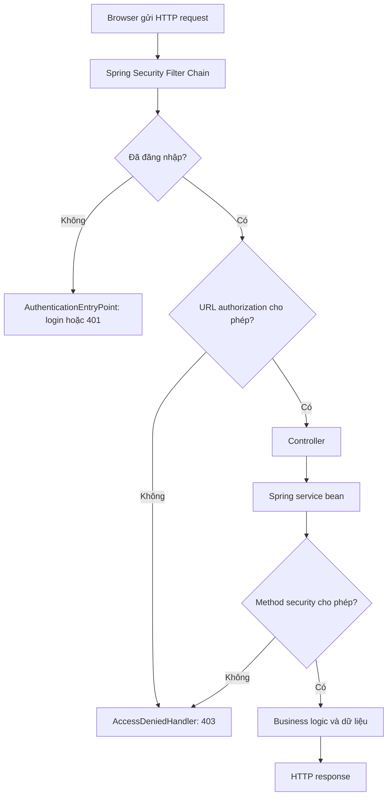

# 13.11. Áp dụng URL authorization và method security sau đăng nhập

Trong một ứng dụng **Spring Security OAuth 2.0 / OpenID Connect (OIDC) Client** chạy trên Servlet, đăng nhập thành công mới trả lời câu hỏi **“người dùng này là ai?”**. Từ thời điểm Spring Security tạo `Authentication` và lưu vào `SecurityContext`, ứng dụng vẫn phải quyết định **“người dùng đó được phép thực hiện thao tác nào?”**.

Hai cơ chế quan trọng để áp dụng quyết định ấy là:

- **URL authorization:** kiểm tra quyền khi HTTP request đi qua `SecurityFilterChain`, thường cấu hình bằng `authorizeHttpRequests(...)` và các `requestMatchers(...)`.
- **Method security:** kiểm tra quyền khi Java method được gọi thông qua Spring bean được bảo vệ, ví dụ `@PreAuthorize`, `@PostAuthorize` và các cơ chế tương ứng.

Bài học này tập trung vào việc **kết hợp hai lớp kiểm soát truy cập sau OIDC login** để bảo vệ endpoint và nghiệp vụ, thay vì chỉ đặt `.anyRequest().authenticated()` rồi coi mọi người dùng đã login đều có toàn quyền.

Ví dụ sử dụng **Spring Boot 3.x, Spring Security 6.x, Spring MVC/Servlet và `oauth2Login()`**. Một số API và mặc định có thể thay đổi giữa các phiên bản Spring Security; cấu hình cần được đối chiếu với phiên bản ứng dụng thực tế.

## 1. Authentication khác Authorization như thế nào?

### 1.1. Authentication — xác nhận danh tính

Người dùng bắt đầu tại:

```text
GET /oauth2/authorization/academy
```

Spring chuyển browser tới OP; sau khi OP xác thực người dùng, browser được redirect về:

```text
GET /login/oauth2/code/academy?code=...&state=...
```

Spring Security đổi authorization code lấy token, xác minh ID Token theo OIDC, tạo `OidcUser` và một `Authentication` (thường là `OAuth2AuthenticationToken`). `SecurityContext` cho request tiếp theo cho biết principal và tập authorities ứng dụng nhìn thấy.

### 1.2. Authorization — kiểm tra quyền

Sau đăng nhập, người dùng có thể yêu cầu:

```text
GET    /api/reports/101
POST   /api/reports
GET    /admin/users
DELETE /api/reports/101
```

Các thao tác này **không đương nhiên được phép chỉ vì `Authentication.isAuthenticated()` là `true`**. Ứng dụng cần chính sách: người dùng đọc báo cáo được không, ai được tạo báo cáo, báo cáo nào thuộc phạm vi của họ, ai được truy cập quản trị?

Sơ đồ điển hình:



URL authorization kiểm tra **lối vào HTTP**; method security bảo vệ **hành động nghiệp vụ**. Hai lớp bổ trợ nhau, không cần và cũng không nên mặc định có cùng một điều kiện lặp lại ở mọi nơi.

## 2. Authentication và GrantedAuthority sau OIDC Login

Một `OAuth2AuthenticationToken` thường cung cấp:

```java
Authentication authentication =
        SecurityContextHolder.getContext().getAuthentication();

String principalName = authentication.getName();
Collection<? extends GrantedAuthority> authorities =
        authentication.getAuthorities();
```

Với OIDC login, principal thường là `OidcUser`. Bạn có thể đọc những thông tin như `getSubject()`, `getIssuer()` và `getClaims()` theo điều kiện provider cung cấp.

Ví dụ nguồn dữ liệu từ OP:

```json
{
  "iss": "https://idp.example.com/realms/academy",
  "sub": "user-482",
  "preferred_username": "learner",
  "email": "learner@example.com",
  "groups": ["report-readers"]
}
```

**Không có quy tắc chung rằng mọi claim `groups` hoặc `roles` được Spring tự đổi thành `ROLE_ADMIN`.** Trước khi dùng `hasRole` hay `hasAuthority`, cần biết authorities trong `Authentication` thực sự được tạo từ đâu và có phù hợp chính sách ứng dụng không.

### 2.1. Các khái niệm quyền thường gặp

| Khái niệm | Ví dụ | Ý nghĩa |
| --- | --- | --- |
| OIDC principal | `OidcUser` | Người dùng đã được OP xác thực và Spring chấp nhận ID Token. |
| Spring `GrantedAuthority` | `ROLE_ADMIN`, `REPORT_READ`, `SCOPE_orders.read` | Chuỗi quyền Spring dùng để so khớp chính sách. |
| Role | `ADMIN` | Nhóm quyền trong chính sách ứng dụng; với mặc định `hasRole("ADMIN")` thường kiểm tra `ROLE_ADMIN`. |
| Permission/authority | `REPORT_READ` | Quyền nghiệp vụ cụ thể, dùng trực tiếp với `hasAuthority("REPORT_READ")`. |
| OAuth2 scope | `orders.read` | Phạm vi OP/Authorization Server cấp cho OAuth2 client hoặc access token; không mặc định là role ứng dụng. |
| Subject | `sub` | Định danh user trong phạm vi issuer; không phải permission. |
| OIDC claim | `groups` | Dữ liệu có thể dùng làm đầu vào để ánh xạ authority sau khi xác minh nguồn. |

Trong cấu hình OAuth2 Login, framework có thể cấp các authorities mặc định liên quan tới người dùng OAuth2/OIDC và scopes (ví dụ `OIDC_USER`, `OAUTH2_USER` hoặc `SCOPE_...` theo cơ chế/phiên bản). Những quyền mặc định đó **không tự biểu thị quyền xem mọi báo cáo hoặc quản trị hệ thống**.

### 2.2. `hasRole` và `hasAuthority` không giống hệt nhau

Giả sử authentication có authority:

```text
ROLE_ADMIN
REPORT_READ
SCOPE_orders.read
```

Một số biểu thức:

| Biểu thức | Kiểm tra |
| --- | --- |
| `hasRole("ADMIN")` | Thông thường tương đương yêu cầu authority `ROLE_ADMIN`, với role prefix mặc định. |
| `hasAuthority("ROLE_ADMIN")` | So khớp chính xác chuỗi `ROLE_ADMIN`. |
| `hasAuthority("REPORT_READ")` | So khớp chính xác quyền nghiệp vụ `REPORT_READ`. |
| `hasAuthority("SCOPE_orders.read")` | So khớp chính xác authority này, nếu đã được Spring ánh xạ/cấp. |
| `isAuthenticated()` | Người dùng đã đăng nhập hợp lệ, không có nghĩa có quyền admin. |
| `permitAll()` | Không yêu cầu authentication cho URL/method thuộc rule này. |
| `denyAll()` | Từ chối mọi người dùng trong phạm vi rule. |

Nếu ứng dụng tùy biến role prefix, hành vi `hasRole` phải được hiểu theo cấu hình hiện hành. Để giảm nhầm lẫn trong các dự án nhiều hệ thống, có thể ưu tiên **permission dạng `hasAuthority("REPORT_READ")`** cho nghiệp vụ và quy ước nhất quán với role `ROLE_ADMIN`.

## 3. URL authorization bảo vệ request ở lớp HTTP

Trong Spring Security 6, cấu hình Servlet hiện đại thường dùng `SecurityFilterChain` kết hợp:

```java
http.authorizeHttpRequests(authorize -> authorize
    .requestMatchers("/public/**").permitAll()
    .requestMatchers("/admin/**").hasRole("ADMIN")
    .anyRequest().authenticated());
```

Phần này đưa ra quyết định khi request đi qua **authorization filter**. Nó chưa tự bảo vệ các service nếu một service được gọi từ scheduler, message listener, một controller khác hoặc code không đi qua chính URL được giới hạn.

### 3.1. Ví dụ cấu hình thực tế với HTTP method

Giả sử website có:

- Trang chủ và tài nguyên tĩnh được phép truy cập công khai.
- `GET /api/reports/{id}` yêu cầu `REPORT_READ`.
- `POST /api/reports` yêu cầu `REPORT_WRITE`.
- `/admin/**` yêu cầu role `ADMIN`.
- Những HTTP method không được khai báo trên `/api/reports/**` sẽ bị từ chối.

Ví dụ:

```java
import org.springframework.context.annotation.Bean;
import org.springframework.context.annotation.Configuration;
import org.springframework.http.HttpMethod;
import org.springframework.security.config.Customizer;
import org.springframework.security.config.annotation.method.configuration.EnableMethodSecurity;
import org.springframework.security.config.annotation.web.builders.HttpSecurity;
import org.springframework.security.web.SecurityFilterChain;

@Configuration
@EnableMethodSecurity
public class SecurityConfig {

    @Bean
    SecurityFilterChain securityFilterChain(HttpSecurity http)
            throws Exception {

        http
            .authorizeHttpRequests(authorize -> authorize
                .requestMatchers("/", "/login", "/error",
                                 "/css/**", "/js/**", "/images/**")
                    .permitAll()

                .requestMatchers(HttpMethod.GET, "/api/reports/**")
                    .hasAuthority("REPORT_READ")

                .requestMatchers(HttpMethod.POST, "/api/reports")
                    .hasAuthority("REPORT_WRITE")

                .requestMatchers("/api/reports/**")
                    .denyAll()

                .requestMatchers("/admin/**")
                    .hasRole("ADMIN")

                .requestMatchers("/api/me")
                    .authenticated()

                .requestMatchers("/api/**")
                    .denyAll()

                .anyRequest()
                    .authenticated()
            )
            .oauth2Login(Customizer.withDefaults())
            .logout(Customizer.withDefaults());

        return http.build();
    }
}
```

**Ý nghĩa thứ tự các matcher:**

1. Các URL public được phép mà không cần đăng nhập.
2. HTTP `GET` cho báo cáo yêu cầu `REPORT_READ`.
3. HTTP `POST` tại tập hợp báo cáo yêu cầu `REPORT_WRITE`.
4. Các method/đường dẫn báo cáo khác (ví dụ `DELETE`) **không vô tình lọt qua**.
5. URL quản trị yêu cầu role quản trị.
6. `/api/me` chỉ yêu cầu login.
7. Mọi `/api/**` chưa được công bố chính sách bị từ chối.
8. Những URL còn lại yêu cầu authentication.

Spring Security xử lý **request matching theo thứ tự rule**; rule phù hợp đầu tiên có hiệu lực. Nếu viết `.anyRequest().authenticated()` lên trước rule `/admin/**`, rule phía sau có thể không được áp dụng hoặc DSL không cho phép cấu hình matcher sau anyRequest, tùy cách viết và phiên bản.

### 3.2. Thứ tự và độ cụ thể của matcher

So sánh hai cấu hình:

**Dễ gây sai lệch ý định:**

```java
.authorizeHttpRequests(auth -> auth
    .requestMatchers("/api/**").authenticated()
    .requestMatchers("/api/admin/**").hasRole("ADMIN")
    .anyRequest().denyAll())
```

Rule chung `/api/**` sẽ khớp trước với `/api/admin/**`, nên yêu cầu role admin phía sau không còn hiệu lực cho đường dẫn đó.

**Hợp lý hơn:**

```java
.authorizeHttpRequests(auth -> auth
    .requestMatchers("/api/admin/**").hasRole("ADMIN")
    .requestMatchers("/api/**").authenticated()
    .anyRequest().denyAll())
```

Hãy đặt rule **đặc hiệu nhất trước rule tổng quát**. Với endpoint nhạy cảm, dùng `denyAll` làm fallback cho nhóm URL chưa có policy rõ ràng giúp giảm rủi ro khi nhóm thêm REST endpoint nhưng quên khai báo quyền.

### 3.3. HTTP method cũng là một phần chính sách

Chỉ giới hạn theo path dễ gây lỗi. Ví dụ:

```java
.requestMatchers("/api/reports/**").hasAuthority("REPORT_READ")
```

Nếu cùng path hỗ trợ `DELETE` hoặc `POST`, người có quyền **chỉ đọc** cũng vượt qua URL rule. Nên xác định quyền theo **method + path**, và đưa các thao tác thay đổi trạng thái vào quyền cụ thể.

Đừng cho rằng `GET` luôn an toàn tuyệt đối: chính ứng dụng phải thiết kế GET không gây side effects. Nếu một controller dùng GET để xóa dữ liệu, đó là lỗi thiết kế HTTP và authorization riêng.

### 3.4. `permitAll` khác bỏ request khỏi Spring Security

Trong Spring Security, `permitAll()` nghĩa là cho phép URL công khai **nhưng request vẫn đi qua filter chain và các thành phần bảo mật liên quan**. Nó thường phù hợp hơn việc loại cả path khỏi security bằng `web.ignoring()` chỉ để phục vụ tài nguyên tĩnh.

Không public hóa `/actuator/**`, trang admin hoặc endpoint debug chỉ vì chúng “cần hoạt động trước login”. Xác định rõ những đường dẫn nào thực sự không cần danh tính.

## 4. Method security bảo vệ nghiệp vụ ở tầng Java

URL authorization là lớp bảo vệ quan trọng, nhưng **nhiều đường gọi code có thể dẫn đến cùng một service**:

```text
HTTP /api/reports/{id} ----> ReportController ----+
                                                  |
Scheduler / worker -------------------------------+--> ReportService.getReport(id)
                                                  |
Một controller khác ------------------------------+
```

Nếu chỉ bảo vệ URL đầu tiên, các đường gọi khác có thể không chịu cùng chính sách. **Method security** đặt rule ngay tại phương thức nghiệp vụ để mọi lời gọi đi qua Spring proxy được kiểm tra.

### 4.1. Kích hoạt `@EnableMethodSecurity`

Thêm vào một lớp cấu hình Spring:

```java
import org.springframework.context.annotation.Configuration;
import org.springframework.security.config.annotation.method.configuration.EnableMethodSecurity;

@Configuration
@EnableMethodSecurity
public class MethodSecurityConfig {
}
```

Với Spring Security 6, `@EnableMethodSecurity` là hướng cấu hình hiện đại. Nó cho phép những annotation như `@PreAuthorize` và `@PostAuthorize` theo mặc định. Nếu dùng `@Secured` hoặc JSR-250 annotations như `@RolesAllowed`, có thể cần bật thuộc tính tương ứng (`securedEnabled`, `jsr250Enabled`).

**Không cần khai báo hai lớp `@EnableMethodSecurity`** khi SecurityConfig trước đó đã có annotation này. Hai đoạn mã là những phương án minh họa tổ chức cấu hình.

### 4.2. `@PreAuthorize` thực thi trước method

Ví dụ service nghiệp vụ đơn giản:

```java
import org.springframework.security.access.prepost.PreAuthorize;
import org.springframework.stereotype.Service;

@Service
public class ReportService {

    @PreAuthorize("hasAuthority('REPORT_READ')")
    public String getReport(long id) {
        return "report-" + id;
    }

    @PreAuthorize("hasAuthority('REPORT_WRITE')")
    public String createReport(String title) {
        return "created-" + title;
    }
}
```

Khi controller hoặc một bean khác gọi `reportService.getReport(101)`, Spring method security kiểm tra `REPORT_READ` **trước khi chạy thân method**. Người dùng không có quyền sẽ gặp một lỗi access denied thay vì được đọc dữ liệu.

Đoạn code trên minh họa lớp policy; việc tạo và trả dữ liệu đơn giản chỉ để dễ thấy vị trí kiểm tra. Trong hệ thống thật, service sẽ làm việc với repository/database và tuân thủ các quy tắc ownership, tenant, trạng thái bản ghi.

### 4.3. URL authorization và method security không nhất thiết trùng nhau

Một endpoint:

```text
GET /api/reports/101
```

có thể phải vượt qua:

1. **URL rule**: `GET /api/reports/**` cần `REPORT_READ`.
2. **Service rule**: `getReport(...)` cần `REPORT_READ` **và** được phép xem chính báo cáo `101`.

Lớp URL giúp ngăn truy cập sớm khi request HTTP không có quyền đọc chung. Lớp method thực thi chính sách của tài nguyên cụ thể và có thể được tái sử dụng qua nhiều đường gọi.

### 4.4. Controller gọi service

Ví dụ nối HTTP và service:

```java
import org.springframework.http.ResponseEntity;
import org.springframework.web.bind.annotation.*;

@RestController
@RequestMapping("/api/reports")
public class ReportController {

    private final ReportService reportService;

    public ReportController(ReportService reportService) {
        this.reportService = reportService;
    }

    @GetMapping("/{id}")
    public ResponseEntity<String> get(@PathVariable long id) {
        return ResponseEntity.ok(reportService.getReport(id));
    }

    public record CreateReportRequest(String title) {}

    @PostMapping
    public ResponseEntity<String> create(
            @RequestBody CreateReportRequest request) {
        return ResponseEntity.ok(
                reportService.createReport(request.title()));
    }
}
```

Controller không tự đọc URL rồi đoán role. Spring Security áp dụng URL policy, sau đó service áp dụng policy riêng. Nếu có lời gọi service từ một controller khác mà người lập trình quên thêm URL rule, method security vẫn có thể giúp bảo vệ thao tác nghiệp vụ — **với điều kiện lời gọi đi qua bean proxy**.

## 5. Áp dụng quyền đến từng bản ghi: tránh IDOR

Một quy tắc như `hasAuthority("REPORT_READ")` chỉ nói người dùng có quyền đọc **một số** báo cáo. Nó **không tự nói** họ có quyền đọc mọi báo cáo trong hệ thống.

Giả sử hai báo cáo:

```text
Report 101 -> chủ sở hữu tài khoản nội bộ A
Report 202 -> chủ sở hữu tài khoản nội bộ B
```

Cả A và B có thể cùng có authority `REPORT_READ`, nhưng A không được xem Report 202 nếu không có quyền bổ sung. Nếu chỉ kiểm tra authority chung rồi truy vấn theo `id` do client cung cấp, ứng dụng có thể gặp lỗi **Insecure Direct Object Reference (IDOR)**.

### 5.1. Thêm permission check theo tài nguyên

Spring method security có thể gọi bean kiểm tra quyền:

```java
import org.springframework.security.access.method.P;
import org.springframework.security.access.prepost.PreAuthorize;
import org.springframework.stereotype.Service;

@Service
public class ReportService {

    @PreAuthorize(
        "hasAuthority('REPORT_READ') and " +
        "@reportAccess.canRead(authentication, #reportId)")
    public String getReport(@P("reportId") long reportId) {
        return "report-" + reportId;
    }

    @PreAuthorize("hasAuthority('REPORT_WRITE')")
    public String createReport(String title) {
        return "created-" + title;
    }
}
```

Lưu ý: đây là **bản thay thế** cho `ReportService` ở mục 4, không phải lớp thứ hai trùng tên cần tạo. `@P("reportId")` giúp Spring Security tìm được tên tham số `reportId` trong expression khi build không giữ tên Java parameter; dự án cũng có thể cấu hình compiler flag `-parameters` và dùng cơ chế khác theo API hỗ trợ.

Một bean policy minh họa:

```java
import java.util.Map;

import org.springframework.security.core.Authentication;
import org.springframework.security.oauth2.core.oidc.user.OidcUser;
import org.springframework.stereotype.Component;

@Component("reportAccess")
public class ReportAccess {

    // Chỉ là dữ liệu giả lập cho ví dụ.
    // Production: tra cứu owner/tenant/ACL bằng repository đáng tin cậy.
    private final Map<Long, String> reportOwners = Map.of(
        101L, "https://idp.example.com/realms/academy|user-482",
        202L, "https://idp.example.com/realms/academy|user-913"
    );

    public boolean canRead(Authentication authentication, long reportId) {
        if (authentication == null
                || !authentication.isAuthenticated()
                || !(authentication.getPrincipal() instanceof OidcUser user)) {
            return false;
        }

        String externalIdentity =
                user.getIssuer().toString() + "|" + user.getSubject();

        return externalIdentity.equals(reportOwners.get(reportId));
    }
}
```

Đây là minh họa **về vị trí kiểm tra ownership**, không phải thiết kế identity store dùng production. Trong hệ thống thực, thường ánh xạ `(issuer, subject)` thành **internal account ID** qua dịch vụ user directory, rồi dùng database/ACL/tenant boundary để kiểm tra tài nguyên. Không lưu username/email trong URL rồi coi đó là bằng chứng chủ sở hữu.

### 5.2. Kết hợp nhiều điều kiện

Một policy có thể là:

```text
Có REPORT_READ
AND report thuộc tenant hiện tại
AND report chưa bị khóa
AND (
      chủ sở hữu là người dùng hiện tại
      OR người dùng có quyền REPORT_AUDIT
    )
```

Để dễ kiểm thử và audit, logic nhiều điều kiện nên nằm trong một **domain authorization service** như `ReportAccess`, thay vì nhồi toàn bộ biểu thức SpEL dài vào annotation hoặc rải check ở nhiều controller.

### 5.3. Không phụ thuộc hoàn toàn vào `@PostAuthorize` để chống IDOR

`@PostAuthorize` có thể kiểm tra kết quả sau khi method hoàn thành, ví dụ:

```java
@PostAuthorize("hasAuthority('REPORT_READ')")
public ReportRecord findReport(long reportId) { ... }
```

Tuy nhiên, method **đã thực thi trước khi quyết định được đánh giá**. Nếu method đã gửi email, gọi API có side effect hoặc đọc/ghi dữ liệu nhạy cảm theo cách không phù hợp, chặn response sau cùng là quá muộn. Với thao tác nhạy cảm và phân quyền theo bản ghi, nên kiểm tra **trước truy vấn hoặc ngay trong truy vấn có ràng buộc principal/tenant** khi có thể.

## 6. Các annotation method security thường dùng

| Annotation | Thời điểm kiểm tra | Ví dụ | Lưu ý |
| --- | --- | --- | --- |
| `@PreAuthorize` | Trước khi gọi method | `@PreAuthorize("hasAuthority('REPORT_READ')")` | Phù hợp bảo vệ service method. |
| `@PostAuthorize` | Sau khi method trả về | `@PostAuthorize("returnObject.ownerId == authentication.name")` | Không thay kiểm tra trước khi có side effect; kiểm tra đúng kiểu dữ liệu/identity. |
| `@PreFilter` | Lọc collection argument trước method | `@PreFilter("filterObject.ownerId == authentication.name")` | Áp dụng collection phù hợp, không thay policy DB. |
| `@PostFilter` | Lọc collection return value | `@PostFilter("filterObject.visible")` | Tốn chi phí khi tập dữ liệu lớn; không nên dùng thay database query để tránh tải dữ liệu trái phép. |
| `@Secured` | Kiểm tra role/authority theo annotation kiểu cũ | `@Secured("ROLE_ADMIN")` | Cần bật `securedEnabled=true` nếu sử dụng. |
| `@RolesAllowed` | Kiểm tra role theo JSR-250 | `@RolesAllowed("ADMIN")` | Cần bật `jsr250Enabled=true` nếu sử dụng. |

Trong Spring Security 6, `@PreAuthorize` là lựa chọn dễ biểu đạt những điều kiện chi tiết và được dùng phổ biến. Không nên đặt tất cả annotation lên cùng method mà không biết cơ chế tổng hợp rule; ưu tiên **một chính sách rõ ràng** ở nơi có ownership.

### 6.1. `@PostFilter` không phải phân quyền query

Ví dụ:

```java
@PostFilter("hasAuthority('REPORT_READ')")
public List<ReportRecord> allReports() {
    return repository.findAll();
}
```

Dù expression cho phép lọc, `repository.findAll()` **đã tải dữ liệu lên tầng application** trước khi Spring lọc. Với dữ liệu lớn hoặc phân vùng theo tenant, nên truyền điều kiện account/tenant được xác thực vào truy vấn database, phân trang và kiểm soát quyền ở tầng truy vấn. Không dùng `@PostFilter` làm chiến lược duy nhất cho multi-tenant isolation.

### 6.2. Method security có thể dùng principal như thế nào?

Trong biểu thức method security, thường có các biến như:

- `authentication`: `Authentication` hiện tại.
- `principal`: principal của authentication.
- `#paramName`: tham số của method, nếu Spring có thể xác định tên.
- `returnObject`: giá trị trả về khi dùng kiểm tra sau method.
- Bean method, ví dụ `@reportAccess.canRead(authentication, #reportId)`.

Với OIDC, `authentication.name` thường liên quan đến subject/name của principal nhưng **không bảo đảm cùng khóa internal user ID của hệ thống**. Nếu có nhiều issuer, nên dùng identity mapping được chuẩn hóa hoặc app-specific principal, không chỉ dựa vào `authentication.name` để ra quyết định liên tenant.

## 7. Ánh xạ quyền từ OIDC claims vào authorities

URL và method security đều so khớp **`GrantedAuthority`**. Do đó nếu ứng dụng viết `hasRole("ADMIN")` mà không có authority `ROLE_ADMIN`, người dùng đã login vẫn bị từ chối.

Spring Security cung cấp các điểm mở rộng để ánh xạ authorities. Nhưng ánh xạ phải dựa trên **nguồn danh tính đã xác minh và chính sách tin cậy** của ứng dụng, không phải tùy tiện tin mọi giá trị `groups` hoặc một email có domain nhất định.

### 7.1. Một ví dụ `GrantedAuthoritiesMapper` có giới hạn issuer

Giả sử OP chính thức `https://idp.example.com/realms/academy` cung cấp claim `groups` trong ID Token/UserInfo với hợp đồng đã được kiểm chứng. Ứng dụng muốn:

- group `report-readers` → authority `REPORT_READ`;
- group `report-editors` → authority `REPORT_WRITE`;
- group `portal-admins` → role authority `ROLE_ADMIN`.

Ví dụ Java:

```java
import java.util.Collection;
import java.util.HashSet;
import java.util.Set;

import org.springframework.context.annotation.Bean;
import org.springframework.context.annotation.Configuration;
import org.springframework.security.core.GrantedAuthority;
import org.springframework.security.core.authority.SimpleGrantedAuthority;
import org.springframework.security.core.authority.mapping.GrantedAuthoritiesMapper;
import org.springframework.security.oauth2.core.oidc.user.OidcUserAuthority;

@Configuration
public class AuthoritiesConfiguration {

    private static final String TRUSTED_ISSUER =
            "https://idp.example.com/realms/academy";

    @Bean
    GrantedAuthoritiesMapper userAuthoritiesMapper() {
        return authorities -> {
            Set<GrantedAuthority> mapped = new HashSet<>(authorities);

            for (GrantedAuthority authority : authorities) {
                if (!(authority instanceof OidcUserAuthority oidc)) {
                    continue;
                }

                String issuer = oidc.getIdToken()
                        .getIssuer().toString();

                if (!TRUSTED_ISSUER.equals(issuer)) {
                    continue;
                }

                Object rawGroups = oidc.getAttributes().get("groups");
                if (!(rawGroups instanceof Collection<?> groups)) {
                    continue;
                }

                if (groups.contains("report-readers")) {
                    mapped.add(new SimpleGrantedAuthority("REPORT_READ"));
                }
                if (groups.contains("report-editors")) {
                    mapped.add(new SimpleGrantedAuthority("REPORT_WRITE"));
                }
                if (groups.contains("portal-admins")) {
                    mapped.add(new SimpleGrantedAuthority("ROLE_ADMIN"));
                }
            }

            return mapped;
        };
    }
}
```

Đoạn code **chỉ là ví dụ mapping khi chính sách cho phép tin claim `groups` từ issuer nêu trên**. Nó không tự cấp quyền dựa trên email, `preferred_username` hay một giá trị do browser gửi. Trong ứng dụng thực tế, còn phải cân nhắc audience, nguồn UserInfo, cấu hình provider, namespace group và cách thu hồi quyền.

Đặc biệt: nếu không có claim `groups` hoặc provider đặt group trong custom claim khác, mapper sẽ **không** tạo authority ứng dụng, và protected endpoints vẫn bị từ chối. Đây là hành vi an toàn hơn việc âm thầm cho quyền.

### 7.2. Đăng ký mapper với `oauth2Login()`

Trong cấu hình `SecurityFilterChain`, có thể thay đoạn:

```java
.oauth2Login(Customizer.withDefaults())
```

bằng:

```java
.oauth2Login(oauth2 -> oauth2
    .userInfoEndpoint(userInfo -> userInfo
        .userAuthoritiesMapper(userAuthoritiesMapper)))
```

Đoạn trên giả định `GrantedAuthoritiesMapper userAuthoritiesMapper` đã được truyền vào phương thức cấu hình từ Spring bean (hoặc gọi bean `@Configuration` đúng cách). Ví dụ tích hợp rõ ràng trong method:

```java
@Bean
SecurityFilterChain securityFilterChain(
        HttpSecurity http,
        GrantedAuthoritiesMapper mapper
) throws Exception {

    http
        .authorizeHttpRequests(authorize -> authorize
            .requestMatchers("/", "/error").permitAll()
            .requestMatchers("/admin/**").hasRole("ADMIN")
            .anyRequest().authenticated())
        .oauth2Login(oauth2 -> oauth2
            .userInfoEndpoint(userInfo -> userInfo
                .userAuthoritiesMapper(mapper)));

    return http.build();
}
```

Đây là **một phương án security chain khác**, không phải bean thứ hai cần tạo đồng thời với `SecurityConfig` ở mục 3. Mục đích là cho thấy vị trí kết nối mapper. Khi áp dụng vào dự án, giữ các URL authorization rules cần thiết và chỉ thay phần login mapping tương ứng.

### 7.3. Không tự cho tất cả OIDC user quyền admin

Một anti-pattern:

```java
// SAI: mọi người đăng nhập đều nhận quyền quản trị
mapped.add(new SimpleGrantedAuthority("ROLE_ADMIN"));
```

OIDC Authentication xác nhận danh tính, **không mặc định phân quyền quản trị**. Chỉ map claim/role sau khi xác định nguồn, hợp đồng claim, mức tin cậy và điều kiện nghiệp vụ. Với quyền nhạy cảm, có thể tốt hơn khi truy vấn quyền nội bộ từ database/authorization service thay vì tin claims có tuổi đời dài.

### 7.4. Mapping quyền từ scope

Nếu `Authentication` chứa authority `SCOPE_orders.read`, có thể dùng:

```java
.hasAuthority("SCOPE_orders.read")
```

nhưng phải hiểu **scope của access token được OP cấp** và authority ứng dụng. Scope thường đại diện quyền mà một OAuth2 client được phép xin hoặc dùng với Resource Server, **không tự chứng minh** người dùng được sửa mọi bản ghi trong website. Không dùng mỗi `SCOPE_orders.read` để bỏ qua ownership/tenant checks.

## 8. Ngữ cảnh nhiều provider và nhiều tài khoản

Một ứng dụng có thể hỗ trợ đăng nhập bằng `corporate` và `partner`:

```yaml
spring:
  security:
    oauth2:
      client:
        registration:
          corporate:
            provider: corporate-op
            client-id: ${CORP_CLIENT_ID}
            client-secret: ${CORP_CLIENT_SECRET}
            authorization-grant-type: authorization_code
            scope: [openid, profile]
          partner:
            provider: partner-op
            client-id: ${PARTNER_CLIENT_ID}
            client-secret: ${PARTNER_CLIENT_SECRET}
            authorization-grant-type: authorization_code
            scope: [openid, profile]
        provider:
          corporate-op:
            issuer-uri: ${CORP_ISSUER_URI}
          partner-op:
            issuer-uri: ${PARTNER_ISSUER_URI}
```

Một role có tên `admin` từ Corporate OP và một role `admin` từ Partner OP **không nhất thiết có cùng ý nghĩa**. Khi ánh xạ authorities:

1. Kiểm tra issuer/registration đã được xác thực.
2. Xác nhận provider nào được quyền cấp authority nào.
3. Chuẩn hóa role/permission trong domain nội bộ.
4. Ánh xạ danh tính bằng `(issuer, subject)`, không chỉ email.
5. Không để provider có mức tin cậy thấp cấp `ROLE_ADMIN` cho toàn bộ ứng dụng.

Trong ứng dụng đa tenant, **tenant boundary phải được kiểm tra cùng permission**, ví dụ service kiểm tra report thuộc tenant mà principal được phép thao tác. Không để tenant ID do browser gửi trở thành căn cứ duy nhất.

## 9. Quy trình quyết định quyền ở từng lớp

Để thiết kế chính sách, có thể sử dụng ma trận:

| Request/hoạt động | URL authorization | Method security | Kiểm tra dữ liệu |
| --- | --- | --- | --- |
| `GET /` | `permitAll` | Thường không cần | Không truy xuất thông tin riêng tư |
| `GET /api/me` | `authenticated` | Nếu gọi service cần policy riêng | Chỉ trả thông tin user hiện tại, không trả toàn bộ token/claims |
| `GET /api/reports/{id}` | `REPORT_READ` | `REPORT_READ` + ownership/tenant | Query/report phải thuộc phạm vi người dùng |
| `POST /api/reports` | `REPORT_WRITE` | `REPORT_WRITE`, kiểm tra business state | Xác định owner/tenant từ server-side principal |
| `GET /admin/users` | `ROLE_ADMIN` | Quyền quản trị tương ứng ở service | Có thể cần phạm vi admin theo tenant |
| `DELETE /api/reports/{id}` | Từ chối nếu chưa thiết kế | Permission xóa riêng, nếu nghiệp vụ có | Kiểm tra trạng thái, ownership, audit |
| Job nội bộ xử lý báo cáo | Không đi qua HTTP | Phương thức được gọi dưới security context phù hợp hoặc policy khác | Không giả định job có principal browser |

**Điểm mấu chốt:** URL authorization quyết định request HTTP có thể đi tiếp; method security bảo vệ nghiệp vụ khi service được gọi từ các đường khác nhau. Cuối cùng, kiểm tra **object-level authorization** phải đảm bảo dữ liệu thuộc đúng phạm vi user/tenant.

## 10. Những giới hạn quan trọng của method security

### 10.1. Spring AOP proxy và self-invocation

Method security trong Spring Security Servlet thường dựa trên **Spring AOP proxies**. Điều này có nghĩa lời gọi phải đi qua Spring-managed proxy để interceptor áp dụng.

Ví dụ dễ mắc lỗi:

```java
@Service
public class ReportWorkflow {

    public void process(long id) {
        // Lời gọi this.getSecretReport(...) trong cùng đối tượng
        // thường KHÔNG đi qua method-security proxy.
        String report = getSecretReport(id);
        // ...
    }

    @PreAuthorize("hasAuthority('REPORT_READ')")
    public String getSecretReport(long id) {
        return "secret-" + id;
    }
}
```

Nếu `process` không được bảo vệ và tự gọi `getSecretReport` trực tiếp, policy trên method kia có thể không được áp dụng ở đường gọi đó. Cách thiết kế an toàn hơn:

- Đặt logic nhạy cảm trong **service bean riêng**, gọi qua Spring injection.
- Hoặc bảo vệ entry-point method thực sự được gọi từ bên ngoài proxy.
- Tránh dựa vào `private`, `final` hoặc self-invocation mà proxy/AOP không thể intercept theo cách mong muốn.
- Nếu dùng AspectJ weaving hoặc cơ chế khác, phải hiểu sự khác nhau và cấu hình cụ thể.

### 10.2. Bean tự tạo bằng `new` không được Spring quản lý

Ví dụ:

```java
ReportService service = new ReportService();
service.getReport(101);
```

Một object tạo thủ công bằng `new` **không tự động là Spring bean được method security proxy bảo vệ**. Để kiểm tra quyền tại service, dùng dependency injection và beans do Spring container quản lý.

### 10.3. Scheduler, queue consumer và background jobs

Nếu job gọi service có `@PreAuthorize` mà không có `SecurityContext` tương ứng với người dùng, biểu thức có thể từ chối — đây là một tín hiệu bạn cần xác định **quyền của công việc nền** riêng, không phải lý do để tắt method security.

Các lựa chọn có thể gồm:

- Tách service policy dành cho user khỏi nghiệp vụ nội bộ, với entry point riêng được kiểm soát.
- Dùng cơ chế service identity/authorization đáng tin cậy cho job.
- Truyền và kiểm tra actor/tenant theo contract nếu có delegated workflow.
- Không tái sử dụng SecurityContext của browser session một cách tùy tiện giữa các luồng.

### 10.4. Method security có thể bị bỏ qua do cấu hình test

Một unit test gọi thẳng một instance service không qua Spring context sẽ không thực thi proxy method security. Nếu muốn kiểm tra annotation thực sự được áp dụng, cần test chạy qua **Spring-managed bean/proxy** hoặc kiểm thử integration phù hợp. Bài tập chỉ xác nhận logic method Java không thay thế kiểm tra authorization ở runtime.

## 11. CSRF và session vẫn quan trọng sau khi login

Ứng dụng dùng `oauth2Login()` thường có **session cookie**. Browser tự gửi cookie trong các request phù hợp, nên authorization không thay thế **CSRF protection**.

Ví dụ một request:

```http
POST /api/reports HTTP/1.1
Host: app.example.com
Cookie: JSESSIONID=...
Content-Type: application/json

{"title":"Báo cáo tháng"}
```

Ngay cả nếu người dùng có `REPORT_WRITE`, một request thay đổi trạng thái vẫn phải thỏa **CSRF token** khi CSRF protection được bật và áp dụng.

- **Authorization:** người dùng hiện tại có quyền tạo báo cáo không?
- **CSRF:** request thay đổi trạng thái có đến từ tương tác hợp lệ thay vì bị website khác ép browser gửi không?

Không gọi `csrf.disable()` toàn ứng dụng chỉ để request POST đi qua trong test. Hãy dùng cơ chế gửi CSRF token phù hợp với ứng dụng (form/HTTP header) và bảo vệ cookies.

### 11.1. Authentication cookie và OAuth2 token khác nhau

Website server-side sau OIDC login thường dùng `JSESSIONID` cho phiên Spring. Access token được quản lý qua `OAuth2AuthorizedClient` để backend gọi API. Không lấy **ID Token** làm Bearer token mặc định cho mọi REST API, cũng không mặc định session cookie là chứng chỉ phân quyền của external Resource Server.

Nếu một endpoint vừa phục vụ browser session vừa phục vụ API Bearer token, cần thiết kế security chain và cơ chế principal/authority mapping rõ ràng; **OAuth2 Login khác OAuth2 Resource Server**.

## 12. 401, 403 và redirect login: diễn giải đúng kết quả

Với ứng dụng web dùng `oauth2Login()`, request chưa đăng nhập tới URL bảo vệ thường được đưa đến login page hoặc authorization flow. Kết quả browser quan sát có thể là **HTTP 302 redirect** thay vì `401`.

Sau khi đã đăng nhập:

- Thiếu authority ở URL rule → thường bị từ chối truy cập (`403 Forbidden`) theo exception handling.
- Thiếu quyền ở method security → thường phát sinh `AccessDeniedException` và được Spring Security chuyển sang phản hồi tương ứng.
- Một HTTP POST có quyền nhưng thiếu CSRF token → cũng có thể `403`, nguyên nhân **không phải authority**.
- Lỗi OIDC login (`state`, ID Token, nonce, issuer) → thuộc **authentication flow**, không phải policy `REPORT_READ`.

| Tình huống | Phản hồi thường thấy | Cách hiểu |
| --- | --- | --- |
| Anonymous mở trang cần login | Redirect tới trang login/OP | Chưa có Authentication phù hợp. |
| OIDC user login nhưng thiếu `ROLE_ADMIN` | `403` | Đã xác thực, chưa được phép dùng chức năng. |
| POST có `REPORT_WRITE` nhưng thiếu CSRF | `403` | CSRF protection chặn request. |
| API dùng Bearer token không hợp lệ | `401` nếu là Resource Server | Resource Server xác thực token thất bại. |
| Endpoint không tồn tại | `404` nếu request đi đến MVC và không có mapping | Không đồng nghĩa policy đã cho phép truy cập mọi dữ liệu. |

Đối với ứng dụng thuần JSON API, có thể muốn **`401` thay vì redirect HTML** cho anonymous `/api/**`. Khi đó hãy cấu hình `AuthenticationEntryPoint` và `AccessDeniedHandler` phù hợp theo request matcher/chain, hoặc tách web UI và API thành các security chains rõ ràng. Đừng mặc định trả `401` cho mọi trường hợp `403` và ngược lại.

## 13. Kiểm tra chính sách bằng Spring Security Test

### 13.1. Dependency test

Trong Maven:

```xml
<dependency>
    <groupId>org.springframework.security</groupId>
    <artifactId>spring-security-test</artifactId>
    <scope>test</scope>
</dependency>
```

Spring Security Test cung cấp các request post-processors và annotation tiện lợi để mô phỏng principal/authorities mà không cần chạy OP thật trong mọi test.

### 13.2. URL authorization với `MockMvc`

Ví dụ phương pháp kiểm thử các request đã có controller tương ứng:

```java
import static org.springframework.security.test.web.servlet.request
        .SecurityMockMvcRequestPostProcessors.oidcLogin;
import static org.springframework.security.test.web.servlet.request
        .SecurityMockMvcRequestPostProcessors.csrf;

import static org.springframework.test.web.servlet.request.MockMvcRequestBuilders.get;
import static org.springframework.test.web.servlet.result.MockMvcResultMatchers.status;

import org.junit.jupiter.api.Test;
import org.springframework.beans.factory.annotation.Autowired;
import org.springframework.boot.test.autoconfigure.web.servlet.AutoConfigureMockMvc;
import org.springframework.boot.test.context.SpringBootTest;
import org.springframework.security.core.authority.SimpleGrantedAuthority;
import org.springframework.test.web.servlet.MockMvc;

@SpringBootTest
@AutoConfigureMockMvc
class ReportAuthorizationTests {

    @Autowired MockMvc mockMvc;

    @Test
    void loggedInUserWithoutReadAuthorityIsForbidden() throws Exception {
        mockMvc.perform(get("/api/reports/101")
                .with(oidcLogin()))
            .andExpect(status().isForbidden());
    }

    @Test
    void loggedInUserWithReadAuthorityCanPassUrlRule() throws Exception {
        mockMvc.perform(get("/api/reports/101")
                .with(oidcLogin().authorities(
                    new SimpleGrantedAuthority("REPORT_READ"))))
            .andExpect(status().isOk());
    }
}
```

Đoạn test này giả định `/api/reports/101` là controller có thể trả `200` và **service phía sau không có thêm ownership policy** hoặc fixture đã cấp quyền phù hợp. Nếu service sử dụng `ReportAccess` ở mục 5, cần thiết lập đúng issuer, subject và bản ghi/ACL test để response được phép. Trong ứng dụng có repository hoặc external database, phải chuẩn bị fixture đúng.

### 13.3. POST phải thỏa cả authority và CSRF

```java
import static org.springframework.security.test.web.servlet.request
        .SecurityMockMvcRequestPostProcessors.oidcLogin;
import static org.springframework.security.test.web.servlet.request
        .SecurityMockMvcRequestPostProcessors.csrf;

import static org.springframework.test.web.servlet.request.MockMvcRequestBuilders.post;
import static org.springframework.test.web.servlet.result.MockMvcResultMatchers.status;

import org.springframework.http.MediaType;
import org.springframework.security.core.authority.SimpleGrantedAuthority;

// Trích đoạn bên trong một @Test và MockMvc đã cấu hình:
mockMvc.perform(post("/api/reports")
        .with(oidcLogin().authorities(
                new SimpleGrantedAuthority("REPORT_WRITE")))
        .with(csrf())
        .contentType(MediaType.APPLICATION_JSON)
        .content("{\"title\":\"Demo\"}"))
    .andExpect(status().isOk());
```

Ở ví dụ này, endpoint `ReportController.create` trả `200`. Nếu ứng dụng thực trả `201 Created` thì test phải phản ánh contract tương ứng. Khi không có `with(csrf())` và CSRF vẫn bật, request POST có thể bị từ chối **trước khi method security được thực thi**.

### 13.4. `@WithMockUser` không xác minh OIDC claim mapping

`@WithMockUser(authorities = "REPORT_READ")` rất hữu ích để kiểm tra **chính sách URL/method** với authority giả lập. Nhưng nó **không chứng minh** một claim `groups` thật từ OP được mapper chuyển đúng thành authority, cũng không chứng minh ID Token được xác minh.

Vì vậy nên có hai loại test:

1. **Authorization policy tests**: giả lập authorities để xác nhận rule nào cho phép/từ chối.
2. **Authentication/mapping integration tests**: dùng OP test hoặc các thành phần xác minh/mapper phù hợp để kiểm tra issuer, claims, authority mapping và login thực sự.

Không coi việc test policy với mock user là đã kiểm thử toàn bộ OIDC flow.

## 14. Mô hình quyền cho ứng dụng có dữ liệu nhiều tenant

Giả sử một hệ thống quản lý báo cáo có:

```text
Tenant A:
  user A1: REPORT_READ, REPORT_WRITE
  user A2: REPORT_READ

Tenant B:
  user B1: REPORT_READ
```

Nếu URL `GET /api/reports/101` chỉ yêu cầu `REPORT_READ`, A2 và B1 đều qua URL policy. Nhưng Report 101 có thể thuộc Tenant A. **URL-level authority chưa đủ để ngăn B1 đọc Report 101**.

Một service policy cần dùng **tenant identity server-side**, ví dụ:

```text
request authenticated
  -> map (issuer, subject) tới internal account
  -> lấy tenant(s) account có quyền truy cập
  -> truy vấn report theo (reportId, tenantId allowed)
  -> kiểm tra quyền REPORT_READ và business status
  -> trả report
```

Có thể kiểm tra bằng `@PreAuthorize("@reportAccess.canRead(authentication, #id)")`, nhưng production còn nên dùng **query-level tenant filtering** ở repository để giảm rủi ro trả nhầm dữ liệu. Đừng dùng `tenantId` trong query parameter làm bằng chứng duy nhất người dùng thuộc tenant đó.

Nếu OP có claim `tenant`, cần xác minh rõ OP có thẩm quyền gán tenant nào, claim có được cập nhật đúng và cách kết hợp với hệ thống tenancy của ứng dụng. Không mặc định mọi issuer đều được phép khai báo mọi tenant.

## 15. Quyền có thể thay đổi khi session còn hoạt động

Một OIDC session thường giữ `Authentication`/authorities được xác định tại thời điểm login. Nếu quản trị viên thu hồi `REPORT_WRITE` ở OP hoặc database sau đó, ứng dụng có thể vẫn đang giữ authority cũ đến khi session được cập nhật.

Vì vậy một chính sách authorization không chỉ có “điều kiện cho phép”, mà còn cần **độ mới (freshness) của quyền**:

- Quyền ít nhạy cảm có thể được cache theo phiên với TTL phù hợp.
- Quyền quản trị/chuyển tiền/xóa dữ liệu có thể cần kiểm tra nguồn quyền gần thời điểm thao tác.
- Khi xảy ra thu hồi quyền, có thể invalidate session, refresh authorities hoặc kiểm tra quyền nội bộ ở mỗi thao tác nhạy cảm.
- Với nhiều provider, không cho một token cũ của provider A ghi đè quyền bị thu hồi từ provider B.
- Không xem `@PreAuthorize` tự động gọi OP để cập nhật claims ở mọi request.

Một kiểm tra method tốt nhưng sử dụng **authority stale** vẫn có thể cho kết quả sai với chính sách tổ chức. Quyết định retention/refresh phải do yêu cầu sản phẩm và bảo mật xác định.

## 16. Những lỗi triển khai thường gặp

| Hiện tượng | Nguyên nhân có thể | Hướng xử lý |
| --- | --- | --- |
| OIDC login thành công nhưng `/admin/**` trả `403` | Không có `ROLE_ADMIN` trong authorities | Kiểm tra mapper và role prefix; không tự cấp ADMIN cho mọi user. |
| `hasRole("ADMIN")` không khớp `ADMIN` | Mặc định thêm prefix `ROLE_` | Dùng `ROLE_ADMIN` hoặc chọn `hasAuthority` với chuỗi thực tế, nhất quán trong hệ thống. |
| Người có `REPORT_READ` gọi DELETE được | Rule URL quá rộng, không xét HTTP method | Cấu hình method + path, thêm denyAll fallback. |
| Controller bảo vệ đúng nhưng scheduler gọi service trực tiếp được | Chỉ có URL authorization | Đặt policy tại method/service hoặc entry point của job. |
| `@PreAuthorize` không hoạt động trong lời gọi cùng class | Self-invocation bỏ qua AOP proxy | Tách Spring bean/entry point hoặc thay kiến trúc gọi. |
| Test đơn vị gọi `new ReportService()` không ném lỗi quyền | Không qua Spring method security proxy | Test bean qua Spring context và security configuration. |
| User xem được report của tenant khác | Chỉ check authority chung, thiếu object/tenant ownership | Áp dụng policy resource và query filter an toàn. |
| User có role nhưng POST vẫn `403` | Thiếu CSRF token | Xác định CSRF trước khi đổi role/authority. |
| User chưa đăng nhập nhận `302`, client API mong `401` | Web login entry point mặc định | Cấu hình entry point phù hợp cho API/chain. |
| `@PreAuthorize` dùng `#id` mà không đọc được param | Không có tên parameter cho expression | Dùng `@P`, `-parameters` hoặc cơ chế parameter-name discovery phù hợp. |
| Claim `groups` có nhưng authority không xuất hiện | Không có mapper, claim sai vị trí hoặc provider không phát | Đọc contract OP và cấu hình mapping; không tự suy role. |
| Provider đối tác cấp `admin` làm admin toàn hệ thống | Mapping không ràng buộc issuer/tenant | Áp dụng issuer-specific allowlist và policy nội bộ. |
| Quyền bị thu hồi nhưng phiên vẫn được phép | Authorities giữ trong SecurityContext quá lâu | Thiết kế refresh/invalidation hoặc recheck sensitive operations. |
| Access token có scope nhưng website vẫn `403` | Scope chưa/không được ánh xạ thành authority ứng dụng | Phân biệt OAuth2 scopes với app-specific permissions và kiểm tra mapping. |
| URL đã chặn nhưng dữ liệu vẫn lộ qua endpoint khác | Chỉ bảo vệ một HTTP route | Áp dụng method security và object-level authorization trong service. |
| Trong test có `@WithMockUser` nhưng production OIDC không có role | Mock không kiểm tra authority mapping thật | Bổ sung integration test OAuth2/OIDC mapping. |

## 17. Những anti-pattern cần tránh

### 17.1. Chỉ dùng `.anyRequest().authenticated()`

```java
.authorizeHttpRequests(a -> a.anyRequest().authenticated())
```

Điều này chỉ đảm bảo cần login, **không phân biệt quyền xem, sửa, xóa hay quản trị**. Có thể phù hợp ứng dụng demo chỉ có một loại người dùng, nhưng không đủ cho ứng dụng có nhiều cấp quyền hoặc dữ liệu tách theo chủ sở hữu.

### 17.2. Dùng email hoặc username làm role

```java
if (user.getEmail().endsWith("@example.com")) {
    grant("ROLE_ADMIN");
}
```

Email có thể thay đổi, không được xác minh hoặc có nguồn khác nhau. Không nên dùng miền email làm điều kiện duy nhất để cấp quyền nhạy cảm. Sử dụng nguồn cấp role được tin cậy hoặc hệ thống authorization nội bộ.

### 17.3. Chỉ ẩn nút trên frontend

Ẩn nút “Delete” với user không có quyền giúp UX, nhưng **không bảo vệ HTTP endpoint**. Browser vẫn có thể gửi request thủ công. Server phải kiểm tra quyền tại URL/service và đối tượng dữ liệu.

### 17.4. Tin `tenantId` từ client để kiểm tra dữ liệu

```text
GET /api/reports/101?tenantId=other-tenant
```

Nếu server chấp nhận `tenantId` như bằng chứng phạm vi truy cập mà không xác minh với identity/ACL, người dùng có thể đọc dữ liệu của tenant khác. Tenant scope phải được quyết định từ dữ liệu đáng tin cậy phía server.

### 17.5. Tắt CSRF vì method security đã hoạt động

Method security và CSRF giải quyết hai nhóm đe dọa khác nhau. Với website dùng session cookie, không mặc định tắt CSRF chỉ vì service method có `@PreAuthorize`. Kiểm tra `POST/PUT/PATCH/DELETE` với CSRF token hợp lệ theo kiến trúc.

### 17.6. Dùng `SCOPE_openid` làm quyền nghiệp vụ

`openid` đánh dấu OIDC login, **không phải quyền xem toàn bộ dữ liệu**. Nếu endpoint yêu cầu `hasAuthority("SCOPE_openid")`, hầu như mọi OIDC user có scope này có thể vượt URL rule, không đúng ý nghĩa nghiệp vụ.

### 17.7. Cho phép role admin từ bất kỳ OP nào

Nếu nhiều OP được tích hợp, không gộp claim `groups=admin` của một OP không đủ tin cậy vào `ROLE_ADMIN` toàn hệ thống. Role mapping phải ràng buộc issuer, tenant, registration và hợp đồng phân quyền.

### 17.8. Dùng self-invocation như một đường “đặc quyền”

Nếu service có `@PreAuthorize` nhưng một method không bảo vệ gọi nội bộ vào method được bảo vệ, đó là rủi ro proxy bypass. Không dựa vào đường gọi này như cơ chế chạy đặc quyền; thiết kế service authorization rõ ràng.

## 18. Bài thực hành: xây ma trận phân quyền

Giả sử website báo cáo có các quyền:

- `REPORT_READ`: đọc báo cáo trong phạm vi được cấp.
- `REPORT_WRITE`: tạo/sửa báo cáo trong phạm vi được cấp.
- `REPORT_DELETE`: xóa báo cáo, có thể cần policy mạnh hơn.
- `ROLE_ADMIN`: truy cập giao diện quản trị.
- Người dùng chưa login chỉ đọc được trang chủ và tài nguyên tĩnh.

### Bước 1 — Xác định URL policy

| URL | Method | Điều kiện |
| --- | --- | --- |
| `/` | GET | `permitAll` |
| `/api/reports/{id}` | GET | `REPORT_READ` |
| `/api/reports` | POST | `REPORT_WRITE` + CSRF |
| `/api/reports/{id}` | DELETE | `REPORT_DELETE` + CSRF nếu chức năng xóa được triển khai |
| `/admin/**` | Mọi method cần thiết | `ROLE_ADMIN` |
| `/api/me` | GET | `authenticated` |

Trong một bản đầu tiên chưa có delete API, nên dùng **`denyAll` cho các HTTP method chưa hỗ trợ**, thay vì vô tình cho phép chỉ vì user đã login.

### Bước 2 — Xác định method policy

- `ReportService.getReport(id)`: `REPORT_READ` và `reportAccess.canRead(authentication, id)`.
- `ReportService.createReport(request)`: `REPORT_WRITE`, xác định owner từ server-side identity.
- `ReportService.deleteReport(id)`: `REPORT_DELETE` và `reportAccess.canDelete(...)`, kiểm tra trạng thái báo cáo.
- `AdminService.listUsers()`: `ROLE_ADMIN`, có thể thêm tenant-level admin boundary.

### Bước 3 — Xác định authority mapping

Với mỗi OP:

1. Client registration và issuer nào được tin cậy?
2. Claim nào được OP cam kết có nghĩa “người dùng thuộc nhóm report-readers”?
3. App mapping tạo authority gì?
4. Khi người dùng bị xóa khỏi nhóm, authority được cập nhật khi nào?
5. Quyền này có bị giới hạn theo tenant hoặc bản ghi không?

### Bước 4 — Thử các đường đi

- Anonymous tới `/admin/users`: bị yêu cầu login hoặc trả 401 theo contract.
- User OIDC chỉ có `REPORT_READ` tới `GET /api/reports/101` được phép nếu report thuộc phạm vi của họ.
- Cùng user tới `POST /api/reports`: bị từ chối vì thiếu `REPORT_WRITE`.
- User có `REPORT_WRITE` nhưng POST thiếu CSRF: vẫn bị từ chối.
- User có `ROLE_ADMIN` từ issuer không được phép cấp admin: mapper phải **không** chuyển thành authority admin nội bộ.
- Service được gọi qua controller khác: method policy vẫn có hiệu lực khi đi qua Spring proxy.
- User có `REPORT_READ` cố truy cập report của tenant khác: bị từ chối bởi object-level policy.

## 19. Câu hỏi tự kiểm tra

**Câu 1.** Một người dùng đã xác thực OIDC nhưng không có `ROLE_ADMIN`. `requestMatchers("/admin/**").hasRole("ADMIN")` cho phép truy cập không?

> Không. `authenticated` và có `ROLE_ADMIN` là hai điều kiện khác nhau. Hệ thống nên trả access denied theo flow phù hợp.

**Câu 2.** `hasRole("ADMIN")` khác `hasAuthority("ADMIN")` ở điểm nào?

> Với role prefix mặc định, `hasRole("ADMIN")` kiểm tra `ROLE_ADMIN`, còn `hasAuthority("ADMIN")` so chính xác chuỗi `ADMIN`.

**Câu 3.** Vì sao không thể chỉ dựa vào URL authorization để bảo vệ `ReportService`?

> Service có thể được gọi từ controller khác, scheduler, message consumer hoặc các đường gọi Java không đi qua URL đã bảo vệ. Method security giúp thực thi policy tại lớp nghiệp vụ.

**Câu 4.** User có `REPORT_READ` và ID báo cáo do user tự nhập. Có thể đọc mọi báo cáo không?

> Không. Cần kiểm tra ownership/tenant/ACL của bản ghi, không chỉ authority chung. Đây là phòng vệ chống IDOR.

**Câu 5.** Một `@PreAuthorize` trong service không chạy khi method khác cùng class gọi trực tiếp. Tại sao?

> Lời gọi self-invocation thường không đi qua Spring AOP proxy, nên interceptor method security không được kích hoạt.

**Câu 6.** User đã có `REPORT_WRITE` nhưng POST báo cáo trả 403. Chắc chắn thiếu role?

> Không. Nếu CSRF protection đang bật, thiếu CSRF token cũng dẫn đến `403`. Cần phân biệt nguyên nhân trước khi thay policy.

**Câu 7.** Claim `email_verified=true` và địa chỉ thuộc domain công ty có đủ để cấp `ROLE_ADMIN` không?

> Không. Quyền quản trị phải đến từ nguồn role/permission được tin cậy và chính sách nội bộ; email không thay thế authorization.

**Câu 8.** Một test với `@WithMockUser(authorities="REPORT_READ")` chạy thành công chứng minh mapping OIDC thật đúng chưa?

> Chưa. Mock user cấp authority trực tiếp mà không đi qua token validation hoặc custom `GrantedAuthoritiesMapper`. Cần integration test cho mapping.

**Câu 9.** Bật `@EnableMethodSecurity` nhưng gọi `new ReportService()`. Annotation có tác dụng không?

> Không tự động. Object không đi qua Spring proxy bảo mật; cần dùng Spring bean được quản lý và test đúng cách.

**Câu 10.** Có cần method security khi service chỉ được gọi từ một controller đã bảo vệ URL?

> Tùy mức độ nhạy cảm và thiết kế, nhưng method security là lớp bảo vệ hữu ích cho domain policy, đặc biệt khi service được tái sử dụng hoặc cần object-level checks. Không cần nhân bản mọi rule một cách máy móc; cần phân định trách nhiệm rõ.

**Câu 11.** Nếu OP thay group của người dùng nhưng session chưa hết hạn, `@PreAuthorize` có tự cập nhật role từ OP không?

> Không. Nó đánh giá dựa trên `Authentication` hiện tại và những dữ liệu policy service truy xuất. Cần thiết kế refresh hoặc kiểm tra quyền ở nguồn đáng tin cậy khi cần.

**Câu 12.** Tại sao một scope `SCOPE_orders.read` không đủ để quyết định user được đọc đơn hàng của người khác?

> Scope có thể biểu thị quyền client/token ở API, không tự bảo đảm ownership của đối tượng nghiệp vụ. Cần chính sách chi tiết theo account/tenant/đơn hàng.

## 20. Tổng kết

Kết hợp URL authorization và method security có thể hình dung:

```text
OIDC Login thành công
      |
      v
OidcUser + GrantedAuthority
      |
      v
SecurityContext chứa Authentication
      |
      v
HTTP request
      |
      +--> URL authorization:
      |      - requestMatchers
      |      - HTTP method + path
      |      - hasRole / hasAuthority
      |      - permitAll / authenticated / denyAll
      |
      v
Controller
      |
      v
Service qua Spring proxy
      |
      +--> Method security:
      |      - @PreAuthorize
      |      - @PostAuthorize (khi phù hợp)
      |      - domain authorization bean
      |
      v
Object-level / tenant-level check
      |
      v
Thực hiện nghiệp vụ và trả dữ liệu được phép
```

Những nguyên tắc cần ghi nhớ:

1. **OIDC xác thực danh tính; Spring Security authorization quyết định quyền.** Login thành công không có nghĩa mọi endpoint được phép.
2. **URL authorization bảo vệ HTTP entry points**; nên kiểm tra theo method + path và sắp rule đặc hiệu trước rule tổng quát.
3. **Method security bảo vệ nghiệp vụ**, giúp các lời gọi service qua Spring proxy tuân thủ policy dù xuất phát từ nhiều HTTP routes.
4. **Authorities phải được ánh xạ có chủ đích** từ nguồn OP/role store đáng tin cậy. `ROLE_ADMIN` không tự xuất hiện chỉ vì người dùng có ID Token.
5. **Permission chung không thay ownership/tenant check**. Object-level authorization là lớp bắt buộc với dữ liệu nhiều người dùng.
6. **`@EnableMethodSecurity` và Spring AOP proxy có giới hạn**: self-invocation, object tạo bằng `new` và lời gọi không qua proxy có thể bỏ qua annotation.
7. **CSRF, session và token security vẫn cần thiết** sau login; đặc biệt với web app dùng cookie.
8. **Test authorization policy và test OIDC authority mapping là hai phạm vi khác nhau**; mock authorities không xác minh ID Token hay contract claims thật.
9. **Quyền có vòng đời riêng**: phải cân nhắc việc thu hồi quyền và làm mới authorities khi session còn hoạt động.
10. Dùng mô hình **defense in depth**: URL rule → method rule → dữ liệu thuộc đúng account/tenant → hành động được phép.

### Tài liệu tham khảo

- [Spring Security Reference — Authorize HTTP Requests](https://docs.spring.io/spring-security/reference/servlet/authorization/authorize-http-requests.html).
- [Spring Security Reference — Method Security](https://docs.spring.io/spring-security/reference/servlet/authorization/method-security.html).
- [Spring Security Reference — Architecture](https://docs.spring.io/spring-security/reference/servlet/architecture.html).
- [Spring Security Reference — OAuth 2.0 Login](https://docs.spring.io/spring-security/reference/servlet/oauth2/login/index.html).
- [Spring Security Reference — OAuth 2.0 Login Advanced](https://docs.spring.io/spring-security/reference/servlet/oauth2/login/advanced.html).
- [Spring Security Reference — Testing Method Security](https://docs.spring.io/spring-security/reference/servlet/test/method.html).
- [Spring Security Reference — Testing OAuth 2.0](https://docs.spring.io/spring-security/reference/servlet/test/mockmvc/oauth2.html).
- [Spring Security Reference — CSRF Protection](https://docs.spring.io/spring-security/reference/servlet/exploits/csrf.html).
- [OpenID Connect Core 1.0 — ID Token](https://openid.net/specs/openid-connect-core-1_0.html#IDToken).
- [OWASP Authorization Cheat Sheet](https://cheatsheetseries.owasp.org/cheatsheets/Authorization_Cheat_Sheet.html).
