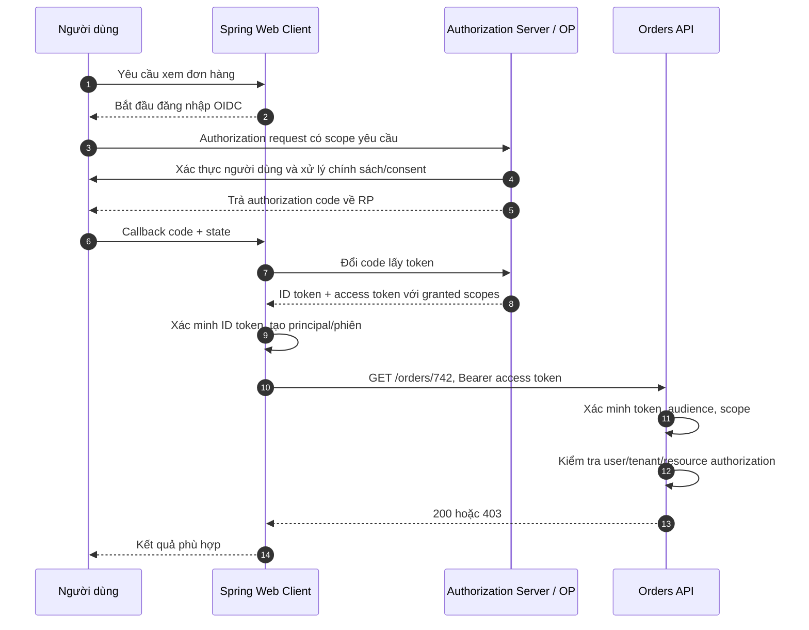
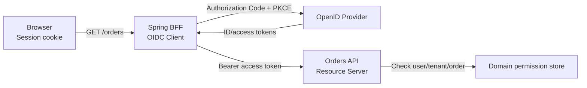

# 13.12. Phân biệt quyền của người dùng với scope được cấp cho client

Trong **Spring Security OAuth 2.0/OIDC Client**, sau khi người dùng đăng nhập thành công, ứng dụng có thể đồng thời nắm giữ:

- Một **principal** đại diện cho người dùng đã được xác thực.
- Một tập **authorities/roles** mà ứng dụng sử dụng để kiểm soát quyền của principal.
- Một **OAuth2AuthorizedClient** chứa access token đã được Authorization Server cấp.
- Các **scope** của access token, biểu diễn phạm vi truy cập được ủy quyền cho OAuth client khi dùng token đó.

Bốn khái niệm này liên quan nhưng **không đồng nghĩa**. Lỗi nghiêm trọng xảy ra khi hệ thống suy luận: “Access token có scope `orders.write`, vậy người đang đăng nhập chắc chắn có quyền sửa mọi đơn hàng”, hoặc “Người dùng có role ADMIN nên OAuth client có thể gọi mọi API dù token không được cấp scope tương ứng”.

**Trọng tâm bài học:** quyền của người dùng và phạm vi được cấp cho client cần được đánh giá theo **đúng vai trò, đúng tài nguyên và đúng token**. Trong nhiều hệ thống, một thao tác chỉ được phép khi *access token hợp lệ, scope cho phép thao tác, người dùng có quyền trên tài nguyên cụ thể và chính sách nghiệp vụ đều chấp thuận*.

Bài viết phân biệt các thuật ngữ, phân tích OAuth 2.0/OIDC theo góc nhìn Relying Party và Resource Server, đồng thời trình bày cách áp dụng trong Spring Security Servlet, các ví dụ Java/YAML và lỗi phân quyền thường gặp.

## 1. Bốn câu hỏi không được gộp thành một

| Thành phần | Câu hỏi trả lời | Ví dụ | Ai quản lý/xác minh? |
|---|---|---|---|
| **Authentication / principal** | Ai đã đăng nhập? | Người dùng có `iss=https://login.example.org`, `sub=user-725` | OP xác thực, RP kiểm tra ID token |
| **User role / authority** | Người dùng được phép thực hiện hành động nào trong hệ thống? | `ROLE_ORDER_VIEWER`, `ROLE_ORDER_ADMIN` | Chính sách ứng dụng/nguồn quyền đáng tin |
| **OAuth scope** | Access token được cấp cho client với phạm vi truy cập nào? | `orders.read`, `orders.write` | Authorization Server cấp; Resource Server thực thi |
| **Resource-level authorization** | Người dùng có được thao tác trên *đối tượng này* không? | Có quyền xem đơn hàng `#742` thuộc công ty A | API/service và dữ liệu nghiệp vụ |

Một người dùng có thể được xác thực hợp lệ nhưng không có quyền xem báo cáo tài chính. Một OAuth client có thể cầm token có `orders.read`, nhưng chủ thể phía sau token vẫn không được xem đơn hàng thuộc một tenant khác.

Ngược lại, người dùng là quản trị viên có quyền sửa đơn hàng trong ứng dụng, nhưng **một access token chỉ được cấp `orders.read` không trở thành token có quyền `orders.write`**.

### 1.1. Một nguyên tắc phân quyền thực dụng

Với yêu cầu đọc đơn hàng:

```text
Cho phép đọc đơn hàng 742 khi:

  Access token hợp lệ cho API orders
  AND Token có scope orders.read
  AND Chủ thể được xác định đáng tin cậy
  AND Chủ thể có quyền đọc đơn hàng 742
  AND Các quy tắc tenant/trạng thái/tổ chức đều thỏa
```

Đây là mô hình kết hợp điển hình, **không phải công thức cứng nhắc cho mọi giao thức**. Một API service-to-service có thể không có End-User; chính sách khi đó xác định quyền của workload/client thay vì quyền một người dùng tương tác.

## 2. Các vai trò trong OAuth 2.0/OIDC

Trong Authorization Code Flow:

- **Resource Owner / End-User:** người đang sử dụng ứng dụng và có thể cho phép client truy cập dữ liệu trong phạm vi giao thức/chính sách.
- **OAuth Client / Relying Party:** ứng dụng Spring Boot, chẳng hạn cổng nội bộ `portal.example.org`.
- **Authorization Server / OpenID Provider:** máy chủ xác thực và cấp token, chẳng hạn `login.example.org`.
- **Resource Server:** API nhận access token, chẳng hạn `orders-api.example.org`.



**Hai lượt kiểm tra khác nhau:**

1. RP kiểm tra **ID token** để biết người dùng đã được OP xác thực và tạo phiên OIDC.
2. Resource Server kiểm tra **access token** và **quyền nghiệp vụ** để quyết định có trả dữ liệu hay không.

Không nên sử dụng ID token làm access token chỉ vì nó là JWT có chữ ký hợp lệ. ID token thường có audience là OAuth client; access token phải được phát cho Resource Server hoặc API tương ứng.

## 3. Scope là gì và không phải là gì?

### 3.1. Scope trong OAuth 2.0

`scope` là tập các chuỗi dùng để diễn đạt **phạm vi truy cập** mà client yêu cầu hoặc được cấp trong giao thức OAuth 2.0. Tên scope phụ thuộc Authorization Server và Resource Server, ví dụ:

```text
orders.read
orders.write
reports.export
profile
email
```

OAuth không định nghĩa tất cả scope nghiệp vụ trên thế giới. `orders.read` chỉ có ý nghĩa cụ thể khi AS và Orders API thỏa thuận scope đó đại diện cho loại truy cập nào.

Một authorization request có thể yêu cầu:

```http
GET /authorize?response_type=code
  &client_id=portal-web
  &scope=openid%20profile%20orders.read
  &redirect_uri=https%3A%2F%2Fportal.example.org%2Flogin%2Foauth2%2Fcode%2Fcompany
  &state=<random-state>
```

Đoạn trên xuống dòng để dễ đọc, request thực tế phải được URL-encode đúng cách.

Sau token exchange, access token có thể chỉ được cấp một **tập con** những scope đã yêu cầu. Cần phân biệt **requested scopes** và **granted scopes**.

### 3.2. Scope không phải role của người dùng

Giả sử user có role nội bộ `ROLE_ORDER_VIEWER`. RP xin access token có scope `orders.read`. Hai điều kiện có thể cùng đúng, nhưng nguồn và ngữ nghĩa của chúng khác nhau:

- `ROLE_ORDER_VIEWER` là **quyền mà ứng dụng gắn với một principal** theo chính sách của ứng dụng.
- `orders.read` là **phạm vi được cấp cho token** để client yêu cầu một lớp thao tác đối với API.

Scope không tự mô tả tài nguyên nào là của user, tenant nào user thuộc về, hoặc người dùng có được duyệt một đơn hàng cụ thể hay không.

Ví dụ, `orders.read` có thể cho phép client **yêu cầu API kiểm tra một thao tác đọc đơn hàng**, chứ không mặc định cho phép đọc **mọi đơn hàng** của mọi khách hàng.

### 3.3. Scope cũng không nhất thiết là quyền vĩnh viễn của client

OAuth access token có thời hạn, audience và phạm vi riêng. Tập scope được cấp có thể khác theo:

- Client registration và allowed scopes ở AS.
- Người dùng đã đăng nhập và chính sách consent.
- Resource server/audience mục tiêu.
- Grant type được dùng.
- Chính sách của tổ chức và thời điểm cấp token.
- Giới hạn của authorization grant gốc khi dùng refresh token.

Vì vậy, không nên xem “client đã từng được cấp `orders.write`” là giấy phép vĩnh viễn. API cần xác minh access token hiện hành và áp dụng chính sách mới nhất cần thiết cho quyền nghiệp vụ.

## 4. OIDC scopes không đồng nghĩa quyền nghiệp vụ

Trong OIDC, các scope thông dụng:

| Scope | Ý nghĩa chủ yếu |
|---|---|
| `openid` | Yêu cầu xử lý như OIDC và nhận ID token |
| `profile` | Yêu cầu quyền truy cập một nhóm standard profile claims |
| `email` | Yêu cầu các claim về email |
| `address` | Yêu cầu các claim địa chỉ |
| `phone` | Yêu cầu các claim số điện thoại |
| `offline_access` | Liên quan yêu cầu quyền truy cập offline/refresh token theo các điều kiện của OP |

Ví dụ:

```yaml
scope:
  - openid
  - profile
  - email
```

không có nghĩa:

```text
ROLE_USER
ROLE_ADMIN
reports.read
orders.write
```

Tương tự, `profile` không phải lời bảo đảm rằng OP luôn trả đủ tên, ảnh, giới tính, ngày sinh hoặc mọi claim có thể có. Một số trường là tùy chọn và chịu chính sách scope/consent.

**Tránh sai lầm:** chỉ vì người dùng đăng nhập được với scope `openid`, `profile`, `email` mà tự động cấp `ROLE_ADMIN` hoặc quyền sửa dữ liệu.

## 5. ID token, access token và UserInfo có nhiệm vụ khác nhau

### 5.1. ID token xác thực người dùng với RP

Ví dụ payload ID token:

```json
{
  "iss": "https://login.example.org",
  "sub": "user-725",
  "aud": "portal-web",
  "exp": 1924999999,
  "iat": 1924996399,
  "preferred_username": "linh"
}
```

ID token của OIDC trả lời: *OP nào đã xác thực chủ thể nào cho client nào trong ngữ cảnh nào?*

RP phải kiểm tra chữ ký, issuer, audience, thời hạn, nonce và các điều kiện OIDC liên quan. `sub` kết hợp `iss` thường là khóa định danh external identity thích hợp, **không phải role**.

### 5.2. Access token phục vụ Resource Server

Ví dụ access token JWT theo một profile của nhà cung cấp:

```json
{
  "iss": "https://login.example.org",
  "sub": "user-725",
  "aud": "orders-api",
  "client_id": "portal-web",
  "scope": "orders.read",
  "exp": 1924999999,
  "iat": 1924996399
}
```

Token này được đưa đến Orders API để xác minh phạm vi truy cập. JWT access token có thể mang nhiều cấu trúc khác nhau; tên claim và nghĩa chính xác phụ thuộc profile/AS. Access token **không nhất thiết là JWT** — nó có thể là opaque token và API cần introspection.

Với access token dạng JWT, `scope` có thể là chuỗi phân cách bằng dấu cách hoặc `scp` là danh sách scope theo convention của AS. Spring Security Resource Server có cơ chế map scope phù hợp, nhưng ứng dụng phải xác định provider format thực tế.

### 5.3. UserInfo phục vụ hồ sơ, không mặc nhiên cấp quyền

OIDC UserInfo Endpoint có thể trả:

```json
{
  "sub": "user-725",
  "name": "Linh Nguyen",
  "email": "linh@example.org",
  "email_verified": true
}
```

Những claim này hỗ trợ hồ sơ và ánh xạ danh tính. Email đã xác minh không đồng nghĩa user có role quản trị. Nếu có claim `groups` hay `roles`, cần biết nó được OP cấp theo hợp đồng nào và có được ứng dụng tin dùng cho authorization hay không.

Tại RP, phải bảo đảm `sub` của UserInfo khớp `sub` từ ID token đã xác minh trước khi sử dụng UserInfo theo OIDC.

## 6. User role, authority và permission trong Spring Security

Spring Security biểu diễn kết quả đăng nhập thông qua một `Authentication` với:

- `principal`: người dùng hoặc chủ thể đã được xác thực.
- `authorities`: tập các `GrantedAuthority` mà ứng dụng cho phép sử dụng trong kiểm tra authorization.
- `authenticated`: trạng thái xác thực theo framework.
- `details`/`credentials`: các thông tin khác tùy implementation.

```java
Authentication authentication =
    SecurityContextHolder.getContext().getAuthentication();

Object principal = authentication.getPrincipal();
boolean authenticated = authentication.isAuthenticated();

Collection<? extends GrantedAuthority> authorities =
    authentication.getAuthorities();
```

`GrantedAuthority` là cách Spring biểu diễn **quyền đã được ánh xạ cho principal trong ngữ cảnh SecurityContext**. Nó có thể là role, scope hay authority đặc thù tùy **loại Authentication và converter**.

### 6.1. Role trong Spring Security

Một cách dùng thông dụng:

```text
ROLE_ORDER_VIEWER
ROLE_ORDER_ADMIN
ROLE_SUPPORT_AGENT
```

Khi cấu hình:

```java
.hasRole("ORDER_ADMIN")
```

Spring Security theo mặc định tìm authority `ROLE_ORDER_ADMIN`. Trong khi:

```java
.hasAuthority("ROLE_ORDER_ADMIN")
```

kiểm tra chính xác chuỗi authority.

Không mặc định rằng giá trị `"admin"` hoặc `"ROLE_ADMIN"` trong một profile JSON sẽ được framework tin cậy và chuyển thành `GrantedAuthority`. Ứng dụng phải có **quy tắc mapping** và nguồn cung cấp quyền phù hợp.

### 6.2. Permission nghiệp vụ có thể chi tiết hơn role

Role là một cách gom nhóm quyền. Một ứng dụng có thể có:

```text
ROLE_ORDER_VIEWER
  -> order.read

ROLE_ORDER_EDITOR
  -> order.read
  -> order.update

ROLE_ORDER_ADMIN
  -> order.read
  -> order.update
  -> order.approve
```

Nhưng quyền truy cập thực tế vẫn có thể phụ thuộc vào:

- Tenant của user và tenant của đơn hàng.
- Người được phân công phụ trách.
- Trạng thái đơn hàng.
- Mức phê duyệt và giá trị giao dịch.
- Quy tắc SoD (separation of duties) hoặc điều kiện thời gian.

`ROLE_ORDER_ADMIN` không nên tự động bỏ qua mọi ràng buộc dữ liệu nếu nghiệp vụ không cho phép.

### 6.3. Authority không có một nguồn duy nhất

Một authority có thể đến từ:

1. Cơ sở dữ liệu quyền nội bộ.
2. Mapping nhóm/role từ một OP đã được tin cậy.
3. Các claim của access token được Resource Server xác minh.
4. Một authorization policy/service riêng.
5. Quy tắc grant/client-specific cho machine-to-machine.

Do đó, trước khi dùng `hasAuthority(...)`, cần biết **ai đã tạo authority và nó có nghĩa gì**. Cùng một chuỗi authority ở hai loại Authentication không chứng minh cùng một cơ chế phân quyền.

## 7. Spring OAuth2 Login và Spring OAuth2 Resource Server là hai ngữ cảnh

Đây là phân biệt quan trọng nhất khi sử dụng Spring Security.

| Đặc điểm | `oauth2Login()` — Spring OAuth2/OIDC Client | `oauth2ResourceServer().jwt()` — API |
|---|---|---|
| Người/công việc được xác thực | Người dùng đăng nhập qua OP | Chủ thể được đại diện bởi bearer access token |
| Authentication thường gặp | `OAuth2AuthenticationToken` | `JwtAuthenticationToken` |
| Principal OIDC | `OidcUser` | Thường là `Jwt` hoặc principal đã custom |
| Token trung tâm | ID token để đăng nhập; access token được giữ trong authorized client | Access token do API nhận |
| Quyền để `hasAuthority` kiểm tra | Authorities của principal web session | Authorities được converter suy ra từ access token hoặc nguồn khác |
| Scope của access token | Xem ở `OAuth2AuthorizedClient.getAccessToken().getScopes()` | Thường map thành `SCOPE_...` khi dùng mặc định JWT |
| Vai trò của API | Không tự được cấp bởi `scope: openid,profile` | Chính sách API dựa trên scope + user/resource permission |

**Không giả định trong một `OAuth2AuthenticationToken` của `oauth2Login()` đã tự có `SCOPE_orders.read` chỉ vì authorized client giữ access token mang scope đó.**

Ngược lại, với Spring Resource Server mặc định cho JWT, framework thường chuyển claim `scope` hoặc `scp` thành authorities có prefix `SCOPE_`. Đây là **quy ước chuyển đổi access token ở phía API**, không phải bằng chứng rằng những scope đã trở thành role nội bộ của End-User.

### 7.1. Cùng một request, hai cách nhìn

RP web có thể giữ:

```text
Authentication:
  principal: OidcUser(sub=user-725)
  authorities:
    OIDC_USER
    ROLE_ORDER_VIEWER

OAuth2AuthorizedClient:
  registrationId: company
  accessToken.scopes:
    orders.read
    profile
```

Khi RP gọi Orders API, API nhận access token và tạo:

```text
JwtAuthenticationToken:
  principal: user-725
  authorities (theo converter API):
    SCOPE_orders.read
    SCOPE_profile
```

Đây là **ví dụ minh họa**, không phải danh sách authorities mặc định bắt buộc của mọi phiên bản/configuration. `ROLE_ORDER_VIEWER` ở RP có thể do ứng dụng tự ánh xạ từ cơ sở dữ liệu, còn API có thể cần tra quyền user riêng. Hai SecurityContext không tự đồng bộ role chỉ vì cùng OAuth flow.

## 8. Cấu hình OAuth2/OIDC Login trong Spring Boot

Giả sử có một Spring MVC portal thực hiện OIDC Login để nhân viên đăng nhập:

### 8.1. Dependencies

Gradle Groovy DSL:

```groovy
dependencies {
    implementation 'org.springframework.boot:spring-boot-starter-web'
    implementation 'org.springframework.boot:spring-boot-starter-security'
    implementation 'org.springframework.boot:spring-boot-starter-oauth2-client'
}
```

### 8.2. Client registration

```yaml
spring:
  security:
    oauth2:
      client:
        registration:
          company:
            provider: company
            client-id: ${OIDC_CLIENT_ID}
            client-secret: ${OIDC_CLIENT_SECRET}
            client-authentication-method: client_secret_basic
            authorization-grant-type: authorization_code
            redirect-uri: "{baseUrl}/login/oauth2/code/{registrationId}"
            scope:
              - openid
              - profile
              - email
              - orders.read
        provider:
          company:
            issuer-uri: ${OIDC_ISSUER_URI}
```

Lưu ý:

- `company` là registration ID cục bộ.
- `client-id` là OAuth client ID do OP cấp.
- `scope` trong registration là **scope yêu cầu**, không phải `GrantedAuthority` của người đăng nhập.
- Giá trị scope thực sự được cấp phải được kiểm tra trong **access token/token response**.
- Việc có `orders.read` trong YAML không ép Orders API phải cho người dùng đọc mọi đơn hàng.

OP có thể từ chối hoặc thu hẹp phạm vi yêu cầu theo cấu hình client và chính sách người dùng. Token endpoint không bắt buộc phải cấp mọi scope mà client gửi.

### 8.3. Bật Servlet OIDC Login

```java
import org.springframework.context.annotation.Bean;
import org.springframework.context.annotation.Configuration;
import org.springframework.security.config.Customizer;
import org.springframework.security.config.annotation.web.builders.HttpSecurity;
import org.springframework.security.web.SecurityFilterChain;

@Configuration
public class SecurityConfig {

    @Bean
    SecurityFilterChain webSecurity(HttpSecurity http) throws Exception {
        http
            .authorizeHttpRequests(authorize -> authorize
                .requestMatchers("/", "/error").permitAll()
                .anyRequest().authenticated())
            .oauth2Login(Customizer.withDefaults());

        return http.build();
    }
}
```

Khi đăng nhập thành công, Spring tạo một `Authentication` cho user, đồng thời quản lý `OAuth2AuthorizedClient` chứa token theo cơ chế authorized client repository/service đã cấu hình.

**Phải phân biệt:** chức năng `authorizeHttpRequests` đang bảo vệ trang của RP dựa trên authorities trong **web SecurityContext**. Còn việc RP gọi Orders API bằng access token phải theo chính sách **API**, nơi token sẽ được xác minh lại.

## 9. Đọc quyền của principal và granted scopes mà không nhầm lẫn

Spring MVC có thể truy cập principal và authorized client qua các argument resolver tương ứng.

```java
import java.util.List;
import java.util.Set;

import org.springframework.security.core.Authentication;
import org.springframework.security.core.GrantedAuthority;
import org.springframework.security.oauth2.client.OAuth2AuthorizedClient;
import org.springframework.security.oauth2.client.annotation.RegisteredOAuth2AuthorizedClient;
import org.springframework.web.bind.annotation.GetMapping;
import org.springframework.web.bind.annotation.RestController;

@RestController
public class LoginContextController {

    public record LoginContext(
        String principalName,
        List<String> userAuthorities,
        Set<String> grantedScopes
    ) {}

    @GetMapping("/internal/login-context")
    public LoginContext loginContext(
            Authentication authentication,
            @RegisteredOAuth2AuthorizedClient("company")
            OAuth2AuthorizedClient authorizedClient) {

        List<String> authorities = authentication.getAuthorities()
            .stream()
            .map(GrantedAuthority::getAuthority)
            .sorted()
            .toList();

        Set<String> scopes = authorizedClient.getAccessToken().getScopes();

        return new LoginContext(
            authentication.getName(),
            authorities,
            scopes
        );
    }
}
```

Đoạn mã minh họa ba tập dữ liệu **không bị trộn lẫn**:

- `authentication.getName()`: tên principal do cơ chế login tạo.
- `authentication.getAuthorities()`: authorities đang có trong web SecurityContext.
- `authorizedClient.getAccessToken().getScopes()`: granted scopes của access token thuộc registration `company`.

**Lưu ý vận hành:** `@RegisteredOAuth2AuthorizedClient` có thể kích hoạt cơ chế tra cứu/ủy quyền client tùy tích hợp và ngữ cảnh. Ví dụ giả định registration `company` đã được đăng nhập và authorized client tồn tại; trong ứng dụng thật cần xử lý trường hợp chưa có token. Endpoint quan sát này chỉ nên dùng trong môi trường debug được kiểm soát; không công khai quyền/metadata không cần thiết cho browser.

Tuyệt đối không trả `accessToken.getTokenValue()`, refresh token, ID token hoặc client secret trong JSON debug.

### 9.1. Vì sao không dùng getAuthorities() để suy đoán scope đã cấp?

Một số ứng dụng tùy biến `GrantedAuthoritiesMapper` để tạo authorities từ group/role. Một số lại dùng converter cho token scope. Vì thế, `Authentication.getAuthorities()` là **kết quả của chính sách authentication/mapping tại điểm đó**, không phải nguồn chân lý chung về mọi OAuth token đang được quản lý.

Nếu ứng dụng muốn biết access token hiện tại có `orders.read` hay không, xem **granted scope của chính token**. Nếu muốn biết user có quyền xem đơn hàng 742 hay không, hỏi **authorization service nghiệp vụ**.

## 10. Mapping user roles trong OAuth2 Login

### 10.1. Một thiết kế nên ưu tiên: local role service

Giả sử Portal dùng OIDC để xác thực danh tính, nhưng quyền xem báo cáo do ứng dụng lưu ở cơ sở dữ liệu nội bộ. Quy tắc:

```text
OP xác thực:
  iss=https://login.example.org
  sub=user-725

Ứng dụng tra quyền:
  (iss,sub) -> local_user_id=142
  local_user_id=142 -> REPORT_VIEWER, ORDER_VIEWER

Web SecurityContext:
  ROLE_REPORT_VIEWER
  ROLE_ORDER_VIEWER
```

Ưu điểm:

- Sự thật về danh tính được gắn với `(iss,sub)` thay vì email.
- Quyền có thể thay đổi độc lập với OAuth client scope.
- Mỗi RP có thể có chính sách quyền khác nhau dù cùng OP.
- Không tự cấp quyền từ `scope=openid profile email`.

### 10.2. Custom OidcUserService bổ sung authorities nội bộ

Ví dụ lớp service ánh xạ quyền đã được ứng dụng kiểm soát:

```java
import java.util.HashSet;
import java.util.Set;

import org.springframework.security.core.GrantedAuthority;
import org.springframework.security.core.authority.SimpleGrantedAuthority;
import org.springframework.security.oauth2.client.oidc.userinfo.OidcUserRequest;
import org.springframework.security.oauth2.client.oidc.userinfo.OidcUserService;
import org.springframework.security.oauth2.client.userinfo.OAuth2UserService;
import org.springframework.security.oauth2.core.oidc.user.DefaultOidcUser;
import org.springframework.security.oauth2.core.oidc.user.OidcUser;

public final class LocalRoleOidcUserService
        implements OAuth2UserService<OidcUserRequest, OidcUser> {

    private final OidcUserService delegate = new OidcUserService();
    private final LocalRoleService localRoles;

    public LocalRoleOidcUserService(LocalRoleService localRoles) {
        this.localRoles = localRoles;
    }

    @Override
    public OidcUser loadUser(OidcUserRequest request) {
        // Spring đã xử lý phần token của OIDC flow trước khi gọi service.
        OidcUser oidcUser = delegate.loadUser(request);

        String issuer = oidcUser.getIdToken().getIssuer().toString();
        String subject = oidcUser.getSubject();

        Set<GrantedAuthority> authorities =
            new HashSet<>(oidcUser.getAuthorities());

        // LocalRoleService chỉ trả role đã được chính sách ứng dụng cho phép.
        for (String role : localRoles.findRoleNames(issuer, subject)) {
            authorities.add(new SimpleGrantedAuthority("ROLE_" + role));
        }

        if (oidcUser.getUserInfo() != null) {
            return new DefaultOidcUser(
                authorities,
                oidcUser.getIdToken(),
                oidcUser.getUserInfo(),
                "sub"
            );
        }

        return new DefaultOidcUser(
            authorities,
            oidcUser.getIdToken(),
            "sub"
        );
    }

    public interface LocalRoleService {
        Set<String> findRoleNames(String issuer, String subject);
    }
}
```

Ở đây `LocalRoleService` là interface cho tầng dữ liệu nghiệp vụ, cần được triển khai thành bean phù hợp với hệ thống. Hợp đồng của nó nên giới hạn role names vào **tập giá trị được quản trị**, ví dụ `REPORT_VIEWER`, `ORDER_VIEWER`; không ghép chuỗi tự do từ profile của IdP thành tên authority.

Lớp này **không lấy granted scopes làm nguồn role**. Nó sử dụng định danh OIDC đã được xác minh để tra cứu quyền trong ứng dụng. Nếu cần quyền thay đổi hiệu lực tức thời, không chỉ cache authorities vào session tại lúc login; cần chính sách refresh/revalidate tại request hoặc ở service.

### 10.3. Gắn user service vào oauth2Login()

```java
import org.springframework.context.annotation.Bean;
import org.springframework.context.annotation.Configuration;
import org.springframework.security.config.annotation.web.builders.HttpSecurity;
import org.springframework.security.web.SecurityFilterChain;

@Configuration
public class AppSecurityConfig {

    @Bean
    SecurityFilterChain webSecurity(
            HttpSecurity http,
            LocalRoleOidcUserService.LocalRoleService roleService)
            throws Exception {

        var userService = new LocalRoleOidcUserService(roleService);

        http
            .authorizeHttpRequests(authorize -> authorize
                .requestMatchers("/", "/error").permitAll()
                .requestMatchers("/reports/**").hasRole("REPORT_VIEWER")
                .anyRequest().authenticated())
            .oauth2Login(oauth2 -> oauth2
                .userInfoEndpoint(userInfo -> userInfo
                    .oidcUserService(userService)));

        return http.build();
    }
}
```

`hasRole("REPORT_VIEWER")` thông thường yêu cầu authority `ROLE_REPORT_VIEWER` trong **web Authentication**. Quy tắc này bảo vệ đường dẫn `/reports/**` ở RP, không thay đổi scope của access token mà RP sử dụng để gọi Reports API.

Một người dùng đã có `ROLE_REPORT_VIEWER` vẫn có thể không gọi được Reports API nếu access token thiếu `reports.read`, sai audience hoặc API áp dụng chính sách dữ liệu hạn chế hơn.

## 11. Kiểm tra scope của access token trong Spring Resource Server

Khi Orders API nhận bearer token, nó đóng vai **Resource Server** chứ không phải web OIDC Login RP.

### 11.1. Dependencies và cấu hình cơ bản

Gradle:

```groovy
dependencies {
    implementation 'org.springframework.boot:spring-boot-starter-web'
    implementation 'org.springframework.boot:spring-boot-starter-security'
    implementation 'org.springframework.boot:spring-boot-starter-oauth2-resource-server'
}
```

`application.yml`:

```yaml
spring:
  security:
    oauth2:
      resourceserver:
        jwt:
          issuer-uri: https://login.example.org
```

Đây là cấu hình ví dụ cho AS phát **JWT access tokens**. API cần bảo đảm token có **audience dành cho chính API**, không chỉ có issuer đúng; audience validation cần được cấu hình theo Spring Security version và hợp đồng AS.

Nếu access token là opaque, cần cấu hình introspection thay cho JWT decoder. Không giả định một access token có ba đoạn phân tách bởi dấu chấm là ID token, và không đưa ID token đến API để kiểm tra scope.

### 11.2. Spring map scope thành SCOPE_* như thế nào?

Với JWT Resource Server và `JwtGrantedAuthoritiesConverter` mặc định, claim `scope` (chuỗi phân cách bằng khoảng trắng) hoặc `scp` thường được chuyển thành authorities:

```text
Access token:
  scope = "orders.read orders.write"

JwtAuthenticationToken authorities:
  SCOPE_orders.read
  SCOPE_orders.write
```

Do đó:

```java
.hasAuthority("SCOPE_orders.read")
```

phù hợp để kiểm tra một scope đã được chuyển thành authority tại Resource Server.

Nhưng:

```java
.hasRole("orders.read")
```

sẽ đi tìm `ROLE_orders.read` theo mặc định, **không phải** `SCOPE_orders.read`.

Chú ý rằng tên và prefix có thể được custom, đặc biệt với provider có claim khác hoặc opaque-token introspection. Không suy ra tự động rằng mọi `Authentication` ở mọi filter chain đều có authorities `SCOPE_...`.

### 11.3. SecurityFilterChain của API

```java
import org.springframework.context.annotation.Bean;
import org.springframework.context.annotation.Configuration;
import org.springframework.http.HttpMethod;
import org.springframework.security.config.annotation.web.builders.HttpSecurity;
import org.springframework.security.web.SecurityFilterChain;

@Configuration
public class ApiSecurityConfig {

    @Bean
    SecurityFilterChain apiSecurity(HttpSecurity http) throws Exception {
        http
            .authorizeHttpRequests(auth -> auth
                .requestMatchers(HttpMethod.GET, "/api/orders/**")
                    .hasAuthority("SCOPE_orders.read")
                .requestMatchers(HttpMethod.POST, "/api/orders/**")
                    .hasAuthority("SCOPE_orders.write")
                .anyRequest().authenticated())
            .oauth2ResourceServer(resource -> resource.jwt(
                org.springframework.security.config.Customizer.withDefaults()
            ));

        return http.build();
    }
}
```

Ví dụ quy định **yêu cầu scope tối thiểu cho thao tác HTTP**. Nó chưa quyết định người dùng có được xem đơn hàng cụ thể nào.

Nếu ứng dụng vừa là web RP vừa là Resource Server, cần thiết kế filter chains/matchers riêng cho `/api/**` và UI session theo kiến trúc, tránh API bị redirect sang trang login thay vì trả 401/403 phù hợp.

### 11.4. Kiểm tra quyền trên từng đơn hàng sau scope

Ví dụ Orders API yêu cầu:

- Access token hợp lệ, đúng issuer và audience API.
- Scope `orders.read` đã được Resource Server ánh xạ.
- Chủ thể được tra quyền đọc đơn hàng theo `issuer` và `subject`.

```java
import org.springframework.security.access.AccessDeniedException;
import org.springframework.security.access.prepost.PreAuthorize;
import org.springframework.security.core.annotation.AuthenticationPrincipal;
import org.springframework.security.oauth2.jwt.Jwt;
import org.springframework.web.bind.annotation.GetMapping;
import org.springframework.web.bind.annotation.PathVariable;
import org.springframework.web.bind.annotation.RequestMapping;
import org.springframework.web.bind.annotation.RestController;

@RestController
@RequestMapping("/api/orders")
public class OrdersApi {

    private final OrderAuthorizer authorizer;
    private final OrderService orders;

    public OrdersApi(OrderAuthorizer authorizer, OrderService orders) {
        this.authorizer = authorizer;
        this.orders = orders;
    }

    @PreAuthorize("hasAuthority('SCOPE_orders.read')")
    @GetMapping("/{id}")
    public OrderView getOrder(
            @PathVariable String id,
            @AuthenticationPrincipal Jwt jwt) {

        String issuer = jwt.getIssuer().toString();
        String subject = jwt.getSubject();

        if (!authorizer.canRead(issuer, subject, id)) {
            throw new AccessDeniedException("Order access denied");
        }

        return orders.loadView(id);
    }

    public interface OrderAuthorizer {
        boolean canRead(String issuer, String subject, String orderId);
    }

    public interface OrderService {
        OrderView loadView(String orderId);
    }

    public record OrderView(String id, String status) {}
}
```

Để dùng `@PreAuthorize`, bật method security:

```java
import org.springframework.context.annotation.Configuration;
import org.springframework.security.config.annotation.method.configuration.EnableMethodSecurity;

@Configuration
@EnableMethodSecurity
public class MethodSecurityConfig {
}
```

`OrderAuthorizer` và `OrderService` trong ví dụ là hợp đồng tầng nghiệp vụ, cần triển khai bằng các bean thật có tra cứu dữ liệu và chính sách. Ví dụ giả định API nhận **delegated user access token** với subject người dùng và issuer từ AS đáng tin. Nếu token thuộc `client_credentials`, subject có thể đại diện workload hoặc client, không thể dùng cùng một quy tắc user ownership mà không phân biệt loại token.

Phương pháp này biểu diễn đúng ranh giới:

```text
SCOPE_orders.read
    -> Token cho phép client yêu cầu thao tác đọc

OrderAuthorizer.canRead(iss, sub, orderId)
    -> Chủ thể có quyền đọc đơn hàng cụ thể?

Cả hai đúng
    -> Trả dữ liệu
```

## 12. Có nên biến groups hoặc roles trong JWT thành Spring authorities?

Một số Authorization Server phát access token có thêm claim như:

```json
{
  "iss": "https://login.example.org",
  "sub": "user-725",
  "aud": ["orders-api"],
  "scope": "orders.read",
  "app_roles": ["ORDER_READER"]
}
```

Nếu AS được API tin cậy và `app_roles` thuộc **hợp đồng phân quyền của chính API**, có thể ánh xạ nó thành `ROLE_ORDER_READER`. Tuy nhiên, **không nên tự động ánh xạ mọi chuỗi `roles` hoặc `groups` từ mọi issuer**.

Ví dụ converter minh họa:

```java
import java.util.ArrayList;
import java.util.Collection;
import java.util.List;
import java.util.Set;

import org.springframework.context.annotation.Bean;
import org.springframework.security.core.GrantedAuthority;
import org.springframework.security.core.authority.SimpleGrantedAuthority;
import org.springframework.security.oauth2.server.resource.authentication.JwtAuthenticationConverter;
import org.springframework.security.oauth2.server.resource.authentication.JwtGrantedAuthoritiesConverter;

@Bean
JwtAuthenticationConverter jwtAuthenticationConverter() {
    var scopes = new JwtGrantedAuthoritiesConverter();
    var converter = new JwtAuthenticationConverter();

    Set<String> acceptedRoles =
        Set.of("ORDER_READER", "ORDER_EDITOR");

    converter.setJwtGrantedAuthoritiesConverter(jwt -> {
        Collection<GrantedAuthority> authorities =
            new ArrayList<>(scopes.convert(jwt));

        List<String> rawRoles =
            jwt.getClaimAsStringList("app_roles");

        if (rawRoles != null) {
            for (String role : rawRoles) {
                if (acceptedRoles.contains(role)) {
                    authorities.add(
                        new SimpleGrantedAuthority("ROLE_" + role)
                    );
                }
            }
        }

        return authorities;
    });

    return converter;
}
```

Điều kiện để dùng an toàn:

1. JWT decoder đã xác minh **chữ ký, issuer, thời hạn và audience API**.
2. Claim `app_roles` thực sự do nguồn **được ủy quyền cấp quyền cho API** phát hành.
3. Tên role được allowlist và không bị ghép từ dữ liệu tùy ý.
4. Converter được gắn vào `oauth2ResourceServer().jwt().jwtAuthenticationConverter(...)`.
5. API vẫn kiểm tra quyền theo tài nguyên/tenant khi cần.

Nếu quyền nội bộ nằm trong database, phương án tra quyền tại API/service có thể phù hợp hơn ánh xạ claim role từ token. Với role token, cũng cần cơ chế xử lý **thu hồi quyền** khi token còn hạn.

### 12.1. Không đánh đồng user groups với client scopes

`groups=["accounting"]` là một mẩu dữ liệu về user trong hệ thống danh tính; `scope="reports.read"` là đặc tính của access token. Chúng có thể cùng cần thiết cho một quyết định:

```text
Access token có reports.read
AND user thuộc nhóm accounting (theo nguồn đáng tin)
AND báo cáo thuộc phạm vi tổ chức của user
    -> Cho phép xem báo cáo
```

Nhưng không nên dùng ánh xạ mặc định kiểu:

```text
groups chứa accounting
    -> tự cấp SCOPE_reports.read
```

vì như vậy ứng dụng đang **giả tạo phạm vi của token** thay vì xin token hợp lệ với quyền được AS cấp.

## 13. Client Credentials Grant: scope không nói về một user tương tác

Với `client_credentials`, một backend job có thể xin token theo danh tính workload:

```http
POST /oauth2/token HTTP/1.1
Host: auth.example.org
Authorization: Basic <service-client-credentials>
Content-Type: application/x-www-form-urlencoded

grant_type=client_credentials&scope=inventory.read
```

Token có thể mang:

```json
{
  "iss": "https://auth.example.org",
  "sub": "inventory-sync-service",
  "aud": "inventory-api",
  "scope": "inventory.read",
  "exp": 1924999999
}
```

Giá trị `sub` và cấu trúc token trong ví dụ phụ thuộc profile của AS. Điểm chính là **không có End-User xác thực tương tác qua Authorization Code/OIDC Login**.

Trong trường hợp này:

- `scope=inventory.read` biểu diễn phạm vi truy cập của token cho workload/client.
- Không có `ROLE_INVENTORY_VIEWER` của một nhân viên cần được suy diễn.
- Resource Server kiểm tra client identity, audience, scope và chính sách workload.
- Quyền đối với dữ liệu cần được kiểm soát theo service account/tenant/resource policy.

Không dùng token `client_credentials` làm bằng chứng “người dùng A đã đăng nhập” hay giả lập End-User bằng cách tự đặt một email trong request.

### 13.1. Không mọi scope đều là delegated permission của user

Trong OAuth 2.0, scope là phạm vi được cấp cho access token. Ở Authorization Code Flow, nó thường nằm trong ngữ cảnh quyền truy cập **được ủy quyền thay mặt người dùng**. Ở Client Credentials Grant, scope áp dụng cho **chính client/workload**.

Vì vậy, nói “scope luôn là quyền của người dùng” là sai; nói “scope luôn chỉ là quyền của ứng dụng” cũng thiếu chính xác. Cách hiểu phù hợp là **scope mô tả giới hạn truy cập của token trong một grant và audience cụ thể**.

## 14. Tình huống so sánh: cùng API nhưng kết quả khác nhau

Giả sử Orders API yêu cầu `orders.write` để sửa đơn hàng và kiểm tra quyền user trên chính đơn hàng đó.

| User có quyền sửa đơn hàng? | Access token có `orders.write`? | Token đúng API, hợp lệ? | Kết quả |
|---|---|---|---|
| Có | Có | Có | Có thể cho phép, nếu các policy khác thỏa |
| Có | Không | Có | **Từ chối** vì thiếu scope |
| Không | Có | Có | **Từ chối** vì user không có quyền dữ liệu |
| Không | Không | Có | **Từ chối** vì thiếu cả hai |
| Có | Có | Không | **Từ chối** vì token không hợp lệ/sai audience |
| Là workload, không có user | Có | Có | Theo chính sách client/workload riêng, không dùng user role |
| User có `ROLE_ADMIN` ở RP | Chỉ có `orders.read` | Có | **Không được sửa** chỉ nhờ role ở RP |
| User đã bị thu hồi quyền | Token cũ còn scope | Có | Cần cơ chế thu hồi/kiểm tra quyền phù hợp |

Nội dung “có thể cho phép” nhấn mạnh scope và role thường chỉ là **điều kiện cần**, không đủ nếu hệ thống còn quy tắc tenant, chủ sở hữu, trạng thái nghiệp vụ, hoặc chính sách rủi ro.

### 14.1. Scope có thể là trần quyền truy cập

Trong kiến trúc ủy quyền thay mặt người dùng, có thể hình dung quyền hiệu lực nằm trong **giao** của các tập điều kiện:

```text
Khả năng của access token
  ∩ Quyền thực tế của người dùng
  ∩ Quyền đối với tài nguyên
  ∩ Chính sách của API
= Hành động được phép
```

Đây là hình ảnh tư duy, không nhất thiết mọi hệ thống biểu diễn các điều kiện bằng cùng một tập quyền. Với machine-to-machine grant, “quyền người dùng” được thay bằng chính sách client/workload.

## 15. Vì sao không sao chép authorities của RP sang API?

Trong ứng dụng Spring MVC dùng `oauth2Login()`, RP có thể ánh xạ quyền nội bộ thành:

```text
ROLE_REPORT_VIEWER
ROLE_ORDER_ADMIN
```

Khi RP gọi Orders API bằng access token, API chỉ nhận token (hoặc kết quả introspection) và context request, **không tự nhận SecurityContext của RP**.

Sai lầm thường gặp:

```text
RP: user có ROLE_ORDER_ADMIN
=> API chắc chắn biết user có ROLE_ORDER_ADMIN
```

Điều đó không đúng, trừ khi có một cơ chế tin cậy rõ ràng để **mang và kiểm chứng** quyền giữa hai service.

Một số cách thiết kế:

- API tự tra quyền người dùng qua user/tenant identity tin cậy.
- AS phát access token có claim quyền phục vụ API, theo nguồn và chính sách đã được đồng ý.
- API dùng authorization service tập trung để quyết định quyền.
- Service-to-service dùng workload identity và kiểm soát riêng.

Không copy raw authorities từ request header do browser đặt, chẳng hạn `X-User-Roles: ADMIN`, rồi coi là đáng tin. Nếu cần user context giữa services, phải có cơ chế xác thực và trust boundary rõ ràng.

## 16. Phân biệt Authentication.getAuthorities() theo loại Authentication

Bảng sau giúp tránh nhầm cách Spring Security đặt quyền:

| Principal/Authentication | Nguồn thường gặp | Authorities có thể thấy | Không nên kết luận |
|---|---|---|---|
| `OAuth2AuthenticationToken` với `OidcUser` | OIDC Login ở RP | `OIDC_USER`, role do mapper/local DB cấp | Không mặc định có scopes của access token |
| `OAuth2AuthenticationToken` với `OAuth2User` | OAuth2 Login không OIDC | `OAUTH2_USER`, role ứng dụng cấp | Không mặc định biết quyền API |
| `JwtAuthenticationToken` | Resource Server xác minh JWT access token | `SCOPE_...` theo converter, role theo custom mapping | Không mặc định tương đương role user ở RP |
| `BearerTokenAuthentication` | Resource Server introspection opaque token | Authorities theo kết quả introspection/converter | Không suy ra tất cả ID token claims |
| Form login Authentication | Username/password/local user service | `ROLE_...` từ local user store | Không có OAuth scope nếu không dùng OAuth client |
| Machine/service principal | Workload authentication/token | Client/service authorities hoặc scopes | Không có End-User theo mặc định |

Danh sách là **mô hình minh họa**. Các authorities thực tế phụ thuộc Spring Security version, provider, converter, user service và chính sách của ứng dụng. Điều quan trọng là xác định **loại Authentication hiện tại**, không dựa trên một tiền tố authority để khẳng định danh tính hoặc nguồn quyền.

### 16.1. hasRole và hasAuthority

```java
hasRole("ADMIN")
```

theo mặc định tương đương kiểm tra authority `ROLE_ADMIN`.

```java
hasAuthority("SCOPE_orders.read")
```

kiểm tra chính xác authority được dùng để biểu diễn scope `orders.read`.

Nếu một nhóm lập trình dùng `@PreAuthorize("hasRole('orders.read')")` để kiểm tra token scope, họ thường sẽ kiểm tra nhầm authority `ROLE_orders.read`. Nếu dùng `hasAuthority("SCOPE_orders.read")` trên một OIDC web session không có authority này, kiểm tra cũng không mang ý nghĩa mà tác giả kỳ vọng.

**Chọn expression theo đúng SecurityContext và nguồn policy.**

## 17. Những trường hợp user role và scope có quan hệ nhưng không giống nhau

### 17.1. Consent của người dùng

Trong một số hệ thống, người dùng nhìn thấy màn hình consent cho phép client truy cập email hoặc đơn hàng. Consent là một phần của **ủy quyền cho client**, không trực tiếp biến user thành người có thêm role trong hệ thống nghiệp vụ.

Ví dụ user chỉ có quyền đọc đơn hàng. Consent cấp `orders.read` cho client không tạo `ROLE_ORDER_ADMIN`.

### 17.2. Chính sách cấp scope dựa trên quyền user

AS có thể quyết định không phát scope `orders.write` khi user không có quyền tương ứng. Đây là một tầng bảo vệ tốt, nhưng API vẫn cần xem xét:

- Token còn hạn hay đã bị thu hồi?
- Quyền user có thay đổi sau lúc cấp token không?
- Có chính sách đối tượng/tenant nào không thể biểu diễn bằng scope?
- Scope có được cấp cho đúng audience không?

Không xem “AS đã cấp scope” là bằng chứng vĩnh viễn rằng mọi object-level permission luôn đúng.

### 17.3. User là ADMIN nhưng client có quyền hạn chế

Một công cụ chỉ đọc có thể đăng nhập người dùng quản trị nhưng xin token scope `reports.read`. Đây là thiết kế **least privilege** hợp lý: quyền cao của user không tự làm client được cấp `reports.write`.

### 17.4. Client được phép xin scope rộng nhưng user bị hạn chế

Một client có thể được cấu hình allowed scopes gồm `orders.read` và `orders.write`, nhưng người dùng cụ thể không được sửa một số đơn hàng. AS, consent và API có thể áp dụng giới hạn theo thời điểm. **Allowed scopes của client registration không phải user entitlement**.

## 18. Scope và audience phải được xem cùng nhau

Một token có `scope=orders.read` nhưng `aud=reports-api` **không phải token hợp lệ để Orders API chấp nhận**, dù scope string trùng tên mà Orders API hiểu.

Ví dụ:

```json
{
  "iss": "https://login.example.org",
  "aud": "reports-api",
  "scope": "orders.read",
  "exp": 1924999999
}
```

Orders API không nên chỉ chạy:

```java
hasAuthority("SCOPE_orders.read")
```

mà quên xác minh **issuer, chữ ký/introspection, thời hạn và audience của API** ở lớp token validation.

Đồng thời, nếu API dùng nhiều issuer, phải giới hạn nguồn phát token được tin cậy và chính sách phân quyền theo issuer. Claim `scope` của một AS không mặc nhiên có cùng ngữ nghĩa với claim cùng tên của AS khác.

### 18.1. OAuth client scope và API resource scope

Ở một số hệ thống, `openid` và `profile` phục vụ OIDC UserInfo; `orders.read` phục vụ Orders API. Có thể RP xin nhiều scope trong một authorization request nhưng AS không nhất thiết phát **một token dùng chung cho mọi API**.

Khi cần gọi nhiều Resource Server, ứng dụng cần kiểm tra token audience, resource indicators và cách AS cấp token tương ứng. Không bỏ audience validation vì “scope có vẻ đúng”.

## 19. Chuyện gì xảy ra khi quyền của user thay đổi?

Giả sử user có quyền `ORDER_EDITOR` và access token còn hạn với `orders.write`. Sau đó quản trị viên thu hồi quyền sửa đơn hàng.

Các khả năng:

1. **API tra quyền nội bộ tại mỗi request:** quyền bị thu hồi có hiệu lực nhanh, dù access token còn `orders.write`.
2. **API tin claim role nhúng trong JWT:** quyền có thể tiếp tục được công nhận cho đến khi JWT hết hạn, trừ khi có cơ chế revocation/introspection/denylist hoặc invalidation khác.
3. **RP giữ role trong session:** role của phiên có thể cũ nếu không refresh authorities/re-login.
4. **AS thay allowed scopes:** điều này thường ảnh hưởng token mới; token đã cấp cần cơ chế hết hạn hoặc thu hồi riêng.

Do đó, để xử lý quyền nhạy cảm:

- Dùng access token lifetime phù hợp.
- Cân nhắc introspection, revocation hoặc kiểm tra quyền động.
- Xác định SLA thu hồi quyền và mức độ nhất quán chấp nhận được.
- Không chỉ dựa trên consent hoặc scope đã cấp trước đó.
- Đừng lạm dụng refresh token để kéo dài vô hạn một quyền đã bị thu hồi.

### 19.1. Refresh token không phải phép xin mọi scope mới

Client dùng refresh token thường bị giới hạn bởi grant/scope gốc và chính sách AS. Không tự thêm `orders.admin` vào refresh request rồi kỳ vọng AS phải phát quyền đó. Một scope mới hoặc quyền rộng hơn có thể đòi authorization transaction/consent mới, hoặc bị từ chối.

## 20. Thực hành thiết kế permissions theo nhiều lớp

Với một hệ thống Orders, có thể định nghĩa:

**Authorization Server / OAuth layer**

```text
Scopes:
  orders.read
  orders.write

Audiences:
  orders-api
  reports-api
```

**Ứng dụng / domain layer**

```text
User roles:
  ORDER_VIEWER
  ORDER_EDITOR
  ORDER_APPROVER

Permissions:
  readOrder(orderId)
  editOrder(orderId)
  approveOrder(orderId)

Context:
  userTenantId
  orderTenantId
  orderStatus
  approvalLimit
```

**Resource Server policy**

```text
GET /orders/{id}:
  token valid for orders-api
  AND scope includes orders.read
  AND user canRead(orderId)

PATCH /orders/{id}:
  token valid for orders-api
  AND scope includes orders.write
  AND user canEdit(orderId)

POST /orders/{id}/approve:
  token valid for orders-api
  AND scope/policy allows approval
  AND user has approval authority for this order
```

Không cần định nghĩa một OAuth scope cho mọi cặp user/đơn hàng. Scope biểu diễn lớp quyền của **token**, còn chính sách đối tượng được xử lý ở **domain authorization**.

### 20.1. Áp dụng trong hệ thống đa tenant

User thuộc tenant A có thể sở hữu role `ORDER_EDITOR`, còn đơn hàng `#742` thuộc tenant B. Nếu API chỉ kiểm tra role và scope mà không kiểm tra tenant, có thể xảy ra **broken object-level authorization (BOLA)**.

Vì thế điều kiện nên bao gồm:

```text
token audience == orders-api
AND scope includes orders.write
AND user has ORDER_EDITOR permission
AND user is authorized for order 742
AND tenant constraints hold
```

Không coi role `ADMIN` hoặc scope `write` là lý do mặc định bỏ qua kiểm tra tenant, trừ khi hệ thống có vai trò cross-tenant được định nghĩa và kiểm soát cụ thể.

## 21. Các anti-pattern cần tránh

### 21.1. Tự tạo role từ scope của token

```java
// Minh họa sai: không dùng để cấp quyền user nội bộ
for (String scope : accessToken.getScopes()) {
    userAuthorities.add(
        new SimpleGrantedAuthority("ROLE_" + scope.toUpperCase())
    );
}
```

Cách này trộn hai loại chính sách và có thể làm phát sinh role không đúng. Nếu API muốn dùng scope làm authority `SCOPE_...`, hãy sử dụng converter phù hợp **ở Resource Server**; đừng tự biến thành `ROLE_...` của End-User.

### 21.2. Cấp quyền chỉ vì scope có trong application.yml

```yaml
scope:
  - orders.write
```

Đây là **scope yêu cầu**; không chứng minh token thực tế đã được cấp, càng không chứng minh user có quyền sửa tài nguyên.

### 21.3. Dùng ID token để gọi API

```http
Authorization: Bearer <id-token>
```

ID token thường có audience là OAuth client. API cần access token phù hợp với resource server và phải xác minh loại token theo profile sử dụng. Không chấp nhận ID token làm access token chỉ vì chữ ký hợp lệ.

### 21.4. Chỉ dùng hasRole ở API và bỏ qua token scope

Một API có thể tin dữ liệu role từ nguồn riêng và bỏ qua scope; khi đó client có thể dùng một access token không được cấp phạm vi thao tác tương ứng. Nếu contract API yêu cầu scope, scope phải được kiểm tra, ngoài quyền user.

### 21.5. Chỉ dùng hasAuthority("SCOPE_*") mà bỏ qua quyền dữ liệu

Một access token được cấp `orders.read` không chứng minh user sở hữu mọi đơn hàng. Nếu API trả một object theo ID mà không kiểm tra quyền object, có nguy cơ đọc dữ liệu tenant khác.

### 21.6. Dùng email để quyết định role

`email=ceo@example.org` hoặc domain email công ty không phải một định danh quyền đủ an toàn. Email có thể thay đổi, không được xác minh hoặc không trùng account source of truth. Ưu tiên external identity key `(iss,sub)` và cơ sở dữ liệu quyền đáng tin.

### 21.7. Coi mọi claim groups là đáng tin

`groups` trong UserInfo/ID token có thể là extension provider-specific; cần xác minh issuer, contract, nhóm được phép ánh xạ và thời điểm cập nhật. Không cho người dùng tự sửa custom claim rồi được cấp `ROLE_ADMIN`.

### 21.8. Dùng client_credentials thay mặt user

Một access token `client_credentials` đại diện cho workload; nó không xác thực End-User. Không dùng nó để tạo `OidcUser` hoặc làm chứng cứ người dùng đã chấp thuận một thao tác nghiệp vụ cụ thể.

## 22. Kiểm tra lỗi 401, 403 và login thành công nhưng API bị từ chối

Khi giao diện OIDC Login thành công nhưng API trả lỗi, cần phân biệt nguyên nhân.

| Biểu hiện | Nguyên nhân thường gặp | Tầng cần kiểm tra |
|---|---|---|
| RP chưa đăng nhập, redirect tới OP | Chưa có phiên xác thực web | OAuth2/OIDC Login |
| API trả **401** | Thiếu token, token không hợp lệ, hết hạn hoặc issuer/audience sai | Bearer authentication/token validation |
| API trả **403** dù token hợp lệ | Thiếu scope hoặc quyền nghiệp vụ | Authorization của Resource Server |
| Scope có trong YAML nhưng không có trong access token | AS thu hẹp grant hoặc scope không được phép | Requested vs granted scopes |
| User là ADMIN ở Portal nhưng API 403 | API không có role tương ứng, token thiếu scope hoặc tài nguyên không được phép | RP/API policy boundary |
| Có `SCOPE_orders.read` nhưng không xem được đơn hàng | User/tenant không có quyền object | Domain authorization |
| Token chứa `ROLE_ADMIN` từ nguồn lạ | Mapping claim không phù hợp hoặc sai trust policy | Jwt converter/issuer contract |
| Client credentials token bị xử lý như người dùng | Không phân biệt workload và delegated token | Grant type, principal model |
| Role thay đổi nhưng phiên vẫn có quyền cũ | Authorities cache trong session/token | Revocation/session/update policy |
| Token dùng cho Reports API bị từ chối tại Orders API | Audience không khớp | Resource Server token validation |

### 22.1. 401 khác 403

Theo cách dùng phổ biến trong HTTP API:

- **401 Unauthorized:** yêu cầu chưa được xác thực hợp lệ bằng credential thích hợp.
- **403 Forbidden:** yêu cầu đã có ngữ cảnh xác thực nhưng không được cấp quyền thao tác.

Tuy vậy, một số filter chain, authentication entry point hoặc exception handler có thể trả mã khác theo cấu hình. Cần xem chính sách thực tế của API chứ không chỉ dựa vào status code để đoán chính xác thiếu scope hay thiếu role.

### 22.2. Ghi log an toàn

Có thể ghi:

```text
event=api_authorization
principalType=delegated-user
issuer=https://login.example.org
audienceMatched=true
requiredScope=orders.read
scopePresent=true
domainPermission=false
result=denied
```

Tránh ghi toàn bộ access token, ID token, refresh token, client secret hoặc các claim hồ sơ nhạy cảm. Nếu ghi user identifier hay resource ID, áp dụng chính sách bảo vệ dữ liệu và retention của hệ thống.

## 23. Kiến trúc backend-for-frontend và phạm vi quyền

Trong mô hình **Backend for Frontend (BFF)**:



Có hai ranh giới:

1. **Browser ↔ BFF:** session của người dùng, authorities và điều hướng UI.
2. **BFF ↔ API:** access token, audience và scopes được cấp, sau đó API kiểm tra domain permissions.

BFF có thể ẩn nút “Sửa” nếu principal thiếu `ROLE_ORDER_EDITOR`. Đây là trải nghiệm giao diện hợp lý nhưng **API vẫn phải tự từ chối** thao tác sửa nếu scope hoặc quyền tài nguyên không đủ. Không xem việc giấu nút là cơ chế bảo mật.

**Quyền của user và scope của client phải được kiểm tra ở đúng ranh giới tin cậy**, ngay cả khi UI đã dùng chúng để quyết định hiển thị.

## 24. Checklist thiết kế authorization cho OAuth2/OIDC Client

Trước khi triển khai, hãy xác định:

1. **Ứng dụng đang đóng vai gì?** RP đăng nhập, Resource Server, hay cả hai?
2. **Grant đang dùng là gì?** Authorization Code/PKCE thay mặt user hay Client Credentials cho workload?
3. **Token dùng ở đâu?** ID token để login RP, access token để gọi API; không tráo đổi chức năng.
4. **Scope requested và granted có khác nhau không?** Đọc scopes từ access token thực tế, không chỉ từ YAML.
5. **Nguồn quyền người dùng là gì?** Local DB, group claim có hợp đồng tin cậy hay authorization service?
6. **Kiểm tra audience và issuer ở API đã được cấu hình chưa?** Chỉ scope đúng không đủ.
7. **Authority prefix đang dùng là gì?** `ROLE_` cho role theo chính sách; `SCOPE_` cho scope được converter ánh xạ.
8. **Endpoint có kiểm tra quyền trên object/tenant không?** Không chỉ `hasAuthority("SCOPE_...")`.
9. **Client credentials có được xử lý như workload không?** Không giả lập người dùng tương tác.
10. **Quyền bị thu hồi có hiệu lực khi nào?** Xác định TTL token, session authority cache và cơ chế tái xác minh.
11. **Multi-issuer/multi-tenant có tách trust policy không?** Không coi cùng tên group/scope ở hai issuer là cùng nghĩa nếu chưa có hợp đồng.
12. **Log và response có để lộ token/PII không?** Chỉ dùng metadata cần thiết, bảo vệ thông tin nhạy cảm.

**Kết luận:** Trong Spring Security OAuth 2.0/OIDC Client, **quyền của người dùng** trả lời “người này được phép làm gì với dữ liệu nào?”, còn **scope của access token** trả lời “token được cấp phạm vi truy cập nào cho client trong ngữ cảnh grant và API nào?”. Hai điều kiện có thể bổ sung cho nhau, nhưng không được dùng thay thế cho nhau. Xác minh ID token đúng để nhận diện user, kiểm tra access token đúng tại Resource Server, và luôn áp dụng authorization nghiệp vụ đối với tài nguyên cụ thể.

## 25. Tài liệu tham khảo

- [RFC 6749 — The OAuth 2.0 Authorization Framework](https://www.rfc-editor.org/rfc/rfc6749): scope, authorization grant, access token, Resource Server và Client Credentials Grant.
- [RFC 9068 — JWT Profile for OAuth 2.0 Access Tokens](https://www.rfc-editor.org/rfc/rfc9068): JWT access token claims, audience và client identity.
- [RFC 8707 — Resource Indicators for OAuth 2.0](https://www.rfc-editor.org/rfc/rfc8707): ràng buộc resource/audience mục tiêu.
- [RFC 9700 — Best Current Practice for OAuth 2.0 Security](https://www.rfc-editor.org/rfc/rfc9700): các nguyên tắc bảo mật OAuth 2.0.
- [OpenID Connect Core 1.0](https://openid.net/specs/openid-connect-core-1_0.html): ID token, user identity và OIDC scopes.
- [Spring Security — OAuth 2.0 Client](https://docs.spring.io/spring-security/reference/servlet/oauth2/client/index.html): `OAuth2AuthorizedClient`, token lifecycle và OAuth2 Login.
- [Spring Security — OAuth 2.0 Login](https://docs.spring.io/spring-security/reference/servlet/oauth2/login/index.html): principal và authorities của Servlet OAuth2/OIDC Login.
- [Spring Security — OAuth 2.0 Resource Server JWT](https://docs.spring.io/spring-security/reference/servlet/oauth2/resource-server/jwt.html): JWT authentication, scopes và `JwtGrantedAuthoritiesConverter`.
- [Spring Security — Authorization](https://docs.spring.io/spring-security/reference/servlet/authorization/index.html): các quy tắc authorization, `hasRole` và `hasAuthority`.
- [Spring Security — Method Security](https://docs.spring.io/spring-security/reference/servlet/authorization/method-security.html): `@EnableMethodSecurity` và `@PreAuthorize` cho phân quyền theo phương thức.
